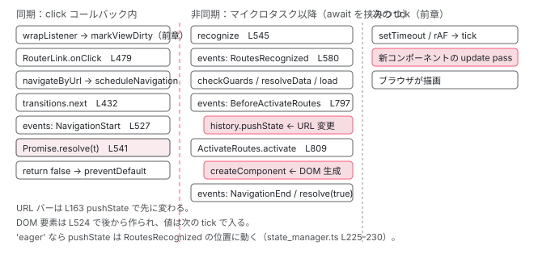

[目次](../README.md) › [起動の全手順](README.md) › 第 13 回 / 全 13 回

# SPA の「ページ遷移」で起きていること

> RouterLink のクリック → navigateByUrl → NavigationTransitions → history.pushState → RouterOutlet.activateWith。ブラウザの戻るボタンは popstate から同じ道へ入る。

angular/angular · 読了 約 14 分 · 中核 · [サイトで読む（デモが動きます）](https://angular-deep-dive-cyan.vercel.app/chapter/boot-spa-navigation)

---

シリーズ最終章です。`<a routerLink="/about">` をクリックしたとき、ページはリロードされないのに URL バーが変わり、`<router-outlet>` の中身が入れ替わります。この章では、その 1 クリックで呼ばれる関数を**順番どおりに 1 本**に並べます。特に「URL バーが変わるのは DOM が変わる前か後か」と「戻るボタンをどう検知するか」の 2 問に、行番号で答えます。Router の設計全体（Route 設定、ガード、resolver）はシリーズ[「Router の内側」](../router/README.md)（全 21 章）に委ね、ここでは順序だけを追います。

読む対象は `packages/router/src/directives/router_link.ts`、`packages/router/src/router.ts`、`packages/router/src/navigation_transition.ts`、`packages/router/src/statemanager/state_manager.ts`、`packages/common/src/location/` の 3 ファイル、`packages/router/src/directives/router_outlet.ts` です。

1. ng コマンド起動
2. builder の解決
3. dev-server と Vite
4. application builder
5. index.html の生成
6. ブラウザが main.js を実行
7. bootstrapApplication
8. 2 段の DI 木
9. APP\_INITIALIZER
10. ApplicationRef.bootstrap
11. 最初の描画
12. クリック→再描画
13. **SPA のページ遷移**（この章）

## 0. 準備：Router はいつ動き始めたか

📄 `angular/packages/router/src/provide_router.ts` L115–121 （▶ の行: 116, 118）

```ts
115 │   return makeEnvironmentProviders([
116 ▶     {provide: ROUTES, multi: true, useValue: routes},
117 │     {provide: ActivatedRoute, useFactory: rootRoute},
118 ▶     {provide: APP_BOOTSTRAP_LISTENER, multi: true, useFactory: getBootstrapListener},
119 │     features.map((feature) => feature.ɵproviders),
120 │   ]);
121 │ }
```

📄 `angular/packages/router/src/provide_router.ts` L274–299 （▶ の行: 276, 279, 283, 286–287）

```ts
274 │ export function getBootstrapListener() {
275 │   const injector = inject(Injector);
276 ▶   return (bootstrappedComponentRef: ComponentRef<unknown>) => {
277 │     const ref = injector.get(ApplicationRef);
278 │ 
279 ▶     if (bootstrappedComponentRef !== ref.components[0]) {
280 │       return;
281 │     }
282 │ 
283 ▶     const router = injector.get(Router);
284 │     const bootstrapDone = injector.get(BOOTSTRAP_DONE);
285 │ 
286 ▶     if (injector.get(INITIAL_NAVIGATION) === InitialNavigation.EnabledNonBlocking) {
287 ▶       router.initialNavigation();
288 │     }
289 │ 
290 │     injector.get(ROUTER_PRELOADER, null, {optional: true})?.setUpPreloading();
291 │     injector.get(ROUTER_SCROLLER, null, {optional: true})?.init();
292 │     router.resetRootComponentType(ref.componentTypes[0]);
293 │     if (!bootstrapDone.closed) {
294 │       bootstrapDone.next();
295 │       bootstrapDone.complete();
296 │       bootstrapDone.unsubscribe();
297 │     }
298 │   };
299 │ }
```

118 行目、`provideRouter` は `APP_BOOTSTRAP_LISTENER` を 1 つ登録します。[10 章](10-boot-application-ref.md)の `_loadComponent` 757 行目が、最初の描画の直後にこれを呼びます。279〜281 行目で「最初にブートストラップされたコンポーネントか」を確かめ、283 行目で `Router` を取り出し （`@Service()` なので**ここで初めて new される**）、286〜288 行目、既定の `EnabledNonBlocking` なら `router.initialNavigation()`。

📄 `angular/packages/router/src/router.ts` L179–190 （▶ の行: 182, 189）

```ts
179 │   constructor() {
180 │     this.resetConfig(this.config);
181 │ 
182 ▶     this.navigationTransitions.setupNavigations(this).subscribe({
183 │       error: (e) => {
184 │         // Note: This subscription is not unsubscribed when the `Router` is destroyed.
185 │         // This is intentional as the `Router` is generally never destroyed.
186 │         // If it is destroyed, the `events` subject is completed, which cleans up this subscription.
187 │       },
188 │     });
189 ▶     this.subscribeToNavigationEvents();
190 │   }
```

📄 `angular/packages/router/src/router.ts` L275–302 （▶ の行: 276, 278–279, 296–297, 299）

```ts
275 │   initialNavigation(): void {
276 ▶     this.setUpLocationChangeListener();
277 │     if (!this.navigationTransitions.hasRequestedNavigation) {
278 ▶       this.navigateToSyncWithBrowser(
279 ▶         this.location.path(true),
280 │         IMPERATIVE_NAVIGATION,
281 │         this.stateManager.restoredState(),
282 │         {replaceUrl: true},
283 │       );
284 │     }
285 │   }
286 │ 
287 │   /**
288 │    * Sets up the location change listener. This listener detects navigations triggered from outside
289 │    * the Router (the browser back/forward buttons, for example) and schedules a corresponding Router
290 │    * navigation so that the correct events, guards, etc. are triggered.
291 │    */
292 │   setUpLocationChangeListener(): void {
293 │     // Don't need to use Zone.wrap any more, because zone.js
294 │     // already patch onPopState, so location change callback will
295 │     // run into ngZone
296 ▶     this.nonRouterCurrentEntryChangeSubscription ??=
297 ▶       this.stateManager.registerNonRouterCurrentEntryChangeListener(
298 │         (url, state, source, extras, hasUAVisualTransition) => {
299 ▶           this.navigateToSyncWithBrowser(url, source, state, extras, hasUAVisualTransition);
300 │         },
301 │       );
302 │   }
```

`Router` のコンストラクタ（182 行目）で `NavigationTransitions.setupNavigations(this)` を `subscribe` します。これが 3 節で読む RxJS パイプラインで、**アプリの生存期間中ずっと購読されたまま**です。189 行目で `events` も購読します（4 節）。`initialNavigation()` は 276 行目で `setUpLocationChangeListener`（6 節の popstate 監視）を仕掛け、278〜283 行目で現在の URL（`location.path(true)`）へ最初のナビゲーションを行います。以降、クリックも戻るボタンも、全部この 1 本のパイプラインに流れ込みます。

## 1. クリック：RouterLink.onClick（同期）

📄 `angular/packages/router/src/directives/router_link.ts` L183–190 （▶ の行: 184, 186）

```ts
183 │ @Directive({
184 ▶   selector: '[routerLink]',
185 │   host: {
186 ▶     '[attr.href]': 'reactiveHref()',
187 │     '[attr.target]': '_target()',
188 │   },
189 │ })
190 │ export class RouterLink implements OnChanges, OnDestroy {
```

📄 `angular/packages/router/src/directives/router_link.ts` L472–485 （▶ の行: 472, 479）

```ts
472 ▶   @HostListener('click', [
473 │     '$event.button',
474 │     '$event.ctrlKey',
475 │     '$event.shiftKey',
476 │     '$event.altKey',
477 │     '$event.metaKey',
478 │   ])
479 ▶   onClick(
480 │     button: number,
481 │     ctrlKey: boolean,
482 │     shiftKey: boolean,
483 │     altKey: boolean,
484 │     metaKey: boolean,
485 │   ): boolean {
```

📄 `angular/packages/router/src/directives/router_link.ts` L486–522 （▶ の行: 486, 493–494, 497–498, 514, 521）

```ts
486 ▶     const urlTree = this._urlTree();
487 │ 
488 │     if (urlTree === null) {
489 │       return true;
490 │     }
491 │ 
492 │     if (this.isAnchorElement) {
493 ▶       if (button !== 0 || ctrlKey || shiftKey || altKey || metaKey) {
494 ▶         return true;
495 │       }
496 │ 
497 ▶       if (typeof this.target === 'string' && this.target != '_self') {
498 ▶         return true;
499 │       }
500 │     }
501 │ 
502 │     const browserUrl = this.browserUrl();
503 │     const extras = {
504 │       skipLocationChange: this.skipLocationChange,
505 │       replaceUrl: this.replaceUrl,
506 │       state: this.state,
507 │       info: this.info,
508 │       // TODO: Remove conditional spread once all consumers handle `browserUrl`.
509 │       // Having this property always set broke some tests in G3.
510 │       ...(browserUrl !== undefined && {browserUrl}),
511 │     };
512 │     // navigateByUrl is mocked frequently in tests... Reduce breakages when
513 │     // adding `catch`
514 ▶     this.router.navigateByUrl(urlTree, extras)?.catch((e) => {
515 │       this.applicationErrorHandler(e);
516 │     });
517 │ 
518 │     // Return `false` for `<a>` elements to prevent default action
519 │     // and cancel the native behavior, since the navigation is handled
520 │     // by the Router.
521 ▶     return !this.isAnchorElement;
522 │   }
```

184 行目、セレクタは `[routerLink]` 属性。186 行目、`href` はホストバインディングで常に計算されて付きます。472〜478 行目、`@HostListener('click', [...])` です。コンパイルされると [前章](12-boot-click-to-paint.md)と同じ `ɵɵlistener` になり、ホスト要素 `<a>` に `addEventListener` されます。したがって**クリックの瞬間、前章の `wrapListener` → `markViewDirty` → `notify(Listener)` が先に走り、tick が 1 つ予約されてから**`onClick` に入ります。

1. **493〜499 行目：ブラウザに任せる条件**

   左クリック以外、修飾キー付き（Ctrl+クリックで新しいタブ等）、`target="_blank"` などは `true` を返して 何もしません。`true` なので前章 dom\_renderer.ts 532 行目の `preventDefault` も呼ばれず、ブラウザが普通に遷移します。
2. **514 行目：router.navigateByUrl(urlTree, extras)**

   `urlTree` は `routerLink` の値から事前に計算済みの `UrlTree`（486 行目）。返ってくる Promise の reject だけ `ErrorHandler` に流します。**Promise を await していません**。
3. **521 行目：&lt;a&gt; なら false を返す**

   `!this.isAnchorElement` → `<a>` では `false`。前章の経路で `event.preventDefault()` が呼ばれ、`href` への本物の遷移が止まります。**これが「ページがリロードされない」理由の全部です**。`href` 自体は 186 行目のホストバインディングで 付いたままなので、右クリック「新しいタブで開く」は普通に動きます。

## 2. navigateByUrl → scheduleNavigation → handleNavigationRequest（まだ同期）

📄 `angular/packages/router/src/router.ts` L546–556 （▶ の行: 552–553, 555）

```ts
546 │   navigateByUrl(
547 │     url: string | UrlTree,
548 │     extras: NavigationBehaviorOptions = {
549 │       skipLocationChange: false,
550 │     },
551 │   ): Promise<boolean> {
552 ▶     const urlTree = isUrlTree(url) ? url : this.parseUrl(url);
553 ▶     const mergedTree = this.urlHandlingStrategy.merge(urlTree, this.rawUrlTree);
554 │ 
555 ▶     return this.scheduleNavigation(mergedTree, IMPERATIVE_NAVIGATION, null, extras);
556 │   }
```

📄 `angular/packages/router/src/router.ts` L695–716 （▶ の行: 696–697, 700, 703–704, 708, 711–713）

```ts
695 │     // Indicate that the navigation is happening.
696 ▶     const taskId = this.pendingTasks.add();
697 ▶     afterNextNavigation(this, () => {
698 │       // Remove pending task in a microtask to allow for cancelled
699 │       // initial navigations and redirects within the same task.
700 ▶       queueMicrotask(() => this.pendingTasks.remove(taskId));
701 │     });
702 │ 
703 ▶     this.navigationTransitions.handleNavigationRequest({
704 ▶       source,
705 │       restoredState,
706 │       currentUrlTree: this.currentUrlTree,
707 │       currentRawUrl: this.currentUrlTree,
708 ▶       rawUrl,
709 │       extras,
710 │       hasUAVisualTransition,
711 ▶       resolve: resolve!,
712 ▶       reject: reject!,
713 ▶       promise,
714 │       currentSnapshot: this.routerState.snapshot,
715 │       currentRouterState: this.routerState,
716 │     });
```

552〜555 行目、`UrlTree` にそろえて `scheduleNavigation`。696 行目で `PendingTasks` に 1 件積み（ナビゲーション中は `isStable` が `false`。697〜701 行目で次のナビゲーション完了後に外す）、703〜716 行目で `NavigationTransitions.handleNavigationRequest`。711〜713 行目、Promise の `resolve`/`reject` を一緒に渡しています。`navigateByUrl` が返す Promise は、パイプラインの終点で `t.resolve(true)` されるまで保留です。

📄 `angular/packages/router/src/navigation_transition.ts` L425–445 （▶ の行: 426, 431–432, 434, 439）

```ts
425 │   ) {
426 ▶     const id = ++this.navigationId;
427 │ 
428 │     // Navigation can happen as a side effect of template execution, as such we need to untrack signal updates
429 │     // (Writing to signals is not allowed while Angular renders the template)
430 │     // TODO: We might want to reconsider allowing navigation as side effect of template execution.
431 ▶     untracked(() => {
432 ▶       this.transitions?.next({
433 │         ...request,
434 ▶         extractedUrl: this.urlHandlingStrategy.extract(request.rawUrl),
435 │         targetSnapshot: null,
436 │         targetRouterState: null,
437 │         guards: {canActivateChecks: [], canDeactivateChecks: []},
438 │         guardsResult: null,
439 ▶         id,
440 │ 
441 │         routesRecognizeHandler: {},
442 │         beforeActivateHandler: {},
443 │       });
444 │     });
445 │   }
```

426 行目で ID を 1 つ進め、431〜444 行目、`untracked` の中で `this.transitions.next(...)`。`transitions` は `BehaviorSubject` です。**`next` は同期なので、ここから 3 節のパイプラインの先頭が その場で動き始めます**。

## 3. setupNavigations：1 本のパイプライン

📄 `angular/packages/router/src/navigation_transition.ts` L447–460 （▶ の行: 448–450, 453, 456）

```ts
447 │   setupNavigations(router: Router): Observable<NavigationTransition> {
448 ▶     this.transitions = new BehaviorSubject<NavigationTransition | null>(null);
449 ▶     return this.transitions.pipe(
450 ▶       filter((t): t is NavigationTransition => t !== null),
451 │ 
452 │       // Using switchMap so we cancel executing navigations when a new one comes in
453 ▶       switchMap((overallTransitionState) => {
454 │         let abortable = true;
455 │         let completedOrAborted = false;
456 ▶         const abortController = new AbortController();
457 │         const shouldContinueNavigation = () => {
458 │           return !completedOrAborted && this.currentTransition?.id === overallTransitionState.id;
459 │         };
460 │         return of(overallTransitionState).pipe(
```

448〜449 行目、`Router` コンストラクタから 1 回だけ呼ばれ、`BehaviorSubject` を `pipe` します。453 行目の `switchMap` が肝で、**新しいナビゲーションが来ると、実行中のものは途中で捨てられます** （456 行目の `AbortController` も併用）。中の演算子を上から順に見ます。

📄 `angular/packages/router/src/navigation_transition.ts` L523–553 （▶ の行: 527–528, 539–541, 545）

```ts
523 │             if (this.urlHandlingStrategy.shouldProcessUrl(t.rawUrl)) {
524 │               return of(t).pipe(
525 │                 // Fire NavigationStart event
526 │                 switchMap((t) => {
527 ▶                   this.events.next(
528 ▶                     new NavigationStart(
529 │                       t.id,
530 │                       this.urlSerializer.serialize(t.extractedUrl),
531 │                       t.source,
532 │                       t.restoredState,
533 │                     ),
534 │                   );
535 │                   if (t.id !== this.navigationId) {
536 │                     return EMPTY;
537 │                   }
538 │ 
539 ▶                   // This delay is required to match old behavior that forced
540 ▶                   // navigation to always be async
541 ▶                   return Promise.resolve(t);
542 │                 }),
543 │ 
544 │                 // Recognize
545 ▶                 recognize(
546 │                   this.environmentInjector,
547 │                   this.configLoader,
548 │                   this.rootComponentType,
549 │                   router.config,
550 │                   this.urlSerializer,
551 │                   this.paramsInheritanceStrategy,
552 │                   abortController.signal,
553 │                 ),
```

1. **527〜534 行目：NavigationStart イベント**

   `this.events.next(new NavigationStart(...))`。`router.events` を購読していれば、クリックと同じ同期区間でこれが届きます。
2. **539〜541 行目：ここで非同期になる**

   `return Promise.resolve(t)`。コメントどおり「ナビゲーションを常に非同期にする」ための 1 マイクロタスクです。**同期区間はここまで**。`onClick` が `false` を返し、`preventDefault` が呼ばれ、ブラウザにいったん制御が戻ります。この時点で URL も DOM も変わっていません。
3. **545〜553 行目：recognize**

   URL を Route 設定と照合して `targetSnapshot`（`ActivatedRouteSnapshot` の木）を作ります。遅延ロードの `loadChildren` があればここで `import()` を待ちます。

📄 `angular/packages/router/src/navigation_transition.ts` L572–581 （▶ の行: 574, 580）

```ts
572 │                 tap(() => {
573 │                   // Fire RoutesRecognized
574 ▶                   const routesRecognized = new RoutesRecognized(
575 │                     t.id,
576 │                     this.urlSerializer.serialize(t.extractedUrl),
577 │                     this.urlSerializer.serialize(t.urlAfterRedirects!),
578 │                     t.targetSnapshot!,
579 │                   );
580 ▶                   this.events.next(routesRecognized);
581 │                 }),
```

📄 `angular/packages/router/src/navigation_transition.ts` L650–663 （▶ の行: 650, 652, 657, 661–662）

```ts
650 ▶             this.currentTransition = overallTransitionState = {
651 │               ...t,
652 ▶               guards: getAllRouteGuards(t.targetSnapshot!, t.currentSnapshot, this.rootContexts),
653 │             };
654 │             return overallTransitionState;
655 │           }),
656 │ 
657 ▶           checkGuards((evt: Event) => this.events.next(evt)),
658 │ 
659 │           switchMap((t) => {
660 │             overallTransitionState.guardsResult = t.guardsResult;
661 ▶             if (t.guardsResult && typeof t.guardsResult !== 'boolean') {
662 ▶               throw redirectingNavigationError(this.urlSerializer, t.guardsResult);
663 │             }
```

574〜580 行目で `RoutesRecognized` イベント（`urlUpdateStrategy: 'eager'` なら 4 節のとおりここで URL が変わります）。650〜653 行目でガードの一覧を計算し、657 行目の `checkGuards` で `canDeactivate` → `canActivate` を実行。661〜663 行目、ガードが `UrlTree` を返したらリダイレクトとして投げます。この後 `resolveData`（resolver）、`loadComponents`（`loadComponent` の遅延ロード）、`createRouterState`（`ActivatedRoute` の木を作る）が続きます。

📄 `angular/packages/router/src/navigation_transition.ts` L795–835 （▶ の行: 796–797, 802–803, 809, 826–827, 834）

```ts
795 │           switchMap((t: NavigationTransition) => {
796 ▶             abortable = false;
797 ▶             this.events.next(new BeforeActivateRoutes());
798 │             const deferred = overallTransitionState.beforeActivateHandler.deferredHandle;
799 │             return deferred ? from(deferred.then(() => t)) : of(t);
800 │           }),
801 │ 
802 ▶           tap((t: NavigationTransition) => {
803 ▶             new ActivateRoutes(
804 │               router.routeReuseStrategy,
805 │               overallTransitionState.targetRouterState!,
806 │               overallTransitionState.currentRouterState,
807 │               (evt: Event) => this.events.next(evt),
808 │               this.inputBindingEnabled,
809 ▶             ).activate(this.rootContexts);
810 │ 
811 │             // Prevent any cleanup of newly created routes once activated.
812 │             t.newlyCreatedRoutes?.clear();
813 │ 
814 │             if (!shouldContinueNavigation()) {
815 │               return;
816 │             }
817 │ 
818 │             resetPendingRoutes(t.targetRouterState);
819 │ 
820 │             completedOrAborted = true;
821 │             this.currentNavigation.update((nav) => {
822 │               (nav as Writable<Navigation>).abort = noop;
823 │               return nav;
824 │             });
825 │             this.lastSuccessfulNavigation.set(untracked(this.currentNavigation));
826 ▶             this.events.next(
827 ▶               new NavigationEnd(
828 │                 t.id,
829 │                 this.urlSerializer.serialize(t.extractedUrl),
830 │                 this.urlSerializer.serialize(t.urlAfterRedirects!),
831 │               ),
832 │             );
833 │             this.titleStrategy?.updateTitle(t.targetRouterState!.snapshot);
834 ▶             t.resolve(true);
835 │           }),
```

ここが本章の 1 問目の答えです。

1. **796〜797 行目：BeforeActivateRoutes イベント**

   `abortable = false`（以降は中断不可）にして、`BeforeActivateRoutes` を `events` に流します。4 節で見るとおり、**このイベントを受けて `history.pushState` が呼ばれます**。
2. **802〜809 行目：ActivateRoutes.activate**

   `new ActivateRoutes(...).activate(this.rootContexts)`。5 節で読む、`RouterOutlet` にコンポーネントを刺す処理です。**797 行目の後**なので、`pushState` → DOM 変更、の順です。
3. **826〜834 行目：NavigationEnd と resolve(true)**

   `NavigationEnd` を流し、`titleStrategy.updateTitle` で `document.title` を更新し、834 行目で 2 節の Promise を `true` で resolve します。`navigateByUrl` の `await` はここで戻ります。

## 4. URL が変わる場所：BeforeActivateRoutes → setBrowserUrl → history.pushState

📄 `angular/packages/router/src/router.ts` L193–200 （▶ の行: 194, 199–200）

```ts
193 │   private subscribeToNavigationEvents() {
194 ▶     const subscription = this.navigationTransitions.events.subscribe((e) => {
195 │       try {
196 │         const currentTransition = this.navigationTransitions.currentTransition;
197 │         const currentNavigation = untracked(this.navigationTransitions.currentNavigation);
198 │ 
199 ▶         if (currentTransition !== null && currentNavigation !== null) {
200 ▶           this.stateManager.handleRouterEvent(e, currentNavigation);
```

📄 `angular/packages/router/src/statemanager/state_manager.ts` L220–244 （▶ の行: 220, 225–226, 228, 231–234, 237, 240）

```ts
220 ▶   override handleRouterEvent(e: Event | PrivateRouterEvents, currentTransition: Navigation): void {
221 │     if (e instanceof NavigationStart) {
222 │       this.updateStateMemento();
223 │     } else if (e instanceof NavigationSkipped) {
224 │       this.commitTransition(currentTransition);
225 ▶     } else if (e instanceof RoutesRecognized) {
226 ▶       if (this.urlUpdateStrategy === 'eager') {
227 │         if (!currentTransition.extras.skipLocationChange) {
228 ▶           this.setBrowserUrl(this.createBrowserPath(currentTransition), currentTransition);
229 │         }
230 │       }
231 ▶     } else if (e instanceof BeforeActivateRoutes) {
232 ▶       this.commitTransition(currentTransition);
233 ▶       if (this.urlUpdateStrategy === 'deferred' && !currentTransition.extras.skipLocationChange) {
234 ▶         this.setBrowserUrl(this.createBrowserPath(currentTransition), currentTransition);
235 │       }
236 │     } else if (e instanceof NavigationCancel && !isRedirectingEvent(e)) {
237 ▶       this.restoreHistory(currentTransition);
238 │     } else if (e instanceof NavigationError) {
239 │       this.restoreHistory(currentTransition, true);
240 ▶     } else if (e instanceof NavigationEnd) {
241 │       this.lastSuccessfulId = e.id;
242 │       this.currentPageId = this.browserPageId;
243 │     }
244 │   }
```

0 節 189 行目の `subscribeToNavigationEvents` が 194 行目で `events` を購読し、200 行目で全イベントを `HistoryStateManager.handleRouterEvent` に渡します。3 節で `events.next(...)` が呼ばれるたびに、**同期的に**この関数が走ります。231〜235 行目、`BeforeActivateRoutes` で `commitTransition`（Router 内部の `currentUrlTree` 等を更新）し、既定の `'deferred'` なら 234 行目で `setBrowserUrl`。`'eager'` なら 225〜230 行目、`RoutesRecognized` の時点（ガードより前）です。

📄 `angular/packages/router/src/statemanager/state_manager.ts` L246–265 （▶ の行: 250, 257, 263）

```ts
246 │   private setBrowserUrl(path: string, navigation: Navigation) {
247 │     const {extras, id} = navigation;
248 │     const {replaceUrl, state} = extras;
249 │ 
250 ▶     if (this.location.isCurrentPathEqualTo(path) || !!replaceUrl) {
251 │       // replacements do not update the target page
252 │       const currentBrowserPageId = this.browserPageId;
253 │       const newState = {
254 │         ...state,
255 │         ...this.generateNgRouterState(id, currentBrowserPageId, navigation),
256 │       };
257 ▶       this.location.replaceState(path, '', newState);
258 │     } else {
259 │       const newState = {
260 │         ...state,
261 │         ...this.generateNgRouterState(id, this.browserPageId + 1, navigation),
262 │       };
263 ▶       this.location.go(path, '', newState);
264 │     }
265 │   }
```

📄 `angular/packages/common/src/location/location.ts` L171–177 （▶ の行: 172–173）

```ts
171 │   go(path: string, query: string = '', state: any = null): void {
172 ▶     this._locationStrategy.pushState(state, '', path, query);
173 ▶     this._notifyUrlChangeListeners(
174 │       this.prepareExternalUrl(path + normalizeQueryParams(query)),
175 │       state,
176 │     );
177 │   }
```

📄 `angular/packages/common/src/location/location_strategy.ts` L163–166 （▶ の行: 164–165）

```ts
163 │   override pushState(state: any, title: string, url: string, queryParams: string) {
164 ▶     const externalUrl = this.prepareExternalUrl(url + normalizeQueryParams(queryParams));
165 ▶     this._platformLocation.pushState(state, title, externalUrl);
166 │   }
```

📄 `angular/packages/common/src/location/platform_location.ts` L162–168 （▶ の行: 163, 167）

```ts
162 │   override pushState(state: any, title: string, url: string): void {
163 ▶     this._history.pushState(state, title, url);
164 │   }
165 │ 
166 │   override replaceState(state: any, title: string, url: string): void {
167 ▶     this._history.replaceState(state, title, url);
168 │   }
```

250 行目、同じ URL か `replaceUrl: true` なら 257 行目で `replaceState`、それ以外は 263 行目で `location.go`。`Location.go`（172 行目）→ `PathLocationStrategy.pushState`（165 行目、`<base href>` を前置）→ `BrowserPlatformLocation.pushState`（**163 行目、`window.history.pushState(state, title, url)`**）。ここで URL バーが変わり、履歴が 1 つ増えます。`state` には `navigationId` と `ɵrouterPageId` が入っていて （255 行目の `generateNgRouterState`）、6 節の戻るボタンで使われます。173 行目、`Location.onUrlChange` の購読者にも通知します。

## 5. DOM が変わる場所：ActivateRoutes → RouterOutlet.activateWith → createComponent

📄 `angular/packages/router/src/operators/activate_routes.ts` L25–32 （▶ の行: 29–31）

```ts
25 │   activate(parentContexts: ChildrenOutletContexts): void {
26 │     const futureRoot = this.futureState._root;
27 │     const currRoot = this.currState ? this.currState._root : null;
28 │ 
29 ▶     this.deactivateChildRoutes(futureRoot, currRoot, parentContexts);
30 ▶     advanceActivatedRoute(this.futureState.root);
31 ▶     this.activateChildRoutes(futureRoot, currRoot, parentContexts);
32 │   }
```

📄 `angular/packages/router/src/operators/activate_routes.ts` L189–220 （▶ の行: 190, 192, 194, 211–213, 216, 219）

```ts
189 │     } else {
190 ▶       if (future.component) {
191 │         // if we have a normal route, we need to place the component into the outlet and recurse.
192 ▶         const context = parentContexts.getOrCreateContext(future.outlet);
193 │ 
194 ▶         if (this.routeReuseStrategy.shouldAttach(future.snapshot)) {
195 │           const stored = <DetachedRouteHandleInternal>(
196 │             this.routeReuseStrategy.retrieve(future.snapshot)
197 │           );
198 │           this.routeReuseStrategy.store(future.snapshot, null);
199 │           context.children.onOutletReAttached(stored.contexts);
200 │           context.attachRef = stored.componentRef;
201 │           context.route = stored.route.value;
202 │           if (context.outlet) {
203 │             // Attach right away when the outlet has already been instantiated
204 │             // Otherwise attach from `RouterOutlet.ngOnInit` when it is instantiated
205 │             context.outlet.attach(stored.componentRef, stored.route.value);
206 │           }
207 │ 
208 │           advanceActivatedRoute(stored.route.value);
209 │           this.activateChildRoutes(futureNode, null, context.children);
210 │         } else {
211 ▶           context.attachRef = null;
212 ▶           context.route = future;
213 ▶           if (context.outlet) {
214 │             // Activate the outlet when it has already been instantiated
215 │             // Otherwise it will get activated from its `ngOnInit` when instantiated
216 ▶             context.outlet.activateWith(future, context.injector);
217 │           }
218 │ 
219 ▶           this.activateChildRoutes(futureNode, null, context.children);
220 │         }
```

29 行目でまず不要になった枝を `deactivate`（古いコンポーネントの `destroy`）、31 行目で新しい枝を activate。190〜192 行目、コンポーネント付きの Route なら outlet 名で `OutletContext` を取り、194 行目の `RouteReuseStrategy.shouldAttach` が `false`（既定）なら 211〜217 行目へ。213〜217 行目、**`<router-outlet>` が既に DOM にあれば `context.outlet.activateWith(future, injector)`**。無ければ（親コンポーネントの中の outlet がまだ作られていない）、その outlet の `ngOnInit` が自分で `activateWith` を呼びます。

📄 `angular/packages/router/src/directives/router_outlet.ts` L384–414 （▶ の行: 384, 395, 397, 404–407, 411, 413）

```ts
384 ▶   activateWith(activatedRoute: ActivatedRoute, environmentInjector: EnvironmentInjector): void {
385 │     if (this.isActivated) {
386 │       throw new RuntimeError(
387 │         RuntimeErrorCode.OUTLET_ALREADY_ACTIVATED,
388 │         (typeof ngDevMode === 'undefined' || ngDevMode) &&
389 │           'Cannot activate an already activated outlet',
390 │       );
391 │     }
392 │     this._activatedRoute = activatedRoute;
393 │     const location = this.location;
394 │     const snapshot = activatedRoute.snapshot;
395 ▶     const component = snapshot.component!;
396 │     const childContexts = this.parentContexts.getOrCreateContext(this.name).children;
397 ▶     const injector = new OutletInjector(
398 │       activatedRoute,
399 │       childContexts,
400 │       location.injector,
401 │       this.routerOutletData,
402 │     );
403 │ 
404 ▶     this.activated = location.createComponent(component, {
405 ▶       index: location.length,
406 ▶       injector,
407 ▶       environmentInjector: environmentInjector,
408 │     });
409 │     // Calling `markForCheck` to make sure we will run the change detection when the
410 │     // `RouterOutlet` is inside a `ChangeDetectionStrategy.OnPush` component.
411 ▶     this.changeDetector.markForCheck();
412 │     this.inputBinder?.bindActivatedRouteToOutletComponent(this, this.location.injector);
413 ▶     this.activateEvents.emit(this.activated.instance);
414 │   }
```

📄 `angular/packages/core/src/linker/view_container_ref.ts` L521–541 （▶ の行: 524, 536）

```ts
521 │     const componentDef = getComponentDef(componentFactory.componentType ?? {});
522 │     const dehydratedView = findMatchingDehydratedView(this._lContainer, componentDef?.id ?? null);
523 │     const rNode = dehydratedView?.firstChild ?? null;
524 ▶     const componentRef = componentFactory.create(
525 │       contextInjector,
526 │       projectableNodes,
527 │       rNode,
528 │       environmentInjector,
529 │       directives,
530 │       bindings,
531 │       this._getHostElementNamespace(),
532 │     );
533 │     if (onError) {
534 │       (componentRef.hostView as R3ViewRef<any>)._lView![ON_ERROR] = onError;
535 │     }
536 ▶     this.insertImpl(
537 │       componentRef.hostView,
538 │       index,
539 │       shouldAddViewToDom(this._hostTNode, dehydratedView),
540 │     );
541 │     return componentRef as ComponentRef<C>;
```

1. **395 行目：コンポーネントのクラス**

   `snapshot.component`、Route 設定の `component:`（または `loadComponent` の結果）です。
2. **397〜402 行目：OutletInjector**

   `ActivatedRoute` や `ChildrenOutletContexts` を提供する小さなインジェクタを、outlet の `ViewContainerRef` のインジェクタを親にして作ります。遷移先コンポーネントで `inject(ActivatedRoute)` が 自分の Route を返すのはこのためです。
3. **404〜408 行目：ViewContainerRef.createComponent**

   `this.location` は `RouterOutlet` が `inject(ViewContainerRef)` したもの、つまり `<router-outlet>` のコメントノードの位置にある `LContainer` です。524 行目で **`componentFactory.create(...)`、[10 章](10-boot-application-ref.md)で `<app-root>` に対して読んだのと同じ関数**です。違いは `rootSelectorOrNode` が無いので `createHostElement` で新しい要素（セレクタ名のタグ）が作られること。creation pass（`renderView`）もこの中で走ります。536 行目の `insertImpl` が、そのホスト要素を `<router-outlet>` の**隣**（兄弟）に挿入します。遷移先コンポーネントは outlet の子ではなく兄弟です（[ViewContainer の章](../template/04-view-container.md)）。
4. **411 行目：markForCheck**

   `RouterOutlet` の `ChangeDetectorRef.markForCheck()` → `markViewDirty(..., MarkForCheck)` → `notify`。前章と同じく tick が予約されます（クリック時の予約がまだ生きていれば 1 つにまとまる）。その tick の `refreshView` で、新しいコンポーネントの update pass（値の流し込み、`ngOnInit`）が走ります。**creation pass は同期（この関数の中）、update pass は次の tick**です。
5. **413 行目：activate イベント**

   `<router-outlet (activate)="...">` に新しいインスタンスを渡します。



*routerLink クリックから画面が変わるまで。URL（history.pushState）は BeforeActivateRoutes の時点で変わり、その後 ActivateRoutes が DOM を作る。*

## 6. 戻るボタン：popstate から同じパイプラインへ

📄 `angular/packages/common/src/location/platform_location.ts` L125–129 （▶ の行: 126–127）

```ts
125 │   override onPopState(fn: LocationChangeListener): VoidFunction {
126 ▶     const window = getDOM().getGlobalEventTarget(this._doc, 'window');
127 ▶     window.addEventListener('popstate', fn, false);
128 │     return () => window.removeEventListener('popstate', fn);
129 │   }
```

📄 `angular/packages/common/src/location/location_strategy.ts` L141–146 （▶ の行: 143–144）

```ts
141 │   override onPopState(fn: LocationChangeListener): void {
142 │     this._removeListenerFns.push(
143 ▶       this._platformLocation.onPopState(fn),
144 ▶       this._platformLocation.onHashChange(fn),
145 │     );
146 │   }
```

📄 `angular/packages/common/src/location/location.ts` L79–90 （▶ の行: 79–81, 83, 89）

```ts
79 ▶     this._locationStrategy.onPopState((ev) => {
80 ▶       const popStateEvent: PopStateEvent = {
81 ▶         'url': this.path(true),
82 │         'pop': true,
83 ▶         'state': ev.state,
84 │         'type': ev.type,
85 │       };
86 │       if (ev.hasUAVisualTransition) {
87 │         popStateEvent.hasUAVisualTransition = true;
88 │       }
89 ▶       this._subject.next(popStateEvent);
90 │     });
```

下から上へ読みます。127 行目、`BrowserPlatformLocation.onPopState` が `window.addEventListener('popstate', fn)`。126 行目の `getDOM()` は [8 章](08-boot-injectors.md)で入れた `BrowserDomAdapter` です。143〜144 行目、`PathLocationStrategy` は `popstate` と `hashchange` の両方を同じ関数で受けます。79〜90 行目、`Location` のコンストラクタ（`providedIn: 'root'` なので最初に inject されたとき）が これを呼び、89 行目で自分の `_subject` に `{url, pop: true, state, type}` を流します。**`window.addEventListener('popstate')` を呼ぶのは `Location` が作られる瞬間**です。

📄 `angular/packages/router/src/statemanager/state_manager.ts` L192–218 （▶ の行: 201–202, 205–206, 209, 211）

```ts
192 │   override registerNonRouterCurrentEntryChangeListener(
193 │     listener: (
194 │       url: string,
195 │       state: RestoredState | null | undefined,
196 │       trigger: NavigationTrigger,
197 │       extras: NavigationExtras,
198 │       hasUAVisualTransition?: boolean,
199 │     ) => void,
200 │   ): SubscriptionLike {
201 ▶     return this.location.subscribe((event) => {
202 ▶       if (event['type'] === 'popstate') {
203 │         // The `setTimeout` was added in #12160 and is likely to support Angular/AngularJS
204 │         // hybrid apps.
205 ▶         setTimeout(() => {
206 ▶           listener(
207 │             event['url']!,
208 │             event.state as RestoredState | null | undefined,
209 ▶             'popstate',
210 │             {
211 ▶               replaceUrl: true,
212 │             },
213 │             event.hasUAVisualTransition,
214 │           );
215 │         });
216 │       }
217 │     });
218 │   }
```

📄 `angular/packages/router/src/router.ts` L311–317 （▶ の行: 311, 313）

```ts
311 ▶   private navigateToSyncWithBrowser(
312 │     url: string,
313 ▶     source: NavigationTrigger,
314 │     state: RestoredState | null | undefined,
315 │     extras: NavigationExtras,
316 │     hasUAVisualTransition?: boolean,
317 │   ) {
```

📄 `angular/packages/router/src/router.ts` L348–357 （▶ の行: 348–349）

```ts
348 ▶     const urlTree = this.parseUrl(routerUrl);
349 ▶     this.scheduleNavigation(urlTree, source, restoredState, extras, hasUAVisualTransition).catch(
350 │       (e) => {
351 │         if (this.disposed) {
352 │           return;
353 │         }
354 │         this.injector.get(ɵINTERNAL_APPLICATION_ERROR_HANDLER)(e);
355 │       },
356 │     );
357 │   }
```

0 節の `setUpLocationChangeListener`（router.ts 296〜301 行目）から呼ばれる `registerNonRouterCurrentEntryChangeListener` が、201 行目で `location.subscribe`。202 行目、`popstate` のときだけ、205 行目の `setTimeout` を 1 つ挟んで、206〜214 行目でリスナー（= `Router.navigateToSyncWithBrowser`）を `source = 'popstate'`、`replaceUrl: true` で呼びます。

`navigateToSyncWithBrowser`（311 行目）は `history.state` から `navigationId` 等を取り出し、348〜349 行目で `parseUrl` → **2 節と同じ `scheduleNavigation`**。以降は 3 節のパイプラインを一字一句同じ順に通ります。違いは 2 点だけです。`NavigationStart.navigationTrigger` が `'popstate'` であること、`replaceUrl: true` なので 4 節 250 行目の分岐で `replaceState` になり、**ブラウザが既に変えた URL を上書きするだけで、履歴は増えない**ことです。

> [!WARNING]
> **ハマりどころ**
>
> 戻るボタンでは、**URL が変わるのが先、Angular が気づくのが後**です。ブラウザが `popstate` を発火した時点で URL バーは既に前のページを指しています。Angular はそれを 205 行目の `setTimeout` 後に受け取り、ガードが `false` を返したら `HistoryStateManager.restoreHistory`（`NavigationCancel` 時、237 行目）で `history.go` を使って URL を元に戻します。クリック時とは順序が逆です。

> **🧪 DEMO — きっかけと urlUpdateStrategy で、pushState と DOM 生成の順はどう変わるか**
>
> setupNavigations（navigation\_transition.ts L447-850）の演算子を上から読み、handleRouterEvent（state\_manager.ts L220-244）が URL を変える位置を重ねた結果です。
>
> ▶ [このデモはサイトで動かせます](https://angular-deep-dive-cyan.vercel.app/chapter/boot-spa-navigation)

## ここまでの呼び出し

- `<a routerLink>` の `click` — *（ブラウザ）* — *── 同期区間 ──*
  - `wrapListener` → `markViewDirty` → `notify(Listener)` — 前章 — *tick を予約*
  - 👤 `RouterLink.onClick(button, ctrlKey, ...)` — router/src/directives/router\_link.ts L479
    - `router.navigateByUrl(urlTree, extras)` — router/src/router.ts L546
      - `scheduleNavigation(mergedTree, 'imperative', null, extras)` — router.ts L665 — *pendingTasks.add()、Promise を作る*
        - `navigationTransitions.handleNavigationRequest({...})` — router/src/navigation\_transition.ts L409
          - `transitions.next({...id})` — navigation\_transition.ts L432 — *BehaviorSubject。同期でパイプラインが動く*
            - `events.next(new NavigationStart(...))` — navigation\_transition.ts L527
              - `HistoryStateManager.handleRouterEvent(NavigationStart)` — router.ts L200 → state\_manager.ts L221 — *updateStateMemento*
            - `return Promise.resolve(t)` — navigation\_transition.ts L541 — *── ここから非同期 ──*
  - `return false` → `event.preventDefault()` — router\_link.ts L521 → dom\_renderer.ts L532 — *ブラウザの遷移を止める*
    - `recognize(...)` → `events.next(new RoutesRecognized(...))` — navigation\_transition.ts L545, L580 — *'eager' ならここで setBrowserUrl*
      - `checkGuards(...)` → `resolveData(...)` → `loadComponents` → `createRouterState` — navigation\_transition.ts L657, L698, L746, L751
        - `events.next(new BeforeActivateRoutes())` — navigation\_transition.ts L797
          - `handleRouterEvent(BeforeActivateRoutes)` → `commitTransition` → `setBrowserUrl` — state\_manager.ts L231-234 → L246
            - `location.go(path, '', state)` — state\_manager.ts L263 → common/src/location/location.ts L171
              - `PathLocationStrategy.pushState` → `BrowserPlatformLocation.pushState` — location\_strategy.ts L163 → platform\_location.ts L162
                - `window.history.pushState(state, title, url)` — platform\_location.ts L163 — *URL バーが変わる*
            - `new ActivateRoutes(...).activate(rootContexts)` — navigation\_transition.ts L803-809 → operators/activate\_routes.ts L25
              - `deactivateChildRoutes`（古いコンポーネントを destroy） — activate\_routes.ts L29
              - `activateChildRoutes` → `activateRoutes` → `context.outlet.activateWith(future, injector)` — activate\_routes.ts L31 → L169 → L216
                - `RouterOutlet.activateWith` → `location.createComponent(component, {index, injector, environmentInjector})` — router/src/directives/router\_outlet.ts L384 → L404
                  - `componentFactory.create(...)` → `renderView`（creation pass） — core/src/linker/view\_container\_ref.ts L524 → component\_ref.ts L266 — *10 章と同じ関数*
                  - `insertImpl(hostView, index, true)` — view\_container\_ref.ts L536 — *&lt;router-outlet&gt; の隣に挿入。DOM が変わる*
                - `changeDetector.markForCheck()` — router\_outlet.ts L411 — *tick 予約（既にあれば 1 つに）*
            - `events.next(new NavigationEnd(...))` → `titleStrategy.updateTitle` → `t.resolve(true)` — navigation\_transition.ts L826-834 — *navigateByUrl の Promise が resolve*
- `setTimeout` / rAF → `tick` → `refreshView` — *（ブラウザ）* — 前章 — *新コンポーネントの update pass → 描画*

## 聞かれそうな質問

**Q. routerLink を押したとき、URL バーが変わるのは DOM が変わる前ですか、後ですか？**

前です。navigation\_transition.ts 797 行目で `BeforeActivateRoutes` イベントが流れ、同期的に state\_manager.ts 231〜234 行目 → 246 行目 `setBrowserUrl` → 263 行目 `location.go` → platform\_location.ts 163 行目 `history.pushState` で URL が変わります。DOM を作る `ActivateRoutes.activate` は、その後の 802〜809 行目です。`urlUpdateStrategy: 'eager'` なら state\_manager.ts 225〜230 行目、`RoutesRecognized`（ガードより前）の時点でさらに早く変わります。

**Q. 戻るボタンを押したとき、Angular はどう気づきますか？**

platform\_location.ts 127 行目の `window.addEventListener('popstate', fn)` です。これは location.ts 79 行目、`Location` のコンストラクタが `PathLocationStrategy.onPopState`（location\_strategy.ts 141〜146 行目）経由で登録します。発火すると location.ts 89 行目で `_subject` に流れ、state\_manager.ts 201〜215 行目の購読が `setTimeout` 後に `Router.navigateToSyncWithBrowser`（router.ts 311 行目）を呼び、349 行目で `scheduleNavigation`。以降はクリックと同じパイプラインです。

**Q. navigateByUrl は同期ですか？**

呼び出しは同期で、途中まで同期で進みます。router.ts 555 行目 → 703 行目 → navigation\_transition.ts 432 行目の `transitions.next` まで同期で、パイプラインの 527 行目 `NavigationStart` もその場で流れます。541 行目の `return Promise.resolve(t)` で必ず非同期になるので、`recognize` 以降はクリックのコールバックが戻った後です。`navigateByUrl` の返す Promise は 834 行目の `t.resolve(true)` まで保留です。

**Q. 遷移先のコンポーネントはどこで作られ、DOM のどこに入りますか？**

router\_outlet.ts 404〜408 行目の `ViewContainerRef.createComponent` → view\_container\_ref.ts 524 行目の `componentFactory.create`（10 章の `<app-root>` と同じ関数）で作られ、536 行目の `insertImpl` で `<router-outlet>` の**兄弟**として直後に挿入されます。outlet の子要素ではありません。constructor と creation pass はこの中で同期に走り、`ngOnInit` と update pass は 411 行目の `markForCheck` が予約した次の tick です。

**Q. ナビゲーション中に別のリンクを押したら？**

navigation\_transition.ts 453 行目の `switchMap` により、実行中のナビゲーションは捨てられ、新しい `transitions.next` のものだけが進みます。ただし 796 行目で `abortable = false` になった後 （`BeforeActivateRoutes` 以降）は中断されず完了まで走ります。捨てられた側の Promise は `NavigationCancel` で `false` に resolve されます。

**Q. &lt;a routerLink&gt; なのに Ctrl+クリックで新しいタブが開くのはなぜですか？**

router\_link.ts 493〜495 行目で `ctrlKey` などが立っていると `true` を返し、`navigateByUrl` を呼ばず、`preventDefault` もされないからです。`href` は 186 行目のホストバインディング `[attr.href]` で常に付いているので、ブラウザが普通に処理します。

## 読み終えて

- クリック時に同期で進むのは `onClick` → `navigateByUrl` → `transitions.next` → `NavigationStart` まで。541 行目の `Promise.resolve` で必ず非同期になる
- `<a>` では `onClick` が `false` を返し、前章の経路で `preventDefault`。これがリロードしない理由
- URL は `BeforeActivateRoutes`（797 行目）→ `setBrowserUrl` → `history.pushState`（163 行目）で、DOM を作る `ActivateRoutes`（809 行目）より**前**に変わる
- 新コンポーネントは `RouterOutlet.activateWith` → `ViewContainerRef.createComponent` → 10 章と同じ `componentFactory.create`。outlet の兄弟に挿入され、update pass は次の tick
- 戻るボタンは `Location` が登録した `popstate` リスナー → `setTimeout` → `navigateToSyncWithBrowser` → 同じ `scheduleNavigation`。`replaceUrl: true` なので履歴は増えない

---

← 前: [クリックから画面が変わるまで](12-boot-click-to-paint.md)  
次: [コンポーネントの実体は配列だった（概観）](../ivy/01-component.md) →
