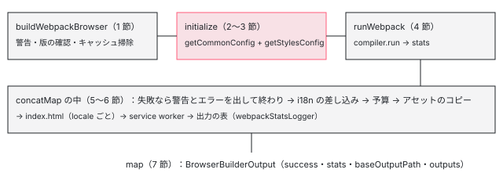

[目次](../README.md) › [webpack の builder の内側：@angular-devkit/build-angular と schematics の CLI](README.md) › 第 1 回 / 全 12 回

# browser builder の流れ：options から webpack の実行まで

> packages/angular\_devkit/build\_angular/src/builders/browser/index.ts・utils/webpack-browser-config.ts・build-options.ts：options の正規化、webpack の設定を組む関数、webpack を回して結果を集め、index.html・service worker・i18n の後処理をするまで。

angular/angular-cli · 読了 約 13 分 · 発展 · [サイトで読む（デモが動きます）](https://angular-deep-dive-cyan.vercel.app/chapter/bwp-browser)

---

この章で分かること：`ng build` が `@angular-devkit/build-angular:browser` を呼んだとき、angular.json の options が webpack の設定になり、webpack が回り、その結果から index.html・service worker・出力の表が作られるまでを、関数の順に 1 つずつ追います。webpack の設定を「誰が」「どの順で」組み立てるのか、webpack の外で builder 自身がしている仕事（アセットのコピー、予算、index.html）が何か、失敗したときに何が返るのかが分かります。

読む対象は angular-cli（44129f66a3）の `packages/angular_devkit/build_angular/src/builders/browser/index.ts`、`utils/webpack-browser-config.ts`、`utils/build-options.ts`、それに webpack を回す `packages/angular_devkit/build_webpack/src/builders/webpack/index.ts` の `runWebpack` です。builder が architect から呼ばれるまでは [dvk-architect の章](../dvk/10-dvk-architect.md)、同じ仕事を esbuild でする application builder の options の正規化は [abl-options の章](../abl/01-abl-options.md)で読みました。

1. **1. browser builder の流れ**（この章）
2. [2. webpack の共通の設定](02-bwp-webpack-common.md)
3. [3. スタイルの設定](03-bwp-webpack-styles.md)
4. [4. Angular の webpack プラグイン](04-bwp-webpack-plugins.md)
5. [5. babel の最適化のプラグイン](05-bwp-babel.md)
6. [6. webpack の dev-server](06-bwp-dev-server.md)
7. [7. server builder と ssr-dev-server](07-bwp-server-ssr.md)
8. [8. prerender と app-shell](08-bwp-prerender-appshell.md)
9. [9. webpack の i18n](09-bwp-i18n.md)
10. [10. karma の builder の webpack の側](10-bwp-karma.md)
11. [11. schematics の CLI](11-bwp-schematics-cli.md)
12. [12. spec と issue](12-bwp-tests-issues.md)

> [!NOTE]
> **ポイント**
>
> 記録は npm の `@angular-devkit/build-angular` 22.2.7（webpack 5.112.0）で録りました。v22.2.7 のタグは 44129f66a3 より後のコミットで、この章で引く `browser/index.ts`・`webpack-browser-config.ts`・`build-options.ts`・`build_webpack` の `index.ts` は 2 つの版で同じです（`git diff v22.2.7 44129f66a3` で差分なし）。

## 0. 全体の流れ



*webpack の設定は builder の外の関数たちが組み、webpack は 1 回回るだけ。アセット・予算・index.html・service worker は webpack が終わってから builder が自分でする。*

1. **入口で前置き**

   target があるか、非推奨の警告、Angular の版の確認、古いディスクのキャッシュの掃除（1 節）。
2. **設定を組む**

   i18n の設定を読み、options を正規化し、`getCommonConfig` と `getStylesConfig` の 2 つの部分設定を webpack-merge で 1 つにする（2〜3 節）。
3. **webpack を 1 回回す**

   `runWebpack` が compiler を作り、`run`（watch なら `watch`）の結果を 1 つの値にして流す（4 節）。
4. **webpack の外の仕事**

   失敗の表示、翻訳の差し込み、予算、アセットのコピー、index.html、service worker を builder がする（5〜6 節）。
5. **結果の形にする**

   architect に返す値に、出力のフォルダと統計を付ける（7 節）。

## 1. 入口：buildWebpackBrowser

📄 `angular-cli/packages/angular_devkit/build_angular/src/builders/browser/index.ts` L63–80 （▶ の行: 66–69, 80）

```ts
63 │ /**
64 │  * @experimental Direct usage of this type is considered experimental.
65 │  */
66 ▶ export type BrowserBuilderOutput = BuilderOutput & {
67 ▶   stats: BuildEventStats;
68 ▶   baseOutputPath: string;
69 ▶   outputs: {
70 │     locale?: string;
71 │     path: string;
72 │     baseHref?: string;
73 │   }[];
74 │ };
75 │ 
76 │ /**
77 │  * Maximum time in milliseconds for single build/rebuild
78 │  * This accounts for CI variability.
79 │  */
80 ▶ export const BUILD_TIMEOUT = 30_000;
```

📄 `angular-cli/packages/angular_devkit/build_angular/src/builders/browser/index.ts` L115–142 （▶ の行: 118, 121–124, 128–129, 132–133, 137, 141）

```ts
115 │ /**
116 │  * @experimental Direct usage of this function is considered experimental.
117 │  */
118 ▶ export function buildWebpackBrowser(
119 │   options: BrowserBuilderSchema,
120 │   context: BuilderContext,
121 ▶   transforms: {
122 ▶     webpackConfiguration?: ExecutionTransformer<webpack.Configuration>;
123 ▶     logging?: WebpackLoggingCallback;
124 ▶     indexHtml?: IndexHtmlTransform;
125 │   } = {},
126 │ ): Observable<BrowserBuilderOutput> {
127 │   const projectName = context.target?.project;
128 ▶   if (!projectName) {
129 ▶     throw new Error('The builder requires a target.');
130 │   }
131 │ 
132 ▶   context.logger.warn(
133 ▶     'The "@angular-devkit/build-angular:browser" builder is deprecated as part of Angular\'s Webpack support deprecation. ' +
134 │       'Use "@angular/build:application" instead. For more information, see https://angular.dev/tools/cli/build-system-migration.',
135 │   );
136 │ 
137 ▶   const baseOutputPath = path.resolve(context.workspaceRoot, options.outputPath);
138 │   let outputPaths: undefined | Map<string, string>;
139 │ 
140 │   // Check Angular version.
141 ▶   assertCompatibleAngularVersion(context.workspaceRoot);
142 │ 
```

📄 `angular-cli/packages/angular_devkit/build_angular/src/builders/browser/index.ts` L143–168 （▶ の行: 143, 146, 149, 152–153, 157–158, 166）

```ts
143 ▶   return from(context.getProjectMetadata(projectName)).pipe(
144 │     switchMap(async (projectMetadata) => {
145 │       // Purge old build disk cache.
146 ▶       await purgeStaleBuildCache(context);
147 │ 
148 │       // Initialize builder
149 ▶       const initialization = await initialize(options, context, transforms.webpackConfiguration);
150 │ 
151 │       // Add index file to watched files.
152 ▶       if (options.watch) {
153 ▶         const indexInputFile = path.join(context.workspaceRoot, getIndexInputFile(options.index));
154 │         initialization.config.plugins ??= [];
155 │         initialization.config.plugins.push({
156 │           apply: (compiler: webpack.Compiler) => {
157 ▶             compiler.hooks.thisCompilation.tap('build-angular', (compilation) => {
158 ▶               compilation.fileDependencies.add(indexInputFile);
159 │             });
160 │           },
161 │         });
162 │       }
163 │ 
164 │       return {
165 │         ...initialization,
166 ▶         cacheOptions: normalizeCacheOptions(projectMetadata, context.workspaceRoot),
167 │       };
168 │     }),
```

1. **118〜126 行目：3 つの差し替え口**

   `transforms` の `webpackConfiguration`（設定を書き換える関数）・`logging`・`indexHtml` は、この関数を直接呼ぶ人のための口です。`@angular-builders/custom-webpack` のような外の builder はここに関数を渡します。デモの記録も、この口に「設定を覚えて返すだけ」の関数を渡して録りました。
2. **127〜135 行目：target と非推奨の警告**

   target が無ければ投げ、毎回 `logger.warn` で「deprecated … Use "@angular/build:application"」を出します。デモのログの 1 行目がこれです。
3. **137・141 行目：出力の根と版**

   `outputPath` をワークスペースの根から絶対にし、`assertCompatibleAngularVersion` で `@angular/core` の版を確かめます（合わなければここで落ちる）。
4. **143〜149 行目：プロジェクトのメタデータから順に**

   `from(getProjectMetadata)` を `switchMap` でつなぎ、`purgeStaleBuildCache`（古い版のキャッシュのフォルダを消す）の後に `initialize`（2 節）を呼びます。
5. **152〜162 行目：watch のときだけ index.html を見張る**

   index.html は webpack の依存の外なので、その場で作った小さなプラグインが `thisCompilation` で `fileDependencies` に足します。これで index.html を保存すると再ビルドになります。
6. **166 行目：キャッシュの設定**

   angular.json の `cli.cache` を読んだ結果を、後の index.html の生成（6 節）に渡すため一緒に流します。

80 行目の `BUILD_TIMEOUT` は export されていますが、build\_angular の中で読む所はありません（`grep -rn BUILD_TIMEOUT packages/angular_devkit` はこの行だけ）。

## 2. initialize：2 つの部分設定を 1 つにする

📄 `angular-cli/packages/angular_devkit/build_angular/src/builders/browser/index.ts` L82–113 （▶ の行: 92, 95, 97–100, 104–105, 108–109, 112）

```ts
 82 │ async function initialize(
 83 │   options: BrowserBuilderSchema,
 84 │   context: BuilderContext,
 85 │   webpackConfigurationTransform?: ExecutionTransformer<webpack.Configuration>,
 86 │ ): Promise<{
 87 │   config: webpack.Configuration;
 88 │   projectRoot: string;
 89 │   projectSourceRoot?: string;
 90 │   i18n: I18nOptions;
 91 │ }> {
 92 ▶   const originalOutputPath = options.outputPath;
 93 │ 
 94 │   // Assets are processed directly by the builder except when watching
 95 ▶   const adjustedOptions = options.watch ? options : { ...options, assets: [] };
 96 │ 
 97 ▶   const { config, projectRoot, projectSourceRoot, i18n } =
 98 ▶     await generateI18nBrowserWebpackConfigFromContext(adjustedOptions, context, (wco) => [
 99 ▶       getCommonConfig(wco),
100 ▶       getStylesConfig(wco),
101 │     ]);
102 │ 
103 │   let transformedConfig;
104 ▶   if (webpackConfigurationTransform) {
105 ▶     transformedConfig = await webpackConfigurationTransform(config);
106 │   }
107 │ 
108 ▶   if (options.deleteOutputPath) {
109 ▶     await deleteOutputDir(context.workspaceRoot, originalOutputPath);
110 │   }
111 │ 
112 ▶   return { config: transformedConfig || config, projectRoot, projectSourceRoot, i18n };
113 │ }
```

95 行目が大事です。watch でないときは options の `assets` を空にしてから設定を組みます。webpack の `CopyWebpackPlugin`（次の回の common.ts の 192 行目）を使わず、webpack が終わってから builder が自分でコピーする（5 節）ためです。98〜101 行目で、設定を組む関数として `getCommonConfig`（次の回）と `getStylesConfig`（第 3 回）の 2 つを渡します。104〜106 行目で利用者の `webpackConfiguration` が最後に設定を書き換え、返った値が 112 行目で使われます。108〜110 行目の `deleteOutputPath` は、webpack を回す前に出力のフォルダを消します。

📄 `angular-cli/packages/angular_devkit/build_angular/src/utils/webpack-browser-config.ts` L131–166 （▶ の行: 131, 137, 143–146, 148, 157）

```ts
131 ▶ export async function generateBrowserWebpackConfigFromContext(
132 │   options: BrowserBuilderSchema,
133 │   context: BuilderContext,
134 │   webpackPartialGenerator: WebpackPartialGenerator,
135 │   extraBuildOptions: Partial<NormalizedBrowserBuilderSchema> = {},
136 │ ): Promise<{ config: Configuration; projectRoot: string; projectSourceRoot?: string }> {
137 ▶   const projectName = context.target && context.target.project;
138 │   if (!projectName) {
139 │     throw new Error('The builder requires a target.');
140 │   }
141 │ 
142 │   const workspaceRoot = context.workspaceRoot;
143 ▶   const projectMetadata = await context.getProjectMetadata(projectName);
144 ▶   const projectRoot = path.join(workspaceRoot, (projectMetadata.root as string | undefined) ?? '');
145 ▶   const sourceRoot = projectMetadata.sourceRoot as string | undefined;
146 ▶   const projectSourceRoot = sourceRoot ? path.join(workspaceRoot, sourceRoot) : undefined;
147 │ 
148 ▶   const normalizedOptions = normalizeBrowserSchema(
149 │     workspaceRoot,
150 │     projectRoot,
151 │     projectSourceRoot,
152 │     options,
153 │     projectMetadata,
154 │     context.logger,
155 │   );
156 │ 
157 ▶   const config = await generateWebpackConfig(
158 │     workspaceRoot,
159 │     projectRoot,
160 │     projectSourceRoot,
161 │     projectName,
162 │     normalizedOptions,
163 │     webpackPartialGenerator,
164 │     context.logger,
165 │     extraBuildOptions,
166 │   );
```

📄 `angular-cli/packages/angular_devkit/build_angular/src/utils/webpack-browser-config.ts` L167–203 （▶ の行: 168–170, 175, 179, 189, 191, 193, 197, 199, 201）

```ts
167 │ 
168 ▶   // If builder watch support is present in the context, add watch plugin
169 ▶   // This is internal only and currently only used for testing
170 ▶   const watcherFactory = (
171 │     context as {
172 │       watcherFactory?: BuilderWatcherFactory;
173 │     }
174 │   ).watcherFactory;
175 ▶   if (watcherFactory) {
176 │     if (!config.plugins) {
177 │       config.plugins = [];
178 │     }
179 ▶     config.plugins.push(new BuilderWatchPlugin(watcherFactory));
180 │   }
181 │ 
182 │   return {
183 │     config,
184 │     projectRoot,
185 │     projectSourceRoot,
186 │   };
187 │ }
188 │ 
189 ▶ export function getIndexOutputFile(index: BrowserBuilderSchema['index']): string {
190 │   if (typeof index === 'string') {
191 ▶     return path.basename(index);
192 │   } else {
193 ▶     return index.output || 'index.html';
194 │   }
195 │ }
196 │ 
197 ▶ export function getIndexInputFile(index: BrowserBuilderSchema['index']): string {
198 │   if (typeof index === 'string') {
199 ▶     return index;
200 │   } else {
201 ▶     return index.input;
202 │   }
203 │ }
```

1. **143〜146 行目：プロジェクトの根**

   angular.json の `root` と `sourceRoot` を絶対パスにします。
2. **148〜155 行目：`normalizeBrowserSchema`**

   `utils/normalize-builder-schema.ts` が、`optimization`・`sourceMap` の短い書き方（true / false）を `{ scripts, styles, … }` の形にし、`assets`・`fileReplacements`・`polyfills` を正規化し、`cache` を angular.json から読み、`poll: 0` を 500 に直し、browserslist から `supportedBrowsers` を作ります（この関数は引かずに名前だけ挙げます）。
3. **170〜180 行目：テストのときだけの watcher**

   context に `watcherFactory` があれば `BuilderWatchPlugin` を足し、webpack のファイルの見張りをテストの仮想の見張りに差し替えます（169 行目のコメントのとおり、spec の道具のためだけ）。
4. **189〜203 行目：index の 2 つの書き方**

   文字列なら入力のファイル名がそのまま出力の名前（`path.basename`）、オブジェクトなら `input` と `output`（省略で `index.html`）です。

📄 `angular-cli/packages/angular_devkit/build_angular/src/utils/webpack-browser-config.ts` L29–65 （▶ の行: 40–41, 44–45, 47–48, 59, 61–62）

```ts
29 │ export async function generateWebpackConfig(
30 │   workspaceRoot: string,
31 │   projectRoot: string,
32 │   sourceRoot: string | undefined,
33 │   projectName: string,
34 │   options: NormalizedBrowserBuilderSchema,
35 │   webpackPartialGenerator: WebpackPartialGenerator,
36 │   logger: BuilderContext['logger'],
37 │   extraBuildOptions: Partial<NormalizedBrowserBuilderSchema>,
38 │ ): Promise<Configuration> {
39 │   // Ensure Build Optimizer is only used with AOT.
40 ▶   if (options.buildOptimizer && !options.aot) {
41 ▶     throw new Error(`The 'buildOptimizer' option cannot be used without 'aot'.`);
42 │   }
43 │ 
44 ▶   const tsConfigPath = path.resolve(workspaceRoot, options.tsConfig);
45 ▶   const tsConfig = await readTsconfig(tsConfigPath);
46 │ 
47 ▶   const buildOptions: NormalizedBrowserBuilderSchema = { ...options, ...extraBuildOptions };
48 ▶   const wco: BrowserWebpackConfigOptions = {
49 │     root: workspaceRoot,
50 │     logger: logger.createChild('webpackConfigOptions'),
51 │     projectRoot,
52 │     sourceRoot,
53 │     buildOptions,
54 │     tsConfig,
55 │     tsConfigPath,
56 │     projectName,
57 │   };
58 │ 
59 ▶   wco.buildOptions.progress = defaultProgress(wco.buildOptions.progress);
60 │ 
61 ▶   const partials = await Promise.all(webpackPartialGenerator(wco));
62 ▶   const webpackConfig = webpackMerge(partials);
63 │ 
64 │   return webpackConfig;
65 │ }
```

40〜42 行目は、`buildOptimizer` が true で `aot` が false の組み合わせを、設定を組む前に止めます（デモの次の回の表に「The 'buildOptimizer' option cannot be used without 'aot'.」が出ます）。47 行目の `extraBuildOptions` は呼び手が足す options で、dev-server は自分の options（host・port・proxy など）をここで混ぜます（[第 6 回](06-bwp-dev-server.md)）。61 行目で部分設定を作る関数を全部呼び、62 行目の `webpackMerge` が配列を後ろ勝ちで深く混ぜます（`plugins` や `module.rules` は連結）。デモの「設定の要所」の `plugins` の並びが、common の後ろに styles のプラグインが続く順になっているのはこのためです。

## 3. options の形と、i18n のときに足すもの

📄 `angular-cli/packages/angular_devkit/build_angular/src/utils/build-options.ts` L29–58 （▶ の行: 29–30, 35–37, 46, 52–53, 58）

```ts
29 ▶ export interface BuildOptions {
30 ▶   optimization: NormalizedOptimizationOptions;
31 │   environment?: string;
32 │   outputPath: string;
33 │   resourcesOutputPath?: string;
34 │   aot?: boolean;
35 ▶   sourceMap: SourceMapClass;
36 ▶   vendorChunk?: boolean;
37 ▶   commonChunk?: boolean;
38 │   baseHref?: string;
39 │   deployUrl?: string;
40 │   verbose?: boolean;
41 │   progress?: boolean;
42 │   localize?: Localize;
43 │   i18nMissingTranslation?: I18NTranslation;
44 │   externalDependencies?: string[];
45 │   watch?: boolean;
46 ▶   outputHashing?: OutputHashing;
47 │   poll?: number;
48 │   index?: IndexUnion;
49 │   deleteOutputPath?: boolean;
50 │   preserveSymlinks?: boolean;
51 │   extractLicenses?: boolean;
52 ▶   buildOptimizer?: boolean;
53 ▶   namedChunks?: boolean;
54 │   crossOrigin?: CrossOrigin;
55 │   subresourceIntegrity?: boolean;
56 │   serviceWorker?: boolean;
57 │   webWorkerTsConfig?: string;
58 ▶   statsJson: boolean;
```

📄 `angular-cli/packages/angular_devkit/build_angular/src/utils/build-options.ts` L59–90 （▶ の行: 60–61, 67, 71, 74, 77–79, 81, 86–87）

```ts
59 │   hmr?: boolean;
60 ▶   main: string;
61 ▶   polyfills: string[];
62 │   budgets: Budget[];
63 │   assets: AssetPatternClass[];
64 │   scripts: ScriptElement[];
65 │   styles: StyleElement[];
66 │   stylePreprocessorOptions?: { includePaths: string[] };
67 ▶   platform?: 'browser' | 'server';
68 │   fileReplacements: NormalizedFileReplacement[];
69 │   inlineStyleLanguage?: InlineStyleLanguage;
70 │   allowedCommonJsDependencies?: string[];
71 ▶   cache: NormalizedCachedOptions;
72 │   codeCoverage?: boolean;
73 │   codeCoverageExclude?: string[];
74 ▶   supportedBrowsers?: string[];
75 │ }
76 │ 
77 ▶ export interface WebpackDevServerOptions
78 ▶   extends BuildOptions,
79 ▶     Omit<DevServerSchema, 'optimization' | 'sourceMap' | 'buildTarget' | 'browserTarget'> {}
80 │ 
81 ▶ export interface WebpackConfigOptions<T = BuildOptions> {
82 │   root: string;
83 │   logger: logging.Logger;
84 │   projectRoot: string;
85 │   sourceRoot?: string;
86 ▶   buildOptions: T;
87 ▶   tsConfig: ParsedConfiguration;
88 │   tsConfigPath: string;
89 │   projectName: string;
90 │ }
```

`BuildOptions` は、正規化の後で部分設定の関数が読む options の形です。30 行目の `optimization` と 35 行目の `sourceMap` は、正規化で必ずオブジェクトになった型（`NormalizedOptimizationOptions`・`SourceMapClass`）です。67 行目の `platform` は server builder が `'server'` を入れる口で、次の回の common.ts の 77 行目が読みます（[第 7 回](07-bwp-server-ssr.md)）。77〜79 行目の `WebpackDevServerOptions` は、dev-server の schema から `optimization`・`sourceMap`・`buildTarget`・`browserTarget` を除いたものを足した形で、2 節の 47 行目で混ぜた結果の型です。81〜90 行目の `WebpackConfigOptions`（略して wco）が、部分設定の関数に渡る 1 つの引数です。

📄 `angular-cli/packages/angular_devkit/build_angular/src/utils/webpack-browser-config.ts` L67–88 （▶ の行: 78–79, 82–83）

```ts
67 │ export async function generateI18nBrowserWebpackConfigFromContext(
68 │   options: BrowserBuilderSchema,
69 │   context: BuilderContext,
70 │   webpackPartialGenerator: WebpackPartialGenerator,
71 │   extraBuildOptions: Partial<NormalizedBrowserBuilderSchema> = {},
72 │ ): Promise<{
73 │   config: Configuration;
74 │   projectRoot: string;
75 │   projectSourceRoot?: string;
76 │   i18n: I18nOptions;
77 │ }> {
78 ▶   const { buildOptions, i18n } = await configureI18nBuild(context, options);
79 ▶   const result = await generateBrowserWebpackConfigFromContext(
80 │     buildOptions,
81 │     context,
82 ▶     (wco) => {
83 ▶       return webpackPartialGenerator(wco);
84 │     },
85 │     extraBuildOptions,
86 │   );
87 │   const config = result.config;
88 │ 
```

📄 `angular-cli/packages/angular_devkit/build_angular/src/utils/webpack-browser-config.ts` L89–113 （▶ の行: 89, 91, 95, 97–98, 104, 109–110）

```ts
 89 ▶   if (i18n.shouldInline) {
 90 │     // Remove localize "polyfill" if in AOT mode
 91 ▶     if (buildOptions.aot) {
 92 │       if (!config.resolve) {
 93 │         config.resolve = {};
 94 │       }
 95 ▶       if (Array.isArray(config.resolve.alias)) {
 96 │         config.resolve.alias.push({
 97 ▶           name: '@angular/localize/init',
 98 ▶           alias: false,
 99 │         });
100 │       } else {
101 │         if (!config.resolve.alias) {
102 │           config.resolve.alias = {};
103 │         }
104 ▶         config.resolve.alias['@angular/localize/init'] = false;
105 │       }
106 │     }
107 │ 
108 │     // Update file hashes to include translation file content
109 ▶     const i18nHash = Object.values(i18n.locales).reduce(
110 ▶       (data, locale) => data + locale.files.map((file) => file.integrity || '').join('|'),
111 │       '',
112 │     );
113 │ 
```

📄 `angular-cli/packages/angular_devkit/build_angular/src/utils/webpack-browser-config.ts` L114–130 （▶ の行: 115, 117–118, 121）

```ts
114 │     config.plugins ??= [];
115 ▶     config.plugins.push({
116 │       apply(compiler) {
117 ▶         compiler.hooks.compilation.tap('build-angular', (compilation) => {
118 ▶           javascript.JavascriptModulesPlugin.getCompilationHooks(compilation).chunkHash.tap(
119 │             'build-angular',
120 │             (_, hash) => {
121 ▶               hash.update('$localize' + i18nHash);
122 │             },
123 │           );
124 │         });
125 │       },
126 │     });
127 │   }
128 │ 
129 │   return { ...result, i18n };
130 │ }
```

1. **78 行目：`configureI18nBuild`**

   `localize` の options と angular.json の `i18n` を読み、差し込むロケールと翻訳ファイルを決めます。翻訳を差し込むときは出力先を一時のフォルダに変えます（[第 9 回](09-bwp-i18n.md)）。
2. **89〜106 行目：`@angular/localize/init` を空にする**

   ビルドの後で翻訳を差し込む（`shouldInline`）ときは、AOT なら実行時の `$localize` の準備が要らないので、alias を `false`（空のモジュール）にします。alias が配列の形でもオブジェクトの形でも足せるように 95〜105 行目で分けています。
3. **109〜126 行目：翻訳ファイルの中身をチャンクのハッシュに混ぜる**

   翻訳はビルドの後で差し込むので、webpack から見ると JS は変わりません。翻訳ファイルの `integrity` を全部つないだ文字列を、121 行目で各チャンクのハッシュに足し、翻訳だけを変えたときにもファイル名が変わるようにします。

## 4. runWebpack：webpack を回して 1 つの結果にする

📄 `angular-cli/packages/angular_devkit/build_webpack/src/builders/webpack/index.ts` L36–67 （▶ の行: 36, 46–47, 49, 52, 55–57, 64）

```ts
36 ▶ export function runWebpack(
37 │   config: webpack.Configuration,
38 │   context: BuilderContext,
39 │   options: {
40 │     logging?: WebpackLoggingCallback;
41 │     webpackFactory?: WebpackFactory;
42 │     shouldProvideStats?: boolean;
43 │   } = {},
44 │ ): Observable<BuildResult> {
45 │   const {
46 ▶     logging: log = (stats, config) => {
47 ▶       if (config.stats !== false) {
48 │         const statsOptions = config.stats === true ? undefined : config.stats;
49 ▶         context.logger.info(stats.toString(statsOptions));
50 │       }
51 │     },
52 ▶     shouldProvideStats = true,
53 │   } = options;
54 │ 
55 ▶   const createWebpack = (c: webpack.Configuration) => {
56 ▶     if (options.webpackFactory) {
57 ▶       const result = options.webpackFactory(c);
58 │       if (isObservable(result)) {
59 │         return result;
60 │       } else {
61 │         return of(result);
62 │       }
63 │     } else {
64 ▶       return from(import('webpack').then((mod) => mod.default(c)));
65 │     }
66 │   };
67 │ 
```

📄 `angular-cli/packages/angular_devkit/build_webpack/src/builders/webpack/index.ts` L68–102 （▶ の行: 68, 74, 84, 86, 88–91, 94–95, 97–99）

```ts
 68 ▶   return createWebpack({ ...config, watch: false }).pipe(
 69 │     switchMap(
 70 │       (webpackCompiler) =>
 71 │         new Observable<BuildResult>((obs) => {
 72 │           assert(webpackCompiler, 'Webpack compiler factory did not return a compiler instance.');
 73 │ 
 74 ▶           const callback = (err?: Error | null, stats?: webpack.Stats) => {
 75 │             if (err) {
 76 │               return obs.error(err);
 77 │             }
 78 │ 
 79 │             if (!stats) {
 80 │               return;
 81 │             }
 82 │ 
 83 │             // Log stats.
 84 ▶             log(stats, config);
 85 │ 
 86 ▶             const statsOptions = typeof config.stats === 'boolean' ? undefined : config.stats;
 87 │             const result = {
 88 ▶               success: !stats.hasErrors(),
 89 ▶               webpackStats: shouldProvideStats ? stats.toJson(statsOptions) : undefined,
 90 ▶               emittedFiles: getEmittedFiles(stats.compilation),
 91 ▶               outputPath: stats.compilation.outputOptions.path,
 92 │             } as unknown as BuildResult;
 93 │ 
 94 ▶             if (config.watch) {
 95 ▶               obs.next(result);
 96 │             } else {
 97 ▶               webpackCompiler.close(() => {
 98 ▶                 obs.next(result);
 99 ▶                 obs.complete();
100 │               });
101 │             }
102 │           };
```

📄 `angular-cli/packages/angular_devkit/build_webpack/src/builders/webpack/index.ts` L103–128 （▶ の行: 105, 107, 110–111, 115, 119）

```ts
103 │ 
104 │           try {
105 ▶             if (config.watch) {
106 │               const watchOptions = config.watchOptions || {};
107 ▶               const watching = webpackCompiler.watch(watchOptions, callback);
108 │ 
109 │               // Teardown logic. Close the watcher when unsubscribed from.
110 ▶               return () => {
111 ▶                 watching?.close(() => {});
112 │                 webpackCompiler.close(() => {});
113 │               };
114 │             } else {
115 ▶               webpackCompiler.run(callback);
116 │             }
117 │           } catch (err) {
118 │             if (err) {
119 ▶               context.logger.error(
120 │                 `\nAn error occurred during the build:\n${err instanceof Error ? err.stack : err}`,
121 │               );
122 │             }
123 │             throw err;
124 │           }
125 │         }),
126 │     ),
127 │   );
128 │ }
```

1. **68 行目：compiler は `watch: false` で作る**

   `webpack(config)` に `watch: true` を渡すと webpack が自分で watch を始めてしまうので、いったん false にして作り、105 行目で元の `config.watch` を見て `watch` か `run` を選びます。
2. **84 行目：ログの関数**

   browser builder は 172〜181 行目（下）で、`verbose` のときだけ `stats.toString` を出す関数を渡します。ふだんの出力の表はここでは出ず、builder が後処理の最後に出します（6 節の 398 行目）。
3. **86〜92 行目：1 つの結果**

   `success` は `!stats.hasErrors()`。`webpackStats` は設定の `stats`（次の回の helpers.ts の `getStatsOptions`）で JSON にした統計、`emittedFiles` は書き出したファイルの一覧、`outputPath` は webpack の出力先です。
4. **94〜101 行目：watch でなければ閉じてから流す**

   `compiler.close` の後に `next` と `complete`。watch なら閉じずにビルドのたびに `next` し、110〜113 行目の後片付けは購読をやめたときに走ります。

📄 `angular-cli/packages/angular_devkit/build_angular/src/builders/browser/index.ts` L169–206 （▶ の行: 170, 172–173, 177, 179, 187–188, 190, 197–199, 202, 204）

```ts
169 │     switchMap(({ config, projectRoot, projectSourceRoot, i18n, cacheOptions }) => {
170 ▶       const normalizedOptimization = normalizeOptimization(options.optimization);
171 │ 
172 ▶       return runWebpack(config, context, {
173 ▶         webpackFactory: require('webpack') as typeof webpack,
174 │         logging:
175 │           transforms.logging ||
176 │           ((stats, config) => {
177 ▶             if (options.verbose && config.stats !== false) {
178 │               const statsOptions = config.stats === true ? undefined : config.stats;
179 ▶               context.logger.info(stats.toString(statsOptions));
180 │             }
181 │           }),
182 │       }).pipe(
183 │         concatMap(
184 │           async (
185 │             buildEvent,
186 │           ): Promise<{ output: BuilderOutput; webpackStats: StatsCompilation }> => {
187 ▶             const spinner = new Spinner();
188 ▶             spinner.enabled = options.progress !== false;
189 │ 
190 ▶             const { success, emittedFiles = [], outputPath: webpackOutputPath } = buildEvent;
191 │             const webpackRawStats = buildEvent.webpackStats;
192 │             if (!webpackRawStats) {
193 │               throw new Error('Webpack stats build result is required.');
194 │             }
195 │ 
196 │             // Fix incorrectly set `initial` value on chunks.
197 ▶             const extraEntryPoints = [
198 ▶               ...normalizeExtraEntryPoints(options.styles || [], 'styles'),
199 ▶               ...normalizeExtraEntryPoints(options.scripts || [], 'scripts'),
200 │             ];
201 │ 
202 ▶             const webpackStats = {
203 │               ...webpackRawStats,
204 ▶               chunks: markAsyncChunksNonInitial(webpackRawStats, extraEntryPoints),
205 │             };
206 │ 
```

173 行目の `webpackFactory` に `require('webpack')` を渡し、build-angular が持つ webpack を使わせます。197〜205 行目は、`inject: false` の scripts と styles のチャンクを「初期でない」に直します（`utils/async-chunks.ts`。webpack は entry を全部初期と数えるため）。この直したほうの `webpackStats` を、予算と出力の表が使います。

## 5. 結果を仕上げる：失敗・翻訳・予算・アセット

📄 `angular-cli/packages/angular_devkit/build_angular/src/builders/browser/index.ts` L207–228 （▶ の行: 207, 210–211, 213–214, 217, 219, 222, 224, 227）

```ts
207 ▶             if (!success) {
208 │               // If using bundle downleveling then there is only one build
209 │               // If it fails show any diagnostic messages and bail
210 ▶               if (statsHasWarnings(webpackStats)) {
211 ▶                 context.logger.warn(statsWarningsToString(webpackStats, { colors: true }));
212 │               }
213 ▶               if (statsHasErrors(webpackStats)) {
214 ▶                 context.logger.error(statsErrorsToString(webpackStats, { colors: true }));
215 │               }
216 │ 
217 ▶               return {
218 │                 webpackStats: webpackRawStats,
219 ▶                 output: { success: false },
220 │               };
221 │             } else {
222 ▶               outputPaths = ensureOutputPaths(baseOutputPath, i18n);
223 │ 
224 ▶               const scriptsEntryPointName = normalizeExtraEntryPoints(
225 │                 options.scripts || [],
226 │                 'scripts',
227 ▶               ).map((x) => x.bundleName);
228 │ 
```

📄 `angular-cli/packages/angular_devkit/build_angular/src/builders/browser/index.ts` L229–247 （▶ の行: 229–230, 238, 240, 243）

```ts
229 ▶               if (i18n.shouldInline) {
230 ▶                 const success = await i18nInlineEmittedFiles(
231 │                   context,
232 │                   emittedFiles,
233 │                   i18n,
234 │                   baseOutputPath,
235 │                   Array.from(outputPaths.values()),
236 │                   scriptsEntryPointName,
237 │                   webpackOutputPath,
238 ▶                   options.i18nMissingTranslation,
239 │                 );
240 ▶                 if (!success) {
241 │                   return {
242 │                     webpackStats: webpackRawStats,
243 ▶                     output: { success: false },
244 │                   };
245 │                 }
246 │               }
247 │ 
```

1. **207〜220 行目：webpack が失敗したら**

   警告とエラーを文字列にして出し、`success: false` だけを返します。222 行目より前なので `outputPaths` は作られません（7 節で効いてくる）。
2. **222 行目：ロケールごとの出力先**

   `ensureOutputPaths` が、ロケールの名前から出力のフォルダへの Map を作ってフォルダを用意します。i18n でなければ `''` → `dist/demo` の 1 つです（デモの「ビルダーの結果」の `outputs`）。
3. **229〜246 行目：翻訳の差し込み**

   一時のフォルダに出た JS に、ロケールごとに翻訳を差し込んで各出力先に書きます。scripts の束（224〜227 行目の名前）は `$localize` を含まないので除けます（[第 9 回](09-bwp-i18n.md)）。

📄 `angular-cli/packages/angular_devkit/build_angular/src/builders/browser/index.ts` L248–266 （▶ の行: 249, 251–252, 255–256, 258–259）

```ts
248 │               // Check for budget errors and display them to the user.
249 ▶               const budgets = options.budgets;
250 │               let budgetFailures: BudgetCalculatorResult[] | undefined;
251 ▶               if (budgets?.length) {
252 ▶                 budgetFailures = [...checkBudgets(budgets, webpackStats)];
253 │                 for (const { severity, message } of budgetFailures) {
254 │                   switch (severity) {
255 ▶                     case ThresholdSeverity.Warning:
256 ▶                       webpackStats.warnings?.push({ message });
257 │                       break;
258 ▶                     case ThresholdSeverity.Error:
259 ▶                       webpackStats.errors?.push({ message });
260 │                       break;
261 │                     default:
262 │                       assertNever(severity);
263 │                   }
264 │                 }
265 │               }
266 │ 
```

予算は webpack の外で計ります。252 行目の `checkBudgets` は `@angular/build` の関数で、application builder と同じ計算です（[cli-budgets の章](../cli/08-cli-budgets.md)）。超えた分を統計の `warnings`・`errors` に足すので、エラーの予算を超えると 267 行目（下）の `buildSuccess` が false になります。次の回のデモの「optimization:false」の行は、本番の予算（警告 500 kB・エラー 1 MB）を 1.68 MB が超えてここで失敗しました。コンポーネントのスタイルの予算（`anyComponentStyle`）だけは webpack の中で計ります（[第 3 回](03-bwp-webpack-styles.md)）。

📄 `angular-cli/packages/angular_devkit/build_angular/src/builders/browser/index.ts` L267–297 （▶ の行: 267–268, 270, 273–274, 280, 288, 291）

```ts
267 ▶               const buildSuccess = success && !statsHasErrors(webpackStats);
268 ▶               if (buildSuccess) {
269 │                 // Copy assets
270 ▶                 if (!options.watch && options.assets?.length) {
271 │                   spinner.start('Copying assets...');
272 │                   try {
273 ▶                     await copyAssets(
274 ▶                       normalizeAssetPatterns(
275 │                         options.assets,
276 │                         context.workspaceRoot,
277 │                         projectRoot,
278 │                         projectSourceRoot,
279 │                       ),
280 ▶                       Array.from(outputPaths.values()),
281 │                       context.workspaceRoot,
282 │                     );
283 │                     spinner.succeed('Copying assets complete.');
284 │                   } catch (err) {
285 │                     spinner.fail('Copying of assets failed.');
286 │                     assertIsError(err);
287 │ 
288 ▶                     return {
289 │                       output: {
290 │                         success: false,
291 ▶                         error: 'Unable to copy assets: ' + err.message,
292 │                       },
293 │                       webpackStats: webpackRawStats,
294 │                     };
295 │                   }
296 │                 }
297 │ 
```

270 行目で、watch でなく `assets` があるときだけコピーします。2 節の 95 行目で webpack から外したのと対になっていて、280 行目でロケールの出力先の全部にコピーします。watch のときは webpack の `CopyWebpackPlugin` が受け持つので、ここは飛ばします。

## 6. index.html と service worker

📄 `angular-cli/packages/angular_devkit/build_angular/src/builders/browser/index.ts` L298–307 （▶ の行: 298, 301–303, 307）

```ts
298 ▶                 if (options.index) {
299 │                   spinner.start('Generating index html...');
300 │ 
301 ▶                   const entrypoints = generateEntryPoints({
302 ▶                     scripts: options.scripts ?? [],
303 ▶                     styles: options.styles ?? [],
304 │                   });
305 │ 
306 │                   let hasErrors = false;
307 ▶                   for (const [locale, outputPath] of outputPaths.entries()) {
```

301〜304 行目の `generateEntryPoints` が、`runtime`・`polyfills`・`styles`・`scripts` の束・`vendor`・`main` の順に入口の名前を並べます（`inject: false` は入れない）。307 行目からロケールごとに `IndexHtmlGenerator`（`@angular/build` の index.html の生成器）を作ります。生成の options（この間の 16 行）は [cmd-image の章](../cmd/01-cmd-image.md)で `imageDomains` を読んだときに引いたので、ここでは引きません。生成器の中身は [bcu-index の章](../bcu/06-bcu-index.md)です。

📄 `angular-cli/packages/angular_devkit/build_angular/src/builders/browser/index.ts` L324–348 （▶ の行: 329–330, 332–333, 336, 338, 341, 346, 348）

```ts
324 │ 
325 │                       const {
326 │                         csrContent: content,
327 │                         warnings,
328 │                         errors,
329 ▶                       } = await indexHtmlGenerator.process({
330 ▶                         baseHref: getLocaleBaseHref(i18n, locale) ?? options.baseHref,
331 │                         // i18nLocale is used when Ivy is disabled
332 ▶                         lang: locale || undefined,
333 ▶                         files: mapEmittedFilesToFileInfo(emittedFiles),
334 │                       });
335 │ 
336 ▶                       if (warnings.length || errors.length) {
337 │                         spinner.stop();
338 ▶                         warnings.forEach((m) => context.logger.warn(m));
339 │                         errors.forEach((m) => {
340 │                           context.logger.error(m);
341 ▶                           hasErrors = true;
342 │                         });
343 │                         spinner.start();
344 │                       }
345 │ 
346 ▶                       const indexOutput = path.join(outputPath, getIndexOutputFile(options.index));
347 │                       await fs.promises.mkdir(path.dirname(indexOutput), { recursive: true });
348 ▶                       await fs.promises.writeFile(indexOutput, content);
```

📄 `angular-cli/packages/angular_devkit/build_angular/src/builders/browser/index.ts` L349–371 （▶ の行: 349, 355, 360, 365, 368）

```ts
349 ▶                     } catch (error) {
350 │                       spinner.fail('Index html generation failed.');
351 │                       assertIsError(error);
352 │ 
353 │                       return {
354 │                         webpackStats: webpackRawStats,
355 ▶                         output: { success: false, error: error.message },
356 │                       };
357 │                     }
358 │                   }
359 │ 
360 ▶                   if (hasErrors) {
361 │                     spinner.fail('Index html generation failed.');
362 │ 
363 │                     return {
364 │                       webpackStats: webpackRawStats,
365 ▶                       output: { success: false },
366 │                     };
367 │                   } else {
368 ▶                     spinner.succeed('Index html generation complete.');
369 │                   }
370 │                 }
371 │ 
```

1. **330 行目：base href**

   ロケールに base href があればそれ、無ければ options の `baseHref`。
2. **333 行目：入れるファイル**

   7 節の `mapEmittedFilesToFileInfo` が、名前のある初期のファイルだけに絞ります。遅延チャンク（デモの `315.….js`）は index.html に入りません。
3. **336〜344 行目：警告とエラー**

   生成器のエラーは 341 行目で `hasErrors` を立て、全部のロケールを書いた後に 360 行目で失敗にします。例外（349 行目）ならその場で失敗です。
4. **346〜348 行目：書き出す**

   出力の名前は `getIndexOutputFile`（2 節）。`csrContent` はブラウザ用の HTML です。

デモの「index.html の前後」で本番を見ると、`<link rel="stylesheet" … media="print" data-beasties-media="all">` と `<noscript>` が足されています。本番の `optimization.styles.inlineCritical`（既定で true）により、生成器の中の重要 CSS のインライン化（beasties）が走った跡です。記録用の `indexHtml`（`postTransform`）が受け取った HTML は、まだこれが入る前の形でした。生成器が `postTransform` を重要 CSS の前の段で呼ぶためです（bcu-index の章）。

📄 `angular-cli/packages/angular_devkit/build_angular/src/utils/inline-critical-css.ts` L19–56 （▶ の行: 19, 22, 27, 29, 36–38, 42, 50–51, 54–55）

```ts
19 ▶ export class InlineCriticalCssProcessor {
20 │   constructor(protected readonly options: InlineCriticalCssProcessorOptions) {}
21 │ 
22 ▶   async process(html: string): Promise<{ content: string; warnings: string[]; errors: string[] }> {
23 │     const warnings: string[] = [];
24 │     const errors: string[] = [];
25 │     const { outputPath, deployUrl, minify = false, readAsset } = this.options;
26 │ 
27 ▶     const { default: Beasties } = await import('beasties');
28 │ 
29 ▶     const beasties = new Beasties({
30 │       logger: {
31 │         warn: (s: string) => warnings.push(s),
32 │         error: (s: string) => errors.push(s),
33 │         info: () => {},
34 │       },
35 │       logLevel: 'warn',
36 ▶       path: outputPath,
37 ▶       publicPath: deployUrl,
38 ▶       compress: minify,
39 │       pruneSource: false,
40 │       reduceInlineStyles: false,
41 │       mergeStylesheets: false,
42 ▶       preload: 'media-script',
43 │       nonce: (document) => {
44 │         const nonceElement = document.querySelector('[ngCspNonce], [ngcspnonce]');
45 │         const cspNonce =
46 │           nonceElement?.getAttribute('ngCspNonce') || nonceElement?.getAttribute('ngcspnonce');
47 │ 
48 │         return cspNonce ?? undefined;
49 │       },
50 ▶       noscriptFallback: true,
51 ▶       inlineFonts: true,
52 │     });
53 │ 
54 ▶     beasties.readFile = (path) => {
55 ▶       return readAsset ? readAsset(path) : readFile(path, 'utf-8');
56 │     };
```

build-angular にも `utils/inline-critical-css.ts` の `InlineCriticalCssProcessor` がありますが、browser builder は使いません（`grep` すると使うのは `app-shell/index.ts` の 95 行目と `prerender/render-worker.ts` の 126 行目だけ）。42〜49 行目の `nonce` は、`ngCspNonce` 属性の値を、インラインにした `<style>` にも付けるためのものです。prerender と app-shell での使われ方は [第 8 回](08-bwp-prerender-appshell.md)で読みます。

📄 `angular-cli/packages/angular_devkit/build_angular/src/builders/browser/index.ts` L372–404 （▶ の行: 372, 376, 380–381, 384, 389, 394, 398, 400, 402）

```ts
372 ▶                 if (options.serviceWorker) {
373 │                   spinner.start('Generating service worker...');
374 │                   for (const [locale, outputPath] of outputPaths.entries()) {
375 │                     try {
376 ▶                       await augmentAppWithServiceWorker(
377 │                         projectRoot,
378 │                         context.workspaceRoot,
379 │                         outputPath,
380 ▶                         getLocaleBaseHref(i18n, locale) ?? options.baseHref ?? '/',
381 ▶                         options.ngswConfigPath,
382 │                       );
383 │                     } catch (error) {
384 ▶                       spinner.fail('Service worker generation failed.');
385 │                       assertIsError(error);
386 │ 
387 │                       return {
388 │                         webpackStats: webpackRawStats,
389 ▶                         output: { success: false, error: error.message },
390 │                       };
391 │                     }
392 │                   }
393 │ 
394 ▶                   spinner.succeed('Service worker generation complete.');
395 │                 }
396 │               }
397 │ 
398 ▶               webpackStatsLogger(context.logger, webpackStats, config, budgetFailures);
399 │ 
400 ▶               return {
401 │                 webpackStats: webpackRawStats,
402 ▶                 output: { success: buildSuccess },
403 │               };
404 │             }
```

`serviceWorker` が true なら、ロケールごとに `augmentAppWithServiceWorker` が `ngsw-config.json` を読んで `ngsw.json` と `ngsw-worker.js` を書きます。380 行目の base href の最後の手は `'/'` です。398 行目の `webpackStatsLogger` が、ここでようやく出力の表を出します（[第 4 回](04-bwp-webpack-plugins.md)の `utils/stats.ts`）。予算の結果（`budgetFailures`）を渡すので、表の行に予算の印が付きます。

### ここまでの呼び出し

- 👤 `ng build` — angular.json の build の target — *architect が builder を呼ぶ*
  - `buildWebpackBrowser(options, context, transforms)` — builders/browser/index.ts — *118 行目*
    - `initialize()` — builders/browser/index.ts — *82 行目*
      - `generateI18nBrowserWebpackConfigFromContext()` — utils/webpack-browser-config.ts — *67 行目*
        - `configureI18nBuild()` — utils/i18n-webpack.ts — *第 9 回*
        - `generateBrowserWebpackConfigFromContext()` — utils/webpack-browser-config.ts — *131 行目*
          - `normalizeBrowserSchema()` — utils/normalize-builder-schema.ts — *148 行目*
          - `generateWebpackConfig()` — utils/webpack-browser-config.ts — *29 行目*
            - `getCommonConfig(wco)` / `getStylesConfig(wco)` — tools/webpack/configs/ — *第 2・3 回*
    - `runWebpack(config, context, { webpackFactory, logging })` — build\_webpack/src/builders/webpack/index.ts — *36 行目*
      - `compiler.run(callback)` — webpack — *115 行目*
    - `checkBudgets()` → `copyAssets()` → `IndexHtmlGenerator.process()` → `augmentAppWithServiceWorker()` — builders/browser/index.ts — *252・273・329・376 行目*
    - `webpackStatsLogger()` — tools/webpack/utils/stats.ts — *398 行目*

## 7. 結果の形と、デモ

📄 `angular-cli/packages/angular_devkit/build_angular/src/builders/browser/index.ts` L405–442 （▶ の行: 411–414, 418–420, 422, 429, 438, 440）

```ts
405 │           },
406 │         ),
407 │         map(
408 │           ({ output: event, webpackStats }) =>
409 │             ({
410 │               ...event,
411 ▶               stats: generateBuildEventStats(webpackStats, options),
412 ▶               baseOutputPath,
413 ▶               outputs: (outputPaths &&
414 ▶                 [...outputPaths.entries()].map(([locale, path]) => ({
415 │                   locale,
416 │                   path,
417 │                   baseHref: getLocaleBaseHref(i18n, locale) ?? options.baseHref,
418 ▶                 }))) || {
419 ▶                 path: baseOutputPath,
420 ▶                 baseHref: options.baseHref,
421 │               },
422 ▶             }) as BrowserBuilderOutput,
423 │         ),
424 │       );
425 │     }),
426 │   );
427 │ 
428 │   function getLocaleBaseHref(i18n: I18nOptions, locale: string): string | undefined {
429 ▶     if (i18n.flatOutput) {
430 │       return undefined;
431 │     }
432 │ 
433 │     const localeData = i18n.locales[locale];
434 │     if (!localeData) {
435 │       return undefined;
436 │     }
437 │ 
438 ▶     const baseHrefSuffix = localeData.baseHref ?? localeData.subPath + '/';
439 │ 
440 ▶     return baseHrefSuffix !== '' ? urlJoin(options.baseHref || '', baseHrefSuffix) : undefined;
441 │   }
442 │ }
```

📄 `angular-cli/packages/angular_devkit/build_angular/src/builders/browser/index.ts` L444–465 （▶ の行: 456–458）

```ts
444 │ function assertNever(input: never): never {
445 │   throw new Error(
446 │     `Unexpected call to assertNever() with input: ${JSON.stringify(
447 │       input,
448 │       null /* replacer */,
449 │       4 /* tabSize */,
450 │     )}`,
451 │   );
452 │ }
453 │ 
454 │ function mapEmittedFilesToFileInfo(files: EmittedFiles[] = []): FileInfo[] {
455 │   const filteredFiles: FileInfo[] = [];
456 ▶   for (const { file, name, extension, initial } of files) {
457 ▶     if (name && initial) {
458 ▶       filteredFiles.push({ file, extension, name });
459 │     }
460 │   }
461 │ 
462 │   return filteredFiles;
463 │ }
464 │ 
465 │ export default createBuilder<BrowserBuilderSchema>(buildWebpackBrowser);
```

411 行目の `stats` は analytics に送る数（[第 4 回](04-bwp-webpack-plugins.md)の `generateBuildEventStats`）、413〜421 行目の `outputs` はロケールごとの出力先です。66〜74 行目の型では `outputs` は配列ですが、5 節の 207 行目で失敗すると `outputPaths` が undefined のままなので、418〜421 行目のオブジェクト `{ path, baseHref }` がそのまま入ります。422 行目の `as BrowserBuilderOutput` がこの食い違いを型の上で隠しています。デモの「型のエラーで失敗」を選ぶと、`outputs` が配列でなく `{ "path": … }` になっているのが見えます。438 行目は、ロケールの `baseHref` が無ければ `subPath + '/'` を base href の後ろに足します。

> **🧪 DEMO — カウンターのアプリを browser builder でビルドした記録（22.2.7）**
>
> 記録のスクリプトは、angular.json に `"builder": "./recorder:browser"` の target を足し、その builder から `executeBrowserBuilder`（1 節の `buildWebpackBrowser`）を `transforms.webpackConfiguration` つきで呼びました。渡した関数は設定を覚えて、そのまま返すだけです。アプリは `bootstrapApplication(Counter)` と 2 つの遅延チャンク（`import('./app/lazy-a')`・`lazy-b`、どちらも `shared.ts` を使う）です。
>
> `{ apply } (apply)` は styles.ts の 71〜80 行目で作る、Sass のコンパイラのキャッシュを片付ける小さなプラグインです。
>
> ▶ [このデモはサイトで動かせます](https://angular-deep-dive-cyan.vercel.app/chapter/bwp-browser)

## テストと直し方

| spec | describe / it と行 | この章のどこ |
| --- | --- | --- |
| builders/browser/tests/behavior/index\_watch\_spec.ts | describe「Behavior: "index is updated during watch mode"」（13 行目）、it「index is watched in watch mode」（14 行目） | 1 節の 152〜162 行目 |
| builders/browser/tests/options/assets\_spec.ts | describe「Option: "assets"」（13 行目）。it「copies a single asset」（50 行目）ほか 24 件 | 5 節の 270〜296 行目 |
| builders/browser/tests/options/bundle-budgets\_spec.ts | describe「Option: "bundleBudgets"」（19 行目）。it「should error when size is above 'maximumError' threshold」（37 行目）など | 5 節の 248〜266 行目 |
| builders/browser/specs/index\_spec.ts | describe「Browser Builder index HTML processing」（15 行目）。it「uses the output value from the index option longform」（163 行目） | 6 節と 2 節の 189〜203 行目 |
| builders/browser/specs/service-worker\_spec.ts | describe「Browser Builder service worker」（14 行目）。it「works with service worker and baseHref」（193 行目） | 6 節の 372〜396 行目 |

これらは `packages/angular_devkit/build_angular/BUILD.bazel` の `LARGE_SPECS` の `"browser"`（10 shard・large）から作られる `//packages/angular_devkit/build_angular:build_angular_browser_test` に入ります。3 つの describe に絞って、../angular-cli で `pnpm bazel test //packages/angular_devkit/build_angular:build_angular_browser_test --nocache_test_results --test_output=all '--test_arg=--filter=Option: "assets"|index is updated during watch mode|Option: "bundleBudgets"'` を走らせました。10 の shard の「Ran N of 253（または 254）specs」の合計が 36 件（assets 25・index の watch 1・bundleBudgets 10）、0 failures で PASSED（12.3 秒）でした。jasmine の `--filter` は正規表現なので `|` でつなげます。絞り込みが 0 件でも PASSED になるので、件数を足して確かめます。

直すなら：

- `outputs` の形：413〜421 行目の `||` の右を `[{ path: baseOutputPath, baseHref: options.baseHref }]` の配列にする。spec は `tests/behavior/rebuild-errors_spec.ts` の並びに、型のエラーで失敗したときの `result.outputs` が配列であることを見る it を足す。
- `BUILD_TIMEOUT`：使う所が無いので、外すか spec の `setup.ts` に移す（公開の API に出ているかを `goldens` で確かめてから）。

## 聞かれそうな質問

**Q. custom-webpack の設定は、どの時点で混ざりますか？**

2 節の 104〜106 行目です。`getCommonConfig` と `getStylesConfig` を webpack-merge した後、i18n の alias とハッシュのプラグインを足した後（webpack-browser-config.ts の 89〜127 行目）に、`transforms.webpackConfiguration` が設定全体を受け取って、返した値が webpack に渡ります。watch のときの index.html の見張り（152〜162 行目）は、その後で足されます。

**Q. assets は webpack がコピーするのですか？**

ふだんの `ng build` では webpack はコピーしません。95 行目で `assets` を空にしてから設定を組み、webpack が終わった後に 270〜296 行目で builder が `copyAssets` を呼びます。watch のときだけ options をそのまま使うので、`CopyWebpackPlugin` が受け持ちます。

**Q. 出力の表はいつ出ますか？**

webpack の中ではなく、予算・アセット・index.html・service worker が終わった後の 398 行目です。`runWebpack` に渡すログの関数（176〜181 行目）は `verbose` のときに webpack の素の文字列を出すだけです。

**Q. ビルドに失敗すると、何が返りますか？**

webpack のエラーなら 217〜220 行目の `{ success: false }` に 7 節の `stats` などが付きます。このとき `outputs` は配列でなくオブジェクトです（7 節、デモの「型のエラーで失敗」）。予算のエラーなら 267 行目で `buildSuccess` が false になり、アセットと index.html を飛ばして 400〜403 行目で返ります。

**Q. application builder（esbuild）の側と、いちばん大きく違う所はどこですか？**

設定の作り方です。こちらは webpack の設定を部分設定の関数で組んで webpack-merge で混ぜ、外から `webpackConfiguration` で書き換えられます。application builder は options を 1 つの正規化（[abl-options の章](../abl/01-abl-options.md)）で受け、esbuild の options を自分で作るので、この差し替え口がありません（第 6 回の dev-server の 69〜73 行目は、esbuild の側に webpack の transforms を渡すとエラーにします）。

## 読み終えて

- browser builder は、webpack の設定を `getCommonConfig` と `getStylesConfig` の 2 つの部分設定から webpack-merge で作り、利用者の `webpackConfiguration` が最後に書き換える。
- webpack は `runWebpack` で 1 回回るだけで、結果は `success`・統計・書き出したファイルの 1 つの値になる。
- アセットのコピー、予算、index.html、service worker、出力の表は、webpack の後で builder が自分でする。
- i18n で翻訳を差し込むときは、`@angular/localize/init` を空にし、翻訳ファイルの中身をチャンクのハッシュに混ぜる。
- 失敗したときの `outputs` は、型の約束と違ってオブジェクトになる。

---

← 前: [spec と issue を読む：@angular/build の読み残しを固めているもの](../bld/09-bld-tests-issues.md)  
次: [webpack の共通の設定：configs/common.ts](02-bwp-webpack-common.md) →
