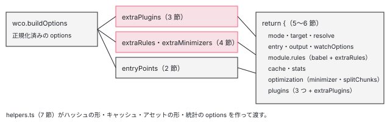

[目次](../README.md) › [webpack の builder の内側：@angular-devkit/build-angular と schematics の CLI](README.md) › 第 2 回 / 全 12 回

# webpack の共通の設定：configs/common.ts

> tools/webpack/configs/common.ts・utils/helpers.ts：entry と output、resolve、loader の並び、最適化（splitChunks・minimizer）、ソースマップ、キャッシュ、AngularWebpackPlugin とのつなぎ方。

angular/angular-cli · 読了 約 13 分 · 発展 · [サイトで読む（デモが動きます）](https://angular-deep-dive-cyan.vercel.app/chapter/bwp-webpack-common)

---

この章で分かること：browser・server・karma・dev-server の 4 つの builder が共通に使う webpack の設定 `getCommonConfig` が、options の 1 つ 1 つを webpack のどの項目に置き換えるか。entry と output、resolve、loader の並び、minimizer（縮める側のプラグイン）、ソースマップ、キャッシュ、splitChunks（チャンクの分け方）を順に読み、options を 1 つ変えると設定のどこが変わるかを、本物の記録で確かめます。

読む対象は angular-cli（44129f66a3）の `packages/angular_devkit/build_angular/src/tools/webpack/configs/common.ts` の全部と、`tools/webpack/utils/helpers.ts`・`utils/environment-options.ts` のうち、この関数が使う部分です。この関数を呼ぶのは [前の回](01-bwp-browser.md)の `initialize` です。application builder（esbuild）の側で同じ役をする esbuild の options の組み立ては [esb-code-bundle の章](../esb/01-esb-code-bundle.md)で読みました。

1. [1. browser builder の流れ](01-bwp-browser.md)
2. **2. webpack の共通の設定**（この章）
3. [3. スタイルの設定](03-bwp-webpack-styles.md)
4. [4. Angular の webpack プラグイン](04-bwp-webpack-plugins.md)
5. [5. babel の最適化のプラグイン](05-bwp-babel.md)
6. [6. webpack の dev-server](06-bwp-dev-server.md)
7. [7. server builder と ssr-dev-server](07-bwp-server-ssr.md)
8. [8. prerender と app-shell](08-bwp-prerender-appshell.md)
9. [9. webpack の i18n](09-bwp-i18n.md)
10. [10. karma の builder の webpack の側](10-bwp-karma.md)
11. [11. schematics の CLI](11-bwp-schematics-cli.md)
12. [12. spec と issue](12-bwp-tests-issues.md)

> [!NOTE]
> **ポイント**
>
> 記録は npm の 22.2.7（webpack 5.112.0）です。この章で引く 3 つのファイルは v22.2.7 と 44129f66a3 で同じです。

## 0. 全体の流れ



*getCommonConfig は options を読み、プラグインと loader の規則を条件ごとに配列へ積み、最後に 1 つのオブジェクトを返す。styles の設定（次の回）は別の関数で作り、前の回の 62 行目で混ぜる。*

1. **options を取り出す**

   既定の値を付けて分解し、compiler-cli を読み込み、ハッシュの形を決める（1 節）。
2. **entry を作る**

   `main`・`polyfills`、server なら `@angular/platform-server/init`（2 節）。
3. **プラグインと規則を積む**

   options の真偽ごとに `extraPlugins`・`extraRules`・`extraMinimizers` に足す（3〜4 節）。
4. **1 つのオブジェクトを返す**

   積んだものを webpack の項目に置き、変わらない項目（moduleIds・runtimeChunk など）を決め打ちで書く（5〜6 節）。

## 1. options の取り出しと compiler-cli

📄 `angular-cli/packages/angular_devkit/build_angular/src/tools/webpack/configs/common.ts` L47–81 （▶ の行: 47, 50–51, 55–57, 60, 66–68, 74, 77–80）

```ts
47 ▶ const VENDORS_TEST = /[\\/]node_modules[\\/]/;
48 │ 
49 │ // eslint-disable-next-line max-lines-per-function
50 ▶ export async function getCommonConfig(wco: WebpackConfigOptions): Promise<Configuration> {
51 ▶   const { root, projectRoot, buildOptions, tsConfig, projectName, sourceRoot, tsConfigPath } = wco;
52 │   const {
53 │     cache,
54 │     codeCoverage,
55 ▶     crossOrigin = 'none',
56 ▶     platform = 'browser',
57 ▶     aot = true,
58 │     codeCoverageExclude = [],
59 │     main,
60 ▶     sourceMap: {
61 │       styles: stylesSourceMap,
62 │       scripts: scriptsSourceMap,
63 │       vendor: vendorSourceMap,
64 │       hidden: hiddenSourceMap,
65 │     },
66 ▶     optimization: { styles: stylesOptimization, scripts: scriptsOptimization },
67 ▶     commonChunk,
68 ▶     vendorChunk,
69 │     subresourceIntegrity,
70 │     verbose,
71 │     poll,
72 │     webWorkerTsConfig,
73 │     externalDependencies = [],
74 ▶     allowedCommonJsDependencies,
75 │   } = buildOptions;
76 │ 
77 ▶   const isPlatformServer = buildOptions.platform === 'server';
78 ▶   const extraPlugins: { apply(compiler: Compiler): void }[] = [];
79 ▶   const extraRules: RuleSetRule[] = [];
80 ▶   const entryPoints: Configuration['entry'] = {};
81 │ 
```

📄 `angular-cli/packages/angular_devkit/build_angular/src/tools/webpack/configs/common.ts` L82–105 （▶ の行: 85–86, 91, 93–94, 97–98, 102–103）

```ts
 82 │   // Load ESM `@angular/compiler-cli` using the TypeScript dynamic import workaround.
 83 │   // Once TypeScript provides support for keeping the dynamic import this workaround can be
 84 │   // changed to a direct dynamic import.
 85 ▶   const { VERSION: NG_VERSION } = await import('@angular/compiler-cli');
 86 ▶   const { GLOBAL_DEFS_FOR_TERSER, GLOBAL_DEFS_FOR_TERSER_WITH_AOT } = await import(
 87 │     '@angular/compiler-cli/private/tooling'
 88 │   );
 89 │ 
 90 │   // determine hashing format
 91 ▶   const hashFormat = getOutputHashFormat(buildOptions.outputHashing);
 92 │ 
 93 ▶   if (buildOptions.progress) {
 94 ▶     extraPlugins.push(new ProgressPlugin(platform));
 95 │   }
 96 │ 
 97 ▶   const localizePackageInitEntryPoint = '@angular/localize/init';
 98 ▶   const hasLocalizeType = tsConfig.options.types?.some(
 99 │     (t) => t === '@angular/localize' || t === localizePackageInitEntryPoint,
100 │   );
101 │ 
102 ▶   if (hasLocalizeType) {
103 ▶     entryPoints['main'] = [localizePackageInitEntryPoint];
104 │   }
105 │ 
```

1. **55〜57 行目：既定の値**

   `crossOrigin` は `'none'`、`platform` は `'browser'`、`aot` は true。schema の既定と同じ値をもう一度ここで書いています。
2. **60〜66 行目：正規化済みの 2 つ**

   `sourceMap` と `optimization` は、前の回の `normalizeBrowserSchema` でオブジェクトになっているので、そのまま分解できます。
3. **78〜80 行目：積む先**

   この関数の残りは、条件ごとにこの 3 つの入れ物に足していく形です。
4. **85〜88 行目：compiler-cli を ESM で読む**

   `VERSION` はキャッシュの名前（7 節）に、`GLOBAL_DEFS_FOR_TERSER` は JS の最適化の `define`（4 節）に使います。
5. **91 行目：ハッシュの形**

   `getOutputHashFormat`（5 節）が `outputHashing` から 4 種類のファイル名の後ろを決めます。
6. **97〜104 行目：`@angular/localize` を型に入れたら**

   tsconfig の `types` に `@angular/localize` か `@angular/localize/init` があれば、`main` の entry の先頭に `@angular/localize/init` を入れます（`$localize` を実行時に使うため）。

## 2. entry：main・polyfills・server

📄 `angular-cli/packages/angular_devkit/build_angular/src/tools/webpack/configs/common.ts` L106–128 （▶ の行: 106–109, 111, 115, 117, 119–121, 125）

```ts
106 ▶   if (buildOptions.main) {
107 ▶     const mainPath = path.resolve(root, buildOptions.main);
108 ▶     if (Array.isArray(entryPoints['main'])) {
109 ▶       entryPoints['main'].push(mainPath);
110 │     } else {
111 ▶       entryPoints['main'] = [mainPath];
112 │     }
113 │   }
114 │ 
115 ▶   if (isPlatformServer) {
116 │     // Fixes Critical dependency: the request of a dependency is an expression
117 ▶     extraPlugins.push(new ContextReplacementPlugin(/@?hapi|express[\\/]/));
118 │ 
119 ▶     if (
120 ▶       isPackageInstalled(wco.root, '@angular/platform-server') &&
121 ▶       Array.isArray(entryPoints['main'])
122 │     ) {
123 │       // This import must come before any imports (direct or transitive) that rely on DOM built-ins being
124 │       // available, such as `@angular/elements`.
125 ▶       entryPoints['main'].unshift('@angular/platform-server/init');
126 │     }
127 │   }
128 │ 
```

📄 `angular-cli/packages/angular_devkit/build_angular/src/tools/webpack/configs/common.ts` L129–163 （▶ の行: 129–131, 146–147, 149, 152, 155, 157, 159）

```ts
129 ▶   const polyfills = [...buildOptions.polyfills];
130 ▶   if (!aot) {
131 ▶     polyfills.push('@angular/compiler');
132 │   }
133 │ 
134 │   if (polyfills.length) {
135 │     // `zone.js/testing` is a **special** polyfill because when not imported in the main it fails with the below errors:
136 │     // `Error: Expected to be running in 'ProxyZone', but it was not found.`
137 │     // This was also the reason why previously it was imported in `test.ts` as the first module.
138 │     // From Jia li:
139 │     // This is because the jasmine functions such as beforeEach/it will not be patched by zone.js since
140 │     // jasmine will not be loaded yet, so the ProxyZone will not be there. We have to load zone-testing.js after
141 │     // jasmine is ready.
142 │     // We could force loading 'zone.js/testing' prior to jasmine by changing the order of scripts in 'karma-context.html'.
143 │     // But this has it's own problems as zone.js needs to be loaded prior to jasmine due to patching of timing functions
144 │     // See: https://github.com/jasmine/jasmine/issues/1944
145 │     // Thus the correct order is zone.js -> jasmine -> zone.js/testing.
146 ▶     const zoneTestingEntryPoint = 'zone.js/testing';
147 ▶     const polyfillsExludingZoneTesting = polyfills.filter((p) => p !== zoneTestingEntryPoint);
148 │ 
149 ▶     if (Array.isArray(entryPoints['polyfills'])) {
150 │       entryPoints['polyfills'].push(...polyfillsExludingZoneTesting);
151 │     } else {
152 ▶       entryPoints['polyfills'] = polyfillsExludingZoneTesting;
153 │     }
154 │ 
155 ▶     if (polyfillsExludingZoneTesting.length !== polyfills.length) {
156 │       if (Array.isArray(entryPoints['main'])) {
157 ▶         entryPoints['main'].unshift(zoneTestingEntryPoint);
158 │       } else {
159 ▶         entryPoints['main'] = [zoneTestingEntryPoint];
160 │       }
161 │     }
162 │   }
163 │ 
```

106〜113 行目で `main` を絶対パスにして entry の `main` の配列に足します。デモの「設定」の `entry.main` は `<app>/src/main.ts` の 1 つです。115〜127 行目は server builder（`platform: 'server'`）だけの分で、`@angular/platform-server` が入っていれば `@angular/platform-server/init` を `main` の先頭に入れます（[第 7 回](07-bwp-server-ssr.md)）。

1. **130〜132 行目：JIT なら compiler を polyfills に**

   `aot: false` だと実行時にテンプレートをコンパイルするので、`@angular/compiler` を `polyfills` の entry に足します。デモの「aot: false」では `entry.polyfills` が `["@angular/compiler"]` になり、`polyfills.….js`（約 523 kB）が増えました。
2. **146〜161 行目：`zone.js/testing` は main へ**

   135〜145 行目のコメントのとおり、`zone.js/testing` は jasmine より後に読む必要があるので、polyfills から抜いて `main` の先頭に移します（karma の builder がこれを使う。[第 10 回](10-bwp-karma.md)）。

## 3. プラグインを積む

📄 `angular-cli/packages/angular_devkit/build_angular/src/tools/webpack/configs/common.ts` L164–199 （▶ の行: 164–165, 167–168, 176, 178, 181, 185, 192–195）

```ts
164 ▶   if (allowedCommonJsDependencies) {
165 ▶     // When this is not defined it means the builder doesn't support showing common js usages.
166 │     // When it does it will be an array.
167 ▶     extraPlugins.push(
168 ▶       new CommonJsUsageWarnPlugin({
169 │         allowedDependencies: allowedCommonJsDependencies,
170 │       }),
171 │     );
172 │   }
173 │ 
174 │   // process global scripts
175 │   // Add a new asset for each entry.
176 ▶   for (const { bundleName, inject, paths } of globalScriptsByBundleName(buildOptions.scripts)) {
177 │     // Lazy scripts don't get a hash, otherwise they can't be loaded by name.
178 ▶     const hash = inject ? hashFormat.script : '';
179 │ 
180 │     extraPlugins.push(
181 ▶       new ScriptsWebpackPlugin({
182 │         name: bundleName,
183 │         sourceMap: scriptsSourceMap,
184 │         scripts: paths,
185 ▶         filename: `${path.basename(bundleName)}${hash}.js`,
186 │         basePath: root,
187 │       }),
188 │     );
189 │   }
190 │ 
191 │   // process asset entries
192 ▶   if (buildOptions.assets.length) {
193 ▶     extraPlugins.push(
194 ▶       new CopyWebpackPlugin({
195 ▶         patterns: assetPatterns(root, buildOptions.assets),
196 │       }),
197 │     );
198 │   }
199 │ 
```

1. **164〜172 行目：CommonJS の警告**

   schema の既定が `[]` なので、browser builder では必ず積まれます（デモの `plugins` の `CommonJsUsageWarnPlugin`）。165 行目のコメントのとおり、この options を持たない builder（server など）では undefined で積まれません。中身は [第 4 回](04-bwp-webpack-plugins.md)。
2. **176〜189 行目：scripts の束ごとに 1 つ**

   `globalScriptsByBundleName` がまとめた束ごとに `ScriptsWebpackPlugin` を 1 つ積みます。178 行目、`inject: false` の束にはハッシュを付けません（名前で読み込むため）。中身と、束のまとめ方は第 4 回です。
3. **192〜198 行目：アセット**

   `assets` が空でなければ `CopyWebpackPlugin`。前の回の 95 行目で、watch でないときは空にしてから呼ばれるので、ふだんの `ng build` ではここは積まれません。

📄 `angular-cli/packages/angular_devkit/build_angular/src/tools/webpack/configs/common.ts` L200–214 （▶ の行: 200–201, 203, 208–210）

```ts
200 ▶   if (buildOptions.extractLicenses) {
201 ▶     const LicenseWebpackPlugin = require('license-webpack-plugin').LicenseWebpackPlugin;
202 │     extraPlugins.push(
203 ▶       new LicenseWebpackPlugin({
204 │         stats: {
205 │           warnings: false,
206 │           errors: false,
207 │         },
208 ▶         perChunkOutput: false,
209 ▶         outputFilename: '3rdpartylicenses.txt',
210 ▶         skipChildCompilers: true,
211 │       }),
212 │     );
213 │   }
214 │ 
```

`extractLicenses`（schema の既定は true、開発の設定では false）なら、`license-webpack-plugin` を必要になった時に `require` して、ライセンスを 1 つのファイル `3rdpartylicenses.txt` にまとめます（デモの本番の出力に出ます）。

📄 `angular-cli/packages/angular_devkit/build_angular/src/tools/webpack/configs/common.ts` L215–241 （▶ の行: 215, 218, 222, 225, 228–230, 235–237）

```ts
215 ▶   if (scriptsSourceMap || stylesSourceMap) {
216 │     const include = [];
217 │     if (scriptsSourceMap) {
218 ▶       include.push(/js$/);
219 │     }
220 │ 
221 │     if (stylesSourceMap) {
222 ▶       include.push(/css$/);
223 │     }
224 │ 
225 ▶     extraPlugins.push(new DevToolsIgnorePlugin());
226 │ 
227 │     extraPlugins.push(
228 ▶       new SourceMapDevToolPlugin({
229 ▶         filename: '[file].map',
230 ▶         include,
231 │         // We want to set sourceRoot to  `webpack:///` for non
232 │         // inline sourcemaps as otherwise paths to sourcemaps will be broken in browser
233 │         // `webpack:///` is needed for Visual Studio breakpoints to work properly as currently
234 │         // there is no way to set the 'webRoot'
235 ▶         sourceRoot: 'webpack:///',
236 ▶         moduleFilenameTemplate: '[resource-path]',
237 ▶         append: hiddenSourceMap ? false : undefined,
238 │       }),
239 │     );
240 │   }
241 │ 
```

1. **215〜240 行目：ソースマップは devtool でなくプラグインで**

   返す設定の `devtool` は 326 行目で常に false。代わりに `SourceMapDevToolPlugin` を自分で積み、JS と CSS のどちらに付けるかを `include` で決めます。
2. **225 行目：DevTools の無視の一覧**

   `DevToolsIgnorePlugin` が、node\_modules と webpack の中のソースを `x_google_ignoreList` に入れます（第 4 回）。
3. **237 行目：hidden**

   `append: false` で、JS の末尾に `//# sourceMappingURL` を書きません。デモの「sourceMap: hidden」は `.map` ができても `main.….js` の中身（96,335 B）が基準と同じ大きさのままです。

📄 `angular-cli/packages/angular_devkit/build_angular/src/tools/webpack/configs/common.ts` L242–279 （▶ の行: 242–243, 246, 248, 252, 254–255, 260, 262–264, 267, 274）

```ts
242 ▶   if (verbose) {
243 ▶     extraPlugins.push(new WatchFilesLogsPlugin());
244 │   }
245 │ 
246 ▶   if (buildOptions.statsJson) {
247 │     extraPlugins.push(
248 ▶       new JsonStatsPlugin(path.resolve(root, buildOptions.outputPath, 'stats.json')),
249 │     );
250 │   }
251 │ 
252 ▶   if (subresourceIntegrity) {
253 │     extraPlugins.push(
254 ▶       new SubresourceIntegrityPlugin({
255 ▶         hashFuncNames: ['sha384'],
256 │       }),
257 │     );
258 │   }
259 │ 
260 ▶   if (scriptsSourceMap || stylesSourceMap) {
261 │     extraRules.push({
262 ▶       test: /\.[cm]?jsx?$/,
263 ▶       enforce: 'pre',
264 ▶       loader: require.resolve('source-map-loader'),
265 │       options: {
266 │         filterSourceMappingUrl: (_mapUri: string, resourcePath: string) => {
267 ▶           if (vendorSourceMap) {
268 │             // Consume all sourcemaps when vendor option is enabled.
269 │             return true;
270 │           }
271 │ 
272 │           // Don't consume sourcemaps in node_modules when vendor is disabled.
273 │           // But, do consume local libraries sourcemaps.
274 ▶           return !resourcePath.includes('node_modules');
275 │         },
276 │       },
277 │     });
278 │   }
279 │ 
```

246〜250 行目の `statsJson` は、出力のフォルダに `stats.json` を書くプラグインです（デモでは 6.2 MB）。252〜258 行目の `subresourceIntegrity` は sha384 のハッシュを付けるプラグイン、260〜278 行目は、ソースマップがあるときに入力の JS が持つソースマップを読む `source-map-loader` です。267〜274 行目で、`vendor` のソースマップを頼まれていなければ node\_modules の中の地図は読みません。

## 4. loader と minimizer

📄 `angular-cli/packages/angular_devkit/build_angular/src/tools/webpack/configs/common.ts` L280–316 （▶ の行: 280, 282–283, 285, 289, 292–293, 297, 299, 301–302, 306–308, 313–314）

```ts
280 ▶   if (main || polyfills) {
281 │     extraRules.push({
282 ▶       test: tsConfig.options.allowJs ? /\.[cm]?[tj]sx?$/ : /\.[cm]?tsx?$/,
283 ▶       loader: AngularWebpackLoaderPath,
284 │       // The below are known paths that are not part of the TypeScript compilation even when allowJs is enabled.
285 ▶       exclude: [
286 │         /[\\/]node_modules[/\\](?:css-loader|mini-css-extract-plugin|webpack-dev-server|webpack)[/\\]/,
287 │       ],
288 │     });
289 ▶     extraPlugins.push(createIvyPlugin(wco, aot, tsConfigPath));
290 │   }
291 │ 
292 ▶   if (webWorkerTsConfig) {
293 ▶     extraPlugins.push(createIvyPlugin(wco, false, path.resolve(wco.root, webWorkerTsConfig)));
294 │   }
295 │ 
296 │   const extraMinimizers = [];
297 ▶   if (scriptsOptimization) {
298 │     extraMinimizers.push(
299 ▶       new JavaScriptOptimizerPlugin({
300 │         define: {
301 ▶           ...(buildOptions.aot ? GLOBAL_DEFS_FOR_TERSER_WITH_AOT : GLOBAL_DEFS_FOR_TERSER),
302 ▶           'ngServerMode': isPlatformServer,
303 │         },
304 │         sourcemap: scriptsSourceMap,
305 │         supportedBrowsers: buildOptions.supportedBrowsers,
306 ▶         keepIdentifierNames: !allowMangle || isPlatformServer,
307 ▶         removeLicenses: buildOptions.extractLicenses,
308 ▶         advanced: buildOptions.buildOptimizer,
309 │       }),
310 │     );
311 │   }
312 │ 
313 ▶   if (platform === 'browser' && (scriptsOptimization || stylesOptimization.minify)) {
314 ▶     extraMinimizers.push(new TransferSizePlugin());
315 │   }
316 │ 
```

1. **280〜290 行目：TS を Angular の loader に**

   `@ngtools/webpack` の loader が `.ts`（`allowJs` なら `.js` も）を受け持ち、289 行目の `createIvyPlugin`（第 4 回の `typescript.ts`）がコンパイラを動かします。280 行目の条件 `main || polyfills` は、129 行目で `polyfills` を配列にしているので、空の配列でも真になり、いつも通ります。
2. **292〜294 行目：Web Worker**

   `webWorkerTsConfig` があれば、AOT でないもう 1 つの Ivy のプラグインを worker の tsconfig で積みます。
3. **297〜311 行目：JS の最適化**

   `optimization.scripts` が真なら `JavaScriptOptimizerPlugin`。`define` に Angular の決め打ちの定数（`ngDevMode: false` など）と `ngServerMode` を入れ、306 行目で名前を残すか（`NG_BUILD_MANGLE` と server）、307 行目でライセンスのコメントを消すか、308 行目で terser を強くするか（`buildOptimizer`）を渡します。
4. **313〜315 行目：転送量の見積もり**

   ブラウザ向けで縮めるときだけ、brotli で縮めた大きさを測る `TransferSizePlugin`。出力の表の「Estimated transfer size」の列はこれが無いと出ません（前の回のデモの開発と本番の表の違い）。

📄 `angular-cli/packages/angular_devkit/build_angular/src/tools/webpack/configs/common.ts` L410–437 （▶ の行: 411, 413–415, 419, 421–425, 427–428, 435）

```ts
410 │         {
411 ▶           test: /\.[cm]?[tj]sx?$/,
412 │           // The below is needed due to a bug in `@babel/runtime`. See: https://github.com/babel/babel/issues/12824
413 ▶           resolve: { fullySpecified: false },
414 ▶           exclude: [
415 ▶             /[\\/]node_modules[/\\](?:core-js|@babel|tslib|web-animations-js|web-streams-polyfill|whatwg-url)[/\\]/,
416 │           ],
417 │           use: [
418 │             {
419 ▶               loader: require.resolve('../../babel/webpack-loader'),
420 │               options: {
421 ▶                 cacheDirectory: (cache.enabled && path.join(cache.path, 'babel-webpack')) || false,
422 ▶                 aot: buildOptions.aot,
423 ▶                 optimize: buildOptions.buildOptimizer,
424 ▶                 supportedBrowsers: buildOptions.supportedBrowsers,
425 ▶                 instrumentCode: codeCoverage
426 │                   ? {
427 ▶                       includedBasePath: sourceRoot ?? projectRoot,
428 ▶                       excludedPaths: getInstrumentationExcludedPaths(root, codeCoverageExclude),
429 │                     }
430 │                   : undefined,
431 │               } as AngularBabelLoaderOptions,
432 │             },
433 │           ],
434 │         },
435 ▶         ...extraRules,
436 │       ],
437 │     },
```

すべての JS（node\_modules も含む）は babel の loader（`tools/babel/webpack-loader.ts`）を通ります。415 行目で `core-js`・`@babel`・`tslib` などは外し、422〜424 行目の `aot`・`optimize`（= `buildOptimizer`）・`supportedBrowsers` で、この loader が何をするかが決まります（[第 5 回](05-bwp-babel.md)）。435 行目で 3〜4 節の `extraRules`（source-map-loader と Angular の loader）を後ろに足します。webpack は 1 つのファイルに当てはまる規則の loader を規則の順に集め、後ろから走らせます（`enforce: 'pre'` はその前）。そのため `.ts` は「Angular の loader（後ろの規則）→ babel」、`.js` は「source-map-loader（pre）→ babel」の順です。

📄 `angular-cli/packages/angular_devkit/build_angular/src/utils/environment-options.ts` L11–41 （▶ の行: 11–12, 15–16, 19–20, 24, 26, 34, 40）

```ts
11 ▶ function isDisabled(variable: string): boolean {
12 ▶   return variable === '0' || variable.toLowerCase() === 'false';
13 │ }
14 │ 
15 ▶ function isEnabled(variable: string): boolean {
16 ▶   return variable === '1' || variable.toLowerCase() === 'true';
17 │ }
18 │ 
19 ▶ function isPresent(variable: string | undefined): variable is string {
20 ▶   return typeof variable === 'string' && variable !== '';
21 │ }
22 │ 
23 │ // Optimization and mangling
24 ▶ const debugOptimizeVariable = process.env['NG_BUILD_DEBUG_OPTIMIZE'];
25 │ const debugOptimize = (() => {
26 ▶   if (!isPresent(debugOptimizeVariable) || isDisabled(debugOptimizeVariable)) {
27 │     return {
28 │       mangle: true,
29 │       minify: true,
30 │       beautify: false,
31 │     };
32 │   }
33 │ 
34 ▶   const debugValue = {
35 │     mangle: false,
36 │     minify: false,
37 │     beautify: true,
38 │   };
39 │ 
40 ▶   if (isEnabled(debugOptimizeVariable)) {
41 │     return debugValue;
```

📄 `angular-cli/packages/angular_devkit/build_angular/src/utils/environment-options.ts` L42–67 （▶ の行: 44, 46, 49, 52, 61–64, 66–67）

```ts
42 │   }
43 │ 
44 ▶   for (const part of debugOptimizeVariable.split(',')) {
45 │     switch (part.trim().toLowerCase()) {
46 ▶       case 'mangle':
47 │         debugValue.mangle = true;
48 │         break;
49 ▶       case 'minify':
50 │         debugValue.minify = true;
51 │         break;
52 ▶       case 'beautify':
53 │         debugValue.beautify = true;
54 │         break;
55 │     }
56 │   }
57 │ 
58 │   return debugValue;
59 │ })();
60 │ 
61 ▶ const mangleVariable = process.env['NG_BUILD_MANGLE'];
62 ▶ export const allowMangle = isPresent(mangleVariable)
63 ▶   ? !isDisabled(mangleVariable)
64 ▶   : debugOptimize.mangle;
65 │ 
66 ▶ export const shouldBeautify = debugOptimize.beautify;
67 ▶ export const allowMinify = debugOptimize.minify;
```

📄 `angular-cli/packages/angular_devkit/build_angular/src/utils/environment-options.ts` L69–98 （▶ の行: 78–81, 84, 87, 90, 93, 97）

```ts
69 │ /**
70 │  * Some environments, like CircleCI which use Docker report a number of CPUs by the host and not the count of available.
71 │  * This cause `Error: Call retries were exceeded` errors when trying to use them.
72 │  *
73 │  * @see https://github.com/nodejs/node/issues/28762
74 │  * @see https://github.com/webpack-contrib/terser-webpack-plugin/issues/143
75 │  * @see https://ithub.com/angular/angular-cli/issues/16860#issuecomment-588828079
76 │  *
77 │  */
78 ▶ const maxWorkersVariable = process.env['NG_BUILD_MAX_WORKERS'];
79 ▶ export const maxWorkers = isPresent(maxWorkersVariable)
80 ▶   ? +maxWorkersVariable
81 ▶   : Math.min(4, Math.max(availableParallelism() - 1, 1));
82 │ 
83 │ const parallelTsVariable = process.env['NG_BUILD_PARALLEL_TS'];
84 ▶ export const useParallelTs = !isPresent(parallelTsVariable) || !isDisabled(parallelTsVariable);
85 │ 
86 │ const debugPerfVariable = process.env['NG_BUILD_DEBUG_PERF'];
87 ▶ export const debugPerformance = isPresent(debugPerfVariable) && isEnabled(debugPerfVariable);
88 │ 
89 │ const watchRootVariable = process.env['NG_BUILD_WATCH_ROOT'];
90 ▶ export const shouldWatchRoot = isPresent(watchRootVariable) && isEnabled(watchRootVariable);
91 │ 
92 │ const typeCheckingVariable = process.env['NG_BUILD_TYPE_CHECK'];
93 ▶ export const useTypeChecking =
94 │   !isPresent(typeCheckingVariable) || !isDisabled(typeCheckingVariable);
95 │ 
96 │ const buildLogsJsonVariable = process.env['NG_BUILD_LOGS_JSON'];
97 ▶ export const useJSONBuildLogs =
98 │   isPresent(buildLogsJsonVariable) && isEnabled(buildLogsJsonVariable);
```

306 行目の `allowMangle` は、`NG_BUILD_MANGLE` があればその値、無ければ `NG_BUILD_DEBUG_OPTIMIZE` の解析結果の `mangle` です（61〜64 行目）。`NG_BUILD_DEBUG_OPTIMIZE=1` にすると 34〜41 行目で mangle・minify が false になりますが、build\_angular の中で `allowMinify`（67 行目）と `shouldBeautify`（66 行目）を読むのは `utils/process-bundle.ts`（i18n の差し込み）だけです。webpack の JS の最適化では名前を残すだけで、縮めることは続きます。79〜81 行目の `maxWorkers` は第 4 回の最適化のワーカーの数です。83〜98 行目の `useParallelTs`・`debugPerformance`・`shouldWatchRoot`・`useTypeChecking`・`useJSONBuildLogs` は、build\_angular の中に読む所がありません（`grep` で 0 件。同じ名前の変数は `@angular/build` の側で使われます）。

## 5. 返す設定：mode・resolve・output

📄 `angular-cli/packages/angular_devkit/build_angular/src/tools/webpack/configs/common.ts` L317–344 （▶ の行: 317–321, 325–327, 330–334, 336–337）

```ts
317 ▶   let crossOriginLoading: NonNullable<Configuration['output']>['crossOriginLoading'] = false;
318 ▶   if (subresourceIntegrity && crossOrigin === 'none') {
319 ▶     crossOriginLoading = 'anonymous';
320 ▶   } else if (crossOrigin !== 'none') {
321 ▶     crossOriginLoading = crossOrigin;
322 │   }
323 │ 
324 │   return {
325 ▶     mode: scriptsOptimization || stylesOptimization.minify ? 'production' : 'development',
326 ▶     devtool: false,
327 ▶     target: [isPlatformServer ? 'node' : 'web', 'es2015'],
328 │     profile: buildOptions.statsJson,
329 │     resolve: {
330 ▶       roots: [projectRoot],
331 ▶       extensions: ['.ts', '.tsx', '.mjs', '.js'],
332 ▶       symlinks: !buildOptions.preserveSymlinks,
333 ▶       modules: [tsConfig.options.baseUrl || projectRoot, 'node_modules'],
334 ▶       mainFields: isPlatformServer
335 │         ? ['es2020', 'es2015', 'module', 'main']
336 ▶         : ['es2020', 'es2015', 'browser', 'module', 'main'],
337 ▶       conditionNames: ['es2020', 'es2015', '...'],
338 │     },
339 │     resolveLoader: {
340 │       symlinks: !buildOptions.preserveSymlinks,
341 │     },
342 │     context: root,
343 │     entry: entryPoints,
344 │     externals: externalDependencies,
```

1. **317〜322 行目：`crossOriginLoading`**

   SRI だけなら `'anonymous'`、`crossOrigin` を指定すればその値。デモの「subresourceIntegrity: true」「crossOrigin」の行で、ここだけが変わります。
2. **325 行目：mode**

   JS か CSS のどちらかを縮めるなら `'production'`。`optimization: false` の行で `'development'` に変わります。
3. **327 行目：target**

   `['web', 'es2015']`。webpack の runtime の書き方の下限で、出力の JS の書き方は babel と browserslist が決めます。
4. **333 行目：resolve.modules**

   tsconfig の `baseUrl`（無ければプロジェクトの根）を node\_modules より前に置きます。プロジェクトの根の直下のフォルダが、パッケージの名前のように `import 'フォルダ名'` で引けます（第 4 回のデモの `legacy-cjs` はこれを使いました）。
5. **334〜337 行目：mainFields と conditionNames**

   `es2020`・`es2015` を先に見て、ブラウザでは `browser` を `module` より前に置きます。

📄 `angular-cli/packages/angular_devkit/build_angular/src/tools/webpack/configs/common.ts` L345–374 （▶ の行: 346–348, 350–352, 354–356, 358, 360, 362–363, 369）

```ts
345 │     output: {
346 ▶       uniqueName: projectName,
347 ▶       hashFunction: 'xxhash64', // todo: remove in webpack 6. This is part of `futureDefaults`.
348 ▶       clean: buildOptions.deleteOutputPath ?? true,
349 │       path: path.resolve(root, buildOptions.outputPath),
350 ▶       publicPath: buildOptions.deployUrl ?? '',
351 ▶       filename: `[name]${hashFormat.chunk}.js`,
352 ▶       chunkFilename: `[name]${hashFormat.chunk}.js`,
353 │       libraryTarget: isPlatformServer ? 'commonjs' : undefined,
354 ▶       crossOriginLoading,
355 ▶       trustedTypes: 'angular#bundler',
356 ▶       scriptType: 'module',
357 │     },
358 ▶     watch: buildOptions.watch,
359 │     watchOptions: {
360 ▶       poll,
361 │       // The below is needed as when preserveSymlinks is enabled we disable `resolve.symlinks`.
362 ▶       followSymlinks: buildOptions.preserveSymlinks,
363 ▶       ignored: poll === undefined ? undefined : '**/node_modules/**',
364 │     },
365 │     snapshot: {
366 │       module: {
367 │         // Use hash of content instead of timestamp because the timestamp of the symlink will be used
368 │         // instead of the referenced files which causes changes in symlinks not to be picked up.
369 ▶         hash: buildOptions.preserveSymlinks,
370 │       },
371 │     },
372 │     performance: {
373 │       hints: false,
374 │     },
```

📄 `angular-cli/packages/angular_devkit/build_angular/src/tools/webpack/utils/helpers.ts` L31–67 （▶ の行: 33–34, 37, 39, 41, 44, 46, 51, 58–59）

```ts
31 │ export type WebpackStatsOptions = Exclude<Configuration['stats'], string | boolean | undefined>;
32 │ 
33 ▶ export function getOutputHashFormat(outputHashing = OutputHashing.None, length = 20): HashFormat {
34 ▶   const hashTemplate = `.[contenthash:${length}]`;
35 │ 
36 │   switch (outputHashing) {
37 ▶     case 'media':
38 │       return {
39 ▶         chunk: '',
40 │         extract: '',
41 ▶         file: hashTemplate,
42 │         script: '',
43 │       };
44 ▶     case 'bundles':
45 │       return {
46 ▶         chunk: hashTemplate,
47 │         extract: hashTemplate,
48 │         file: '',
49 │         script: hashTemplate,
50 │       };
51 ▶     case 'all':
52 │       return {
53 │         chunk: hashTemplate,
54 │         extract: hashTemplate,
55 │         file: hashTemplate,
56 │         script: hashTemplate,
57 │       };
58 ▶     case 'none':
59 ▶     default:
60 │       return {
61 │         chunk: '',
62 │         extract: '',
63 │         file: '',
64 │         script: '',
65 │       };
66 │   }
67 │ }
```

1. **351〜352 行目と 33〜34 行目：ハッシュは 20 桁と書いて 16 桁**

   ファイル名は `[name].[contenthash:20].js` ですが、347 行目の `hashFunction: 'xxhash64'` が 16 桁（64 bit）しか作らないので、出力は `main.c3a5375cc7c224bc.js` の 16 桁になります。spec も 16 桁を期待しています（`output-hashing_spec.ts` の 34 行目の `/main\.[0-9a-f]{16}\.js$/`）。
2. **37〜50 行目：`media` と `bundles`**

   `media` は `file`（url() で引いた画像など）だけ、`bundles` は JS と CSS だけにハッシュを付けます。デモの「outputHashing: 'media'」では JS の名前からハッシュが消えます。
3. **348・350 行目：clean と publicPath**

   `deleteOutputPath`（既定 true）で webpack も出力のフォルダを掃除し、`deployUrl` を `publicPath` にします（遅延チャンクを読む URL の前に付く）。
4. **355〜356 行目：Trusted Types と module**

   webpack の runtime が作る script の URL を `angular#bundler` の Trusted Types の方針で作り、`<script type="module">` として読みます。
5. **359〜370 行目：watch と symlink**

   `poll` があれば node\_modules を見張りから外し、`preserveSymlinks` なら時刻でなく中身のハッシュで変化を見ます（デモの「preserveSymlinks: true」は `resolve.symlinks` が false になる）。

## 6. module・最適化・splitChunks

📄 `angular-cli/packages/angular_devkit/build_angular/src/tools/webpack/configs/common.ts` L375–409 （▶ の行: 377, 379, 382, 386, 389, 392–393, 398, 400–401, 407–408）

```ts
375 │     ignoreWarnings: [
376 │       // https://github.com/webpack-contrib/source-map-loader/blob/b2de4249c7431dd8432da607e08f0f65e9d64219/src/index.js#L83
377 ▶       /Failed to parse source map from/,
378 │       // https://github.com/webpack-contrib/postcss-loader/blob/bd261875fdf9c596af4ffb3a1a73fe3c549befda/src/index.js#L153-L158
379 ▶       /Add postcss as project dependency/,
380 │       // esbuild will issue a warning, while still hoists the @charset at the very top.
381 │       // This is caused by a bug in css-loader https://github.com/webpack-contrib/css-loader/issues/1212
382 ▶       /"@charset" must be the first rule in the file/,
383 │     ],
384 │     module: {
385 │       // Show an error for missing exports instead of a warning.
386 ▶       strictExportPresence: true,
387 │       parser: {
388 │         javascript: {
389 ▶           requireContext: false,
390 │           // Disable auto URL asset module creation. This doesn't effect `new Worker(new URL(...))`
391 │           // https://webpack.js.org/guides/asset-modules/#url-assets
392 ▶           url: false,
393 ▶           worker: !!webWorkerTsConfig,
394 │         },
395 │       },
396 │       rules: [
397 │         {
398 ▶           test: /\.?(svg|html)$/,
399 │           // Only process HTML and SVG which are known Angular component resources.
400 ▶           resourceQuery: /\?ngResource/,
401 ▶           type: 'asset/source',
402 │         },
403 │         {
404 │           // Mark files inside `rxjs/add` as containing side effects.
405 │           // If this is fixed upstream and the fixed version becomes the minimum
406 │           // supported version, this can be removed.
407 ▶           test: /[/\\]rxjs[/\\]add[/\\].+\.js$/,
408 ▶           sideEffects: true,
409 │         },
```

375〜383 行目で、source-map-loader と postcss-loader と css-loader の決まった警告を出力から消します。386 行目の `strictExportPresence` で、無い export の import をエラーにします。392 行目の `url: false` は、JS の中の `new URL('./x', import.meta.url)` を webpack がアセットにしないための設定です（Worker の `new URL` は 393 行目で別に扱う）。398〜402 行目の規則は、Angular のコンポーネントの `templateUrl` の HTML と SVG を、`?ngResource` の付いた要求のときだけ文字列として読みます。

📄 `angular-cli/packages/angular_devkit/build_angular/src/tools/webpack/configs/common.ts` L438–455 （▶ の行: 439–442, 445–446, 448–449, 451–455）

```ts
438 │     experiments: {
439 ▶       backCompat: false,
440 ▶       syncWebAssembly: true,
441 ▶       asyncWebAssembly: true,
442 ▶       topLevelAwait: false,
443 │     },
444 │     infrastructureLogging: {
445 ▶       debug: verbose,
446 ▶       level: verbose ? 'verbose' : 'error',
447 │     },
448 ▶     stats: getStatsOptions(verbose),
449 ▶     cache: getCacheSettings(wco, NG_VERSION.full),
450 │     optimization: {
451 ▶       minimizer: extraMinimizers,
452 ▶       moduleIds: 'deterministic',
453 ▶       chunkIds: buildOptions.namedChunks ? 'named' : 'deterministic',
454 ▶       emitOnErrors: false,
455 ▶       runtimeChunk: isPlatformServer ? false : 'single',
```

📄 `angular-cli/packages/angular_devkit/build_angular/src/tools/webpack/configs/common.ts` L456–492 （▶ の行: 457, 459–461, 464–467, 471–474, 476, 482–483, 487–488, 490）

```ts
456 │       splitChunks: {
457 ▶         maxAsyncRequests: Infinity,
458 │         cacheGroups: {
459 ▶           default: !!commonChunk && {
460 ▶             chunks: 'async',
461 ▶             minChunks: 2,
462 │             priority: 10,
463 │           },
464 ▶           common: !!commonChunk && {
465 ▶             name: 'common',
466 ▶             chunks: 'async',
467 ▶             minChunks: 2,
468 │             enforce: true,
469 │             priority: 5,
470 │           },
471 ▶           vendors: false,
472 ▶           defaultVendors: !!vendorChunk && {
473 ▶             name: 'vendor',
474 ▶             chunks: (chunk) => chunk.name === 'main',
475 │             enforce: true,
476 ▶             test: VENDORS_TEST,
477 │           },
478 │         },
479 │       },
480 │     },
481 │     plugins: [
482 ▶       new NamedChunksPlugin(),
483 ▶       new OccurrencesPlugin({
484 │         aot,
485 │         scriptsOptimization,
486 │       }),
487 ▶       new DedupeModuleResolvePlugin({ verbose }),
488 ▶       ...extraPlugins,
489 │     ],
490 ▶     node: false,
491 │   };
492 │ }
```

1. **451 行目：minimizer**

   4 節の `extraMinimizers`（JS の最適化と転送量）だけを置き、CSS の `CssOptimizerPlugin` は次の回の styles の設定が足します。デモの本番の `optimization.minimizer` が `JavaScriptOptimizerPlugin, TransferSizePlugin, CssOptimizerPlugin` の順なのは、webpack-merge で配列がつながるためです。
2. **453 行目：chunkIds**

   `namedChunks` なら `'named'`。遅延チャンクの名前が `315.….js` から `src_app_lazy-a_ts.….js` に変わります（デモ）。
3. **455 行目：runtimeChunk**

   ブラウザでは webpack の runtime を `runtime.js` に分けます。server では false（1 つのファイル）。
4. **459〜470 行目：commonChunk は遅延チャンクの間だけ**

   `chunks: 'async'` と `minChunks: 2` なので、2 つ以上の遅延チャンクが使うコードだけを `common` に集めます。schema の説明「code used across multiple bundles」より狭く、初期のチャンクとの共有は対象外です。デモの「commonChunk: false」では `common.….js` が消え、2 つの遅延チャンクが 169 B から 284 B に増えます（`shared.ts` の中身がそれぞれに入る）。
5. **472〜477 行目：vendorChunk は main からだけ**

   474 行目で `main` のチャンクの node\_modules だけを `vendor` に出します。デモの「vendorChunk: true」では `main` が 96 kB から 726 B になり、`vendor.….js`（259 kB）ができました。
6. **482〜488 行目：いつも積む 3 つ**

   `NamedChunksPlugin`・`OccurrencesPlugin`・`DedupeModuleResolvePlugin` を先頭に、3〜4 節の `extraPlugins` を後ろに並べます。490 行目の `node: false` で、Node の組み込みの polyfill を入れません。

## 7. helpers の残り：キャッシュ・アセット・統計

📄 `angular-cli/packages/angular_devkit/build_angular/src/tools/webpack/utils/helpers.ts` L161–200 （▶ の行: 165–166, 168, 170–171, 175–179, 182, 185, 192, 194–195, 199）

```ts
161 │ export function getCacheSettings(
162 │   wco: WebpackConfigOptions,
163 │   angularVersion: string,
164 │ ): WebpackOptionsNormalized['cache'] {
165 ▶   const { enabled, path: cacheDirectory } = wco.buildOptions.cache;
166 ▶   if (enabled) {
167 │     return {
168 ▶       type: 'filesystem',
169 │       profile: wco.buildOptions.verbose,
170 ▶       cacheDirectory: path.join(cacheDirectory, 'angular-webpack'),
171 ▶       maxMemoryGenerations: 1,
172 │       // We use the versions and build options as the cache name. The Webpack configurations are too
173 │       // dynamic and shared among different build types: test, build and serve.
174 │       // None of which are "named".
175 ▶       name: createHash('sha1')
176 ▶         .update(angularVersion)
177 ▶         .update(VERSION)
178 ▶         .update(wco.projectRoot)
179 ▶         .update(JSON.stringify(wco.tsConfig))
180 │         .update(
181 │           JSON.stringify({
182 ▶             ...wco.buildOptions,
183 │             // Needed because outputPath changes on every build when using i18n extraction
184 │             // https://github.com/angular/angular-cli/blob/736a5f89deaca85f487b78aec9ff66d4118ceb6a/packages/angular_devkit/build_angular/src/utils/i18n-options.ts#L264-L265
185 ▶             outputPath: undefined,
186 │           }),
187 │         )
188 │         .digest('hex'),
189 │     };
190 │   }
191 │ 
192 ▶   if (wco.buildOptions.watch) {
193 │     return {
194 ▶       type: 'memory',
195 ▶       maxGenerations: 1,
196 │     };
197 │   }
198 │ 
199 ▶   return false;
200 │ }
```

angular.json の `cli.cache.enabled` が true なら、ディスクのキャッシュ（既定で `.angular/cache/ディスクのキャッシュ（.angular/cache/<版>/angular-webpack）lt;build-angular の版ディスクのキャッシュ（.angular/cache/<版>/angular-webpack）gt;/angular-webpack`、`normalize-cache.ts` の 48・68 行目）を使います。175〜188 行目のキャッシュの名前は、Angular と build-angular の版・プロジェクトの根・tsconfig・options（`outputPath` を除く）の sha1 で、どれかが変わると別のキャッシュになります。キャッシュが無効でも watch なら、1 世代だけのメモリのキャッシュ（192〜197 行目）。デモはキャッシュを切ったので `cache: false` です。

📄 `angular-cli/packages/angular_devkit/build_angular/src/tools/webpack/utils/helpers.ts` L231–267 （▶ の行: 235–238, 240–241, 245, 247, 249–250, 253, 262, 264）

```ts
231 │ export function assetPatterns(root: string, assets: AssetPatternClass[]) {
232 │   return assets.map((asset: AssetPatternClass, index: number): ObjectPattern => {
233 │     // Resolve input paths relative to workspace root and add slash at the end.
234 │     // eslint-disable-next-line prefer-const
235 ▶     let { input, output = '', ignore = [], glob } = asset;
236 ▶     input = path.resolve(root, input).replace(/\\/g, '/');
237 ▶     input = input.endsWith('/') ? input : input + '/';
238 ▶     output = output.endsWith('/') ? output : output + '/';
239 │ 
240 ▶     if (output.startsWith('..')) {
241 ▶       throw new Error('An asset cannot be written to a location outside of the output path.');
242 │     }
243 │ 
244 │     return {
245 ▶       context: input,
246 │       // Now we remove starting slash to make Webpack place it from the output root.
247 ▶       to: output.replace(/^\//, ''),
248 │       from: glob,
249 ▶       noErrorOnMissing: true,
250 ▶       force: true,
251 │       globOptions: {
252 │         dot: true,
253 ▶         followSymbolicLinks: !!asset.followSymlinks,
254 │         ignore: [
255 │           '.gitkeep',
256 │           '**/.DS_Store',
257 │           '**/Thumbs.db',
258 │           // Negate patterns needs to be absolute because copy-webpack-plugin uses absolute globs which
259 │           // causes negate patterns not to match.
260 │           // See: https://github.com/webpack-contrib/copy-webpack-plugin/issues/498#issuecomment-639327909
261 │           ...ignore,
262 ▶         ].map((i) => path.posix.join(input, i)),
263 │       },
264 ▶       priority: index,
265 │     };
266 │   });
267 │ }
```

watch のときの `CopyWebpackPlugin` の形です。240〜242 行目で出力の外（`..` で始まる）への書き出しを止め、262 行目で無視の一覧を入力の絶対パスに直します（コメントの copy-webpack-plugin の issue のため）。watch でないときの `copyAssets`（前の回の 5 節）は別の実装です。

📄 `angular-cli/packages/angular_devkit/build_angular/src/tools/webpack/utils/helpers.ts` L269–307 （▶ の行: 271, 273, 275, 280, 283–284, 289, 300, 304）

```ts
269 │ export function getStatsOptions(verbose = false): WebpackStatsOptions {
270 │   const webpackOutputOptions: WebpackStatsOptions = {
271 ▶     all: false, // Fallback value for stats options when an option is not defined. It has precedence over local webpack defaults.
272 │     colors: true,
273 ▶     hash: true, // required by custom stat output
274 │     timings: true, // required by custom stat output
275 ▶     chunks: true, // required by custom stat output
276 │     builtAt: true, // required by custom stat output
277 │     warnings: true,
278 │     errors: true,
279 │     assets: true, // required by custom stat output
280 ▶     cachedAssets: true, // required for bundle size calculators
281 │ 
282 │     // Needed for markAsyncChunksNonInitial.
283 ▶     ids: true,
284 ▶     entrypoints: true,
285 │   };
286 │ 
287 │   const verboseWebpackOutputOptions: WebpackStatsOptions = {
288 │     // The verbose output will most likely be piped to a file, so colors just mess it up.
289 ▶     colors: false,
290 │     usedExports: true,
291 │     optimizationBailout: true,
292 │     reasons: true,
293 │     children: true,
294 │     assets: true,
295 │     version: true,
296 │     chunkModules: true,
297 │     errorDetails: true,
298 │     errorStack: true,
299 │     moduleTrace: true,
300 ▶     logging: 'verbose',
301 │     modulesSpace: Infinity,
302 │   };
303 │ 
304 ▶   return verbose
305 │     ? { ...webpackOutputOptions, ...verboseWebpackOutputOptions }
306 │     : webpackOutputOptions;
307 │ }
```

`all: false` から、出力の表に要る項目だけを true にします。283〜284 行目の `ids` と `entrypoints` は、前の回の `markAsyncChunksNonInitial` がチャンクを探すためです。`verbose` なら理由や使われた export まで出します。

📄 `angular-cli/packages/angular_devkit/build_angular/src/tools/webpack/utils/helpers.ts` L122–134 （▶ の行: 128–130）

```ts
122 │ export function getInstrumentationExcludedPaths(
123 │   root: string,
124 │   excludedPaths: string[],
125 │ ): Set<string> {
126 │   const excluded = new Set<string>();
127 │ 
128 ▶   for (const excludeGlob of excludedPaths) {
129 ▶     const excludePath = excludeGlob[0] === '/' ? excludeGlob.slice(1) : excludeGlob;
130 ▶     globSync(excludePath, { cwd: root }).forEach((p) => excluded.add(path.join(root, p)));
131 │   }
132 │ 
133 │   return excluded;
134 │ }
```

📄 `angular-cli/packages/angular_devkit/build_angular/src/tools/webpack/utils/helpers.ts` L309–325 （▶ の行: 316, 318–319, 321, 323）

```ts
309 │ /**
310 │  * Checks if a specified package is installed in the given workspace.
311 │  *
312 │  * @param root - The root directory of the workspace.
313 │  * @param name - The name of the package to check for.
314 │  * @returns `true` if the package is installed, `false` otherwise.
315 │  */
316 ▶ export function isPackageInstalled(root: string, name: string): boolean {
317 │   try {
318 ▶     const resolve = createRequire(root + '/').resolve;
319 ▶     resolve(name);
320 │ 
321 ▶     return true;
322 │   } catch {
323 ▶     return false;
324 │   }
325 │ }
```

`getInstrumentationExcludedPaths` は karma の `codeCoverageExclude` の glob をワークスペースの根から絶対パスの集合にし、4 節の 428 行目で babel の loader に渡します。`isPackageInstalled` は 2 節の 120 行目で `@angular/platform-server` が入っているかを確かめる関数です。

## 8. デモ：options を 1 つ変えると、設定のどこが変わるか

> **🧪 DEMO — 本番の設定を基準に options を 1 つずつ変えた記録（22.2.7）**
>
> 前の回のカウンターのアプリ（2 つの遅延チャンクが `shared.ts` を共有）を、本番の設定（`outputHashing: 'all'`・予算あり）に 1 つだけ上書きを足してビルドし、webpack に渡る直前の設定を基準と比べました。表の「設定の差」は、記録のスクリプトが設定を縮めた形（`summarize.cjs`）を平らにして比べたものです。
>
> 上書き：`{"vendorChunk":true}` 結果：成功
>
> ▶ [このデモはサイトで動かせます](https://angular-deep-dive-cyan.vercel.app/chapter/bwp-webpack-common)

## テストと直し方

| spec | describe / it と行 | この章のどこ |
| --- | --- | --- |
| builders/browser/tests/options/output-hashing\_spec.ts | describe「Option: "outputHashing"」（14 行目）。it「hashes all filenames when set to "all"」（21 行目、16 桁を期待）、「hashes CSS resources filenames only when set to "media"」（80 行目）など 7 件 | 5 節の helpers.ts 33〜67 行目 |
| builders/browser/tests/options/named-chunks\_spec.ts | describe「Option: "namedChunks"」（17 行目）。it「generates named files in output when true」（26 行目）など 3 件 | 6 節の 453 行目 |
| builders/browser/specs/vendor-chunk\_spec.ts | describe「Browser Builder vendor chunk」（12 行目）、it「works」（22 行目） | 6 節の 472〜477 行目 |
| builders/browser/specs/lazy-module\_spec.ts | describe「Browser Builder lazy modules」（21 行目）。it「supports making a common bundle for shared lazy modules」（145 行目）、「supports disabling the common bundle」（158 行目） | 6 節の 459〜470 行目 |
| builders/browser/specs/build-optimizer\_spec.ts | describe「Browser Builder build optimizer」（15 行目）。it「fails if AOT is disabled」（31 行目） | 前の回の webpack-browser-config.ts 40〜42 行目 |
| builders/browser/tests/options/subresource-integrity\_spec.ts・stats-json\_spec.ts・extract-licenses\_spec.ts | describe「Option: "subresourceIntegrity"」（14 行目）・「Option: "statsJson"」（13 行目）・「Option: "extractLicenses"」（13 行目） | 3 節 |

../angular-cli で `pnpm bazel test //packages/angular_devkit/build_angular:build_angular_browser_test --nocache_test_results --test_output=all '--test_arg=--filter=Option: "outputHashing"|Option: "namedChunks"|Browser Builder vendor chunk|Option: "subresourceIntegrity"|Option: "statsJson"|Browser Builder lazy modules|Browser Builder build optimizer|Option: "extractLicenses"'` を走らせました。10 の shard の「Ran N」の合計が 33 件、0 failures で PASSED（10.9 秒）でした。1 件は pending で、`stats-json_spec.ts` の 38 行目の `xit`（「includes Webpack profiling information」、一時的に外してある）です。

直すなら：

- ハッシュの長さ：helpers.ts の 33 行目の既定 `length = 20` を 16 にそろえるか、`[contenthash]`（長さなし）にする。出力の名前は変わらないので、spec は今の 16 桁の期待のままで通ることを確かめる。
- 280 行目：`main || polyfills.length` にするか条件を外す。karma の builder が `main` 無しで呼ぶ場面があるので、`builders/karma/tests/` を一緒に走らせる。
- commonChunk の説明：`builders/browser/schema.json` の `commonChunk` の説明に「遅延チャンクの間で共有するコード」と書く（実装を変えずに説明を合わせる）。

## 聞かれそうな質問

**Q. ソースマップを付けたのに、webpack の設定の `devtool` が false なのはなぜですか？**

326 行目で常に false にして、代わりに 228〜239 行目で `SourceMapDevToolPlugin` を自分で積むからです。JS と CSS を別々に選べ（`include`）、hidden のときに `append: false` で参照のコメントを消せます。

**Q. vendorChunk を true にしても、遅延チャンクの node\_modules は vendor に入りますか？**

入りません。474 行目の `chunks` が `chunk.name === 'main'` の関数なので、`main` のチャンクから使う node\_modules だけが `vendor` に出ます。

**Q. ファイル名のハッシュは何桁ですか？**

16 桁です。テンプレートは 20 桁（helpers.ts の 33〜34 行目）ですが、347 行目の `xxhash64` が 16 桁しか作りません。デモの出力と `output-hashing_spec.ts` の 34 行目の正規表現で確かめられます。

**Q. `NG_BUILD_DEBUG_OPTIMIZE=1` で、本番のビルドを読める形にできますか？**

webpack の側では名前を残すだけです。environment-options.ts の 34〜41 行目で mangle が false になり、306 行目の `keepIdentifierNames` が true になりますが、`allowMinify`・`shouldBeautify` を読むのは i18n の `process-bundle.ts` だけで、JS の最適化のワーカー（第 4 回）は縮め続けます。

**Q. application builder の esbuild の options と比べて、同じ options が同じ意味ですか？**

同じではありません。`vendorChunk` と `commonChunk` は webpack の splitChunks（459〜477 行目）の options で、application builder の schema にはありません。use-application-builder の移行は `schematics/angular/migrations/use-application-builder/migration.ts` の 95〜96 行目でこの 2 つを消します（[sca-build-migrations の章](../sca/05-sca-build-migrations.md)）。esbuild の側でチャンクを束ね直す仕組みは [bld-chunk-optimizer の章](../bld/05-bld-chunk-optimizer.md)です。

## 読み終えて

- `getCommonConfig` は options の真偽ごとにプラグイン・規則・minimizer を 3 つの配列に積み、決め打ちの項目と一緒に 1 つの設定を返す。
- ソースマップは `devtool` でなく `SourceMapDevToolPlugin`、CSS の minimizer は次の回の styles の設定が足す。
- すべての JS が babel の loader を通り、TS は `@ngtools/webpack` の loader とプラグインが受け持つ。
- `commonChunk` は遅延チャンクの間だけ、`vendorChunk` は main からだけを分ける。
- ハッシュは 20 桁と書いて 16 桁、`main || polyfills` はいつも真、build\_angular の中で読まれない環境変数がある。

---

← 前: [browser builder の流れ：options から webpack の実行まで](01-bwp-browser.md)  
次: [スタイルの設定：configs/styles.ts と postcss の道具](03-bwp-webpack-styles.md) →
