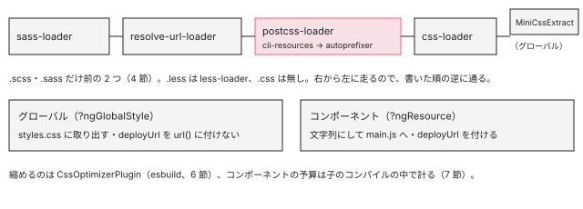

[目次](../README.md) › [webpack の builder の内側：@angular-devkit/build-angular と schematics の CLI](README.md) › 第 3 回 / 全 12 回

# スタイルの設定：configs/styles.ts と postcss の道具

> tools/webpack/configs/styles.ts・plugins/postcss-cli-resources.ts・css-optimizer-plugin.ts・any-component-style-budget-checker.ts：グローバルとコンポーネントのスタイルの loader の並び、url の書き換え、CSS の最適化、コンポーネントのスタイルの予算。

angular/angular-cli · 読了 約 12 分 · 発展 · [サイトで読む（デモが動きます）](https://angular-deep-dive-cyan.vercel.app/chapter/bwp-webpack-styles)

---

この章で分かること：angular.json の `styles` に書いたグローバルのスタイルと、コンポーネントの `styleUrl`・`styles` が、webpack のどの loader をどの順で通るか。その途中で `url()` の画像が出力のどの名前に書き換わるのか（相対・`/`・`~`・`^`・`deployUrl`・`resourcesOutputPath`）、CSS をどこで縮めるのか、`anyComponentStyle` の予算が何の大きさを計るのかを、本物の出力で確かめます。

読む対象は angular-cli（44129f66a3）の `packages/angular_devkit/build_angular/src/tools/webpack/configs/styles.ts`、`plugins/postcss-cli-resources.ts`・`css-optimizer-plugin.ts`・`any-component-style-budget-checker.ts`、それにこの設定が使う `styles-webpack-plugin.ts`・`remove-hash-plugin.ts`・`suppress-entry-chunks-webpack-plugin.ts` と `utils/helpers.ts` の 2 つの関数です。styles.ts の 69〜80 行目（Sass のコンパイラ）と 336〜352 行目（sass-loader の options の前半）は [bld-sass-service の章](../bld/02-bld-sass-service.md)で読みました。application builder（esbuild）の側のスタイルは [cli-component-styles の章](../cli/04-cli-component-styles.md)と [bld-sass-rebase の章](../bld/01-bld-sass-rebase.md)です。

1. [1. browser builder の流れ](01-bwp-browser.md)
2. [2. webpack の共通の設定](02-bwp-webpack-common.md)
3. **3. スタイルの設定**（この章）
4. [4. Angular の webpack プラグイン](04-bwp-webpack-plugins.md)
5. [5. babel の最適化のプラグイン](05-bwp-babel.md)
6. [6. webpack の dev-server](06-bwp-dev-server.md)
7. [7. server builder と ssr-dev-server](07-bwp-server-ssr.md)
8. [8. prerender と app-shell](08-bwp-prerender-appshell.md)
9. [9. webpack の i18n](09-bwp-i18n.md)
10. [10. karma の builder の webpack の側](10-bwp-karma.md)
11. [11. schematics の CLI](11-bwp-schematics-cli.md)
12. [12. spec と issue](12-bwp-tests-issues.md)

> [!NOTE]
> **ポイント**
>
> 記録は npm の 22.2.7 です。この章で引くファイルは v22.2.7 と 44129f66a3 で同じです。

## 0. 全体の流れ



*1 つのスタイルのファイルは、拡張子の規則（.scss など）の中で「グローバルか、コンポーネントか」を要求の印（?ngGlobalStyle / ?ngResource）で分けられ、後ろの loader から順に通る。*

1. **グローバルのスタイルを entry にする**

   `StylesWebpackPlugin` が、angular.json の `styles` を束ごとの entry にし、`?ngGlobalStyle` の印を付ける（1 節）。
2. **拡張子ごとの規則に入る**

   `.css`・`.scss`・`.sass`・`.less` の 4 つの規則の中で、印で 2 つの loader の並びに分かれる（3〜4 節）。
3. **postcss で url() を書き換える**

   `postcss-cli-resources` が url() の画像を探し、出力に書き出し、名前を差し替える（5 節）。
4. **縮めて、計る**

   本番なら esbuild で縮め、コンポーネントのスタイルの予算を見る（6〜7 節）。

## 1. グローバルのスタイルを entry にする

📄 `angular-cli/packages/angular_devkit/build_angular/src/tools/webpack/configs/styles.ts` L37–68 （▶ の行: 41, 43, 46, 49–50, 53–54, 56, 58, 63, 65）

```ts
37 │ export async function getStylesConfig(wco: WebpackConfigOptions): Promise<Configuration> {
38 │   const { root, buildOptions, logger, projectRoot } = wco;
39 │   const extraPlugins: Configuration['plugins'] = [];
40 │ 
41 ▶   extraPlugins.push(new AnyComponentStyleBudgetChecker(buildOptions.budgets));
42 │ 
43 ▶   const cssSourceMap = buildOptions.sourceMap.styles;
44 │ 
45 │   // Determine hashing format.
46 ▶   const hashFormat = getOutputHashFormat(buildOptions.outputHashing);
47 │ 
48 │   // use includePaths from appConfig
49 ▶   const includePaths =
50 ▶     buildOptions.stylePreprocessorOptions?.includePaths?.map((p) => path.resolve(root, p)) ?? [];
51 │ 
52 │   // Process global styles.
53 ▶   if (buildOptions.styles.length > 0) {
54 ▶     const { entryPoints, noInjectNames } = normalizeGlobalStyles(buildOptions.styles);
55 │     extraPlugins.push(
56 ▶       new StylesWebpackPlugin({
57 │         root,
58 ▶         entryPoints,
59 │         preserveSymlinks: buildOptions.preserveSymlinks,
60 │       }),
61 │     );
62 │ 
63 ▶     if (noInjectNames.length > 0) {
64 │       // Add plugin to remove hashes from lazy styles.
65 ▶       extraPlugins.push(new RemoveHashPlugin({ chunkNames: noInjectNames, hashFormat }));
66 │     }
67 │   }
68 │ 
```

📄 `angular-cli/packages/angular_devkit/build_angular/src/tools/webpack/utils/helpers.ts` L136–159 （▶ の行: 147, 149–150, 153–154）

```ts
136 │ export function normalizeGlobalStyles(styleEntrypoints: StyleElement[]): {
137 │   entryPoints: Record<string, string[]>;
138 │   noInjectNames: string[];
139 │ } {
140 │   const entryPoints: Record<string, string[]> = {};
141 │   const noInjectNames: string[] = [];
142 │ 
143 │   if (styleEntrypoints.length === 0) {
144 │     return { entryPoints, noInjectNames };
145 │   }
146 │ 
147 ▶   for (const style of normalizeExtraEntryPoints(styleEntrypoints, 'styles')) {
148 │     // Add style entry points.
149 ▶     entryPoints[style.bundleName] ??= [];
150 ▶     entryPoints[style.bundleName].push(style.input);
151 │ 
152 │     // Add non injected styles to the list.
153 ▶     if (!style.inject) {
154 ▶       noInjectNames.push(style.bundleName);
155 │     }
156 │   }
157 │ 
158 │   return { entryPoints, noInjectNames };
159 │ }
```

41 行目で予算のプラグインを無条件に積みます（中で `anyComponentStyle` だけを残す、7 節）。49〜50 行目の `includePaths` は Sass と Less の探す場所です。54 行目の `normalizeGlobalStyles` は、`styles` を `bundleName`（省略で `styles`、`inject: false` ならファイル名）ごとの入力の配列にします。デモの `src/styles.scss` と `src/plain.css` は同じ `styles` の束になり、1 つの `styles.css` に出ました。`inject: false` の束があれば、65 行目で `RemoveHashPlugin` がその束の名前からハッシュを外します（名前で読み込むため）。

📄 `angular-cli/packages/angular_devkit/build_angular/src/tools/webpack/plugins/styles-webpack-plugin.ts` L25–47 （▶ の行: 32–37, 44, 46）

```ts
25 │ export class StylesWebpackPlugin {
26 │   private compilation: Compilation | undefined;
27 │ 
28 │   constructor(private readonly options: StylesWebpackPluginOptions) {}
29 │ 
30 │   apply(compiler: Compiler): void {
31 │     const { entryPoints, preserveSymlinks, root } = this.options;
32 ▶     const resolver = compiler.resolverFactory.get('global-styles', {
33 ▶       conditionNames: ['sass', 'less', 'style'],
34 ▶       mainFields: ['sass', 'less', 'style', 'main', '...'],
35 ▶       extensions: ['.scss', '.sass', '.less', '.css'],
36 ▶       restrictions: [/\.((le|sa|sc|c)ss)$/i],
37 ▶       preferRelative: true,
38 │       useSyncFileSystemCalls: true,
39 │       symlinks: !preserveSymlinks,
40 │       fileSystem: compiler.inputFileSystem ?? undefined,
41 │     });
42 │ 
43 │     const webpackOptions = compiler.options;
44 ▶     compiler.hooks.environment.tap(PLUGIN_NAME, () => {
45 │       const entry =
46 ▶         typeof webpackOptions.entry === 'function' ? webpackOptions.entry() : webpackOptions.entry;
47 │ 
```

📄 `angular-cli/packages/angular_devkit/build_angular/src/tools/webpack/plugins/styles-webpack-plugin.ts` L48–79 （▶ の行: 48–49, 51–53, 57, 59, 62, 67, 72, 77）

```ts
48 ▶       webpackOptions.entry = async () => {
49 ▶         const entrypoints = await entry;
50 │ 
51 ▶         for (const [bundleName, paths] of Object.entries(entryPoints)) {
52 ▶           entrypoints[bundleName] ??= {};
53 ▶           const entryImport = (entrypoints[bundleName].import ??= []);
54 │ 
55 │           for (const path of paths) {
56 │             try {
57 ▶               const resolvedPath = resolver.resolveSync({}, root, path);
58 │               if (resolvedPath) {
59 ▶                 entryImport.push(`${resolvedPath}?ngGlobalStyle`);
60 │               } else {
61 │                 assert(this.compilation, 'Compilation cannot be undefined.');
62 ▶                 addError(this.compilation, `Cannot resolve '${path}'.`);
63 │               }
64 │             } catch (error) {
65 │               assert(this.compilation, 'Compilation cannot be undefined.');
66 │               assertIsError(error);
67 ▶               addError(this.compilation, error.message);
68 │             }
69 │           }
70 │         }
71 │ 
72 ▶         return entrypoints;
73 │       };
74 │     });
75 │ 
76 │     compiler.hooks.thisCompilation.tap(PLUGIN_NAME, (compilation) => {
77 ▶       this.compilation = compilation;
78 │     });
79 │   }
```

1. **32〜41 行目：スタイル用の resolver**

   `package.json` の `sass`・`less`・`style` の項目を見て、拡張子を補い、スタイルのファイルだけに当てる resolver です。`styles: ['bootstrap/scss/bootstrap']` のようなパッケージの名前も引けます。
2. **44〜48 行目：entry を関数に包む**

   webpack の `environment` の時点で元の entry を取り、非同期の関数に置き換えます。webpack は make のたびにこの関数を呼びます。
3. **59 行目：印を付けて entry に足す**

   解決したパスに `?ngGlobalStyle` を付けて、束の名前の entry の `import` に足します。この印が 3 節の `oneOf` の 1 つ目に当たります。
4. **62・67 行目：見つからないとき**

   例外にせず、77 行目で覚えた `compilation` にエラーとして足します。

📄 `angular-cli/packages/angular_devkit/build_angular/src/tools/webpack/plugins/remove-hash-plugin.ts` L17–37 （▶ の行: 22–23, 26, 28, 34）

```ts
17 │ export class RemoveHashPlugin {
18 │   constructor(private options: RemoveHashPluginOptions) {}
19 │ 
20 │   apply(compiler: Compiler): void {
21 │     compiler.hooks.compilation.tap('remove-hash-plugin', (compilation) => {
22 ▶       const assetPath = (path: string, data: { chunk?: { name?: string | null } }) => {
23 ▶         const chunkName = data.chunk?.name;
24 │         const { chunkNames, hashFormat } = this.options;
25 │ 
26 ▶         if (chunkName && chunkNames?.includes(chunkName)) {
27 │           // Replace hash formats with empty strings.
28 ▶           return path.replace(hashFormat.chunk, '').replace(hashFormat.extract, '');
29 │         }
30 │ 
31 │         return path;
32 │       };
33 │ 
34 ▶       compilation.hooks.assetPath.tap('remove-hash-plugin', assetPath);
35 │     });
36 │   }
37 │ }
```

`assetPath` の hook で、出力のファイル名を作るたびに、`inject: false` の束の名前なら `.[contenthash:20]` の文字列そのものを消します（名前に置き換わる前のテンプレートの段階なので、文字列の置き換えで済む）。

## 2. postcss の設定と Tailwind

📄 `angular-cli/packages/angular_devkit/build_angular/src/tools/webpack/configs/styles.ts` L82–101 （▶ の行: 82, 86–87, 89–90, 92–96, 99）

```ts
 82 ▶   const assetNameTemplate = assetNameTemplateFactory(hashFormat);
 83 │ 
 84 │   const extraPostcssPlugins: import('postcss').Plugin[] = [];
 85 │ 
 86 ▶   const searchDirectories = await generateSearchDirectories([projectRoot, root]);
 87 ▶   const postcssConfig = await loadPostcssConfiguration(searchDirectories);
 88 │ 
 89 ▶   if (postcssConfig) {
 90 ▶     const postCssPluginRequire = createRequire(path.dirname(postcssConfig.configPath) + '/');
 91 │ 
 92 ▶     for (const [pluginName, pluginOptions] of postcssConfig.config.plugins) {
 93 ▶       const pluginMod = postCssPluginRequire(pluginName);
 94 ▶       const plugin = pluginMod.__esModule ? pluginMod['default'] : pluginMod;
 95 ▶       if (typeof plugin !== 'function' || plugin.postcss !== true) {
 96 ▶         throw new Error(`Attempted to load invalid Postcss plugin: "${pluginName}"`);
 97 │       }
 98 │ 
 99 ▶       extraPostcssPlugins.push(plugin(pluginOptions));
100 │     }
101 │   } else {
```

📄 `angular-cli/packages/angular_devkit/build_angular/src/tools/webpack/configs/styles.ts` L102–124 （▶ の行: 106–107, 110, 113–115, 119–120）

```ts
102 │     // Attempt to setup Tailwind CSS
103 │     // Only load Tailwind CSS plugin if configuration file was found.
104 │     // This acts as a guard to ensure the project actually wants to use Tailwind CSS.
105 │     // The package may be unknowningly present due to a third-party transitive package dependency.
106 ▶     const tailwindConfigPath = findTailwindConfiguration(searchDirectories);
107 ▶     if (tailwindConfigPath) {
108 │       let tailwindPackagePath;
109 │       try {
110 ▶         tailwindPackagePath = require.resolve('tailwindcss', { paths: [root] });
111 │       } catch {
112 │         const relativeTailwindConfigPath = path.relative(root, tailwindConfigPath);
113 ▶         logger.warn(
114 ▶           `Tailwind CSS configuration file found (${relativeTailwindConfigPath})` +
115 ▶             ` but the 'tailwindcss' package is not installed.` +
116 │             ` To enable Tailwind CSS, please install the 'tailwindcss' package.`,
117 │         );
118 │       }
119 ▶       if (tailwindPackagePath) {
120 ▶         extraPostcssPlugins.push(require(tailwindPackagePath)({ config: tailwindConfigPath }));
121 │       }
122 │     }
123 │   }
124 │ 
```

86〜87 行目で、プロジェクトの根とワークスペースの根から `postcss.config.json` か `.postcssrc.json` を探します（`@angular/build` の関数。[bcu-options の章](../bcu/08-bcu-options.md)）。見つかれば、その場所から `require` したプラグインを順に積みます。95 行目で、関数でなかったり `postcss: true` の印が無かったりすると「Attempted to load invalid Postcss plugin」で止めます。設定ファイルが無いときだけ、Tailwind の設定ファイルを探し（106 行目）、パッケージが入っていれば Tailwind のプラグインを積み、入っていなければ 113〜117 行目で警告します。104〜105 行目のコメントのとおり、パッケージが依存の依存で入っているだけでは使いません。

📄 `angular-cli/packages/angular_devkit/build_angular/src/tools/webpack/configs/styles.ts` L125–157 （▶ の行: 125, 127–129, 136–139, 141–143, 145–146, 148, 153）

```ts
125 ▶   const autoprefixer: typeof import('autoprefixer') = require('autoprefixer');
126 │ 
127 ▶   const postcssOptionsCreator = (inlineSourcemaps: boolean, extracted: boolean) => {
128 ▶     const optionGenerator = (loader: LoaderContext<unknown>) => ({
129 ▶       map: inlineSourcemaps
130 │         ? {
131 │             inline: true,
132 │             annotation: false,
133 │           }
134 │         : undefined,
135 │       plugins: [
136 ▶         PostcssCliResources({
137 ▶           baseHref: buildOptions.baseHref,
138 ▶           deployUrl: buildOptions.deployUrl,
139 ▶           resourcesOutputPath: buildOptions.resourcesOutputPath,
140 │           loader,
141 ▶           filename: assetNameTemplate,
142 ▶           emitFile: buildOptions.platform !== 'server',
143 ▶           extracted,
144 │         }),
145 ▶         ...extraPostcssPlugins,
146 ▶         autoprefixer({
147 │           ignoreUnknownVersions: true,
148 ▶           overrideBrowserslist: buildOptions.supportedBrowsers,
149 │         }),
150 │       ],
151 │     });
152 │     // postcss-loader fails when trying to determine configuration files for data URIs
153 ▶     optionGenerator.config = false;
154 │ 
155 │     return optionGenerator;
156 │   };
157 │ 
```

postcss の options を作る関数を、loader ごとに 1 回呼ばれる関数（128 行目、引数は loader の文脈）として返します。`postcss-cli-resources` に loader を渡すためです。プラグインの順は「`postcss-cli-resources` → 設定ファイルか Tailwind のプラグイン → autoprefixer」です。142 行目、server builder では画像を書き出しません（ブラウザの側のビルドが書くため）。143 行目の `extracted` が「別の CSS のファイルに取り出すか」で、5 節の `deployUrl` の扱いを分けます。137 行目の `baseHref` は渡していますが、5 節のとおり受け取る側で使われていません。

## 3. 2 つの loader の並び

📄 `angular-cli/packages/angular_devkit/build_angular/src/tools/webpack/configs/styles.ts` L158–183 （▶ の行: 158–160, 163–164, 166–167, 170, 176, 178–179, 181）

```ts
158 ▶   let componentsSourceMap = !!cssSourceMap;
159 ▶   if (cssSourceMap) {
160 ▶     if (buildOptions.optimization.styles.minify) {
161 │       // Never use component css sourcemap when style optimizations are on.
162 │       // It will just increase bundle size without offering good debug experience.
163 ▶       logger.warn(
164 ▶         'Components styles sourcemaps are not generated when styles optimization is enabled.',
165 │       );
166 ▶       componentsSourceMap = false;
167 ▶     } else if (buildOptions.sourceMap.hidden) {
168 │       // Inline all sourcemap types except hidden ones, which are the same as no sourcemaps
169 │       // for component css.
170 ▶       logger.warn('Components styles sourcemaps are not generated when sourcemaps are hidden.');
171 │       componentsSourceMap = false;
172 │     }
173 │   }
174 │ 
175 │   // extract global css from js files into own css file.
176 ▶   extraPlugins.push(new MiniCssExtractPlugin({ filename: `[name]${hashFormat.extract}.css` }));
177 │ 
178 ▶   if (!buildOptions.hmr) {
179 ▶     // don't remove `.js` files for `.css` when we are using HMR these contain HMR accept codes.
180 │     // suppress empty .js files in css only entry points.
181 ▶     extraPlugins.push(new SuppressExtractedTextChunksWebpackPlugin());
182 │   }
183 │ 
```

コンポーネントのスタイルのソースマップは、CSS を縮めるときと hidden のときに切ります（163・170 行目の警告。[前の回](02-bwp-webpack-common.md)のデモの「sourceMap: true」の行に出ています）。176 行目の `MiniCssExtractPlugin` がグローバルのスタイルを `[name].css`（ハッシュの形は `extract`）に取り出し、178〜182 行目で、HMR でなければ CSS だけの entry に残る空の JS を消します。

📄 `angular-cli/packages/angular_devkit/build_angular/src/tools/webpack/plugins/suppress-entry-chunks-webpack-plugin.ts` L13–52 （▶ の行: 16, 18, 24–25, 31, 37, 39–40, 48–50）

```ts
13 │ export class SuppressExtractedTextChunksWebpackPlugin {
14 │   apply(compiler: import('webpack').Compiler): void {
15 │     compiler.hooks.compilation.tap('SuppressExtractedTextChunks', (compilation) => {
16 ▶       compilation.hooks.chunkAsset.tap('SuppressExtractedTextChunks', (chunk, filename) => {
17 │         // Remove only JavaScript assets
18 ▶         if (!filename.endsWith('.js')) {
19 │           return;
20 │         }
21 │ 
22 │         // Only chunks with a css asset should have JavaScript assets removed
23 │         let hasCssFile = false;
24 ▶         for (const file of chunk.files) {
25 ▶           if (file.endsWith('.css')) {
26 │             hasCssFile = true;
27 │             break;
28 │           }
29 │         }
30 │ 
31 ▶         if (!hasCssFile) {
32 │           return;
33 │         }
34 │ 
35 │         // Only chunks with all CSS entry dependencies should have JavaScript assets removed
36 │         let cssOnly = false;
37 ▶         const entryModules = compilation.chunkGraph.getChunkEntryModulesIterable(chunk);
38 │         for (const module of entryModules) {
39 ▶           cssOnly = module.dependencies.every(
40 ▶             (dependency: {}) => dependency.constructor.name === 'CssDependency',
41 │           );
42 │ 
43 │           if (!cssOnly) {
44 │             break;
45 │           }
46 │         }
47 │ 
48 ▶         if (cssOnly) {
49 ▶           chunk.files.delete(filename);
50 ▶           compilation.deleteAsset(filename);
51 │         }
52 │       });
```

entry のモジュールの依存が全部 `CssDependency`（mini-css-extract-plugin が作る依存）のチャンクだけ、JS のファイルを消します。40 行目はクラスの名前の文字列で比べています。HMR のときに残すのは、179 行目のコメントのとおり、その JS が CSS を差し替える受け口のコードを持つためです（[第 6 回](06-bwp-dev-server.md)）。

📄 `angular-cli/packages/angular_devkit/build_angular/src/tools/webpack/configs/styles.ts` L184–206 （▶ の行: 187, 189, 191–195, 199, 202）

```ts
184 │   const postCss = require('postcss');
185 │   const postCssLoaderPath = require.resolve('postcss-loader');
186 │ 
187 ▶   const componentStyleLoaders: RuleSetUseItem[] = [
188 │     {
189 ▶       loader: require.resolve('css-loader'),
190 │       options: {
191 ▶         url: false,
192 ▶         sourceMap: componentsSourceMap,
193 ▶         importLoaders: 1,
194 ▶         exportType: 'string',
195 ▶         esModule: false,
196 │       },
197 │     },
198 │     {
199 ▶       loader: postCssLoaderPath,
200 │       options: {
201 │         implementation: postCss,
202 ▶         postcssOptions: postcssOptionsCreator(componentsSourceMap, false),
203 │       },
204 │     },
205 │   ];
206 │ 
```

📄 `angular-cli/packages/angular_devkit/build_angular/src/tools/webpack/configs/styles.ts` L207–228 （▶ の行: 207, 209, 212, 214–216, 220, 223–224）

```ts
207 ▶   const globalStyleLoaders: RuleSetUseItem[] = [
208 │     {
209 ▶       loader: MiniCssExtractPlugin.loader,
210 │     },
211 │     {
212 ▶       loader: require.resolve('css-loader'),
213 │       options: {
214 ▶         url: false,
215 ▶         sourceMap: !!cssSourceMap,
216 ▶         importLoaders: 1,
217 │       },
218 │     },
219 │     {
220 ▶       loader: postCssLoaderPath,
221 │       options: {
222 │         implementation: postCss,
223 ▶         postcssOptions: postcssOptionsCreator(false, true),
224 ▶         sourceMap: !!cssSourceMap,
225 │       },
226 │     },
227 │   ];
228 │ 
```

1. **191・214 行目：css-loader は url() を触らない**

   `url: false` で、url() の解決を css-loader にさせず、前の postcss-loader の中の `postcss-cli-resources` に任せます。
2. **193〜195 行目：コンポーネントは文字列**

   `exportType: 'string'`・`esModule: false` で、CSS をそのまま文字列として返します。Angular のコンパイラはこれを `styles` の配列に入れます（デモの「コンポーネントのスタイル」の `[_ngcontent-%COMP%]` はコンパイラが付けた印）。
3. **202・223 行目：extracted の違い**

   コンポーネントは `postcssOptionsCreator(componentsSourceMap, false)`、グローバルは `(false, true)`。グローバルのソースマップは postcss-loader の `sourceMap`（224 行目）で別に扱います。

## 4. 拡張子ごとの規則と Sass の importer

📄 `angular-cli/packages/angular_devkit/build_angular/src/tools/webpack/configs/styles.ts` L229–258 （▶ の行: 234–235, 238, 241, 243, 247–248, 252）

```ts
229 │   const styleLanguages: {
230 │     extensions: string[];
231 │     use: RuleSetUseItem[];
232 │   }[] = [
233 │     {
234 ▶       extensions: ['css'],
235 ▶       use: [],
236 │     },
237 │     {
238 ▶       extensions: ['scss'],
239 │       use: [
240 │         {
241 ▶           loader: require.resolve('resolve-url-loader'),
242 │           options: {
243 ▶             sourceMap: cssSourceMap,
244 │           },
245 │         },
246 │         {
247 ▶           loader: require.resolve('sass-loader'),
248 ▶           options: getSassLoaderOptions(
249 │             root,
250 │             sassImplementation,
251 │             includePaths,
252 ▶             false,
253 │             !!buildOptions.verbose,
254 │             !!buildOptions.preserveSymlinks,
255 │           ),
256 │         },
257 │       ],
258 │     },
```

📄 `angular-cli/packages/angular_devkit/build_angular/src/tools/webpack/configs/styles.ts` L259–297 （▶ の行: 260, 263, 269, 274, 282, 285, 287, 290–291）

```ts
259 │     {
260 ▶       extensions: ['sass'],
261 │       use: [
262 │         {
263 ▶           loader: require.resolve('resolve-url-loader'),
264 │           options: {
265 │             sourceMap: cssSourceMap,
266 │           },
267 │         },
268 │         {
269 ▶           loader: require.resolve('sass-loader'),
270 │           options: getSassLoaderOptions(
271 │             root,
272 │             sassImplementation,
273 │             includePaths,
274 ▶             true,
275 │             !!buildOptions.verbose,
276 │             !!buildOptions.preserveSymlinks,
277 │           ),
278 │         },
279 │       ],
280 │     },
281 │     {
282 ▶       extensions: ['less'],
283 │       use: [
284 │         {
285 ▶           loader: require.resolve('less-loader'),
286 │           options: {
287 ▶             implementation: require('less'),
288 │             sourceMap: cssSourceMap,
289 │             lessOptions: {
290 ▶               javascriptEnabled: true,
291 ▶               paths: includePaths,
292 │             },
293 │           },
294 │         },
295 │       ],
296 │     },
297 │   ];
```

`.scss` と `.sass` は「sass-loader → resolve-url-loader」、`.less` は less-loader、`.css` は前処理なしです。resolve-url-loader は、Sass の部分ファイルに書いた相対の url() を、部分ファイルからの相対に直します（デモの `.partial` の `../../img/bg.png` が正しく `bg.png` になった）。esbuild の側では同じ仕事を Sass の importer がしています（[bld-sass-rebase の章](../bld/01-bld-sass-rebase.md)）。290 行目、Less は `javascriptEnabled: true` で、Less の中のインラインの JavaScript を許します。

📄 `angular-cli/packages/angular_devkit/build_angular/src/tools/webpack/configs/styles.ts` L299–334 （▶ の行: 301–303, 306, 309–310, 314–315, 319, 324, 326, 332）

```ts
299 │   return {
300 │     module: {
301 ▶       rules: styleLanguages.map(({ extensions, use }) => ({
302 ▶         test: new RegExp(`\\.(?:${extensions.join('|')})$`, 'i'),
303 ▶         rules: [
304 │           // Setup processing rules for global and component styles
305 │           {
306 ▶             oneOf: [
307 │               // Global styles are only defined global styles
308 │               {
309 ▶                 use: globalStyleLoaders,
310 ▶                 resourceQuery: /\?ngGlobalStyle/,
311 │               },
312 │               // Component styles are all styles except defined global styles
313 │               {
314 ▶                 use: componentStyleLoaders,
315 ▶                 resourceQuery: /\?ngResource/,
316 │               },
317 │             ],
318 │           },
319 ▶           { use },
320 │         ],
321 │       })),
322 │     },
323 │     optimization: {
324 ▶       minimizer: buildOptions.optimization.styles.minify
325 │         ? [
326 ▶             new CssOptimizerPlugin({
327 │               supportedBrowsers: buildOptions.supportedBrowsers,
328 │             }),
329 │           ]
330 │         : undefined,
331 │     },
332 ▶     plugins: extraPlugins,
333 │   };
334 │ }
```

302 行目で拡張子ごとに 1 つの規則を作り、303〜320 行目の `rules` に「`oneOf`（印で 2 つに分ける）」と「`{ use }`（拡張子の loader）」を並べます。webpack は 1 つのファイルに当たる loader を規則の順に集めて後ろから走らせるので、`.scss` のグローバルは「sass-loader → resolve-url-loader → postcss-loader → css-loader → MiniCssExtract の loader」の順になります（デモの「loader の並び」）。印が無い要求（JS から `import './x.css'` したもの）は `oneOf` のどちらにも当たらず、拡張子の loader だけが付きます。324〜330 行目で、CSS を縮めるときだけ `CssOptimizerPlugin` を minimizer に置きます。

📄 `angular-cli/packages/angular_devkit/build_angular/src/tools/webpack/configs/styles.ts` L353–365 （▶ の行: 353, 357, 359, 361–362）

```ts
353 ▶       loadPaths: includePaths,
354 │       // Use expanded as otherwise sass will remove comments that are needed for autoprefixer
355 │       // Ex: /* autoprefixer grid: autoplace */
356 │       // See: https://github.com/webpack-contrib/sass-loader/blob/45ad0be17264ceada5f0b4fb87e9357abe85c4ff/src/getSassOptions.js#L68-L70
357 ▶       style: 'expanded',
358 │       // Silences compiler warnings from 3rd party stylesheets
359 ▶       quietDeps: !verbose,
360 │       verbose,
361 ▶       syntax: indentedSyntax ? 'indented' : 'scss',
362 ▶       sourceMapIncludeSources: true,
363 │     }),
364 │   };
365 │ }
```

📄 `angular-cli/packages/angular_devkit/build_angular/src/tools/webpack/configs/styles.ts` L367–394 （▶ の行: 373–377, 383, 385–386, 389, 392）

```ts
367 │ function getSassResolutionImporter(
368 │   loaderContext: LoaderContext<{}>,
369 │   root: string,
370 │   preserveSymlinks: boolean,
371 │ ): FileImporter<'async'> {
372 │   const commonResolverOptions: Parameters<(typeof loaderContext)['getResolve']>[0] = {
373 ▶     conditionNames: ['sass', 'style'],
374 ▶     mainFields: ['sass', 'style', 'main', '...'],
375 ▶     extensions: ['.scss', '.sass', '.css'],
376 ▶     restrictions: [/\.((sa|sc|c)ss)$/i],
377 ▶     preferRelative: true,
378 │     symlinks: !preserveSymlinks,
379 │   };
380 │ 
381 │   // Sass also supports import-only files. If you name a file <name>.import.scss, it will only be loaded for imports, not for @uses.
382 │   // See: https://sass-lang.com/documentation/at-rules/import#import-only-files
383 ▶   const resolveImport = loaderContext.getResolve({
384 │     ...commonResolverOptions,
385 ▶     dependencyType: 'sass-import',
386 ▶     mainFiles: ['_index.import', '_index', 'index.import', 'index', '...'],
387 │   });
388 │ 
389 ▶   const resolveModule = loaderContext.getResolve({
390 │     ...commonResolverOptions,
391 │     dependencyType: 'sass-module',
392 ▶     mainFiles: ['_index', 'index', '...'],
393 │   });
394 │ 
```

📄 `angular-cli/packages/angular_devkit/build_angular/src/tools/webpack/configs/styles.ts` L395–414 （▶ の行: 396–397, 399, 402–404, 407–409, 411）

```ts
395 │   return {
396 ▶     findFileUrl: async (url, { fromImport, containingUrl }): Promise<URL | null> => {
397 ▶       if (url.charAt(0) === '.') {
398 │         // Let Sass handle relative imports.
399 ▶         return null;
400 │       }
401 │ 
402 ▶       let resolveDir = root;
403 ▶       if (containingUrl) {
404 ▶         resolveDir = path.dirname(fileURLToPath(containingUrl));
405 │       }
406 │ 
407 ▶       const resolve = fromImport ? resolveImport : resolveModule;
408 ▶       // Try to resolve from root of workspace
409 ▶       const result = await tryResolve(resolve, resolveDir, url);
410 │ 
411 ▶       return result ? pathToFileURL(result) : null;
412 │     },
413 │   };
414 │ }
```

📄 `angular-cli/packages/angular_devkit/build_angular/src/tools/webpack/configs/styles.ts` L416–437 （▶ の行: 422, 427–430, 432）

```ts
416 │ async function tryResolve(
417 │   resolve: ReturnType<LoaderContext<{}>['getResolve']>,
418 │   root: string,
419 │   url: string,
420 │ ): Promise<string | undefined> {
421 │   try {
422 ▶     return await resolve(root, url);
423 │   } catch {
424 │     // Try to resolve a partial file
425 │     // @use '@material/button/button' as mdc-button;
426 │     // `@material/button/button` -> `@material/button/_button`
427 ▶     const lastSlashIndex = url.lastIndexOf('/');
428 ▶     const underscoreIndex = lastSlashIndex + 1;
429 ▶     if (underscoreIndex > 0 && url.charAt(underscoreIndex) !== '_') {
430 ▶       const partialFileUrl = `${url.slice(0, underscoreIndex)}_${url.slice(underscoreIndex)}`;
431 │ 
432 ▶       return resolve(root, partialFileUrl).catch(() => undefined);
433 │     }
434 │   }
435 │ 
436 │   return undefined;
437 │ }
```

1. **357 行目：expanded**

   Sass の出力を圧縮しないのは、autoprefixer の印のコメント（`/* autoprefixer grid: autoplace */`）を残すためです。縮めるのは 6 節の esbuild です。
2. **383〜393 行目：`@import` と `@use` で別の resolver**

   `@import` は `_index.import`・`index.import` も探します（Sass の import 専用のファイルの規則）。
3. **397〜400 行目：相対は Sass に任せる**

   `.` で始まる URL は null を返して Sass 自身に探させます。それ以外（パッケージや `includePaths` の外の名前）を webpack の resolver で探します。
4. **402〜409 行目：探す場所**

   408 行目のコメントは「ワークスペースの根から」ですが、403〜405 行目で `containingUrl`（import した側のファイル）があればそのフォルダに変えるので、実際は import した側のフォルダから探します。
5. **427〜433 行目：部分ファイルの `_`**

   見つからなければ、最後の `/` の後ろに `_` を付けてもう 1 回探します（`@material/button/button` → `_button`）。429 行目の条件で、`/` を含まない名前には付けません。

## 5. url() を書き換える：postcss-cli-resources

📄 `angular-cli/packages/angular_devkit/build_angular/src/tools/webpack/plugins/postcss-cli-resources.ts` L15–52 （▶ の行: 15, 17, 19–20, 22, 25, 29, 32, 35, 47, 49）

```ts
15 ▶ function wrapUrl(url: string): string {
16 │   let wrappedUrl;
17 ▶   const hasSingleQuotes = url.indexOf("'") >= 0;
18 │ 
19 ▶   if (hasSingleQuotes) {
20 ▶     wrappedUrl = `"${url}"`;
21 │   } else {
22 ▶     wrappedUrl = `'${url}'`;
23 │   }
24 │ 
25 ▶   return `url(${wrappedUrl})`;
26 │ }
27 │ 
28 │ export interface PostcssCliResourcesOptions {
29 ▶   baseHref?: string;
30 │   deployUrl?: string;
31 │   resourcesOutputPath?: string;
32 ▶   rebaseRootRelative?: boolean;
33 │ 
34 │   /** CSS is extracted to a `.css` or is embedded in a `.js` file. */
35 ▶   extracted?: boolean;
36 │   filename: (resourcePath: string) => string;
37 │   loader: import('webpack').LoaderContext<unknown>;
38 │   emitFile: boolean;
39 │ }
40 │ 
41 │ async function resolve(
42 │   file: string,
43 │   base: string,
44 │   resolver: (file: string, base: string) => Promise<string>,
45 │ ): Promise<string> {
46 │   try {
47 ▶     return await resolver('./' + file, base);
48 │   } catch {
49 ▶     return resolver(file, base);
50 │   }
51 │ }
52 │ 
```

📄 `angular-cli/packages/angular_devkit/build_angular/src/tools/webpack/plugins/postcss-cli-resources.ts` L55–94 （▶ の行: 60–62, 66, 71–72, 75–76, 81–82, 85, 87, 91–92）

```ts
55 │ export default function (options?: PostcssCliResourcesOptions): Plugin {
56 │   if (!options) {
57 │     throw new Error('No options were specified to "postcss-cli-resources".');
58 │   }
59 │ 
60 ▶   const {
61 ▶     deployUrl = '',
62 ▶     resourcesOutputPath = '',
63 │     filename,
64 │     loader,
65 │     emitFile,
66 ▶     extracted,
67 │   } = options;
68 │ 
69 │   const process = async (inputUrl: string, context: string, resourceCache: Map<string, string>) => {
70 │     // If root-relative, absolute or protocol relative url, leave as is
71 ▶     if (/^((?:\w+:)?\/\/|data:|chrome:|#)/.test(inputUrl)) {
72 ▶       return inputUrl;
73 │     }
74 │ 
75 ▶     if (/^\//.test(inputUrl)) {
76 ▶       return inputUrl;
77 │     }
78 │ 
79 │     // If starts with a caret, remove and return remainder
80 │     // this supports bypassing asset processing
81 ▶     if (inputUrl.startsWith('^')) {
82 ▶       return inputUrl.slice(1);
83 │     }
84 │ 
85 ▶     const cacheKey = path.resolve(context, inputUrl);
86 │     const cachedUrl = resourceCache.get(cacheKey);
87 ▶     if (cachedUrl) {
88 │       return cachedUrl;
89 │     }
90 │ 
91 ▶     if (inputUrl.startsWith('~')) {
92 ▶       inputUrl = inputUrl.slice(1);
93 │     }
94 │ 
```

1. **15〜26 行目：書き戻すときの引用符**

   値に `'` が無ければ `url('…')`、あれば `url("…")`。デモの開発の出力が全部 `url('bg.png')` になっているのはこのためです（本番は esbuild が引用符を外す）。
2. **28〜39 行目と 60〜67 行目：使われない options**

   型には `baseHref` と `rebaseRootRelative` がありますが、60〜67 行目の分解に入っておらず、このファイルのどこでも読みません。2 節の 137 行目で渡す `baseHref` は効きません。
3. **71〜77 行目：触らない URL**

   `http://`・`//`・`data:`・`chrome:`・`#` と、`/` で始まる URL はそのまま返します（デモの `.root`・`.data`・`.http`）。
4. **81〜83 行目：`^`**

   先頭の `^` を取って、そのまま返します。探しも書き出しもしないので、`^img/raw.png` は出力で `img/raw.png` になり、画像は出力にコピーされません（デモの `.caret`）。
5. **85〜93 行目：キャッシュと `~`**

   同じファイルからの同じ URL は 1 回だけ処理します。`~` は取るだけで、後は普通の名前として探します。

📄 `angular-cli/packages/angular_devkit/build_angular/src/tools/webpack/plugins/postcss-cli-resources.ts` L95–128 （▶ の行: 95–96, 98, 108, 111, 118, 122, 124, 127）

```ts
 95 ▶     const { pathname, hash, search } = url.parse(inputUrl.replace(/\\/g, '/'));
 96 ▶     const resolver = (file: string, base: string) =>
 97 │       new Promise<string>((resolve, reject) => {
 98 ▶         loader.resolve(base, decodeURI(file), (err, result) => {
 99 │           if (err) {
100 │             reject(err);
101 │ 
102 │             return;
103 │           }
104 │           resolve(result as string);
105 │         });
106 │       });
107 │ 
108 ▶     const result = await resolve(pathname as string, context, resolver);
109 │ 
110 │     return new Promise<string>((resolve, reject) => {
111 ▶       loader.fs.readFile(result, (err, content) => {
112 │         if (err) {
113 │           reject(err);
114 │ 
115 │           return;
116 │         }
117 │ 
118 ▶         let outputPath = interpolateName(
119 │           // TODO: Revisit. Previously due to lack of type safety, this object
120 │           // was fine, but in practice it doesn't match the type of the loader context.
121 │           { resourcePath: result } as Parameters<typeof interpolateName>[0],
122 ▶           filename(result),
123 │           {
124 ▶             content,
125 │             context: loader.context || loader.rootContext,
126 │           },
127 ▶         ).replace(/\\|\//g, '-');
128 │ 
```

📄 `angular-cli/packages/angular_devkit/build_angular/src/tools/webpack/utils/helpers.ts` L95–120 （▶ の行: 99, 101, 104, 106–107, 109, 111–112, 114, 118）

```ts
 95 │ export function assetNameTemplateFactory(hashFormat: HashFormat): (resourcePath: string) => string {
 96 │   const visitedFiles = new Map<string, string>();
 97 │ 
 98 │   return (resourcePath: string) => {
 99 ▶     if (hashFormat.file) {
100 │       // File names are hashed therefore we don't need to handle files with the same file name.
101 ▶       return `[name]${hashFormat.file}.[ext]`;
102 │     }
103 │ 
104 ▶     const filename = path.basename(resourcePath);
105 │     // Check if the file with the same name has already been processed.
106 ▶     const visited = visitedFiles.get(filename);
107 ▶     if (!visited) {
108 │       // Not visited.
109 ▶       visitedFiles.set(filename, resourcePath);
110 │ 
111 ▶       return filename;
112 ▶     } else if (visited === resourcePath) {
113 │       // Same file.
114 ▶       return filename;
115 │     }
116 │ 
117 │     // File has the same name but it's in a different location.
118 ▶     return '[path][name].[ext]';
119 │   };
120 │ }
```

📄 `angular-cli/packages/angular_devkit/build_angular/src/tools/webpack/plugins/postcss-cli-resources.ts` L129–152 （▶ の行: 129–130, 133–134, 136, 140–141, 144–145, 148）

```ts
129 ▶         if (resourcesOutputPath) {
130 ▶           outputPath = path.posix.join(resourcesOutputPath, outputPath);
131 │         }
132 │ 
133 ▶         loader.addDependency(result);
134 ▶         if (emitFile) {
135 │           // eslint-disable-next-line @typescript-eslint/no-non-null-assertion
136 ▶           loader.emitFile(outputPath, content!, undefined, { sourceFilename: result });
137 │         }
138 │ 
139 │         let outputUrl = outputPath.replace(/\\/g, '/');
140 ▶         if (hash || search) {
141 ▶           outputUrl = url.format({ pathname: outputUrl, hash, search });
142 │         }
143 │ 
144 ▶         if (deployUrl && !extracted) {
145 ▶           outputUrl = url.resolve(deployUrl, outputUrl);
146 │         }
147 │ 
148 ▶         resourceCache.set(cacheKey, outputUrl);
149 │         resolve(outputUrl);
150 │       });
151 │     });
152 │   };
```

1. **108 行目と 41〜51 行目：探し方**

   まず `'./' + 名前`（そのファイルからの相対）、だめなら名前のまま（webpack の resolver、つまり `resolve.modules` のプロジェクトの根と node\_modules）。デモの `~src/img/icon.png` は、`~` を取った `src/img/icon.png` が 2 回目でプロジェクトの根から見つかりました。
2. **118〜127 行目と helpers.ts の 95〜120 行目：出力の名前**

   ハッシュを付けるなら `[name].[hash].[ext]`。付けないなら元のファイル名ですが、別のフォルダに同じ名前があると後から来たほうが `[path][name].[ext]` になり、127 行目で `/` を `-` に変えます。デモの開発の `.same`（`img2/bg.png`）は `img2-bg.png` になりました。どちらが元の名前を取るかは、処理した順で決まります。
3. **129〜131 行目：`resourcesOutputPath`**

   出力の名前の前にフォルダを付けます（デモの「resourcesOutputPath: 'media'」で `media/bg.….png`）。
4. **140〜142 行目：`?` と `#` を戻す**

   探すときは外した `?v=1#frag` を、出力の URL に付け直します（デモの `.query`）。
5. **144〜146 行目：deployUrl はコンポーネントだけ**

   取り出さない CSS（コンポーネントのスタイル）だけ、URL の前に `deployUrl` を付けます。取り出した CSS は `styles.css` からの相対で画像が見つかるので付けません。デモの「本番 + deployUrl」で、コンポーネントの `.rel` は `/cdn/bg.….png`、グローバルの `.rel` は `bg.….png` のままです。

📄 `angular-cli/packages/angular_devkit/build_angular/src/tools/webpack/plugins/postcss-cli-resources.ts` L154–186 （▶ の行: 158–160, 165, 173–174, 176, 180, 183–184）

```ts
154 │   const resourceCache = new Map<string, string>();
155 │   const processed = Symbol('postcss-cli-resources');
156 │ 
157 │   return {
158 ▶     postcssPlugin: 'postcss-cli-resources',
159 ▶     async Declaration(decl) {
160 ▶       if (!decl.value.includes('url') || processed in decl) {
161 │         return;
162 │       }
163 │ 
164 │       const value = decl.value;
165 ▶       const urlRegex = /url(?:\(\s*(['"]?))(.*?)(?:\1\s*\))/g;
166 │       const segments: string[] = [];
167 │ 
168 │       let match;
169 │       let lastIndex = 0;
170 │       let modified = false;
171 │ 
172 │       // We want to load it relative to the file that imports
173 ▶       const inputFile = decl.source && decl.source.input.file;
174 ▶       const context = (inputFile && path.dirname(inputFile)) || loader.context;
175 │ 
176 ▶       while ((match = urlRegex.exec(value))) {
177 │         const originalUrl = match[2];
178 │         let processedUrl;
179 │         try {
180 ▶           processedUrl = await process(originalUrl, context, resourceCache);
181 │         } catch (err) {
182 │           assertIsError(err);
183 ▶           loader.emitError(decl.error(err.message, { word: originalUrl }));
184 ▶           continue;
185 │         }
186 │ 
```

📄 `angular-cli/packages/angular_devkit/build_angular/src/tools/webpack/plugins/postcss-cli-resources.ts` L187–212 （▶ の行: 191–192, 194–195, 205–206, 209）

```ts
187 │         if (lastIndex < match.index) {
188 │           segments.push(value.slice(lastIndex, match.index));
189 │         }
190 │ 
191 ▶         if (!processedUrl || originalUrl === processedUrl) {
192 ▶           segments.push(match[0]);
193 │         } else {
194 ▶           segments.push(wrapUrl(processedUrl));
195 ▶           modified = true;
196 │         }
197 │ 
198 │         lastIndex = match.index + match[0].length;
199 │       }
200 │ 
201 │       if (lastIndex < value.length) {
202 │         segments.push(value.slice(lastIndex));
203 │       }
204 │ 
205 ▶       if (modified) {
206 ▶         decl.value = segments.join('');
207 │       }
208 │ 
209 ▶       (decl as Declaration & { [processed]: boolean })[processed] = true;
210 │     },
211 │   };
212 │ }
```

postcss の宣言（`background: …`）ごとに、値に `url` の文字が無ければすぐ帰ります。165 行目の正規表現で `url(` を 1 つずつ探し、探せなかった URL は 183 行目で loader のエラーにして、その URL を元のまま残します（デモの「見つからない url」は `Can't resolve './img/missing.png'` でビルドが失敗）。174 行目の基準のフォルダは、宣言の元のファイル（Sass なら入口のファイル）です。部分ファイルの中の相対は、ここに来る前に resolve-url-loader が直しています。

## 6. CSS を縮める：CssOptimizerPlugin

📄 `angular-cli/packages/angular_devkit/build_angular/src/tools/webpack/plugins/css-optimizer-plugin.ts` L30–58 （▶ の行: 32, 35–36, 43, 46, 49, 52, 55–56）

```ts
30 │ export class CssOptimizerPlugin {
31 │   private targets: string[] | undefined;
32 ▶   private esbuild = new EsbuildExecutor();
33 │ 
34 │   constructor(options?: CssOptimizerPluginOptions) {
35 ▶     if (options?.supportedBrowsers) {
36 ▶       this.targets = transformSupportedBrowsersToTargets(options.supportedBrowsers);
37 │     }
38 │   }
39 │ 
40 │   apply(compiler: Compiler) {
41 │     const { OriginalSource, SourceMapSource } = compiler.webpack.sources;
42 │ 
43 ▶     compiler.hooks.compilation.tap(PLUGIN_NAME, (compilation) => {
44 │       const logger = compilation.getLogger('build-angular.CssOptimizerPlugin');
45 │ 
46 ▶       compilation.hooks.processAssets.tapPromise(
47 │         {
48 │           name: PLUGIN_NAME,
49 ▶           stage: compiler.webpack.Compilation.PROCESS_ASSETS_STAGE_OPTIMIZE_SIZE,
50 │         },
51 │         async (compilationAssets) => {
52 ▶           const cache = compilation.options.cache && compilation.getCache(PLUGIN_NAME);
53 │ 
54 │           logger.time('optimize css assets');
55 ▶           for (const assetName of Object.keys(compilationAssets)) {
56 ▶             if (!/\.(?:css|scss|sass|less)$/.test(assetName)) {
57 │               continue;
58 │             }
```

📄 `angular-cli/packages/angular_devkit/build_angular/src/tools/webpack/plugins/css-optimizer-plugin.ts` L59–86 （▶ の行: 60, 62, 69–71, 76, 79, 81）

```ts
59 │ 
60 ▶             const asset = compilation.getAsset(assetName);
61 │             // Skip assets that have already been optimized or are verbatim copies (project assets)
62 ▶             if (!asset || asset.info.minimized || asset.info.copied) {
63 │               continue;
64 │             }
65 │ 
66 │             const { source: styleAssetSource, name } = asset;
67 │             let cacheItem;
68 │ 
69 ▶             if (cache) {
70 ▶               const eTag = cache.getLazyHashedEtag(styleAssetSource);
71 ▶               cacheItem = cache.getItemCache(name, eTag);
72 │               const cachedOutput = await cacheItem.getPromise<
73 │                 { source: sources.Source; warnings: Message[] } | undefined
74 │               >();
75 │ 
76 ▶               if (cachedOutput) {
77 │                 logger.debug(`${name} restored from cache`);
78 │                 await this.addWarnings(compilation, cachedOutput.warnings);
79 ▶                 compilation.updateAsset(name, cachedOutput.source, (assetInfo) => ({
80 │                   ...assetInfo,
81 ▶                   minimized: true,
82 │                 }));
83 │                 continue;
84 │               }
85 │             }
86 │ 
```

📄 `angular-cli/packages/angular_devkit/build_angular/src/tools/webpack/plugins/css-optimizer-plugin.ts` L87–119 （▶ の行: 87, 92, 100, 102–103, 105, 107, 110）

```ts
 87 ▶             const { source, map: inputMap } = styleAssetSource.sourceAndMap();
 88 │             const input = typeof source === 'string' ? source : source.toString();
 89 │ 
 90 │             const optimizeAssetLabel = `optimize asset: ${asset.name}`;
 91 │             logger.time(optimizeAssetLabel);
 92 ▶             const { code, warnings, map } = await this.optimize(
 93 │               input,
 94 │               asset.name,
 95 │               inputMap,
 96 │               this.targets,
 97 │             );
 98 │             logger.timeEnd(optimizeAssetLabel);
 99 │ 
100 ▶             await this.addWarnings(compilation, warnings);
101 │ 
102 ▶             const optimizedAsset = map
103 ▶               ? new SourceMapSource(code, name, map)
104 │               : new OriginalSource(code, name);
105 ▶             compilation.updateAsset(name, optimizedAsset, (assetInfo) => ({
106 │               ...assetInfo,
107 ▶               minimized: true,
108 │             }));
109 │ 
110 ▶             await cacheItem?.storePromise({
111 │               source: optimizedAsset,
112 │               warnings,
113 │             });
114 │           }
115 │           logger.timeEnd('optimize css assets');
116 │         },
117 │       );
118 │     });
119 │   }
```

📄 `angular-cli/packages/angular_devkit/build_angular/src/tools/webpack/plugins/css-optimizer-plugin.ts` L131–162 （▶ の行: 138, 140, 145–149, 151, 157–158）

```ts
131 │   private optimize(
132 │     input: string,
133 │     name: string,
134 │     inputMap: object | null,
135 │     target: string[] | undefined,
136 │   ): Promise<TransformResult> {
137 │     let sourceMapLine;
138 ▶     if (inputMap) {
139 │       // esbuild will automatically remap the sourcemap if provided
140 ▶       sourceMapLine = `\n/*# sourceMappingURL=data:application/json;charset=utf-8;base64,${Buffer.from(
141 │         JSON.stringify(inputMap),
142 │       ).toString('base64')} */`;
143 │     }
144 │ 
145 ▶     return this.esbuild.transform(sourceMapLine ? input + sourceMapLine : input, {
146 ▶       loader: 'css',
147 ▶       legalComments: 'inline',
148 ▶       minify: true,
149 ▶       sourcemap: !!inputMap && 'external',
150 │       sourcefile: name,
151 ▶       target,
152 │     });
153 │   }
154 │ 
155 │   private async addWarnings(compilation: Compilation, warnings: Message[]) {
156 │     if (warnings.length > 0) {
157 ▶       for (const warning of await this.esbuild.formatMessages(warnings, { kind: 'warning' })) {
158 ▶         addWarning(compilation, warning);
159 │       }
160 │     }
161 │   }
162 │ }
```

`processAssets` の `OPTIMIZE_SIZE` の段で、名前が `.css`（など）の出力を esbuild の `transform` に `loader: 'css'`・`minify: true` で通します。36 行目で browserslist を esbuild の target に直すので、対応するブラウザに合わせて書き方が変わります（デモの `rebeccapurple` が `#639` になる）。入力にソースマップがあれば、140〜142 行目でデータ URL のコメントにして末尾に付け、esbuild に合成させます。62 行目、コピーしただけのアセットや、もう縮めたものは飛ばします。この hook は `compiler.hooks.compilation` に付けるので、コンポーネントのスタイルを処理する子のコンパイル（`@ngtools/webpack` の resource loader が作る）でも走ります。7 節の予算はその後で計ります。

## 7. コンポーネントのスタイルの予算

📄 `angular-cli/packages/angular_devkit/build_angular/src/tools/webpack/plugins/any-component-style-budget-checker.ts` L22–52 （▶ の行: 30, 34–35, 38, 42, 47–48, 51）

```ts
22 │ /**
23 │  * Check budget sizes for component styles by emitting a warning or error if a
24 │  * budget is exceeded by a particular component's styles.
25 │  */
26 │ export class AnyComponentStyleBudgetChecker {
27 │   private readonly budgets: BudgetEntry[];
28 │ 
29 │   constructor(budgets: BudgetEntry[]) {
30 ▶     this.budgets = budgets.filter((budget) => budget.type === BudgetType.AnyComponentStyle);
31 │   }
32 │ 
33 │   apply(compiler: Compiler) {
34 ▶     compiler.hooks.compilation.tap(PLUGIN_NAME, (compilation) => {
35 ▶       compilation.hooks.processAssets.tap(
36 │         {
37 │           name: PLUGIN_NAME,
38 ▶           stage: Compilation.PROCESS_ASSETS_STAGE_ANALYSE,
39 │         },
40 │         () => {
41 │           // No budgets.
42 ▶           if (this.budgets.length === 0) {
43 │             return;
44 │           }
45 │ 
46 │           // In AOT compilations component styles get processed in child compilations.
47 ▶           if (!compilation.compiler.parentCompilation) {
48 ▶             return;
49 │           }
50 │ 
51 ▶           const cssExtensions = ['.css', '.scss', '.less', '.sass'];
52 │ 
```

📄 `angular-cli/packages/angular_devkit/build_angular/src/tools/webpack/plugins/any-component-style-budget-checker.ts` L53–80 （▶ の行: 53–54, 57–58, 61, 63–64, 68, 71）

```ts
53 ▶           const componentStyles: BudgetAsset[] = Object.keys(compilation.assets)
54 ▶             .filter((name) => cssExtensions.includes(path.extname(name)))
55 │             .map((name) => ({
56 │               name,
57 ▶               size: compilation.assets[name].size(),
58 ▶               componentStyle: true,
59 │             }));
60 │ 
61 ▶           for (const { severity, message } of checkBudgets(
62 │             this.budgets,
63 ▶             { chunks: [], assets: componentStyles },
64 ▶             true,
65 │           )) {
66 │             switch (severity) {
67 │               case ThresholdSeverity.Warning:
68 ▶                 addWarning(compilation, message);
69 │                 break;
70 │               case ThresholdSeverity.Error:
71 ▶                 addError(compilation, message);
72 │                 break;
73 │               default:
74 │                 assertNever(severity);
75 │             }
76 │           }
77 │         },
78 │       );
79 │     });
80 │   }
```

1. **47〜49 行目：子のコンパイルの中だけ**

   親（アプリ全体）のコンパイルでは何もしません。コンポーネントの 1 つのスタイルは、`@ngtools/webpack` が 1 つの子のコンパイルで処理するので、その出力が 1 つのスタイルの大きさになります。
2. **38 行目：ANALYSE の段**

   6 節の `OPTIMIZE_SIZE` より後なので、本番では縮めた後の大きさを計ります。デモの `big.css` は開発で 794 B（元のまま）、本番で 642 B（esbuild で縮めた大きさと同じ）でした。
3. **計らないもの**

   Angular のコンパイラが後から付ける `[_ngcontent-%COMP%]` は入りません。本番の main.js に入った `big.css` の文字列は 918 B で、予算の 642 B より大きくなります。
4. **68・71 行目：警告とエラー**

   子のコンパイルの警告とエラーにします。前の回の `statsHasErrors` は `children` も見るので、エラーならビルド全体が失敗します（デモの「開発 + 予算」）。インラインの `styles` も `small.ts-angular-inline--1.css` の名前で計られます。

## 8. デモ：url() の書き換えと予算

> **🧪 DEMO — url() をいろいろに書いたスタイルを browser builder でビルドした記録（22.2.7）**
>
> グローバルは `src/styles.scss`（部分ファイル `_theme.scss` を `@use`）と `src/plain.css`、コンポーネントは `root.css`（url あり）・`big.css`（約 800 B）・`small.ts` のインラインです。画像は `src/img/bg.png`・`src/img/icon.png`・`src/img2/bg.png`（中身が違う同じ名前）です。
>
> 出力に書き出された画像：
>
> 見つからない url()（`src/broken.scss` の `url(img/missing.png)`）の開発のビルド：
>
> ▶ [このデモはサイトで動かせます](https://angular-deep-dive-cyan.vercel.app/chapter/bwp-webpack-styles)

## テストと直し方

| spec | describe / it と行 | この章のどこ |
| --- | --- | --- |
| builders/browser/specs/styles\_spec.ts | describe「Browser Builder styles」（14 行目）。it「supports baseHref/deployUrl in resource urls」（364 行目）、「causes equal failure for tilde url()」（495 行目）、「adjusts relative resource URLs when using @import in ${ext} (component)」（609 行目）など | 5 節 |
| builders/browser/tests/options/styles\_spec.ts | describe「Option: "styles"」（13 行目）。it「does not add link element to index when inject is false」（363 行目）など | 1 節 |
| builders/browser/specs/resources-output-path\_spec.ts | describe「Browser Builder styles resources output path」（13 行目）。it「supports resourcesOutputPath in resource urls」（47 行目） | 5 節の 129〜131 行目 |
| builders/browser/tests/options/bundle-budgets\_spec.ts | it「shows warnings for large component ${ext} when using 'anyComponentStyle' when AOT」（92 行目） | 7 節 |
| builders/browser/tests/behavior/postcss\_config\_spec.ts | describe「Behavior: "Postcss config file"」（13 行目）、it「applies plugins from config file if one is present」（14 行目） | 2 節の 89〜100 行目 |

364 行目の it は名前に baseHref/deployUrl とありますが、確かめているのは `/` で始まる URL が変わらないことと、最初のビルドで相対の URL が `url('global-img-relative.png')` になることだけで、コンポーネントの相対の URL に `deployUrl` が付く（144〜146 行目）ことは見ていません。../angular-cli で `pnpm bazel test //packages/angular_devkit/build_angular:build_angular_browser_test --nocache_test_results --test_output=all '--test_arg=--filter=Browser Builder styles|Option: "styles"|Behavior: "Postcss config file"'` を走らせました。10 の shard の「Ran N」の合計が 58 件、0 failures で PASSED（22.0 秒）でした。

直すなら：

- `baseHref`・`rebaseRootRelative`：使わないなら postcss-cli-resources.ts の 29・32 行目と styles.ts の 137 行目から外す。型を変えるだけなので、`styles_spec.ts` の 364 行目の it がそのまま通ることを確かめる。
- 408 行目のコメント：「import した側のフォルダから」に書き直す。
- deployUrl の spec：364 行目の it の中に、`deployUrl: 'deploy/'` のときコンポーネントの `url('../assets/component-img-relative.png')` が `deploy/component-img-relative.png` になる期待を足す。

## 聞かれそうな質問

**Q. グローバルの CSS とコンポーネントの CSS で、url() の書き換えはどう違いますか？**

探し方と出力の名前は同じで（5 節）、`deployUrl` だけが違います。144〜146 行目で、取り出さない CSS（コンポーネント）だけに `deployUrl` を前に付けます。グローバルは `styles.css` の隣に画像を置くので、相対のままで届きます。

**Q. `^` で始まる url() は何のためですか？**

ビルドに画像を探させないためです。81〜83 行目で `^` を取って返すだけなので、画像は出力にコピーされず、URL も書き換わりません。アセットとして別にコピーする画像や、実行時にだけある画像に使います。

**Q. コンポーネントのスタイルの予算は、どの大きさを計りますか？**

コンポーネントの 1 つのスタイルを処理する子のコンパイルの出力です（47〜59 行目）。本番では esbuild で縮めた後（6 節の後）、Angular の `[_ngcontent-%COMP%]` を付ける前の大きさです。デモの `big.css` は 642 B と計られ、main.js の中では 918 B でした。

**Q. Sass の部分ファイルに書いた相対の url() は、なぜ正しく解決されるのですか？**

`.scss` の規則の拡張子の loader に resolve-url-loader が入っているからです（241〜245 行目）。Sass が混ぜた後の CSS の url() を、元の部分ファイルからの相対に直してから postcss-cli-resources に渡します。esbuild の側にはこの loader が無く、Sass の importer が書き換えます（bld-sass-rebase の章）。

**Q. postcss の設定ファイルを置くと、autoprefixer はどうなりますか？**

残ります。設定ファイルのプラグインは 145 行目で `postcss-cli-resources` と autoprefixer の間に入るだけで、autoprefixer（146〜149 行目）は消えません。Tailwind の自動の設定は、設定ファイルが無いときだけです（101〜123 行目）。

## 読み終えて

- スタイルの規則は拡張子ごとに 1 つで、中で `?ngGlobalStyle` と `?ngResource` の印により、グローバルとコンポーネントの loader の並びに分かれる。
- url() は css-loader でなく `postcss-cli-resources` が書き換え、`/`・`^`・外部はそのまま、`~` は取って探す。
- `deployUrl` はコンポーネントのスタイルの url() にだけ付く。`baseHref` は渡されても使われない。
- CSS は esbuild で縮め、その hook は子のコンパイルでも走る。
- `anyComponentStyle` の予算は、縮めた後・カプセル化の印を付ける前の 1 つのスタイルの大きさを計る。

---

← 前: [webpack の共通の設定：configs/common.ts](02-bwp-webpack-common.md)  
次: [Angular の webpack プラグイン：scripts・最適化・警告・統計](04-bwp-webpack-plugins.md) →
