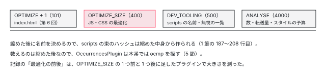

[目次](../README.md) › [webpack の builder の内側：@angular-devkit/build-angular と schematics の CLI](README.md) › 第 4 回 / 全 12 回

# Angular の webpack プラグイン：scripts・最適化・警告・統計

> tools/webpack/plugins/\*・utils/stats.ts：scripts を束ねるプラグイン、CommonJS の警告、JS の最適化のワーカーと esbuild の実行器、TypeScript の options の上書き、コンポーネントを数えるプラグインと小さなプラグイン（名前・重複・進み具合・転送量・ソースマップ・変わったファイル）、出力の表。

angular/angular-cli · 読了 約 13 分 · 発展 · [サイトで読む（デモが動きます）](https://angular-deep-dive-cyan.vercel.app/chapter/bwp-webpack-plugins)

---

この章で分かること：[前の回](02-bwp-webpack-common.md)の `getCommonConfig` が積む Angular の自前の webpack プラグインが、webpack のどの hook で何をしているか。angular.json の `scripts` を 1 つの JS に束ねるプラグイン、CommonJS の警告、JS の最適化（esbuild と terser をワーカーで回す）、TypeScript の設定の上書き、小さな数のプラグイン、そして出力の表を作る `utils/stats.ts` を読み、記録で確かめます。

読む対象は angular-cli（44129f66a3）の `packages/angular_devkit/build_angular/src/tools/webpack/plugins/` の `scripts-webpack-plugin.ts`・`common-js-usage-warn-plugin.ts`・`javascript-optimizer-plugin.ts`・`javascript-optimizer-worker.ts`・`esbuild-executor.ts`・`typescript.ts`・`occurrences-plugin.ts`・`named-chunks-plugin.ts`・`dedupe-module-resolve-plugin.ts`・`progress-plugin.ts`・`transfer-size-plugin.ts`・`devtools-ignore-plugin.ts`・`json-stats-plugin.ts`・`watch-files-logs-plugin.ts`、それに `tools/webpack/utils/stats.ts`・`async-chunks.ts` と `helpers.ts` の 2 つの関数です。スタイルのプラグインは [前の回](03-bwp-webpack-styles.md)、index.html・service worker・watch の差し替え・HMR のプラグインは [第 6 回](06-bwp-dev-server.md)で読みます。

1. [1. browser builder の流れ](01-bwp-browser.md)
2. [2. webpack の共通の設定](02-bwp-webpack-common.md)
3. [3. スタイルの設定](03-bwp-webpack-styles.md)
4. **4. Angular の webpack プラグイン**（この章）
5. [5. babel の最適化のプラグイン](05-bwp-babel.md)
6. [6. webpack の dev-server](06-bwp-dev-server.md)
7. [7. server builder と ssr-dev-server](07-bwp-server-ssr.md)
8. [8. prerender と app-shell](08-bwp-prerender-appshell.md)
9. [9. webpack の i18n](09-bwp-i18n.md)
10. [10. karma の builder の webpack の側](10-bwp-karma.md)
11. [11. schematics の CLI](11-bwp-schematics-cli.md)
12. [12. spec と issue](12-bwp-tests-issues.md)

> [!NOTE]
> **ポイント**
>
> 記録は npm の 22.2.7（webpack 5.112.0）です。v22.2.7 と 44129f66a3 で違うのは 2 か所で、どちらも webpack の内部のファイルの場所です。`common-js-usage-warn-plugin.ts` の 14〜17 行目は 22.2.7 で `webpack/lib/dependencies/amd/…`・`…/commonjs/…`、`named-chunks-plugin.ts` の 12 行目は `…/dependencies/import/ImportDependency` です（36f24fffb3「update internal webpack dependency paths」、webpack 5.112.0 の並べ替えに合わせたもの。44129f66a3 は webpack 5.110.3 を使う）。仕組みは同じです。

## 0. どのプラグインが、どの hook で動くか

| プラグイン | 積む所（common.ts） | hook | すること |
| --- | --- | --- | --- |
| `ScriptsWebpackPlugin` | 176〜189 行目、束ごと | additionalAssets・processAssets（DEV\_TOOLING） | scripts のファイルをつないで 1 つのアセットとチャンクにする（1 節） |
| `CommonJsUsageWarnPlugin` | 164〜172 行目 | finishModules | main から使う CommonJS のパッケージを警告（2 節） |
| `JavaScriptOptimizerPlugin` | 297〜311 行目（minimizer） | processAssets（OPTIMIZE\_SIZE） | esbuild と terser をワーカーで回す（3 節） |
| `AngularWebpackPlugin`（`createIvyPlugin`） | 289 行目 | @ngtools/webpack の中 | TS のコンパイル。options を上書きする（4 節） |
| `OccurrencesPlugin` | 483〜486 行目（いつも） | processAssets（ANALYSE） | コンポーネントの数を数える（5 節） |
| `NamedChunksPlugin` | 482 行目（いつも） | chunkAsset | 遅延チャンクに名前を付ける（5 節） |
| `DedupeModuleResolvePlugin` | 487 行目（いつも） | normalModuleFactory の afterResolve | 同じ名前と版のパッケージを 1 つにする（5 節） |
| `ProgressPlugin`・`TransferSizePlugin`・`DevToolsIgnorePlugin`・`JsonStatsPlugin`・`WatchFilesLogsPlugin` | 93・313・225・246・242 行目 | いろいろ | 進み具合・転送量・無視の一覧・stats.json・変わったファイル（5 節） |

## 1. scripts を 1 つの JS に束ねる

📄 `angular-cli/packages/angular_devkit/build_angular/src/tools/webpack/utils/helpers.ts` L69–93 （▶ の行: 76–77, 80, 82–84, 86, 88）

```ts
69 │ export type NormalizedEntryPoint = Required<Exclude<ScriptElement | StyleElement, string>>;
70 │ 
71 │ export function normalizeExtraEntryPoints(
72 │   extraEntryPoints: (ScriptElement | StyleElement)[],
73 │   defaultBundleName: string,
74 │ ): NormalizedEntryPoint[] {
75 │   return extraEntryPoints.map((entry) => {
76 ▶     if (typeof entry === 'string') {
77 ▶       return { input: entry, inject: true, bundleName: defaultBundleName };
78 │     }
79 │ 
80 ▶     const { inject = true, ...newEntry } = entry;
81 │     let bundleName;
82 ▶     if (entry.bundleName) {
83 ▶       bundleName = entry.bundleName;
84 ▶     } else if (!inject) {
85 │       // Lazy entry points use the file name as bundle name.
86 ▶       bundleName = path.parse(entry.input).name;
87 │     } else {
88 ▶       bundleName = defaultBundleName;
89 │     }
90 │ 
91 │     return { ...newEntry, inject, bundleName };
92 │   });
93 │ }
```

📄 `angular-cli/packages/angular_devkit/build_angular/src/tools/webpack/utils/helpers.ts` L202–229 （▶ の行: 205, 209–211, 213, 216, 218, 220）

```ts
202 │ export function globalScriptsByBundleName(
203 │   scripts: ScriptElement[],
204 │ ): { bundleName: string; inject: boolean; paths: string[] }[] {
205 ▶   return normalizeExtraEntryPoints(scripts, 'scripts').reduce(
206 │     (prev: { bundleName: string; paths: string[]; inject: boolean }[], curr) => {
207 │       const { bundleName, inject, input } = curr;
208 │ 
209 ▶       const existingEntry = prev.find((el) => el.bundleName === bundleName);
210 ▶       if (existingEntry) {
211 ▶         if (existingEntry.inject && !inject) {
212 │           // All entries have to be lazy for the bundle to be lazy.
213 ▶           throw new Error(`The ${bundleName} bundle is mixing injected and non-injected scripts.`);
214 │         }
215 │ 
216 ▶         existingEntry.paths.push(input);
217 │       } else {
218 ▶         prev.push({
219 │           bundleName,
220 ▶           inject,
221 │           paths: [input],
222 │         });
223 │       }
224 │ 
225 │       return prev;
226 │     },
227 │     [],
228 │   );
229 │ }
```

1. **76〜88 行目：束の名前**

   文字列なら `scripts` の束で注入する。オブジェクトで `bundleName` があればその名前、無くて `inject: false` ならファイル名（`lazy.js` → `lazy`）、それ以外は `scripts`。
2. **209〜223 行目：同じ名前の束にまとめる**

   名前が同じなら 1 つの束の `paths` に足し、最初に来た 1 つの `inject` を束の `inject` にします。
3. **211〜214 行目：混ぜたときの検査は片方向だけ**

   212 行目のコメントは「束が遅延になるのは全部が遅延のときだけ」ですが、止めるのは「先に注入、後に遅延」の順だけです。「先に遅延、後に注入」はエラーにならず、束は遅延のまま、後の注入のファイルもその束に入ります（デモの「同じ束：inject: false が先」）。

📄 `angular-cli/packages/angular_devkit/build_angular/src/tools/webpack/plugins/scripts-webpack-plugin.ts` L41–75 （▶ の行: 47–49, 51, 54, 56, 63, 67–68, 74）

```ts
41 │ export class ScriptsWebpackPlugin {
42 │   private _lastBuildTime?: number;
43 │   private _cachedOutput?: ScriptOutput;
44 │ 
45 │   constructor(private options: ScriptsWebpackPluginOptions) {}
46 │ 
47 ▶   async shouldSkip(compilation: Compilation, scripts: string[]): Promise<boolean> {
48 ▶     if (this._lastBuildTime == undefined) {
49 ▶       this._lastBuildTime = Date.now();
50 │ 
51 ▶       return false;
52 │     }
53 │ 
54 ▶     for (const script of scripts) {
55 │       const scriptTime = await new Promise<number | undefined>((resolve, reject) => {
56 ▶         compilation.fileSystemInfo.getFileTimestamp(script, (error, entry) => {
57 │           if (error) {
58 │             reject(error);
59 │ 
60 │             return;
61 │           }
62 │ 
63 ▶           resolve(entry && typeof entry !== 'string' ? entry.safeTime : undefined);
64 │         });
65 │       });
66 │ 
67 ▶       if (!scriptTime || scriptTime > this._lastBuildTime) {
68 ▶         this._lastBuildTime = Date.now();
69 │ 
70 │         return false;
71 │       }
72 │     }
73 │ 
74 ▶     return true;
75 │   }
```

📄 `angular-cli/packages/angular_devkit/build_angular/src/tools/webpack/plugins/scripts-webpack-plugin.ts` L77–96 （▶ の行: 82–84, 86, 88–89, 91–92, 94–95）

```ts
77 │   private _insertOutput(
78 │     compilation: Compilation,
79 │     { filename, source }: ScriptOutput,
80 │     cached = false,
81 │   ) {
82 ▶     const chunk = new Chunk(this.options.name);
83 ▶     chunk.rendered = !cached;
84 ▶     chunk.id = this.options.name;
85 │     chunk.ids = [chunk.id];
86 ▶     chunk.files.add(filename);
87 │ 
88 ▶     const entrypoint = new Entrypoint(this.options.name);
89 ▶     entrypoint.pushChunk(chunk);
90 │     chunk.addGroup(entrypoint);
91 ▶     compilation.entrypoints.set(this.options.name, entrypoint);
92 ▶     compilation.chunks.add(chunk);
93 │ 
94 ▶     compilation.assets[filename] = source;
95 ▶     compilation.hooks.chunkAsset.call(chunk, filename);
96 │   }
```

`shouldSkip` は watch のための近道です。最初のビルドは時刻を覚えて false、次からは webpack の `fileSystemInfo` に各ファイルの時刻を聞き、1 つでも新しければ作り直します。`_insertOutput` は、webpack のモジュールを通らないアセットを、本物のチャンクと entry のように見せる関数です。82〜92 行目で束の名前のチャンクと `Entrypoint` を作って compilation に登録し、94 行目でアセットを置き、95 行目で `chunkAsset` の hook を自分で呼びます。これで出力の表や index.html の生成が、scripts の束を普通の entry として扱えます。

📄 `angular-cli/packages/angular_devkit/build_angular/src/tools/webpack/plugins/scripts-webpack-plugin.ts` L98–129 （▶ の行: 99, 103, 107–109, 111, 118, 120, 122, 126）

```ts
 98 │   apply(compiler: Compiler): void {
 99 ▶     if (this.options.scripts.length === 0) {
100 │       return;
101 │     }
102 │ 
103 ▶     compiler.hooks.thisCompilation.tap(PLUGIN_NAME, (compilation) => {
104 │       // Use the resolver from the compilation instead of compiler.
105 │       // Using the latter will causes a lot of `DescriptionFileUtils.loadDescriptionFile` calls.
106 │       // See: https://github.com/angular/angular-cli/issues/24634#issuecomment-1425782668
107 ▶       const resolver = compilation.resolverFactory.get('normal', {
108 ▶         preferRelative: true,
109 ▶         useSyncFileSystemCalls: true,
110 │         // Caching must be disabled because it causes the resolver to become async after a rebuild.
111 ▶         cache: false,
112 │       });
113 │ 
114 │       const scripts: string[] = [];
115 │ 
116 │       for (const script of this.options.scripts) {
117 │         try {
118 ▶           const resolvedPath = resolver.resolveSync({}, this.options.basePath, script);
119 │           if (resolvedPath) {
120 ▶             scripts.push(resolvedPath);
121 │           } else {
122 ▶             addError(compilation, `Cannot resolve '${script}'.`);
123 │           }
124 │         } catch (error) {
125 │           assertIsError(error);
126 ▶           addError(compilation, error.message);
127 │         }
128 │       }
129 │ 
```

📄 `angular-cli/packages/angular_devkit/build_angular/src/tools/webpack/plugins/scripts-webpack-plugin.ts` L130–140 （▶ の行: 130–133, 136, 138）

```ts
130 ▶       compilation.hooks.additionalAssets.tapPromise(PLUGIN_NAME, async () => {
131 ▶         if (await this.shouldSkip(compilation, scripts)) {
132 ▶           if (this._cachedOutput) {
133 ▶             this._insertOutput(compilation, this._cachedOutput, true);
134 │           }
135 │ 
136 ▶           addDependencies(compilation, scripts);
137 │ 
138 ▶           return;
139 │         }
140 │ 
```

📄 `angular-cli/packages/angular_devkit/build_angular/src/tools/webpack/plugins/scripts-webpack-plugin.ts` L141–171 （▶ の行: 141, 143, 152, 155–156, 158, 160, 162, 164）

```ts
141 ▶         const sourceGetters = scripts.map((fullPath) => {
142 │           return new Promise<webpackSources.Source>((resolve, reject) => {
143 ▶             compilation.inputFileSystem.readFile(
144 │               fullPath,
145 │               (err?: Error | null, data?: string | Buffer) => {
146 │                 if (err) {
147 │                   reject(err);
148 │ 
149 │                   return;
150 │                 }
151 │ 
152 ▶                 const content = data?.toString() ?? '';
153 │ 
154 │                 let source;
155 ▶                 if (this.options.sourceMap) {
156 ▶                   // TODO: Look for source map file (for '.min' scripts, etc.)
157 │ 
158 ▶                   let adjustedPath = fullPath;
159 │                   if (this.options.basePath) {
160 ▶                     adjustedPath = path.relative(this.options.basePath, fullPath);
161 │                   }
162 ▶                   source = new webpackSources.OriginalSource(content, adjustedPath);
163 │                 } else {
164 ▶                   source = new webpackSources.RawSource(content);
165 │                 }
166 │ 
167 │                 resolve(source);
168 │               },
169 │             );
170 │           });
171 │         });
```

📄 `angular-cli/packages/angular_devkit/build_angular/src/tools/webpack/plugins/scripts-webpack-plugin.ts` L173–210 （▶ の行: 173–174, 176–177, 180, 183–184, 187, 190, 196, 200, 203–204）

```ts
173 ▶         const sources = await Promise.all(sourceGetters);
174 ▶         const concatSource = new webpackSources.ConcatSource();
175 │         sources.forEach((source) => {
176 ▶           concatSource.add(source);
177 ▶           concatSource.add('\n;');
178 │         });
179 │ 
180 ▶         const combinedSource = new webpackSources.CachedSource(concatSource);
181 │ 
182 │         const output = { filename: this.options.filename, source: combinedSource };
183 ▶         this._insertOutput(compilation, output);
184 ▶         this._cachedOutput = output;
185 │         addDependencies(compilation, scripts);
186 │       });
187 ▶       compilation.hooks.processAssets.tapPromise(
188 │         {
189 │           name: PLUGIN_NAME,
190 ▶           stage: compiler.webpack.Compilation.PROCESS_ASSETS_STAGE_DEV_TOOLING,
191 │         },
192 │         async () => {
193 │           const assetName = this.options.filename;
194 │           const asset = compilation.getAsset(assetName);
195 │           if (asset) {
196 ▶             const interpolatedFilename = interpolateName(
197 │               // TODO: Revisit. Previously due to lack of type safety, this object
198 │               // was fine, but in practice it doesn't match the type of the loader context.
199 │               { resourcePath: 'scripts.js' } as Parameters<typeof interpolateName>[0],
200 ▶               assetName,
201 │               { content: asset.source.source() },
202 │             );
203 ▶             if (assetName !== interpolatedFilename) {
204 ▶               compilation.renameAsset(assetName, interpolatedFilename);
205 │             }
206 │           }
207 │         },
208 │       );
209 │     });
210 │   }
```

1. **107〜128 行目：パスを解決する**

   compilation の resolver（`preferRelative` なので `src/scripts/a.js` はワークスペースの根からの相対）で探し、見つからなければ例外の文をエラーにします（デモの「無いファイル」の `Can't resolve 'src/scripts/nope.js' in '<app>'`）。
2. **141〜171 行目：読む**

   ソースマップを頼まれていれば元のパスを持つ `OriginalSource`、無ければ `RawSource`。156 行目の TODO のとおり、`.min.js` の隣のソースマップは読みません。
3. **173〜178 行目：つなぐ**

   ファイルごとに `\n;` を挟んでつなぎます。開発の `scripts.js` の中身に `;` が 2 つ並ぶのはこのためです。モジュールとして包まないので、スクリプトの中の `var` はグローバルになります。
4. **187〜208 行目：ハッシュを付けるのは最後**

   前の回の 185 行目で付けた `[contenthash:20]` は、ここ（DEV\_TOOLING の段）まで文字のまま残ります。記録の「最適化の前後」で、最適化の前のアセットの名前が `scripts.[contenthash:20].js` のままなのはこのためで、縮めた後の中身からハッシュを作って名前を変えます。

もう 1 つ、束の名前が既存のチャンクの名前と同じでも止まりません。`bundleName: 'main'` にすると、94 行目がアプリの `main.js` をスクリプトの中身で上書きし、アプリの main が消えます（デモの「bundleName: 'main'」で `main.js` が 48 B）。同じ名前を止めるための `utils/package-chunk-sort.ts` の重複の検査は、41 行目で entry の配列の最初の要素（`["runtime", …]`）の中を探しているため、重複を見つけません（このファイルはこの章では引きません）。

## 2. CommonJS の警告

📄 `angular-cli/packages/angular_devkit/build_angular/src/tools/webpack/plugins/common-js-usage-warn-plugin.ts` L13–46 （▶ の行: 14–17, 21, 29, 33–34, 38–39, 43–44）

```ts
13 │ // Webpack doesn't export these so the deep imports can potentially break.
14 ▶ const AMDDefineDependency = require('webpack/lib/dependencies/AMDDefineDependency');
15 ▶ const CommonJsExportsDependency = require('webpack/lib/dependencies/CommonJsExportsDependency');
16 ▶ const CommonJsRequireDependency = require('webpack/lib/dependencies/CommonJsRequireDependency');
17 ▶ const CommonJsSelfReferenceDependency = require('webpack/lib/dependencies/CommonJsSelfReferenceDependency');
18 │ 
19 │ export interface CommonJsUsageWarnPluginOptions {
20 │   /** A list of CommonJS or AMD packages that are allowed to be used without a warning. Use `'*'` to allow all. */
21 ▶   allowedDependencies?: string[];
22 │ }
23 │ 
24 │ export class CommonJsUsageWarnPlugin {
25 │   private shownWarnings = new Set<string>();
26 │   private allowedDependencies: Set<string>;
27 │ 
28 │   constructor(private options: CommonJsUsageWarnPluginOptions = {}) {
29 ▶     this.allowedDependencies = new Set(this.options.allowedDependencies);
30 │   }
31 │ 
32 │   apply(compiler: Compiler) {
33 ▶     if (this.allowedDependencies.has('*')) {
34 ▶       return;
35 │     }
36 │ 
37 │     compiler.hooks.compilation.tap('CommonJsUsageWarnPlugin', (compilation) => {
38 ▶       compilation.hooks.finishModules.tap('CommonJsUsageWarnPlugin', (modules) => {
39 ▶         const mainEntry = compilation.entries.get('main');
40 │         if (!mainEntry) {
41 │           return;
42 │         }
43 ▶         const mainModules = new Set(
44 ▶           mainEntry.dependencies.map((dep) => compilation.moduleGraph.getModule(dep)),
45 │         );
46 │ 
```

📄 `angular-cli/packages/angular_devkit/build_angular/src/tools/webpack/plugins/common-js-usage-warn-plugin.ts` L47–78 （▶ の行: 48, 51–55, 66, 68, 71, 73–74, 76）

```ts
47 │         for (const module of modules) {
48 ▶           const { dependencies, rawRequest } = module as NormalModule;
49 │           if (
50 │             !rawRequest ||
51 ▶             rawRequest.startsWith('.') ||
52 ▶             isAbsolute(rawRequest) ||
53 ▶             this.allowedDependencies.has(rawRequest) ||
54 ▶             this.allowedDependencies.has(this.rawRequestToPackageName(rawRequest)) ||
55 ▶             rawRequest.startsWith('@angular/common/locales/')
56 │           ) {
57 │             /**
58 │              * Skip when:
59 │              * - module is absolute or relative.
60 │              * - module is allowed even if it's a CommonJS.
61 │              * - module is a locale imported from '@angular/common'.
62 │              */
63 │             continue;
64 │           }
65 │ 
66 ▶           if (this.hasCommonJsDependencies(compilation, dependencies)) {
67 │             // Dependency is CommonsJS or AMD.
68 ▶             const issuer = getIssuer(compilation, module);
69 │             // Check if it's parent issuer is also a CommonJS dependency.
70 │             // In case it is skip as an warning will be show for the parent CommonJS dependency.
71 ▶             const parentDependencies = getIssuer(compilation, issuer)?.dependencies;
72 │             if (
73 ▶               parentDependencies &&
74 ▶               this.hasCommonJsDependencies(compilation, parentDependencies, true)
75 │             ) {
76 ▶               continue;
77 │             }
78 │ 
```

📄 `angular-cli/packages/angular_devkit/build_angular/src/tools/webpack/plugins/common-js-usage-warn-plugin.ts` L79–106 （▶ の行: 80–83, 90–93, 97–98）

```ts
 79 │             // Find the main issuer (entry-point).
 80 ▶             let mainIssuer = issuer;
 81 ▶             let nextIssuer = getIssuer(compilation, mainIssuer);
 82 ▶             while (nextIssuer) {
 83 ▶               mainIssuer = nextIssuer;
 84 │               nextIssuer = getIssuer(compilation, mainIssuer);
 85 │             }
 86 │ 
 87 │             // Only show warnings for modules from main entrypoint.
 88 │             // And if the issuer request is not from 'webpack-dev-server', as 'webpack-dev-server'
 89 │             // will require CommonJS libraries for live reloading such as 'sockjs-node'.
 90 ▶             if (mainIssuer && mainModules.has(mainIssuer)) {
 91 ▶               const warning =
 92 ▶                 `${(issuer as NormalModule | null)?.userRequest} depends on '${rawRequest}'. ` +
 93 ▶                 'CommonJS or AMD dependencies can cause optimization bailouts.\n' +
 94 │                 'For more info see: https://angular.dev/tools/cli/build#configuring-commonjs-dependencies';
 95 │ 
 96 │               // Avoid showing the same warning multiple times when in 'watch' mode.
 97 ▶               if (!this.shownWarnings.has(warning)) {
 98 ▶                 addWarning(compilation, warning);
 99 │                 this.shownWarnings.add(warning);
100 │               }
101 │             }
102 │           }
103 │         }
104 │       });
105 │     });
106 │   }
```

📄 `angular-cli/packages/angular_devkit/build_angular/src/tools/webpack/plugins/common-js-usage-warn-plugin.ts` L108–141 （▶ の行: 114–118, 123, 125, 135, 137, 139）

```ts
108 │   private hasCommonJsDependencies(
109 │     compilation: Compilation,
110 │     dependencies: Dependency[],
111 │     checkParentModules = false,
112 │   ): boolean {
113 │     for (const dep of dependencies) {
114 ▶       if (
115 ▶         dep instanceof CommonJsRequireDependency ||
116 ▶         dep instanceof CommonJsExportsDependency ||
117 ▶         dep instanceof CommonJsSelfReferenceDependency ||
118 ▶         dep instanceof AMDDefineDependency
119 │       ) {
120 │         return true;
121 │       }
122 │ 
123 ▶       if (checkParentModules) {
124 │         const module = getWebpackModule(compilation, dep);
125 ▶         if (module && this.hasCommonJsDependencies(compilation, module.dependencies)) {
126 │           return true;
127 │         }
128 │       }
129 │     }
130 │ 
131 │     return false;
132 │   }
133 │ 
134 │   private rawRequestToPackageName(rawRequest: string): string {
135 ▶     return rawRequest.startsWith('@')
136 │       ? // Scoped request ex: @angular/common/locale/en -> @angular/common
137 ▶         rawRequest.split('/', 2).join('/')
138 │       : // Non-scoped request ex: lodash/isEmpty -> lodash
139 ▶         rawRequest.split('/', 1)[0];
140 │   }
141 │ }
```

1. **33〜35 行目：`'*'`**

   許す一覧に `*` があれば、hook を付けずに帰ります。
2. **38〜45 行目：main の entry のモジュール**

   モジュールがそろった（`finishModules`）後、`main` の entry の直接のモジュールを集合にします。polyfills や scripts から使うものは警告しません。
3. **49〜64 行目：調べない要求**

   相対・絶対の要求、許す一覧にある名前（要求そのものか、パッケージの名前）、`@angular/common/locales/` は飛ばします。
4. **66〜77 行目：親も CommonJS なら黙る**

   このモジュールの依存に `require`・`exports`・`module.exports`・AMD の `define` があれば CommonJS。それを使った側（issuer）も CommonJS なら、警告は親の分だけにします。
5. **80〜101 行目：main までたどる**

   issuer を根までたどり、根が `main` の entry のモジュールなら警告します。文は「`<issuer の要求> depends on '<要求>'`」で、watch で同じ文を 2 回出さないよう覚えておきます。

デモの `legacy-cjs` はプロジェクトの根の直下のフォルダで、前の回の 333 行目の `resolve.modules` により `import { greet } from 'legacy-cjs'` で引けます。警告は「`<app>/src/main.ts depends on 'legacy-cjs'.`」で、`allowedCommonJsDependencies: ['legacy-cjs']` にすると消えました。esbuild の側の同じ検査は [abl-plugins の章](../abl/05-abl-plugins.md)で読みました。

## 3. JS の最適化：esbuild と terser をワーカーで



*webpack の processAssets の段（数字は webpack の Compilation の定数の値）。この章のプラグインはこの順に出力を書き換え、数える。*

📄 `angular-cli/packages/angular_devkit/build_angular/src/tools/webpack/plugins/javascript-optimizer-plugin.ts` L87–115 （▶ の行: 90, 93, 96, 101–102, 106, 112–113）

```ts
 87 │   apply(compiler: Compiler) {
 88 │     const { OriginalSource, SourceMapSource } = compiler.webpack.sources;
 89 │ 
 90 ▶     compiler.hooks.compilation.tap(PLUGIN_NAME, (compilation) => {
 91 │       const logger = compilation.getLogger('build-angular.JavaScriptOptimizerPlugin');
 92 │ 
 93 ▶       compilation.hooks.processAssets.tapPromise(
 94 │         {
 95 │           name: PLUGIN_NAME,
 96 ▶           stage: compiler.webpack.Compilation.PROCESS_ASSETS_STAGE_OPTIMIZE_SIZE,
 97 │         },
 98 │         async (compilationAssets) => {
 99 │           logger.time('optimize js assets');
100 │           const scriptsToOptimize = [];
101 ▶           const cache =
102 ▶             compilation.options.cache && compilation.getCache('JavaScriptOptimizerPlugin');
103 │ 
104 │           // Analyze the compilation assets for scripts that require optimization
105 │           for (const assetName of Object.keys(compilationAssets)) {
106 ▶             if (!assetName.endsWith('.js')) {
107 │               continue;
108 │             }
109 │ 
110 │             const scriptAsset = compilation.getAsset(assetName);
111 │             // Skip assets that have already been optimized or are verbatim copies (project assets)
112 ▶             if (!scriptAsset || scriptAsset.info.minimized || scriptAsset.info.copied) {
113 ▶               continue;
114 │             }
115 │ 
```

📄 `angular-cli/packages/angular_devkit/build_angular/src/tools/webpack/plugins/javascript-optimizer-plugin.ts` L116–147 （▶ の行: 119–121, 126, 128, 136–137, 145–146）

```ts
116 │             const { source: scriptAssetSource, name } = scriptAsset;
117 │             let cacheItem;
118 │ 
119 ▶             if (cache) {
120 ▶               const eTag = cache.getLazyHashedEtag(scriptAssetSource);
121 ▶               cacheItem = cache.getItemCache(name, eTag);
122 │               const cachedOutput = await cacheItem.getPromise<
123 │                 { source: sources.Source } | undefined
124 │               >();
125 │ 
126 ▶               if (cachedOutput) {
127 │                 logger.debug(`${name} restored from cache`);
128 ▶                 compilation.updateAsset(name, cachedOutput.source, (assetInfo) => ({
129 │                   ...assetInfo,
130 │                   minimized: true,
131 │                 }));
132 │                 continue;
133 │               }
134 │             }
135 │ 
136 ▶             const { source, map } = scriptAssetSource.sourceAndMap();
137 ▶             scriptsToOptimize.push({
138 │               name: scriptAsset.name,
139 │               code: typeof source === 'string' ? source : source.toString(),
140 │               map,
141 │               cacheItem,
142 │             });
143 │           }
144 │ 
145 ▶           if (scriptsToOptimize.length === 0) {
146 ▶             return;
147 │           }
```

📄 `angular-cli/packages/angular_devkit/build_angular/src/tools/webpack/plugins/javascript-optimizer-plugin.ts` L148–182 （▶ の行: 151, 154, 160, 162–163, 165, 169, 172–173, 176–177, 179）

```ts
148 │ 
149 │           // Ensure all replacement values are strings which is the expected type for esbuild
150 │           let define: Record<string, string> | undefined;
151 ▶           if (this.options.define) {
152 │             define = {};
153 │             for (const [key, value] of Object.entries(this.options.define)) {
154 ▶               define[key] = String(value);
155 │             }
156 │           }
157 │ 
158 │           // Setup the options used by all worker tasks
159 │           const optimizeOptions: OptimizeRequestOptions = {
160 ▶             sourcemap: this.options.sourcemap,
161 │             define,
162 ▶             keepIdentifierNames: this.options.keepIdentifierNames,
163 ▶             target: this.targets,
164 │             removeLicenses: this.options.removeLicenses,
165 ▶             advanced: this.options.advanced,
166 │             // Perform a single native esbuild support check.
167 │             // This removes the need for each worker to perform the check which would
168 │             // otherwise require spawning a separate process per worker.
169 ▶             alwaysUseWasm: !(await EsbuildExecutor.hasNativeSupport()),
170 │           };
171 │ 
172 ▶           // Sort scripts so larger scripts start first - worker pool uses a FIFO queue
173 ▶           scriptsToOptimize.sort((a, b) => a.code.length - b.code.length);
174 │ 
175 │           // Initialize the task worker pool
176 ▶           const workerPath = require.resolve('./javascript-optimizer-worker');
177 ▶           const workerPool = new Piscina({
178 │             filename: workerPath,
179 ▶             maxThreads: MAX_OPTIMIZE_WORKERS,
180 │             recordTiming: false,
181 │           });
182 │ 
```

📄 `angular-cli/packages/angular_devkit/build_angular/src/tools/webpack/plugins/javascript-optimizer-plugin.ts` L183–211 （▶ の行: 186, 191, 197, 201, 203, 209）

```ts
183 │           // Enqueue script optimization tasks and update compilation assets as the tasks complete
184 │           try {
185 │             const tasks = [];
186 ▶             for (const { name, code, map, cacheItem } of scriptsToOptimize) {
187 │               logger.time(`optimize asset: ${name}`);
188 │ 
189 │               tasks.push(
190 │                 workerPool
191 ▶                   .run({
192 │                     asset: {
193 │                       name,
194 │                       code,
195 │                       map,
196 │                     },
197 ▶                     options: optimizeOptions,
198 │                   })
199 │                   .then(
200 │                     async ({ code, name, map, errors }) => {
201 ▶                       if (errors?.length) {
202 │                         for (const error of errors) {
203 ▶                           addError(compilation, `Optimization error [${name}]: ${error}`);
204 │                         }
205 │ 
206 │                         return;
207 │                       }
208 │ 
209 ▶                       const optimizedAsset = map
210 │                         ? new SourceMapSource(code, name, map)
211 │                         : new OriginalSource(code, name);
```

📄 `angular-cli/packages/angular_devkit/build_angular/src/tools/webpack/plugins/javascript-optimizer-plugin.ts` L212–243 （▶ の行: 219, 224, 233, 235）

```ts
212 │                       compilation.updateAsset(name, optimizedAsset, (assetInfo) => ({
213 │                         ...assetInfo,
214 │                         minimized: true,
215 │                       }));
216 │ 
217 │                       logger.timeEnd(`optimize asset: ${name}`);
218 │ 
219 ▶                       return cacheItem?.storePromise({
220 │                         source: optimizedAsset,
221 │                       });
222 │                     },
223 │                     (error) => {
224 ▶                       addError(
225 │                         compilation,
226 │                         `Optimization error [${name}]: ${error.stack || error.message}`,
227 │                       );
228 │                     },
229 │                   ),
230 │               );
231 │             }
232 │ 
233 ▶             await Promise.all(tasks);
234 │           } finally {
235 ▶             void workerPool.destroy();
236 │           }
237 │ 
238 │           logger.timeEnd('optimize js assets');
239 │         },
240 │       );
241 │     });
242 │   }
243 │ }
```

1. **96 行目：OPTIMIZE\_SIZE の段**

   webpack の `processAssets` の段のうち、出力を縮める段です。記録では `main` が 1,167,444 B から 96,256 B になりました（デモの「最適化の前後」）。
2. **112・136〜142 行目：縮める対象**

   `.js` で、まだ縮めていない、コピーしただけでないアセットを、中身とソースマップごと集めます。キャッシュに同じ中身の結果があれば、それを使います。
3. **169 行目：native の esbuild が使えるか、1 回だけ**

   ワーカーごとに調べると、それぞれが esbuild の子のプロセスを立てるためです。
4. **172〜173 行目：コメントと逆の順**

   コメントは「大きいスクリプトから始める（ワーカーのプールは FIFO）」ですが、`a.code.length - b.code.length` は小さい順です。記録の大きさでこの比べ方を使うと、積む順は `lazy.js`（44 B）→ `extra` → `scripts` → `runtime` → `main`（1.17 MB）で、いちばん大きい main が最後に入ります。この行は 2020 年の da32daa75d（esbuild と terser の組み合わせを入れたコミット）から変わっていません。
5. **177〜181 行目：Piscina のワーカー**

   数は `maxWorkers`（前の回の environment-options.ts の 79〜81 行目、既定は CPU − 1 で 4 まで、`NG_BUILD_MAX_WORKERS`）。ビルドのたびに作り、235 行目で壊します。
6. **201〜207・223〜228 行目：失敗**

   esbuild の文法のエラーは「Optimization error \[名前\]: …」のエラーになり、そのアセットは縮めないまま残ります。

📄 `angular-cli/packages/angular_devkit/build_angular/src/tools/webpack/plugins/javascript-optimizer-worker.ts` L103–142 （▶ の行: 103, 105–106, 115, 124, 127–128, 131–132, 135–136, 139, 142）

```ts
103 ▶ export default async function ({ asset, options }: OptimizeRequest) {
104 │   // esbuild is used as a first pass
105 ▶   const esbuildResult = await optimizeWithEsbuild(asset.code, asset.name, options);
106 ▶   if (isEsBuildFailure(esbuildResult)) {
107 │     return {
108 │       name: asset.name,
109 │       // eslint-disable-next-line @typescript-eslint/no-non-null-assertion
110 │       errors: await esbuild!.formatMessages(esbuildResult.errors, { kind: 'error' }),
111 │     };
112 │   }
113 │ 
114 │   // terser is used as a second pass
115 ▶   const terserResult = await optimizeWithTerser(
116 │     asset.name,
117 │     esbuildResult.code,
118 │     options.sourcemap,
119 │     options.advanced,
120 │   );
121 │ 
122 │   // Merge intermediate sourcemaps with input sourcemap if enabled
123 │   let fullSourcemap;
124 ▶   if (options.sourcemap) {
125 │     const partialSourcemaps = [];
126 │ 
127 ▶     if (esbuildResult.map) {
128 ▶       partialSourcemaps.unshift(JSON.parse(esbuildResult.map) as SourceMapInput);
129 │     }
130 │ 
131 ▶     if (terserResult.map) {
132 ▶       partialSourcemaps.unshift(terserResult.map as SourceMapInput);
133 │     }
134 │ 
135 ▶     if (asset.map) {
136 ▶       partialSourcemaps.push(asset.map);
137 │     }
138 │ 
139 ▶     fullSourcemap = remapping(partialSourcemaps, () => null);
140 │   }
141 │ 
142 ▶   return { name: asset.name, code: terserResult.code, map: fullSourcemap };
```

📄 `angular-cli/packages/angular_devkit/build_angular/src/tools/webpack/plugins/javascript-optimizer-worker.ts` L153–182 （▶ の行: 163–169, 172–173）

```ts
153 │ async function optimizeWithEsbuild(
154 │   content: string,
155 │   name: string,
156 │   options: OptimizeRequest['options'],
157 │ ): Promise<TransformResult | BuildFailure> {
158 │   if (!esbuild) {
159 │     esbuild = new EsbuildExecutor(options.alwaysUseWasm);
160 │   }
161 │ 
162 │   try {
163 ▶     return await esbuild.transform(content, {
164 ▶       minifyIdentifiers: !options.keepIdentifierNames,
165 ▶       minifySyntax: true,
166 ▶       // NOTE: Disabling whitespace ensures unused pure annotations are kept
167 ▶       minifyWhitespace: false,
168 ▶       pure: ['forwardRef'],
169 ▶       legalComments: options.removeLicenses ? 'none' : 'inline',
170 │       sourcefile: name,
171 │       sourcemap: options.sourcemap && 'external',
172 ▶       define: options.define,
173 ▶       target: options.target,
174 │     });
175 │   } catch (error) {
176 │     if (isEsBuildFailure(error)) {
177 │       return error;
178 │     }
179 │ 
180 │     throw error;
181 │   }
182 │ }
```

📄 `angular-cli/packages/angular_devkit/build_angular/src/tools/webpack/plugins/javascript-optimizer-worker.ts` L193–232 （▶ の行: 199, 203–204, 208, 210, 212, 215–216, 218）

```ts
193 │ async function optimizeWithTerser(
194 │   name: string,
195 │   code: string,
196 │   sourcemaps: boolean | undefined,
197 │   advanced: boolean | undefined,
198 │ ): Promise<{ code: string; map?: object }> {
199 ▶   const result = await minify(
200 │     { [name]: code },
201 │     {
202 │       compress: {
203 ▶         passes: advanced ? 2 : 1,
204 ▶         pure_getters: advanced,
205 │       },
206 │       // Set to ES2015 to prevent higher level features from being introduced when browserslist
207 │       // contains older browsers. The build system requires browsers to support ES2015 at a minimum.
208 ▶       ecma: 2015,
209 │       // esbuild in the first pass is used to minify identifiers instead of mangle here
210 ▶       mangle: false,
211 │       // esbuild in the first pass is used to minify function names
212 ▶       keep_fnames: true,
213 │       format: {
214 │         // ASCII output is enabled here as well to prevent terser from converting back to UTF-8
215 ▶         ascii_only: true,
216 ▶         wrap_func_args: false,
217 │       },
218 ▶       sourceMap:
219 │         sourcemaps &&
220 │         ({
221 │           asObject: true,
222 │           // typings don't include asObject option
223 │           // eslint-disable-next-line @typescript-eslint/no-explicit-any
224 │         } as any),
225 │     },
226 │   );
227 │ 
228 │   if (typeof result.code !== 'string') {
229 │     throw new Error('Terser failed for unknown reason.');
230 │   }
231 │ 
232 │   return { code: result.code, map: result.map as object };
```

1. **164〜168 行目：esbuild は空白を残す**

   名前を短くし（`NG_BUILD_MANGLE` を切ると残す）、文法を縮めますが、空白は縮めません。166 行目のコメントのとおり、空白を縮めると使われない `/*@__PURE__*/` の印も消えるので、後の terser が使えるように残します。`forwardRef` の呼び出しは純粋と見なします。
2. **203〜216 行目：terser は 2 回目**

   `buildOptimizer`（`advanced`）なら passes を 2 にし、`pure_getters` を入れます。名前の短縮はしません（esbuild がした）。215 行目の `ascii_only` で、`ɵ` は `ɵ` と書かれます（5 節の数え方に効く）。
3. **124〜140 行目：ソースマップを重ねる**

   terser → esbuild → 元の順に並べて、`@ampproject/remapping` で 1 枚にします。

📄 `angular-cli/packages/angular_devkit/build_angular/src/tools/webpack/plugins/esbuild-executor.ts` L36–57 （▶ の行: 36–37, 47, 50–51, 53, 55）

```ts
36 ▶   constructor(private alwaysUseWasm = false) {
37 ▶     this.esbuildTransform = this.esbuildFormatMessages = () => {
38 │       throw new Error('esbuild implementation missing');
39 │     };
40 │   }
41 │ 
42 │   /**
43 │    * Determines whether the native variant of esbuild can be used on the current platform.
44 │    *
45 │    * @returns A promise which resolves to `true`, if the native variant of esbuild is support or `false`, if the WASM variant is required.
46 │    */
47 ▶   static async hasNativeSupport(): Promise<boolean> {
48 │     // Try to use native variant to ensure it is functional for the platform.
49 │     try {
50 ▶       const { formatMessages } = await import('esbuild');
51 ▶       await formatMessages([], { kind: 'error' });
52 │ 
53 ▶       return true;
54 │     } catch {
55 ▶       return false;
56 │     }
57 │   }
```

📄 `angular-cli/packages/angular_devkit/build_angular/src/tools/webpack/plugins/esbuild-executor.ts` L59–89 （▶ の行: 64–65, 70–71, 79, 81, 85, 88）

```ts
59 │   /**
60 │    * Initializes the esbuild transform and format messages functions.
61 │    *
62 │    * @returns A promise that fulfills when esbuild has been loaded and available for use.
63 │    */
64 ▶   private async ensureEsbuild(): Promise<void> {
65 ▶     if (this.initialized) {
66 │       return;
67 │     }
68 │ 
69 │     // If the WASM variant was preferred at class construction or native is not supported, use WASM
70 ▶     if (this.alwaysUseWasm || !(await EsbuildExecutor.hasNativeSupport())) {
71 ▶       await this.useWasm();
72 │       this.initialized = true;
73 │ 
74 │       return;
75 │     }
76 │ 
77 │     try {
78 │       // Use the faster native variant if available.
79 ▶       const { transform, formatMessages } = await import('esbuild');
80 │ 
81 ▶       this.esbuildTransform = transform;
82 │       this.esbuildFormatMessages = formatMessages;
83 │     } catch {
84 │       // If the native variant is not installed then use the WASM-based variant
85 ▶       await this.useWasm();
86 │     }
87 │ 
88 ▶     this.initialized = true;
89 │   }
```

📄 `angular-cli/packages/angular_devkit/build_angular/src/tools/webpack/plugins/esbuild-executor.ts` L91–123 （▶ の行: 95, 102, 104, 111, 113, 120, 122）

```ts
 91 │   /**
 92 │    * Transitions an executor instance to use the WASM-variant of esbuild.
 93 │    */
 94 │   private async useWasm(): Promise<void> {
 95 ▶     const { transform, formatMessages } = await import('esbuild-wasm');
 96 │     this.esbuildTransform = transform;
 97 │     this.esbuildFormatMessages = formatMessages;
 98 │ 
 99 │     // The ESBUILD_BINARY_PATH environment variable cannot exist when attempting to use the
100 │     // WASM variant. If it is then the binary located at the specified path will be used instead
101 │     // of the WASM variant.
102 ▶     delete process.env.ESBUILD_BINARY_PATH;
103 │ 
104 ▶     this.alwaysUseWasm = true;
105 │   }
106 │ 
107 │   async transform(
108 │     input: string | Uint8Array,
109 │     options?: TransformOptions,
110 │   ): Promise<TransformResult> {
111 ▶     await this.ensureEsbuild();
112 │ 
113 ▶     return this.esbuildTransform(input, options);
114 │   }
115 │ 
116 │   async formatMessages(
117 │     messages: PartialMessage[],
118 │     options: FormatMessagesOptions,
119 │   ): Promise<string[]> {
120 ▶     await this.ensureEsbuild();
121 │ 
122 ▶     return this.esbuildFormatMessages(messages, options);
123 │   }
```

`EsbuildExecutor` は、esbuild の native の版が動かない環境でも `esbuild-wasm` に切り替えて同じ関数を出す包みです。51 行目で空の `formatMessages` を試し、動けば native、だめなら WASM。102 行目で `ESBUILD_BINARY_PATH` を消すのは、残っていると `esbuild-wasm` も native のバイナリを使おうとするためです。`CssOptimizerPlugin`（前の回）もこれを使います。

## 4. TypeScript の options の上書き

📄 `angular-cli/packages/angular_devkit/build_angular/src/tools/webpack/plugins/typescript.ts` L14–45 （▶ の行: 20, 22–24, 28, 31–33, 36, 38–39）

```ts
14 │ export function createIvyPlugin(
15 │   wco: WebpackConfigOptions,
16 │   aot: boolean,
17 │   tsconfig: string,
18 │ ): AngularWebpackPlugin {
19 │   const { buildOptions, tsConfig } = wco;
20 ▶   const optimize = buildOptions.optimization.scripts;
21 │ 
22 ▶   const compilerOptions: CompilerOptions = {
23 ▶     sourceMap: buildOptions.sourceMap.scripts,
24 ▶     declaration: false,
25 │     declarationMap: false,
26 │     // Disable removing of comments as TS is quite aggressive with these and can
27 │     // remove important annotations, such as /* @__PURE__ */.
28 ▶     removeComments: false,
29 │   };
30 │ 
31 ▶   if (tsConfig.options.target === undefined || tsConfig.options.target < ScriptTarget.ES2022) {
32 ▶     compilerOptions.target = ScriptTarget.ES2022;
33 ▶     // If 'useDefineForClassFields' is already defined in the users project leave the value as is.
34 │     // Otherwise fallback to false due to https://github.com/microsoft/TypeScript/issues/45995
35 │     // which breaks the deprecated `@Effects` NGRX decorator and potentially other existing code as well.
36 ▶     compilerOptions.useDefineForClassFields ??= false;
37 │ 
38 ▶     wco.logger.warn(
39 ▶       'TypeScript compiler options "target" and "useDefineForClassFields" are set to "ES2022" and ' +
40 │         '"false" respectively by the Angular CLI. To control ECMA version and features use the Browserslist configuration. ' +
41 │         'For more information, see https://angular.dev/tools/cli/build#configuring-browser-compatibility\n' +
42 │         `NOTE: You can set the "target" to "ES2022" in the project's tsconfig to remove this warning.`,
43 │     );
44 │   }
45 │ 
```

📄 `angular-cli/packages/angular_devkit/build_angular/src/tools/webpack/plugins/typescript.ts` L46–65 （▶ の行: 46–47, 51, 53, 57–63）

```ts
46 ▶   if (buildOptions.preserveSymlinks !== undefined) {
47 ▶     compilerOptions.preserveSymlinks = buildOptions.preserveSymlinks;
48 │   }
49 │ 
50 │   const fileReplacements: Record<string, string> = {};
51 ▶   if (buildOptions.fileReplacements) {
52 │     for (const replacement of buildOptions.fileReplacements) {
53 ▶       fileReplacements[replacement.replace] = replacement.with;
54 │     }
55 │   }
56 │ 
57 ▶   return new AngularWebpackPlugin({
58 ▶     tsconfig,
59 ▶     compilerOptions,
60 ▶     fileReplacements,
61 ▶     jitMode: !aot,
62 ▶     emitNgModuleScope: !optimize,
63 ▶     inlineStyleFileExtension: buildOptions.inlineStyleLanguage ?? 'css',
64 │   });
65 │ }
```

1. **22〜29 行目：上書きの入れ物**

   `compilerOptions` は空から作る上書き用のオブジェクトで、`@ngtools/webpack` は tsconfig の options の上にこれを重ねます。`removeComments: false` は `/*@__PURE__*/` を消させないため。
2. **31〜36 行目：target が ES2022 より前なら**

   target を ES2022 にし、`useDefineForClassFields` を false にして警告します。33 行目のコメントは「利用者のプロジェクトに定義があればそのまま」ですが、`??=` の左は 22 行目で作ったばかりの上書き用のオブジェクトで、利用者の tsconfig の値は入っていません。そのため利用者が true にしていても、上書きで false になります。
3. **57〜64 行目：Angular のプラグイン**

   `jitMode` は `aot` の逆、`emitNgModuleScope` は縮めないときだけ（`ɵɵsetNgModuleScope` の出力）、インラインのスタイルの拡張子は `inlineStyleLanguage`。

この形は 2023 年の fc60d22276（「correctly set overridden compiler option」）で、上書きの先を `tsConfig.options`（利用者の値の入った options）から `compilerOptions` に移したときからです。`@angular/build` の同じ処理（`tools/angular/compilation/compiler-options.ts` の 31〜42 行目）は、利用者の options の写しに `??=` するので、利用者の値が残ります。デモの「tsconfig の上書き」で、`"target": "ES2020", "useDefineForClassFields": true` の tsconfig でビルドすると、`count = signal(0)` のクラスのフィールドが `constructor() { this.count = … }` の代入になり、`static ɵfac` も `static { this.ɵfac = … }` になりました（useDefineForClassFields が false の出し方）。

## 5. いつも積む小さなプラグイン

📄 `angular-cli/packages/angular_devkit/build_angular/src/tools/webpack/plugins/occurrences-plugin.ts` L18–47 （▶ の行: 22–23, 26, 29–30, 39, 43, 45）

```ts
18 │ export class OccurrencesPlugin {
19 │   constructor(private options: OccurrencesPluginOptions) {}
20 │ 
21 │   apply(compiler: Compiler) {
22 ▶     compiler.hooks.thisCompilation.tap(PLUGIN_NAME, (compilation) => {
23 ▶       compilation.hooks.processAssets.tapPromise(
24 │         {
25 │           name: PLUGIN_NAME,
26 ▶           stage: compiler.webpack.Compilation.PROCESS_ASSETS_STAGE_ANALYSE,
27 │         },
28 │         async (compilationAssets) => {
29 ▶           for (const assetName of Object.keys(compilationAssets)) {
30 ▶             if (!assetName.endsWith('.js')) {
31 │               continue;
32 │             }
33 │ 
34 │             const scriptAsset = compilation.getAsset(assetName);
35 │             if (!scriptAsset || scriptAsset.source.size() <= 0) {
36 │               continue;
37 │             }
38 │ 
39 ▶             const src = scriptAsset.source.source().toString('utf-8');
40 │ 
41 │             let ngComponentCount = 0;
42 │ 
43 ▶             if (!this.options.aot) {
44 │               // Count the number of `Component({` strings (case sensitive), which happens in __decorate().
45 ▶               ngComponentCount += this.countOccurrences(src, 'Component({');
46 │             }
47 │ 
```

📄 `angular-cli/packages/angular_devkit/build_angular/src/tools/webpack/plugins/occurrences-plugin.ts` L48–68 （▶ の行: 48, 50, 52–53, 56, 61）

```ts
48 ▶             if (this.options.scriptsOptimization) {
49 │               // for ascii_only true
50 ▶               ngComponentCount += this.countOccurrences(src, '.\\u0275cmp', false);
51 │             } else {
52 ▶               // For Ivy we just count ɵcmp.src
53 ▶               ngComponentCount += this.countOccurrences(src, '.ɵcmp', true);
54 │             }
55 │ 
56 ▶             compilation.updateAsset(
57 │               assetName,
58 │               (s) => s,
59 │               (assetInfo) => ({
60 │                 ...assetInfo,
61 ▶                 ngComponentCount,
62 │               }),
63 │             );
64 │           }
65 │         },
66 │       );
67 │     });
68 │   }
```

📄 `angular-cli/packages/angular_devkit/build_angular/src/tools/webpack/plugins/occurrences-plugin.ts` L70–97 （▶ の行: 74–78, 81, 87–89）

```ts
70 │   private countOccurrences(source: string, match: string, wordBreak = false): number {
71 │     let count = 0;
72 │ 
73 │     // We condition here so branch prediction happens out of the loop, not in it.
74 ▶     if (wordBreak) {
75 ▶       const re = /\w/;
76 ▶       for (let pos = source.lastIndexOf(match); pos >= 0; pos = source.lastIndexOf(match, pos)) {
77 ▶         if (!(re.test(source[pos - 1] || '') || re.test(source[pos + match.length] || ''))) {
78 ▶           count++; // 1 match, AH! AH! AH! 2 matches, AH! AH! AH!
79 │         }
80 │ 
81 ▶         pos -= match.length;
82 │         if (pos < 0) {
83 │           break;
84 │         }
85 │       }
86 │     } else {
87 ▶       for (let pos = source.lastIndexOf(match); pos >= 0; pos = source.lastIndexOf(match, pos)) {
88 ▶         count++; // 1 match, AH! AH! AH! 2 matches, AH! AH! AH!
89 ▶         pos -= match.length;
90 │         if (pos < 0) {
91 │           break;
92 │         }
93 │       }
94 │     }
95 │ 
96 │     return count;
97 │   }
```

`OccurrencesPlugin` は、コンポーネントの数を数えてアセットの情報 `ngComponentCount` に入れます。6 節の `generateBuildEventStats` がこれを足し、CLI の analytics（`architect-base-command-module.ts` の `epn.ng_component_count`）に送ります。数え方は、縮めたら `.ɵcmp`（terser の `ascii_only`）、縮めなければ `.ɵcmp` の文字列です。どちらも前に `.` を付けた形で、`Counter.ɵcmp = …` と代入で書かれていた頃の出力に合わせたものです。いまの ES2022 の出力は `static ɵcmp = …`（開発）・`static ɵcmp=…`（本番）で前に `.` が無く、記録ではコンポーネントが 1 つのアプリで開発も本番も `ngComponentCount: 0` でした（デモの「出力の表」の統計）。

📄 `angular-cli/packages/angular_devkit/build_angular/src/tools/webpack/plugins/named-chunks-plugin.ts` L16–41 （▶ の行: 17, 19, 24–25, 29, 35, 37）

```ts
16 │ /**
17 ▶  * Webpack will not populate the chunk `name` property unless `webpackChunkName` magic comment is used.
18 │  * This however will also effect the filename which is not desired when using `deterministic` chunkIds.
19 ▶  * This plugin will populate the chunk `name` which is mainly used so that users can set bundle budgets on lazy chunks.
20 │  */
21 │ export class NamedChunksPlugin {
22 │   apply(compiler: Compiler) {
23 │     compiler.hooks.compilation.tap(PLUGIN_NAME, (compilation) => {
24 ▶       compilation.hooks.chunkAsset.tap(PLUGIN_NAME, (chunk) => {
25 ▶         if (chunk.name) {
26 │           return;
27 │         }
28 │ 
29 ▶         if ([...chunk.files.values()].every((f) => f.endsWith('.css'))) {
30 │           // If all chunk files are CSS files skip.
31 │           // This happens when using `import('./styles.css')` in a lazy loaded module.
32 │           return undefined;
33 │         }
34 │ 
35 ▶         const name = this.generateName(chunk);
36 │         if (name) {
37 ▶           chunk.name = name;
38 │         }
39 │       });
40 │     });
41 │   }
```

📄 `angular-cli/packages/angular_devkit/build_angular/src/tools/webpack/plugins/named-chunks-plugin.ts` L43–64 （▶ の行: 44–46, 50, 55–57）

```ts
43 │   private generateName(chunk: Chunk): string | undefined {
44 ▶     for (const group of chunk.groupsIterable) {
45 ▶       const [block] = group.getBlocks();
46 ▶       if (!(block instanceof AsyncDependenciesBlock)) {
47 │         continue;
48 │       }
49 │ 
50 ▶       if (block.groupOptions.name) {
51 │         // Ignore groups which have been named already.
52 │         return undefined;
53 │       }
54 │ 
55 ▶       for (const dependency of block.dependencies) {
56 ▶         if (dependency instanceof ImportDependency) {
57 ▶           return Template.toPath(dependency.request);
58 │         }
59 │       }
60 │     }
61 │ 
62 │     return undefined;
63 │   }
64 │ }
```

webpack は `webpackChunkName` のコメントが無いと遅延チャンクの `name` を空にします。このプラグインは、ファイル名を変えずに `name` だけを `import()` の要求から作って入れます（`./app/lazy-a` → `app-lazy-a` の形、`Template.toPath`）。19 行目のとおり、遅延チャンクに名前で予算を付けるためです。

📄 `angular-cli/packages/angular_devkit/build_angular/src/tools/webpack/plugins/dedupe-module-resolve-plugin.ts` L23–33 （▶ の行: 25, 28–31）

```ts
23 │ // eslint-disable-next-line @typescript-eslint/no-explicit-any
24 │ function getResourceData(resolveData: any): ResourceData {
25 ▶   const { descriptionFileData, relativePath } = resolveData.createData.resourceResolveData;
26 │ 
27 │   return {
28 ▶     packageName: descriptionFileData?.name,
29 ▶     packageVersion: descriptionFileData?.version,
30 ▶     relativePath,
31 ▶     resource: resolveData.createData.resource,
32 │   };
33 │ }
```

📄 `angular-cli/packages/angular_devkit/build_angular/src/tools/webpack/plugins/dedupe-module-resolve-plugin.ts` L44–76 （▶ の行: 53, 58, 61, 65–66, 68, 70–72）

```ts
44 │ export class DedupeModuleResolvePlugin {
45 │   modules = new Map<string, { request: string; resource: string }>();
46 │ 
47 │   constructor(private options?: DedupeModuleResolvePluginOptions) {}
48 │ 
49 │   apply(compiler: Compiler) {
50 │     compiler.hooks.compilation.tap(
51 │       'DedupeModuleResolvePlugin',
52 │       (compilation, { normalModuleFactory }) => {
53 ▶         normalModuleFactory.hooks.afterResolve.tap('DedupeModuleResolvePlugin', (result) => {
54 │           if (!result) {
55 │             return;
56 │           }
57 │ 
58 ▶           const { packageName, packageVersion, relativePath, resource } = getResourceData(result);
59 │ 
60 │           // Empty name or versions are no valid primary  entrypoints of a library
61 ▶           if (!packageName || !packageVersion) {
62 │             return;
63 │           }
64 │ 
65 ▶           const moduleId = packageName + '@' + packageVersion + ':' + relativePath;
66 ▶           const prevResolvedModule = this.modules.get(moduleId);
67 │ 
68 ▶           if (!prevResolvedModule) {
69 │             // This is the first time we visit this module.
70 ▶             this.modules.set(moduleId, {
71 ▶               resource,
72 ▶               request: result.request,
73 │             });
74 │ 
75 │             return;
76 │           }
```

📄 `angular-cli/packages/angular_devkit/build_angular/src/tools/webpack/plugins/dedupe-module-resolve-plugin.ts` L77–96 （▶ の行: 79, 85–86, 90–92）

```ts
77 │ 
78 │           const { resource: prevResource, request: prevRequest } = prevResolvedModule;
79 ▶           if (resource === prevResource) {
80 │             // No deduping needed.
81 │             // Current path and previously resolved path are the same.
82 │             return;
83 │           }
84 │ 
85 ▶           if (this.options?.verbose) {
86 ▶             addWarning(compilation, `[DedupeModuleResolvePlugin]: ${resource} -> ${prevResource}`);
87 │           }
88 │ 
89 │           // Alter current request with previously resolved module.
90 ▶           const createData = result.createData as { resource: string; userRequest: string };
91 ▶           createData.resource = prevResource;
92 ▶           createData.userRequest = prevRequest;
93 │         });
94 │       },
95 │     );
96 │   }
```

node\_modules の木の違う場所に同じパッケージの同じ版が 2 つあると、webpack は 2 回束ねます。このプラグインは「名前`@`版`:`パッケージの中のパス」を鍵に、2 回目以降の解決の結果を 1 回目の場所に差し替えます（91〜92 行目）。`verbose` なら差し替えを警告に出します。

📄 `angular-cli/packages/angular_devkit/build_angular/src/tools/webpack/plugins/progress-plugin.ts` L12–38 （▶ の行: 14–16, 19, 21, 24–26, 29–31）

```ts
12 │ export class ProgressPlugin extends WebpackProgressPlugin {
13 │   constructor(platform: 'server' | 'browser') {
14 ▶     const platformCapitalFirst = platform.replace(/^\w/, (s) => s.toUpperCase());
15 ▶     const spinner = new Spinner();
16 ▶     spinner.start(`Generating ${platform} application bundles (phase: setup)...`);
17 │ 
18 │     super({
19 ▶       handler: (percentage: number, message: string) => {
20 │         const phase = message ? ` (phase: ${message})` : '';
21 ▶         spinner.text = `Generating ${platform} application bundles${phase}...`;
22 │ 
23 │         switch (percentage) {
24 ▶           case 1:
25 ▶             if (spinner.isSpinning) {
26 ▶               spinner.succeed(`${platformCapitalFirst} application bundle generation complete.`);
27 │             }
28 │             break;
29 ▶           case 0:
30 ▶             if (!spinner.isSpinning) {
31 ▶               spinner.start();
32 │             }
33 │             break;
34 │         }
35 │       },
36 │     });
37 │   }
38 │ }
```

webpack の `ProgressPlugin` を継いで、進み具合を spinner の文に出します。1（終わり）で spinner が回っていれば「Browser application bundle generation complete.」を出します。記録では、1 回のビルドで handler が `0`・`1`・`1` の順に呼ばれました。`utils/spinner.ts` の `isSpinning` は TTY でないとき常に true を返すので、CI のログのように TTY でない出力では 25 行目が 2 回とも通り、完了の行が 2 行出ます（第 1 回の記録のスクリプトの出力でも 2 行）。

📄 `angular-cli/packages/angular_devkit/build_angular/src/tools/webpack/plugins/transfer-size-plugin.ts` L22–61 （▶ の行: 26, 31, 36, 41, 43, 48, 53, 55）

```ts
22 │     compiler.hooks.thisCompilation.tap(PLUGIN_NAME, (compilation) => {
23 │       compilation.hooks.processAssets.tapPromise(
24 │         {
25 │           name: PLUGIN_NAME,
26 ▶           stage: compiler.webpack.Compilation.PROCESS_ASSETS_STAGE_ANALYSE,
27 │         },
28 │         async (compilationAssets) => {
29 │           const actions = [];
30 │           for (const assetName of Object.keys(compilationAssets)) {
31 ▶             if (!assetName.endsWith('.js') && !assetName.endsWith('.css')) {
32 │               continue;
33 │             }
34 │ 
35 │             const scriptAsset = compilation.getAsset(assetName);
36 ▶             if (!scriptAsset || scriptAsset.source.size() <= 0) {
37 │               continue;
38 │             }
39 │ 
40 │             actions.push(
41 ▶               brotliCompressAsync(scriptAsset.source.source())
42 │                 .then((result) => {
43 ▶                   compilation.updateAsset(
44 │                     assetName,
45 │                     (s) => s,
46 │                     (assetInfo) => ({
47 │                       ...assetInfo,
48 ▶                       estimatedTransferSize: result.length,
49 │                     }),
50 │                   );
51 │                 })
52 │                 .catch((error) => {
53 ▶                   addWarning(
54 │                     compilation,
55 ▶                     `Unable to calculate estimated transfer size for '${assetName}'. Reason: ${error.message}`,
56 │                   );
57 │                 }),
58 │             );
59 │           }
60 │ 
61 │           await Promise.all(actions);
```

📄 `angular-cli/packages/angular_devkit/build_angular/src/tools/webpack/plugins/devtools-ignore-plugin.ts` L28–67 （▶ の行: 35–36, 43, 48, 53, 56–58, 62–63）

```ts
28 │   apply(compiler: Compiler) {
29 │     const { RawSource } = compiler.webpack.sources;
30 │ 
31 │     compiler.hooks.compilation.tap(PLUGIN_NAME, (compilation) => {
32 │       compilation.hooks.processAssets.tap(
33 │         {
34 │           name: PLUGIN_NAME,
35 ▶           stage: Compilation.PROCESS_ASSETS_STAGE_DEV_TOOLING,
36 ▶           additionalAssets: true,
37 │         },
38 │         (assets) => {
39 │           for (const [name, asset] of Object.entries(assets)) {
40 │             // Instead of using `asset.map()` to fetch the source maps from
41 │             // SourceMapSource assets, process them directly as a RawSource.
42 │             // This is because `.map()` is slow and can take several seconds.
43 ▶             if (!name.endsWith('.map')) {
44 │               // Ignore non source map files.
45 │               continue;
46 │             }
47 │ 
48 ▶             const mapContent = asset.source().toString();
49 │             if (!mapContent) {
50 │               continue;
51 │             }
52 │ 
53 ▶             const map = JSON.parse(mapContent) as SourceMap;
54 │             const ignoreList = [];
55 │ 
56 ▶             for (const [index, path] of map.sources.entries()) {
57 ▶               if (path.includes('/node_modules/') || path.startsWith('webpack/')) {
58 ▶                 ignoreList.push(index);
59 │               }
60 │             }
61 │ 
62 ▶             map[IGNORE_LIST] = ignoreList;
63 ▶             compilation.updateAsset(name, new RawSource(JSON.stringify(map)));
64 │           }
65 │         },
66 │       );
67 │     });
```

📄 `angular-cli/packages/angular_devkit/build_angular/src/tools/webpack/plugins/json-stats-plugin.ts` L17–37 （▶ の行: 21–23, 26–27, 30）

```ts
17 │ export class JsonStatsPlugin {
18 │   constructor(private readonly statsOutputPath: string) {}
19 │ 
20 │   apply(compiler: Compiler) {
21 ▶     compiler.hooks.done.tapPromise('angular-json-stats', async (stats) => {
22 ▶       const { stringifyChunked } = await import('@discoveryjs/json-ext');
23 ▶       const data = stats.toJson('verbose');
24 │ 
25 │       try {
26 ▶         await mkdir(dirname(this.statsOutputPath), { recursive: true });
27 ▶         await pipeline(stringifyChunked(data), createWriteStream(this.statsOutputPath));
28 │       } catch (error) {
29 │         assertIsError(error);
30 ▶         addError(
31 │           stats.compilation,
32 │           `Unable to write stats file: ${error.message || 'unknown error'}`,
33 │         );
34 │       }
35 │     });
36 │   }
37 │ }
```

📄 `angular-cli/packages/angular_devkit/build_angular/src/tools/webpack/plugins/watch-files-logs-plugin.ts` L13–28 （▶ の行: 15–19, 22–23）

```ts
13 │ export class WatchFilesLogsPlugin {
14 │   apply(compiler: Compiler) {
15 ▶     compiler.hooks.watchRun.tap(PLUGIN_NAME, ({ modifiedFiles, removedFiles }) => {
16 ▶       compiler.hooks.compilation.tap(PLUGIN_NAME, (compilation) => {
17 ▶         const logger = compilation.getLogger(PLUGIN_NAME);
18 ▶         if (modifiedFiles?.size) {
19 ▶           logger.log(`Modified files:\n${[...modifiedFiles].join('\n')}\n`);
20 │         }
21 │ 
22 ▶         if (removedFiles?.size) {
23 ▶           logger.log(`Removed files:\n${[...removedFiles].join('\n')}\n`);
24 │         }
25 │       });
26 │     });
27 │   }
28 │ }
```

1. **TransferSizePlugin**

   ANALYSE の段で、JS と CSS を brotli で縮めた大きさを `estimatedTransferSize` に入れます。縮めた後の中身を縮めるので、出力の表の「Estimated transfer size」は実際に配る大きさの見積もりです。
2. **DevToolsIgnorePlugin**

   `.map` のアセットを JSON として読み、`/node_modules/` を含むか `webpack/` で始まるソースの番号を `x_google_ignoreList` に入れます。Chrome の DevTools がそのソースを飛ばします。
3. **JsonStatsPlugin**

   `done` の後に `stats.toJson('verbose')` を流しながら書きます（巨大な JSON を 1 つの文字列にしないため）。
4. **WatchFilesLogsPlugin**

   `verbose` の watch で、変わったファイルと消えたファイルをログに出します。ただし 15〜16 行目は `watchRun` のたびに `compiler.hooks.compilation` に新しい関数を足し、古い関数を外しません。記録では `counter.ts` を 3 回保存すると、「Modified files」が 1 回・2 回・3 回と増えて出ました（デモの「出力の表」の下）。

## 6. 出力の表と統計：utils/stats.ts

📄 `angular-cli/packages/angular_devkit/build_angular/src/tools/webpack/utils/stats.ts` L25–55 （▶ の行: 29, 40–41, 45–46, 48, 53）

```ts
25 │ function getBuildDuration(webpackStats: StatsCompilation): number {
26 │   assert(webpackStats.builtAt, 'buildAt cannot be undefined');
27 │   assert(webpackStats.time, 'time cannot be undefined');
28 │ 
29 ▶   return Date.now() - webpackStats.builtAt + webpackStats.time;
30 │ }
31 │ 
32 │ function generateBundleStats(info: {
33 │   rawSize?: number;
34 │   estimatedTransferSize?: number;
35 │   files?: string[];
36 │   names?: string[];
37 │   initial?: boolean;
38 │   rendered?: boolean;
39 │ }): BundleStats {
40 ▶   const rawSize = typeof info.rawSize === 'number' ? info.rawSize : '-';
41 ▶   const estimatedTransferSize =
42 │     typeof info.estimatedTransferSize === 'number' ? info.estimatedTransferSize : '-';
43 │   const files =
44 │     info.files
45 ▶       ?.filter((f) => !f.endsWith('.map'))
46 ▶       .map((f) => path.basename(f))
47 │       .join(', ') ?? '';
48 ▶   const names = info.names?.length ? info.names.join(', ') : '-';
49 │   const initial = !!info.initial;
50 │ 
51 │   return {
52 │     initial,
53 ▶     stats: [files, names, rawSize, estimatedTransferSize],
54 │   };
55 │ }
```

📄 `angular-cli/packages/angular_devkit/build_angular/src/tools/webpack/utils/stats.ts` L61–99 （▶ の行: 61, 69, 80, 82, 85, 89, 94, 98）

```ts
61 ▶ const runsCache = new Set<string>();
62 │ 
63 │ function statsToString(
64 │   json: StatsCompilation,
65 │   // eslint-disable-next-line @typescript-eslint/no-explicit-any
66 │   statsConfig: any,
67 │   budgetFailures?: BudgetCalculatorResult[],
68 │ ): string {
69 ▶   if (!json.chunks?.length) {
70 │     return '';
71 │   }
72 │ 
73 │   const colors = statsConfig.colors;
74 │   const rs = (x: string) => (colors ? ansiColors.reset(x) : x);
75 │   const w = (x: string) => (colors ? ansiColors.bold.white(x) : x);
76 │ 
77 │   const changedChunksStats: BundleStats[] = [];
78 │   let hasEstimatedTransferSizes = false;
79 │ 
80 ▶   const isFirstRun = !runsCache.has(json.outputPath || '');
81 │ 
82 ▶   for (const chunk of json.chunks) {
83 │     // During first build we want to display unchanged chunks
84 │     // but unchanged cached chunks are always marked as not rendered.
85 ▶     if (!isFirstRun && !chunk.rendered) {
86 │       continue;
87 │     }
88 │ 
89 ▶     const assets = json.assets?.filter((asset) => chunk.files?.includes(asset.name));
90 │     let rawSize = 0;
91 │     let estimatedTransferSize;
92 │     if (assets) {
93 │       for (const asset of assets) {
94 ▶         if (asset.name.endsWith('.map')) {
95 │           continue;
96 │         }
97 │ 
98 ▶         rawSize += asset.size;
99 │ 
```

📄 `angular-cli/packages/angular_devkit/build_angular/src/tools/webpack/utils/stats.ts` L100–133 （▶ の行: 109, 111, 113, 115, 118–119, 126, 130–131）

```ts
100 │         if (typeof asset.info.estimatedTransferSize === 'number') {
101 │           if (estimatedTransferSize === undefined) {
102 │             estimatedTransferSize = 0;
103 │             hasEstimatedTransferSizes = true;
104 │           }
105 │           estimatedTransferSize += asset.info.estimatedTransferSize;
106 │         }
107 │       }
108 │     }
109 ▶     changedChunksStats.push(generateBundleStats({ ...chunk, rawSize, estimatedTransferSize }));
110 │   }
111 ▶   const unchangedChunkNumber = json.chunks.length - changedChunksStats.length;
112 │ 
113 ▶   runsCache.add(json.outputPath || '');
114 │ 
115 ▶   const statsTable = generateBuildStatsTable(
116 │     changedChunksStats,
117 │     colors,
118 ▶     unchangedChunkNumber === 0,
119 ▶     hasEstimatedTransferSizes,
120 │     budgetFailures,
121 │   );
122 │ 
123 │   // In some cases we do things outside of webpack context
124 │   // Such us index generation, service worker augmentation etc...
125 │   // This will correct the time and include these.
126 ▶   const time = getBuildDuration(json);
127 │ 
128 │   return rs(
129 │     `\n${statsTable}\n\n` +
130 ▶       (unchangedChunkNumber > 0 ? `${unchangedChunkNumber} unchanged chunks\n\n` : '') +
131 ▶       `Build at: ${w(new Date().toISOString())} - Hash: ${w(json.hash || '')} - Time: ${w('' + time)}ms`,
132 │   );
133 │ }
```

1. **61・80 行目：最初の 1 回かどうか**

   モジュールの中の `runsCache` に出力のフォルダを覚え、2 回目からは描き直したチャンク（`rendered`）だけを表に出し、残りを「N unchanged chunks」にします。
2. **89〜108 行目：大きさを足す**

   チャンクのファイルのうち `.map` 以外の大きさを足し、転送量の見積もりがあれば足します。
3. **115〜121 行目：表は @angular/build の関数**

   `generateBuildStatsTable` は application builder と同じ表の関数で、初期と遅延に分け、予算の結果の印を付けます（[bcu-budget の章](../bcu/05-bcu-budget.md)）。
4. **126 行目と 29 行目：時間**

   webpack の `time` に、`builtAt` から今までの時間を足します。index.html や service worker の時間も入れるためです（123〜125 行目のコメント）。

📄 `angular-cli/packages/angular_devkit/build_angular/src/tools/webpack/utils/stats.ts` L144–179 （▶ の行: 145–146, 150–152, 154, 158–159, 161, 172–173）

```ts
144 │   const warnings = json.warnings ? [...json.warnings] : [];
145 ▶   if (json.children) {
146 ▶     warnings.push(...json.children.map((c) => c.warnings ?? []).reduce((a, b) => [...a, ...b], []));
147 │   }
148 │ 
149 │   let output = '';
150 ▶   for (const warning of warnings) {
151 ▶     if (typeof warning === 'string') {
152 ▶       output += yb(`Warning: ${warning}\n\n`);
153 │     } else {
154 ▶       let file = warning.file || warning.moduleName;
155 │       // Clean up warning paths
156 │       // Ex: ./src/app/styles.scss.webpack[javascript/auto]!=!./node_modules/css-loader/dist/cjs.js....
157 │       // to ./src/app/styles.scss.webpack
158 ▶       if (file && !statsConfig.errorDetails) {
159 ▶         const webpackPathIndex = file.indexOf('.webpack[');
160 │         if (webpackPathIndex !== -1) {
161 ▶           file = file.substring(0, webpackPathIndex);
162 │         }
163 │       }
164 │ 
165 │       if (file) {
166 │         output += c(file);
167 │         if (warning.loc) {
168 │           output += ':' + yb(warning.loc);
169 │         }
170 │         output += ' - ';
171 │       }
172 ▶       if (!/^warning/i.test(warning.message)) {
173 ▶         output += y('Warning: ');
174 │       }
175 │       output += `${warning.message}\n\n`;
176 │     }
177 │   }
178 │ 
179 │   return output ? '\n' + output : output;
```

📄 `angular-cli/packages/angular_devkit/build_angular/src/tools/webpack/utils/stats.ts` L201–240 （▶ の行: 201, 205–206, 223–225, 230–231, 234–235）

```ts
201 ▶       let file = error.file || error.moduleName;
202 │       // Clean up error paths
203 │       // Ex: ./src/app/styles.scss.webpack[javascript/auto]!=!./node_modules/css-loader/dist/cjs.js....
204 │       // to ./src/app/styles.scss.webpack
205 ▶       if (file && !statsConfig.errorDetails) {
206 ▶         const webpackPathIndex = file.indexOf('.webpack[');
207 │         if (webpackPathIndex !== -1) {
208 │           file = file.substring(0, webpackPathIndex);
209 │         }
210 │       }
211 │ 
212 │       if (file) {
213 │         output += c(file);
214 │         if (error.loc) {
215 │           output += ':' + yb(error.loc);
216 │         }
217 │         output += ' - ';
218 │       }
219 │ 
220 │       // In most cases webpack will add stack traces to error messages.
221 │       // This below cleans up the error from stacks.
222 │       // See: https://github.com/webpack/webpack/issues/15980
223 ▶       const index = error.message.search(/[\n\s]+at /);
224 ▶       let message =
225 ▶         statsConfig.errorStack || index === -1 ? error.message : error.message.substring(0, index);
226 │ 
227 │       // Clean up error message paths when not verbose
228 │       // Ex: Execution of module code from module graph (./src/styles.scss.webpack[javascript/auto]!=!...) failed
229 │       // to Execution of module code from module graph (./src/styles.scss) failed
230 ▶       if (message && !statsConfig.errorDetails) {
231 ▶         message = message.replace(/([^(\s]+)\.webpack\[[^\]]+\]!=![^\s)]+/g, '$1');
232 │       }
233 │ 
234 ▶       if (!/^error/i.test(message)) {
235 ▶         output += r('Error: ');
236 │       }
237 │       output += `${message}\n\n`;
238 │     }
239 │   }
240 │ 
```

警告とエラーは、子のコンパイル（コンポーネントのスタイル）の分も足し、`styles.scss.webpack[javascript/auto]!=!…` のような webpack の内部の長い要求を `.webpack[` の前で切ります。エラーは 223〜225 行目で、メッセージに混ざる `at …` のスタックを、`verbose`（`errorStack`）でなければ外します。文の先頭が `Warning`・`Error` でなければ前に付けます（デモの CommonJS の警告の「Warning: 」）。

📄 `angular-cli/packages/angular_devkit/build_angular/src/tools/webpack/utils/stats.ts` L244–276 （▶ の行: 244–245, 248–249, 252, 257, 263, 268, 271, 274）

```ts
244 ▶ export function statsHasErrors(json: StatsCompilation): boolean {
245 ▶   return !!(json.errors?.length || json.children?.some((c) => c.errors?.length));
246 │ }
247 │ 
248 ▶ export function statsHasWarnings(json: StatsCompilation): boolean {
249 ▶   return !!(json.warnings?.length || json.children?.some((c) => c.warnings?.length));
250 │ }
251 │ 
252 ▶ export function createWebpackLoggingCallback(
253 │   options: BrowserBuilderOptions,
254 │   logger: logging.LoggerApi,
255 │ ): WebpackLoggingCallback {
256 │   const { verbose = false, scripts = [], styles = [] } = options;
257 ▶   const extraEntryPoints = [
258 │     ...normalizeExtraEntryPoints(styles, 'styles'),
259 │     ...normalizeExtraEntryPoints(scripts, 'scripts'),
260 │   ];
261 │ 
262 │   return (stats, config) => {
263 ▶     if (verbose && config.stats !== false) {
264 │       const statsOptions = config.stats === true ? undefined : config.stats;
265 │       logger.info(stats.toString(statsOptions));
266 │     }
267 │ 
268 ▶     const rawStats = stats.toJson(getStatsOptions(false));
269 │     const webpackStats = {
270 │       ...rawStats,
271 ▶       chunks: markAsyncChunksNonInitial(rawStats, extraEntryPoints),
272 │     };
273 │ 
274 ▶     webpackStatsLogger(logger, webpackStats, config);
275 │   };
276 │ }
```

📄 `angular-cli/packages/angular_devkit/build_angular/src/tools/webpack/utils/async-chunks.ts` L18–54 （▶ の行: 28–31, 35–36, 38, 46–47, 50）

```ts
18 │ export function markAsyncChunksNonInitial(
19 │   webpackStats: StatsCompilation,
20 │   extraEntryPoints: NormalizedEntryPoint[],
21 │ ): StatsChunk[] {
22 │   const { chunks = [], entrypoints: entryPoints = {} } = webpackStats;
23 │ 
24 │   // Find all Webpack chunk IDs not injected into the main bundle. We don't have
25 │   // to worry about transitive dependencies because extra entry points cannot be
26 │   // depended upon in Webpack, thus any extra entry point with `inject: false`,
27 │   // **cannot** be loaded in main bundle.
28 ▶   const asyncChunkIds = extraEntryPoints
29 ▶     .filter((entryPoint) => !entryPoint.inject && entryPoints[entryPoint.bundleName])
30 ▶     .flatMap((entryPoint) =>
31 ▶       entryPoints[entryPoint.bundleName].chunks?.filter((n) => n !== 'runtime'),
32 │     );
33 │ 
34 │   // Find chunks for each ID.
35 ▶   const asyncChunks = asyncChunkIds.map((chunkId) => {
36 ▶     const chunk = chunks.find((chunk) => chunk.id === chunkId);
37 │     if (!chunk) {
38 ▶       throw new Error(`Failed to find chunk (${chunkId}) in set:\n${JSON.stringify(chunks)}`);
39 │     }
40 │ 
41 │     return chunk;
42 │   });
43 │ 
44 │   // A chunk is considered `initial` only if Webpack already belives it to be initial
45 │   // and the application developer did not mark it async via an extra entry point.
46 ▶   return chunks.map((chunk) => {
47 ▶     return asyncChunks.find((asyncChunk) => asyncChunk === chunk)
48 │       ? {
49 │           ...chunk,
50 ▶           initial: false,
51 │         }
52 │       : chunk;
53 │   });
54 │ }
```

`createWebpackLoggingCallback` は dev-server が使うログの関数です（browser builder は第 1 回の 398 行目で、予算の後に自分で `webpackStatsLogger` を呼ぶ）。`markAsyncChunksNonInitial` は、`inject: false` の束の entry のチャンク（`runtime` を除く）を初期でないと直します。デモの「同じ束：inject: false が先」では、束の最初が `inject: false` なのでこの関数が `mix` を遅延に直し、出力の表で「Lazy chunk files」に並びました。一方で index.html の入口を並べる `generateEntryPoints` は、ファイルごとの `inject` を見て 1 つでも true なら束を入れるので、同じ `mix.js` が `<script src="mix.js" defer>` として index.html に入りました。表と HTML で扱いが食い違います。

📄 `angular-cli/packages/angular_devkit/build_angular/src/tools/webpack/utils/stats.ts` L291–319 （▶ の行: 295, 303–304, 308, 312, 316–317）

```ts
291 │ export function generateBuildEventStats(
292 │   webpackStats: StatsCompilation,
293 │   browserBuilderOptions: BrowserBuilderOptions,
294 │ ): BuildEventStats {
295 ▶   const { chunks = [], assets = [] } = webpackStats;
296 │ 
297 │   let jsSizeInBytes = 0;
298 │   let cssSizeInBytes = 0;
299 │   let initialChunksCount = 0;
300 │   let ngComponentCount = 0;
301 │   let changedChunksCount = 0;
302 │ 
303 ▶   const allChunksCount = chunks.length;
304 ▶   const isFirstRun = !runsCache.has(webpackStats.outputPath || '');
305 │ 
306 │   const chunkFiles = new Set<string>();
307 │   for (const chunk of chunks) {
308 ▶     if (!isFirstRun && chunk.rendered) {
309 │       changedChunksCount++;
310 │     }
311 │ 
312 ▶     if (chunk.initial) {
313 │       initialChunksCount++;
314 │     }
315 │ 
316 ▶     for (const file of chunk.files ?? []) {
317 ▶       chunkFiles.add(file);
318 │     }
319 │   }
```

📄 `angular-cli/packages/angular_devkit/build_angular/src/tools/webpack/utils/stats.ts` L320–346 （▶ の行: 322, 326–329, 335–336, 344）

```ts
320 │ 
321 │   for (const asset of assets) {
322 ▶     if (asset.name.endsWith('.map') || !chunkFiles.has(asset.name)) {
323 │       continue;
324 │     }
325 │ 
326 ▶     if (asset.name.endsWith('.js')) {
327 ▶       jsSizeInBytes += asset.size;
328 ▶       ngComponentCount += asset.info.ngComponentCount ?? 0;
329 ▶     } else if (asset.name.endsWith('.css')) {
330 │       cssSizeInBytes += asset.size;
331 │     }
332 │   }
333 │ 
334 │   return {
335 ▶     optimization: !!normalizeOptimization(browserBuilderOptions.optimization).scripts,
336 ▶     aot: browserBuilderOptions.aot !== false,
337 │     allChunksCount,
338 │     lazyChunksCount: allChunksCount - initialChunksCount,
339 │     initialChunksCount,
340 │     changedChunksCount,
341 │     durationInMs: getBuildDuration(webpackStats),
342 │     cssSizeInBytes,
343 │     jsSizeInBytes,
344 ▶     ngComponentCount,
345 │   };
346 │ }
```

📄 `angular-cli/packages/angular_devkit/build_angular/src/tools/webpack/utils/stats.ts` L348–367 （▶ の行: 354, 356–357, 360–361, 364–365）

```ts
348 │ export function webpackStatsLogger(
349 │   logger: logging.LoggerApi,
350 │   json: StatsCompilation,
351 │   config: Configuration,
352 │   budgetFailures?: BudgetCalculatorResult[],
353 │ ): void {
354 ▶   logger.info(statsToString(json, config.stats, budgetFailures));
355 │ 
356 ▶   if (typeof config.stats !== 'object') {
357 ▶     throw new Error('Invalid Webpack stats configuration.');
358 │   }
359 │ 
360 ▶   if (statsHasWarnings(json)) {
361 ▶     logger.warn(statsWarningsToString(json, config.stats));
362 │   }
363 │ 
364 ▶   if (statsHasErrors(json)) {
365 ▶     logger.error(statsErrorsToString(json, config.stats));
366 │   }
367 │ }
```

`generateBuildEventStats` は第 1 回の 411 行目の `stats`（analytics に送る数）です。328 行目で 5 節の `ngComponentCount` を JS のアセットごとに足します。`webpackStatsLogger` は、表を `info`、警告を `warn`、エラーを `error` で出します。設定の `stats` がオブジェクトでなければ 357 行目で投げるので、custom-webpack で `stats: 'minimal'` のような文字列にすると、ここで「Invalid Webpack stats configuration.」になります。

## 7. デモ

> **🧪 DEMO — scripts・CommonJS・最適化・出力の表・tsconfig の記録（22.2.7）**
>
> カウンターのアプリの `main.ts` から `legacy-cjs`（`exports.greet = …` の CommonJS）を import し、angular.json の `scripts` に `a.js`・`b.js`・`{ input: extra.js, bundleName: 'extra' }`・`{ input: lazy.js, inject: false }` を書きました。記録用の builder の `webpackConfiguration` で、最適化の段の前と後でアセットの大きさを覚えるプラグインを足し、`ProgressPlugin` の handler を包んで呼ばれ方を覚えました。
>
> scripts：`"angular.json の 4 つ（a.js・b.js、bundleName: extra、inject: false の lazy.js）"` 結果：成功
>
> index.html の script の要素：
>
> ▶ [このデモはサイトで動かせます](https://angular-deep-dive-cyan.vercel.app/chapter/bwp-webpack-plugins)

## テストと直し方

| spec | describe / it と行 | この章のどこ |
| --- | --- | --- |
| builders/browser/tests/options/scripts\_spec.ts | describe「Option: "scripts"」（13 行目）。it「processes multiple scripts with same bundleName into a single output」（231 行目）、「does not add script element to index when inject is false」（366 行目）など 20 件 | 1 節 |
| builders/browser/specs/scripts-array\_spec.ts | describe「Browser Builder scripts array」（13 行目）。it「uglifies, uses sourcemaps, and adds hashes」（78 行目）など 4 件 | 1 節の 187〜208 行目 |
| builders/browser/tests/options/allowed-common-js-dependencies\_spec.ts | describe「Option: "allowedCommonJsDependencies"」（14 行目）。it「should not show warning when all dependencies are allowed by wildcard」（74 行目）など | 2 節 |
| builders/browser/tests/options/verbose\_spec.ts | describe「Option: "verbose"」（17 行目）。it「should list modified files when verbose is set to true」（68 行目、再ビルドは 1 回だけ） | 5 節の WatchFilesLogsPlugin |

../angular-cli で `pnpm bazel test //packages/angular_devkit/build_angular:build_angular_browser_test --nocache_test_results --test_output=all '--test_arg=--filter=Option: "scripts"|Option: "allowedCommonJsDependencies"|Browser Builder scripts array|Option: "verbose"'` を走らせ、10 の shard の合計 36 件、0 failures で PASSED（8.1 秒）でした。束を混ぜたときの検査、`useDefineForClassFields`、`ngComponentCount`、最適化の順を見る spec はありません（`grep -rn` で 0 件）。

練習用の作業木（44129f66a3）で 2 つを確かめました。`scripts_spec.ts` の longhand syntax に「fails when a non-injected script comes before an injected script in the same bundle」（`inject: false` を先にした 2 つを同じ `bundleName: 'mix'` に入れ、「is mixing injected and non-injected scripts」の例外を期待）、`tsconfig_spec.ts` に「keeps "useDefineForClassFields" from the tsconfig when the target is lower than ES2022」（`tsconfig.json` を `target: 'es2020'`・`useDefineForClassFields: true` にして `class Foo { bar = 1; }` をビルドし、`this.bar = 1` が出ないことを期待）を足すと、2 件とも落ちました（前者は例外が出ず成功、後者は main.js に `this.bar = 1;`）。下の 1 つ目と 2 つ目の直し方を入れると、`--test_arg=--filter=Option: "scripts"|Option: "tsConfig"` の 23 件が 0 failures でした。作業木は試したあとに消しました。

直すなら：

- 束を混ぜる検査：helpers.ts の 211 行目を `existingEntry.inject !== inject` にする。scripts\_spec.ts の longhand syntax の中に、`inject: false` を先にした 2 つのファイルを同じ `bundleName` にしてエラーになる it を足す。
- `useDefineForClassFields`：typescript.ts の 36 行目を `compilerOptions.useDefineForClassFields = tsConfig.options.useDefineForClassFields ?? false;` にする（利用者の値が無いときだけ false）。`builders/browser/tests/options/tsconfig_spec.ts` に、target ES2020 と `useDefineForClassFields: true` の tsconfig で出力にクラスのフィールドが残る it を足す。
- `OccurrencesPlugin`：`ɵcmp` の前を `.` だけでなく `static` の後ろも数える（`/(?:\.|static\s+)(?:ɵcmp|\\u0275cmp)\b/` の形）。spec は無いので、occurrences-plugin の unit の spec を新しく作る。
- 最適化の順：173 行目を `b.code.length - a.code.length` にする（コメントに合わせる）。出力は変わらないので、既存の spec が通ることを確かめる。
- `WatchFilesLogsPlugin`：`watchRun` で覚えた一覧を変数に入れ、`compilation` の tap は `apply` の中で 1 回だけにする。verbose\_spec.ts の 68 行目の it に、2 回目の再ビルドで「Modified files」が 1 回だけ出る case を足す。

## 聞かれそうな質問

**Q. angular.json の scripts は webpack のモジュールになりますか？**

なりません。`ScriptsWebpackPlugin` がファイルを読んで `\n;` でつなぎ（173〜178 行目）、`_insertOutput`（77〜96 行目）で webpack のチャンクと entry のふりをさせて置くだけです。import も変換もされず、中の `var` はグローバルになります。縮めるのは 3 節の最適化のプラグインです。

**Q. inject: false の script のファイル名にハッシュが付かないのはなぜですか？**

前の回の common.ts の 178 行目で、`inject` が false の束はハッシュの形を空にするからです。index.html に入らないので、アプリが名前（`lazy.js`）で読み込めるようにしています。

**Q. CommonJS の警告が polyfills のパッケージには出ないのはなぜですか？**

39〜45 行目で `main` の entry だけを見て、90 行目で issuer の根が `main` の entry のモジュールのときだけ警告するからです。

**Q. JS の最適化は esbuild ですか、terser ですか？**

両方です。ワーカーの中で esbuild が名前を短くして文法を縮め（空白は残す）、terser が 2 回目に縮めます（worker の 103〜143 行目）。terser の名前の短縮は切ってあります。

**Q. 出力の表に「N unchanged chunks」が出るのはどんなときですか？**

watch の再ビルドで、キャッシュから出て描き直さなかったチャンクがあるときです。stats.ts の 61 行目の `runsCache` が出力のフォルダを覚え、2 回目からは 85 行目で `rendered` が false のチャンクを飛ばして数だけ出します。新しい compiler でのビルドは全部のチャンクを描くので出ません（記録の 8 つのビルドは、同じプロセスで同じ出力先でしたが、どれも出ませんでした）。

## 読み終えて

- scripts の束は webpack のモジュールにならず、つないだ文字列をチャンクのふりをさせて置き、最後にハッシュを付ける。
- CommonJS の警告は main の entry から使うパッケージだけ、親も CommonJS なら親の分だけ出す。
- JS の最適化は esbuild → terser をワーカーで回す。積む順はコメントと逆の小さい順。
- TypeScript の target を上げるときの `useDefineForClassFields` は、コメントと違って利用者の値を残さない。
- コンポーネントの数、束を混ぜる検査、同じ名前の束、watch のログに、記録で確かめられる食い違いがある。

---

← 前: [スタイルの設定：configs/styles.ts と postcss の道具](03-bwp-webpack-styles.md)  
次: [babel の最適化のプラグイン：static メンバー・enum・メタデータ](05-bwp-babel.md) →
