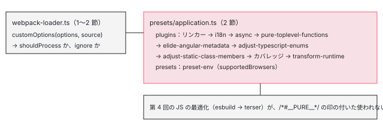

[目次](../README.md) › [webpack の builder の内側：@angular-devkit/build-angular と schematics の CLI](README.md) › 第 5 回 / 全 12 回

# babel の最適化のプラグイン：static メンバー・enum・メタデータ

> tools/babel/plugins/\*・presets/application.ts・webpack-loader.ts：adjust-static-class-members・adjust-typescript-enums・elide-angular-metadata・pure-toplevel-functions が何を書き換えて tree-shaking を助けるか、preset と loader が何を選ぶか。

angular/angular-cli · 読了 約 13 分 · 発展 · [サイトで読む（デモが動きます）](https://angular-deep-dive-cyan.vercel.app/chapter/bwp-babel)

---

この章で分かること：webpack の側のビルドで、すべての JS が通る babel の loader が、ファイルごとに何をするかを決める仕組みと、`buildOptimizer` のときに足す 4 つの babel のプラグインが、コードをどう書き換えて「使われなければ消してよい」印を付けるのか。static メンバー・TypeScript の enum・`ɵsetClassMetadata`・トップレベルの関数呼び出しを、本物のプラグインに通した前後と、それを縮めたときに何が消えるかで確かめます。

読む対象は angular-cli（44129f66a3）の `packages/angular_devkit/build_angular/src/tools/babel/` の `webpack-loader.ts`・`presets/application.ts`・`plugins/` の 5 つです。loader を module.rules に置く所は [第 2 回](02-bwp-webpack-common.md)の 410〜437 行目、縮めて消すのは [第 4 回](04-bwp-webpack-plugins.md)の JS の最適化です。application builder（esbuild）の側で同じ役をする `JavaScriptTransformer`（oxc で純粋の印を付ける）は [cli-javascript-transformer の章](../cli/05-cli-javascript-transformer.md)、部分コンパイルのライブラリを仕上げるリンカーは [cli-linker の章](../cli/06-cli-linker.md)です。

1. [1. browser builder の流れ](01-bwp-browser.md)
2. [2. webpack の共通の設定](02-bwp-webpack-common.md)
3. [3. スタイルの設定](03-bwp-webpack-styles.md)
4. [4. Angular の webpack プラグイン](04-bwp-webpack-plugins.md)
5. **5. babel の最適化のプラグイン**（この章）
6. [6. webpack の dev-server](06-bwp-dev-server.md)
7. [7. server builder と ssr-dev-server](07-bwp-server-ssr.md)
8. [8. prerender と app-shell](08-bwp-prerender-appshell.md)
9. [9. webpack の i18n](09-bwp-i18n.md)
10. [10. karma の builder の webpack の側](10-bwp-karma.md)
11. [11. schematics の CLI](11-bwp-schematics-cli.md)
12. [12. spec と issue](12-bwp-tests-issues.md)

> [!NOTE]
> **ポイント**
>
> 記録は npm の 22.2.7 の dist の babel のプラグインと `@babel/core` 8.0.5・esbuild 0.28.2 です。v22.2.7 と 44129f66a3 で違うのは `pure-toplevel-functions.ts` だけで、22.2.7 には ac70f86208（「do not mark standalone expression statements as pure」、#34017、本家の main では dd68d3a65d）の 2 つの検査が足されています。44129f66a3 の形は、dist から この 2 つの検査（2 か所）を取り除いた写しで再現しました（4 節）。

## 0. 全体の流れ



*loader はファイルごとに customOptions を決め、何もしないファイルは babel を飛ばす。する場合は preset application が、リンカー・preset-env・i18n・async の変換・4 つの最適化・カバレッジ・runtime の helper を選んで並べる。*

1. **ファイルごとに決める**

   リンカーが要るか、async を変換するか、i18n か、最適化するか、カバレッジか（1〜2 節）。どれも要らなければ babel を飛ばす。
2. **preset が並べる**

   決まった options から、plugins と presets の配列を作る（2 節）。
3. **4 つのプラグインが印を付ける**

   トップレベルの呼び出し、メタデータ、enum、static メンバーを、縮める側が消せる形に書き換える（3〜6 節）。

## 1. loader：ファイルごとの customOptions

📄 `angular-cli/packages/angular_devkit/build_angular/src/tools/babel/webpack-loader.ts` L17–38 （▶ の行: 17–18, 20–21, 30–31, 37）

```ts
17 ▶ interface AngularCustomOptions extends Omit<ApplicationPresetOptions, 'instrumentCode'> {
18 ▶   instrumentCode?: {
19 │     /** node_modules and test files are always excluded. */
20 ▶     excludedPaths: Set<string>;
21 ▶     includedBasePath: string;
22 │   };
23 │ }
24 │ 
25 │ export type AngularBabelLoaderOptions = AngularCustomOptions & Record<string, unknown>;
26 │ 
27 │ /**
28 │  * Cached instance of the compiler-cli linker's Babel plugin factory function.
29 │  */
30 ▶ let linkerPluginCreator:
31 ▶   | typeof import('@angular/compiler-cli/linker/babel').createEs2015LinkerPlugin
32 │   | undefined;
33 │ 
34 │ /**
35 │  * Cached instance of the localize Babel plugins factory functions.
36 │  */
37 ▶ let i18nPluginCreators: I18nPluginCreators | undefined;
38 │ 
```

📄 `angular-cli/packages/angular_devkit/build_angular/src/tools/babel/webpack-loader.ts` L39–64 （▶ の行: 39–42, 45–46, 50–51, 55, 57, 62）

```ts
39 ▶ export default custom<ApplicationPresetOptions>(() => {
40 ▶   const baseOptions = Object.freeze({
41 ▶     babelrc: false,
42 ▶     configFile: false,
43 │     compact: false,
44 │     cacheCompression: false,
45 ▶     sourceType: 'unambiguous',
46 ▶     inputSourceMap: false,
47 │   });
48 │ 
49 │   return {
50 ▶     async customOptions(options, { source, map }) {
51 ▶       const { i18n, aot, optimize, instrumentCode, supportedBrowsers, ...rawOptions } =
52 │         options as AngularBabelLoaderOptions;
53 │ 
54 │       // Must process file if plugins are added
55 ▶       let shouldProcess = Array.isArray(rawOptions.plugins) && rawOptions.plugins.length > 0;
56 │ 
57 ▶       const customOptions: ApplicationPresetOptions = {
58 │         forceAsyncTransformation: false,
59 │         angularLinker: undefined,
60 │         i18n: undefined,
61 │         instrumentCode: undefined,
62 ▶         supportedBrowsers,
63 │       };
64 │ 
```

📄 `angular-cli/packages/angular_devkit/build_angular/src/tools/babel/webpack-loader.ts` L65–92 （▶ の行: 66, 70, 73–75, 78, 85–86, 88–90）

```ts
65 │       // Analyze file for linking
66 ▶       if (await requiresLinking(this.resourcePath, source)) {
67 │         // Load ESM `@angular/compiler-cli/linker/babel` using the TypeScript dynamic import workaround.
68 │         // Once TypeScript provides support for keeping the dynamic import this workaround can be
69 │         // changed to a direct dynamic import.
70 ▶         linkerPluginCreator ??= (await import('@angular/compiler-cli/linker/babel'))
71 │           .createEs2015LinkerPlugin;
72 │ 
73 ▶         customOptions.angularLinker = {
74 ▶           shouldLink: true,
75 ▶           jitMode: aot !== true,
76 │           linkerPluginCreator,
77 │         };
78 ▶         shouldProcess = true;
79 │       }
80 │ 
81 │       // Application code (TS files) will only contain native async if target is ES2017+.
82 │       // However, third-party libraries can regardless of the target option.
83 │       // APF packages with code in [f]esm2015 directories is downlevelled to ES2015 and
84 │       // will not have native async.
85 ▶       customOptions.forceAsyncTransformation =
86 ▶         !/[\\/][_f]?esm2015[\\/]/.test(this.resourcePath) && source.includes('async');
87 │ 
88 ▶       shouldProcess ||=
89 ▶         customOptions.forceAsyncTransformation ||
90 ▶         customOptions.supportedBrowsers !== undefined ||
91 │         false;
92 │ 
```

1. **39〜47 行目：babel-loader の custom**

   `babel-loader` の `custom()` で、ファイルごとに options を決める関数を作ります。`babelrc` も `babel.config.js` も読まず（41〜42 行目）、利用者の babel の設定は効きません。
2. **66〜79 行目：リンカー**

   `requiresLinking`（2 節の 247〜260 行目）が真なら、compiler-cli の babel のリンカーのプラグインを読み、部分コンパイルの宣言（`ɵɵngDeclareComponent` など）を完全な定義に直します。75 行目、AOT でなければ JIT 向けに仕上げます。
3. **85〜86 行目：async の変換**

   パスが `esm2015`・`fesm2015` のフォルダでなく、中身に `async` の文字があれば、async/await を generator に変える印を立てます（Zone.js が native の async を追えないため。2 節の 205〜212 行目）。文字を探すだけなので、コメントの中の async でも立ちます。
4. **88〜91 行目：supportedBrowsers があれば必ず通す**

   第 1 回の `normalizeBrowserSchema` が browserslist から `supportedBrowsers` を必ず作るので、browser builder ではすべての JS が babel（preset-env）を通ります。

📄 `angular-cli/packages/angular_devkit/build_angular/src/tools/babel/webpack-loader.ts` L93–128 （▶ の行: 95–97, 104, 108, 111, 113, 119–120, 123, 127）

```ts
 93 │       // Analyze for i18n inlining
 94 │       if (
 95 ▶         i18n &&
 96 ▶         !/[\\/]@angular[\\/](?:compiler|localize)/.test(this.resourcePath) &&
 97 ▶         source.includes('$localize')
 98 │       ) {
 99 │         // Load the i18n plugin creators from the new `@angular/localize/tools` entry point.
100 │         // This may fail during the transition to ESM due to the entry point not yet existing.
101 │         // During the transition, this will always attempt to load the entry point for each file.
102 │         // This will only occur during prerelease and will be automatically corrected once the new
103 │         // entry point exists.
104 ▶         if (i18nPluginCreators === undefined) {
105 │           // Load ESM `@angular/localize/tools` using the TypeScript dynamic import workaround.
106 │           // Once TypeScript provides support for keeping the dynamic import this workaround can be
107 │           // changed to a direct dynamic import.
108 ▶           i18nPluginCreators = await import('@angular/localize/tools');
109 │         }
110 │ 
111 ▶         customOptions.i18n = {
112 │           ...i18n,
113 ▶           pluginCreators: i18nPluginCreators,
114 │         };
115 │ 
116 │         // Add translation files as dependencies of the file to support rebuilds
117 │         // Except for `@angular/core` which needs locale injection but has no translations
118 │         if (
119 ▶           customOptions.i18n.translationFiles &&
120 ▶           !/[\\/]@angular[\\/]core/.test(this.resourcePath)
121 │         ) {
122 │           for (const file of customOptions.i18n.translationFiles) {
123 ▶             this.addDependency(file);
124 │           }
125 │         }
126 │ 
127 ▶         shouldProcess = true;
128 │       }
```

📄 `angular-cli/packages/angular_devkit/build_angular/src/tools/babel/webpack-loader.ts` L130–158 （▶ の行: 130–133, 136, 139, 145, 147–149, 152）

```ts
130 ▶       if (optimize) {
131 ▶         const AngularPackage = /[\\/]node_modules[\\/]@angular[\\/]/.test(this.resourcePath);
132 ▶         const sideEffectFree = !!this._module?.factoryMeta?.sideEffectFree;
133 ▶         customOptions.optimize = {
134 │           // Angular packages provide additional tested side effects guarantees and can use
135 │           // otherwise unsafe optimizations. (@angular/platform-server/init) however has side-effects.
136 ▶           topLevelSafeMode: !(AngularPackage && sideEffectFree),
137 │           // JavaScript modules that are marked as side effect free are considered to have
138 │           // no decorators that contain non-local effects.
139 ▶           wrapDecorators: sideEffectFree,
140 │         };
141 │ 
142 │         shouldProcess = true;
143 │       }
144 │ 
145 ▶       if (
146 │         instrumentCode &&
147 ▶         !instrumentCode.excludedPaths.has(this.resourcePath) &&
148 ▶         !/\.(e2e|spec)\.tsx?$|[\\/]node_modules[\\/]/.test(this.resourcePath) &&
149 ▶         this.resourcePath.startsWith(instrumentCode.includedBasePath)
150 │       ) {
151 │         // `babel-plugin-istanbul` has it's own includes but we do the below so that we avoid running the loader.
152 ▶         customOptions.instrumentCode = {
153 │           includedBasePath: instrumentCode.includedBasePath,
154 │           inputSourceMap: map,
155 │         };
156 │ 
157 │         shouldProcess = true;
158 │       }
```

1. **94〜128 行目：i18n**

   options に `i18n` があり、ファイルに `$localize` があれば、`@angular/localize/tools` の翻訳のプラグインを使います。browser builder の翻訳の差し込みはビルドの後（第 1 回の 229〜246 行目）なので、ここを通るのは dev-server の 1 つのロケールのとき（[第 6 回](06-bwp-dev-server.md)の `setupLocalize`）です。
2. **130〜143 行目：最適化**

   `optimize`（= `buildOptimizer`）なら 4 つのプラグインを使います。136 行目の `topLevelSafeMode` は「node\_modules の `@angular/` で、しかも package.json の `sideEffects` で副作用が無いと言っているモジュール」だけ false です。それ以外（アプリのコードや他のパッケージ）は安全側（true）で、トップレベルの呼び出しに印を付けません（3 節）。139 行目、副作用が無いと言っているモジュールなら `__decorate` も包みます（6 節）。
3. **145〜158 行目：カバレッジ**

   karma の `codeCoverage` のとき、spec と node\_modules と除くパスを外して、istanbul の印を入れます（[第 10 回](10-bwp-karma.md)）。

📄 `angular-cli/packages/angular_devkit/build_angular/src/tools/babel/webpack-loader.ts` L160–179 （▶ の行: 161, 164–166, 173, 175, 178）

```ts
160 │       // Add provided loader options to default base options
161 ▶       const loaderOptions: Record<string, unknown> = {
162 │         ...baseOptions,
163 │         ...rawOptions,
164 ▶         cacheIdentifier: JSON.stringify({
165 ▶           buildAngular: VERSION,
166 ▶           customOptions,
167 │           baseOptions,
168 │           rawOptions,
169 │         }),
170 │       };
171 │ 
172 │       // Skip babel processing if no actions are needed
173 ▶       if (!shouldProcess) {
174 │         // Force the current file to be ignored
175 ▶         loaderOptions.ignore = [() => true];
176 │       }
177 │ 
178 ▶       return { custom: customOptions, loader: loaderOptions };
179 │     },
```

📄 `angular-cli/packages/angular_devkit/build_angular/src/tools/babel/webpack-loader.ts` L180–210 （▶ の行: 180, 186–187, 190, 192–193, 196, 198, 200）

```ts
180 ▶     config(configuration, { customOptions }) {
181 │       return {
182 │         ...configuration.options,
183 │         // Using `false` disables babel from attempting to locate sourcemaps or process any inline maps.
184 │         // The babel types do not include the false option even though it is valid
185 │         // eslint-disable-next-line @typescript-eslint/no-explicit-any
186 ▶         inputSourceMap: configuration.options.inputSourceMap ?? (false as any),
187 ▶         presets: [
188 │           ...(configuration.options.presets || []),
189 │           [
190 ▶             require('./presets/application').default,
191 │             {
192 ▶               ...customOptions,
193 ▶               diagnosticReporter: (type, message) => {
194 │                 switch (type) {
195 │                   case 'error':
196 ▶                     this.emitError(message);
197 │                     break;
198 ▶                   case 'info': // Webpack does not currently have an informational diagnostic
199 │                   case 'warning':
200 ▶                     this.emitWarning(message);
201 │                     break;
202 │                 }
203 │               },
204 │             } as ApplicationPresetOptions,
205 │           ],
206 │         ],
207 │       };
208 │     },
209 │   };
210 │ });
```

164〜169 行目のキャッシュの鍵には build-angular の版と、このファイルに決めた `customOptions` が入ります。何もしないファイルは 175 行目の `ignore: [() => true]` で babel に読ませません。`config`（180〜208 行目）で、preset を 1 つ足し、プラグインからの診断を webpack のエラーと警告にします。198 行目、webpack には info の段が無いので、info も警告になります。

## 2. preset application：何を並べるか

📄 `angular-cli/packages/angular_devkit/build_angular/src/tools/babel/presets/application.ts` L38–65 （▶ の行: 39, 47, 53–54, 58–60, 63–64）

```ts
38 │ export interface ApplicationPresetOptions {
39 ▶   i18n?: {
40 │     locale: string;
41 │     missingTranslationBehavior?: 'error' | 'warning' | 'ignore';
42 │     translation?: Record<string, ɵParsedTranslation>;
43 │     translationFiles?: string[];
44 │     pluginCreators: I18nPluginCreators;
45 │   };
46 │ 
47 ▶   angularLinker?: {
48 │     shouldLink: boolean;
49 │     jitMode: boolean;
50 │     linkerPluginCreator: typeof import('@angular/compiler-cli/linker/babel').createEs2015LinkerPlugin;
51 │   };
52 │ 
53 ▶   forceAsyncTransformation?: boolean;
54 ▶   instrumentCode?: {
55 │     includedBasePath: string;
56 │     inputSourceMap: unknown;
57 │   };
58 ▶   optimize?: {
59 ▶     topLevelSafeMode: boolean;
60 ▶     wrapDecorators: boolean;
61 │   };
62 │ 
63 ▶   supportedBrowsers?: string[];
64 ▶   diagnosticReporter?: DiagnosticReporter;
65 │ }
```

📄 `angular-cli/packages/angular_devkit/build_angular/src/tools/babel/presets/application.ts` L152–190 （▶ の行: 152, 157, 159–160, 162–163, 180, 182, 184–186, 189）

```ts
152 ▶ export default function (api: unknown, options: ApplicationPresetOptions) {
153 │   const presets = [];
154 │   const plugins = [];
155 │   let needRuntimeTransform = false;
156 │ 
157 ▶   if (options.angularLinker?.shouldLink) {
158 │     plugins.push(
159 ▶       options.angularLinker.linkerPluginCreator({
160 ▶         linkerJitMode: options.angularLinker.jitMode,
161 │         // This is a workaround until https://github.com/angular/angular/issues/42769 is fixed.
162 ▶         sourceMapping: false,
163 ▶         logger: createNgtscLogger(options.diagnosticReporter),
164 │         fileSystem: {
165 │           resolve: path.resolve,
166 │           exists: fs.existsSync,
167 │           dirname: path.dirname,
168 │           relative: path.relative,
169 │           readFile: fs.readFileSync,
170 │           // Node.JS types don't overlap the Compiler types.
171 │           // eslint-disable-next-line @typescript-eslint/no-explicit-any
172 │         } as any,
173 │       }),
174 │     );
175 │   }
176 │ 
177 │   // Applications code ES version can be controlled using TypeScript's `target` option.
178 │   // However, this doesn't effect libraries and hence we use preset-env to downlevel ES features
179 │   // based on the supported browsers in browserslist.
180 ▶   if (options.supportedBrowsers) {
181 │     presets.push([
182 ▶       require('@babel/preset-env').default,
183 │       {
184 ▶         modules: false,
185 ▶         targets: options.supportedBrowsers,
186 ▶         exclude: ['transform-typeof-symbol'],
187 │       },
188 │     ]);
189 ▶     needRuntimeTransform = true;
190 │   }
```

📄 `angular-cli/packages/angular_devkit/build_angular/src/tools/babel/presets/application.ts` L191–227 （▶ の行: 192, 194, 197, 205, 208–209, 214, 217–218, 220–221, 223–224）

```ts
191 │ 
192 ▶   if (options.i18n) {
193 │     const { locale, missingTranslationBehavior, pluginCreators, translation } = options.i18n;
194 ▶     const i18nPlugins = createI18nPlugins(
195 │       locale,
196 │       translation,
197 ▶       missingTranslationBehavior || 'ignore',
198 │       options.diagnosticReporter,
199 │       pluginCreators,
200 │     );
201 │ 
202 │     plugins.push(...i18nPlugins);
203 │   }
204 │ 
205 ▶   if (options.forceAsyncTransformation) {
206 │     // Always transform async/await to support Zone.js
207 │     plugins.push(
208 ▶       require('@babel/plugin-transform-async-to-generator').default,
209 ▶       require('@babel/plugin-transform-async-generator-functions').default,
210 │     );
211 │     needRuntimeTransform = true;
212 │   }
213 │ 
214 ▶   if (options.optimize) {
215 │     plugins.push(
216 │       [
217 ▶         require('../plugins/pure-toplevel-functions').default,
218 ▶         { topLevelSafeMode: options.optimize.topLevelSafeMode },
219 │       ],
220 ▶       require('../plugins/elide-angular-metadata').default,
221 ▶       require('../plugins/adjust-typescript-enums').default,
222 │       [
223 ▶         require('../plugins/adjust-static-class-members').default,
224 ▶         { wrapDecorators: options.optimize.wrapDecorators },
225 │       ],
226 │     );
227 │   }
```

📄 `angular-cli/packages/angular_devkit/build_angular/src/tools/babel/presets/application.ts` L228–260 （▶ の行: 229–230, 233, 236, 238–239, 250, 254–255, 259）

```ts
228 │ 
229 ▶   if (options.instrumentCode) {
230 ▶     plugins.push(require('../plugins/add-code-coverage').default);
231 │   }
232 │ 
233 ▶   if (needRuntimeTransform) {
234 │     // Babel equivalent to TypeScript's `importHelpers` option
235 │     plugins.push([
236 ▶       require('@babel/plugin-transform-runtime').default,
237 │       {
238 ▶         version: require('@babel/runtime/package.json').version,
239 ▶         absoluteRuntime: path.dirname(require.resolve('@babel/runtime/package.json')),
240 │       },
241 │     ]);
242 │   }
243 │ 
244 │   return { presets, plugins };
245 │ }
246 │ 
247 │ export async function requiresLinking(path: string, source: string): Promise<boolean> {
248 │   // @angular/core and @angular/compiler will cause false positives
249 │   // Also, TypeScript files do not require linking
250 ▶   if (/[\\/]@angular[\\/](?:compiler|core)|\.tsx?$/.test(path)) {
251 │     return false;
252 │   }
253 │ 
254 ▶   if (!needsLinking) {
255 ▶     const linkerModule = await import('@angular/compiler-cli/linker');
256 │     needsLinking = linkerModule.needsLinking;
257 │   }
258 │ 
259 ▶   return needsLinking(path, source);
260 │ }
```

1. **157〜175 行目：リンカーが先頭**

   162 行目の `sourceMapping: false` は、161 行目のコメントのとおり angular/angular の issue 42769 の回避です。
2. **180〜190 行目：preset-env**

   `supportedBrowsers` を target にしてライブラリの書き方を下げます（アプリのコードは TS の target が決める、177〜179 行目のコメント）。`typeof` の変換は外します。
3. **214〜227 行目：4 つの最適化の順**

   `pure-toplevel-functions` → `elide-angular-metadata` → `adjust-typescript-enums` → `adjust-static-class-members`。
4. **233〜242 行目：runtime の helper**

   preset-env か async の変換を使ったら、helper を各ファイルに書かずに `@babel/runtime` から import します（TS の `importHelpers` と同じ考え）。239 行目で、build-angular が持つ `@babel/runtime` の絶対パスを使います。
5. **247〜260 行目：`requiresLinking`**

   `@angular/core`・`@angular/compiler` と `.ts` は調べず、それ以外は compiler-cli の `needsLinking`（中身に部分宣言の名前があるか）に聞きます。

📄 `angular-cli/packages/angular_devkit/build_angular/src/tools/babel/presets/application.ts` L111–134 （▶ の行: 118, 123–126, 131）

```ts
111 │ function createI18nPlugins(
112 │   locale: string,
113 │   translation: Record<string, ɵParsedTranslation> | undefined,
114 │   missingTranslationBehavior: 'error' | 'warning' | 'ignore',
115 │   diagnosticReporter: DiagnosticReporter | undefined,
116 │   pluginCreators: I18nPluginCreators,
117 │ ) {
118 ▶   const diagnostics = createI18nDiagnostics(diagnosticReporter);
119 │   const plugins = [];
120 │ 
121 │   const { makeEs2015TranslatePlugin, makeLocalePlugin } = pluginCreators;
122 │ 
123 ▶   if (translation) {
124 ▶     plugins.push(
125 ▶       makeEs2015TranslatePlugin(diagnostics, translation, {
126 ▶         missingTranslation: missingTranslationBehavior,
127 │       }),
128 │     );
129 │   }
130 │ 
131 ▶   plugins.push(makeLocalePlugin(locale));
132 │ 
133 │   return plugins;
134 │ }
```

📄 `angular-cli/packages/angular_devkit/build_angular/src/tools/babel/presets/application.ts` L136–150 （▶ の行: 138–139, 141, 144, 147）

```ts
136 │ function createNgtscLogger(reporter: DiagnosticReporter | undefined): NgtscLogger {
137 │   return {
138 ▶     level: 1, // Info level
139 ▶     debug(...args: string[]) {},
140 │     info(...args: string[]) {
141 ▶       reporter?.('info', args.join());
142 │     },
143 │     warn(...args: string[]) {
144 ▶       reporter?.('warning', args.join());
145 │     },
146 │     error(...args: string[]) {
147 ▶       reporter?.('error', args.join());
148 │     },
149 │   };
150 │ }
```

翻訳があれば翻訳のプラグイン、いつもロケールのプラグイン（`$localize.locale` を入れる）を並べます。リンカーのログは info・warn・error だけを 1 節の診断の関数に渡し、debug は捨てます。

## 3. pure-toplevel-functions：トップレベルの呼び出しに印

📄 `angular-cli/packages/angular_devkit/build_angular/src/tools/babel/plugins/pure-toplevel-functions.ts` L13–50 （▶ の行: 16, 21, 29–30, 33, 37, 40, 48–49）

```ts
13 │ /**
14 │  * A set of constructor names that are considered to be side-effect free.
15 │  */
16 ▶ const sideEffectFreeConstructors = new Set<string>(['InjectionToken']);
17 │ 
18 │ /**
19 │  * A set of TypeScript helper function names used by the helper name matcher utility function.
20 │  */
21 ▶ const tslibHelpers = new Set<string>(Object.keys(tslib).filter((h) => h.startsWith('__')));
22 │ 
23 │ /**
24 │  * Determinates whether an identifier name matches one of the TypeScript helper function names.
25 │  *
26 │  * @param name The identifier name to check.
27 │  * @returns True, if the name matches a TypeScript helper name; otherwise, false.
28 │  */
29 ▶ function isTslibHelperName(name: string): boolean {
30 ▶   const nameParts = name.split('$');
31 │   const originalName = nameParts[0];
32 │ 
33 ▶   if (nameParts.length > 2 || (nameParts.length === 2 && isNaN(+nameParts[1]))) {
34 │     return false;
35 │   }
36 │ 
37 ▶   return tslibHelpers.has(originalName);
38 │ }
39 │ 
40 ▶ const babelHelpers = new Set<string>(['_defineProperty']);
41 │ 
42 │ /**
43 │  * Determinates whether an identifier name matches one of the Babel helper function names.
44 │  *
45 │  * @param name The identifier name to check.
46 │  * @returns True, if the name matches a Babel helper name; otherwise, false.
47 │  */
48 ▶ function isBabelHelperName(name: string): boolean {
49 ▶   return babelHelpers.has(name);
50 │ }
```

📄 `angular-cli/packages/angular_devkit/build_angular/src/tools/babel/plugins/pure-toplevel-functions.ts` L56–92 （▶ の行: 63–65, 70, 74, 76–77, 84–86, 91）

```ts
56 │ /**
57 │  * A babel plugin factory function for adding the PURE annotation to top-level new and call expressions.
58 │  * @returns A babel plugin object instance.
59 │  */
60 │ export default function (): PluginObject {
61 │   return {
62 │     visitor: {
63 ▶       CallExpression(path: NodePath<types.CallExpression>, state: ExtendedPluginPass) {
64 ▶         const { topLevelSafeMode = false } = state.opts;
65 ▶         if (topLevelSafeMode) {
66 │           return;
67 │         }
68 │ 
69 │         // If the expression has a function parent, it is not top-level
70 ▶         if (path.getFunctionParent()) {
71 │           return;
72 │         }
73 │ 
74 ▶         const callee = path.get('callee');
75 │         if (
76 ▶           (callee.isFunctionExpression() || callee.isArrowFunctionExpression()) &&
77 ▶           path.node.arguments.length !== 0
78 │         ) {
79 │           return;
80 │         }
81 │ 
82 │         // Do not annotate TypeScript helpers emitted by the TypeScript compiler or Babel helpers.
83 │         // They are intended to cause side effects.
84 ▶         if (
85 ▶           callee.isIdentifier() &&
86 ▶           (isTslibHelperName(callee.node.name) || isBabelHelperName(callee.node.name))
87 │         ) {
88 │           return;
89 │         }
90 │ 
91 ▶         annotateAsPure(path);
92 │       },
```

📄 `angular-cli/packages/angular_devkit/build_angular/src/tools/babel/plugins/pure-toplevel-functions.ts` L93–114 （▶ の行: 93, 95, 99, 101–102, 107–109）

```ts
 93 ▶       NewExpression(path: NodePath<types.NewExpression>, state: ExtendedPluginPass) {
 94 │         // If the expression has a function parent, it is not top-level
 95 ▶         if (path.getFunctionParent()) {
 96 │           return;
 97 │         }
 98 │ 
 99 ▶         const { topLevelSafeMode = false } = state.opts;
100 │ 
101 ▶         if (!topLevelSafeMode) {
102 ▶           annotateAsPure(path);
103 │ 
104 │           return;
105 │         }
106 │ 
107 ▶         const callee = path.get('callee');
108 ▶         if (callee.isIdentifier() && sideEffectFreeConstructors.has(callee.node.name)) {
109 ▶           annotateAsPure(path);
110 │         }
111 │       },
112 │     },
113 │   };
114 │ }
```

1. **65〜67 行目：安全側なら何もしない**

   呼び出しは、`topLevelSafeMode` のとき 1 つも印を付けません（アプリのコードはこちら、1 節の 136 行目）。
2. **70〜80 行目：トップレベルだけ、引数つきの IIFE は除く**

   関数の中は対象外。`(function (x) {…})(1)` のように引数を渡す即時実行の関数は、中で副作用を起こす形（TS の enum や namespace）なので除きます。
3. **84〜89 行目：helper は除く**

   `tslib` の `__` で始まる名前（`__decorate$1` のように `$数字` が付いても）と Babel の `_defineProperty` は、副作用のための呼び出しなので除きます。
4. **91 行目：印を付ける**

   `@babel/helper-annotate-as-pure` が `/*#__PURE__*/` を前に付けます。値を使わなければ、縮める側が呼び出しごと消せます。
5. **93〜111 行目：new**

   安全側でなければすべての `new` に、安全側なら `new InjectionToken(…)` だけに印を付けます（16 行目）。

44129f66a3 のこの形には穴がありました。値を使わない式の文（`setup();` や引数の無い IIFE `(() => {…})();`）にも印を付けるので、縮める側が副作用ごと消します。ac70f86208 のコミットの説明によると、Chrome 94 より前を対象にすると preset-env が自分を参照する static フィールドを引数の無い IIFE に下げ、それに印が付いて `Injector.ɵprov` が消え、起動時に NG0201 になっていました（#34017）。22.2.7 は 70 行目と 95 行目の後ろに「親が式の文なら何もしない」を足しています。デモの「トップレベルの関数呼び出し」で 2 つの版を比べると、44129f66a3 の形では `setup()` と `install()` が縮めた後に消えます。

## 4. elide-angular-metadata：開発用のメタデータを消す

📄 `angular-cli/packages/angular_devkit/build_angular/src/tools/babel/plugins/elide-angular-metadata.ts` L11–44 （▶ の行: 14, 19, 24, 32–33, 40–43）

```ts
11 │ /**
12 │  * The name of the Angular class metadata function created by the Angular compiler.
13 │  */
14 ▶ const SET_CLASS_METADATA_NAME = 'ɵsetClassMetadata';
15 │ 
16 │ /**
17 │  * Name of the asynchronous Angular class metadata function created by the Angular compiler.
18 │  */
19 ▶ const SET_CLASS_METADATA_ASYNC_NAME = 'ɵsetClassMetadataAsync';
20 │ 
21 │ /**
22 │  * Name of the function that sets debug information on classes.
23 │  */
24 ▶ const SET_CLASS_DEBUG_INFO_NAME = 'ɵsetClassDebugInfo';
25 │ 
26 │ /**
27 │  * Provides one or more keywords that if found within the content of a source file indicate
28 │  * that this plugin should be used with a source file.
29 │  *
30 │  * @returns An a string iterable containing one or more keywords.
31 │  */
32 ▶ export function getKeywords(): Iterable<string> {
33 ▶   return Object.keys(angularMetadataFunctions);
34 │ }
35 │ 
36 │ /**
37 │  * An object map of function names and related value checks for discovery of Angular generated
38 │  * metadata calls.
39 │  */
40 ▶ const angularMetadataFunctions: Record<string, (args: NodePath[]) => boolean> = {
41 ▶   [SET_CLASS_METADATA_NAME]: isSetClassMetadataCall,
42 ▶   [SET_CLASS_METADATA_ASYNC_NAME]: isSetClassMetadataAsyncCall,
43 ▶   [SET_CLASS_DEBUG_INFO_NAME]: isSetClassDebugInfoCall,
44 │ };
```

📄 `angular-cli/packages/angular_devkit/build_angular/src/tools/babel/plugins/elide-angular-metadata.ts` L51–88 （▶ の行: 55, 59, 61–62, 64–65, 73–74, 77, 79, 82）

```ts
51 │ export default function ({ types: t }: { types: typeof BabelTypes }): PluginObject {
52 │   return {
53 │     visitor: {
54 │       CallExpression(path: NodePath<BabelTypes.CallExpression>) {
55 ▶         const callee = path.get('callee');
56 │ 
57 │         // The function being called must be the metadata function name
58 │         let calleeName;
59 ▶         if (callee.isMemberExpression()) {
60 │           const calleeProperty = callee.get('property');
61 ▶           if (calleeProperty.isIdentifier()) {
62 ▶             calleeName = calleeProperty.node.name;
63 │           }
64 ▶         } else if (callee.isIdentifier()) {
65 ▶           calleeName = callee.node.name;
66 │         }
67 │ 
68 │         if (!calleeName) {
69 │           return;
70 │         }
71 │ 
72 │         if (
73 ▶           Object.hasOwn(angularMetadataFunctions, calleeName) &&
74 ▶           angularMetadataFunctions[calleeName](path.get('arguments'))
75 │         ) {
76 │           // The metadata function is always emitted inside a function expression
77 ▶           const parent = path.getFunctionParent();
78 │ 
79 ▶           if (parent && (parent.isFunctionExpression() || parent.isArrowFunctionExpression())) {
80 │             // Replace the metadata function with `void 0` which is the equivalent return value
81 │             // of the metadata function.
82 ▶             path.replaceWith(t.buildUndefinedNode());
83 │           }
84 │         }
85 │       },
86 │     },
87 │   };
88 │ }
```

📄 `angular-cli/packages/angular_devkit/build_angular/src/tools/babel/plugins/elide-angular-metadata.ts` L90–128 （▶ の行: 96–98, 109–112, 119–121）

```ts
 90 │ /** Determines if a function call is a call to `setClassMetadata`. */
 91 │ function isSetClassMetadataCall(callArguments: NodePath[]): boolean {
 92 │   // `setClassMetadata` calls have to meet the following criteria:
 93 │   // * First must be an identifier
 94 │   // * Second must be an array literal
 95 │   return (
 96 ▶     callArguments.length === 4 &&
 97 ▶     callArguments[0].isIdentifier() &&
 98 ▶     callArguments[1].isArrayExpression()
 99 │   );
100 │ }
101 │ 
102 │ /** Determines if a function call is a call to `setClassMetadataAsync`. */
103 │ function isSetClassMetadataAsyncCall(callArguments: NodePath[]): boolean {
104 │   // `setClassMetadataAsync` calls have to meet the following criteria:
105 │   // * First argument must be an identifier.
106 │   // * Second argument must be an inline function.
107 │   // * Third argument must be an inline function.
108 │   return (
109 ▶     callArguments.length === 3 &&
110 ▶     callArguments[0].isIdentifier() &&
111 ▶     isInlineFunction(callArguments[1]) &&
112 ▶     isInlineFunction(callArguments[2])
113 │   );
114 │ }
115 │ 
116 │ /** Determines if a function call is a call to `setClassDebugInfo`. */
117 │ function isSetClassDebugInfoCall(callArguments: NodePath[]): boolean {
118 │   return (
119 ▶     callArguments.length === 2 &&
120 ▶     callArguments[0].isIdentifier() &&
121 ▶     callArguments[1].isObjectExpression()
122 │   );
123 │ }
124 │ 
125 │ /** Determines if a node is an inline function expression. */
126 │ function isInlineFunction(path: NodePath): boolean {
127 │   return path.isFunctionExpression() || path.isArrowFunctionExpression();
128 │ }
```

Angular のコンパイラは、デコレーターの情報（テストの `TestBed.overrideComponent` などが使う）を `(() => { (typeof ngDevMode === "undefined" || ngDevMode) && i0.ɵsetClassMetadata(…); })();` の形で出します。このプラグインは、名前と引数の形（96〜98・109〜112・119〜121 行目）が合い、しかも関数の中（79 行目）にある呼び出しを `void 0`（82 行目）にします。IIFE の中身が空の式になるので、縮める側が IIFE ごと消せます。トップレベルに直接書いた `ɵsetClassMetadata(…)` は 79 行目の条件で残ります（デモの 3 行目）。32〜34 行目の `getKeywords` は、このファイルの外から呼ばれていません（`grep -rn getKeywords` で、各プラグインの定義だけ）。

## 5. adjust-typescript-enums：enum を 1 つの式にする

📄 `angular-cli/packages/angular_devkit/build_angular/src/tools/babel/plugins/adjust-typescript-enums.ts` L22–58 （▶ の行: 30, 32, 37, 42, 46–50, 55）

```ts
22 │ /**
23 │  * A babel plugin factory function for adjusting TypeScript emitted enums.
24 │  *
25 │  * @returns A babel plugin object instance.
26 │  */
27 │ export default function (): PluginObject {
28 │   return {
29 │     visitor: {
30 ▶       VariableDeclaration(path: NodePath<types.VariableDeclaration>) {
31 │         const { parentPath, node } = path;
32 ▶         if (node.kind !== 'var' || node.declarations.length !== 1) {
33 │           return;
34 │         }
35 │ 
36 │         const declaration = path.get('declarations')[0];
37 ▶         if (declaration.node.init) {
38 │           return;
39 │         }
40 │ 
41 │         const declarationId = declaration.node.id;
42 ▶         if (!types.isIdentifier(declarationId)) {
43 │           return;
44 │         }
45 │ 
46 ▶         const hasExport =
47 ▶           parentPath.isExportNamedDeclaration() || parentPath.isExportDefaultDeclaration();
48 ▶         const origin = hasExport ? parentPath : path;
49 ▶         const nextStatement = origin.getSibling(+(origin.key ?? 0) + 1);
50 ▶         if (!nextStatement.isExpressionStatement()) {
51 │           return;
52 │         }
53 │ 
54 │         const nextExpression = nextStatement.get('expression');
55 ▶         if (!nextExpression.isCallExpression() || nextExpression.node.arguments.length !== 1) {
56 │           return;
57 │         }
58 │ 
```

📄 `angular-cli/packages/angular_devkit/build_angular/src/tools/babel/plugins/adjust-typescript-enums.ts` L59–91 （▶ の行: 64–65, 69–70, 74, 79–80, 84, 89–91）

```ts
59 │         const enumCallArgument = nextExpression.get('arguments')[0];
60 │         if (!enumCallArgument.isLogicalExpression({ operator: '||' })) {
61 │           return;
62 │         }
63 │ 
64 ▶         const leftCallArgument = enumCallArgument.get('left');
65 ▶         const rightCallArgument = enumCallArgument.get('right');
66 │ 
67 │         // Check if identifiers match var declaration
68 │         if (
69 ▶           !leftCallArgument.isIdentifier() ||
70 ▶           !nextExpression.scope.bindingIdentifierEquals(
71 │             leftCallArgument.node.name,
72 │             declarationId,
73 │           ) ||
74 ▶           !rightCallArgument.isAssignmentExpression()
75 │         ) {
76 │           return;
77 │         }
78 │ 
79 ▶         const enumCallee = nextExpression.get('callee');
80 ▶         if (!enumCallee.isFunctionExpression() || enumCallee.node.params.length !== 1) {
81 │           return;
82 │         }
83 │ 
84 ▶         const parameterId = enumCallee.get('params')[0];
85 │         if (!parameterId.isIdentifier()) {
86 │           return;
87 │         }
88 │ 
89 ▶         // Check if all enum member values are pure.
90 ▶         // If not, leave as-is due to potential side efects
91 ▶         let hasElements = false;
```

📄 `angular-cli/packages/angular_devkit/build_angular/src/tools/babel/plugins/adjust-typescript-enums.ts` L92–131 （▶ の行: 92–93, 97–100, 103, 109, 114–115, 119, 121, 125, 127, 130）

```ts
 92 ▶         for (const enumStatement of enumCallee.get('body').get('body')) {
 93 ▶           if (!enumStatement.isExpressionStatement()) {
 94 │             return;
 95 │           }
 96 │ 
 97 ▶           const enumValueAssignment = enumStatement.get('expression');
 98 ▶           if (
 99 ▶             !enumValueAssignment.isAssignmentExpression() ||
100 ▶             !enumValueAssignment.get('right').isPure()
101 │           ) {
102 │             return;
103 ▶           }
104 │ 
105 │           hasElements = true;
106 │         }
107 │ 
108 │         // If there are no enum elements then there is nothing to wrap
109 ▶         if (!hasElements) {
110 │           return;
111 │         }
112 │ 
113 │         // Update right-side of initializer call argument to remove redundant assignment
114 ▶         if (rightCallArgument.get('left').isIdentifier()) {
115 ▶           rightCallArgument.replaceWith(rightCallArgument.get('right'));
116 │         }
117 │ 
118 │         // Add a return statement to the enum initializer block
119 ▶         enumCallee
120 │           .get('body')
121 ▶           .node.body.push(types.returnStatement(types.cloneNode(parameterId.node)));
122 │ 
123 │         // Remove existing enum initializer
124 │         const enumInitializer = nextExpression.node;
125 ▶         nextExpression.remove();
126 │ 
127 ▶         annotateAsPure(enumInitializer);
128 │ 
129 │         // Add the wrapped enum initializer directly to the variable declaration
130 ▶         declaration.get('init').replaceWith(enumInitializer);
131 │       },
```

1. **30〜62 行目：TS の enum の形を探す**

   `var E;`（初期値なし）の次の文が `(function (E) {…})(E || (E = {}));` の形か。export されていても次の文を見ます。
2. **89〜106 行目：値が純粋か**

   関数の中のすべての文が代入で、右辺が純粋なら続けます。90 行目のコメントは「値に副作用があれば触らない」です。
3. **113〜130 行目：1 つの式に**

   `E = {}` を `{}` に、関数の最後に `return E` を足し、呼び出しに印を付けて `var E = /*#__PURE__*/ (function (E) {…; return E; })(E || {})` にします。

89〜106 行目の検査には穴があります。TS 6.0.3 は数値の enum の 1 つのメンバーを `Flags[Flags["A"] = compute()] = "A";` と出します。値（`compute()`）は左辺の計算したキーの中の代入の右辺にあり、100 行目が見る外側の右辺は名前の文字列 `"A"` です。そのため値に関数呼び出しがある enum も純粋として包まれ、使われなければ縮める側が呼び出しごと消します。spec（`adjust-typescript-enums_spec.ts` の 229〜241 行目「does not wrap TypeScript enums with side effect values」）は、外側の右辺に `console.log('foo')` を置いた形だけを確かめていて、TS が実際に出す形は見ていません。同じ場面は 2017 年の #12160（「enum wrapping pass is unsafe in atypical use cases」、閉じている）で挙げられていました。

## 6. adjust-static-class-members：クラスを純粋の IIFE に包む

📄 `angular-cli/packages/angular_devkit/build_angular/src/tools/babel/plugins/adjust-static-class-members.ts` L23–58 （▶ の行: 23–24, 26, 30–31, 38–40, 42, 45, 56–57）

```ts
23 ▶ const angularStaticsToWrap = new Set([
24 ▶   'ɵcmp',
25 │   'ɵdir',
26 ▶   'ɵfac',
27 │   'ɵinj',
28 │   'ɵmod',
29 │   'ɵpipe',
30 ▶   'ɵprov',
31 ▶   'INJECTOR_KEY',
32 │ ]);
33 │ 
34 │ /**
35 │  * An object map of static fields and related value checks for discovery of Angular generated
36 │  * JIT related static fields.
37 │  */
38 ▶ const angularStaticsToElide: Record<string, (path: NodePath<types.Expression>) => boolean> = {
39 ▶   'ctorParameters'(path) {
40 ▶     return path.isFunctionExpression() || path.isArrowFunctionExpression();
41 │   },
42 ▶   'decorators'(path) {
43 │     return path.isArrayExpression();
44 │   },
45 ▶   'propDecorators'(path) {
46 │     return path.isObjectExpression();
47 │   },
48 │ };
49 │ 
50 │ /**
51 │  * Provides one or more keywords that if found within the content of a source file indicate
52 │  * that this plugin should be used with a source file.
53 │  *
54 │  * @returns An a string iterable containing one or more keywords.
55 │  */
56 ▶ export function getKeywords(): Iterable<string> {
57 ▶   return ['class'];
58 │ }
```

📄 `angular-cli/packages/angular_devkit/build_angular/src/tools/babel/plugins/adjust-static-class-members.ts` L60–88 （▶ の行: 69–71, 74, 76, 79–81, 84, 87）

```ts
60 │ /**
61 │  * Determines whether a property and its initializer value can be safely wrapped in a pure
62 │  * annotated IIFE. Values that may cause side effects are not considered safe to wrap.
63 │  * Wrapping such values may cause runtime errors and/or incorrect runtime behavior.
64 │  *
65 │  * @param propertyName The name of the property to analyze.
66 │  * @param assignmentValue The initializer value that will be assigned to the property.
67 │  * @returns If the property can be safely wrapped, then true; otherwise, false.
68 │  */
69 ▶ function canWrapProperty(propertyName: string, assignmentValue: NodePath): boolean {
70 ▶   if (angularStaticsToWrap.has(propertyName)) {
71 ▶     return true;
72 │   }
73 │ 
74 ▶   const { leadingComments } = assignmentValue.node as { leadingComments?: { value: string }[] };
75 │   if (
76 ▶     leadingComments?.some(
77 │       // `@pureOrBreakMyCode` is used by closure and is present in Angular code
78 │       ({ value }) =>
79 ▶         value.includes('@__PURE__') ||
80 ▶         value.includes('#__PURE__') ||
81 ▶         value.includes('@pureOrBreakMyCode'),
82 │     )
83 │   ) {
84 ▶     return true;
85 │   }
86 │ 
87 ▶   return assignmentValue.isPure();
88 │ }
```

包んでよい static は、Angular のコンパイラの定義（23〜32 行目の `ɵcmp`・`ɵfac`・`ɵprov` など）、`@__PURE__`・`#__PURE__`・`@pureOrBreakMyCode` の印の付いた値、babel が純粋と見る値です。38〜48 行目の `ctorParameters`・`decorators`・`propDecorators` は、JIT のためにデコレーターを下げたときの static で、AOT では要らないので消します。

📄 `angular-cli/packages/angular_devkit/build_angular/src/tools/babel/plugins/adjust-static-class-members.ts` L100–135 （▶ の行: 107–109, 116–119, 124–125, 129, 133）

```ts
100 │ function analyzeClassSiblings(
101 │   origin: NodePath,
102 │   classIdentifier: types.Identifier,
103 │   allowWrappingDecorators: boolean,
104 │ ): { hasPotentialSideEffects: boolean; wrapStatementPaths: NodePath<types.Statement>[] } {
105 │   const wrapStatementPaths: NodePath<types.Statement>[] = [];
106 │   let hasPotentialSideEffects = false;
107 ▶   for (let i = 1; ; ++i) {
108 ▶     const nextStatement = origin.getSibling(+(origin.key ?? 0) + i);
109 ▶     if (!nextStatement.isExpressionStatement()) {
110 │       break;
111 │     }
112 │ 
113 │     // Valid sibling statements for class declarations are only assignment expressions
114 │     // and TypeScript decorator helper call expressions
115 │     const nextExpression = nextStatement.get('expression');
116 ▶     if (nextExpression.isCallExpression()) {
117 ▶       if (
118 ▶         !types.isIdentifier(nextExpression.node.callee) ||
119 ▶         nextExpression.node.callee.name !== TSLIB_DECORATE_HELPER_NAME
120 │       ) {
121 │         break;
122 │       }
123 │ 
124 ▶       if (allowWrappingDecorators) {
125 ▶         wrapStatementPaths.push(nextStatement);
126 │       } else {
127 │         // Statement cannot be safely wrapped which makes wrapping the class unneeded.
128 │         // The statement will prevent even a wrapped class from being optimized away.
129 ▶         hasPotentialSideEffects = true;
130 │       }
131 │ 
132 │       continue;
133 ▶     } else if (!nextExpression.isAssignmentExpression()) {
134 │       break;
135 │     }
```

📄 `angular-cli/packages/angular_devkit/build_angular/src/tools/babel/plugins/adjust-static-class-members.ts` L136–167 （▶ の行: 140–141, 143, 146, 151–152, 156, 160–161, 163–164）

```ts
136 │ 
137 │     // Valid assignment expressions should be member access expressions using the class
138 │     // name as the object and an identifier as the property for static fields or only
139 │     // the class name for decorators.
140 ▶     const left = nextExpression.get('left');
141 ▶     if (left.isIdentifier()) {
142 │       if (
143 ▶         !left.scope.bindingIdentifierEquals(left.node.name, classIdentifier) ||
144 │         !types.isCallExpression(nextExpression.node.right) ||
145 │         !types.isIdentifier(nextExpression.node.right.callee) ||
146 ▶         nextExpression.node.right.callee.name !== TSLIB_DECORATE_HELPER_NAME
147 │       ) {
148 │         break;
149 │       }
150 │ 
151 ▶       if (allowWrappingDecorators) {
152 ▶         wrapStatementPaths.push(nextStatement);
153 │       } else {
154 │         // Statement cannot be safely wrapped which makes wrapping the class unneeded.
155 │         // The statement will prevent even a wrapped class from being optimized away.
156 ▶         hasPotentialSideEffects = true;
157 │       }
158 │ 
159 │       continue;
160 ▶     } else if (
161 ▶       !left.isMemberExpression() ||
162 │       !types.isIdentifier(left.node.object) ||
163 ▶       !left.scope.bindingIdentifierEquals(left.node.object.name, classIdentifier) ||
164 ▶       !types.isIdentifier(left.node.property)
165 │     ) {
166 │       break;
167 │     }
```

📄 `angular-cli/packages/angular_devkit/build_angular/src/tools/babel/plugins/adjust-static-class-members.ts` L168–197 （▶ の行: 169–172, 174–175, 179, 183）

```ts
168 │ 
169 ▶     const propertyName = left.node.property.name;
170 ▶     const assignmentValue = nextExpression.get('right');
171 ▶     if (angularStaticsToElide[propertyName]?.(assignmentValue)) {
172 ▶       nextStatement.remove();
173 │       --i;
174 ▶     } else if (canWrapProperty(propertyName, assignmentValue)) {
175 ▶       wrapStatementPaths.push(nextStatement);
176 │     } else {
177 │       // Statement cannot be safely wrapped which makes wrapping the class unneeded.
178 │       // The statement will prevent even a wrapped class from being optimized away.
179 ▶       hasPotentialSideEffects = true;
180 │     }
181 │   }
182 │ 
183 ▶   return { hasPotentialSideEffects, wrapStatementPaths };
184 │ }
185 │ 
186 │ /**
187 │  * The set of classes already visited and analyzed during the plugin's execution.
188 │  * This is used to prevent adjusted classes from being repeatedly analyzed which can lead
189 │  * to an infinite loop.
190 │  */
191 │ const visitedClasses = new WeakSet<types.Class>();
192 │ 
193 │ /**
194 │  * A map of classes that have already been analyzed during the default export splitting step.
195 │  * This is used to avoid analyzing a class declaration twice if it is a direct default export.
196 │  */
197 │ const exportDefaultAnalysis = new WeakMap<types.Class, ReturnType<typeof analyzeClassSiblings>>();
```

1. **107〜111 行目：クラスの後ろの文を順に**

   クラスの宣言の後ろに続く式の文を、1 つずつ見ます。式の文でなくなったら終わり。
2. **116〜132 行目：`__decorate(…)`**

   TS の `experimentalDecorators` の出力です。`wrapDecorators`（1 節の 139 行目、副作用が無いと言っているパッケージ）なら包む文に入れ、そうでなければ「副作用がある」として、クラスを包むのをやめます。
3. **141〜159 行目：`X = __decorate(…, X)`**

   クラスの名前への代入も同じ扱い。
4. **160〜180 行目：`X.名前 = 値`**

   JIT の static なら文を消し（172 行目）、包んでよい値なら包む文に入れ、それ以外なら副作用ありにします。

📄 `angular-cli/packages/angular_devkit/build_angular/src/tools/babel/plugins/adjust-static-class-members.ts` L209–245 （▶ の行: 214, 216, 221, 225, 229, 231, 236, 241, 243–244）

```ts
209 │ export default function (): PluginObject {
210 │   return {
211 │     visitor: {
212 │       // When a class is converted to a variable declaration, the default export must be moved
213 │       // to a subsequent statement to prevent a JavaScript syntax error.
214 ▶       ExportDefaultDeclaration(path: NodePath<types.ExportDefaultDeclaration>, state: PluginPass) {
215 │         const declaration = path.get('declaration');
216 ▶         if (!declaration.isClassDeclaration() || !declaration.node.id) {
217 │           return;
218 │         }
219 │ 
220 │         const { wrapDecorators } = state.opts as { wrapDecorators: boolean };
221 ▶         const analysis = analyzeClassSiblings(path, declaration.node.id, wrapDecorators);
222 │         exportDefaultAnalysis.set(declaration.node, analysis);
223 │ 
224 │         // Splitting the export declaration is not needed if the class will not be wrapped
225 ▶         if (analysis.hasPotentialSideEffects) {
226 │           return;
227 │         }
228 │ 
229 ▶         splitExportDeclaration(path);
230 │       },
231 ▶       ClassDeclaration(path: NodePath<types.ClassDeclaration>, state: PluginPass) {
232 │         const { node: classNode, parentPath } = path;
233 │         const { wrapDecorators } = state.opts as { wrapDecorators: boolean };
234 │ 
235 │         // Skip if already visited or has no name
236 ▶         if (visitedClasses.has(classNode) || !classNode.id) {
237 │           return;
238 │         }
239 │ 
240 │         // Analyze sibling statements for elements of the class that were downleveled
241 ▶         const origin = parentPath.isExportNamedDeclaration() ? parentPath : path;
242 │         const { wrapStatementPaths, hasPotentialSideEffects } =
243 ▶           exportDefaultAnalysis.get(classNode) ??
244 ▶           analyzeClassSiblings(origin, classNode.id, wrapDecorators);
245 │ 
```

📄 `angular-cli/packages/angular_devkit/build_angular/src/tools/babel/plugins/adjust-static-class-members.ts` L246–282 （▶ の行: 249–251, 257, 259, 263, 266–268, 275, 278–279, 281）

```ts
246 │         visitedClasses.add(classNode);
247 │ 
248 │         // If no statements to wrap, check for static class properties.
249 ▶         if (
250 ▶           hasPotentialSideEffects ||
251 ▶           (wrapStatementPaths.length === 0 && !analyzeClassStaticProperties(path).shouldWrap)
252 │         ) {
253 │           return;
254 │         }
255 │ 
256 │         const wrapStatementNodes: types.Statement[] = [];
257 ▶         for (const statementPath of wrapStatementPaths) {
258 │           wrapStatementNodes.push(statementPath.node);
259 ▶           statementPath.remove();
260 │         }
261 │ 
262 │         // Wrap class and safe static assignments in a pure annotated IIFE
263 ▶         const container = types.arrowFunctionExpression(
264 │           [],
265 │           types.blockStatement([
266 ▶             classNode,
267 ▶             ...wrapStatementNodes,
268 ▶             types.returnStatement(types.cloneNode(classNode.id)),
269 │           ]),
270 │         );
271 │         const replacementInitializer = types.callExpression(
272 │           types.parenthesizedExpression(container),
273 │           [],
274 │         );
275 ▶         annotateAsPure(replacementInitializer);
276 │ 
277 │         // Replace class with IIFE wrapped class
278 ▶         const declaration = types.variableDeclaration('let', [
279 ▶           types.variableDeclarator(types.cloneNode(classNode.id), replacementInitializer),
280 │         ]);
281 ▶         path.replaceWith(declaration);
282 │       },
```

📄 `angular-cli/packages/angular_devkit/build_angular/src/tools/babel/plugins/adjust-static-class-members.ts` L283–314 （▶ の行: 283, 287, 291, 295–296, 300, 309–311）

```ts
283 ▶       ClassExpression(path: NodePath<types.ClassExpression>, state: PluginPass) {
284 │         const { node: classNode, parentPath } = path;
285 │         const { wrapDecorators } = state.opts as { wrapDecorators: boolean };
286 │ 
287 ▶         if (visitedClasses.has(classNode)) {
288 │           return;
289 │         }
290 │ 
291 ▶         if (!parentPath.isVariableDeclarator() || !types.isIdentifier(parentPath.node.id)) {
292 │           return;
293 │         }
294 │ 
295 ▶         const origin = parentPath.parentPath;
296 ▶         if (!origin.isVariableDeclaration() || origin.node.declarations.length !== 1) {
297 │           return;
298 │         }
299 │ 
300 ▶         const { wrapStatementPaths, hasPotentialSideEffects } = analyzeClassSiblings(
301 │           origin,
302 │           parentPath.node.id,
303 │           wrapDecorators,
304 │         );
305 │ 
306 │         visitedClasses.add(classNode);
307 │ 
308 │         // If no statements to wrap, check for static class properties.
309 ▶         if (
310 ▶           hasPotentialSideEffects ||
311 ▶           (wrapStatementPaths.length === 0 && !analyzeClassStaticProperties(path).shouldWrap)
312 │         ) {
313 │           return;
314 │         }
```

📄 `angular-cli/packages/angular_devkit/build_angular/src/tools/babel/plugins/adjust-static-class-members.ts` L315–345 （▶ の行: 317–318, 323, 326–327, 330, 333, 338, 341）

```ts
315 │ 
316 │         const wrapStatementNodes: types.Statement[] = [];
317 ▶         for (const statementPath of wrapStatementPaths) {
318 ▶           wrapStatementNodes.push(statementPath.node);
319 │           statementPath.remove();
320 │         }
321 │ 
322 │         // Wrap class and safe static assignments in a pure annotated IIFE
323 ▶         const container = types.arrowFunctionExpression(
324 │           [],
325 │           types.blockStatement([
326 ▶             types.variableDeclaration('let', [
327 ▶               types.variableDeclarator(types.cloneNode(parentPath.node.id), classNode),
328 │             ]),
329 │             ...wrapStatementNodes,
330 ▶             types.returnStatement(types.cloneNode(parentPath.node.id)),
331 │           ]),
332 │         );
333 ▶         const replacementInitializer = types.callExpression(
334 │           types.parenthesizedExpression(container),
335 │           [],
336 │         );
337 │ 
338 ▶         annotateAsPure(replacementInitializer);
339 │ 
340 │         // Add the wrapped class directly to the variable declaration
341 ▶         parentPath.get('init').replaceWith(replacementInitializer);
342 │       },
343 │     },
344 │   };
345 │ }
```

副作用が無く、包む文があるか、static のプロパティが包んでよいなら（249〜254 行目）、クラスと包む文を引数の無いアロー関数に入れ、呼び出しに印を付けて `let X = /*#__PURE__*/ (() => { class X {…} …; return X; })();` にします。214〜230 行目は `export default class` を、`let` に置き換えられるよう先に分けるため、283〜342 行目は `let X = class X {}` の形（esbuild や TS の出力）のためです。

📄 `angular-cli/packages/angular_devkit/build_angular/src/tools/babel/plugins/adjust-static-class-members.ts` L354–388 （▶ の行: 354, 358–359, 361, 367–368, 370–371, 373, 376, 379, 383, 385）

```ts
354 ▶ function analyzeClassStaticProperties(
355 │   path: NodePath<types.ClassDeclaration | types.ClassExpression>,
356 │ ): { shouldWrap: boolean } {
357 │   let shouldWrap = false;
358 ▶   for (const element of path.get('body').get('body')) {
359 ▶     if (element.isClassProperty()) {
360 │       // Only need to analyze static properties
361 ▶       if (!element.node.static) {
362 │         continue;
363 │       }
364 │ 
365 │       // Check for potential side effects.
366 │       // These checks are conservative and could potentially be expanded in the future.
367 ▶       const elementKey = element.get('key');
368 ▶       const elementValue = element.get('value');
369 │       if (
370 ▶         elementKey.isIdentifier() &&
371 ▶         (!elementValue.isExpression() || canWrapProperty(elementKey.node.name, elementValue))
372 │       ) {
373 ▶         shouldWrap = true;
374 │       } else {
375 │         // Not safe to wrap
376 ▶         shouldWrap = false;
377 │         break;
378 │       }
379 ▶     } else if (element.isStaticBlock()) {
380 │       // Only need to analyze static blocks
381 │       const body = element.get('body');
382 │ 
383 ▶       if (Array.isArray(body) && body.length > 1) {
384 │         // Not safe to wrap
385 ▶         shouldWrap = false;
386 │         break;
387 │       }
388 │ 
```

📄 `angular-cli/packages/angular_devkit/build_angular/src/tools/babel/plugins/adjust-static-class-members.ts` L389–421 （▶ の行: 389, 391–395, 398, 400, 406, 410, 416）

```ts
389 ▶       const expression = body.find((n) => n.isExpressionStatement());
390 │ 
391 ▶       const assignmentExpression = expression?.get('expression');
392 ▶       if (assignmentExpression?.isAssignmentExpression()) {
393 ▶         const left = assignmentExpression.get('left');
394 ▶         if (!left.isMemberExpression()) {
395 ▶           continue;
396 │         }
397 │ 
398 ▶         if (!left.get('object').isThisExpression()) {
399 │           // Not safe to wrap
400 ▶           shouldWrap = false;
401 │           break;
402 │         }
403 │ 
404 │         const element = left.get('property');
405 │         const right = assignmentExpression.get('right');
406 ▶         if (
407 │           element.isIdentifier() &&
408 │           (!right.isExpression() || canWrapProperty(element.node.name, right))
409 │         ) {
410 ▶           shouldWrap = true;
411 │         } else {
412 │           // Not safe to wrap
413 │           shouldWrap = false;
414 │           break;
415 │         }
416 ▶       }
417 │     }
418 │   }
419 │ 
420 │   return { shouldWrap };
421 │ }
```

1. **359〜378 行目：static のプロパティ**

   名前が識別子で、値が無いか包んでよいなら包む。1 つでもだめなら包まない。
2. **379〜387 行目：static ブロックが 2 文以上**

   包まない。
3. **389〜416 行目：static ブロックが 1 文**

   その文が `this.名前 = 値` の代入なら、値で決めます（398〜415 行目）。

ここにも穴があります。1 文の static ブロックが代入でない式（`console.log(…)` の呼び出しなど）か、式でない文（`if` など）のとき、392 行目の条件が偽になり、どこも `shouldWrap = false` にしません。ほかに包んでよい static プロパティがあれば、そのまま包まれます。デモの「static ブロックの中の関数呼び出し」の `class Logger { static level = 1; static { console.log('Logger loaded'); } }` は包まれ、使われないと static ブロックごと消えます。spec（`adjust-static-class-members_spec.ts` の 816 行目「does not wrap class with side effect full static block」）は `globalThis.bar = 1`（this でない代入）の形だけです。static ブロックを見るこの部分は 2023 年の 3978891a46 で入りました。

📄 `angular-cli/packages/angular_devkit/build_angular/src/tools/babel/plugins/add-code-coverage.ts` L18–43 （▶ の行: 25, 27, 29, 31, 34, 37–38）

```ts
18 │ export default function (): PluginObject {
19 │   const visitors = new WeakMap<NodePath, Visitor>();
20 │ 
21 │   return {
22 │     visitor: {
23 │       Program: {
24 │         enter(path: NodePath<types.Program>, state: PluginPass) {
25 ▶           const visitor = programVisitor(types, state.filename, {
26 │             // Babel returns a Converter object from the `convert-source-map` package
27 ▶             inputSourceMap: (state.file.inputMap as undefined | { toObject(): object })?.toObject(),
28 │           });
29 ▶           visitors.set(path, visitor);
30 │ 
31 ▶           visitor.enter(path);
32 │         },
33 │         exit(path: NodePath<types.Program>) {
34 ▶           const visitor = visitors.get(path);
35 │           assert(visitor, 'Instrumentation visitor should always be present for program path.');
36 │ 
37 ▶           visitor.exit(path);
38 ▶           visitors.delete(path);
39 │         },
40 │       },
41 │     },
42 │   };
43 │ }
```

最後の `add-code-coverage` は、istanbul の `programVisitor` を `Program` の入りと出で呼ぶだけの包みです（1 節の 145〜158 行目で選ばれたときだけ）。

## 7. デモ：プラグインの前後と、縮めたときに消えるもの

> **🧪 DEMO — dist（22.2.7）の babel のプラグインに小さな JS を通した記録**
>
> 記録のスクリプトは、作業用の場所の `@babel/core` で各プラグインを 1 つずつ（options つき）呼び、その前後を esbuild の `transform`（`minify`・`treeShaking`・`format: 'esm'`）に通して、使われないものが消えるかを見ました。webpack の中で実際に消すのは第 4 回の最適化（esbuild → terser）ですが、`/*#__PURE__*/` の印を見て消すのは同じです。
>
> プラグイン：`adjust-typescript-enums`
>
> アプリでも確かめました。使われない export の `enum Flags { A = globalThis.__compute(), B = 2 }` と、上の `Logger` と同じクラスを持つ `side-effects.ts` を `main.ts` から `import './app/side-effects'` し、browser builder でビルドした main.js：
>
> ▶ [このデモはサイトで動かせます](https://angular-deep-dive-cyan.vercel.app/chapter/bwp-babel)

## テストと直し方

| spec | describe と件数 | この章のどこ |
| --- | --- | --- |
| tools/babel/plugins/pure-toplevel-functions\_spec.ts | describe「pure-toplevel-functions Babel plugin」（43 行目）、it 18 件（22.2.7 では式の文の 2 件が増える） | 3 節 |
| tools/babel/plugins/elide-angular-metadata\_spec.ts | describe「elide-angular-metadata Babel plugin」（38 行目）、it 7 件 | 4 節 |
| tools/babel/plugins/adjust-typescript-enums\_spec.ts | describe「adjust-typescript-enums Babel plugin」（48 行目）、it 12 件。229 行目「does not wrap TypeScript enums with side effect values」 | 5 節 |
| tools/babel/plugins/adjust-static-class-members\_spec.ts | describe「adjust-static-class-members Babel plugin」（40 行目）、it 45 件。816 行目「does not wrap class with side effect full static block」 | 6 節 |

この 4 つは `BUILD.bazel` の `build_angular_test_lib`（builders の外の `*_spec.ts`）に入り、`//packages/angular_devkit/build_angular:test` で走ります。../angular-cli で `pnpm bazel test //packages/angular_devkit/build_angular:test --nocache_test_results --test_output=all` を走らせ、93 specs、0 failures で PASSED（1.0 秒）でした（ほかに `utils/` の 2 つの spec を含む）。

練習用の作業木（44129f66a3）で、5・6 節の穴を確かめました。`adjust-typescript-enums_spec.ts` に「does not wrap TypeScript enums with side effect member initializers」（入力は `Flags[Flags["A"] = compute()] = "A"` の TS の形、期待は変えない）、`adjust-static-class-members_spec.ts` に「does not wrap class with a side effect call in a static block」（入力はデモの `Logger`、期待は変えない）の 2 件を足すと、95 specs、2 failures で、2 件とも「Expected 'var Flags = /\*#\_\_PURE\_\_\*/ (function (Flags) {…」「Expected 'let Logger = /\*#\_\_PURE\_\_\*/ (() =&gt; {…」で落ちました。次の 2 つを直すと 95 specs、0 failures でした。作業木は試したあとに消しました。

- `adjust-typescript-enums.ts` の 103 行目の後ろ：左辺が計算したキーのメンバーで、キーが代入なら、その右辺も `isPure()` を確かめ、だめなら return する。
- `adjust-static-class-members.ts` の 391 行目の後ろ：static ブロックが 1 文で、それが代入の式でなければ `shouldWrap = false; break;` にする。

## 聞かれそうな質問

**Q. buildOptimizer を false にすると、何が変わりますか？**

1 節の 130〜143 行目の `optimize` が立たず、4 つのプラグインを使いません。terser の passes も 1 回になります（第 4 回の 308 行目）。リンカー・preset-env・async の変換はそのまま走ります。デモのアプリのビルドでは、`buildOptimizer: false` にすると使われない enum の `__compute()` と static ブロックが残りました。

**Q. アプリのコードのトップレベルの関数呼び出しに、純粋の印は付きますか？**

呼び出しには付きません。1 節の 136 行目でアプリのコードは `topLevelSafeMode: true` なので、3 節の 65〜67 行目ですぐ帰ります。`new` は `InjectionToken` だけに付きます。enum と static メンバーの包みは、安全側でも走ります。

**Q. クラスを IIFE に包むと、なぜ消せるようになるのですか？**

クラスの後ろの `X.ɵfac = …` のような代入は、そのままだと「X を書き換える副作用」に見え、X を使わなくても残ります。6 節の 263〜281 行目で代入ごと IIFE の中に入れ、呼び出しに `/*#__PURE__*/` を付けると、結果（X）を使わなければ呼び出しごと消せます。

**Q. babel.config.js を置けば、この loader の設定を変えられますか？**

変えられません。1 節の 41〜42 行目で `babelrc: false`・`configFile: false` です。変えたいときは custom-webpack で module.rules を書き換えます（第 1 回の 104〜106 行目の口）。

**Q. application builder でも同じ穴がありますか？**

application builder はこの babel のプラグインを使いません。純粋の印とメタデータの削除は `JavaScriptTransformer` の側の別の実装です（[cli-javascript-transformer の章](../cli/05-cli-javascript-transformer.md)）。この章の 2 つの穴は、webpack の builder（browser・server・karma・dev-server）で `buildOptimizer` が true のときのものです。

## 読み終えて

- babel の loader はファイルごとに、リンカー・async・i18n・最適化・カバレッジのどれが要るかを決め、要らなければ babel を飛ばす（browser builder では preset-env のため全部通る）。
- 4 つの最適化のプラグインは、トップレベルの呼び出し・メタデータ・enum・static メンバーを、縮める側が消せる `/*#__PURE__*/` の形にする。
- アプリのコードは安全側で、呼び出しには印を付けず、enum と static メンバーだけを包む。
- 数値の enum の値と、1 文の static ブロックの呼び出しは、副作用があっても包まれ、使われないと消える（spec を足すと落ち、直すと通った）。
- 44129f66a3 の pure-toplevel-functions は式の文にも印を付け、22.2.7 で直った（#34017）。

---

← 前: [Angular の webpack プラグイン：scripts・最適化・警告・統計](04-bwp-webpack-plugins.md)  
次: [webpack の dev-server：builder・設定・HMR](06-bwp-dev-server.md) →
