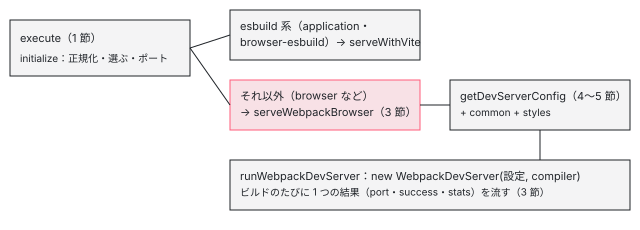

[目次](../README.md) › [webpack の builder の内側：@angular-devkit/build-angular と schematics の CLI](README.md) › 第 6 回 / 全 12 回

# webpack の dev-server：builder・設定・HMR

> builders/dev-server/builder.ts・options.ts・webpack-server.ts・tools/webpack/configs/dev-server.ts・plugins/hmr/\*：application builder と webpack の振り分け、webpack-dev-server の設定（proxy・historyApiFallback・headers・allowedHosts）、index.html と service worker のプラグイン、HMR を受ける側のコード。

angular/angular-cli · 読了 約 13 分 · 発展 · [サイトで読む（デモが動きます）](https://angular-deep-dive-cyan.vercel.app/chapter/bwp-dev-server)

---

この章で分かること：`ng serve` が `@angular-devkit/build-angular:dev-server` を呼んだとき、build の target の builder の名前から「Vite（application builder の側）か、webpack-dev-server か」を決める条件と、webpack の側に来たときに options が webpack-dev-server の設定（historyApiFallback・headers・proxy・allowedHosts・WebSocket）にどう置き換わるか、HMR を受ける側のコードが何をするかです。127.0.0.1 に本物の dev-server を立て、要求を投げた応答で確かめます。

読む対象は angular-cli（44129f66a3）の `packages/angular_devkit/build_angular/src/builders/dev-server/builder.ts`・`options.ts`・`webpack-server.ts`、`tools/webpack/configs/dev-server.ts`、`tools/webpack/plugins/` の `index-html-webpack-plugin.ts`・`service-worker-plugin.ts`・`builder-watch-plugin.ts`・`hmr/`、それに `build_webpack` の `runWebpackDevServer` です。Vite に振り分けた後の `serveWithVite` は [bld-dev-server-rest の章](../bld/06-bld-dev-server-rest.md)、application builder の側の HMR は [cli-hmr の章](../cli/11-cli-hmr.md)で読みました。

1. [1. browser builder の流れ](01-bwp-browser.md)
2. [2. webpack の共通の設定](02-bwp-webpack-common.md)
3. [3. スタイルの設定](03-bwp-webpack-styles.md)
4. [4. Angular の webpack プラグイン](04-bwp-webpack-plugins.md)
5. [5. babel の最適化のプラグイン](05-bwp-babel.md)
6. **6. webpack の dev-server**（この章）
7. [7. server builder と ssr-dev-server](07-bwp-server-ssr.md)
8. [8. prerender と app-shell](08-bwp-prerender-appshell.md)
9. [9. webpack の i18n](09-bwp-i18n.md)
10. [10. karma の builder の webpack の側](10-bwp-karma.md)
11. [11. schematics の CLI](11-bwp-schematics-cli.md)
12. [12. spec と issue](12-bwp-tests-issues.md)

> [!NOTE]
> **ポイント**
>
> 記録は npm の 22.2.7（webpack-dev-server 6.0.0）です。v22.2.7 と 44129f66a3 で違うのは `options.ts` の 147〜148 行目だけで、22.2.7 は `sslCert`・`sslKey` をワークスペースの根から絶対パスにします （0c4bd19ace、#34399。本家の main では d2aafa2d25）。webpack の側は 5 節の 144〜145 行目で根から解決するので、効くのは Vite の側です。

## 0. 全体の流れ



*build の target の builder の名前で道が分かれる。webpack の側は browser builder と同じ部分設定に dev-server の部分設定を足し、webpack-dev-server がメモリの上の出力を配る。*

1. **選ぶ**

   dev-server の options を正規化し、build の target の builder の名前と `forceEsbuild` から、使う builder を決める（1〜2 節）。
2. **Vite へ**

   esbuild 系なら、webpack の transforms を断って `serveWithVite` に渡す（1 節）。
3. **webpack へ**

   それ以外は build の target の options を読み直し、dev-server の部分設定を足して webpack-dev-server を立てる（3〜5 節）。
4. **HMR を受ける**

   `hmr` なら main の末尾に受け口のコードを足し、差し替えのときにアプリを作り直す（6 節）。

## 1. execute：Vite か webpack か

📄 `angular-cli/packages/angular_devkit/build_angular/src/builders/dev-server/builder.ts` L19–51 （▶ の行: 22–23, 34, 37–38, 42–44, 49）

```ts
19 │ /**
20 │  * A Builder that executes a development server based on the provided browser target option.
21 │  *
22 ▶  * Usage of the `transforms` and/or `extensions` parameters is NOT supported and may cause
23 ▶  * unexpected build output or build failures.
24 │  *
25 │  * @param options Dev Server options.
26 │  * @param context The build context.
27 │  * @param transforms A map of transforms that can be used to hook into some logic (such as
28 │  * transforming webpack configuration before passing it to webpack).
29 │  * @param extensions An optional object containing an array of build plugins (esbuild-based)
30 │  * and/or HTTP request middleware.
31 │  *
32 │  * @experimental Direct usage of this function is considered experimental.
33 │  */
34 ▶ export function execute(
35 │   options: DevServerBuilderOptions,
36 │   context: BuilderContext,
37 ▶   transforms: {
38 ▶     webpackConfiguration?: ExecutionTransformer<import('webpack').Configuration>;
39 │     logging?: import('@angular-devkit/build-webpack').WebpackLoggingCallback;
40 │     indexHtml?: IndexHtmlTransform;
41 │   } = {},
42 ▶   extensions?: {
43 ▶     buildPlugins?: Plugin[];
44 ▶     middleware?: ((
45 │       req: http.IncomingMessage,
46 │       res: http.ServerResponse,
47 │       next: (err?: unknown) => void,
48 │     ) => void)[];
49 ▶     builderSelector?: (info: BuilderSelectorInfo, logger: BuilderContext['logger']) => string;
50 │   },
51 │ ): Observable<DevServerBuilderOutput> {
```

📄 `angular-cli/packages/angular_devkit/build_angular/src/builders/dev-server/builder.ts` L52–86 （▶ の行: 53–55, 57, 60–61, 65, 68–70, 75–76, 81–82）

```ts
52 │   // Determine project name from builder context target
53 ▶   const projectName = context.target?.project;
54 ▶   if (!projectName) {
55 ▶     context.logger.error(`The "dev-server" builder requires a target to be specified.`);
56 │ 
57 ▶     return EMPTY;
58 │   }
59 │ 
60 ▶   context.logger.warn(
61 ▶     'The "@angular-devkit/build-angular:dev-server" builder is deprecated as part of Angular\'s Webpack support deprecation. ' +
62 │       'Use "@angular/build:dev-server" instead. For more information, see https://angular.dev/tools/cli/build-system-migration.',
63 │   );
64 │ 
65 ▶   return defer(() => initialize(options, projectName, context, extensions?.builderSelector)).pipe(
66 │     switchMap(({ builderName, normalizedOptions }) => {
67 │       // Use vite-based development server for esbuild-based builds
68 ▶       if (isEsbuildBased(builderName)) {
69 ▶         if (transforms?.logging || transforms?.webpackConfiguration) {
70 ▶           throw new Error(
71 │             `The "application" and "browser-esbuild" builders do not support Webpack transforms.`,
72 │           );
73 │         }
74 │ 
75 ▶         if (options.publicHost) {
76 ▶           context.logger.warn(
77 │             `The "publicHost" option will not be used because it is not supported by the "${builderName}" builder.`,
78 │           );
79 │         }
80 │ 
81 ▶         if (options.disableHostCheck) {
82 ▶           context.logger.warn(
83 │             `The "disableHostCheck" option will not be used because it is not supported by the "${builderName}" builder.`,
84 │           );
85 │         }
86 │ 
```

📄 `angular-cli/packages/angular_devkit/build_angular/src/builders/dev-server/builder.ts` L87–122 （▶ の行: 88, 91–92, 94, 97, 101, 108–109, 111, 114）

```ts
 87 │         // New build system defaults hmr option to the value of liveReload
 88 ▶         normalizedOptions.hmr ??= normalizedOptions.liveReload;
 89 │ 
 90 │         // New build system uses Vite's allowedHost option convention of true for disabling host checks
 91 ▶         if (normalizedOptions.disableHostCheck) {
 92 ▶           (normalizedOptions as unknown as { allowedHosts: true }).allowedHosts = true;
 93 │         } else {
 94 ▶           normalizedOptions.allowedHosts ??= [];
 95 │         }
 96 │ 
 97 ▶         return defer(() =>
 98 │           Promise.all([import('@angular/build/private'), import('../browser-esbuild')]),
 99 │         ).pipe(
100 │           switchMap(([{ serveWithVite, buildApplicationInternal }, { convertBrowserOptions }]) =>
101 ▶             serveWithVite(
102 │               normalizedOptions as typeof normalizedOptions & {
103 │                 hmr: boolean;
104 │                 allowedHosts: true | string[];
105 │                 define: { [key: string]: string } | undefined;
106 │               },
107 │               builderName,
108 ▶               (options, context, codePlugins) => {
109 ▶                 return builderName === '@angular-devkit/build-angular:browser-esbuild'
110 │                   ? // eslint-disable-next-line @typescript-eslint/no-explicit-any
111 ▶                     buildApplicationInternal(convertBrowserOptions(options as any), context, {
112 │                       codePlugins,
113 │                     })
114 ▶                   : buildApplicationInternal(options, context, { codePlugins });
115 │               },
116 │               context,
117 │               transforms,
118 │               extensions,
119 │             ),
120 │           ),
121 │         );
122 │       }
```

📄 `angular-cli/packages/angular_devkit/build_angular/src/builders/dev-server/builder.ts` L123–151 （▶ の行: 125–126, 131–132, 134–135, 141, 144, 146）

```ts
123 │ 
124 │       // Warn if the initial options provided by the user enable prebundling with Webpack-based builders
125 ▶       if (options.prebundle) {
126 ▶         context.logger.warn(
127 │           `Prebundling has been configured but will not be used because it is not supported by the "${builderName}" builder.`,
128 │         );
129 │       }
130 │ 
131 ▶       if (extensions?.buildPlugins?.length) {
132 ▶         throw new Error('Only the "application" and "browser-esbuild" builders support plugins.');
133 │       }
134 ▶       if (extensions?.middleware?.length) {
135 ▶         throw new Error(
136 │           'Only the "application" and "browser-esbuild" builders support middleware.',
137 │         );
138 │       }
139 │ 
140 │       // Webpack based build systems default to false for hmr option
141 ▶       normalizedOptions.hmr ??= false;
142 │ 
143 │       // Use Webpack for all other browser targets
144 ▶       return defer(() => import('./webpack-server')).pipe(
145 │         switchMap(({ serveWebpackBrowser }) =>
146 ▶           serveWebpackBrowser(normalizedOptions, builderName, context, transforms),
147 │         ),
148 │       );
149 │     }),
150 │   );
151 │ }
```

1. **22〜23 行目と 37〜50 行目：2 つの差し替え口**

   `transforms` は webpack 用、`extensions`（esbuild のプラグイン・middleware・builder の選び方）は Vite 用です。JSDoc はどちらも「サポートしない」と書きます。
2. **68〜73 行目：esbuild 系に webpack の transforms を渡すとエラー**

   記録で、`forceEsbuild: true` に記録用の `webpackConfiguration` を付けて立てると「The "application" and "browser-esbuild" builders do not support Webpack transforms.」で止まりました（デモの「forceEsbuild + webpack の transforms」）。
3. **75〜95 行目：Vite で使わない options**

   `publicHost` と `disableHostCheck` は警告だけ。`hmr` の既定を `liveReload` にし、`disableHostCheck` は Vite の流儀の `allowedHosts: true` に直します。
4. **108〜115 行目：browser-esbuild なら options を直す**

   browser の形の options を application の形にしてから `buildApplicationInternal` に渡します。
5. **125〜141 行目：webpack の側**

   `prebundle` は使えないと警告し、esbuild のプラグインや middleware が渡されたらエラーにし、`hmr` の既定を false にします。

📄 `angular-cli/packages/angular_devkit/build_angular/src/builders/dev-server/builder.ts` L153–170 （▶ の行: 157, 160, 162–163, 165–166）

```ts
153 │ async function initialize(
154 │   initialOptions: DevServerBuilderOptions,
155 │   projectName: string,
156 │   context: BuilderContext,
157 ▶   builderSelector = defaultBuilderSelector,
158 │ ) {
159 │   // Purge old build disk cache.
160 ▶   await purgeStaleBuildCache(context);
161 │ 
162 ▶   const normalizedOptions = await normalizeOptions(context, projectName, initialOptions);
163 ▶   const builderName = builderSelector(
164 │     {
165 ▶       builderName: await context.getBuilderNameForTarget(normalizedOptions.buildTarget),
166 ▶       forceEsbuild: !!normalizedOptions.forceEsbuild,
167 │     },
168 │     context.logger,
169 │   );
170 │ 
```

📄 `angular-cli/packages/angular_devkit/build_angular/src/builders/dev-server/builder.ts` L171–200 （▶ の行: 172–174, 176, 187, 189, 194）

```ts
171 │   if (
172 ▶     !normalizedOptions.disableHostCheck &&
173 ▶     !/^127\.\d+\.\d+\.\d+/g.test(normalizedOptions.host) &&
174 ▶     normalizedOptions.host !== 'localhost'
175 │   ) {
176 ▶     context.logger.warn(`
177 │ Warning: This is a simple server for use in testing or debugging Angular applications
178 │ locally. It hasn't been reviewed for security issues.
179 │ 
180 │ Binding this server to an open connection can result in compromising your application or
181 │ computer. Using a different host than the one passed to the "--host" flag might result in
182 │ websocket connection issues. You might need to use "--disable-host-check" if that's the
183 │ case.
184 │     `);
185 │   }
186 │ 
187 ▶   if (normalizedOptions.disableHostCheck) {
188 │     context.logger.warn(
189 ▶       'Warning: Running a server with --disable-host-check is a security risk. ' +
190 │         'See https://medium.com/webpack/webpack-dev-server-middleware-security-issues-1489d950874a for more information.',
191 │     );
192 │   }
193 │ 
194 ▶   normalizedOptions.port = await checkPort(normalizedOptions.port, normalizedOptions.host);
195 │ 
196 │   return {
197 │     builderName,
198 │     normalizedOptions,
199 │   };
200 │ }
```

📄 `angular-cli/packages/angular_devkit/build_angular/src/builders/dev-server/builder.ts` L202–228 （▶ の行: 211–212, 215–217, 224, 227）

```ts
202 │ interface BuilderSelectorInfo {
203 │   builderName: string;
204 │   forceEsbuild: boolean;
205 │ }
206 │ 
207 │ function defaultBuilderSelector(
208 │   info: BuilderSelectorInfo,
209 │   logger: BuilderContext['logger'],
210 │ ): string {
211 ▶   if (isEsbuildBased(info.builderName)) {
212 ▶     return info.builderName;
213 │   }
214 │ 
215 ▶   if (info.forceEsbuild) {
216 ▶     if (!info.builderName.startsWith('@angular-devkit/build-angular:')) {
217 ▶       logger.warn(
218 │         'Warning: Forcing the use of the esbuild-based build system with third-party builders' +
219 │           ' may cause unexpected behavior and/or build failures.',
220 │       );
221 │     }
222 │ 
223 │     // The compatibility builder should be used if esbuild is force enabled.
224 ▶     return '@angular-devkit/build-angular:browser-esbuild';
225 │   }
226 │ 
227 ▶   return info.builderName;
228 │ }
```

1. **163〜169 行目：選ぶ関数**

   build の target の builder の名前と `forceEsbuild` を、既定の `defaultBuilderSelector`（または `extensions.builderSelector`）に渡します。
2. **211〜227 行目：3 つの場合**

   esbuild 系ならそのまま、`forceEsbuild` なら `browser-esbuild`（build-angular 以外の builder なら警告）、それ以外は元の名前。
3. **171〜185 行目：外に開くときの警告**

   host が `127.` で始まるか `localhost` でなければ、長い警告を出します。`::1` や `0.0.0.0` でも出ます。
4. **194 行目：ポート**

   `checkPort` がポートの空きを確かめます（0 なら空いているポート）。

📄 `angular-cli/packages/angular_devkit/build_angular/src/builders/dev-server/options.ts` L17–32 （▶ の行: 17, 24–26）

```ts
17 ▶ export function isEsbuildBased(
18 │   builderName: string,
19 │ ): builderName is
20 │   | '@angular/build:application'
21 │   | '@angular-devkit/build-angular:application'
22 │   | '@angular-devkit/build-angular:browser-esbuild' {
23 │   if (
24 ▶     builderName === '@angular/build:application' ||
25 ▶     builderName === '@angular-devkit/build-angular:application' ||
26 ▶     builderName === '@angular-devkit/build-angular:browser-esbuild'
27 │   ) {
28 │     return true;
29 │   }
30 │ 
31 │   return false;
32 │ }
```

esbuild 系と見なすのは、この 3 つの名前だけです。デモでは、`browser` の target は webpack-dev-server（応答の `x-powered-by: Express`）、`forceEsbuild: true` と `@angular-devkit/build-angular:application` の target は Vite（HTML に `/@vite/client`）になりました。

## 2. options の正規化

📄 `angular-cli/packages/angular_devkit/build_angular/src/builders/dev-server/options.ts` L44–79 （▶ の行: 53, 56–57, 60–61, 63–64, 66–67, 69, 72, 74）

```ts
44 │ export async function normalizeOptions(
45 │   context: BuilderContext,
46 │   projectName: string,
47 │   options: DevServerOptions,
48 │ ) {
49 │   const { workspaceRoot, logger } = context;
50 │   const projectMetadata = await context.getProjectMetadata(projectName);
51 │   const projectRoot = path.join(workspaceRoot, (projectMetadata.root as string | undefined) ?? '');
52 │ 
53 ▶   const cacheOptions = normalizeCacheOptions(projectMetadata, workspaceRoot);
54 │ 
55 │   // Target specifier defaults to the current project's build target using a development configuration
56 ▶   const buildTargetSpecifier = options.buildTarget ?? `::development`;
57 ▶   const buildTarget = targetFromTargetString(buildTargetSpecifier, projectName, 'build');
58 │ 
59 │   // Get the application builder options.
60 ▶   const browserBuilderName = await context.getBuilderNameForTarget(buildTarget);
61 ▶   const rawBuildOptions = await context.getTargetOptions(buildTarget);
62 │   // eslint-disable-next-line @typescript-eslint/no-explicit-any
63 ▶   const buildOptions = (await context.validateOptions(rawBuildOptions, browserBuilderName)) as any;
64 ▶   const optimization = normalizeOptimization(buildOptions.optimization);
65 │ 
66 ▶   if (options.prebundle !== false && isEsbuildBased(browserBuilderName)) {
67 ▶     if (!cacheOptions.enabled) {
68 │       // Warn if the initial options provided by the user enable prebundling but caching is disabled
69 ▶       logger.warn(
70 │         'Prebundling has been configured but will not be used because caching has been disabled.',
71 │       );
72 ▶     } else if (optimization.scripts) {
73 │       // Warn if the initial options provided by the user enable prebundling but script optimization is enabled.
74 ▶       logger.warn(
75 │         'Prebundling has been configured but will not be used because scripts optimization is enabled.',
76 │       );
77 │     }
78 │   }
79 │ 
```

📄 `angular-cli/packages/angular_devkit/build_angular/src/builders/dev-server/options.ts` L80–102 （▶ の行: 82–83, 87–89, 95, 98）

```ts
 80 │   let inspect: false | { host?: string; port?: number } = false;
 81 │   const inspectRaw = options.inspect;
 82 ▶   if (inspectRaw === true || inspectRaw === '' || inspectRaw === 'true') {
 83 ▶     inspect = {
 84 │       host: undefined,
 85 │       port: undefined,
 86 │     };
 87 ▶   } else if (typeof inspectRaw === 'string' && inspectRaw !== 'false') {
 88 ▶     const port = +inspectRaw;
 89 ▶     if (isFinite(port)) {
 90 │       inspect = {
 91 │         host: undefined,
 92 │         port,
 93 │       };
 94 │     } else {
 95 ▶       const [host, port] = inspectRaw.split(':');
 96 │       inspect = {
 97 │         host,
 98 ▶         port: isNaN(+port) ? undefined : +port,
 99 │       };
100 │     }
101 │   }
102 │ 
```

📄 `angular-cli/packages/angular_devkit/build_angular/src/builders/dev-server/options.ts` L103–125 （▶ の行: 104–106, 111–112, 116–117, 122）

```ts
103 │   // Initial options to keep
104 ▶   const {
105 ▶     host,
106 ▶     port,
107 │     poll,
108 │     open,
109 │     verbose,
110 │     watch,
111 ▶     allowedHosts,
112 ▶     disableHostCheck,
113 │     liveReload,
114 │     hmr,
115 │     headers,
116 ▶     proxyConfig,
117 ▶     servePath,
118 │     publicHost,
119 │     ssl,
120 │     sslCert,
121 │     sslKey,
122 ▶     forceEsbuild,
123 │     prebundle,
124 │   } = options;
125 │ 
```

📄 `angular-cli/packages/angular_devkit/build_angular/src/builders/dev-server/options.ts` L126–154 （▶ の行: 128–130, 135–136, 147–148, 151–152）

```ts
126 │   // Return all the normalized options
127 │   return {
128 ▶     buildTarget,
129 ▶     host: host ?? 'localhost',
130 ▶     port: port ?? 4200,
131 │     poll,
132 │     open,
133 │     verbose,
134 │     watch,
135 ▶     liveReload: !!liveReload,
136 ▶     hmr,
137 │     headers,
138 │     workspaceRoot,
139 │     projectRoot,
140 │     cacheOptions,
141 │     allowedHosts,
142 │     disableHostCheck,
143 │     proxyConfig,
144 │     servePath,
145 │     publicHost,
146 │     ssl,
147 ▶     sslCert,
148 ▶     sslKey,
149 │     forceEsbuild,
150 │     // Prebundling defaults to true but requires caching to function
151 ▶     prebundle: cacheOptions.enabled && !optimization.scripts && (prebundle ?? true),
152 ▶     inspect,
153 │   };
154 │ }
```

1. **56〜57 行目：buildTarget の既定**

   省略すると `::development`、つまり同じプロジェクトの `build` の target の `development` の設定です。
2. **60〜64 行目：build の options を読む**

   builder の名前を聞き、build の target の options をその builder の schema で検めてから、`optimization` を正規化します。
3. **66〜78 行目：prebundle の警告**

   66 行目の `isEsbuildBased` は build の target の builder の名前（`browserBuilderName`）で見るので、`forceEsbuild` で Vite に行くときは見ません。デモで、キャッシュを切ったワークスペースで application の target なら「Prebundling has been configured but will not be used because caching has been disabled.」が出て、`forceEsbuild: true` では出ませんでした。
4. **80〜101 行目：inspect**

   `true`・空・`'true'`、数だけ（ポート）、`host:port` の 3 つの書き方を受けます（SSR の dev-server が使う）。
5. **129〜135 行目：既定**

   host は `localhost`、port は 4200、`liveReload` は真偽に直します。151 行目、`prebundle` はキャッシュが有効で JS を縮めないときだけ。

## 3. serveWebpackBrowser：build の options を読み直して立てる

📄 `angular-cli/packages/angular_devkit/build_angular/src/builders/dev-server/webpack-server.ts` L76–98 （▶ の行: 78, 84–85, 90, 92, 95–96）

```ts
76 │   // Check Angular version.
77 │   const { logger, workspaceRoot } = context;
78 ▶   assertCompatibleAngularVersion(workspaceRoot);
79 │ 
80 │   async function setup(): Promise<{
81 │     browserOptions: BrowserBuilderSchema;
82 │     webpackConfig: webpack.Configuration;
83 │   }> {
84 ▶     if (options.hmr) {
85 ▶       logger.warn(tags.stripIndents`NOTICE: Hot Module Replacement (HMR) is enabled for the dev server.
86 │       See https://webpack.js.org/guides/hot-module-replacement for information on working with HMR for Webpack.`);
87 │     }
88 │ 
89 │     // Get the browser configuration from the target name.
90 ▶     const rawBrowserOptions = await context.getTargetOptions(options.buildTarget);
91 │ 
92 ▶     if (rawBrowserOptions.outputHashing && rawBrowserOptions.outputHashing !== OutputHashing.None) {
93 │       // Disable output hashing for dev build as this can cause memory leaks
94 │       // See: https://github.com/webpack/webpack-dev-server/issues/377#issuecomment-241258405
95 ▶       rawBrowserOptions.outputHashing = OutputHashing.None;
96 ▶       logger.warn(`Warning: 'outputHashing' option is disabled when using the dev-server.`);
97 │     }
98 │ 
```

📄 `angular-cli/packages/angular_devkit/build_angular/src/builders/dev-server/webpack-server.ts` L99–133 （▶ の行: 100, 103–104, 106, 111–113, 118, 123, 126–127）

```ts
 99 │     // eslint-disable-next-line @typescript-eslint/no-unnecessary-type-assertion
100 ▶     const browserOptions = (await context.validateOptions(
101 │       {
102 │         ...rawBrowserOptions,
103 ▶         watch: options.watch,
104 ▶         verbose: options.verbose,
105 │         // In dev server we should not have budgets because of extra libs such as socks-js
106 ▶         budgets: undefined,
107 │       } as json.JsonObject & BrowserBuilderSchema,
108 │       builderName,
109 │     )) as json.JsonObject & BrowserBuilderSchema;
110 │ 
111 ▶     const { styles, scripts } = normalizeOptimization(browserOptions.optimization);
112 ▶     if (scripts || styles.minify) {
113 ▶       logger.error(tags.stripIndents`
114 │         ****************************************************************************************
115 │         This is a simple server for use in testing or debugging Angular applications locally.
116 │         It hasn't been reviewed for security issues.
117 │ 
118 ▶         DON'T USE IT FOR PRODUCTION!
119 │         ****************************************************************************************
120 │       `);
121 │     }
122 │ 
123 ▶     const { config, i18n } = await generateI18nBrowserWebpackConfigFromContext(
124 │       browserOptions,
125 │       context,
126 ▶       (wco) => [getDevServerConfig(wco), getCommonConfig(wco), getStylesConfig(wco)],
127 ▶       options,
128 │     );
129 │ 
130 │     if (!config.devServer) {
131 │       throw new Error('Webpack Dev Server configuration was not set.');
132 │     }
133 │ 
```

1. **92〜97 行目：outputHashing は none に**

   ファイル名にハッシュが付くと、再ビルドのたびに新しい名前がメモリに溜まるためです（94 行目のリンク）。build の設定にあれば警告します。
2. **100〜109 行目：dev-server の値で上書き**

   `watch`・`verbose` は dev-server の値、`budgets` は undefined（105 行目のコメント：dev-server は sockjs などで大きくなるため）。
3. **111〜121 行目：縮める設定で立てると**

   「DON'T USE IT FOR PRODUCTION!」を `error` で出します（止めはしない）。
4. **123〜128 行目：3 つの部分設定**

   browser builder の 2 つの前に `getDevServerConfig`（4 節）を置き、127 行目で dev-server の options を `extraBuildOptions` として混ぜます（第 1 回の webpack-browser-config.ts の 47 行目）。

📄 `angular-cli/packages/angular_devkit/build_angular/src/builders/dev-server/webpack-server.ts` L134–168 （▶ の行: 135, 137–138, 140, 147–148, 153, 163–164）

```ts
134 │     let locale: string | undefined;
135 ▶     if (i18n.shouldInline) {
136 │       // Dev-server only supports one locale
137 ▶       locale = [...i18n.inlineLocales][0];
138 ▶     } else if (i18n.hasDefinedSourceLocale) {
139 │       // use source locale if not localizing
140 ▶       locale = i18n.sourceLocale;
141 │     }
142 │ 
143 │     let webpackConfig = config;
144 │ 
145 │     // If a locale is defined, setup localization
146 │     if (locale) {
147 ▶       if (i18n.inlineLocales.size > 1) {
148 ▶         throw new Error(
149 │           'The development server only supports localizing a single locale per build.',
150 │         );
151 │       }
152 │ 
153 ▶       await setupLocalize(
154 │         locale,
155 │         i18n,
156 │         browserOptions,
157 │         webpackConfig,
158 │         options.cacheOptions,
159 │         context,
160 │       );
161 │     }
162 │ 
163 ▶     if (transforms.webpackConfiguration) {
164 ▶       webpackConfig = await transforms.webpackConfiguration(webpackConfig);
165 │     }
166 │ 
167 │     webpackConfig.plugins ??= [];
168 │ 
```

📄 `angular-cli/packages/angular_devkit/build_angular/src/builders/dev-server/webpack-server.ts` L169–196 （▶ の行: 169, 171, 177, 180–184, 189, 192）

```ts
169 ▶     if (browserOptions.index) {
170 │       const { scripts = [], styles = [], baseHref } = browserOptions;
171 ▶       const entrypoints = generateEntryPoints({
172 │         scripts,
173 │         styles,
174 │         // The below is needed as otherwise HMR for CSS will break.
175 │         // styles.js and runtime.js needs to be loaded as a non-module scripts as otherwise `document.currentScript` will be null.
176 │         // https://github.com/webpack-contrib/mini-css-extract-plugin/blob/90445dd1d81da0c10b9b0e8a17b417d0651816b8/src/hmr/hotModuleReplacement.js#L39
177 ▶         isHMREnabled: !!webpackConfig.devServer?.hot,
178 │       });
179 │ 
180 ▶       webpackConfig.plugins.push(
181 ▶         new IndexHtmlWebpackPlugin({
182 ▶           indexPath: path.resolve(workspaceRoot, getIndexInputFile(browserOptions.index)),
183 ▶           outputPath: getIndexOutputFile(browserOptions.index),
184 ▶           baseHref,
185 │           entrypoints,
186 │           deployUrl: browserOptions.deployUrl,
187 │           sri: browserOptions.subresourceIntegrity,
188 │           cache: options.cacheOptions,
189 ▶           postTransform: transforms.indexHtml,
190 │           optimization: normalizeOptimization(browserOptions.optimization),
191 │           crossOrigin: browserOptions.crossOrigin,
192 ▶           lang: locale,
193 │         }),
194 │       );
195 │     }
196 │ 
```

📄 `angular-cli/packages/angular_devkit/build_angular/src/builders/dev-server/webpack-server.ts` L197–213 （▶ の行: 197–200, 202–203, 208–210）

```ts
197 ▶     if (browserOptions.serviceWorker) {
198 ▶       webpackConfig.plugins.push(
199 ▶         new ServiceWorkerPlugin({
200 ▶           baseHref: browserOptions.baseHref,
201 │           root: context.workspaceRoot,
202 ▶           projectRoot: options.projectRoot,
203 ▶           ngswConfigPath: browserOptions.ngswConfigPath,
204 │         }),
205 │       );
206 │     }
207 │ 
208 ▶     return {
209 ▶       browserOptions,
210 ▶       webpackConfig,
211 │     };
212 │   }
213 │ 
```

ロケールは 1 つだけです（147〜151 行目）。`localize` で 2 つ以上を差し込む設定ならエラー、1 つなら 7 節の `setupLocalize` で babel の loader に翻訳させます。browser builder は index.html をビルドの後に書きましたが（第 1 回の 6 節）、dev-server は出力をメモリに置くので、180〜194 行目で `IndexHtmlWebpackPlugin`（4 節）を webpack のプラグインとして足し、index.html も webpack のアセットにします。177 行目、HMR のときは `runtime` も module でない script にします（`utils/package-chunk-sort.ts` の `generateEntryPoints` は styles の束をいつも module でない形にする。mini-css-extract-plugin の HMR が `document.currentScript` を使うため、174〜176 行目のコメント）。

📄 `angular-cli/packages/angular_devkit/build_angular/src/builders/dev-server/webpack-server.ts` L214–236 （▶ の行: 216–219, 221, 228, 230, 232–234）

```ts
214 │   return from(setup()).pipe(
215 │     switchMap(({ browserOptions, webpackConfig }) => {
216 ▶       return runWebpackDevServer(webpackConfig, context, {
217 ▶         logging: transforms.logging || createWebpackLoggingCallback(browserOptions, logger),
218 ▶         webpackFactory: require('webpack') as typeof webpack,
219 ▶         webpackDevServerFactory: require('webpack-dev-server') as typeof webpackDevServer,
220 │       }).pipe(
221 ▶         concatMap(async (buildEvent, index) => {
222 │           const webpackRawStats = buildEvent.webpackStats;
223 │           if (!webpackRawStats) {
224 │             throw new Error('Webpack stats build result is required.');
225 │           }
226 │ 
227 │           // Resolve serve address.
228 ▶           const publicPath = webpackConfig.devServer?.devMiddleware?.publicPath;
229 │ 
230 ▶           const serverAddress = url.format({
231 │             protocol: options.ssl ? 'https' : 'http',
232 ▶             hostname: options.host === '0.0.0.0' ? 'localhost' : options.host,
233 ▶             port: buildEvent.port,
234 ▶             pathname: typeof publicPath === 'string' ? publicPath : undefined,
235 │           });
236 │ 
```

📄 `angular-cli/packages/angular_devkit/build_angular/src/builders/dev-server/webpack-server.ts` L237–270 （▶ の行: 237–238, 242–243, 249, 251, 255–256, 258, 261, 263–264）

```ts
237 ▶           if (index === 0) {
238 ▶             logger.info(
239 │               '\n' +
240 │                 tags.oneLine`
241 │               **
242 ▶               Angular Live Development Server is listening on ${options.host}:${buildEvent.port},
243 ▶               open your browser on ${serverAddress}
244 │               **
245 │             ` +
246 │                 '\n',
247 │             );
248 │ 
249 ▶             if (options.open) {
250 │               const open = (await import('open')).default;
251 ▶               await open(serverAddress);
252 │             }
253 │           }
254 │ 
255 ▶           if (buildEvent.success) {
256 ▶             logger.info(`\n${colors.greenBright(colors.symbols.check)} Compiled successfully.`);
257 │           } else {
258 ▶             logger.info(`\n${colors.redBright(colors.symbols.cross)} Failed to compile.`);
259 │           }
260 │ 
261 ▶           return {
262 │             ...buildEvent,
263 ▶             baseUrl: serverAddress,
264 ▶             stats: generateBuildEventStats(webpackRawStats, browserOptions),
265 │           } as DevServerBuilderOutput;
266 │         }),
267 │       );
268 │     }),
269 │   );
270 │ }
```

📄 `angular-cli/packages/angular_devkit/build_webpack/src/builders/webpack-dev-server/index.ts` L66–94 （▶ の行: 66, 70, 78–79, 84, 86–87, 89, 91–92）

```ts
66 ▶   return createWebpack({ ...config, watch: false }).pipe(
67 │     switchMap(async (webpackCompiler) => {
68 │       return [
69 │         webpackCompiler,
70 ▶         options.webpackDevServerFactory ?? (await import('webpack-dev-server')).default,
71 │       ] as unknown as [webpack.Compiler | null, WebpackDevServerFactory];
72 │     }),
73 │     switchMap(
74 │       ([webpackCompiler, webpackDevServerFactory]) =>
75 │         new Observable<DevServerBuildOutput>((obs) => {
76 │           assert(webpackCompiler, 'Webpack compiler factory did not return a compiler instance.');
77 │ 
78 ▶           const devServerConfig = options.devServerConfig || config.devServer || {};
79 ▶           devServerConfig.host ??= 'localhost';
80 │ 
81 │           let result: Partial<DevServerBuildOutput>;
82 │           const statsOptions = typeof config.stats === 'boolean' ? undefined : config.stats;
83 │ 
84 ▶           webpackCompiler.hooks.done.tap('build-webpack', (stats) => {
85 │             // Log stats.
86 ▶             log(stats, config);
87 ▶             obs.next({
88 │               ...result,
89 ▶               webpackStats: shouldProvideStats ? stats.toJson(statsOptions) : undefined,
90 │               emittedFiles: getEmittedFiles(stats.compilation),
91 ▶               success: !stats.hasErrors(),
92 ▶               outputPath: stats.compilation.outputOptions.path,
93 │             } as unknown as DevServerBuildOutput);
94 │           });
```

📄 `angular-cli/packages/angular_devkit/build_webpack/src/builders/webpack-dev-server/index.ts` L96–126 （▶ の行: 96–97, 104, 111–113, 120–122）

```ts
 96 ▶           const devServer = new webpackDevServerFactory(devServerConfig, webpackCompiler);
 97 ▶           devServer.startCallback((err) => {
 98 │             if (err) {
 99 │               obs.error(err);
100 │ 
101 │               return;
102 │             }
103 │ 
104 ▶             const address = devServer.server?.address();
105 │             if (!address) {
106 │               obs.error(new Error(`Dev-server address info is not defined.`));
107 │ 
108 │               return;
109 │             }
110 │ 
111 ▶             result = {
112 ▶               success: true,
113 ▶               port: typeof address === 'string' ? 0 : address.port,
114 │               family: typeof address === 'string' ? '' : address.family,
115 │               address: typeof address === 'string' ? address : address.address,
116 │             };
117 │           });
118 │ 
119 │           // Teardown logic. Close the server when unsubscribed from.
120 ▶           return () => {
121 ▶             devServer.stopCallback(() => {});
122 ▶             webpackCompiler.close(() => {});
123 │           };
124 │         }),
125 │     ),
126 │   );
```

1. **96〜117 行目：webpack-dev-server を立てる**

   `new WebpackDevServer(devServer の設定, compiler)` の `startCallback` で、立った後のアドレスとポートを覚えます。
2. **84〜94 行目：ビルドのたびに 1 つの値**

   compiler の `done` のたびに、ポートと統計を合わせた値を流します。watch で再ビルドすると、また流れます。
3. **230〜247 行目：アドレスの表示**

   最初の 1 回だけ「Angular Live Development Server is listening on …」を出します。host が `0.0.0.0` なら表示の URL は `localhost`。`devMiddleware.publicPath`（4 節の `servePath`）を URL の後ろに付けます（デモの servePath の行で `http://127.0.0.1:8814/app`）。
4. **255〜259 行目：毎回の 1 行**

   「✔ Compiled successfully.」か「✘ Failed to compile.」。
5. **120〜123 行目：止める**

   購読をやめると dev-server と compiler を閉じます。記録のスクリプトは `run.stop()` でここを通しました。

## 4. dev-server の部分設定

📄 `angular-cli/packages/angular_devkit/build_angular/src/tools/webpack/configs/dev-server.ts` L21–54 （▶ の行: 25, 30, 33–36, 41, 44, 47, 49）

```ts
21 │ export async function getDevServerConfig(
22 │   wco: WebpackConfigOptions<WebpackDevServerOptions>,
23 │ ): Promise<Configuration> {
24 │   const {
25 ▶     buildOptions: { host, port, index, headers, watch, hmr, main, liveReload, proxyConfig },
26 │     logger,
27 │     root,
28 │   } = wco;
29 │ 
30 ▶   const servePath = buildServePath(wco.buildOptions, logger);
31 │ 
32 │   const extraRules: RuleSetRule[] = [];
33 ▶   if (hmr) {
34 ▶     extraRules.push({
35 ▶       loader: HmrLoader,
36 ▶       include: [resolve(wco.root, main)],
37 │     });
38 │   }
39 │ 
40 │   const extraPlugins = [];
41 ▶   if (!watch) {
42 │     // There's no option to turn off file watching in webpack-dev-server, but
43 │     // we can override the file watcher instead.
44 ▶     extraPlugins.push({
45 │       // eslint-disable-next-line @typescript-eslint/no-explicit-any
46 │       apply: (compiler: any) => {
47 ▶         compiler.hooks.afterEnvironment.tap('angular-cli', () => {
48 │           // eslint-disable-next-line @typescript-eslint/no-empty-function
49 ▶           compiler.watchFileSystem = { watch: () => {} };
50 │         });
51 │       },
52 │     });
53 │   }
54 │ 
```

📄 `angular-cli/packages/angular_devkit/build_angular/src/tools/webpack/configs/dev-server.ts` L55–93 （▶ の行: 63–68, 70–71, 78–80, 82, 84, 87–90）

```ts
55 │   return {
56 │     plugins: extraPlugins,
57 │     module: {
58 │       rules: extraRules,
59 │     },
60 │     devServer: {
61 │       host,
62 │       port,
63 ▶       headers,
64 ▶       historyApiFallback: !!index && {
65 ▶         index: posix.join(servePath, getIndexOutputFile(index)),
66 ▶         disableDotRule: true,
67 ▶         htmlAcceptHeaders: ['text/html', 'application/xhtml+xml'],
68 ▶         rewrites: [
69 │           {
70 ▶             from: new RegExp(`^(?!${servePath})/.*`),
71 ▶             to: (context) => context.parsedUrl.href,
72 │           },
73 │         ],
74 │       },
75 │       // When setupExitSignals is enabled webpack-dev-server will shutdown gracefully which would
76 │       // require CTRL+C to be pressed multiple times to exit.
77 │       // See: https://github.com/webpack/webpack-dev-server/blob/c76b6d11a3821436c5e20207c8a38deb6ab7e33c/lib/Server.js#L1801-L1827
78 ▶       setupExitSignals: false,
79 ▶       compress: false,
80 ▶       static: false,
81 │       server: getServerConfig(root, wco.buildOptions),
82 ▶       allowedHosts: getAllowedHostsConfig(wco.buildOptions),
83 │       devMiddleware: {
84 ▶         publicPath: servePath,
85 │         stats: false,
86 │       },
87 ▶       liveReload,
88 ▶       hot: hmr && !liveReload ? 'only' : hmr,
89 ▶       proxy: await addProxyConfig(root, proxyConfig),
90 ▶       ...getWebSocketSettings(wco.buildOptions, servePath),
91 │     },
92 │   };
93 │ }
```

1. **33〜38 行目：HMR の loader**

   `hmr` なら main のファイルだけに 6 節の loader を当てます。
2. **41〜53 行目：`watch: false`**

   webpack-dev-server には見張りを止める options が無いので、compiler の `watchFileSystem` を何もしないものに替えます。
3. **64〜74 行目：historyApiFallback**

   index があれば、`servePath` の下の index.html に戻します。`disableDotRule` で `.` を含むパスも戻し、戻すのは `Accept` が `text/html` か `application/xhtml+xml` の要求だけです（デモ：`/deep/route` は HTML なら index、JSON なら 404、`/file.with.dot` も index）。
4. **68〜73 行目：servePath の外は戻さない**

   rewrites は「`servePath` で始まらないパスは、そのままの URL に書き換える」で、戻しの対象から外す働きです。`servePath` が `/` のときは正規表現が `^(?!\/)\/.*`（`/` で始まらない `/`…）になり、何にも当たりません（デモの設定の `rewrites`）。`/app` なら `/other` や `/` は戻されず 404 でした。
5. **78〜80 行目：決め打ち**

   Ctrl+C で 1 回で止まるよう `setupExitSignals: false`、圧縮しない、静的なフォルダを配らない（アセットは webpack の出力として配る）。
6. **88 行目：hot**

   `hmr` で `liveReload` が false なら `'only'`（差し替えられなければ再読み込みもしない）、両方 true なら `true`（デモの hmr の行は `hot: true`）。

📄 `angular-cli/packages/angular_devkit/build_angular/src/tools/webpack/configs/dev-server.ts` L95–124 （▶ の行: 103–107, 112, 115–116, 119–120）

```ts
 95 │ /**
 96 │  * Resolve and build a URL _path_ that will be the root of the server. This resolved base href and
 97 │  * deploy URL from the browser options and returns a path from the root.
 98 │  */
 99 │ export function buildServePath(
100 │   options: WebpackDevServerOptions,
101 │   logger: logging.LoggerApi,
102 │ ): string {
103 ▶   let servePath = options.servePath;
104 ▶   if (servePath === undefined) {
105 ▶     const defaultPath = findDefaultServePath(options.baseHref, options.deployUrl);
106 ▶     if (defaultPath == null) {
107 ▶       logger.warn(tags.oneLine`
108 │         Warning: --deploy-url and/or --base-href contain unsupported values for ng serve. Default
109 │         serve path of '/' used. Use --serve-path to override.
110 │       `);
111 │     }
112 ▶     servePath = defaultPath || '';
113 │   }
114 │ 
115 ▶   if (servePath.endsWith('/')) {
116 ▶     servePath = servePath.slice(0, -1);
117 │   }
118 │ 
119 ▶   if (!servePath.startsWith('/')) {
120 ▶     servePath = `/${servePath}`;
121 │   }
122 │ 
123 │   return servePath;
124 │ }
```

📄 `angular-cli/packages/angular_devkit/build_angular/src/tools/webpack/configs/dev-server.ts` L241–277 （▶ の行: 248, 252, 260–262, 264, 266–267, 272, 276）

```ts
241 │ /**
242 │  * Find the default server path. We don't want to expose baseHref and deployUrl as arguments, only
243 │  * the browser options where needed. This method should stay private (people who want to resolve
244 │  * baseHref and deployUrl should use the buildServePath exported function.
245 │  * @private
246 │  */
247 │ function findDefaultServePath(baseHref?: string, deployUrl?: string): string | null {
248 ▶   if (!baseHref && !deployUrl) {
249 │     return '';
250 │   }
251 │ 
252 ▶   if (/^(\w+:)?\/\//.test(baseHref || '') || /^(\w+:)?\/\//.test(deployUrl || '')) {
253 │     // If baseHref or deployUrl is absolute, unsupported by ng serve
254 │     return null;
255 │   }
256 │ 
257 │   // normalize baseHref
258 │   // for ng serve the starting base is always `/` so a relative
259 │   // and root relative value are identical
260 ▶   const baseHrefParts = (baseHref || '').split('/').filter((part) => part !== '');
261 ▶   if (baseHref && !baseHref.endsWith('/')) {
262 ▶     baseHrefParts.pop();
263 │   }
264 ▶   const normalizedBaseHref = baseHrefParts.length === 0 ? '/' : `/${baseHrefParts.join('/')}/`;
265 │ 
266 ▶   if (deployUrl && deployUrl[0] === '/') {
267 ▶     if (baseHref && baseHref[0] === '/' && normalizedBaseHref !== deployUrl) {
268 │       // If baseHref and deployUrl are root relative and not equivalent, unsupported by ng serve
269 │       return null;
270 │     }
271 │ 
272 ▶     return deployUrl;
273 │   }
274 │ 
275 │   // Join together baseHref and deployUrl
276 ▶   return `${normalizedBaseHref}${deployUrl || ''}`;
277 │ }
```

`servePath` が無ければ、`baseHref` と `deployUrl` から作ります。どちらかが `http://` などの絶対の URL なら作れず、警告して `/`。`deployUrl` が `/` で始まればそれ、そうでなければ `baseHref` のフォルダ（最後の `/` まで）に `deployUrl` を足します。`servePath` は index.html の `<base href>` を変えません。デモの `servePath: '/app/'` の index.html は `<base href="/">` のままで、ブラウザはスクリプトを `/runtime.js` に取りに行き、`/` の下は 404 です。`baseHref` と `servePath` はそろえて使います。

## 5. SSL・proxy・allowedHosts・WebSocket

📄 `angular-cli/packages/angular_devkit/build_angular/src/tools/webpack/configs/dev-server.ts` L126–149 （▶ の行: 135–136, 139–140, 142, 144–145）

```ts
126 │ /**
127 │  * Private method to enhance a webpack config with SSL configuration.
128 │  * @private
129 │  */
130 │ function getServerConfig(
131 │   root: string,
132 │   options: WebpackDevServerOptions,
133 │ ): DevServerConfiguration['server'] {
134 │   const { ssl, sslCert, sslKey } = options;
135 ▶   if (!ssl) {
136 ▶     return 'http';
137 │   }
138 │ 
139 ▶   return {
140 ▶     type: 'https',
141 │     options:
142 ▶       sslCert && sslKey
143 │         ? {
144 ▶             key: resolve(root, sslKey),
145 ▶             cert: resolve(root, sslCert),
146 │           }
147 │         : undefined,
148 │   };
149 │ }
```

📄 `angular-cli/packages/angular_devkit/build_angular/src/tools/webpack/configs/dev-server.ts` L151–190 （▶ の行: 159, 163, 165–166, 171–172, 175, 177, 179, 185, 190）

```ts
151 │ /**
152 │  * Private method to enhance a webpack config with Proxy configuration.
153 │  * @private
154 │  */
155 │ async function addProxyConfig(
156 │   root: string,
157 │   proxyConfig: string | undefined,
158 │ ): Promise<object[] | undefined> {
159 ▶   if (!proxyConfig) {
160 │     return undefined;
161 │   }
162 │ 
163 ▶   const proxyPath = resolve(root, proxyConfig);
164 │ 
165 ▶   if (!existsSync(proxyPath)) {
166 ▶     throw new Error(`Proxy configuration file ${proxyPath} does not exist.`);
167 │   }
168 │ 
169 │   let proxyConfiguration;
170 │ 
171 ▶   switch (extname(proxyPath)) {
172 ▶     case '.json': {
173 │       const content = await fsPromises.readFile(proxyPath, 'utf-8');
174 │ 
175 ▶       const { parse, printParseErrorCode } = await import('jsonc-parser');
176 │       const parseErrors: import('jsonc-parser').ParseError[] = [];
177 ▶       proxyConfiguration = parse(content, parseErrors, { allowTrailingComma: true });
178 │ 
179 ▶       if (parseErrors.length > 0) {
180 │         let errorMessage = `Proxy configuration file ${proxyPath} contains parse errors:`;
181 │         for (const parseError of parseErrors) {
182 │           const { line, column } = getJsonErrorLineColumn(parseError.offset, content);
183 │           errorMessage += `\n[${line}, ${column}] ${printParseErrorCode(parseError.error)}`;
184 │         }
185 ▶         throw new Error(errorMessage);
186 │       }
187 │ 
188 │       break;
189 │     }
190 ▶     default: {
```

📄 `angular-cli/packages/angular_devkit/build_angular/src/tools/webpack/configs/dev-server.ts` L191–211 （▶ の行: 192, 195, 199, 206–207, 210）

```ts
191 │       try {
192 ▶         proxyConfiguration = await import(proxyPath);
193 │       } catch (e) {
194 │         assertIsError(e);
195 ▶         if (e.code !== 'ERR_REQUIRE_ASYNC_MODULE') {
196 │           throw e;
197 │         }
198 │ 
199 ▶         proxyConfiguration = await loadEsmModule<{ default: unknown }>(pathToFileURL(proxyPath));
200 │       }
201 │ 
202 │       break;
203 │     }
204 │   }
205 │ 
206 ▶   if ('default' in proxyConfiguration) {
207 ▶     proxyConfiguration = proxyConfiguration.default;
208 │   }
209 │ 
210 ▶   return normalizeProxyConfiguration(proxyConfiguration);
211 │ }
```

📄 `angular-cli/packages/angular_devkit/build_angular/src/tools/webpack/configs/dev-server.ts` L213–239 （▶ の行: 219–220, 227, 230–231, 235, 238）

```ts
213 │ /**
214 │  * Calculates the line and column for an error offset in the content of a JSON file.
215 │  * @param location The offset error location from the beginning of the content.
216 │  * @param content The full content of the file containing the error.
217 │  * @returns An object containing the line and column
218 │  */
219 ▶ function getJsonErrorLineColumn(offset: number, content: string) {
220 ▶   if (offset === 0) {
221 │     return { line: 1, column: 1 };
222 │   }
223 │ 
224 │   let line = 0;
225 │   let position = 0;
226 │   // eslint-disable-next-line no-constant-condition
227 ▶   while (true) {
228 │     ++line;
229 │ 
230 ▶     const nextNewline = content.indexOf('\n', position);
231 ▶     if (nextNewline === -1 || nextNewline > offset) {
232 │       break;
233 │     }
234 │ 
235 ▶     position = nextNewline + 1;
236 │   }
237 │ 
238 ▶   return { line, column: offset - position + 1 };
239 │ }
```

1. **130〜149 行目：SSL**

   `ssl` なら https。証明書と鍵がそろっていればワークスペースの根から解決し、無ければ webpack-dev-server が自分で作る証明書を使います。
2. **155〜211 行目：proxy の設定ファイル**

   根から解決し、無ければ「Proxy configuration file … does not exist.」。`.json` は jsonc-parser でコメントと末尾のコンマを許して読み、エラーなら 219〜239 行目で行と列を数えて出します。それ以外は `import()` で読み、ESM が非同期で読めないとき（`ERR_REQUIRE_ASYNC_MODULE`）は `loadEsmModule` に替えます。

📄 `angular-cli/packages/angular_devkit/build_angular/src/tools/webpack/configs/dev-server.ts` L326–340 （▶ の行: 333, 337–339）

```ts
326 │ function getPublicHostOptions(options: WebpackDevServerOptions, webSocketPath: string): string {
327 │   let publicHost: string | null | undefined = options.publicHost;
328 │   if (publicHost) {
329 │     const hostWithProtocol = !/^\w+:\/\//.test(publicHost) ? `https://${publicHost}` : publicHost;
330 │     publicHost = new URL(hostWithProtocol).host;
331 │   }
332 │ 
333 ▶   return `auto://${publicHost || '0.0.0.0:0'}${webSocketPath}`;
334 │ }
335 │ 
336 │ function normalizeProxyConfiguration(proxy: Record<string, object> | object[]): object[] {
337 ▶   return Array.isArray(proxy)
338 ▶     ? proxy
339 ▶     : Object.entries(proxy).map(([context, value]) => ({ context: [context], ...value }));
340 │ }
```

`{ "/api": { "target": … } }` のオブジェクトの形は、webpack-dev-server の配列の形 `[{ context: ["/api"], target: … }]` に直します（デモの設定の `proxy`）。デモで `/api/items?x=1` を投げると、127.0.0.1:8811 の小さなサーバーに届き、届いた `host` は `127.0.0.1:8810`（dev-server の側の host のまま、`changeOrigin` を付けていないため）でした。

📄 `angular-cli/packages/angular_devkit/build_angular/src/tools/webpack/configs/dev-server.ts` L279–289 （▶ の行: 282–285, 288）

```ts
279 │ function getAllowedHostsConfig(
280 │   options: WebpackDevServerOptions,
281 │ ): DevServerConfiguration['allowedHosts'] {
282 ▶   if (options.disableHostCheck) {
283 ▶     return 'all';
284 ▶   } else if (options.allowedHosts?.length) {
285 ▶     return options.allowedHosts;
286 │   }
287 │ 
288 ▶   return undefined;
289 │ }
```

`disableHostCheck` なら `'all'`、`allowedHosts` があればそれ、無ければ undefined で、webpack-dev-server の既定の `'auto'`（`lib/Server.js` の `isValidHost` で、IP アドレス・`localhost` と `*.localhost`・`host` の値・WebSocket の URL の host だけを許す）になります。デモで `Host: evil.example` を付けると 403「Invalid Host header」、`Host: localhost:8810` は 200、`allowedHosts: ['evil.example']` の行では 200 でした。この 2 つの options の spec（`tests/options/allowed-hosts_spec.ts` の 21 行目と `disable-host-check_spec.ts` の 21 行目）は `(isViteRun ? xdescribe : xdescribe)` で、Vite だけでなく webpack の側も外されています（20 行目のコメントは「TODO(fix-vite): currently this is broken in vite.」）。

📄 `angular-cli/packages/angular_devkit/build_angular/src/tools/webpack/configs/dev-server.ts` L291–324 （▶ の行: 298–299, 301, 306, 311, 316, 318–320）

```ts
291 │ function getWebSocketSettings(
292 │   options: WebpackDevServerOptions,
293 │   servePath: string,
294 │ ): {
295 │   webSocketServer?: DevServerConfiguration['webSocketServer'];
296 │   client?: DevServerConfiguration['client'];
297 │ } {
298 ▶   const { hmr, liveReload } = options;
299 ▶   if (!hmr && !liveReload) {
300 │     return {
301 ▶       webSocketServer: false,
302 │       client: undefined,
303 │     };
304 │   }
305 │ 
306 ▶   const webSocketPath = posix.join(servePath, 'ng-cli-ws');
307 │ 
308 │   return {
309 │     webSocketServer: {
310 │       options: {
311 ▶         path: webSocketPath,
312 │       },
313 │     },
314 │     client: {
315 │       logging: 'info',
316 ▶       webSocketURL: getPublicHostOptions(options, webSocketPath),
317 │       overlay: {
318 ▶         errors: true,
319 ▶         warnings: false,
320 ▶         runtimeErrors: false,
321 │       },
322 │     },
323 │   };
324 │ }
```

live reload も HMR も切れば WebSocket のサーバーを立てません（デモの servePath の行は `webSocketServer: false`）。立てるときは `servePath` の下の `ng-cli-ws` を道にし、ブラウザの側には実行時のエラーと警告の重ね表示を切って、ビルドのエラーだけを出させます。WebSocket の URL は `auto://0.0.0.0:0/ng-cli-ws`（ページの host とポートをそのまま使う）で、`publicHost` があればその host にします（プロキシの後ろで開くとき）。

## 6. HMR を受ける側

📄 `angular-cli/packages/angular_devkit/build_angular/src/tools/webpack/plugins/hmr/hmr-loader.ts` L11–29 （▶ の行: 11–12, 14, 19, 22–23, 26）

```ts
11 ▶ export const HmrLoader = __filename;
12 ▶ const hmrAcceptPath = join(__dirname, './hmr-accept.js').replace(/\\/g, '/');
13 │ 
14 ▶ export default function localizeExtractLoader(
15 │   this: import('webpack').LoaderContext<{}>,
16 │   content: string,
17 │   map: Parameters<import('webpack').LoaderDefinitionFunction>[1],
18 │ ) {
19 ▶   const source = `${content}
20 │ 
21 │   // HMR Accept Code
22 ▶   import ngHmrAccept from '${hmrAcceptPath}';
23 ▶   ngHmrAccept(module);
24 │   `;
25 │ 
26 ▶   this.callback(null, source, map);
27 │ 
28 │   return;
29 │ }
```

📄 `angular-cli/packages/angular_devkit/build_angular/src/tools/webpack/plugins/hmr/hmr-accept.ts` L31–70 （▶ の行: 32, 36, 44–46, 54, 60–61, 66）

```ts
31 │ export default function (mod: any): void {
32 ▶   if (!mod['hot']) {
33 │     return;
34 │   }
35 │ 
36 ▶   if (!isDevMode()) {
37 │     console.error(
38 │       `[NG HMR] Cannot use HMR when Angular is running in production mode. To prevent production mode, do not call 'enableProdMode()'.`,
39 │     );
40 │ 
41 │     return;
42 │   }
43 │ 
44 ▶   mod['hot'].accept();
45 ▶   mod['hot'].dispose(() => {
46 ▶     if (typeof ng === 'undefined') {
47 │       console.warn(
48 │         `[NG HMR] Cannot find global 'ng'. Likely this is caused because scripts optimization is enabled.`,
49 │       );
50 │ 
51 │       return;
52 │     }
53 │ 
54 ▶     if (!ng.getInjector) {
55 │       // View Engine
56 │       return;
57 │     }
58 │ 
59 │     // Reset JIT compiled components cache
60 ▶     ɵresetCompiledComponents();
61 ▶     const appRoot = getAppRoot();
62 │     if (!appRoot) {
63 │       return;
64 │     }
65 │ 
66 ▶     const appRef = getApplicationRef(appRoot);
67 │     if (!appRef) {
68 │       return;
69 │     }
70 │ 
```

📄 `angular-cli/packages/angular_devkit/build_angular/src/tools/webpack/plugins/hmr/hmr-accept.ts` L71–97 （▶ の行: 72–73, 76–79, 81, 85, 87, 92）

```ts
71 │     // Inputs that are hidden should be ignored
72 ▶     const oldInputs = document.querySelectorAll('input:not([type="hidden"]), textarea');
73 ▶     const oldOptions = document.querySelectorAll('option');
74 │ 
75 │     // Create new application
76 ▶     appRef.components.forEach((cp) => {
77 ▶       const element = cp.location.nativeElement;
78 ▶       const parentNode = element.parentNode;
79 ▶       parentNode.insertBefore(document.createElement(element.tagName), element);
80 │ 
81 ▶       parentNode.removeChild(element);
82 │     });
83 │ 
84 │     // Destroy old application, injectors, <style..., etc..
85 ▶     const platformRef = getPlatformRef(appRoot);
86 │     if (platformRef) {
87 ▶       platformRef.destroy();
88 │     }
89 │ 
90 │     // Restore all inputs and options
91 │     const bodyElement = document.body;
92 ▶     if (oldInputs.length + oldOptions.length === 0 || !bodyElement) {
93 │       return;
94 │     }
95 │ 
96 │     // Use a `MutationObserver` to wait until the app-root element has been bootstrapped.
97 │     // ie: when the ng-version attribute is added.
```

📄 `angular-cli/packages/angular_devkit/build_angular/src/tools/webpack/plugins/hmr/hmr-accept.ts` L98–124 （▶ の行: 98–99, 101, 106, 112, 114–115, 117–118, 121）

```ts
 98 ▶     new MutationObserver((_mutationsList: any, observer: any) => {
 99 ▶       observer.disconnect();
100 │ 
101 ▶       const newAppRoot = getAppRoot();
102 │       if (!newAppRoot) {
103 │         return;
104 │       }
105 │ 
106 ▶       const newAppRef = getApplicationRef(newAppRoot);
107 │       if (!newAppRef) {
108 │         return;
109 │       }
110 │ 
111 │       // Wait until the application isStable to restore the form values
112 ▶       newAppRef.isStable
113 │         .pipe(
114 ▶           filter((isStable) => !!isStable),
115 ▶           take(1),
116 │         )
117 ▶         .subscribe(() => restoreFormValues(oldInputs, oldOptions));
118 ▶     }).observe(bodyElement, {
119 │       attributes: true,
120 │       subtree: true,
121 ▶       attributeFilter: ['ng-version'],
122 │     });
123 │   });
124 │ }
```

1. **hmr-loader の 19〜24 行目：main の末尾に足す**

   `import ngHmrAccept from '…/hmr-accept.js'; ngHmrAccept(module);` を足します。デモの hmr の行の `main.js` に「// HMR Accept Code」と `hmr-accept.js` の import が入っていました。関数の名前 `localizeExtractLoader`（14 行目）は、中身と関係のない名前のままです。
2. **44 行目：自分を受け入れる**

   `module.hot.accept()` で、main が変わったら main を読み直します。main は `bootstrapApplication` を呼ぶので、読み直すとアプリがもう一度起動します。
3. **45〜88 行目：差し替えの前に片付ける**

   `dispose` で、`ng-version` の付いた根の要素から `ApplicationRef` を引き、根のコンポーネントの要素を同じ名前の空の要素に入れ替え、`PlatformRef` を壊します。
4. **72〜73・98〜122 行目：入力を戻す**

   前の `input`・`textarea`・`option` を覚え、新しいアプリに `ng-version` が付いて安定したら、値を戻してイベントを送ります。

📄 `angular-cli/packages/angular_devkit/build_angular/src/tools/webpack/plugins/hmr/hmr-accept.ts` L126–161 （▶ の行: 127, 138, 142, 153）

```ts
126 │ function getAppRoot(): any {
127 ▶   const appRoot = document.querySelector('[ng-version]');
128 │   if (!appRoot) {
129 │     console.warn('[NG HMR] Cannot find the application root component.');
130 │ 
131 │     return undefined;
132 │   }
133 │ 
134 │   return appRoot;
135 │ }
136 │ 
137 │ function getToken<T>(appRoot: any, token: Type<T>): T | undefined {
138 ▶   return (typeof ng === 'object' && ng.getInjector(appRoot).get(token)) || undefined;
139 │ }
140 │ 
141 │ function getApplicationRef(appRoot: any): ApplicationRef | undefined {
142 ▶   const appRef = getToken(appRoot, ApplicationRef);
143 │   if (!appRef) {
144 │     console.warn(`[NG HMR] Cannot get 'ApplicationRef'.`);
145 │ 
146 │     return undefined;
147 │   }
148 │ 
149 │   return appRef;
150 │ }
151 │ 
152 │ function getPlatformRef(appRoot: any): PlatformRef | undefined {
153 ▶   const platformRef = getToken(appRoot, PlatformRef);
154 │   if (!platformRef) {
155 │     console.warn(`[NG HMR] Cannot get 'PlatformRef'.`);
156 │ 
157 │     return undefined;
158 │   }
159 │ 
160 │   return platformRef;
161 │ }
```

📄 `angular-cli/packages/angular_devkit/build_angular/src/tools/webpack/plugins/hmr/hmr-accept.ts` L163–195 （▶ の行: 164, 171, 173, 179, 185, 192, 194）

```ts
163 │ function dispatchEvents(element: any): void {
164 ▶   element.dispatchEvent(
165 │     new Event('input', {
166 │       bubbles: true,
167 │       cancelable: true,
168 │     }),
169 │   );
170 │ 
171 ▶   element.blur();
172 │ 
173 ▶   element.dispatchEvent(new KeyboardEvent('keyup', { key: 'Enter' }));
174 │ }
175 │ 
176 │ function restoreFormValues(oldInputs: any[], oldOptions: any[]): void {
177 │   // Restore input that are not hidden
178 │   const newInputs = document.querySelectorAll('input:not([type="hidden"]), textarea');
179 ▶   if (newInputs.length && newInputs.length === oldInputs.length) {
180 │     console.log('[NG HMR] Restoring input/textarea values.');
181 │     for (let index = 0; index < newInputs.length; index++) {
182 │       const newElement = newInputs[index];
183 │       const oldElement = oldInputs[index];
184 │ 
185 ▶       switch (oldElement.type) {
186 │         case 'button':
187 │         case 'image':
188 │         case 'submit':
189 │         case 'reset':
190 │           // These types don't need any value change.
191 │           continue;
192 ▶         case 'radio':
193 │         case 'checkbox':
194 ▶           newElement.checked = oldElement.checked;
195 │           break;
```

📄 `angular-cli/packages/angular_devkit/build_angular/src/tools/webpack/plugins/hmr/hmr-accept.ts` L196–228 （▶ の行: 196, 212, 214, 218–219, 223, 225–226）

```ts
196 ▶         case 'color':
197 │         case 'date':
198 │         case 'datetime-local':
199 │         case 'email':
200 │         case 'hidden':
201 │         case 'month':
202 │         case 'number':
203 │         case 'password':
204 │         case 'range':
205 │         case 'search':
206 │         case 'tel':
207 │         case 'text':
208 │         case 'textarea':
209 │         case 'time':
210 │         case 'url':
211 │         case 'week':
212 ▶           newElement.value = oldElement.value;
213 │           break;
214 ▶         case 'file':
215 │           // Ignored due: Uncaught DOMException: Failed to set the 'value' property on 'HTMLInputElement':
216 │           // This input element accepts a filename, which may only be programmatically set to the empty string.
217 │           break;
218 ▶         default:
219 ▶           console.warn('[NG HMR] Unknown input type ' + oldElement.type + '.');
220 │           continue;
221 │       }
222 │ 
223 ▶       dispatchEvents(newElement);
224 │     }
225 ▶   } else if (oldInputs.length) {
226 ▶     console.warn('[NG HMR] Cannot restore input/textarea values.');
227 │   }
228 │ 
```

📄 `angular-cli/packages/angular_devkit/build_angular/src/tools/webpack/plugins/hmr/hmr-accept.ts` L229–242 （▶ の行: 230–231, 235, 237, 240）

```ts
229 │   // Restore option
230 ▶   const newOptions = document.querySelectorAll('option');
231 ▶   if (newOptions.length && newOptions.length === oldOptions.length) {
232 │     console.log('[NG HMR] Restoring selected options.');
233 │     for (let index = 0; index < newOptions.length; index++) {
234 │       const newElement = newOptions[index];
235 ▶       newElement.selected = oldOptions[index].selected;
236 │ 
237 ▶       dispatchEvents(newElement);
238 │     }
239 │   } else if (oldOptions.length) {
240 ▶     console.warn('[NG HMR] Cannot restore selected options.');
241 │   }
242 │ }
```

138 行目の `ng.getInjector` は、開発のときに Angular が置く global の `ng`（DevTools 用）を使います。JS を縮めると `ng` が無く、46〜52 行目で「Cannot find global 'ng'」を出して何もしません。値の戻し方は `type` ごとで、179 行目、前と後で要素の数が違えば戻しません。application builder の HMR はコンポーネントの単位で差し替える別の仕組みです（[cli-hmr の章](../cli/11-cli-hmr.md)）。

## 7. index.html・service worker・翻訳・watch の差し替え

📄 `angular-cli/packages/angular_devkit/build_angular/src/tools/webpack/plugins/index-html-webpack-plugin.ts` L20–52 （▶ の行: 24, 34–35, 37, 42, 44, 47）

```ts
20 │ export interface IndexHtmlWebpackPluginOptions
21 │   extends IndexHtmlGeneratorOptions, Omit<IndexHtmlGeneratorProcessOptions, 'files'> {}
22 │ 
23 │ const PLUGIN_NAME = 'index-html-webpack-plugin';
24 ▶ export class IndexHtmlWebpackPlugin extends IndexHtmlGenerator {
25 │   private _compilation: Compilation | undefined;
26 │   get compilation(): Compilation {
27 │     if (this._compilation) {
28 │       return this._compilation;
29 │     }
30 │ 
31 │     throw new Error('compilation is undefined.');
32 │   }
33 │ 
34 ▶   constructor(readonly pluginOptions: IndexHtmlWebpackPluginOptions) {
35 ▶     super({
36 │       ...pluginOptions,
37 ▶       outputPath: dirname(pluginOptions.outputPath),
38 │     });
39 │   }
40 │ 
41 │   apply(compiler: Compiler) {
42 ▶     compiler.hooks.thisCompilation.tap(PLUGIN_NAME, (compilation) => {
43 │       this._compilation = compilation;
44 ▶       compilation.hooks.processAssets.tapPromise(
45 │         {
46 │           name: PLUGIN_NAME,
47 ▶           stage: Compilation.PROCESS_ASSETS_STAGE_OPTIMIZE + 1,
48 │         },
49 │         callback,
50 │       );
51 │     });
52 │ 
```

📄 `angular-cli/packages/angular_devkit/build_angular/src/tools/webpack/plugins/index-html-webpack-plugin.ts` L53–91 （▶ の行: 57–58, 60, 64–65, 76, 78, 82, 84–85）

```ts
53 │     const callback = async (assets: Record<string, unknown>) => {
54 │       const files: FileInfo[] = [];
55 │ 
56 │       try {
57 ▶         for (const chunk of this.compilation.chunks) {
58 ▶           for (const file of chunk.files) {
59 │             // https://github.com/webpack/webpack/blob/1f99ad6367f2b8a6ef17cce0e058f7a67fb7db18/lib/config/defaults.js#L1000
60 ▶             if (file.endsWith('.hot-update.js') || file.endsWith('.hot-update.mjs')) {
61 │               continue;
62 │             }
63 │ 
64 ▶             files.push({
65 ▶               name: chunk.name ?? undefined,
66 │               file,
67 │               extension: extname(file),
68 │             });
69 │           }
70 │         }
71 │ 
72 │         const {
73 │           csrContent: content,
74 │           warnings,
75 │           errors,
76 ▶         } = await this.process({
77 │           files,
78 ▶           baseHref: this.pluginOptions.baseHref,
79 │           lang: this.pluginOptions.lang,
80 │         });
81 │ 
82 ▶         assets[this.pluginOptions.outputPath] = new sources.RawSource(content);
83 │ 
84 ▶         warnings.forEach((msg) => addWarning(this.compilation, msg));
85 ▶         errors.forEach((msg) => addError(this.compilation, msg));
86 │       } catch (error) {
87 │         assertIsError(error);
88 │         addError(this.compilation, error.message);
89 │       }
90 │     };
91 │   }
```

📄 `angular-cli/packages/angular_devkit/build_angular/src/tools/webpack/plugins/index-html-webpack-plugin.ts` L93–116 （▶ の行: 94, 99, 101, 110–111）

```ts
 93 │   override async readAsset(path: string): Promise<string> {
 94 ▶     const data = this.compilation.assets[basename(path)].source();
 95 │ 
 96 │     return typeof data === 'string' ? data : data.toString();
 97 │   }
 98 │ 
 99 ▶   protected override async readIndex(path: string): Promise<string> {
100 │     return new Promise<string>((resolve, reject) => {
101 ▶       this.compilation.inputFileSystem.readFile(
102 │         path,
103 │         (err?: Error | null, data?: string | Buffer) => {
104 │           if (err) {
105 │             reject(err);
106 │ 
107 │             return;
108 │           }
109 │ 
110 ▶           this.compilation.fileDependencies.add(path);
111 ▶           resolve(data?.toString() ?? '');
112 │         },
113 │       );
114 │     });
115 │   }
116 │ }
```

`IndexHtmlGenerator` を継いで、webpack の中で動く形にしたものです。47 行目の段（OPTIMIZE の直後）で、全部のチャンクのファイル（HMR の差分のファイルを除く）を集めて index.html を作り、82 行目でアセットに置きます。94 行目、CSS などの読み込みはディスクでなく compilation のアセットから、110 行目、index.html の元のファイルは webpack の依存に足すので、保存すると再ビルドになります。第 4 回の表のとおり、ここでは scripts の束もチャンクとして見えます。

📄 `angular-cli/packages/angular_devkit/build_angular/src/tools/webpack/plugins/service-worker-plugin.ts` L22–61 （▶ の行: 23–24, 35, 42, 49, 51, 54）

```ts
22 │   apply(compiler: Compiler) {
23 ▶     compiler.hooks.done.tapPromise('angular-service-worker', async (stats) => {
24 ▶       if (stats.hasErrors()) {
25 │         // Don't generate a service worker if the compilation has errors.
26 │         // When there are errors some files will not be emitted which would cause other errors down the line such as readdir failures.
27 │         return;
28 │       }
29 │ 
30 │       const { projectRoot, root, baseHref = '', ngswConfigPath } = this.options;
31 │       const { compilation } = stats;
32 │       // We use the output path from the compilation instead of build options since during
33 │       // localization the output path is modified to a temp directory.
34 │       // See: https://github.com/angular/angular-cli/blob/7e64b1537d54fadb650559214fbb12707324cd75/packages/angular_devkit/build_angular/src/utils/i18n-options.ts#L251-L252
35 ▶       const outputPath = compilation.outputOptions.path;
36 │ 
37 │       if (!outputPath) {
38 │         throw new Error('Compilation output path cannot be empty.');
39 │       }
40 │ 
41 │       try {
42 ▶         await augmentAppWithServiceWorker(
43 │           projectRoot,
44 │           root,
45 │           outputPath,
46 │           baseHref,
47 │           ngswConfigPath,
48 │           // eslint-disable-next-line @typescript-eslint/no-explicit-any
49 ▶           (compiler.inputFileSystem as any).promises,
50 │           // eslint-disable-next-line @typescript-eslint/no-explicit-any
51 ▶           (compiler.outputFileSystem as any).promises,
52 │         );
53 │       } catch (error) {
54 ▶         compilation.errors.push(
55 │           new compilation.compiler.webpack.WebpackError(
56 │             `Failed to generate service worker - ${error instanceof Error ? error.message : error}`,
57 │           ),
58 │         );
59 │       }
60 │     });
61 │   }
```

ビルドが終わるたび（`done`）に、エラーが無ければ service worker のファイルを作ります。49〜51 行目で webpack の入力と出力のファイルシステムを渡すので、dev-server ではメモリの上の出力に書きます。

📄 `angular-cli/packages/angular_devkit/build_angular/src/builders/dev-server/webpack-server.ts` L272–306 （▶ の行: 280, 284, 290, 299, 302–303）

```ts
272 │ async function setupLocalize(
273 │   locale: string,
274 │   i18n: I18nOptions,
275 │   browserOptions: BrowserBuilderSchema,
276 │   webpackConfig: webpack.Configuration,
277 │   cacheOptions: NormalizedCachedOptions,
278 │   context: BuilderContext,
279 │ ) {
280 ▶   const localeDescription = i18n.locales[locale];
281 │ 
282 │   // Modify main entrypoint to include locale data
283 │   if (
284 ▶     localeDescription?.dataPath &&
285 │     typeof webpackConfig.entry === 'object' &&
286 │     !Array.isArray(webpackConfig.entry) &&
287 │     webpackConfig.entry['main']
288 │   ) {
289 │     if (Array.isArray(webpackConfig.entry['main'])) {
290 ▶       webpackConfig.entry['main'].unshift(localeDescription.dataPath);
291 │     } else {
292 │       webpackConfig.entry['main'] = [
293 │         localeDescription.dataPath,
294 │         webpackConfig.entry['main'] as string,
295 │       ];
296 │     }
297 │   }
298 │ 
299 ▶   let missingTranslationBehavior = browserOptions.i18nMissingTranslation || 'ignore';
300 │   let translation = localeDescription?.translation || {};
301 │ 
302 ▶   if (locale === i18n.sourceLocale) {
303 ▶     missingTranslationBehavior = 'ignore';
304 │     translation = {};
305 │   }
306 │ 
```

📄 `angular-cli/packages/angular_devkit/build_angular/src/builders/dev-server/webpack-server.ts` L307–345 （▶ の行: 316–318, 321, 326, 330, 344）

```ts
307 │   const i18nLoaderOptions = {
308 │     locale,
309 │     missingTranslationBehavior,
310 │     translation: i18n.shouldInline ? translation : undefined,
311 │     translationFiles: localeDescription?.files.map((file) =>
312 │       path.resolve(context.workspaceRoot, file.path),
313 │     ),
314 │   };
315 │ 
316 ▶   const i18nRule: webpack.RuleSetRule = {
317 ▶     test: /\.[cm]?[tj]sx?$/,
318 ▶     enforce: 'post',
319 │     use: [
320 │       {
321 ▶         loader: require.resolve('../../tools/babel/webpack-loader'),
322 │         options: {
323 │           cacheDirectory:
324 │             (cacheOptions.enabled && path.join(cacheOptions.path, 'babel-dev-server-i18n')) ||
325 │             false,
326 ▶           cacheIdentifier: JSON.stringify({
327 │             locale,
328 │             translationIntegrity: localeDescription?.files.map((file) => file.integrity),
329 │           }),
330 ▶           i18n: i18nLoaderOptions,
331 │         },
332 │       },
333 │     ],
334 │   };
335 │ 
336 │   // Get the rules and ensure the Webpack configuration is setup properly
337 │   const rules = webpackConfig.module?.rules || [];
338 │   if (!webpackConfig.module) {
339 │     webpackConfig.module = { rules };
340 │   } else if (!webpackConfig.module.rules) {
341 │     webpackConfig.module.rules = rules;
342 │   }
343 │ 
344 ▶   rules.push(i18nRule);
345 │ 
```

📄 `angular-cli/packages/angular_devkit/build_angular/src/builders/dev-server/webpack-server.ts` L346–381 （▶ の行: 347, 349, 351–352, 354, 371, 374, 376）

```ts
346 │   // Add a plugin to reload translation files on rebuilds
347 ▶   const loader = await createTranslationLoader();
348 │   // eslint-disable-next-line @typescript-eslint/no-non-null-assertion
349 ▶   webpackConfig.plugins!.push({
350 │     apply: (compiler: webpack.Compiler) => {
351 ▶       compiler.hooks.thisCompilation.tap('build-angular', (compilation) => {
352 ▶         if (i18n.shouldInline && i18nLoaderOptions.translation === undefined) {
353 │           // Reload translations
354 ▶           loadTranslations(
355 │             locale,
356 │             localeDescription,
357 │             context.workspaceRoot,
358 │             loader,
359 │             {
360 │               warn(message) {
361 │                 addWarning(compilation, message);
362 │               },
363 │               error(message) {
364 │                 addError(compilation, message);
365 │               },
366 │             },
367 │             undefined,
368 │             browserOptions.i18nDuplicateTranslation,
369 │           );
370 │ 
371 ▶           i18nLoaderOptions.translation = localeDescription.translation ?? {};
372 │         }
373 │ 
374 ▶         compilation.hooks.finishModules.tap('build-angular', () => {
375 │           // After loaders are finished, clear out the now unneeded translations
376 ▶           i18nLoaderOptions.translation = undefined;
377 │         });
378 │       });
379 │     },
380 │   });
381 │ }
```

1 つのロケールで開くときは、main の entry の先頭にロケールのデータを入れ（283〜297 行目）、`enforce: 'post'` の babel の loader（第 5 回の i18n の分）で `$localize` に翻訳を差し込みます。元のロケールなら翻訳は空です（302〜305 行目）。349〜380 行目のプラグインは、ビルドのたびに翻訳ファイルを読み直し、モジュールが終わったら翻訳を手放します。翻訳ファイルの読み方そのものは [第 9 回](09-bwp-i18n.md)です。

📄 `angular-cli/packages/angular_devkit/build_angular/src/tools/webpack/plugins/builder-watch-plugin.ts` L11–47 （▶ の行: 11, 15–18, 23–24, 28）

```ts
11 ▶ export type BuilderWatcherCallback = (
12 │   events: Array<{ path: string; type: 'created' | 'modified' | 'deleted'; time?: number }>,
13 │ ) => void;
14 │ 
15 ▶ export interface BuilderWatcherFactory {
16 ▶   watch(
17 ▶     files: Iterable<string>,
18 ▶     directories: Iterable<string>,
19 │     callback: BuilderWatcherCallback,
20 │   ): { close(): void };
21 │ }
22 │ 
23 ▶ class TimeInfoMap extends Map<string, { safeTime: number; timestamp: number }> {
24 ▶   update(path: string, timestamp: number): void {
25 │     this.set(path, Object.freeze({ safeTime: timestamp, timestamp }));
26 │   }
27 │ 
28 ▶   toTimestamps(): Map<string, number> {
29 │     const timestamps = new Map<string, number>();
30 │     for (const [file, entry] of this) {
31 │       timestamps.set(file, entry.timestamp);
32 │     }
33 │ 
34 │     return timestamps;
35 │   }
36 │ }
37 │ 
38 │ // Extract watch related types from the Webpack compiler type since they are not directly exported
39 │ type WebpackWatchFileSystem = NonNullable<Compiler['watchFileSystem']>;
40 │ type WatchOptions = Parameters<WebpackWatchFileSystem['watch']>[4];
41 │ type WatchCallback = Parameters<WebpackWatchFileSystem['watch']>[5];
42 │ 
43 │ class BuilderWatchFileSystem implements WebpackWatchFileSystem {
44 │   constructor(
45 │     private readonly watcherFactory: BuilderWatcherFactory,
46 │     private readonly inputFileSystem: Compiler['inputFileSystem'],
47 │   ) {}
```

📄 `angular-cli/packages/angular_devkit/build_angular/src/tools/webpack/plugins/builder-watch-plugin.ts` L49–78 （▶ の行: 49, 58–60, 62–63, 70）

```ts
49 ▶   watch(
50 │     files: Iterable<string>,
51 │     directories: Iterable<string>,
52 │     missing: Iterable<string>,
53 │     startTime: number,
54 │     _options: WatchOptions,
55 │     callback: WatchCallback,
56 │     callbackUndelayed?: (file: string, time: number) => void,
57 │   ): ReturnType<WebpackWatchFileSystem['watch']> {
58 ▶     const watchedFiles = new Set(files);
59 ▶     const watchedDirectories = new Set(directories);
60 ▶     const watchedMissing = new Set(missing);
61 │ 
62 ▶     const timeInfo = new TimeInfoMap();
63 ▶     for (const file of files) {
64 │       timeInfo.update(file, startTime);
65 │     }
66 │     for (const directory of directories) {
67 │       timeInfo.update(directory, startTime);
68 │     }
69 │ 
70 ▶     const watcher = this.watcherFactory.watch(files, directories, (events) => {
71 │       if (events.length === 0) {
72 │         return;
73 │       }
74 │ 
75 │       if (callbackUndelayed) {
76 │         process.nextTick(() => callbackUndelayed(events[0].path, events[0].time ?? Date.now()));
77 │       }
78 │ 
```

📄 `angular-cli/packages/angular_devkit/build_angular/src/tools/webpack/plugins/builder-watch-plugin.ts` L79–113 （▶ の行: 86, 88–89, 92–93, 97, 105, 109）

```ts
 79 │       process.nextTick(() => {
 80 │         const removals = new Set<string>();
 81 │         const fileChanges = new Set<string>();
 82 │         const directoryChanges = new Set<string>();
 83 │         const missingChanges = new Set<string>();
 84 │ 
 85 │         for (const event of events) {
 86 ▶           this.inputFileSystem?.purge?.(event.path);
 87 │ 
 88 ▶           if (event.type === 'deleted') {
 89 ▶             timeInfo.delete(event.path);
 90 │             removals.add(event.path);
 91 │           } else {
 92 ▶             timeInfo.update(event.path, event.time ?? Date.now());
 93 ▶             if (watchedFiles.has(event.path)) {
 94 │               fileChanges.add(event.path);
 95 │             } else if (watchedDirectories.has(event.path)) {
 96 │               directoryChanges.add(event.path);
 97 ▶             } else if (watchedMissing.has(event.path)) {
 98 │               missingChanges.add(event.path);
 99 │             }
100 │           }
101 │         }
102 │ 
103 │         const timeInfoMap = new Map(timeInfo);
104 │ 
105 ▶         callback(
106 │           null,
107 │           timeInfoMap,
108 │           timeInfoMap,
109 ▶           new Set([...fileChanges, ...directoryChanges, ...missingChanges]),
110 │           removals,
111 │         );
112 │       });
113 │     });
```

📄 `angular-cli/packages/angular_devkit/build_angular/src/tools/webpack/plugins/builder-watch-plugin.ts` L114–141 （▶ の行: 120–121, 133–135）

```ts
114 │ 
115 │     return {
116 │       close() {
117 │         watcher.close();
118 │       },
119 │       pause() {},
120 ▶       getFileTimeInfoEntries() {
121 ▶         return new Map(timeInfo);
122 │       },
123 │       getContextTimeInfoEntries() {
124 │         return new Map(timeInfo);
125 │       },
126 │     };
127 │   }
128 │ }
129 │ 
130 │ export class BuilderWatchPlugin {
131 │   constructor(private readonly watcherFactory: BuilderWatcherFactory) {}
132 │ 
133 ▶   apply(compiler: Compiler): void {
134 ▶     compiler.hooks.environment.tap('BuilderWatchPlugin', () => {
135 ▶       compiler.watchFileSystem = new BuilderWatchFileSystem(
136 │         this.watcherFactory,
137 │         compiler.inputFileSystem,
138 │       );
139 │     });
140 │   }
141 │ }
```

第 1 回の webpack-browser-config.ts の 170〜180 行目で、context に `watcherFactory` があるとき（spec の道具）だけ積むプラグインです。webpack のファイルの見張りを、spec の仮想のファイルシステムの見張りに替えます。70 行目で渡すのはファイルとフォルダだけで、`missing`（まだ無いファイル）は渡さないので、97 行目の `watchedMissing` に当たる出来事は、見張りの側が自分で送ってこない限り起きません。28〜35 行目の `toTimestamps` を呼ぶ所はありません。

## 8. デモ：本物の dev-server に要求を投げる

> **🧪 DEMO — カウンターのアプリを 127.0.0.1 で立てた記録（22.2.7）**
>
> dev-server の target は `buildTarget: demo:build:development`（browser builder）、`headers: { "X-Demo": "bwp" }`、`proxyConfig: proxy.conf.json`（`/api` → 127.0.0.1:8811 の小さなサーバー）です。記録のスクリプトは、記録用の builder から `executeDevServerBuilder` を呼んで立て、最初の結果が流れたら Node の `http` で要求を投げ、`run.stop()` で止めました（ポートは 8810・8812〜8815）。
>
> 上書き：`{}` 最初の結果：`{"success":true,"baseUrl":"http://127.0.0.1:8810/","port":8810}`（1925 ms）
>
> plugins：`NamedChunksPlugin``OccurrencesPlugin``DedupeModuleResolvePlugin``ProgressPlugin``CommonJsUsageWarnPlugin``DevToolsIgnorePlugin``SourceMapDevToolPlugin``AngularWebpackPlugin``AnyComponentStyleBudgetChecker``StylesWebpackPlugin``{ apply }``MiniCssExtractPlugin``SuppressExtractedTextChunksWebpackPlugin``IndexHtmlWebpackPlugin`
>
> ▶ [このデモはサイトで動かせます](https://angular-deep-dive-cyan.vercel.app/chapter/bwp-dev-server)

## テストと直し方

| spec | describe / it と行 | この章のどこ |
| --- | --- | --- |
| builders/dev-server/tests/options/proxy-config\_spec.ts | describe「option: "proxyConfig"」（17 行目）。it「proxies requests based on the \`.json\` (with comments) proxy configuration file provided in the option」（46 行目）、「throws an error when JSON proxy configuration file cannot be parsed」（193 行目）など | 5 節の 155〜239 行目 |
| builders/dev-server/tests/options/headers\_spec.ts | describe「option: "headers"」（15 行目）。it「index response headers should include configured header」（26 行目） | 4 節の 63 行目 |
| builders/dev-server/tests/options/serve-path\_spec.ts | describe「option: "servePath"」（19 行目）。it「does not rewrite from path outside serve path when option is used」（72 行目）、57 行目は Vite だけ `xit` | 4 節の 68〜73・99〜124 行目 |
| builders/dev-server/tests/options/force-esbuild\_spec.ts | describe「option: "forceEsbuild"」（21 行目）。it「should always use the esbuild build system with Vite when true」（63 行目） | 1 節 |
| builders/dev-server/tests/options/allowed-hosts\_spec.ts・disable-host-check\_spec.ts | どちらも 21 行目で `xdescribe`（webpack の側も外されている） | 5 節の 279〜289 行目 |
| builders/dev-server/specs/hmr\_spec.ts | describe「Dev Server Builder HMR」（21 行目、puppeteer で開く） | 6 節 |

`tests/jasmine-helpers.ts` の `describeServeBuilder`（44〜56 行目）が、同じ spec を「vite」（application の target）と「webpack-dev-server」（browser の target）の 2 回走らせます。../angular-cli で `pnpm bazel test //packages/angular_devkit/build_angular:build_angular_dev-server_test --nocache_test_results --test_output=all '--test_arg=--filter=option: "proxyConfig"|option: "headers"|option: "servePath"|option: "forceEsbuild"|option: "allowedHosts"'` を走らせ、10 の shard の合計 52 件、0 failures、7 件が pending（allowedHosts の 3 件 × 2 と、serve-path の Vite の `xit` 1 件）で PASSED（7.1 秒）でした。

直すなら：

- prebundle の警告：options.ts の 66 行目の条件を、`forceEsbuild` のときも esbuild 系と見なす形（`isEsbuildBased(browserBuilderName) || options.forceEsbuild`）にする。force-esbuild\_spec.ts にキャッシュを切った警告の it を足す。
- allowedHosts の spec：webpack の側だけでも `describe` に戻す（`(isViteRun ? xdescribe : describe)`）。デモのとおり webpack-dev-server では 403 と 200 が分かれるので、3 件の it がそのまま使えるかを走らせて確かめる。
- hmr-loader.ts の 14 行目：関数の名前を `hmrLoader` などにする（振る舞いは変わらない）。

## 聞かれそうな質問

**Q. ng serve が Vite で動くか webpack で動くかは、何で決まりますか？**

dev-server の options でなく、build の target の builder の名前です。options.ts の 23〜27 行目の 3 つ（`@angular/build:application`・`@angular-devkit/build-angular:application`・`browser-esbuild`）なら Vite、`forceEsbuild: true` なら builder.ts の 215〜225 行目で `browser-esbuild` に替えて Vite、それ以外（browser など）は webpack-dev-server です。

**Q. ng serve で outputHashing を all にしても、ファイル名にハッシュが付かないのはなぜですか？**

webpack-server.ts の 92〜97 行目で、dev-server は build の options の `outputHashing` を `none` に替えるからです（警告も出ます）。再ビルドのたびに新しい名前のファイルがメモリに溜まるのを防ぐためです。

**Q. /deep/route のような URL で index.html が返らないことがあります。**

historyApiFallback は `Accept` が `text/html` か `application/xhtml+xml` の要求だけを戻します（configs/dev-server.ts の 67 行目）。fetch や curl の既定の `Accept` では 404 です（デモの JSON の行）。`servePath` を付けたときは、その外のパスも戻しません（68〜73 行目）。

**Q. proxy の先に届く Host ヘッダーは何ですか？**

設定に `changeOrigin` が無ければ、ブラウザが dev-server に送った Host のままです。デモでは 127.0.0.1:8811 のサーバーに `host: 127.0.0.1:8810` が届きました。proxy の設定は 336〜340 行目で配列に直すだけで、Angular は何も足しません。

**Q. application builder の dev-server と比べて、webpack の側だけにある options は何ですか？**

`publicHost` と `disableHostCheck` は Vite の側では使わず、builder.ts の 75〜85 行目で警告だけ出します。逆に `prebundle` と、`extensions` の esbuild のプラグイン・middleware は webpack の側で使えず、125〜138 行目で警告かエラーです。

## 読み終えて

- dev-server は、build の target の builder の名前（と `forceEsbuild`）で Vite と webpack-dev-server を分け、esbuild 系に webpack の transforms を渡すとエラーにする。
- webpack の側は build の options を読み直し、outputHashing を none、budgets を無しにし、dev-server の部分設定を前に足して、index.html も webpack のアセットにする。
- historyApiFallback は HTML の要求だけ、servePath の下だけを index.html に戻す。proxy はオブジェクトを配列に直すだけ。
- allowedHosts を省くと webpack-dev-server の `'auto'` になり、知らない Host は 403。spec はこの options を webpack の側でも外している。
- HMR は main の末尾に受け口を足し、差し替えのたびにアプリを壊して作り直し、入力の値を戻す。

---

← 前: [babel の最適化のプラグイン：static メンバー・enum・メタデータ](05-bwp-babel.md)  
次: [server builder と ssr-dev-server](07-bwp-server-ssr.md) →
