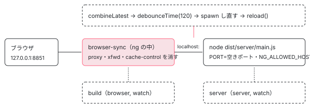

[目次](../README.md) › [webpack の builder の内側：@angular-devkit/build-angular と schematics の CLI](README.md) › 第 7 回 / 全 12 回

# server builder と ssr-dev-server

> builders/server/index.ts・platform-server-exports-loader.ts・builders/ssr-dev-server/\*：platform: 'server' で組む Node 向けの CommonJS の束と、renderApplication などの export を足す loader、ssr-dev-server が 2 つの target を watch で回して Node のサーバーを起動し直し、browser-sync の proxy でつなぐ仕組みと Host の扱い。

angular/angular-cli · 読了 約 12 分 · 発展 · [サイトで読む（デモが動きます）](https://angular-deep-dive-cyan.vercel.app/chapter/bwp-server-ssr)

---

この章で分かること: webpack の `@angular-devkit/build-angular:server` が、browser builder と同じ設定を組む関数に `platform: 'server'` を渡して Node 向けの束（1 つの `main.js`）を作り、そこへ `renderApplication` などの export を足す仕組みです。そして `ssr-dev-server` が browser と server の 2 つの target を同時に watch で回し、両方そろうたびに Node のサーバーを起動し直して、browser-sync の proxy でつなぐ流れです。

読む対象は angular-cli（44129f66a3）の `packages/angular_devkit/build_angular/src/builders/server/index.ts`・`server/platform-server-exports-loader.ts`・`ssr-dev-server/index.ts`・`ssr-dev-server/utils.ts` です。設定を組む関数（`generateI18nBrowserWebpackConfigFromContext`）と browser builder の流れは[第 1 回](01-bwp-browser.md)、`platform` で変わる共通の設定（`target`・`libraryTarget`・`@angular/platform-server/init` の entry）は[第 2 回](02-bwp-webpack-common.md)が読んでいます。application builder（esbuild）がサーバーの束を作るところは[束ね方の設定の章](../esb/01-esb-code-bundle.md)、`renderApplication` の中身は[renderApplication の章](../platform/02-ssr-render-application.md)です。

1. [1. browser builder の流れ](01-bwp-browser.md)
2. [2. webpack の共通の設定](02-bwp-webpack-common.md)
3. [3. スタイルの設定](03-bwp-webpack-styles.md)
4. [4. Angular の webpack プラグイン](04-bwp-webpack-plugins.md)
5. [5. babel の最適化のプラグイン](05-bwp-babel.md)
6. [6. webpack の dev-server](06-bwp-dev-server.md)
7. **7. server builder と ssr-dev-server**（この章）
8. [8. prerender と app-shell](08-bwp-prerender-appshell.md)
9. [9. webpack の i18n](09-bwp-i18n.md)
10. [10. karma の builder の webpack の側](10-bwp-karma.md)
11. [11. schematics の CLI](11-bwp-schematics-cli.md)
12. [12. spec と issue](12-bwp-tests-issues.md)

> [!TIP]
> **新卒エンジニアへ**
>
> **server の target** は、angular.json に browser の target（`build`）とは別に書く target で、サーバーで動かす入口（ここでは `src/server.ts`）を Node 向けに束ねます。application builder では 1 つの target の `server`・`ssr` の option にまとまりましたが、webpack の側では target が 2 つです。**browser-sync** は、開発用のサーバーを立てて、ファイルが変わったらブラウザを読み直させる npm のパッケージです。`ssr-dev-server` は自分では HTML を返さず、browser-sync の proxy で Node のサーバーへ流します。

### 1. 全体の流れ

- 👤 `ng run demo:server` — 利用者
  - `execute(options, context, transforms)` — server/index.ts 60 — *非推奨の警告 → 版の確かめ*
    - `initialize()` — server/index.ts 187 — *キャッシュの掃除・preserveWhitespaces の警告・設定を組む*
      - `generateI18nBrowserWebpackConfigFromContext({ aot: true, platform: 'server' })` — utils/webpack-browser-config.ts — *第 1 回*
        - `getPlatformServerExportsConfig`・`getCommonConfig`・`getStylesConfig`・`DefinePlugin` — server/index.ts 219
    - `runWebpack(config)` — @angular-devkit/build-webpack
    - `copyAssets` → `i18nInlineEmittedFiles` → `webpackStatsLogger` — server/index.ts 112〜158
- 👤 `ng run demo:serve-ssr` — 利用者
  - `scheduleTarget(browser)`・`scheduleTarget(server)` — ssr-dev-server/index.ts 89・97 — *どちらも watch*
  - `combineLatest` → `debounceTime(120)` → `startNodeServer` — ssr-dev-server/index.ts 114〜123 — *node main.js を spawn*
  - `initBrowserSync`（1 回目）／`bsInstance.reload()`（2 回目から） — ssr-dev-server/index.ts 169〜174

## 2. server builder の execute：警告から runWebpack まで

📄 `angular-cli/packages/angular_devkit/build_angular/src/builders/server/index.ts` L60–90 （▶ の行: 69, 75, 77, 80, 82–83, 85, 87）

```ts
60 │ export function execute(
61 │   options: ServerBuilderOptions,
62 │   context: BuilderContext,
63 │   transforms: {
64 │     webpackConfiguration?: ExecutionTransformer<webpack.Configuration>;
65 │   } = {},
66 │ ): Observable<ServerBuilderOutput> {
67 │   const root = context.workspaceRoot;
68 │ 
69 ▶   context.logger.warn(
70 │     'The "@angular-devkit/build-angular:server" builder is deprecated as part of Angular\'s Webpack support deprecation. ' +
71 │       'Use "@angular/build:application" instead. For more information, see https://angular.dev/tools/cli/build-system-migration.',
72 │   );
73 │ 
74 │   // Check Angular version.
75 ▶   assertCompatibleAngularVersion(root);
76 │ 
77 ▶   const baseOutputPath = path.resolve(root, options.outputPath);
78 │   let outputPaths: undefined | Map<string, string>;
79 │ 
80 ▶   return from(initialize(options, context, transforms.webpackConfiguration)).pipe(
81 │     concatMap(({ config, i18n, projectRoot, projectSourceRoot }) => {
82 ▶       return runWebpack(config, context, {
83 ▶         webpackFactory: require('webpack') as typeof webpack,
84 │         logging: (stats, config) => {
85 ▶           if (options.verbose && config.stats !== false) {
86 │             const statsOptions = config.stats === true ? undefined : config.stats;
87 ▶             context.logger.info(stats.toString(statsOptions));
88 │           }
89 │         },
90 │       }).pipe(
```

69〜72 行目で、まず「webpack の builder は非推奨、`@angular/build:application` を使う」と警告します（b7940dbcb4、2026-05）。記録でも ssr-dev-server が回す 2 つの target のそれぞれから、この警告が 1 行ずつ出ています。75 行目で workspace の `@angular/core` の版を確かめ、77 行目で `outputPath` を workspace の root からの絶対パスにします。80 行目の `initialize` が webpack の設定を作り、82 行目でそれを `runWebpack` に渡します。83 行目で webpack 本体を builder の側の `require('webpack')` に固定し、85〜88 行目、webpack の stats の文字列は `verbose` のときだけ出します。

📄 `angular-cli/packages/angular_devkit/build_angular/src/builders/server/index.ts` L91–111 （▶ の行: 92–93, 97–98, 101, 105, 108–110）

```ts
 91 │         concatMap(async (output) => {
 92 ▶           const { emittedFiles = [], outputPath, webpackStats, success } = output;
 93 ▶           if (!webpackStats) {
 94 │             throw new Error('Webpack stats build result is required.');
 95 │           }
 96 │ 
 97 ▶           if (!success) {
 98 ▶             if (statsHasWarnings(webpackStats)) {
 99 │               context.logger.warn(statsWarningsToString(webpackStats, { colors: true }));
100 │             }
101 ▶             if (statsHasErrors(webpackStats)) {
102 │               context.logger.error(statsErrorsToString(webpackStats, { colors: true }));
103 │             }
104 │ 
105 ▶             return output;
106 │           }
107 │ 
108 ▶           const spinner = new Spinner();
109 ▶           spinner.enabled = options.progress !== false;
110 ▶           outputPaths = ensureOutputPaths(baseOutputPath, i18n);
111 │ 
```

`runWebpack` は 1 回のビルドごとに 1 つの結果を流します（watch なら何度も）。92 行目で `emittedFiles`（webpack が出したファイルの一覧）と `outputPath` を取り出し、97〜106 行目、失敗なら警告とエラーを出してそのまま返します。成功なら 108〜109 行目で進み具合の表示（`progress` が `false` でなければ）を用意し、110 行目の `ensureOutputPaths` がロケールごとの出力先を作ります。i18n を差し込まないときは `['', baseOutputPath]` の 1 つだけです（`utils/output-paths.ts`。中身は[第 9 回](09-bwp-i18n.md)）。

## 3. initialize：platform: 'server' と 4 つの設定

📄 `angular-cli/packages/angular_devkit/build_angular/src/builders/server/index.ts` L187–213 （▶ の行: 198, 200, 202, 205, 207, 210–211）

```ts
187 │ async function initialize(
188 │   options: ServerBuilderOptions,
189 │   context: BuilderContext,
190 │   webpackConfigurationTransform?: ExecutionTransformer<webpack.Configuration>,
191 │ ): Promise<{
192 │   config: webpack.Configuration;
193 │   i18n: I18nOptions;
194 │   projectRoot: string;
195 │   projectSourceRoot?: string;
196 │ }> {
197 │   // Purge old build disk cache.
198 ▶   await purgeStaleBuildCache(context);
199 │ 
200 ▶   await checkTsConfigForPreserveWhitespacesSetting(context, options.tsConfig);
201 │ 
202 ▶   const browserslist = (await import('browserslist')).default;
203 │   const originalOutputPath = options.outputPath;
204 │   // Assets are processed directly by the builder except when watching
205 ▶   const adjustedOptions = options.watch ? options : { ...options, assets: [] };
206 │   const { config, projectRoot, projectSourceRoot, i18n } =
207 ▶     await generateI18nBrowserWebpackConfigFromContext(
208 │       {
209 │         ...adjustedOptions,
210 ▶         aot: true,
211 ▶         platform: 'server',
212 │       } as NormalizedBrowserBuilderSchema,
213 │       context,
```

📄 `angular-cli/packages/angular_devkit/build_angular/src/builders/server/index.ts` L214–242 （▶ の行: 216–217, 220–222, 225–227, 235–236, 239）

```ts
214 │       (wco) => {
215 │         // We use the platform to determine the JavaScript syntax output.
216 ▶         wco.buildOptions.supportedBrowsers ??= [];
217 ▶         wco.buildOptions.supportedBrowsers.push(...browserslist('maintained node versions'));
218 │ 
219 │         return [
220 ▶           getPlatformServerExportsConfig(wco),
221 ▶           getCommonConfig(wco),
222 ▶           getStylesConfig(wco),
223 │           {
224 │             plugins: [
225 ▶               new webpack.DefinePlugin({
226 ▶                 'ngJitMode': false,
227 ▶                 'ngServerMode': true,
228 │               }),
229 │             ],
230 │           },
231 │         ];
232 │       },
233 │     );
234 │ 
235 ▶   if (options.deleteOutputPath) {
236 ▶     await deleteOutputDir(context.workspaceRoot, originalOutputPath);
237 │   }
238 │ 
239 ▶   const transformedConfig = (await webpackConfigurationTransform?.(config)) ?? config;
240 │ 
241 │   return { config: transformedConfig, i18n, projectRoot, projectSourceRoot };
242 │ }
```

198 行目で古いビルドのキャッシュを消し、200 行目で tsconfig の `preserveWhitespaces` を確かめます（次の引用）。205 行目、watch でなければ `assets` を空にして webpack には渡さず、ビルドの後に builder が自分で写します（4 節）。watch のときは webpack の側の copy のプラグインに任せます。207〜212 行目、browser builder と同じ設定を組む関数に、`aot: true`（angular.json に `aot: false` と書いても上書き）と `platform: 'server'` を足して渡します。

216〜217 行目、JavaScript をどの文法まで下げるかを決める `supportedBrowsers` に、browserslist の `maintained node versions`（保守中の Node の版）を足します。219〜231 行目が組み合わせる設定の部分（partial）で、次の 4 つです。browser builder にある index.html・service worker・`getStylesConfig` 以外の browser 向けの部分は入りません。

1. **getPlatformServerExportsConfig（220 行目）**

   入口のファイルにだけ効く loader を足します（次の引用）。
2. **getCommonConfig（221 行目）**

   entry・output・resolve・最適化。`platform === 'server'` で `target: ['node', 'es2015']`、`libraryTarget: 'commonjs'`、`runtimeChunk: false` になり、entry の先頭に `@angular/platform-server/init` が入ります（[第 2 回](02-bwp-webpack-common.md)）。
3. **getStylesConfig（222 行目）**

   コンポーネントのスタイルを束に入れるためです。server の schema には `styles` が無いので、グローバルのスタイルのファイルは出ません（記録の出力の一覧に `styles.css` が無い）。
4. **DefinePlugin（225〜228 行目）**

   コードの中の `ngJitMode` を `false`、`ngServerMode` を `true` に置き換えます。Angular 本体は `ngServerMode` でサーバーの分岐を消せるようになります（4340f5f9ad、2024-11）。

235〜237 行目、`deleteOutputPath`（既定 `true`）なら出力先を消し、239 行目で利用者の `transforms.webpackConfiguration`（custom-webpack の builder などが使う差し替え口）を通します。

📄 `angular-cli/packages/angular_devkit/build_angular/src/builders/server/index.ts` L244–268 （▶ の行: 257, 259–261, 264）

```ts
244 │ async function checkTsConfigForPreserveWhitespacesSetting(
245 │   context: BuilderContext,
246 │   tsConfigPath: string,
247 │ ): Promise<void> {
248 │   // We don't use the `readTsConfig` method on purpose here.
249 │   // To only catch cases were `preserveWhitespaces` is set directly in the `tsconfig.server.json`,
250 │   // which in the majority of cases will cause a mistmatch between client and server builds.
251 │   // Technically we should check if `tsconfig.server.json` and `tsconfig.app.json` values match.
252 │ 
253 │   // But:
254 │   // 1. It is not guaranteed that `tsconfig.app.json` is used to build the client side of this app.
255 │   // 2. There is no easy way to access the build build config from the server builder.
256 │   // 4. This will no longer be an issue with a single compilation model were the same tsconfig is used for both browser and server builds.
257 ▶   const content = await readFile(path.join(context.workspaceRoot, tsConfigPath), 'utf-8');
258 │   const { parse } = await import('jsonc-parser');
259 ▶   const tsConfig = parse(content, [], { allowTrailingComma: true });
260 ▶   if (tsConfig.angularCompilerOptions?.preserveWhitespaces !== undefined) {
261 ▶     context.logger.warn(
262 │       `"preserveWhitespaces" was set in "${tsConfigPath}". ` +
263 │         'Make sure that this setting is set consistently in both "tsconfig.server.json" for your server side ' +
264 ▶         'and "tsconfig.app.json" for your client side. A mismatched value will cause hydration to break.\n' +
265 │         'For more information see: https://angular.dev/guide/hydration#preserve-whitespaces-configuration',
266 │     );
267 │   }
268 │ }
```

257〜259 行目、server の tsconfig のファイルそのものを読み、`extends` を辿らずに jsonc-parser でパースします。260 行目で `angularCompilerOptions.preserveWhitespaces` が書いてあれば（値に関係なく）警告します。248〜256 行目のコメントのとおり、ブラウザとサーバーで値が違うと hydration（サーバーの HTML をブラウザで再利用する仕組み）の DOM の比べ合わせが崩れるからです。tsconfig.app.json と比べることはしていません（コメントの 1〜4 の理由。番号は 3 が抜けている）。

📄 `angular-cli/packages/angular_devkit/build_angular/src/builders/server/index.ts` L270–292 （▶ の行: 282–283, 285–286）

```ts
270 │ /**
271 │  * Add `@angular/platform-server` exports.
272 │  * This is needed so that DI tokens can be referenced and set at runtime outside of the bundle.
273 │  */
274 │ function getPlatformServerExportsConfig(wco: BrowserWebpackConfigOptions): Partial<Configuration> {
275 │   // Add `@angular/platform-server` exports.
276 │   // This is needed so that DI tokens can be referenced and set at runtime outside of the bundle.
277 │ 
278 │   return {
279 │     module: {
280 │       rules: [
281 │         {
282 ▶           loader: require.resolve('./platform-server-exports-loader'),
283 ▶           include: [path.resolve(wco.root, wco.buildOptions.main)],
284 │           options: {
285 ▶             angularSSRInstalled: isPackageInstalled(wco.root, '@angular/ssr'),
286 ▶             isZoneJsInstalled: isPackageInstalled(wco.root, 'zone.js'),
287 │           },
288 │         },
289 │       ],
290 │     },
291 │   };
292 │ }
```

📄 `angular-cli/packages/angular_devkit/build_angular/src/builders/server/platform-server-exports-loader.ts` L9–44 （▶ の行: 10–12, 24, 27, 30, 32, 36–37, 41）

```ts
 9 │ /**
10 ▶  * This loader is needed to add additional exports and is a workaround for a Webpack bug that doesn't
11 ▶  * allow exports from multiple files in the same entry.
12 ▶  * @see https://github.com/webpack/webpack/issues/15936.
13 │  */
14 │ export default function (
15 │   this: import('webpack').LoaderContext<{
16 │     angularSSRInstalled: boolean;
17 │     isZoneJsInstalled: boolean;
18 │   }>,
19 │   content: string,
20 │   map: Parameters<import('webpack').LoaderDefinitionFunction>[1],
21 │ ) {
22 │   const { angularSSRInstalled, isZoneJsInstalled } = this.getOptions();
23 │ 
24 ▶   let source = `${content}
25 │ 
26 │   // EXPORTS added by @angular-devkit/build-angular
27 ▶   export { renderApplication, renderModule, ɵSERVER_CONTEXT } from '@angular/platform-server';
28 │   `;
29 │ 
30 ▶   if (angularSSRInstalled) {
31 │     source += `
32 ▶       export { ɵgetRoutesFromAngularRouterConfig } from '@angular/ssr';
33 │     `;
34 │   }
35 │ 
36 ▶   if (isZoneJsInstalled) {
37 ▶     source = `import 'zone.js/node';
38 │     ${source}`;
39 │   }
40 │ 
41 ▶   this.callback(null, source, map);
42 │ 
43 │   return;
44 │ }
```

282〜283 行目、この loader は `main`（ここでは `src/server.ts`）の 1 ファイルにだけ効きます。285〜286 行目、`@angular/ssr` と `zone.js` が workspace に入っているかを、ビルドを始めるときに 1 回調べて options にします。loader の 24〜28 行目は、入口のファイルの末尾に `export { renderApplication, renderModule, ɵSERVER_CONTEXT } from '@angular/platform-server'` を書き足します。30〜34 行目、`@angular/ssr` があれば `ɵgetRoutesFromAngularRouterConfig`（Router の設定からルートを取り出す関数。[サーバールートの章](../platform/05-ssr-server-routes.md)）も足し、36〜39 行目、`zone.js` があれば先頭に `import 'zone.js/node'` を置きます。

なぜ束に export を足すかというと、次の回の prerender と app-shell の builder が、ワーカーの中でこの `main.js` を `import` し、そこから `renderApplication` と `ɵSERVER_CONTEXT` を取り出すからです（[第 8 回](08-bwp-prerender-appshell.md)）。束の外の `@angular/platform-server` を別に読み込むと、束の中の Angular と DI のトークンが別物になります（273 行目の JSDoc）。10〜12 行目のコメントのとおり、1 つの entry に「入口のファイル」と「export を持つ別のファイル」の 2 つを並べると、webpack が後ろのファイルの export しか出さない不具合（webpack#15936）があり、そのために 1 ファイルの末尾に書き足す形をとっています。

> **🧪 DEMO — browser と server の webpack の設定、出力、ssr-dev-server（記録）**
>
> 記録のスクリプト（`rec-ssr.mjs`）が、カウンターのアプリ（ルートは `/`・`/about`・`/items/:id`・`/shell`）を @angular-devkit/build-angular 22.2.7・@angular/core 22.2.7・browser-sync 3.0.4・webpack 5.112.0、Node v24.22.1 で動かした記録です。`NODE_OPTIONS=--require hook.cjs` で ng の中にフックを入れ、`runWebpack` に渡った設定の要所、spawn した子プロセス、browser-sync の `init` の options を書きました。ssr-dev-server は `host: "127.0.0.1"`・`port: 8851` で立て、応答を fetch で取り、`about.ts` を書き換えて 2 回の再ビルドを起こしたあと SIGINT で止めました。「44129f66a3 の形」は、22.2.7 にある `changeOrigin: false` の 1 行（7 節）をフックが `init` の直前に消して走らせたものです。
>
> plugins の片方にだけあるもの — browser: CommonJsUsageWarnPlugin, StylesWebpackPlugin／server: ContextReplacementPlugin, DefinePlugin
>
> ▶ [このデモはサイトで動かせます](https://angular-deep-dive-cyan.vercel.app/chapter/bwp-server-ssr)

設定の差の表から読めることです。

- **target と束の形**: server は `['node', 'es2015']`・`libraryTarget: 'commonjs'`・`runtimeChunk: false` で、出力は `main.js` 1 つと、遅延で読む `508.js`（`xhr2`、`@angular/platform-server` が Node で XHR を使うための依存）だけです。browser は `runtime.js` と `styles.css` も出します。
- **entry**: server の `main` は `@angular/platform-server/init`・`@angular/localize/init`・`src/server.ts` の順です。`@angular/localize/init` は tsconfig の `types` に `@angular/localize` があるので両方に入りました。
- **module.rules の先頭**: server だけ、`platform-server-exports-loader.js` が `src/server.ts` に効き、options は `angularSSRInstalled: true`・`isZoneJsInstalled: false` でした。
- **plugins**: server だけに `ContextReplacementPlugin`（express の動的な require の警告を消す）と `DefinePlugin`、browser だけに `CommonJsUsageWarnPlugin` と `StylesWebpackPlugin` がありました。

## 4. ビルドの後：assets・i18n・出力の形

📄 `angular-cli/packages/angular_devkit/build_angular/src/builders/server/index.ts` L112–138 （▶ の行: 113, 116–117, 123–124, 134）

```ts
112 │           // Copy assets
113 ▶           if (!options.watch && options.assets?.length) {
114 │             spinner.start('Copying assets...');
115 │             try {
116 ▶               await copyAssets(
117 ▶                 normalizeAssetPatterns(
118 │                   options.assets,
119 │                   context.workspaceRoot,
120 │                   projectRoot,
121 │                   projectSourceRoot,
122 │                 ),
123 ▶                 Array.from(outputPaths.values()),
124 ▶                 context.workspaceRoot,
125 │               );
126 │               spinner.succeed('Copying assets complete.');
127 │             } catch (err) {
128 │               spinner.fail('Copying of assets failed.');
129 │               assertIsError(err);
130 │ 
131 │               return {
132 │                 ...output,
133 │                 success: false,
134 ▶                 error: 'Unable to copy assets: ' + err.message,
135 │               };
136 │             }
137 │           }
138 │ 
```

113 行目、watch でなく `assets` があるときだけ、builder が写します。117 行目の `normalizeAssetPatterns` で文字列の書き方をオブジェクトに直し、123 行目のとおり**ロケールごとの出力先の全部**へ同じものを写します（`utils/copy-assets.ts` の中身は[第 9 回](09-bwp-i18n.md)）。失敗は 134 行目の文で失敗の結果になります。

📄 `angular-cli/packages/angular_devkit/build_angular/src/builders/server/index.ts` L139–163 （▶ の行: 139–140, 146–148, 150, 158）

```ts
139 ▶           if (i18n.shouldInline) {
140 ▶             const success = await i18nInlineEmittedFiles(
141 │               context,
142 │               emittedFiles,
143 │               i18n,
144 │               baseOutputPath,
145 │               Array.from(outputPaths.values()),
146 ▶               [],
147 ▶               outputPath,
148 ▶               options.i18nMissingTranslation,
149 │             );
150 ▶             if (!success) {
151 │               return {
152 │                 ...output,
153 │                 success: false,
154 │               };
155 │             }
156 │           }
157 │ 
158 ▶           webpackStatsLogger(context.logger, webpackStats, config);
159 │ 
160 │           return output;
161 │         }),
162 │       );
163 │     }),
```

139 行目、`localize` で翻訳を差し込むときは、140 行目の `i18nInlineEmittedFiles` が、一時のフォルダに出た束をロケールごとに書き換えて出力先へ置きます（[第 9 回](09-bwp-i18n.md)）。146 行目の空の配列は「差し込まない scripts の entry の名前」で、server の束には scripts が無いので空です。148 行目で `i18nMissingTranslation` を渡します。158 行目の `webpackStatsLogger` が、記録に出ている「Initial chunk files | Names | Raw size」の表を書きます（[第 4 回](04-bwp-webpack-plugins.md)）。

📄 `angular-cli/packages/angular_devkit/build_angular/src/builders/server/index.ts` L164–185 （▶ の行: 165, 172–174, 177–178）

```ts
164 │     concatMap(async (output) => {
165 ▶       if (!output.success) {
166 │         // The `as unknown` is here primarily for the linter.
167 │         return output as unknown as ServerBuilderOutput;
168 │       }
169 │ 
170 │       return {
171 │         ...output,
172 ▶         baseOutputPath,
173 ▶         outputs: (outputPaths &&
174 ▶           [...outputPaths.entries()].map(([locale, path]) => ({
175 │             locale,
176 │             path,
177 ▶           }))) || {
178 ▶           path: baseOutputPath,
179 │         },
180 │       } as ServerBuilderOutput;
181 │     }),
182 │   );
183 │ }
184 │ 
185 │ export default createBuilder<ServerBuilderOptions, ServerBuilderOutput>(execute);
```

成功した結果に、172 行目の `baseOutputPath` と、173〜176 行目の `outputs`（ロケールと出力先の組の配列）を足します。prerender と app-shell は、この `baseOutputPath` と browser の側の `outputs` から、ロケールごとの `main.js` の場所を組み立てます（[第 8 回](08-bwp-prerender-appshell.md)）。177〜179 行目の `||` の右は配列でなくオブジェクト（`{ path }`）で、型の `outputs: {…}[]` と合いません。ただし成功した結果は必ず 110 行目を通って `outputPaths` が入っているので、この右に来ることはありません。

## 5. ssr-dev-server：2 つの target を立てる

📄 `angular-cli/packages/angular_devkit/build_angular/src/builders/ssr-dev-server/index.ts` L50–84 （▶ の行: 51–53, 66, 73, 75, 79, 83）

```ts
50 │ /** Log messages to ignore and not rely to the logger */
51 ▶ const IGNORED_STDOUT_MESSAGES = [
52 ▶   'server listening on',
53 ▶   'Angular is running in development mode. Call enableProdMode() to enable production mode.',
54 │ ];
55 │ 
56 │ export type SSRDevServerBuilderOptions = Schema;
57 │ export type SSRDevServerBuilderOutput = BuilderOutput & {
58 │   baseUrl?: string;
59 │   port?: string;
60 │ };
61 │ 
62 │ export function execute(
63 │   options: SSRDevServerBuilderOptions,
64 │   context: BuilderContext,
65 │ ): Observable<SSRDevServerBuilderOutput> {
66 ▶   context.logger.warn(
67 │     'The "@angular-devkit/build-angular:ssr-dev-server" builder is deprecated as part of Angular\'s Webpack support deprecation. ' +
68 │       'Use "@angular/build:ssr-dev-server" instead. For more information, see https://angular.dev/tools/cli/build-system-migration.',
69 │   );
70 │ 
71 │   let browserSync: typeof import('browser-sync');
72 │   try {
73 ▶     browserSync = createRequire(context.workspaceRoot + '/')('browser-sync');
74 │   } catch {
75 ▶     return of({
76 │       success: false,
77 │       error:
78 │         // eslint-disable-next-line max-len
79 ▶         'Required dependency `browser-sync` is not installed, most likely you need to run `npm install browser-sync --save-dev` in your project.',
80 │     });
81 │   }
82 │ 
83 ▶   const bsInstance = browserSync.create();
84 │ 
```

66〜69 行目の非推奨の警告は、移る先として `@angular/build:ssr-dev-server` を挙げます。73 行目、browser-sync は builder の依存ではなく、workspace の root から `createRequire` で探します（optional の依存にしたのは 364a16b7a6、2023-12）。無ければ 75〜80 行目の文で失敗します。83 行目で browser-sync の instance を作ります。

51〜54 行目は、Node のサーバーの stdout のうち、端末に出さない文です。53 行目の文は、Angular が 2020 年から出していた「Angular is running in development mode. Call enableProdMode() to enable production mode.」です。Angular 本体は bf1b5b424f9（2023-04、#49723）でこれを「Angular is running in development mode.」に縮めたので、53 行目の文は今の出力を含みません（223 行目の `stdout.includes(x)` は、出力の方が長くないと真にならない）。記録では、要求のたびに「Angular is running in development mode.」が端末に出ています。

📄 `angular-cli/packages/angular_devkit/build_angular/src/builders/ssr-dev-server/index.ts` L85–111 （▶ の行: 85–86, 89–90, 94, 97, 103, 108）

```ts
 85 ▶   const browserTarget = targetFromTargetString(options.browserTarget);
 86 ▶   const serverTarget = targetFromTargetString(options.serverTarget);
 87 │   const getBaseUrl = (bs: BrowserSyncInstance) =>
 88 │     `${bs.getOption('scheme')}://${bs.getOption('host')}:${bs.getOption('port')}`;
 89 ▶   const browserTargetRun = context.scheduleTarget(browserTarget, {
 90 ▶     watch: options.watch,
 91 │     progress: options.progress,
 92 │     verbose: options.verbose,
 93 │     // Disable bundle budgets are these are not meant to be used with a dev-server as this will add extra JavaScript for live-reloading.
 94 ▶     budgets: [],
 95 │   } as json.JsonObject);
 96 │ 
 97 ▶   const serverTargetRun = context.scheduleTarget(serverTarget, {
 98 │     watch: options.watch,
 99 │     progress: options.progress,
100 │     verbose: options.verbose,
101 │   } as json.JsonObject);
102 │ 
103 ▶   context.logger.error(tags.stripIndents`
104 │   ****************************************************************************************
105 │   This is a simple server for use in testing or debugging Angular applications locally.
106 │   It hasn't been reviewed for security issues.
107 │ 
108 ▶   DON'T USE IT FOR PRODUCTION!
109 │   ****************************************************************************************
110 │  `);
111 │ 
```

85〜86 行目で `browserTarget` と `serverTarget` の文字列を target の形にし、89 行目と 97 行目で 2 つを**同時に**予約します。どちらにも `watch`（既定 `true`）・`progress`・`verbose` を上書きで渡し、browser にだけ 94 行目の `budgets: []`（live reload の分だけ JS が増えるので予算の検査を止める）を渡します。103〜110 行目の「本番で使わない」の囲みは、`logger.error` で出します。記録でも stderr に出ています。

📄 `angular-cli/packages/angular_devkit/build_angular/src/builders/ssr-dev-server/utils.ts` L13–24 （▶ の行: 15, 19–21）

```ts
13 │ export function getAvailablePort(): Promise<number> {
14 │   return new Promise((resolve, reject) => {
15 ▶     const server = createServer();
16 │     server
17 │       .unref()
18 │       .on('error', reject)
19 ▶       .listen(0, () => {
20 ▶         const { port } = server.address() as AddressInfo;
21 ▶         server.close(() => resolve(port));
22 │       });
23 │   });
24 │ }
```

Node のサーバーのポートは、19 行目で `listen(0)`（OS に空いているポートを選ばせる）して、20 行目で番号を読み、21 行目で閉じてから返します。利用者が決める `port`（既定 4200）は browser-sync の方で、Node のサーバーのポートは毎回変わります（記録では 57418 と 57449）。



*ssr-dev-server の 3 つのプロセスとポート。ブラウザがつなぐのは browser-sync の port で、Node のサーバーのポートは毎回変わる*

## 6. 2 つのビルドを待って Node を起動する

📄 `angular-cli/packages/angular_devkit/build_angular/src/builders/ssr-dev-server/index.ts` L112–137 （▶ の行: 112–114, 117, 119–120, 123, 131–132, 134）

```ts
112 ▶   return zip(browserTargetRun, serverTargetRun, getAvailablePort()).pipe(
113 ▶     switchMap(([br, sr, nodeServerPort]) => {
114 ▶       return combineLatest([br.output, sr.output]).pipe(
115 │         // This is needed so that if both server and browser emit close to each other
116 │         // we only emit once. This typically happens on the first build.
117 ▶         debounceTime(120),
118 │         switchMap(([b, s]) => {
119 ▶           if (!s.success || !b.success) {
120 ▶             return of([b, s]);
121 │           }
122 │ 
123 ▶           return startNodeServer(
124 │             s,
125 │             nodeServerPort,
126 │             options.host,
127 │             context.logger,
128 │             !!options.inspect,
129 │           ).pipe(
130 │             map(() => [b, s]),
131 ▶             catchError((err) => {
132 ▶               context.logger.error(`A server error has occurred.\n${mapErrorToMessage(err)}`);
133 │ 
134 ▶               return EMPTY;
135 │             }),
136 │           );
137 │         }),
```

📄 `angular-cli/packages/angular_devkit/build_angular/src/builders/ssr-dev-server/index.ts` L138–163 （▶ の行: 142–143, 150, 153–155, 159–160）

```ts
138 │         map(
139 │           ([b, s]) =>
140 │             [
141 │               {
142 ▶                 success: b.success && s.success,
143 ▶                 error: b.error || s.error,
144 │               },
145 │               nodeServerPort,
146 │             ] as [SSRDevServerBuilderOutput, number],
147 │         ),
148 │         tap(([builderOutput]) => {
149 │           if (builderOutput.success) {
150 ▶             context.logger.info('\nCompiled successfully.');
151 │           }
152 │         }),
153 ▶         debounce(([builderOutput]) =>
154 ▶           builderOutput.success && !options.inspect
155 ▶             ? waitUntilServerIsListening(nodeServerPort)
156 │             : EMPTY,
157 │         ),
158 │         finalize(() => {
159 ▶           void br.stop();
160 ▶           void sr.stop();
161 │         }),
162 │       );
163 │     }),
```

1. **3 つがそろうのを待つ（112 行目）**

   `zip` で、2 つの target の run の開始と空いているポートの 3 つがそろったら進みます。
2. **両方の最新の結果を組にする（114 行目）**

   `combineLatest` は、どちらかが新しい結果を出すたびに、両方の最新を組にして流します。最初は両方が 1 回ずつ出るまで流しません。
3. **120ms 待つ（117 行目）**

   2 つがほぼ同時に終わると組が 2 回流れるので、`debounceTime(120)` で最後の 1 回だけにします（115〜116 行目のコメント）。
4. **Node のサーバーを起動し直す（119〜136 行目）**

   どちらかが失敗なら起動せず、結果だけ流します。両方成功なら `startNodeServer`。`switchMap` なので、前の組の `startNodeServer` の購読が切れ、前のプロセスは止められます（次の引用の utils.ts の 51〜55 行目）。起動の失敗は 132 行目でログに出し、134 行目で何も流しません。
5. **成否をまとめて「Compiled successfully.」（142〜151 行目）**

   142〜143 行目で成否とエラーを 1 つにし、150 行目で成功の文を出します。
6. **listen を待つ（153〜157 行目）**

   成功で `inspect` でなければ、`waitUntilServerIsListening` がそのポートにつながるまで、次へ流すのを止めます。

📄 `angular-cli/packages/angular_devkit/build_angular/src/builders/ssr-dev-server/index.ts` L228–252 （▶ の行: 235–237, 239, 241, 245–246, 250）

```ts
228 │ function startNodeServer(
229 │   serverOutput: BuilderOutput,
230 │   port: number,
231 │   host: string | undefined,
232 │   logger: logging.LoggerApi,
233 │   inspectMode = false,
234 │ ): Observable<void> {
235 ▶   const outputPath = serverOutput.outputPath as string;
236 ▶   const path = join(outputPath, 'main.js');
237 ▶   const env = { ...process.env, PORT: '' + port, NG_ALLOWED_HOSTS: host ?? 'localhost' };
238 │ 
239 ▶   const args = ['--enable-source-maps', path];
240 │   if (inspectMode) {
241 ▶     args.unshift('--inspect-brk');
242 │   }
243 │ 
244 │   return of(null).pipe(
245 ▶     delay(0), // Avoid EADDRINUSE error since it will cause the kill event to be finish.
246 ▶     switchMap(() => spawnAsObservable(process.execPath, args, { env })),
247 │     tap((res) => log({ stderr: res.stderr, stdout: res.stdout }, logger)),
248 │     ignoreElements(),
249 │     // Emit a signal after the process has been started
250 ▶     startWith(undefined),
251 │   );
252 │ }
```

235〜236 行目、server の結果の `outputPath` の `main.js` を起動します。i18n のロケールが複数あっても、ここはロケールのフォルダを見ません。237 行目で環境変数の `PORT` に空いているポートを、`NG_ALLOWED_HOSTS` に `host` の option（無ければ `localhost`）を入れます。`@angular/ssr` の `CommonEngine` は、この変数の host だけを許します（6cf621c905、2026-02。[ホストの検査の章](../ssrx/04-ssrx-host-validation.md)）。239〜242 行目で `--enable-source-maps`（`inspect` なら `--inspect-brk` も）を付け、246 行目で今の Node の実行ファイルで spawn します。

245 行目の `delay(0)` は、前のプロセスが止まりきる前に同じポートで起動して EADDRINUSE になるのを避けるためです。250 行目の `startWith(undefined)` は、コメントでは「プロセスが起動した後に合図を出す」ですが、実際は購読した瞬間に出るので、245 行目の待ちと 246 行目の spawn より先です。そのため 2 回目からは、153 行目の `waitUntilServerIsListening` が止まりかけの古いプロセスにつながって、すぐ次へ流すことがあります。記録の 2 回の再ビルドでは、フックが書いた順が「spawn → reload」と「reload → spawn」の 1 回ずつでした（「ssr-dev-server の時系列」で「フックの記録だけ」）。

📄 `angular-cli/packages/angular_devkit/build_angular/src/builders/ssr-dev-server/utils.ts` L26–57 （▶ の行: 32, 34, 38, 44–45, 51–53）

```ts
26 │ export function spawnAsObservable(
27 │   command: string,
28 │   args: string[] = [],
29 │   options: SpawnOptions = {},
30 │ ): Observable<{ stdout?: string; stderr?: string }> {
31 │   return new Observable((obs) => {
32 ▶     const proc = spawn(command, args, options);
33 │     if (proc.stdout) {
34 ▶       proc.stdout.on('data', (data) => obs.next({ stdout: data.toString() }));
35 │     }
36 │ 
37 │     if (proc.stderr) {
38 ▶       proc.stderr.on('data', (data) => obs.next({ stderr: data.toString() }));
39 │     }
40 │ 
41 │     proc
42 │       .on('error', (err) => obs.error(err))
43 │       .on('close', (code) => {
44 ▶         if (code !== 0) {
45 ▶           obs.error(new Error(`${command} exited with ${code} code.`));
46 │         }
47 │ 
48 │         obs.complete();
49 │       });
50 │ 
51 ▶     return () => {
52 ▶       if (!proc.killed) {
53 ▶         proc.kill();
54 │       }
55 │     };
56 │   });
57 │ }
```

📄 `angular-cli/packages/angular_devkit/build_angular/src/builders/ssr-dev-server/utils.ts` L59–84 （▶ の行: 60, 63–64, 77, 79）

```ts
59 │ export function waitUntilServerIsListening(port: number, host?: string): Observable<undefined> {
60 ▶   const allowedErrorCodes = ['ECONNREFUSED', 'ECONNRESET'];
61 │ 
62 │   return new Observable<undefined>((obs) => {
63 ▶     const client = createConnection({ host, port }, () => {
64 ▶       obs.next(undefined);
65 │       obs.complete();
66 │     }).on('error', (err) => obs.error(err));
67 │ 
68 │     return () => {
69 │       if (!client.destroyed) {
70 │         client.destroy();
71 │       }
72 │     };
73 │   }).pipe(
74 │     retryWhen((err) =>
75 │       err.pipe(
76 │         mergeMap((error, attempts) => {
77 ▶           return attempts > 10 || !allowedErrorCodes.includes(error.code)
78 │             ? throwError(error)
79 ▶             : timer(100 * (attempts * 1));
80 │         }),
81 │       ),
82 │     ),
83 │   );
84 │ }
```

`spawnAsObservable` は 32 行目で spawn し、34・38 行目で stdout と stderr の塊を 1 つずつ流します。44〜45 行目、終了コードが 0 でなければエラーにします。51〜55 行目の後片付けが、購読が切れたときにプロセスを kill します。`waitUntilServerIsListening` は 63 行目で TCP でつなぎ、つながったら 64 行目で 1 回流して終わります。77〜79 行目、`ECONNREFUSED`・`ECONNRESET` なら 100ms・200ms…と間を広げて 10 回まで試し直します。`host` は渡していないので（155 行目）、`localhost` につなぎます。

📄 `angular-cli/packages/angular_devkit/build_angular/src/builders/ssr-dev-server/index.ts` L212–226 （▶ の行: 218, 220, 223–224）

```ts
212 │ // Logs output to the terminal.
213 │ // Removes any trailing new lines from the output.
214 │ export function log(
215 │   { stderr, stdout }: { stderr: string | undefined; stdout: string | undefined },
216 │   logger: logging.LoggerApi,
217 │ ) {
218 ▶   if (stderr) {
219 │     // Strip the webpack scheme (webpack://) from error log.
220 ▶     logger.error(stderr.replace(/\n?$/, '').replace(/webpack:\/\//g, '.'));
221 │   }
222 │ 
223 ▶   if (stdout && !IGNORED_STDOUT_MESSAGES.some((x) => stdout.includes(x))) {
224 ▶     logger.info(stdout.replace(/\n?$/, ''));
225 │   }
226 │ }
```

Node のサーバーの stderr は、220 行目で `webpack://` を `.` に置き換えて error で出します（記録の 44129f66a3 の形の run の「ERROR: URL with hostname…」は、この経路で stderr に出たもの）。223 行目、stdout は 51〜54 行目の文を含まなければ info で出します。

## 7. browser-sync の proxy：Host の扱いと publicHost・proxyConfig・ssl

📄 `angular-cli/packages/angular_devkit/build_angular/src/builders/ssr-dev-server/index.ts` L164–187 （▶ の行: 165, 169–170, 174, 179）

```ts
164 │     concatMap(([builderOutput, nodeServerPort]) => {
165 ▶       if (!builderOutput.success) {
166 │         return of(builderOutput);
167 │       }
168 │ 
169 ▶       if (bsInstance.active) {
170 ▶         bsInstance.reload();
171 │ 
172 │         return of(builderOutput);
173 │       } else {
174 ▶         return from(initBrowserSync(bsInstance, nodeServerPort, options, context)).pipe(
175 │           tap((bs) => {
176 │             const baseUrl = getBaseUrl(bs);
177 │             context.logger.info(tags.oneLine`
178 │                 **
179 ▶                 Angular Universal Live Development Server is listening on ${baseUrl},
180 │                 open your browser on ${baseUrl}
181 │                 **
182 │               `);
183 │           }),
184 │           map(() => builderOutput),
185 │         );
186 │       }
187 │     }),
```

📄 `angular-cli/packages/angular_devkit/build_angular/src/builders/ssr-dev-server/index.ts` L188–210 （▶ の行: 191, 193–194, 199–200, 203）

```ts
188 │     map(
189 │       (builderOutput) =>
190 │         ({
191 ▶           success: builderOutput.success,
192 │           error: builderOutput.error,
193 ▶           baseUrl: getBaseUrl(bsInstance),
194 ▶           port: bsInstance.getOption('port'),
195 │         }) as SSRDevServerBuilderOutput,
196 │     ),
197 │     finalize(() => {
198 │       if (bsInstance) {
199 ▶         bsInstance.exit();
200 ▶         bsInstance.cleanup();
201 │       }
202 │     }),
203 ▶     catchError((error) =>
204 │       of({
205 │         success: false,
206 │         error: mapErrorToMessage(error),
207 │       }),
208 │     ),
209 │   );
210 │ }
```

164 行目からは、上の 2 つのビルドと Node のサーバーがそろうたびに 1 回来ます。169 行目、browser-sync がもう動いていれば 170 行目で `reload()`（開いているブラウザに読み直させる）だけ、まだなら 174 行目で `initBrowserSync` を呼び、179 行目の「Angular Universal Live Development Server is listening on …」を出します。builder の結果は 191〜194 行目で、browser-sync の `baseUrl` と `port` を付けて流します。止めるときは 199〜200 行目で browser-sync を閉じます。

📄 `angular-cli/packages/angular_devkit/build_angular/src/builders/ssr-dev-server/index.ts` L254–290 （▶ の行: 265, 268, 270, 275, 281–284, 286–287, 289）

```ts
254 │ async function initBrowserSync(
255 │   browserSyncInstance: BrowserSyncInstance,
256 │   nodeServerPort: number,
257 │   options: SSRDevServerBuilderOptions,
258 │   context: BuilderContext,
259 │ ): Promise<BrowserSyncInstance> {
260 │   if (browserSyncInstance.active) {
261 │     return browserSyncInstance;
262 │   }
263 │ 
264 │   const { port: browserSyncPort, open, host, publicHost, proxyConfig } = options;
265 ▶   const bsPort = browserSyncPort || (await getAvailablePort());
266 │   const bsOptions: BrowserSyncOptions = {
267 │     proxy: {
268 ▶       target: `localhost:${nodeServerPort}`,
269 │       proxyOptions: {
270 ▶         xfwd: true,
271 │       },
272 │       proxyRes: [
273 │         (proxyRes) => {
274 │           if ('headers' in proxyRes) {
275 ▶             proxyRes.headers['cache-control'] = undefined;
276 │           }
277 │         },
278 │       ],
279 │       // proxyOptions is not in the typings
280 │     } as ProxyOptions & { proxyOptions: { xfwd: boolean } },
281 ▶     host,
282 ▶     port: bsPort,
283 ▶     ui: false,
284 ▶     server: false,
285 │     notify: false,
286 ▶     ghostMode: false,
287 ▶     logLevel: options.verbose ? 'debug' : 'silent',
288 │     open,
289 ▶     https: getSslConfig(context.workspaceRoot, options),
290 │   };
```

265 行目、`port` が 0 なら空いているポートを選びます（spec の「works with port 0」）。268 行目の proxy の行き先は `localhost:<Node のポート>` で、270 行目の `xfwd: true` が `X-Forwarded-For`・`-Host`・`-Port` を足します。275 行目、Node のサーバーの応答の `cache-control` を消します（express.static の `max-age=31536000` のままだと、ブラウザが古い束を使い続けるため）。281〜287 行目、browser-sync 自身の UI・静的配信・通知・クリックの同期を止め、ログは `verbose` でなければ出しません。289 行目の https は下の `getSslConfig` です。

> [!WARNING]
> **ハマりどころ**
>
> 44129f66a3 の 269〜271 行目の `proxyOptions` には `changeOrigin` がありません。browser-sync はその場合、proxy の行き先に合わせて `Host` を `localhost:<Node のポート>` に書き換えます。記録の「44129f66a3 の形」では、`host: "127.0.0.1"` にしたので 237 行目の `NG_ALLOWED_HOSTS` は `127.0.0.1`、届いた `Host` は `localhost:57449` になり、`CommonEngine` が「URL with hostname "localhost" is not allowed.」で 500 を返しました（`/api/hello` は Angular を通らないので 200 のまま）。22.2.7 の形（`changeOrigin: false`、cfe970c8bc、22.2.2 から）では `Host` が `127.0.0.1:8851` のまま届き、200 でした。`host` が既定の `localhost` なら、どちらの形でも書き換え後の名前が許されるので 200 になります。

📄 `angular-cli/packages/angular_devkit/build_angular/src/builders/ssr-dev-server/index.ts` L292–318 （▶ の行: 293–294, 298, 301–303, 305）

```ts
292 │   const publicHostNormalized =
293 ▶     publicHost && publicHost.endsWith('/')
294 ▶       ? publicHost.substring(0, publicHost.length - 1)
295 │       : publicHost;
296 │ 
297 │   if (publicHostNormalized) {
298 ▶     const { protocol, hostname, port, pathname } = url.parse(publicHostNormalized);
299 │     const defaultSocketIoPath = '/browser-sync/socket.io';
300 │     const defaultNamespace = '/browser-sync';
301 ▶     const hasPathname = !!(pathname && pathname !== '/');
302 ▶     const namespace = hasPathname ? pathname + defaultNamespace : defaultNamespace;
303 ▶     const path = hasPathname ? pathname + defaultSocketIoPath : defaultSocketIoPath;
304 │ 
305 ▶     bsOptions.socket = {
306 │       namespace,
307 │       path,
308 │       domain: url.format({
309 │         protocol,
310 │         hostname,
311 │         port,
312 │       }),
313 │     };
314 │ 
315 │     // When having a pathname we also need to create a reverse proxy because socket.io
316 │     // will be listening on: 'http://localhost:4200/ssr/browser-sync/socket.io'
317 │     // However users will typically have a reverse proxy that will redirect all matching requests
318 │     // ex: http://testinghost.com/ssr -> http://localhost:4200 which will result in a 404.
```

📄 `angular-cli/packages/angular_devkit/build_angular/src/builders/ssr-dev-server/index.ts` L319–343 （▶ の行: 319–320, 323, 327, 334）

```ts
319 ▶     if (hasPathname) {
320 ▶       const { createProxyMiddleware } = await import('http-proxy-middleware');
321 │ 
322 │       // Remove leading slash
323 ▶       bsOptions.scriptPath = (p) => p.substring(1);
324 │ 
325 │       bsOptions.middleware = [
326 │         createProxyMiddleware({
327 ▶           pathFilter: defaultSocketIoPath,
328 │           target: url.format({
329 │             protocol: 'http',
330 │             hostname: host,
331 │             port: bsPort,
332 │             pathname: path,
333 │           }),
334 ▶           ws: true,
335 │           logger: {
336 │             info: () => {},
337 │             warn: () => {},
338 │             error: () => {},
339 │           },
340 │         }),
341 │       ];
342 │     }
343 │   }
```

`publicHost`（リバースプロキシの外から見える URL）があるときは、293〜295 行目で末尾の `/` を落とし、298 行目の `url.parse`（Node の古い URL の API）で分けます。301〜303 行目、パスがあれば socket.io（browser-sync がブラウザと話す口）の名前空間とパスをその下にずらし、305 行目でブラウザの側のつなぎ先にします。319〜341 行目、パスがあるときは、ずらしたパスの要求を自分のポートの元のパスへ流す proxy を、http-proxy-middleware で 1 つ足します（315〜318 行目のコメントの例）。

📄 `angular-cli/packages/angular_devkit/build_angular/src/builders/ssr-dev-server/index.ts` L345–379 （▶ の行: 345, 352, 354, 359, 361）

```ts
345 ▶   if (proxyConfig) {
346 │     if (!bsOptions.middleware) {
347 │       bsOptions.middleware = [];
348 │     } else if (!Array.isArray(bsOptions.middleware)) {
349 │       bsOptions.middleware = [bsOptions.middleware];
350 │     }
351 │ 
352 ▶     bsOptions.middleware = [
353 │       ...bsOptions.middleware,
354 ▶       ...(await getProxyConfig(context.workspaceRoot, proxyConfig)),
355 │     ];
356 │   }
357 │ 
358 │   return new Promise((resolve, reject) => {
359 ▶     browserSyncInstance.init(bsOptions, (error, bs) => {
360 │       if (error) {
361 ▶         reject(error);
362 │       } else {
363 │         resolve(bs);
364 │       }
365 │     });
366 │   });
367 │ }
368 │ 
369 │ function mapErrorToMessage(error: unknown): string {
370 │   if (error instanceof Error) {
371 │     return error.message;
372 │   }
373 │ 
374 │   if (typeof error === 'string') {
375 │     return error;
376 │   }
377 │ 
378 │   return '';
379 │ }
```

📄 `angular-cli/packages/angular_devkit/build_angular/src/builders/ssr-dev-server/index.ts` L381–415 （▶ の行: 386, 388–389, 393, 397, 405, 408, 410）

```ts
381 │ function getSslConfig(
382 │   root: string,
383 │   options: SSRDevServerBuilderOptions,
384 │ ): HttpsOptions | undefined | boolean {
385 │   const { ssl, sslCert, sslKey } = options;
386 ▶   if (ssl && sslCert && sslKey) {
387 │     return {
388 ▶       key: pathResolve(root, sslKey),
389 ▶       cert: pathResolve(root, sslCert),
390 │     };
391 │   }
392 │ 
393 ▶   return ssl;
394 │ }
395 │ 
396 │ async function getProxyConfig(root: string, proxyConfig: string): Promise<MiddlewareHandler[]> {
397 ▶   const proxy = await loadProxyConfiguration(root, proxyConfig);
398 │   if (!proxy) {
399 │     return [];
400 │   }
401 │ 
402 │   const { createProxyMiddleware } = await import('http-proxy-middleware');
403 │ 
404 │   return Object.entries(proxy).map(([key, context]) => {
405 ▶     const filterRegExp = new RegExp(key);
406 │ 
407 │     return createProxyMiddleware({
408 ▶       pathFilter: (pathname) => filterRegExp.test(pathname),
409 │       // eslint-disable-next-line @typescript-eslint/no-explicit-any
410 ▶       ...(context as any),
411 │     });
412 │   });
413 │ }
414 │ 
415 │ export default createBuilder<SSRDevServerBuilderOptions, BuilderOutput>(execute);
```

`proxyConfig` があれば、345〜356 行目で middleware の配列に、`getProxyConfig` の結果を足します。397 行目の `loadProxyConfiguration` は application builder の dev-server と同じ読み込み（e9a51a37f6 で共通にした。[オプションの小道具の章](../bcu/08-bcu-options.md)）で、405 行目、key を**正規表現**として、408 行目でパスに当てます。webpack の dev-server の proxy の key の扱い（[第 6 回](06-bwp-dev-server.md)）と比べてください。ssl は 386 行目、`sslCert` と `sslKey` の両方があるときだけ workspace の root からの絶対パスにし、そうでなければ 393 行目で `ssl` の真偽をそのまま渡します（`true` なら browser-sync が持つ自己署名の証明書）。

記録の 22.2.7 の run で、`/` の HTML には browser-sync が差し込んだ `<script id="__bs_script__">` があり、`/main.js` は直接（Node のポート）では `cache-control: public, max-age=31536000`、8851 を通すと無しでした（275 行目）。`/api/hello` の JSON では、`x-forwarded-host` が `127.0.0.1:8851`、`x-forwarded-port` が `8851` でした（270 行目）。

### 8. この形を入れたコミット

📄 `git show（server builder の loader）`

```
$ git show 15d3fc6dc3 --stat   # 2022-09-19
feat(@angular-devkit/build-angular): export `@angular/platform-server` symbols in server bundle
（platform-server-exports-loader.ts を足した。server の束から renderModule などを取り出せるようにする）

$ git show 7a8c946151 -- …/server/platform-server-exports-loader.ts   # 2025-09-24
-  const { angularSSRInstalled } = this.getOptions();
+  const { angularSSRInstalled, isZoneJsInstalled } = this.getOptions();
 ...
-  let source = `${content}
+  let source = `${content}
 ...
+  if (isZoneJsInstalled) {
+    source = `import 'zone.js/node';
+    ${source}`;
+  }
```

📄 `git show（ssr-dev-server、2026 年）`

```
$ git show 6cf621c905 -- …/ssr-dev-server/index.ts   # 2026-02-23（host を Node のサーバーに渡す）
-          return startNodeServer(s, nodeServerPort, context.logger, !!options.inspect).pipe(
+          return startNodeServer(
+            s,
+            nodeServerPort,
+            options.host,
 ...
-  const env = { ...process.env, PORT: '' + port };
+  const env = { ...process.env, PORT: '' + port, NG_ALLOWED_HOSTS: host ?? 'localhost' };

$ git show 2d3eb7fb3b -- …/ssr-dev-server/index.ts   # 2026-06-27（OS コマンドの差し込みを防ぐ）
-  const args = ['--enable-source-maps', `"${path}"`];
+  const args = ['--enable-source-maps', path];
 ...
-    switchMap(() => spawnAsObservable('node', args, { env, shell: true })),
+    switchMap(() => spawnAsObservable(process.execPath, args, { env })),

$ git show cfe970c8bc -- …/ssr-dev-server/index.ts   # 2026-10-06、22.2.2 から（main は 3379a13314、PR #34261）
       proxyOptions: {
         xfwd: true,
+        changeOrigin: false,
       },
```

2026 年の 3 つは、どれもセキュリティの修正の続きです。6cf621c905 が `CommonEngine` に Host の検査を入れ、ssr-dev-server は Node のサーバーに `NG_ALLOWED_HOSTS` を渡すようになりました。その結果、Host を書き換える proxy と組み合わさって 7 節の 500 が起き、7 か月あまり後の cfe970c8bc が `changeOrigin: false` で直しました（44129f66a3 はその前）。2d3eb7fb3b は、`outputPath` に `$()` を書くとシェルが評価してしまう `shell: true` の spawn をやめたものです。今の 246 行目は `process.execPath` と引数の配列を、シェルを通さずに渡します。origin/main（2026-11-27）と比べると、この章の 4 つのファイルで違うのは 268〜281 行目の `changeOrigin`（3379a13314）だけで、53 行目の文はそのままです。

## テストと直し方

| spec | describe / it（行） | 固めているもの |
| --- | --- | --- |
| `server/tests/behavior/preserve_whitespaces_check_spec.ts` | `Behavior: "preserveWhitespaces warning"`（14）、警告なし（15）・あり（27） | 3 節の 260 行目 |
| `server/tests/behavior/build-errors_spec.ts` | `emits errors`（15） | 2 節の 97〜106 行目 |
| `server/tests/options/assets_spec.ts` | `Option: "assets"`（13）の 22 の it | 4 節の 113〜137 行目 |
| `server/tests/options/*_spec.ts` の残り | sourceMap（13）・resourcesOutputPath（13）・extractLicenses（13）・externalDependencies（13）、web-workers（13） | 共通の設定（第 2 回）の option |
| `ssr-dev-server/specs/works_spec.ts` | `works`（80）・`works with port 0`（90） | 5〜7 節の流れ、265 行目 |
| `ssr-dev-server/specs/proxy_spec.ts` | proxyConfig（81） | 7 節の 345〜356 行目 |
| `ssr-dev-server/specs/ssl_spec.ts` | `works with SSL`（81） | 7 節の 386〜393 行目 |

📄 `走らせたコマンドと結果`

```
cd ~/angular-research/angular-cli   # 44129f66a3
pnpm bazel test //packages/angular_devkit/build_angular:build_angular_server_test \
  //packages/angular_devkit/build_angular:build_angular_ssr-dev-server_test --nocache_test_results --test_output=all
# server: 2 つの shard で 21 + 21 = 42 specs, 0 failures（it は 8 つの spec のファイルで 42）
# ssr-dev-server: 2 + 2 = 4 specs, 0 failures（works 2・proxy 1・ssl 1）
//packages/angular_devkit/build_angular:build_angular_server_test         PASSED in 118.9s
//packages/angular_devkit/build_angular:build_angular_ssr-dev-server_test PASSED in 38.7s
```

44129f66a3 には、loader が足す export（3 節）を確かめる spec も、`Host` を確かめる spec もありません。後者は cfe970c8bc が `works_spec.ts` に「rejects requests with a disallowed Host header」を足しました（`Host: example.com` で 500 を期待する）。直すとしたら、次の場所になります。

- **53 行目の文**: `IGNORED_STDOUT_MESSAGES` を今の「Angular is running in development mode.」にする（223 行目の `includes` なので、短い方に合わせれば両方の版に効く）。確かめる spec は `log` 関数（214 行目、export されている）に stdout を渡す unit の spec で、`ssr-dev-server/` の下に置くことになります。
- **reload の順**: 250 行目の `startWith` を spawn の後に出す（たとえば `spawnAsObservable` の中で spawn の直後に 1 回流す）か、153 行目で待つ前に古いプロセスの終了を待つ。spec は `works_spec.ts` の形で、2 回目のビルドの後の応答が新しい中身かを見ることになります。
- **server の束の export**: `server/tests/behavior/` に、出力の `main.js` に `renderApplication` などの export の行があるかを見る spec を足す形です。

## 聞かれそうな質問

**Q. server builder の束と browser builder の束は、何が違いますか？**

同じ設定を組む関数に `platform: 'server'` と `aot: true` を渡します（3 節の 207〜212 行目）。そのため target が node、CommonJS の束 1 つ、runtime の束なし、`ngServerMode: true` になり、index.html と service worker の後処理はありません。記録の設定の差の表がその一覧です。

**Q. server の `main.js` から `renderApplication` を export しているのは誰ですか？**

`platform-server-exports-loader` です。3 節の 282〜283 行目で入口のファイルにだけ効き、loader の 24〜28 行目で末尾に export の行を書き足します。`@angular/ssr` があれば `ɵgetRoutesFromAngularRouterConfig` も足します。

**Q. ssr-dev-server の port は Node のサーバーのポートですか？**

いいえ。`port` は browser-sync のポートです（7 節の 265 行目）。Node のサーバーは 5 節の `getAvailablePort` で毎回空いているポートを選び、`PORT` の環境変数で渡します（6 節の 237 行目）。

**Q. ファイルを保存すると、何が起きますか？**

browser と server の 2 つの target が watch で再ビルドし、6 節の 114・117 行目で両方の最新がそろってから 120ms 後に、Node のサーバーを止めて起動し直し（119〜136 行目）、7 節の 170 行目で browser-sync がブラウザに読み直させます。記録では書き換えから「Compiled successfully.」まで約 0.8 秒でした。

**Q. `--host 127.0.0.1` で立てたら 500 になりました。なぜですか？**

44129f66a3（と 22.2.1 まで）では、browser-sync の proxy が `Host` を `localhost:<ポート>` に書き換え、Node のサーバーには `NG_ALLOWED_HOSTS=127.0.0.1` が渡るので、`CommonEngine` が拒みます（7 節の注意と記録）。22.2.2 からは `changeOrigin: false` で `Host` が保たれます。

## 読み終えて

- server builder は browser builder の設定を組む関数を `platform: 'server'`・`aot: true` で呼び、4 つの設定の部分を組み合わせて Node 向けの CommonJS の束を作る。
- 入口のファイルの末尾に loader が `renderApplication`・`renderModule`・`ɵSERVER_CONTEXT` の export を書き足し、prerender と app-shell がそれを使う。
- ssr-dev-server は 2 つの target を watch で同時に回し、`combineLatest` と `debounceTime(120)` で両方そろうたびに Node のサーバーを起動し直して、browser-sync の proxy でつなぐ。
- proxy の `Host` の書き換えは 2026-10 の `changeOrigin: false` まで、`localhost` 以外の host で 500 を起こしていた。stdout の無視の文（53 行目）は 2023 年から今の出力と合っていない。

---

← 前: [webpack の dev-server：builder・設定・HMR](06-bwp-dev-server.md)  
次: [prerender と app-shell の builder](08-bwp-prerender-appshell.md) →
