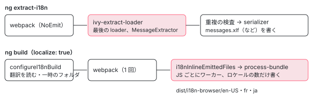

[目次](../README.md) › [webpack の builder の内側：@angular-devkit/build-angular と schematics の CLI](README.md) › 第 9 回 / 全 12 回

# webpack の i18n：抽出と翻訳の差し込み

> builders/extract-i18n/\*（webpack の側）・utils/i18n-webpack.ts・i18n-inlining.ts・process-bundle.ts ほか：出力を書かない webpack のビルドの最後の loader で $localize を集める仕組み、一時のフォルダに 1 回束ねた後にワーカーでロケールごとに翻訳を差し込む処理。

angular/angular-cli · 読了 約 12 分 · 発展 · [サイトで読む（デモが動きます）](https://angular-deep-dive-cyan.vercel.app/chapter/bwp-i18n)

---

この章で分かること: webpack の側の i18n の 2 つの仕事です。1 つ目は `extract-i18n` が、出力を書かない webpack のビルドの最後の loader（`ivy-extract-loader`）で、コンパイルされた JS の `$localize` からメッセージを集めて翻訳のファイルを書く流れ。2 つ目は `localize: true` のビルドが、1 回だけ束ねた JS を一時のフォルダに出し、ワーカーでロケールごとに `$localize` を翻訳の文字列に置き換えて、ロケールのフォルダに書く流れです。

読む対象は angular-cli（44129f66a3）の `packages/angular_devkit/build_angular/src/builders/extract-i18n/`（`builder.ts`・`options.ts`・`webpack-extraction.ts`・`ivy-extract-loader.ts`・`empty-loader.ts`・`application-extraction.ts`）と、`src/utils/` の `i18n-webpack.ts`・`i18n-inlining.ts`・`process-bundle.ts`・`action-executor.ts`・`output-paths.ts`・`copy-assets.ts` です。browser builder がどこで `configureI18nBuild` と `i18nInlineEmittedFiles` を呼ぶかは[第 1 回](01-bwp-browser.md)、application builder の側の抽出は[メッセージを取り出す章](../bld/03-bld-extract-i18n.md)、差し込みは[I18nInliner の章](../esb/04-esb-i18n-inliner.md)と[翻訳を差し込む章](../bld/04-bld-i18n-inline.md)、`$localize` と翻訳の関数そのものは[localize-translate の章](../loc/18-loc-translate-tool.md)です。

1. [1. browser builder の流れ](01-bwp-browser.md)
2. [2. webpack の共通の設定](02-bwp-webpack-common.md)
3. [3. スタイルの設定](03-bwp-webpack-styles.md)
4. [4. Angular の webpack プラグイン](04-bwp-webpack-plugins.md)
5. [5. babel の最適化のプラグイン](05-bwp-babel.md)
6. [6. webpack の dev-server](06-bwp-dev-server.md)
7. [7. server builder と ssr-dev-server](07-bwp-server-ssr.md)
8. [8. prerender と app-shell](08-bwp-prerender-appshell.md)
9. **9. webpack の i18n**（この章）
10. [10. karma の builder の webpack の側](10-bwp-karma.md)
11. [11. schematics の CLI](11-bwp-schematics-cli.md)
12. [12. spec と issue](12-bwp-tests-issues.md)

> [!TIP]
> **新卒エンジニアへ**
>
> **$localize** は、Angular のコンパイラがテンプレートの `i18n` 属性から作るタグ付きテンプレート（`` $localize`:@@id:文` ``）です。抽出はこの呼び出しを探して文を集め、差し込みはこの呼び出しを翻訳の文字列に置き換えます。**ロケール**は `ja`・`fr` のような言語と地域の名前で、angular.json の `i18n.locales` に翻訳のファイルと一緒に書きます。

### 1. 全体の流れ



*2 つの流れ。抽出は webpack で出力を書かずに集め、差し込みは 1 回の webpack のビルドの後でロケールの数だけ書き換える*

- 👤 `ng run demo:extract-i18n` — 利用者
  - `execute()` — extract-i18n/builder.ts 23 — *builder の名前で振り分け*
    - `extractMessages()` — webpack-extraction.ts 27 — *NoEmitPlugin ＋ ivy-extract-loader*
    - `checkDuplicateMessages` → `createSerializer` → `writeFileSync` — builder.ts 118〜157
- 👤 `ng run demo:build:development,i18n` — 利用者
  - `configureI18nBuild()` — utils/i18n-webpack.ts 32 — *第 1 回の browser builder から*
  - `i18nInlineEmittedFiles()` — utils/i18n-inlining.ts 68
    - `BundleActionExecutor.inlineAll()` — utils/action-executor.ts 43 — *piscina のワーカー*
      - `inlineLocales()` → `inlineLocalesDirect()` — utils/process-bundle.ts 109・210

## 2. extract-i18n の入口：webpack の側に入る条件

📄 `angular-cli/packages/angular_devkit/build_angular/src/builders/extract-i18n/builder.ts` L30–57 （▶ の行: 31–32, 38, 43, 46–47）

```ts
30 │   // Determine project name from builder context target
31 ▶   const projectName = context.target?.project;
32 ▶   if (!projectName) {
33 │     context.logger.error(`The 'extract-i18n' builder requires a target to be specified.`);
34 │ 
35 │     return { success: false };
36 │   }
37 │ 
38 ▶   context.logger.warn(
39 │     'The "@angular-devkit/build-angular:extract-i18n" builder is deprecated as part of Angular\'s Webpack support deprecation. ' +
40 │       'Use "@angular/build:extract-i18n" instead. For more information, see https://angular.dev/tools/cli/build-system-migration.',
41 │   );
42 │ 
43 ▶   const { projectType } = (await context.getProjectMetadata(projectName)) as {
44 │     projectType?: string;
45 │   };
46 ▶   if (projectType !== 'application') {
47 ▶     context.logger.error(
48 │       `Tried to extract from ${projectName} with 'projectType' ${projectType}, which is not supported.` +
49 │         ` The 'extract-i18n' builder can only extract from applications.`,
50 │     );
51 │ 
52 │     return { success: false };
53 │   }
54 │ 
55 │   // Check Angular version.
56 │   assertCompatibleAngularVersion(context.workspaceRoot);
57 │ 
```

📄 `angular-cli/packages/angular_devkit/build_angular/src/builders/extract-i18n/builder.ts` L58–75 （▶ の行: 62, 67, 73–74）

```ts
58 │   // Load the Angular localize package.
59 │   // The package is a peer dependency and might not be present
60 │   let localizeToolsModule: typeof import('@angular/localize/tools');
61 │   try {
62 ▶     localizeToolsModule = await import('@angular/localize/tools');
63 │   } catch {
64 │     return {
65 │       success: false,
66 │       error:
67 ▶         `i18n extraction requires the '@angular/localize' package.` +
68 │         ` You can add it by using 'ng add @angular/localize'.`,
69 │     };
70 │   }
71 │ 
72 │   // Normalize options
73 ▶   const normalizedOptions = await normalizeOptions(context, projectName, options);
74 ▶   const builderName = await context.getBuilderNameForTarget(normalizedOptions.buildTarget);
75 │ 
```

📄 `angular-cli/packages/angular_devkit/build_angular/src/builders/extract-i18n/builder.ts` L76–105 （▶ の行: 78–80, 82, 96, 98–99, 102–103）

```ts
 76 │   // Extract messages based on configured builder
 77 │   let extractionResult;
 78 ▶   if (
 79 ▶     builderName === '@angular-devkit/build-angular:application' ||
 80 ▶     builderName === '@angular-devkit/build-angular:browser-esbuild'
 81 │   ) {
 82 ▶     const { extractMessages } = await import('./application-extraction');
 83 │     extractionResult = await extractMessages(
 84 │       normalizedOptions,
 85 │       builderName,
 86 │       context,
 87 │       localizeToolsModule.MessageExtractor,
 88 │     );
 89 │ 
 90 │     if (!extractionResult.success) {
 91 │       return { success: false };
 92 │     }
 93 │   } else {
 94 │     // Purge old build disk cache.
 95 │     // Other build systems handle stale cache purging directly.
 96 ▶     await purgeStaleBuildCache(context);
 97 │ 
 98 ▶     const { extractMessages } = await import('./webpack-extraction');
 99 ▶     extractionResult = await extractMessages(normalizedOptions, builderName, context, transforms);
100 │ 
101 │     // Return the builder result if it failed
102 ▶     if (!extractionResult.builderResult.success) {
103 ▶       return extractionResult.builderResult;
104 │     }
105 │   }
```

31〜36 行目で target が必要、43〜53 行目で `projectType` が `application` でなければ失敗です。62 行目で `@angular/localize/tools` を読み、無ければ 67 行目の「`ng add @angular/localize`」の文で失敗します。74 行目で `buildTarget` の builder の名前を取り、78〜81 行目でそれが `@angular-devkit/build-angular:application` か `…:browser-esbuild` なら application builder で抽出し、**それ以外は全部** 96〜99 行目の webpack の抽出に進みます。

名前の一覧に `@angular/build:application` がありません。記録の「buildTarget が @angular/build:application」は webpack の側に入り、application builder の options（入口は `browser`、`main` が無い）で webpack の設定を組んだので、entry にアプリのファイルが入らず、TypeScript の「part of the TypeScript compilation but it's unused」の警告が 8 つ出たあと、「Extraction Complete. (Messages: 0)」で**成功**して、中身の無い `messages.appbuilder.xlf` を書きました。移行の schematic は extract-i18n の target も `@angular/build:extract-i18n` に書き換えるので（[builder の移行の章](../sca/05-sca-build-migrations.md)）、build だけを手で `@angular/build:application` にしたワークスペースで起きる形です。

📄 `angular-cli/packages/angular_devkit/build_angular/src/builders/extract-i18n/options.ts` L33–67 （▶ の行: 38–39, 43–44, 51, 55, 57, 59）

```ts
33 │   const workspaceRoot = context.workspaceRoot;
34 │   const projectMetadata = await context.getProjectMetadata(projectName);
35 │   const projectRoot = path.join(workspaceRoot, (projectMetadata.root as string | undefined) ?? '');
36 │ 
37 │   // Target specifier defaults to the current project's build target with no specified configuration
38 ▶   const buildTargetSpecifier = options.buildTarget ?? ':';
39 ▶   const buildTarget = targetFromTargetString(buildTargetSpecifier, projectName, 'build');
40 │   const i18nOptions: I18nOptions & {
41 │     duplicateTranslationBehavior: DiagnosticHandlingStrategy;
42 │   } = {
43 ▶     ...createI18nOptions(projectMetadata, /** inline */ false, context.logger),
44 ▶     duplicateTranslationBehavior: options.i18nDuplicateTranslation || 'warning',
45 │   };
46 │ 
47 │   // Normalize xliff format extensions
48 │   let format = options.format;
49 │   switch (format) {
50 │     // Default format is xliff1
51 ▶     case undefined:
52 │     case Format.Xlf:
53 │     case Format.Xlif:
54 │     case Format.Xliff:
55 ▶       format = Format.Xliff;
56 │       break;
57 ▶     case Format.Xlf2:
58 │     case Format.Xliff2:
59 ▶       format = Format.Xliff2;
60 │       break;
61 │   }
62 │ 
63 │   let outFile = options.outFile || getDefaultOutFile(format);
64 │   if (options.outputPath) {
65 │     outFile = path.join(options.outputPath, outFile);
66 │   }
67 │   outFile = path.resolve(context.workspaceRoot, outFile);
```

📄 `angular-cli/packages/angular_devkit/build_angular/src/builders/extract-i18n/options.ts` L69–95 （▶ の行: 69, 75–76, 83, 85–86, 88–89）

```ts
69 ▶   return {
70 │     workspaceRoot,
71 │     projectRoot,
72 │     buildTarget,
73 │     i18nOptions,
74 │     format,
75 ▶     outFile,
76 ▶     progress: options.progress ?? true,
77 │   };
78 │ }
79 │ 
80 │ function getDefaultOutFile(format: Format) {
81 │   switch (format) {
82 │     case Format.Xmb:
83 ▶       return 'messages.xmb';
84 │     case Format.Xliff:
85 ▶     case Format.Xliff2:
86 ▶       return 'messages.xlf';
87 │     case Format.Json:
88 ▶     case Format.LegacyMigrate:
89 ▶       return 'messages.json';
90 │     case Format.Arb:
91 │       return 'messages.arb';
92 │     default:
93 │       fail(`Invalid Format enum value: ${format as unknown}`);
94 │   }
95 │ }
```

38〜39 行目、`buildTarget` を書かなければ `':'` から「今の project の `build`、configuration なし」になります。43 行目の `createI18nOptions`（[オプションの小道具の章](../bcu/08-bcu-options.md)）に `inline: false` を渡し、44 行目で重複の扱いを `i18nDuplicateTranslation`、無ければ `'warning'` にします（schema に既定値が書かれたのは 22.2.7 の c2ae4752fd。8 節）。49〜61 行目、`xlf`・`xlif`・`xliff` を 1 つに、`xlf2`・`xliff2` を 1 つにまとめます。schema の既定は `xlf` ですが、51 行目の `undefined` も同じ扱いです。

📄 `angular-cli/packages/angular_devkit/build_angular/src/builders/extract-i18n/application-extraction.ts` L30–60 （▶ の行: 34, 40, 48, 52, 55, 60）

```ts
30 │   const messages: LocalizeMessage[] = [];
31 │ 
32 │   // Setup the build options for the application based on the buildTarget option
33 │   let buildOptions;
34 ▶   if (builderName === '@angular-devkit/build-angular:application') {
35 │     buildOptions = (await context.validateOptions(
36 │       await context.getTargetOptions(options.buildTarget),
37 │       builderName,
38 │     )) as unknown as ApplicationBuilderOptions;
39 │   } else {
40 ▶     buildOptions = convertBrowserOptions(
41 │       (await context.validateOptions(
42 │         await context.getTargetOptions(options.buildTarget),
43 │         builderName,
44 │       )) as unknown as BrowserBuilderOptions,
45 │     );
46 │   }
47 │ 
48 ▶   buildOptions.optimization = false;
49 │   buildOptions.sourceMap = { scripts: true, vendor: true, styles: false };
50 │   buildOptions.localize = false;
51 │   buildOptions.budgets = undefined;
52 ▶   buildOptions.index = false;
53 │   buildOptions.serviceWorker = false;
54 │   buildOptions.server = undefined;
55 ▶   buildOptions.ssr = false;
56 │   buildOptions.appShell = undefined;
57 │   buildOptions.prerender = undefined;
58 │   buildOptions.outputMode = undefined;
59 │ 
60 ▶   const builderResult = await first(buildApplicationInternal(buildOptions, context));
```

application builder の側（この `build_angular` の写し）は、34 行目で `application` ならその options、40 行目で `browser-esbuild` なら `convertBrowserOptions` で application の形に直し、48〜58 行目で抽出に要らないものを切って 60 行目で 1 回ビルドします。`@angular/build` の写し（[メッセージを取り出す章](../bld/03-bld-extract-i18n.md)）とは、`browser-esbuild` の変換と、58 行目の `outputMode = undefined`（向こうは `Static`）が違います。22.2.7 では 48 行目の前に `buildOptions.aot = true` が入りました（fbe208f839、22.2.3 から）。

## 3. webpack で集める：出力を書かないビルドと ivy-extract-loader

📄 `angular-cli/packages/angular_devkit/build_angular/src/builders/extract-i18n/webpack-extraction.ts` L21–46 （▶ の行: 21–23, 40–41, 43–45）

```ts
21 ▶ class NoEmitPlugin {
22 ▶   apply(compiler: webpack.Compiler): void {
23 ▶     compiler.hooks.shouldEmit.tap('angular-no-emit', () => false);
24 │   }
25 │ }
26 │ 
27 │ export async function extractMessages(
28 │   options: NormalizedExtractI18nOptions,
29 │   builderName: string,
30 │   context: BuilderContext,
31 │   transforms: {
32 │     webpackConfiguration?: ExecutionTransformer<webpack.Configuration>;
33 │   } = {},
34 │ ): Promise<{
35 │   builderResult: BuildResult;
36 │   basePath: string;
37 │   messages: LocalizeMessage[];
38 │   useLegacyIds: boolean;
39 │ }> {
40 ▶   const messages: LocalizeMessage[] = [];
41 ▶   let useLegacyIds = true;
42 │ 
43 ▶   const browserOptions = await context.validateOptions(
44 ▶     await context.getTargetOptions(options.buildTarget),
45 ▶     builderName,
46 │   );
```

📄 `angular-cli/packages/angular_devkit/build_angular/src/builders/extract-i18n/webpack-extraction.ts` L47–80 （▶ の行: 50–51, 56–57, 59–62, 67, 75, 78–79）

```ts
47 │ 
48 │   const builderOptions = {
49 │     ...browserOptions,
50 ▶     optimization: false,
51 ▶     sourceMap: {
52 │       scripts: true,
53 │       styles: false,
54 │       vendor: true,
55 │     },
56 ▶     buildOptimizer: false,
57 ▶     aot: true,
58 │     progress: options.progress,
59 ▶     budgets: [],
60 ▶     assets: [],
61 ▶     scripts: [],
62 ▶     styles: [],
63 │     deleteOutputPath: false,
64 │     extractLicenses: false,
65 │     subresourceIntegrity: false,
66 │     outputHashing: OutputHashing.None,
67 ▶     namedChunks: true,
68 │     allowedCommonJsDependencies: undefined,
69 │   } as unknown as Schema;
70 │   const { config } = await generateBrowserWebpackConfigFromContext(
71 │     builderOptions,
72 │     context,
73 │     (wco) => {
74 │       // Default value for legacy message ids is currently true
75 ▶       useLegacyIds = wco.tsConfig.options.enableI18nLegacyMessageIdFormat ?? true;
76 │ 
77 │       const partials: (Promise<Configuration> | Configuration)[] = [
78 ▶         { plugins: [new NoEmitPlugin()] },
79 ▶         getCommonConfig(wco),
80 │       ];
```

21〜25 行目の `NoEmitPlugin` は、webpack の `shouldEmit` の hook で `false` を返し、出力のファイルを 1 つも書かせません。43〜46 行目で build の target の options を、その builder（ここでは browser）の schema で検証して受け取ります。48〜69 行目で抽出に要らないものを上書きします。最適化と `buildOptimizer` を切り、57 行目で AOT にし（テンプレートを `$localize` の呼び出しにコンパイルさせるため）、59〜62 行目で budgets・assets・scripts・styles を空にします。75 行目、tsconfig の `enableI18nLegacyMessageIdFormat`（古い形の ID も作るか）を読み、既定は `true` です。78〜79 行目の部分は NoEmit と共通の設定（[第 2 回](02-bwp-webpack-common.md)）だけで、styles の設定の部分は入れません。

📄 `angular-cli/packages/angular_devkit/build_angular/src/builders/extract-i18n/webpack-extraction.ts` L81–113 （▶ の行: 83, 87–88, 90, 98, 102–103, 112）

```ts
 81 │ 
 82 │       // Add Ivy application file extractor support
 83 ▶       partials.unshift({
 84 │         module: {
 85 │           rules: [
 86 │             {
 87 ▶               test: /\.[cm]?[tj]sx?$/,
 88 ▶               loader: require.resolve('./ivy-extract-loader'),
 89 │               options: {
 90 ▶                 messageHandler: (fileMessages: LocalizeMessage[]) => messages.push(...fileMessages),
 91 │               },
 92 │             },
 93 │           ],
 94 │         },
 95 │       });
 96 │ 
 97 │       // Replace all stylesheets with empty content
 98 ▶       partials.push({
 99 │         module: {
100 │           rules: [
101 │             {
102 ▶               test: /\.(css|scss|sass|less)$/,
103 ▶               loader: require.resolve('./empty-loader'),
104 │             },
105 │           ],
106 │         },
107 │       });
108 │ 
109 │       return partials;
110 │     },
111 │     // During extraction we don't need specific browser support.
112 ▶     { supportedBrowsers: undefined },
113 │   );
```

📄 `angular-cli/packages/angular_devkit/build_angular/src/builders/extract-i18n/empty-loader.ts` L9–11 （▶ の行: 10）

```ts
 9 │ export default function () {
10 ▶   return `export default '';`;
11 │ }
```

📄 `angular-cli/packages/angular_devkit/build_angular/src/builders/extract-i18n/webpack-extraction.ts` L114–128 （▶ の行: 116, 124–125）

```ts
114 │ 
115 │   const builderResult = await lastValueFrom(
116 ▶     runWebpack((await transforms?.webpackConfiguration?.(config)) || config, context, {
117 │       logging: createWebpackLoggingCallback(builderOptions, context.logger),
118 │       webpackFactory: webpack,
119 │     }),
120 │   );
121 │ 
122 │   return {
123 │     builderResult,
124 ▶     basePath: config.context || options.projectRoot,
125 ▶     messages,
126 │     useLegacyIds,
127 │   };
128 │ }
```

83 行目は `unshift`、つまり module.rules の**先頭**に、すべての JS と TS（87 行目）に効く `ivy-extract-loader` を置きます。webpack は 1 つのファイルに当たる loader を、rules の後ろから前の順に走らせます。共通の設定の後ろの方にある `@ngtools/webpack` の loader（コンパイル）と babel が先に走り、先頭のこの loader は最後に、コンパイルされた後の JS を受け取ります。90 行目の `messageHandler` が、見つかったメッセージを 40 行目の配列に足していきます。98〜107 行目、CSS・Sass・Less は 10 行目の `empty-loader` で空にします（コンポーネントのスタイルのコンパイルを省く）。112 行目、対象のブラウザは決めません。116 行目で webpack を 1 回走らせ、124 行目、メッセージのファイルの位置の基準を webpack の `context`（workspace の root）にします。

📄 `angular-cli/packages/angular_devkit/build_angular/src/builders/extract-i18n/ivy-extract-loader.ts` L18–56 （▶ の行: 26, 31, 34, 50, 54）

```ts
18 │ export default function localizeExtractLoader(
19 │   this: import('webpack').LoaderContext<LocalizeExtractLoaderOptions>,
20 │   content: string,
21 │   map: LoaderSourceMap,
22 │ ) {
23 │   // This loader is not cacheable due to how message extraction works.
24 │   // Extracted messages are not part of webpack pipeline and hence they cannot be retrieved from cache.
25 │   // TODO: We should investigate in the future on making this deterministic and more cacheable.
26 ▶   this.cacheable(false);
27 │ 
28 │   const options = this.getOptions();
29 │   const callback = this.async();
30 │ 
31 ▶   extract(this, content, map, options).then(
32 │     () => {
33 │       // Pass through the original content now that messages have been extracted
34 ▶       callback(undefined, content, map);
35 │     },
36 │     (error) => {
37 │       callback(error);
38 │     },
39 │   );
40 │ }
41 │ 
42 │ async function extract(
43 │   loaderContext: import('webpack').LoaderContext<LocalizeExtractLoaderOptions>,
44 │   content: string,
45 │   map: string | LoaderSourceMap | undefined,
46 │   options: LocalizeExtractLoaderOptions,
47 │ ) {
48 │   let MessageExtractor;
49 │   try {
50 ▶     const { MessageExtractor: MsgExtractor } = await import('@angular/localize/tools');
51 │     MessageExtractor = MsgExtractor;
52 │   } catch {
53 │     throw new Error(
54 ▶       `Unable to load message extractor. Please ensure '@angular/localize' is installed.`,
55 │     );
56 │   }
```

📄 `angular-cli/packages/angular_devkit/build_angular/src/builders/extract-i18n/ivy-extract-loader.ts` L58–84 （▶ の行: 61, 66–67, 69–70, 72–73, 77, 80, 82）

```ts
58 │   // Setup a Webpack-based logger instance
59 │   const logger = {
60 │     // level 2 is warnings
61 ▶     level: 2,
62 │     debug(...args: string[]): void {
63 │       // eslint-disable-next-line no-console
64 │       console.debug(...args);
65 │     },
66 ▶     info(...args: string[]): void {
67 ▶       loaderContext.emitWarning(new Error(args.join('')));
68 │     },
69 ▶     warn(...args: string[]): void {
70 ▶       loaderContext.emitWarning(new Error(args.join('')));
71 │     },
72 ▶     error(...args: string[]): void {
73 ▶       loaderContext.emitError(new Error(args.join('')));
74 │     },
75 │   };
76 │ 
77 ▶   let filename = loaderContext.resourcePath;
78 │   const mapObject =
79 │     typeof map === 'string' ? (JSON.parse(map) as Exclude<LoaderSourceMap, string>) : map;
80 ▶   if (mapObject?.file) {
81 │     // The extractor's internal sourcemap handling expects the filenames to match
82 ▶     filename = nodePath.join(loaderContext.context, mapObject.file);
83 │   }
84 │ 
```

📄 `angular-cli/packages/angular_devkit/build_angular/src/builders/extract-i18n/ivy-extract-loader.ts` L85–123 （▶ の行: 88, 90, 92, 95, 113, 115–116, 119, 121）

```ts
 85 │   // Setup a virtual file system instance for the extractor
 86 │   // * MessageExtractor itself uses readFile, relative and resolve
 87 │   // * Internal SourceFileLoader (sourcemap support) uses dirname, exists, readFile, and resolve
 88 ▶   const filesystem = {
 89 │     readFile(path: string): string {
 90 ▶       if (path === filename) {
 91 │         return content;
 92 ▶       } else if (path === filename + '.map') {
 93 │         return typeof map === 'string' ? map : JSON.stringify(map);
 94 │       } else {
 95 ▶         throw new Error('Unknown file requested: ' + path);
 96 │       }
 97 │     },
 98 │     relative(from: string, to: string): string {
 99 │       return nodePath.relative(from, to);
100 │     },
101 │     resolve(...paths: string[]): string {
102 │       return nodePath.resolve(...paths);
103 │     },
104 │     exists(path: string): boolean {
105 │       return path === filename || path === filename + '.map';
106 │     },
107 │     dirname(path: string): string {
108 │       return nodePath.dirname(path);
109 │     },
110 │   };
111 │ 
112 │   // eslint-disable-next-line @typescript-eslint/no-explicit-any
113 ▶   const extractor = new MessageExtractor(filesystem as any, logger, {
114 │     // eslint-disable-next-line @typescript-eslint/no-explicit-any
115 ▶     basePath: loaderContext.rootContext as any,
116 ▶     useSourceMaps: !!map,
117 │   });
118 │ 
119 ▶   const messages = extractor.extractMessages(filename);
120 │   if (messages.length > 0) {
121 ▶     options?.messageHandler(messages);
122 │   }
123 │ }
```

26 行目、メッセージは webpack の流れの外（40 行目の配列）に集めるので、webpack のキャッシュに載せられず、cacheable を切ります（23〜25 行目のコメント）。31〜39 行目で抽出し、34 行目で受け取った中身をそのまま次へ渡します。59〜75 行目の logger は、`MessageExtractor` の info と warn を webpack の警告に、error を webpack のエラーにします。80〜83 行目、ソースマップの `file` があれば、ファイル名をそれに合わせます。88〜110 行目は、このファイルとそのマップだけを読める仮のファイルシステムで、ほかのパスを読もうとすると 95 行目で例外です。113〜117 行目で `MessageExtractor`（[localize-extract の章](../loc/15-loc-extract-tool.md)）を作り、119 行目でこのファイルの `$localize` を集めます。

記録では、この loader が呼ばれたのは 111 のファイルで、そのうちアプリの `src` のファイルは 8 つ、残りは `node_modules` の JS（`@angular/core` など）でした。87 行目の `test` には `exclude` が無いので、依存の JS にも `MessageExtractor` をかけます。

## 4. 重複の検査と書き出し

📄 `angular-cli/packages/angular_devkit/build_angular/src/builders/extract-i18n/builder.ts` L107–134 （▶ の行: 108, 112, 117–118, 122, 126–128, 130, 132）

```ts
107 │   // Perform duplicate message checks
108 ▶   const { checkDuplicateMessages } = localizeToolsModule;
109 │ 
110 │   // The filesystem is used to create a relative path for each file
111 │   // from the basePath.  This relative path is then used in the error message.
112 ▶   const checkFileSystem = {
113 │     relative(from: string, to: string): string {
114 │       return path.relative(from, to);
115 │     },
116 │   };
117 ▶   const duplicateTranslationBehavior = normalizedOptions.i18nOptions.duplicateTranslationBehavior;
118 ▶   const diagnostics = checkDuplicateMessages(
119 │     // eslint-disable-next-line @typescript-eslint/no-explicit-any
120 │     checkFileSystem as any,
121 │     extractionResult.messages,
122 ▶     duplicateTranslationBehavior,
123 │     // eslint-disable-next-line @typescript-eslint/no-explicit-any
124 │     extractionResult.basePath as any,
125 │   );
126 ▶   if (diagnostics.messages.length > 0 && duplicateTranslationBehavior !== 'ignore') {
127 ▶     if (duplicateTranslationBehavior === 'error') {
128 ▶       context.logger.error(`Extraction Failed: ${diagnostics.formatDiagnostics('')}`);
129 │ 
130 ▶       return { success: false };
131 │     } else {
132 ▶       context.logger.warn(diagnostics.formatDiagnostics(''));
133 │     }
134 │   }
```

108〜125 行目、`@angular/localize` の `checkDuplicateMessages` に、集めたメッセージと扱い（44 行目の値）を渡します。同じ ID で文が違うメッセージが見つかると、126 行目で `ignore` でなければ、`error` なら 128 行目の「Extraction Failed:」で失敗、`warning` なら 132 行目で警告して続けます。この分かれ方は d16e358eda（2025-05、#23635）からで、それまでは 117 行目の値に関係なく警告だけでした。記録では、`home.ts` の「Counter」と `shell.ts` の「Counter app」に同じ `@@homeTitle` を付け、既定では警告、`error` では終了コード 1 でファイルを書きませんでした。

📄 `angular-cli/packages/angular_devkit/build_angular/src/builders/extract-i18n/builder.ts` L136–164 （▶ の行: 137, 148, 151, 153, 157, 159–160, 163）

```ts
136 │   // Serialize all extracted messages
137 ▶   const serializer = await createSerializer(
138 │     localizeToolsModule,
139 │     normalizedOptions.format,
140 │     normalizedOptions.i18nOptions.sourceLocale,
141 │     extractionResult.basePath,
142 │     extractionResult.useLegacyIds,
143 │     diagnostics,
144 │   );
145 │ 
146 │   assert(serializer);
147 │ 
148 ▶   const content = serializer.serialize(extractionResult.messages);
149 │ 
150 │   // Ensure directory exists
151 ▶   const outputPath = path.dirname(normalizedOptions.outFile);
152 │   if (!fs.existsSync(outputPath)) {
153 ▶     fs.mkdirSync(outputPath, { recursive: true });
154 │   }
155 │ 
156 │   // Write translation file
157 ▶   fs.writeFileSync(normalizedOptions.outFile, content);
158 │ 
159 ▶   if (normalizedOptions.progress) {
160 ▶     context.logger.info(`Extraction Complete. (Messages: ${extractionResult.messages.length})`);
161 │   }
162 │ 
163 ▶   return { success: true, outputPath: normalizedOptions.outFile };
164 │ }
```

📄 `angular-cli/packages/angular_devkit/build_angular/src/builders/extract-i18n/builder.ts` L174–212 （▶ の行: 184, 186, 191, 195, 197, 199, 201）

```ts
174 │   const {
175 │     XmbTranslationSerializer,
176 │     LegacyMessageIdMigrationSerializer,
177 │     ArbTranslationSerializer,
178 │     Xliff1TranslationSerializer,
179 │     Xliff2TranslationSerializer,
180 │     SimpleJsonTranslationSerializer,
181 │   } = localizeToolsModule;
182 │ 
183 │   switch (format) {
184 ▶     case Format.Xmb:
185 │       // eslint-disable-next-line @typescript-eslint/no-explicit-any
186 ▶       return new XmbTranslationSerializer(basePath as any, useLegacyIds);
187 │     case Format.Xlf:
188 │     case Format.Xlif:
189 │     case Format.Xliff:
190 │       // eslint-disable-next-line @typescript-eslint/no-explicit-any
191 ▶       return new Xliff1TranslationSerializer(sourceLocale, basePath as any, useLegacyIds, {});
192 │     case Format.Xlf2:
193 │     case Format.Xliff2:
194 │       // eslint-disable-next-line @typescript-eslint/no-explicit-any
195 ▶       return new Xliff2TranslationSerializer(sourceLocale, basePath as any, useLegacyIds, {});
196 │     case Format.Json:
197 ▶       return new SimpleJsonTranslationSerializer(sourceLocale);
198 │     case Format.LegacyMigrate:
199 ▶       return new LegacyMessageIdMigrationSerializer(diagnostics);
200 │     case Format.Arb:
201 ▶       return new ArbTranslationSerializer(
202 │         sourceLocale,
203 │         // eslint-disable-next-line @typescript-eslint/no-explicit-any
204 │         basePath as any,
205 │         {
206 │           relative(from: string, to: string): string {
207 │             return path.relative(from, to);
208 │           },
209 │           // eslint-disable-next-line @typescript-eslint/no-explicit-any
210 │         } as any,
211 │       );
212 │   }
```

137〜148 行目で形式に合った serializer を作って文字列にし、151〜154 行目で出力先のフォルダを作り、157 行目で書きます。160 行目の数は集めたメッセージの数で、重複も数えます。記録の「Messages: 8」に対して、xlf の `trans-unit` は 7 つでした（`homeTitle` は 1 つにまとまり、`context-group` が 2 つ）。184〜211 行目の serializer は、`xmb`・`xlf`・`xlf2`・`json`・`legacy-migrate`・`arb` の 6 つで、`json` だけ `basePath` も ID の古い形も受け取りません（197 行目）。

## 5. ビルドの前：configureI18nBuild が翻訳を読み、出力先を一時のフォルダにする

📄 `angular-cli/packages/angular_devkit/build_angular/src/utils/i18n-webpack.ts` L32–58 （▶ の行: 43–44, 46, 49–50, 55–57）

```ts
32 │ export async function configureI18nBuild<T extends BrowserBuilderSchema | ServerBuilderSchema>(
33 │   context: BuilderContext,
34 │   options: T,
35 │ ): Promise<{
36 │   buildOptions: T;
37 │   i18n: I18nOptions;
38 │ }> {
39 │   if (!context.target) {
40 │     throw new Error('The builder requires a target.');
41 │   }
42 │ 
43 ▶   const buildOptions = { ...options };
44 ▶   const tsConfig = await readTsconfig(buildOptions.tsConfig, context.workspaceRoot);
45 │   const metadata = await context.getProjectMetadata(context.target);
46 ▶   const i18n = createI18nOptions(metadata, buildOptions.localize, context.logger);
47 │ 
48 │   // No additional processing needed if no inlining requested and no source locale defined.
49 ▶   if (!i18n.shouldInline && !i18n.hasDefinedSourceLocale) {
50 ▶     return { buildOptions, i18n };
51 │   }
52 │ 
53 │   const projectRoot = path.join(context.workspaceRoot, (metadata.root as string) || '');
54 │   // The trailing slash is required to signal that the path is a directory and not a file.
55 ▶   const projectRequire = createRequire(projectRoot + '/');
56 ▶   const localeResolver = (locale: string) =>
57 ▶     projectRequire.resolve(path.join(LOCALE_DATA_BASE_MODULE, locale));
58 │ 
```

📄 `angular-cli/packages/angular_devkit/build_angular/src/utils/i18n-webpack.ts` L59–89 （▶ の行: 62–63, 67, 69, 71, 73–74, 80, 84）

```ts
59 │   // Load locale data and translations (if present)
60 │   let loader;
61 │   const usedFormats = new Set<string>();
62 ▶   for (const [locale, desc] of Object.entries(i18n.locales)) {
63 ▶     if (!i18n.inlineLocales.has(locale) && locale !== i18n.sourceLocale) {
64 │       continue;
65 │     }
66 │ 
67 ▶     let localeDataPath = findLocaleDataPath(locale, localeResolver);
68 │     if (!localeDataPath) {
69 ▶       const [first] = locale.split('-');
70 │       if (first) {
71 ▶         localeDataPath = findLocaleDataPath(first.toLowerCase(), localeResolver);
72 │         if (localeDataPath) {
73 ▶           context.logger.warn(
74 ▶             `Locale data for '${locale}' cannot be found. Using locale data for '${first}'.`,
75 │           );
76 │         }
77 │       }
78 │     }
79 │     if (!localeDataPath) {
80 ▶       context.logger.warn(
81 │         `Locale data for '${locale}' cannot be found. No locale data will be included for this locale.`,
82 │       );
83 │     } else {
84 ▶       desc.dataPath = localeDataPath;
85 │     }
86 │ 
87 │     if (!desc.files.length) {
88 │       continue;
89 │     }
```

📄 `angular-cli/packages/angular_devkit/build_angular/src/utils/i18n-webpack.ts` L90–117 （▶ の行: 91, 93, 102–103, 106–107, 110, 113）

```ts
 90 │ 
 91 ▶     loader ??= await createTranslationLoader();
 92 │ 
 93 ▶     loadTranslations(
 94 │       locale,
 95 │       desc,
 96 │       context.workspaceRoot,
 97 │       loader,
 98 │       {
 99 │         warn(message) {
100 │           context.logger.warn(message);
101 │         },
102 ▶         error(message) {
103 ▶           throw new Error(message);
104 │         },
105 │       },
106 ▶       usedFormats,
107 ▶       buildOptions.i18nDuplicateTranslation,
108 │     );
109 │ 
110 ▶     if (usedFormats.size > 1 && tsConfig.options.enableI18nLegacyMessageIdFormat !== false) {
111 │       // This limitation is only for legacy message id support (defaults to true as of 9.0)
112 │       throw new Error(
113 ▶         'Localization currently only supports using one type of translation file format for the entire application.',
114 │       );
115 │     }
116 │   }
117 │ 
```

browser builder と server builder（[第 7 回](07-bwp-server-ssr.md)）は、設定を組む前にこの関数を通ります。46 行目で angular.json の `i18n` と `localize` の option からロケールの一覧を作り、49〜51 行目、差し込まず source locale も書いていなければ何もしません。55〜57 行目、ロケールのデータ（数や日付の書き方）を、project の root から `@angular/common/locales/global/<ロケール>` として探します。62〜65 行目、差し込むロケールと source locale だけを調べ、69〜77 行目、`fr-CA` のように見つからなければ `fr` を探して警告します。

翻訳のファイルがあれば、91 行目で読み込み係を 1 回だけ作り、93〜108 行目の `loadTranslations` で読みます。102〜104 行目、読み込みのエラーは例外にし、107 行目で `i18nDuplicateTranslation`（こちらは翻訳のファイルの中の重複）を渡します。110〜115 行目、古い形の ID を使うなら、形式（xlf と json など）を混ぜられません。

📄 `angular-cli/packages/angular_devkit/build_angular/src/utils/i18n-webpack.ts` L118–145 （▶ の行: 119, 122–123, 125, 127, 137, 143）

```ts
118 │   // If inlining store the output in a temporary location to facilitate post-processing
119 ▶   if (i18n.shouldInline) {
120 │     // TODO: we should likely save these in the .angular directory in the next major version.
121 │     // We'd need to do a migration to add the temp directory to gitignore.
122 ▶     const tempPath = fs.mkdtempSync(path.join(fs.realpathSync(os.tmpdir()), 'angular-cli-i18n-'));
123 ▶     buildOptions.outputPath = tempPath;
124 │ 
125 ▶     process.on('exit', () => {
126 │       try {
127 ▶         fs.rmSync(tempPath, { force: true, recursive: true, maxRetries: 3 });
128 │       } catch {}
129 │     });
130 │   }
131 │ 
132 │   return { buildOptions, i18n };
133 │ }
134 │ 
135 │ function findLocaleDataPath(locale: string, resolver: (locale: string) => string): string | null {
136 │   // Remove private use subtags
137 ▶   const scrubbedLocale = locale.replace(/-x(-[a-zA-Z0-9]{1,8})+$/, '');
138 │ 
139 │   try {
140 │     return resolver(scrubbedLocale);
141 │   } catch {
142 │     // fallback to known existing en-US locale data as of 14.0
143 ▶     return scrubbedLocale === 'en-US' ? findLocaleDataPath('en', resolver) : null;
144 │   }
145 │ }
```

差し込むときは、122〜123 行目で OS の一時のフォルダに `angular-cli-i18n-` で始まるフォルダを作り、webpack の出力先をそこに変えます。webpack はロケールを知らない 1 つの束をそこに書き、6 節がそれを読みます。125〜129 行目、プロセスが終わるときに消します（120〜121 行目の TODO は「次のメジャーで .angular の中に置くべき」）。137 行目、`-x-` の後ろの私用の部分を落としてから探し、143 行目、`en-US` のデータが無ければ `en` を使います（記録の `en-US` の `main.js` の先頭にも、ロケールのデータが入っている）。

## 6. ビルドの後：i18nInlineEmittedFiles がワーカーに配る

📄 `angular-cli/packages/angular_devkit/build_angular/src/utils/i18n-inlining.ts` L20–48 （▶ の行: 32–34, 39, 41–45）

```ts
20 │ function emittedFilesToInlineOptions(
21 │   emittedFiles: EmittedFiles[],
22 │   scriptsEntryPointName: string[],
23 │   emittedPath: string,
24 │   outputPath: string,
25 │   missingTranslation: 'error' | 'warning' | 'ignore' | undefined,
26 │   context: BuilderContext,
27 │ ): { options: InlineOptions[]; originalFiles: string[] } {
28 │   const options: InlineOptions[] = [];
29 │   const originalFiles: string[] = [];
30 │   for (const emittedFile of emittedFiles) {
31 │     if (
32 ▶       emittedFile.asset ||
33 ▶       emittedFile.extension !== '.js' ||
34 ▶       (emittedFile.name && scriptsEntryPointName.includes(emittedFile.name))
35 │     ) {
36 │       continue;
37 │     }
38 │ 
39 ▶     const originalPath = path.join(emittedPath, emittedFile.file);
40 │     const action: InlineOptions = {
41 ▶       filename: emittedFile.file,
42 ▶       code: fs.readFileSync(originalPath, 'utf8'),
43 ▶       outputPath,
44 ▶       missingTranslation,
45 ▶       setLocale: emittedFile.name === 'main',
46 │     };
47 │     originalFiles.push(originalPath);
48 │ 
```

📄 `angular-cli/packages/angular_devkit/build_angular/src/utils/i18n-inlining.ts` L49–66 （▶ の行: 50–52, 55, 62）

```ts
49 │     try {
50 ▶       const originalMapPath = originalPath + '.map';
51 ▶       action.map = fs.readFileSync(originalMapPath, 'utf8');
52 ▶       originalFiles.push(originalMapPath);
53 │     } catch (err) {
54 │       assertIsError(err);
55 ▶       if (err.code !== 'ENOENT') {
56 │         throw err;
57 │       }
58 │     }
59 │ 
60 │     context.logger.debug(`i18n file queued for processing: ${action.filename}`);
61 │ 
62 ▶     options.push(action);
63 │   }
64 │ 
65 │   return { options, originalFiles };
66 │ }
```

webpack が出したファイルのうち、32〜34 行目で assets、`.js` でないもの、`scripts` の entry を除きます。39〜46 行目で 1 ファイルを 1 つの仕事にし、中身を読み、書き先は最終の出力先（`dist/i18n-browser`）、45 行目、entry の名前が `main` のときだけ `setLocale`（ロケールの宣言とデータを先頭に足す）を立てます。49〜58 行目でソースマップも読みます。記録の仕事は `main.js`（`setLocale: true`、約 2.19 MB）と `runtime.js`（`false`）の 2 つで、`styles.css` は仕事にならず、次の写しで配られました。

📄 `angular-cli/packages/angular_devkit/build_angular/src/utils/i18n-inlining.ts` L68–106 （▶ の行: 78, 81, 84, 93, 96, 98–100, 102）

```ts
 68 │ export async function i18nInlineEmittedFiles(
 69 │   context: BuilderContext,
 70 │   emittedFiles: EmittedFiles[],
 71 │   i18n: I18nOptions,
 72 │   baseOutputPath: string,
 73 │   outputPaths: string[],
 74 │   scriptsEntryPointName: string[],
 75 │   emittedPath: string,
 76 │   missingTranslation: 'error' | 'warning' | 'ignore' | undefined,
 77 │ ): Promise<boolean> {
 78 ▶   const executor = new BundleActionExecutor({ i18n });
 79 │   let hasErrors = false;
 80 │   const spinner = new Spinner();
 81 ▶   spinner.start('Generating localized bundles...');
 82 │ 
 83 │   try {
 84 ▶     const { options, originalFiles: processedFiles } = emittedFilesToInlineOptions(
 85 │       emittedFiles,
 86 │       scriptsEntryPointName,
 87 │       emittedPath,
 88 │       baseOutputPath,
 89 │       missingTranslation,
 90 │       context,
 91 │     );
 92 │ 
 93 ▶     for await (const result of executor.inlineAll(options)) {
 94 │       context.logger.debug(`i18n file processed: ${result.file}`);
 95 │ 
 96 ▶       for (const diagnostic of result.diagnostics) {
 97 │         spinner.stop();
 98 ▶         if (diagnostic.type === 'error') {
 99 ▶           hasErrors = true;
100 ▶           context.logger.error(diagnostic.message);
101 │         } else {
102 ▶           context.logger.warn(diagnostic.message);
103 │         }
104 │         spinner.start();
105 │       }
106 │     }
```

📄 `angular-cli/packages/angular_devkit/build_angular/src/utils/i18n-inlining.ts` L107–137 （▶ の行: 109, 112–113, 115, 118, 123, 127, 130, 136）

```ts
107 │ 
108 │     // Copy any non-processed files into the output locations
109 ▶     await copyAssets(
110 │       [
111 │         {
112 ▶           glob: '**/*',
113 ▶           input: emittedPath,
114 │           output: '',
115 ▶           ignore: [...processedFiles].map((f) => path.relative(emittedPath, f)),
116 │         },
117 │       ],
118 ▶       outputPaths,
119 │       '',
120 │     );
121 │   } catch (err) {
122 │     assertIsError(err);
123 ▶     spinner.fail('Localized bundle generation failed: ' + err.message);
124 │ 
125 │     return false;
126 │   } finally {
127 ▶     executor.stop();
128 │   }
129 │ 
130 ▶   if (hasErrors) {
131 │     spinner.fail('Localized bundle generation failed.');
132 │   } else {
133 │     spinner.succeed('Localized bundle generation complete.');
134 │   }
135 │ 
136 ▶   return !hasErrors;
137 │ }
```

78 行目でワーカーの係を作り、93 行目で全部の仕事を流して、終わった順に受け取ります。96〜105 行目、翻訳の診断（見つからない翻訳など）を、`error` ならエラーにして `hasErrors` を立て、そうでなければ警告で出します。109〜120 行目、処理したファイル以外（`styles.css`・`index.html` など）を、一時のフォルダから**全部のロケールのフォルダ**へ写します。`index.html` の `lang` と `base href` をロケールごとに直すのは browser builder の側です（[第 1 回](01-bwp-browser.md)。記録の `ja/index.html` は `lang="ja"`・`/ja/`）。

📄 `angular-cli/packages/angular_devkit/build_angular/src/utils/output-paths.ts` L13–28 （▶ の行: 14–15, 17, 19, 22–23）

```ts
13 │ export function ensureOutputPaths(baseOutputPath: string, i18n: I18nOptions): Map<string, string> {
14 ▶   const outputPaths: [string, string][] = i18n.shouldInline
15 ▶     ? [...i18n.inlineLocales].map((l) => [
16 │         l,
17 ▶         i18n.flatOutput ? baseOutputPath : join(baseOutputPath, i18n.locales[l].subPath),
18 │       ])
19 ▶     : [['', baseOutputPath]];
20 │ 
21 │   for (const [, outputPath] of outputPaths) {
22 ▶     if (!existsSync(outputPath)) {
23 ▶       mkdirSync(outputPath, { recursive: true });
24 │     }
25 │   }
26 │ 
27 │   return new Map(outputPaths);
28 │ }
```

📄 `angular-cli/packages/angular_devkit/build_angular/src/utils/copy-assets.ts` L13–40 （▶ の行: 26, 31–32, 34–36）

```ts
13 │ export async function copyAssets(
14 │   entries: {
15 │     glob: string;
16 │     ignore?: string[];
17 │     input: string;
18 │     output: string;
19 │     flatten?: boolean;
20 │     followSymlinks?: boolean;
21 │   }[],
22 │   basePaths: Iterable<string>,
23 │   root: string,
24 │   changed?: Set<string>,
25 │ ) {
26 ▶   const defaultIgnore = ['.gitkeep', '**/.DS_Store', '**/Thumbs.db'];
27 │ 
28 │   const outputFiles: { source: string; destination: string }[] = [];
29 │ 
30 │   for (const entry of entries) {
31 ▶     const cwd = path.resolve(root, entry.input);
32 ▶     const files = await glob(entry.glob, {
33 │       cwd,
34 ▶       dot: true,
35 ▶       ignore: entry.ignore ? defaultIgnore.concat(entry.ignore) : defaultIgnore,
36 ▶       followSymbolicLinks: entry.followSymlinks,
37 │     });
38 │ 
39 │     const directoryExists = new Set<string>();
40 │ 
```

📄 `angular-cli/packages/angular_devkit/build_angular/src/utils/copy-assets.ts` L41–66 （▶ の行: 43, 47, 51–52, 55, 60）

```ts
41 │     for (const file of files) {
42 │       const src = path.join(cwd, file);
43 ▶       if (changed && !changed.has(src)) {
44 │         continue;
45 │       }
46 │ 
47 ▶       const filePath = entry.flatten ? path.basename(file) : file;
48 │ 
49 │       outputFiles.push({ source: src, destination: path.join(entry.output, filePath) });
50 │ 
51 ▶       for (const base of basePaths) {
52 ▶         const dest = path.join(base, entry.output, filePath);
53 │         const dir = path.dirname(dest);
54 │         if (!directoryExists.has(dir)) {
55 ▶           if (!fs.existsSync(dir)) {
56 │             fs.mkdirSync(dir, { recursive: true });
57 │           }
58 │           directoryExists.add(dir);
59 │         }
60 ▶         fs.copyFileSync(src, dest, fs.constants.COPYFILE_FICLONE);
61 │       }
62 │     }
63 │   }
64 │ 
65 │   return outputFiles;
66 │ }
```

`ensureOutputPaths` は、差し込むなら 15〜18 行目でロケールごとに `<出力先>/<subPath>`（`flatOutput` なら出力先そのもの）、そうでなければ 19 行目の `['', 出力先]` の 1 つで、22〜24 行目で無いフォルダを作ります。`copyAssets` は、26 行目の既定の除外（`.gitkeep`・`.DS_Store`・`Thumbs.db`）に指定の除外を足し、31〜37 行目で tinyglobby（glob の道具）で探します。`dot: true` なので `.` で始まるファイルも拾います。51〜61 行目、見つけたファイルを出力先の数だけ写し、60 行目の `COPYFILE_FICLONE` は、ファイルシステムが対応していれば中身を複製せずに共有する写し方です。43〜45 行目の `changed` は watch のとき変わったファイルだけ写す口です。

> [!WARNING]
> **ハマりどころ**
>
> 36 行目は `entry.followSymlinks` をそのまま渡します。6 節の 110〜117 行目の写しにも、server builder の assets（[第 7 回](07-bwp-server-ssr.md)の 117 行目の `normalizeAssetPatterns` は `followSymlinks` を足さない）にも無いので `undefined` で、tinyglobby 0.2.17 は `undefined` を「symlink の先もたどる」として扱います。schema の asset の `followSymlinks` の既定は `false` です。下の記録のとおり、server builder の `assets` に置いた symlink の先（アプリのフォルダの外）のファイルが、文字列の書き方でもオブジェクトの書き方でも出力に写りました。origin/main では a0a6b422cd（2026-09-25、#34164「symlink の asset のフォルダから workspace の外のファイルを写せる」）が 36 行目を `?? false` にしましたが、22.2.x の枝（22.2.8 まで）には入っていません。

📄 `手元の記録（tinyglobby と server builder の assets）`

```
# src/assets/linked -> ../../../rec/sym/real（アプリの外のフォルダへの symlink）
$ node -e 'glob("**/*", { cwd: "src/assets", dot: true, followSymbolicLinks: undefined })'
[ 'b.txt', 'linked/sub/a.txt' ]
$ node -e 'glob("**/*", { cwd: "src/assets", dot: true, followSymbolicLinks: false })'
[ 'b.txt' ]

# server の target に "assets": ["src/assets", { "glob": "**/*", "input": "src/assets", "output": "obj" }]
$ ng run demo:server-assets      # @angular-devkit/build-angular 22.2.7、終了コード 0
$ cd dist/server-assets && find . -name "*.txt"
./assets/b.txt
./assets/linked/sub/a.txt
./obj/b.txt
./obj/linked/sub/a.txt
```

📄 `angular-cli/packages/angular_devkit/build_angular/src/utils/action-executor.ts` L14–45 （▶ の行: 14, 21, 26–30, 40）

```ts
14 ▶ const workerFile = require.resolve('./process-bundle');
15 │ 
16 │ export class BundleActionExecutor {
17 │   private workerPool?: Piscina;
18 │ 
19 │   constructor(private workerOptions: { i18n: I18nOptions }) {}
20 │ 
21 ▶   private ensureWorkerPool(): Piscina {
22 │     if (this.workerPool) {
23 │       return this.workerPool;
24 │     }
25 │ 
26 ▶     this.workerPool = new Piscina({
27 ▶       filename: workerFile,
28 ▶       name: 'inlineLocales',
29 ▶       workerData: this.workerOptions,
30 ▶       maxThreads: maxWorkers,
31 │       recordTiming: false,
32 │     });
33 │ 
34 │     return this.workerPool;
35 │   }
36 │ 
37 │   async inline(
38 │     action: InlineOptions,
39 │   ): Promise<{ file: string; diagnostics: { type: string; message: string }[]; count: number }> {
40 ▶     return this.ensureWorkerPool().run(action, { name: 'inlineLocales' });
41 │   }
42 │ 
43 │   inlineAll(actions: Iterable<InlineOptions>) {
44 │     return BundleActionExecutor.executeAll(actions, (action) => this.inline(action));
45 │   }
```

📄 `angular-cli/packages/angular_devkit/build_angular/src/utils/action-executor.ts` L47–72 （▶ の行: 52–54, 56, 60–61, 63, 69）

```ts
47 │   private static async *executeAll<I, O>(
48 │     actions: Iterable<I>,
49 │     executor: (action: I) => Promise<O>,
50 │   ): AsyncIterable<O> {
51 │     const executions = new Map<Promise<O>, Promise<[Promise<O>, O]>>();
52 ▶     for (const action of actions) {
53 ▶       const execution = executor(action);
54 ▶       executions.set(
55 │         execution,
56 ▶         execution.then((result) => [execution, result]),
57 │       );
58 │     }
59 │ 
60 ▶     while (executions.size > 0) {
61 ▶       const [execution, result] = await Promise.race(executions.values());
62 │       executions.delete(execution);
63 ▶       yield result;
64 │     }
65 │   }
66 │ 
67 │   stop(): void {
68 │     if (this.workerPool) {
69 ▶       void this.workerPool.destroy();
70 │     }
71 │   }
72 │ }
```

`BundleActionExecutor` は、最初の仕事が来たときに 26〜32 行目で piscina の pool を作ります。ワーカーのファイルは 14 行目の `process-bundle`、`workerData` にロケールと翻訳を全部入れた `i18n` を渡すので、翻訳はワーカーごとに 1 回だけ構造化複製で渡ります。47〜65 行目の `executeAll` は、52〜58 行目で全部の仕事をいっぺんに投げ、60〜64 行目で `Promise.race` を繰り返して、終わった順に 1 つずつ yield します。

## 7. process-bundle：$localize を探して置き換える

📄 `angular-cli/packages/angular_devkit/build_angular/src/utils/process-bundle.ts` L33–63 （▶ の行: 35, 37, 44, 52, 60）

```ts
33 │ // Lazy loaded webpack-sources object
34 │ // Webpack is only imported if needed during the processing
35 ▶ let webpackSources: typeof import('webpack').sources | undefined;
36 │ 
37 ▶ const { i18n } = (workerData || {}) as { i18n?: I18nOptions };
38 │ 
39 │ /**
40 │  * Internal flag to enable the direct usage of the `@angular/localize` translation plugins.
41 │  * Their usage is currently several times slower than the string manipulation method.
42 │  * Future work to optimize the plugins should enable plugin usage as the default.
43 │  */
44 ▶ const USE_LOCALIZE_PLUGINS = false;
45 │ 
46 │ type LocalizeUtilityModule = typeof import('@angular/localize/tools');
47 │ 
48 │ /**
49 │  * Cached instance of the `@angular/localize/tools` module.
50 │  * This is used to remove the need to repeatedly import the module per file translation.
51 │  */
52 ▶ let localizeToolsModule: LocalizeUtilityModule | undefined;
53 │ 
54 │ /**
55 │  * Attempts to load the `@angular/localize/tools` module containing the functionality to
56 │  * perform the file translations.
57 │  * This module must be dynamically loaded as it is an ESM module and this file is CommonJS.
58 │  */
59 │ async function loadLocalizeTools(): Promise<LocalizeUtilityModule> {
60 ▶   localizeToolsModule ??= await import('@angular/localize/tools');
61 │ 
62 │   return localizeToolsModule;
63 │ }
```

📄 `angular-cli/packages/angular_devkit/build_angular/src/utils/process-bundle.ts` L109–151 （▶ の行: 110, 113, 117–119, 126, 138, 140, 149–150）

```ts
109 │ export async function inlineLocales(options: InlineOptions) {
110 ▶   if (!i18n || i18n.inlineLocales.size === 0) {
111 │     return { file: options.filename, diagnostics: [], count: 0 };
112 │   }
113 ▶   if (i18n.flatOutput && i18n.inlineLocales.size > 1) {
114 │     throw new Error('Flat output is only supported when inlining one locale.');
115 │   }
116 │ 
117 ▶   const hasLocalizeName = options.code.includes(localizeName);
118 ▶   if (!hasLocalizeName && !options.setLocale) {
119 ▶     return inlineCopyOnly(options);
120 │   }
121 │ 
122 │   await loadLocalizeTools();
123 │ 
124 │   let ast: ParseResult | undefined | null;
125 │   try {
126 ▶     ast = parseSync(options.code, {
127 │       babelrc: false,
128 │       configFile: false,
129 │       sourceType: 'unambiguous',
130 │       filename: options.filename,
131 │     });
132 │   } catch (error) {
133 │     assertIsError(error);
134 │ 
135 │     // Make the error more readable.
136 │     // Same errors will contain the full content of the file as the error message
137 │     // Which makes it hard to find the actual error message.
138 ▶     const index = error.message.indexOf(')\n');
139 │     const msg = index !== -1 ? error.message.slice(0, index + 1) : error.message;
140 ▶     throw new Error(`${msg}\nAn error occurred inlining file "${options.filename}"`, {
141 │       cause: error,
142 │     });
143 │   }
144 │ 
145 │   if (!ast) {
146 │     throw new Error(`Unknown error occurred inlining file "${options.filename}"`);
147 │   }
148 │ 
149 ▶   if (!USE_LOCALIZE_PLUGINS) {
150 ▶     return inlineLocalesDirect(ast, options);
151 │   }
```

37 行目でワーカーの `workerData` から `i18n` を受け取ります。44 行目の `USE_LOCALIZE_PLUGINS` は `false` で、コメント（40〜43 行目）のとおり `@angular/localize` の babel のプラグインで翻訳する道は遅いので使いません。a5aefa1258（2020-03、「一時的に止める」）からずっと `false` で、この関数の後半のプラグインの道（`createI18nPlugins` を使う部分）は通りません。113〜115 行目、`flatOutput` でロケールが 2 つ以上なら例外です。117〜120 行目、`$localize` という文字列を含まず `setLocale` でもなければ、そのまま写すだけです（記録の `runtime.js`）。126〜131 行目で babel で構文木にし、失敗したら 138〜142 行目でメッセージをファイルの中身の手前で切ってから投げ直します。150 行目で `inlineLocalesDirect` に進みます。

📄 `angular-cli/packages/angular_devkit/build_angular/src/utils/process-bundle.ts` L210–236 （▶ の行: 215, 217, 219–221, 224, 228, 233）

```ts
210 │ async function inlineLocalesDirect(ast: ParseResult, options: InlineOptions) {
211 │   if (!i18n || i18n.inlineLocales.size === 0) {
212 │     return { file: options.filename, diagnostics: [], count: 0 };
213 │   }
214 │ 
215 ▶   const { default: generate } = await import('@babel/generator');
216 │   const localizeDiag = await loadLocalizeTools();
217 ▶   const diagnostics = new localizeDiag.Diagnostics();
218 │ 
219 ▶   const positions = findLocalizePositions(ast, options, localizeDiag);
220 ▶   if (positions.length === 0 && !options.setLocale) {
221 ▶     return inlineCopyOnly(options);
222 │   }
223 │ 
224 ▶   const inputMap = !!options.map && (JSON.parse(options.map) as { sourceRoot?: string });
225 │   // Cleanup source root otherwise it will be added to each source entry
226 │   const mapSourceRoot = inputMap && inputMap.sourceRoot;
227 │   if (inputMap) {
228 ▶     delete inputMap.sourceRoot;
229 │   }
230 │ 
231 │   // Load Webpack only when needed
232 │   if (webpackSources === undefined) {
233 ▶     webpackSources = (await import('webpack')).sources;
234 │   }
235 │   const { ConcatSource, OriginalSource, ReplaceSource, SourceMapSource } = webpackSources;
236 │ 
```

📄 `angular-cli/packages/angular_devkit/build_angular/src/utils/process-bundle.ts` L327–355 （▶ の行: 335–336, 338–341, 344, 346）

```ts
327 │ function findLocalizePositions(
328 │   ast: ParseResult,
329 │   options: InlineOptions,
330 │   utils: LocalizeUtilityModule,
331 │ ): LocalizePosition[] {
332 │   const positions: LocalizePosition[] = [];
333 │ 
334 │   // Workaround to ensure a path hub is present for traversal
335 ▶   const { File } = require('@babel/core');
336 ▶   const file = new File({}, { code: options.code, ast });
337 │ 
338 ▶   traverse(file.ast, {
339 ▶     TaggedTemplateExpression(path) {
340 ▶       if (types.isIdentifier(path.node.tag) && path.node.tag.name === localizeName) {
341 ▶         const [messageParts, expressions] = unwrapTemplateLiteral(path, utils);
342 │         positions.push({
343 │           // eslint-disable-next-line @typescript-eslint/no-non-null-assertion
344 ▶           start: path.node.start!,
345 │           // eslint-disable-next-line @typescript-eslint/no-non-null-assertion
346 ▶           end: path.node.end!,
347 │           messageParts,
348 │           expressions,
349 │         });
350 │       }
351 │     },
352 │   });
353 │ 
354 │   return positions;
355 │ }
```

219 行目の `findLocalizePositions` は、338〜352 行目で構文木を辿り、タグが識別子 `$localize` のタグ付きテンプレートを全部集め、その開始と終わりの位置（ファイルの中の文字の位置）と、メッセージの部品と式を取ります。335〜336 行目は、babel の `traverse` に要る土台（path hub）を作る回り道です。220〜222 行目、1 つも無く `setLocale` でもなければ写すだけです。224〜229 行目でソースマップの `sourceRoot` を外し（ソースの名前ごとに付いてしまうため）、233 行目、webpack の `sources`（文字列の一部を置き換えてもソースマップを保てる道具）をここで初めて読み込みます。

📄 `angular-cli/packages/angular_devkit/build_angular/src/utils/process-bundle.ts` L237–263 （▶ の行: 237–238, 241, 245, 247, 249, 254, 257, 259, 261）

```ts
237 ▶   for (const locale of i18n.inlineLocales) {
238 ▶     const content = new ReplaceSource(
239 │       inputMap
240 │         ? // eslint-disable-next-line @typescript-eslint/no-explicit-any
241 ▶           new SourceMapSource(options.code, options.filename, inputMap as any)
242 │         : new OriginalSource(options.code, options.filename),
243 │     );
244 │ 
245 ▶     const isSourceLocale = locale === i18n.sourceLocale;
246 │     // eslint-disable-next-line @typescript-eslint/no-explicit-any
247 ▶     const translations: any = isSourceLocale ? {} : i18n.locales[locale].translation || {};
248 │     for (const position of positions) {
249 ▶       const translated = localizeDiag.translate(
250 │         diagnostics,
251 │         translations,
252 │         position.messageParts,
253 │         position.expressions,
254 ▶         isSourceLocale ? 'ignore' : options.missingTranslation || 'warning',
255 │       );
256 │ 
257 ▶       const expression = localizeDiag.buildLocalizeReplacement(translated[0], translated[1]);
258 │       // eslint-disable-next-line @typescript-eslint/no-explicit-any
259 ▶       const { code } = generate(expression as any);
260 │ 
261 ▶       content.replace(position.start, position.end - 1, code);
262 │     }
263 │ 
```

📄 `angular-cli/packages/angular_devkit/build_angular/src/utils/process-bundle.ts` L264–303 （▶ の行: 265–266, 272–273, 276, 278, 282, 287, 289, 292）

```ts
264 │     let outputSource: import('webpack').sources.Source = content;
265 ▶     if (options.setLocale) {
266 ▶       const setLocaleText = `globalThis.$localize=Object.assign(globalThis.$localize || {},{locale:"${locale}"});\n`;
267 │ 
268 │       // If locale data is provided, load it and prepend to file
269 │       let localeDataSource;
270 │       const localeDataPath = i18n.locales[locale] && i18n.locales[locale].dataPath;
271 │       if (localeDataPath) {
272 ▶         const localeDataContent = await loadLocaleData(localeDataPath, true);
273 ▶         localeDataSource = new OriginalSource(localeDataContent, path.basename(localeDataPath));
274 │       }
275 │ 
276 ▶       outputSource = localeDataSource
277 │         ? // The semicolon ensures that there is no syntax error between statements
278 ▶           new ConcatSource(setLocaleText, localeDataSource, ';\n', content)
279 │         : new ConcatSource(setLocaleText, content);
280 │     }
281 │ 
282 ▶     const { source: outputCode, map: outputMap } = outputSource.sourceAndMap() as {
283 │       source: string;
284 │       map: { file: string; sourceRoot?: string };
285 │     };
286 │     const subPath = i18n.locales[locale].subPath;
287 ▶     const outputPath = path.join(
288 │       options.outputPath,
289 ▶       i18n.flatOutput ? '' : subPath,
290 │       options.filename,
291 │     );
292 ▶     await fs.writeFile(outputPath, outputCode);
293 │ 
294 │     if (inputMap && outputMap) {
295 │       outputMap.file = options.filename;
296 │       if (mapSourceRoot) {
297 │         outputMap.sourceRoot = mapSourceRoot;
298 │       }
299 │       await fs.writeFile(outputPath + '.map', JSON.stringify(outputMap));
300 │     }
301 │   }
302 │ 
303 │   return { file: options.filename, diagnostics: diagnostics.messages, count: positions.length };
```

1. **ロケールごとに元の文字列から始める（237〜243 行目）**

   構文木は 1 回だけ作り、ロケールの数だけ `ReplaceSource`（置き換えの予約を積んで最後に文字列にする）を作ります。
2. **翻訳を選ぶ（245〜247 行目）**

   source locale なら空の翻訳（元の文のまま）、そうでなければ読み込んだ翻訳です。
3. **1 つずつ訳して置き換える（248〜262 行目）**

   249 行目の `translate` が ID で翻訳を引き、無ければ 254 行目の扱いで診断を積みます（source locale は `ignore`、ほかは `missingTranslation`、既定 `warning`）。257 行目で翻訳を式の形に組み、259 行目で文字列にして、261 行目で `` $localize`…` `` の位置を置き換えます。
4. **main.js ならロケールを宣言する（265〜280 行目）**

   266 行目の `globalThis.$localize=Object.assign(…,{locale:"ja"})` と、272 行目で読んだロケールのデータを、278 行目で先頭に足します。
5. **書く（282〜300 行目）**

   287〜291 行目、`<出力先>/<subPath>/<ファイル名>` に書き、マップも書きます。

📄 `angular-cli/packages/angular_devkit/build_angular/src/utils/process-bundle.ts` L306–325 （▶ の行: 311, 313, 318, 320）

```ts
306 │ async function inlineCopyOnly(options: InlineOptions) {
307 │   if (!i18n) {
308 │     throw new Error('i18n options are missing');
309 │   }
310 │ 
311 ▶   for (const locale of i18n.inlineLocales) {
312 │     const subPath = i18n.locales[locale].subPath;
313 ▶     const outputPath = path.join(
314 │       options.outputPath,
315 │       i18n.flatOutput ? '' : subPath,
316 │       options.filename,
317 │     );
318 ▶     await fs.writeFile(outputPath, options.code);
319 │     if (options.map) {
320 ▶       await fs.writeFile(outputPath + '.map', options.map);
321 │     }
322 │   }
323 │ 
324 │   return { file: options.filename, diagnostics: [], count: 0 };
325 │ }
```

📄 `angular-cli/packages/angular_devkit/build_angular/src/utils/process-bundle.ts` L373–403 （▶ の行: 375, 378, 389, 393–395）

```ts
373 │ async function loadLocaleData(path: string, optimize: boolean): Promise<string> {
374 │   // The path is validated during option processing before the build starts
375 ▶   const content = await fs.readFile(path, 'utf8');
376 │ 
377 │   // Downlevel and optimize the data
378 ▶   const transformResult = await transformAsync(content, {
379 │     filename: path,
380 │     // The types do not include the false option even though it is valid
381 │     // eslint-disable-next-line @typescript-eslint/no-explicit-any
382 │     inputSourceMap: false as any,
383 │     babelrc: false,
384 │     configFile: false,
385 │     presets: [
386 │       [
387 │         require.resolve('@babel/preset-env'),
388 │         {
389 ▶           targets: { esmodules: true },
390 │         },
391 │       ],
392 │     ],
393 ▶     minified: allowMinify && optimize,
394 ▶     compact: !shouldBeautify && optimize,
395 ▶     comments: !optimize,
396 │   });
397 │ 
398 │   if (!transformResult || !transformResult.code) {
399 │     throw new Error(`Unknown error occurred processing bundle for "${path}".`);
400 │   }
401 │ 
402 │   return transformResult.code;
403 │ }
```

写すだけの道（306〜325 行目）も、ロケールの数だけ同じ中身を書きます。ロケールのデータは 378〜396 行目で babel の preset-env を通し、ES モジュールの対象に下げます。272 行目は `optimize` に `true` を渡すので、開発の設定のビルドでも 393 行目で `allowMinify`（`NG_BUILD_MINIFY` で切れる）なら圧縮されます。記録の開発の設定の `main.js` の先頭も、1 行に詰めたロケールのデータでした。

> [!NOTE]
> **ポイント**
>
> 249 行目の `translate` の診断の文は「No translation found for "aboutBody" \[…\] ("Built by the webpack builders.")」で、どのロケールの話かを含みません。6 節の 96〜105 行目も文をそのまま出すので、記録の 3 つの警告が `fr` のものだと端末からは分かりません（`ja` は全部訳した）。

> **🧪 DEMO — extract-i18n と localize: true のビルド（記録）**
>
> 記録のスクリプト（`rec-i18n.mjs`）が、browser builder のアプリ（`i18n.sourceLocale: "en-US"`、`ja` と `fr`）を、@angular-devkit/build-angular 22.2.7・@angular/localize 22.2.7、Node v24.22.1 で動かした記録です。抽出した `messages.xlf` から、`ja` は全部、`fr` は `aboutBody`・`homeClicks`・`aboutCode` を抜いた翻訳のファイルを作り、`build:development,i18n`（`localize: true`）と、`i18nMissingTranslation: "error"` を足した設定で走らせました。「差し込む前」は `hook.cjs` がワーカーに渡る `main.js` の中身から切り出したもの、「差し込んだ後」は各ロケールの `main.js` の同じ場所です。
>
> `ng run demo:extract-i18n` — 終了コード 0（2360 ms）。ivy-extract-loader が呼ばれたファイル 111（うち src の 8: src/main.ts, src/app/app.ts, src/app/app.config.ts, src/app/routes.ts, src/app/home.ts, src/app/about.ts, src/app/item.ts, src/app/shell.ts）
>
> ▶ [このデモはサイトで動かせます](https://angular-deep-dive-cyan.vercel.app/chapter/bwp-i18n)

差し込んだ後の `i18n_0 = "このデモについて";` は、差し込む前の `` $localize`:@@aboutTitle␟…␟…:About this demo` `` の位置を 261 行目で置き換えたものです。`␟` の後ろの 2 つは、コンパイラが付けた ID の別の形（[メッセージ ID の章](../loc/04-loc-message-id.md)）です。`goog.getMsg` の側（Closure Compiler 向けの枝）は `$localize` ではないので、そのまま残っています。`missingTranslation: error` では、同じ 3 つの文がエラーになり、「Localized bundle generation failed.」で終了コード 1 でした。

### 8. この形を入れたコミット

📄 `git show（webpack の i18n）`

```
$ git show a5aefa1258 --stat   # 2020-03-12
refactor(@angular-devkit/build-angular): temporarily disable plugin based localization
（process-bundle.ts の USE_LOCALIZE_PLUGINS を false にした。今もそのまま）

$ git show 3a576574ae --stat   # 2023-07-24
refactor(@angular-devkit/build-angular): restructure i18n extraction builder to allow for application builder support
（webpack-extraction.ts に分け、builder.ts が builder の名前で振り分ける形になった）

$ git show d16e358eda -- …/extract-i18n/builder.ts   # 2025-05-14（#23635）
-    'warning',
+    duplicateTranslationBehavior,
 ...
-  if (diagnostics.messages.length > 0) {
-    context.logger.warn(diagnostics.formatDiagnostics(''));
+  if (diagnostics.messages.length > 0 && duplicateTranslationBehavior !== 'ignore') {
+    if (duplicateTranslationBehavior === 'error') {
+      context.logger.error(`Extraction Failed: ${diagnostics.formatDiagnostics('')}`);
+      return { success: false };

$ git show fbe208f839 -- …/extract-i18n/application-extraction.ts   # 2026-10-10、22.2.3 から（main は 13923047f6）
+  buildOptions.aot = true;
   buildOptions.optimization = false;

$ git show c2ae4752fd -- …/extract-i18n/schema.json   # 2026-11-04（main は 2bac6c20a9）
-      "description": "How to handle duplicate translations.",
-      "enum": ["error", "warning", "ignore"]
+      "description": "How to handle duplicate messages found during extraction.",
+      "enum": ["error", "warning", "ignore"],
+      "default": "warning"
```

origin/main（2026-11-27）と比べると、`extract-i18n/` の違いは application-extraction.ts の `aot = true`（と、ディスクの上のファイルを読むときの `file.source`）と schema.json の説明と既定値、`utils/` の 6 つのファイルの違いは 6 節の注意の copy-assets.ts の 1 行だけです。2 節の 78〜81 行目の名前の一覧は同じです。

## テストと直し方

| spec の it（extract-i18n/works\_spec.ts の行） | 固めているもの |
| --- | --- |
| `generates an extraction file`（24）・`does not emit the application files`（42） | 4 節の 157 行目、3 節の NoEmitPlugin |
| `shows errors`（54） | 3 節の webpack のエラー |
| `supports out file`（75）・`supports output path`（91）・`supports i18n format`（108） | 2 節の 63〜67 行目、49〜61 行目 |
| `issues warnings for duplicate message identifiers`（123）・`issues errors …`（144） | 4 節の 126〜134 行目 |
| `ignores inline styles`（172） | 3 節の empty-loader |

📄 `走らせたコマンドと結果`

```
cd ~/angular-research/angular-cli   # 44129f66a3
pnpm bazel test //packages/angular_devkit/build_angular:build_angular_extract-i18n_test --nocache_test_results --test_output=all
# 2 つの shard で 5 + 4 = 9 specs, 0 failures（works_spec.ts の it は 9）
//packages/angular_devkit/build_angular:build_angular_extract-i18n_test  PASSED in 17.4s
```

差し込みの側（5〜7 節）には unit の spec がありません。browser builder の `tests/behavior/localize_watch_spec.ts`（31 行目の it、watch で `localize` が動く）と、npm のパッケージを作って動かす e2e の `tests/e2e/tests/i18n/`（`ivy-localize-*.ts` など 17 のファイル）が間接に固めています。e2e は手元では走らせていません。直すとしたら、次の場所になります。

- **@angular/build:application**: 2 節の 78〜81 行目に `@angular/build:application` を足す（application-extraction.ts の 34 行目の分岐にも）。spec は works\_spec.ts に、build の target を application builder にして `Messages` が 0 でないことを見る it を足す形です。
- **ロケールの名前のない診断**: 7 節の 249〜255 行目の診断に、6 節の 96〜105 行目でロケールを付けて出す。`process-bundle.ts` の返す `diagnostics` にロケールを入れることになります。

## 聞かれそうな質問

**Q. webpack の extract-i18n は、TypeScript のソースからメッセージを読んでいるのですか？**

いいえ。3 節の 83 行目で rules の先頭に置いた loader が最後に走り、`@ngtools/webpack` がコンパイルした後の JS の `$localize` を読みます（ivy-extract-loader の 119 行目）。そのため 57 行目で AOT に固定しています。

**Q. 抽出のときに出力のファイルは書かれますか？**

書かれません。3 節の 21〜25 行目の `NoEmitPlugin` が `shouldEmit` で `false` を返します（spec の 42 行目の it）。書かれるのは翻訳のファイル 1 つです。

**Q. `localize: true` で webpack は何回走りますか？**

1 回です。5 節の 122〜123 行目で出力先を一時のフォルダにして 1 回束ね、6〜7 節でワーカーが JS をロケールの数だけ書き換えます。記録では 3 つのロケールで、ビルドと差し込みを合わせて 6 秒ほどでした。

**Q. 翻訳が無いメッセージはどうなりますか？**

7 節の 249〜255 行目で元の文のまま置き換え、`i18nMissingTranslation`（既定 `warning`）で診断を出します。`error` なら 6 節の 99 行目で `hasErrors` が立ち、ビルドが失敗します（記録の missingTranslation）。

**Q. application builder の i18n と比べて何が違いますか？**

抽出は esbuild の 1 回のビルドの出力（メモリの上）を読み（[メッセージを取り出す章](../bld/03-bld-extract-i18n.md)）、差し込みは `I18nInliner` が同じくビルドの後に行います（[I18nInliner の章](../esb/04-esb-i18n-inliner.md)）。webpack の側は一時のフォルダに書いてから読み直す点と、babel で構文木を作る点が違います。

## 読み終えて

- webpack の extract-i18n は、出力を書かない webpack のビルドの最後の loader で、コンパイル後の JS の `$localize` を集める。依存の JS にもかける。
- builder の振り分けは名前の一覧で、`@angular/build:application` の build の target は webpack の側に入り、0 件のファイルを書いて成功する。
- `localize: true` は 1 回だけ一時のフォルダに束ね、`process-bundle` のワーカーが `$localize` の位置を `ReplaceSource` でロケールごとに置き換える。`main.js` にはロケールの宣言とデータを足す。
- babel のプラグインで訳す道（`USE_LOCALIZE_PLUGINS`）は 2020 年から止まったまま。

---

← 前: [prerender と app-shell の builder](08-bwp-prerender-appshell.md)  
次: [karma の builder の webpack の側](10-bwp-karma.md) →
