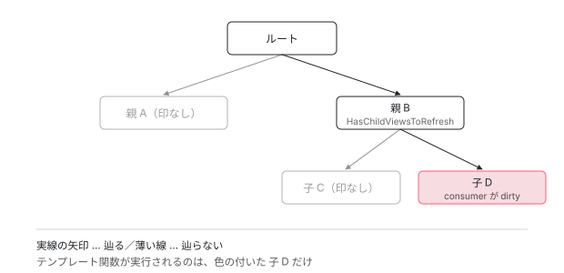

[目次](../README.md) › [変更検知の各ステップ](README.md) › 第 1 回 / 全 9 回

# 変更検知は何を見て「省略」するか（概観）

> LView のフラグと refreshView() の実装から、OnPush・markForCheck・Signal の 3 つがどう一本の仕組みに合流しているかを読み解く。

angular/angular · 読了 約 14 分 · 中核 · [サイトで読む（デモが動きます）](https://angular-deep-dive-cyan.vercel.app/chapter/change-detection)

---

> [!NOTE]
> **ポイント**
>
> この章はシリーズ「変更検知の各ステップ」の概観です。ここで軽く触れる detectChangesInView・refreshView・markForCheck・Signal との合流は、次の章から 1 関数ずつ全部読みます。[シリーズの構成を見る](README.md)

読む対象は `packages/core/src/render3/instructions/change_detection.ts` です。ここに「どのビューを更新し、どれを飛ばすか」の判断がすべて入っています。まず状態を表すフラグから見ます。

## 1. ビューの状態はビットで持たれている

📄 `angular/packages/core/src/render3/interfaces/view.ts` L410–471 （▶ の行: 435, 441, 458, 471）

```ts
410 │ export const enum LViewFlags {
411 │   /** The state of the init phase on the first 2 bits */
412 │   InitPhaseStateIncrementer = 0b00000000001,
413 │   InitPhaseStateMask = 0b00000000011,
414 │ 
415 │   /**
416 │    * Whether or not the view is in creationMode.
417 │    *
418 │    * This must be stored in the view rather than using `data` as a marker so that
419 │    * we can properly support embedded views. Otherwise, when exiting a child view
420 │    * back into the parent view, `data` will be defined and `creationMode` will be
421 │    * improperly reported as false.
422 │    */
423 │   CreationMode = 1 << 2,
424 │ 
425 │   /**
426 │    * Whether or not this LView instance is on its first processing pass.
427 │    *
428 │    * An LView instance is considered to be on its "first pass" until it
429 │    * has completed one creation mode run and one update mode run. At this
430 │    * time, the flag is turned off.
431 │    */
432 │   FirstLViewPass = 1 << 3,
433 │ 
434 │   /** Whether this view has default change detection strategy (checks always) or onPush */
435 ▶   CheckAlways = 1 << 4,
436 │ 
437 │   /** Whether there are any i18n blocks inside this LView. */
438 │   HasI18n = 1 << 5,
439 │ 
440 │   /** Whether or not this view is currently dirty (needing check) */
441 ▶   Dirty = 1 << 6,
442 │ 
443 │   /** Whether or not this view is currently attached to change detection tree. */
444 │   Attached = 1 << 7,
445 │ 
446 │   /** Whether or not this view is destroyed. */
447 │   Destroyed = 1 << 8,
448 │ 
449 │   /** Whether or not this view is the root view */
450 │   IsRoot = 1 << 9,
451 │ 
452 │   /**
453 │    * Whether this moved LView needs to be refreshed. Similar to the Dirty flag, but used for
454 │    * transplanted and signal views where the parent/ancestor views are not marked dirty as well.
455 │    * i.e. "Refresh just this view". Used in conjunction with the HAS_CHILD_VIEWS_TO_REFRESH
456 │    * flag.
457 │    */
458 ▶   RefreshView = 1 << 10,
459 │ 
460 │   /** Indicates that the view **or any of its ancestors** have an embedded view injector. */
461 │   HasEmbeddedViewInjector = 1 << 11,
462 │ 
463 │   /** Indicates that the view was created with `signals: true`. */
464 │   SignalView = 1 << 12,
465 │ 
466 │   /**
467 │    * Indicates that this LView has a view underneath it that needs to be refreshed during change
468 │    * detection. This flag indicates that even if this view is not dirty itself, we still need to
469 │    * traverse its children during change detection.
470 │    */
471 ▶   HasChildViewsToRefresh = 1 << 13,
```

変更検知に効くのはこの 4 つです。

| 行 | フラグ | 意味 |
| --- | --- | --- |
| 435 | `CheckAlways` | OnPush **でない**。毎回チェックしてよい |
| 441 | `Dirty` | このビューは変わったのでチェックが必要 |
| 458 | `RefreshView` | このビューだけをピンポイントで更新したい |
| 471 | `HasChildViewsToRefresh` | 自分は変わっていないが、子孫に用がある（通り道） |

458 行目のコメントに注目してください。「Dirty に似ているが、**先祖を dirty にせずにこのビューだけを更新したい**とき」に使う、と書かれています。Signal による部分更新がここに効いてきます。

## 2. 2 つの走査モード

📄 `angular/packages/core/src/render3/instructions/change_detection.ts` L161–187 （▶ の行: 174, 178）

```ts
161 │ 
162 │ /**
163 │  * Different modes of traversing the logical view tree during change detection.
164 │  *
165 │  *
166 │  * The change detection traversal algorithm switches between these modes based on various
167 │  * conditions.
168 │  */
169 │ export const enum ChangeDetectionMode {
170 │   /**
171 │    * In `Global` mode, `Dirty` and `CheckAlways` views are refreshed as well as views with the
172 │    * `RefreshView` flag.
173 │    */
174 ▶   Global,
175 │   /**
176 │    * In `Targeted` mode, only views with the `RefreshView` flag or updated signals are refreshed.
177 │    */
178 ▶   Targeted,
179 │ }
180 │ 
181 │ /**
182 │  * Processes a view in update mode. This includes a number of steps in a specific order:
183 │  * - executing a template function in update mode;
184 │  * - executing hooks;
185 │  * - refreshing queries;
186 │  * - setting host bindings;
187 │  * - refreshing child (embedded and component) views.
```

`Global` は普通の走査、`Targeted` は **「印が付いたものだけ」**を狙い撃ちする走査です。この 2 つを行き来しながら木を降りていきます。

## 3. 核心の関数

変更検知の判断は、この 1 か所に集まっています。

📄 `angular/packages/core/src/render3/instructions/change_detection.ts` L502–560 （▶ の行: 509, 519, 526, 529, 538, 540, 542）

```ts
502 │ function detectChangesInView(lView: LView, mode: ChangeDetectionMode) {
503 │   const isInCheckNoChangesPass = ngDevMode && isInCheckNoChangesMode();
504 │   const tView = lView[TVIEW];
505 │   const flags = lView[FLAGS];
506 │   const consumer = lView[REACTIVE_TEMPLATE_CONSUMER];
507 │ 
508 │   // Refresh CheckAlways views in Global mode.
509 ▶   let shouldRefreshView: boolean = !!(
510 │     mode === ChangeDetectionMode.Global && flags & LViewFlags.CheckAlways
511 │   );
512 │ 
513 │   // Refresh Dirty views in Global mode, as long as we're not in checkNoChanges.
514 │   // CheckNoChanges never worked with `OnPush` components because the `Dirty` flag was
515 │   // cleared before checkNoChanges ran. Because there is now a loop for to check for
516 │   // backwards views, it gives an opportunity for `OnPush` components to be marked `Dirty`
517 │   // before the CheckNoChanges pass. We don't want existing errors that are hidden by the
518 │   // current CheckNoChanges bug to surface when making unrelated changes.
519 ▶   shouldRefreshView ||= !!(
520 │     flags & LViewFlags.Dirty &&
521 │     mode === ChangeDetectionMode.Global &&
522 │     !isInCheckNoChangesPass
523 │   );
524 │ 
525 │   // Always refresh views marked for refresh, regardless of mode.
526 ▶   shouldRefreshView ||= !!(flags & LViewFlags.RefreshView);
527 │ 
528 │   // Refresh views when they have a dirty reactive consumer, regardless of mode.
529 ▶   shouldRefreshView ||= !!(consumer?.dirty && consumerPollProducersForChange(consumer));
530 │ 
531 │   shouldRefreshView ||= !!(ngDevMode && isExhaustiveCheckNoChanges());
532 │ 
533 │   // Mark the Flags and `ReactiveNode` as not dirty before refreshing the component, so that they
534 │   // can be re-dirtied during the refresh process.
535 │   if (consumer) {
536 │     consumer.dirty = false;
537 │   }
538 ▶   lView[FLAGS] &= ~(LViewFlags.HasChildViewsToRefresh | LViewFlags.RefreshView);
539 │ 
540 ▶   if (shouldRefreshView) {
541 │     refreshView(tView, lView, tView.template, lView[CONTEXT]);
542 ▶   } else if (flags & LViewFlags.HasChildViewsToRefresh) {
543 │     // Set active consumer to null to avoid inheriting an improper reactive context
544 │     const prevConsumer = setActiveConsumer(null);
545 │     try {
546 │       if (!isInCheckNoChangesPass) {
547 │         runEffectsInView(lView);
548 │       }
549 │       detectChangesInEmbeddedViews(lView, ChangeDetectionMode.Targeted);
550 │       const components = tView.components;
551 │       if (components !== null) {
552 │         detectChangesInChildComponents(lView, components, ChangeDetectionMode.Targeted);
553 │       }
554 │       if (!isInCheckNoChangesPass) {
555 │         addAfterRenderSequencesForView(lView);
556 │       }
557 │     } finally {
558 │       setActiveConsumer(prevConsumer);
559 │     }
560 │   }
```

509 行目から 529 行目まで、`shouldRefreshView` に `||=` が並びます。**更新する理由は 4 つあり、どれか 1 つ当てはまれば更新する** ということがそのまま書かれています。

| 行 | 更新する理由 |
| --- | --- |
| 509 | Global モードで、OnPush ではない |
| 519 | Global モードで、Dirty が立っている |
| 526 | `RefreshView` が立っている（モード不問） |
| 529 | テンプレートの consumer が dirty で、**かつ実際に依存が変わっている** |

> [!NOTE]
> **さらに深く**
>
> 529 行目が Signal と変更検知の接点です。呼ばれている `consumerPollProducersForChange` は、前の章で読んだあの関数そのものです。**テンプレートは巨大な computed のようなもの**で、同じグラフに consumer として 参加しています。「dirty と言われたが本当に変わったのか」を問い直す仕組みが、そのまま再描画の判断に使われています。

538 行目からが分岐です。更新するなら 540 行目の `refreshView`。しないなら 542 行目で `HasChildViewsToRefresh` を見て、**自分は実行せずに子だけを `Targeted` で辿ります**。

これが Signal を使ったときの効率の正体です。深い階層の signal が 1 つ変わったとき、ルートからそこまでの経路は 542 行目の分岐を通るだけで、途中のテンプレート関数は**一度も実行されません**。



*Signal が 1 つ変わったとき、ルートからその位置までは HasChildViewsToRefresh だけが立ち、経路上のテンプレート関数は実行されない。実行されるのは印の付いた末端だけ。*

## 4. 印を付ける側

📄 `angular/packages/core/src/render3/instructions/mark_view_dirty.ts` L16–52 （▶ の行: 41–42, 45）

```ts
16 │  * Marks current view and all ancestors dirty.
17 │  *
18 │  * Returns the root view because it is found as a byproduct of marking the view tree
19 │  * dirty, and can be used by methods that consume markViewDirty() to easily schedule
20 │  * change detection. Otherwise, such methods would need to traverse up the view tree
21 │  * an additional time to get the root view and schedule a tick on it.
22 │  *
23 │  * @param lView The starting LView to mark dirty
24 │  * @returns the root LView
25 │  */
26 │ export function markViewDirty(lView: LView, source: NotificationSource): LView | null {
27 │   const dirtyBitsToUse = isRefreshingViews()
28 │     ? // When we are actively refreshing views, we only use the `Dirty` bit to mark a view
29 │       // for check. This bit is ignored in ChangeDetectionMode.Targeted, which is used to
30 │       // synchronously rerun change detection on a specific set of views (those which have
31 │       // the `RefreshView` flag and those with dirty signal consumers). `LViewFlags.Dirty`
32 │       // does not support re-entrant change detection on its own.
33 │       LViewFlags.Dirty
34 │     : // When we are not actively refreshing a view tree, it is absolutely
35 │       // valid to update state and mark views dirty. We use the `RefreshView` flag in this
36 │       // case to allow synchronously rerunning change detection. This applies today to
37 │       // afterRender hooks as well as animation listeners which execute after detecting
38 │       // changes in a view when the render factory flushes.
39 │       LViewFlags.RefreshView | LViewFlags.Dirty;
40 │   lView[ENVIRONMENT].changeDetectionScheduler?.notify(source);
41 ▶   while (lView) {
42 ▶     lView[FLAGS] |= dirtyBitsToUse;
43 │     const parent = getLViewParent(lView);
44 │     // Stop traversing up as soon as you find a root view that wasn't attached to any container
45 ▶     if (isRootView(lView) && !parent) {
46 │       return lView;
47 │     }
48 │     // continue otherwise
49 │     lView = parent!;
50 │   }
51 │   return null;
52 │ }
```

41 行目の `while` でルートまで登り、42 行目で全員にフラグを立てます。**自分だけでなく先祖全員**に印を付ける必要があるのは、変更検知が必ずルートから始まるからです。途中に dirty でない OnPush が 1 つでもあると、そこで木が切れて子まで届きません。

> [!WARNING]
> **ハマりどころ**
>
> 「OnPush のコンポーネントで `setTimeout` の中で値を変えたのに画面が変わらない」のは、この関数が呼ばれていないからです。値は変わっているが 441 行目のフラグが立たず、3 節の 519 行目に引っかからない。Signal ならこの経路を必ず通るので起きません。

## 5. 何度もやり直す仕組み

📄 `angular/packages/core/src/render3/instructions/change_detection.ts` L112–145 （▶ の行: 130–131, 143）

```ts
112 │ function detectChangesInViewWhileDirty(lView: LView, mode: ChangeDetectionMode) {
113 │   const lastIsRefreshingViewsValue = isRefreshingViews();
114 │   try {
115 │     setIsRefreshingViews(true);
116 │     detectChangesInView(lView, mode);
117 │ 
118 │     // We don't need or want to do any looping when in exhaustive checkNoChanges because we
119 │     // already traverse all the views and nothing should change so we shouldn't have to do
120 │     // another pass to pick up new changes.
121 │     if (ngDevMode && isExhaustiveCheckNoChanges()) {
122 │       return;
123 │     }
124 │ 
125 │     let retries = 0;
126 │     // If after running change detection, this view still needs to be refreshed or there are
127 │     // descendants views that need to be refreshed due to re-dirtying during the change detection
128 │     // run, detect changes on the view again. We run change detection in `Targeted` mode to only
129 │     // refresh views with the `RefreshView` flag.
130 ▶     while (requiresRefreshOrTraversal(lView)) {
131 ▶       if (retries === MAXIMUM_REFRESH_RERUNS) {
132 │         throw new RuntimeError(
133 │           RuntimeErrorCode.INFINITE_CHANGE_DETECTION,
134 │           ngDevMode &&
135 │             'Infinite change detection while trying to refresh views. ' +
136 │               'There may be components which each cause the other to require a refresh, ' +
137 │               'causing an infinite loop.',
138 │         );
139 │       }
140 │       retries++;
141 │       // Even if this view is detached, we still detect changes in targeted mode because this was
142 │       // the root of the change detection run.
143 ▶       detectChangesInView(lView, ChangeDetectionMode.Targeted);
144 │     }
145 │   } finally {
```

130 行目の `while` が、更新中に新しく dirty になったビューを拾い直します。143 行目でモードが `Targeted` になっているので、2 周目以降は**新しく印が付いたものだけ**が対象です。

📄 `angular/packages/core/src/render3/instructions/change_detection.ts` L85–88 （▶ の行: 88）

```ts
85 │ /**
86 │  * The maximum number of times the change detection traversal will rerun before throwing an error.
87 │  */
88 ▶ export const MAXIMUM_REFRESH_RERUNS = 100;
```

131 行目で上限に達するとエラーになります。「お互いを dirty にし合うコンポーネントがいる」という具体的なメッセージが出るのは、100 回収束しない状況がそれしかないからです。

## 6. refreshView の中の順序

3 節の 540 行目で呼ばれる `refreshView` は 300 行以上あるので、ここでは順序だけを見ます。同じファイルの 190 行目から始まる関数を開くと、上から順にこうなっています。

1. テンプレートを更新モードで実行（バインディングを DOM に反映）
2. pre-order フック（`ngOnInit` / `ngOnChanges` / `ngDoCheck`）
3. 埋め込みビュー（`@if` や `@for` の中身）
4. content クエリ → content フック
5. ホストバインディング
6. 子コンポーネント
7. view クエリ → view フック
8. 最後に `Dirty` フラグを落とす

この並びから、実務で効く事実がそのまま読み取れます。

- テンプレートの実行がフックより先。だから `ngOnInit` の時点で バインディングは更新済み
- content フックは子コンポーネントより前、view フックは後。だから `ngAfterViewInit` で子を触れる
- 同じ理由で、`ngAfterViewInit` で値を変えると `ExpressionChangedAfterItHasBeenChecked` が出る。すでにチェックが終わった後だから

## 読み終えて

zone.js はこの章に一度も出てきませんでした。それが答えです。zone.js の役割は「**いつ**始めるか」だけで、「**何を**更新するか」はすべてこのファイルが決めています。

---

← 前: [zoneless で動く条件、動かなくなる書き方](../zoneless/11-zoneless-migration.md)  
次: [detectChangesInView：更新する 4 つの理由と 2 つのモード](02-cd-detect-changes-in-view.md) →
