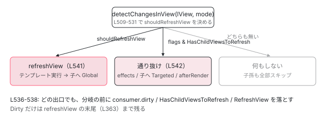

[目次](../README.md) › [変更検知の各ステップ](README.md) › 第 2 回 / 全 9 回

# detectChangesInView：更新する 4 つの理由と 2 つのモード

> shouldRefreshView を決める ||= の 4 行を 1 行ずつ。Global と Targeted の違い、HasChildViewsToRefresh だけが立っているときに「通り道」として降りる処理。

angular/angular · 読了 約 12 分 · 中核 · [サイトで読む（デモが動きます）](https://angular-deep-dive-cyan.vercel.app/chapter/cd-detect-changes-in-view)

---

変更検知は、木のビュー 1 つ 1 つに対して「このビューのテンプレートを実行し直すか、子だけ見に行くか、何もしないか」を決めながら降りていきます。その判断は `detectChangesInView` という 60 行の関数に全部入っています。この章では、その関数の `||=` 4 行を 1 行ずつ読み、2 つの走査モード（`Global` / `Targeted`）と、「自分は更新しないが子へは降りる」分岐が何をしているかを確認します。

読む対象は `packages/core/src/render3/instructions/change_detection.ts` の 90〜149 行目と 419〜572 行目、フラグの定義は `packages/core/src/render3/interfaces/view.ts` です。

1. 概観
2. **detectChangesInView**（この章）
3. refreshView の全ステップ
4. OnPush と markForCheck
5. ReactiveLViewConsumer
6. Targeted 走査
7. checkNoChanges
8. afterRender
9. effect

## 1. 入力は 2 つ：走査モードと LView\[FLAGS\]

📄 `angular/packages/core/src/render3/instructions/change_detection.ts` L162–179 （▶ の行: 171, 174, 176, 178）

```ts
162 │ /**
163 │  * Different modes of traversing the logical view tree during change detection.
164 │  *
165 │  *
166 │  * The change detection traversal algorithm switches between these modes based on various
167 │  * conditions.
168 │  */
169 │ export const enum ChangeDetectionMode {
170 │   /**
171 ▶    * In `Global` mode, `Dirty` and `CheckAlways` views are refreshed as well as views with the
172 │    * `RefreshView` flag.
173 │    */
174 ▶   Global,
175 │   /**
176 ▶    * In `Targeted` mode, only views with the `RefreshView` flag or updated signals are refreshed.
177 │    */
178 ▶   Targeted,
179 │ }
```

171〜172 行目のコメントが `Global` の定義です。`Dirty` か `CheckAlways` か `RefreshView` が立っているビューを更新します。176 行目が `Targeted` の定義で、`RefreshView` か「signal が変わった」ビュー**だけ**を更新します。`CheckAlways` と `Dirty` は `Targeted` では見ません。この違いが 3 節の 510 行目と 521 行目に、条件式としてそのまま現れます。

📄 `angular/packages/core/src/render3/interfaces/view.ts` L434–471 （▶ の行: 435, 441, 444, 458, 471）

```ts
434 │   /** Whether this view has default change detection strategy (checks always) or onPush */
435 ▶   CheckAlways = 1 << 4,
436 │ 
437 │   /** Whether there are any i18n blocks inside this LView. */
438 │   HasI18n = 1 << 5,
439 │ 
440 │   /** Whether or not this view is currently dirty (needing check) */
441 ▶   Dirty = 1 << 6,
442 │ 
443 │   /** Whether or not this view is currently attached to change detection tree. */
444 ▶   Attached = 1 << 7,
445 │ 
446 │   /** Whether or not this view is destroyed. */
447 │   Destroyed = 1 << 8,
448 │ 
449 │   /** Whether or not this view is the root view */
450 │   IsRoot = 1 << 9,
451 │ 
452 │   /**
453 │    * Whether this moved LView needs to be refreshed. Similar to the Dirty flag, but used for
454 │    * transplanted and signal views where the parent/ancestor views are not marked dirty as well.
455 │    * i.e. "Refresh just this view". Used in conjunction with the HAS_CHILD_VIEWS_TO_REFRESH
456 │    * flag.
457 │    */
458 ▶   RefreshView = 1 << 10,
459 │ 
460 │   /** Indicates that the view **or any of its ancestors** have an embedded view injector. */
461 │   HasEmbeddedViewInjector = 1 << 11,
462 │ 
463 │   /** Indicates that the view was created with `signals: true`. */
464 │   SignalView = 1 << 12,
465 │ 
466 │   /**
467 │    * Indicates that this LView has a view underneath it that needs to be refreshed during change
468 │    * detection. This flag indicates that even if this view is not dirty itself, we still need to
469 │    * traverse its children during change detection.
470 │    */
471 ▶   HasChildViewsToRefresh = 1 << 13,
```

`LView[FLAGS]` は 1 つの整数で、各ビットが 1 つの状態です。この章で読むのは 5 ビットです。

| 行 | ビット | 誰が立てるか | 誰が落とすか |
| --- | --- | --- | --- |
| 435 | `CheckAlways` | ビュー作成時。`OnPush` でなければ立つ（次の引用） | 落ちない |
| 441 | `Dirty` | `markViewDirty`（[4 回目](04-cd-onpush-markforcheck.md)） | `refreshView` の末尾（[3 回目](03-cd-refresh-view.md)） |
| 444 | `Attached` | 作成時。`reattach()` | `ChangeDetectorRef.detach()`（5 節） |
| 458 | `RefreshView` | `markViewForRefresh`、`ViewRef.detectChanges()` | `detectChangesInView` 538 行目（4 節） |
| 471 | `HasChildViewsToRefresh` | `markAncestorsForTraversal`（[6 回目](06-cd-targeted-traversal.md)） | `detectChangesInView` 538 行目（4 節） |

📄 `angular/packages/core/src/render3/view/construction.ts` L259–271 （▶ の行: 264, 267–268）

```ts
259 │ /**
260 │  * Gets the initial set of LView flags based on the component definition that the LView represents.
261 │  * @param def Component definition from which to determine the flags.
262 │  */
263 │ export function getInitialLViewFlagsFromDef(def: ComponentDef<unknown>): LViewFlags {
264 ▶   let flags = LViewFlags.CheckAlways;
265 │   if (def.signals) {
266 │     flags = LViewFlags.SignalView;
267 ▶   } else if (def.onPush) {
268 ▶     flags = LViewFlags.Dirty;
269 │   }
270 │   return flags;
271 │ }
```

264 行目、コンポーネントビューの初期フラグは `CheckAlways` です。267〜268 行目、`changeDetection: ChangeDetectionStrategy.OnPush` を書いたコンポーネントだけ `CheckAlways` の代わりに `Dirty` から始まります （初回は必ず描画しなければならないので `Dirty` です）。つまり**「OnPush である」とは「`CheckAlways` ビットが無い」ことです**。ソースに「OnPush」という名前のビットはありません。

## 2. 入口：detectChangesInternal と「やり直しループ」

`ApplicationRef`（ルートビュー）からも `ViewRef.detectChanges()`（任意のビュー）からも、走査の起点として呼ばれるのは `detectChangesInternal` です。

📄 `angular/packages/core/src/render3/instructions/change_detection.ts` L90–110 （▶ の行: 90, 97, 100, 104, 107）

```ts
 90 ▶ export function detectChangesInternal(lView: LView, mode = ChangeDetectionMode.Global) {
 91 │   const environment = lView[ENVIRONMENT];
 92 │   const rendererFactory = environment.rendererFactory;
 93 │ 
 94 │   // Check no changes mode is a dev only mode used to verify that bindings have not changed
 95 │   // since they were assigned. We do not want to invoke renderer factory functions in that mode
 96 │   // to avoid any possible side-effects.
 97 ▶   const checkNoChangesMode = !!ngDevMode && isInCheckNoChangesMode();
 98 │ 
 99 │   if (!checkNoChangesMode) {
100 ▶     rendererFactory.begin?.();
101 │   }
102 │ 
103 │   try {
104 ▶     detectChangesInViewWhileDirty(lView, mode);
105 │   } finally {
106 │     if (!checkNoChangesMode) {
107 ▶       rendererFactory.end?.();
108 │     }
109 │   }
110 │ }
```

90 行目、`mode` の既定値は `Global` です。100 行目と 107 行目で `rendererFactory.begin()` / `end()` を呼びます。これはアニメーション等のレンダラが「1 回の走査が始まった・終わった」を知るためのものです。97 行目、`checkNoChanges` の走査中は副作用を避けるため呼びません （[7 回目](07-cd-check-no-changes.md)）。本体は 104 行目です。

📄 `angular/packages/core/src/render3/instructions/change_detection.ts` L112–149 （▶ の行: 115–116, 130–131, 143, 147）

```ts
112 │ function detectChangesInViewWhileDirty(lView: LView, mode: ChangeDetectionMode) {
113 │   const lastIsRefreshingViewsValue = isRefreshingViews();
114 │   try {
115 ▶     setIsRefreshingViews(true);
116 ▶     detectChangesInView(lView, mode);
117 │ 
118 │     // We don't need or want to do any looping when in exhaustive checkNoChanges because we
119 │     // already traverse all the views and nothing should change so we shouldn't have to do
120 │     // another pass to pick up new changes.
121 │     if (ngDevMode && isExhaustiveCheckNoChanges()) {
122 │       return;
123 │     }
124 │ 
125 │     let retries = 0;
126 │     // If after running change detection, this view still needs to be refreshed or there are
127 │     // descendants views that need to be refreshed due to re-dirtying during the change detection
128 │     // run, detect changes on the view again. We run change detection in `Targeted` mode to only
129 │     // refresh views with the `RefreshView` flag.
130 ▶     while (requiresRefreshOrTraversal(lView)) {
131 ▶       if (retries === MAXIMUM_REFRESH_RERUNS) {
132 │         throw new RuntimeError(
133 │           RuntimeErrorCode.INFINITE_CHANGE_DETECTION,
134 │           ngDevMode &&
135 │             'Infinite change detection while trying to refresh views. ' +
136 │               'There may be components which each cause the other to require a refresh, ' +
137 │               'causing an infinite loop.',
138 │         );
139 │       }
140 │       retries++;
141 │       // Even if this view is detached, we still detect changes in targeted mode because this was
142 │       // the root of the change detection run.
143 ▶       detectChangesInView(lView, ChangeDetectionMode.Targeted);
144 │     }
145 │   } finally {
146 │     // restore state to what it was before entering this change detection loop
147 ▶     setIsRefreshingViews(lastIsRefreshingViewsValue);
148 │   }
149 │ }
```

1. **115 行目：`setIsRefreshingViews(true)`**

   「いま走査中である」というモジュール変数を立てます。`markViewDirty` がこの値を見て、立てるビットを変えます （[4 回目](04-cd-onpush-markforcheck.md)の 27 行目）。147 行目で元の値に戻します。
2. **116 行目：1 回目の `detectChangesInView(lView, mode)`**

   渡された `mode`（既定は `Global`）でルートから降ります。
3. **130 行目：`while (requiresRefreshOrTraversal(lView))`**

   1 回目の走査の**途中で**誰かが `RefreshView` を立てたり signal を書いたりすると、ルートビューにまた印が残ります。それが残っている限り繰り返します。
4. **143 行目：2 回目以降は必ず `Targeted`**

   印が付いたものだけを狙う走査です。`CheckAlways` のビューはここでは実行されません。1 周目で全部実行したばかりなので、もう一度全部やり直す必要がないからです。
5. **131 行目：100 回で `INFINITE_CHANGE_DETECTION`**

   `MAXIMUM_REFRESH_RERUNS` は 88 行目で `100` です。毎周ルートに印が戻ってくる状況（互いを dirty にし合うコンポーネント）だけがここに到達します。

📄 `angular/packages/core/src/render3/instructions/change_detection.ts` L85–88 （▶ の行: 88）

```ts
85 │ /**
86 │  * The maximum number of times the change detection traversal will rerun before throwing an error.
87 │  */
88 ▶ export const MAXIMUM_REFRESH_RERUNS = 100;
```

📄 `angular/packages/core/src/render3/util/view_utils.ts` L236–241 （▶ の行: 238–239）

```ts
236 │ export function requiresRefreshOrTraversal(lView: LView) {
237 │   return !!(
238 ▶     lView[FLAGS] & (LViewFlags.RefreshView | LViewFlags.HasChildViewsToRefresh) ||
239 ▶     lView[REACTIVE_TEMPLATE_CONSUMER]?.dirty
240 │   );
241 │ }
```

130 行目の判定条件です。238 行目で `RefreshView` か `HasChildViewsToRefresh`、239 行目でテンプレート consumer の `dirty`。**`Dirty` ビットは見ていません**。`Dirty` は `Global` 専用の印で、ループの継続条件には使われないのです。この関数は `ApplicationRef.synchronizeOnce` でも、どのルートビューを走査するかの判定に使われています。

📄 `angular/packages/core/src/application/application_ref.ts` L638–655 （▶ の行: 641, 646, 650, 652–653）

```ts
638 │       // Check all potentially dirty views.
639 │       for (let {_lView} of this.allViews) {
640 │         // When re-checking, only check views which actually need it.
641 ▶         if (!useGlobalCheck && !requiresRefreshOrTraversal(_lView)) {
642 │           continue;
643 │         }
644 │ 
645 │         const mode =
646 ▶           useGlobalCheck && !this.zonelessEnabled
647 │             ? // Global mode includes `CheckAlways` views.
648 │               // When using zoneless, all root views must be explicitly marked for refresh, even if they are
649 │               // `CheckAlways`.
650 ▶               ChangeDetectionMode.Global
651 │             : // Only refresh views with the `RefreshView` flag or views is a changed signal
652 ▶               ChangeDetectionMode.Targeted;
653 ▶         detectChangesInternal(_lView, mode);
654 │         ranDetectChanges = true;
655 │       }
```

641 行目、`ViewTreeGlobal` が立っていないなら `requiresRefreshOrTraversal` が `false` のルートビューは飛ばします。645〜652 行目、**zoneless のときは最初から `Targeted`**、zone.js ありで `ApplicationRef.tick()` が `ViewTreeGlobal` を立てたときだけ `Global` です。詳しくは [zoneless シリーズの tick の章](../zoneless/05-zoneless-tick.md)を見てください。

## 3. 核心：shouldRefreshView を決める 4 行

📄 `angular/packages/core/src/render3/instructions/change_detection.ts` L492–511 （▶ の行: 503, 505–506, 509–510）

```ts
492 │ /**
493 │  * Visits a view as part of change detection traversal.
494 │  *
495 │  * The view is refreshed if:
496 │  * - If the view is CheckAlways or Dirty and ChangeDetectionMode is `Global`
497 │  * - If the view has the `RefreshView` flag
498 │  *
499 │  * The view is not refreshed, but descendants are traversed in `ChangeDetectionMode.Targeted` if the
500 │  * view HasChildViewsToRefresh flag is set.
501 │  */
502 │ function detectChangesInView(lView: LView, mode: ChangeDetectionMode) {
503 ▶   const isInCheckNoChangesPass = ngDevMode && isInCheckNoChangesMode();
504 │   const tView = lView[TVIEW];
505 ▶   const flags = lView[FLAGS];
506 ▶   const consumer = lView[REACTIVE_TEMPLATE_CONSUMER];
507 │ 
508 │   // Refresh CheckAlways views in Global mode.
509 ▶   let shouldRefreshView: boolean = !!(
510 ▶     mode === ChangeDetectionMode.Global && flags & LViewFlags.CheckAlways
511 │   );
```

503〜506 行目で、判定に使う 4 つの値をローカルに取り出します。`flags` は 505 行目の時点の値で固定されることに注意してください。4 節で 538 行目がフラグを書き換えますが、542 行目はこのローカル変数 `flags` を見ます。

1. **509〜511 行目：理由 1 — `Global` かつ `CheckAlways`**

   OnPush でない（`ChangeDetectionStrategy.Eager` を明示した）コンポーネントは、`Global` 走査なら無条件に更新されます。`Targeted` では `mode === Global` が偽になり、この行では決まりません。

📄 `angular/packages/core/src/render3/instructions/change_detection.ts` L513–531 （▶ の行: 519–522, 526, 529, 531）

```ts
513 │   // Refresh Dirty views in Global mode, as long as we're not in checkNoChanges.
514 │   // CheckNoChanges never worked with `OnPush` components because the `Dirty` flag was
515 │   // cleared before checkNoChanges ran. Because there is now a loop for to check for
516 │   // backwards views, it gives an opportunity for `OnPush` components to be marked `Dirty`
517 │   // before the CheckNoChanges pass. We don't want existing errors that are hidden by the
518 │   // current CheckNoChanges bug to surface when making unrelated changes.
519 ▶   shouldRefreshView ||= !!(
520 ▶     flags & LViewFlags.Dirty &&
521 ▶     mode === ChangeDetectionMode.Global &&
522 ▶     !isInCheckNoChangesPass
523 │   );
524 │ 
525 │   // Always refresh views marked for refresh, regardless of mode.
526 ▶   shouldRefreshView ||= !!(flags & LViewFlags.RefreshView);
527 │ 
528 │   // Refresh views when they have a dirty reactive consumer, regardless of mode.
529 ▶   shouldRefreshView ||= !!(consumer?.dirty && consumerPollProducersForChange(consumer));
530 │ 
531 ▶   shouldRefreshView ||= !!(ngDevMode && isExhaustiveCheckNoChanges());
```

1. **519〜523 行目：理由 2 — `Dirty` かつ `Global` かつ checkNoChanges 中でない**

   OnPush コンポーネントが更新される通常の経路です。`Dirty` は `markViewDirty` が立てます。522 行目、`checkNoChanges` の 2 回目走査では `Dirty` を理由に更新しません。513〜518 行目のコメントに理由が書かれています。「`Dirty` は 1 回目で落とされるので、歴史的に checkNoChanges は OnPush を見ていなかった。いまのループ構造では 2 回目の前に OnPush が再度 `Dirty` になり得るが、それで今まで隠れていたエラーが急に出るのを避ける」ためです。
2. **526 行目：理由 3 — `RefreshView`（モード不問）**

   `mode` を見ていません。`Targeted` でも `Global` でも、このビットがあれば更新します。立てるのは `markViewForRefresh` と `ViewRef.detectChanges()` です（[6 回目](06-cd-targeted-traversal.md)）。
3. **529 行目：理由 4 — consumer が dirty で、かつ本当に依存が変わった**

   `consumer` は 506 行目で取り出した `lView[REACTIVE_TEMPLATE_CONSUMER]` です。テンプレートが signal を読んでいなければ `null` で、`?.` により偽です。`consumer.dirty` が真でも、`consumerPollProducersForChange` が 「読んだときのバージョンと今のバージョンが同じ」と答えれば更新しません。この関数の中身は [5 回目](05-cd-signal-consumer.md)で読みます。
4. **531 行目：理由 5（開発モードのみ）— exhaustive checkNoChanges**

   `provideCheckNoChangesConfig({ exhaustive: true })` のときだけ、すべてのビューを更新対象にします。本番ビルドでは `ngDevMode` が偽で消えます。

> [!NOTE]
> **ポイント**
>
> 4 つの理由のうち、`mode` を見るのは理由 1 と理由 2 だけです。だから `Targeted` モードの定義（176 行目）は「`RefreshView` か signal の変化」になります。モードは「`CheckAlways` と `Dirty` を無視するかどうか」のスイッチだと言い換えられます。

## 4. 判定の直後にフラグを落とす

📄 `angular/packages/core/src/render3/instructions/change_detection.ts` L533–538 （▶ の行: 536, 538）

```ts
533 │   // Mark the Flags and `ReactiveNode` as not dirty before refreshing the component, so that they
534 │   // can be re-dirtied during the refresh process.
535 │   if (consumer) {
536 ▶     consumer.dirty = false;
537 │   }
538 ▶   lView[FLAGS] &= ~(LViewFlags.HasChildViewsToRefresh | LViewFlags.RefreshView);
```

536 行目で `consumer.dirty = false`、538 行目で `HasChildViewsToRefresh` と `RefreshView` を落とします。**`refreshView` を呼ぶ前に**落とすのが重要です。533〜534 行目のコメントどおり、テンプレート実行中に再び印が付いたら、それを「新しい印」として 2 節の `while` ループが拾えるようにするためです。もし後で落とすと、実行中に付いた印まで一緒に消えてしまいます。

一方 `Dirty` はここでは落としません。`Dirty` は `refreshView` の 最後で落とされます。

📄 `angular/packages/core/src/render3/instructions/change_detection.ts` L354–364 （▶ の行: 360, 363）

```ts
354 │     // Do not reset the dirty state when running in check no changes mode. We don't want components
355 │     // to behave differently depending on whether check no changes is enabled or not. For example:
356 │     // Marking an OnPush component as dirty from within the `ngAfterViewInit` hook in order to
357 │     // refresh a `NgClass` binding should work. If we would reset the dirty state in the check
358 │     // no changes cycle, the component would be not be dirty for the next update pass. This would
359 │     // be different in production mode where the component dirty state is not reset.
360 ▶     if (!isInCheckNoChangesPass) {
361 │       addAfterRenderSequencesForView(lView);
362 │ 
363 ▶       lView[FLAGS] &= ~(LViewFlags.Dirty | LViewFlags.FirstLViewPass);
364 │     }
```

363 行目、`refreshView` の末尾で `Dirty` と `FirstLViewPass` を落とします。360 行目、checkNoChanges の走査では落としません（理由は 354〜359 行目のコメント。[7 回目](07-cd-check-no-changes.md)で読みます）。「判定の前に落とす印」と「実行の後に落とす印」が分かれているので、`ViewRef.detectChanges()` は `Dirty` ではなく `RefreshView` を使います。

📄 `angular/packages/core/src/render3/view_ref.ts` L307–315 （▶ の行: 309–310, 313–314）

```ts
307 │   detectChanges(): void {
308 │     // Add `RefreshView` flag to ensure this view is refreshed if not already dirty.
309 ▶     // `RefreshView` flag is used intentionally over `Dirty` because it gets cleared before
310 ▶     // executing any of the actual refresh code while the `Dirty` flag doesn't get cleared
311 │     // until the end of the refresh. Using `RefreshView` prevents creating a potential difference
312 │     // in the state of the LViewFlags during template execution.
313 ▶     this._lView[FLAGS] |= LViewFlags.RefreshView;
314 ▶     detectChangesInternal(this._lView);
315 │   }
```

309〜312 行目のコメントがその理由です。`RefreshView` はテンプレート実行の前に落ちるので、テンプレート実行中に見える `LView[FLAGS]` の状態が、通常の走査のときと同じになります。313 行目で立てて、314 行目で 2 節の `detectChangesInternal` を呼びます。

## 5. 更新するか、通り抜けるか、何もしないか

📄 `angular/packages/core/src/render3/instructions/change_detection.ts` L540–561 （▶ の行: 540–542, 544, 547, 549, 552, 555）

```ts
540 ▶   if (shouldRefreshView) {
541 ▶     refreshView(tView, lView, tView.template, lView[CONTEXT]);
542 ▶   } else if (flags & LViewFlags.HasChildViewsToRefresh) {
543 │     // Set active consumer to null to avoid inheriting an improper reactive context
544 ▶     const prevConsumer = setActiveConsumer(null);
545 │     try {
546 │       if (!isInCheckNoChangesPass) {
547 ▶         runEffectsInView(lView);
548 │       }
549 ▶       detectChangesInEmbeddedViews(lView, ChangeDetectionMode.Targeted);
550 │       const components = tView.components;
551 │       if (components !== null) {
552 ▶         detectChangesInChildComponents(lView, components, ChangeDetectionMode.Targeted);
553 │       }
554 │       if (!isInCheckNoChangesPass) {
555 ▶         addAfterRenderSequencesForView(lView);
556 │       }
557 │     } finally {
558 │       setActiveConsumer(prevConsumer);
559 │     }
560 │   }
561 │ }
```

1. **540〜541 行目：更新する**

   `refreshView(tView, lView, tView.template, lView[CONTEXT])`。テンプレート関数を Update モードで実行し、フック、子ビューまで全部処理します （[3 回目](03-cd-refresh-view.md)）。子へは `refreshView` の中から `Global` モードで降ります。
2. **542 行目：通り抜ける**

   自分は更新しないが、505 行目で取り出した `flags` に `HasChildViewsToRefresh` があった。つまり**子孫のどこかに用がある**ビューです。自分のテンプレートは実行せず、544 行目で `setActiveConsumer(null)` にして （親の consumer に子の signal 読み取りが紛れ込まないように）、549 行目と 552 行目で埋め込みビューと子コンポーネントを `Targeted` で辿ります。
3. **547 行目と 555 行目：通り抜けでもやること**

   `runEffectsInView`（このビューの `effect()` を実行。[9 回目](09-cd-effects.md)）と `addAfterRenderSequencesForView`（このビューで登録された `afterRender` を管理者に渡す。[8 回目](08-cd-after-render.md)）。テンプレートを実行しなくても、この 2 つは通り道でも処理されます。
4. **どちらでもない：何もしない**

   `else if` に落ちなければ、このビューと**その子孫全部**がスキップされます。OnPush で `Dirty` が無く、印も無いビューはここで木が切れます。



*detectChangesInView の 3 つの出口。540 行目は refreshView（子へは Global）、542 行目は子だけ Targeted、それ以外は子孫ごとスキップ。*

> **🧪 DEMO — 4 条件を手で評価する**
>
> mode と LView\[FLAGS\] のビット、consumer の状態を選ぶと、509 / 519 / 526 / 529 行目のどれで shouldRefreshView が真になるか、540 / 542 行目のどちらに入るかが出ます。
>
> ▶ [このデモはサイトで動かせます](https://angular-deep-dive-cyan.vercel.app/chapter/cd-detect-changes-in-view)

## 6. 子へ降りる 3 つの関数

`refreshView` からも 542 行目からも、子へ降りるには同じ 3 つの小さな関数を通ります。

📄 `angular/packages/core/src/render3/instructions/change_detection.ts` L419–434 （▶ の行: 425, 427, 429, 431）

```ts
419 │ /**
420 │  * Goes over embedded views (ones created through ViewContainerRef APIs) and refreshes
421 │  * them by executing an associated template function.
422 │  */
423 │ function detectChangesInEmbeddedViews(lView: LView, mode: ChangeDetectionMode) {
424 │   for (
425 ▶     let lContainer = getFirstLContainer(lView);
426 │     lContainer !== null;
427 ▶     lContainer = getNextLContainer(lContainer)
428 │   ) {
429 ▶     for (let i = CONTAINER_HEADER_OFFSET; i < lContainer.length; i++) {
430 │       const embeddedLView = lContainer[i];
431 ▶       detectChangesInViewIfAttached(embeddedLView, mode);
432 │     }
433 │   }
434 │ }
```

埋め込みビューとは `@if` / `@for` / `ng-template` から作られたビューです。425〜427 行目でこのビュー直下の `LContainer` を順に辿り、429〜431 行目で各コンテナに入っているビューを 1 つずつ `detectChangesInViewIfAttached` に渡します。`CONTAINER_HEADER_OFFSET` より前はコンテナのヘッダ領域なので飛ばします （[LContainer の章](../ivy/11-ivy-lcontainer.md)）。

📄 `angular/packages/core/src/render3/instructions/change_detection.ts` L563–572 （▶ の行: 566, 570）

```ts
563 │ /** Refreshes child components in the current view (update mode). */
564 │ function detectChangesInChildComponents(
565 │   hostLView: LView,
566 ▶   components: number[],
567 │   mode: ChangeDetectionMode,
568 │ ): void {
569 │   for (let i = 0; i < components.length; i++) {
570 ▶     detectChangesInComponent(hostLView, components[i], mode);
571 │   }
572 │ }
```

📄 `angular/packages/core/src/render3/instructions/change_detection.ts` L458–478 （▶ の行: 470, 472, 474, 476）

```ts
458 │ /**
459 │  * Detects changes in a component by entering the component view and processing its bindings,
460 │  * queries, etc. if it is CheckAlways, OnPush and Dirty, etc.
461 │  *
462 │  * @param componentHostIdx  Element index in LView[] (adjusted for HEADER_OFFSET)
463 │  */
464 │ function detectChangesInComponent(
465 │   hostLView: LView,
466 │   componentHostIdx: number,
467 │   mode: ChangeDetectionMode,
468 │ ): void {
469 │   ngDevMode && assertEqual(isCreationMode(hostLView), false, 'Should be run in update mode');
470 ▶   profiler(ProfilerEvent.ComponentStart);
471 │ 
472 ▶   const componentView = getComponentLViewByIndex(componentHostIdx, hostLView);
473 │   try {
474 ▶     detectChangesInViewIfAttached(componentView, mode);
475 │   } finally {
476 ▶     profiler(ProfilerEvent.ComponentEnd, componentView[CONTEXT] as any as {});
477 │   }
478 │ }
```

566 行目の `components` は `tView.components`、このテンプレート内のコンポーネントホスト要素のインデックス配列です。472 行目でその要素のスロットからコンポーネントビュー（`LView`）を取り出し、474 行目で同じ `detectChangesInViewIfAttached` へ。470 行目と 476 行目は DevTools 用のプロファイラ通知で、Angular DevTools の 「このコンポーネントの変更検知に何 ms かかったか」はここで測られています。

📄 `angular/packages/core/src/render3/util/view_utils.ts` L152–158 （▶ の行: 155–156）

```ts
152 │ export function getComponentLViewByIndex(nodeIndex: number, hostView: LView): LView {
153 │   // Could be an LView or an LContainer. If LContainer, unwrap to find LView.
154 │   ngDevMode && assertIndexInRange(hostView, nodeIndex);
155 ▶   const slotValue = hostView[nodeIndex];
156 ▶   const lView = isLView(slotValue) ? slotValue : slotValue[HOST];
157 │   return lView;
158 │ }
```

156 行目、ホスト要素のスロットには `LView` が直接入っている場合と、`LContainer` が入っている場合（そのホスト要素に `ng-template` 系のディレクティブもあるとき）があり、後者は `[HOST]` からコンポーネントビューを取り出します。

## 7. detach したビューはここで止まる

📄 `angular/packages/core/src/render3/instructions/change_detection.ts` L480–490 （▶ の行: 486–487, 489）

```ts
480 │ /**
481 │  * Visits a view as part of change detection traversal.
482 │  *
483 │  * If the view is detached, no additional traversal happens.
484 │  */
485 │ function detectChangesInViewIfAttached(lView: LView, mode: ChangeDetectionMode) {
486 ▶   if (!viewAttachedToChangeDetector(lView)) {
487 ▶     return;
488 │   }
489 ▶   detectChangesInView(lView, mode);
490 │ }
```

📄 `angular/packages/core/src/render3/util/view_utils.ts` L165–173 （▶ の行: 172）

```ts
165 │ /**
166 │  * Returns a boolean for whether the view is attached to the change detection tree.
167 │  *
168 │  * Note: This determines whether a view should be checked, not whether it's inserted
169 │  * into a container. For that, you'll want `viewAttachedToContainer` below.
170 │  */
171 │ export function viewAttachedToChangeDetector(view: LView): boolean {
172 ▶   return (view[FLAGS] & LViewFlags.Attached) === LViewFlags.Attached;
173 │ }
```

📄 `angular/packages/core/src/render3/view_ref.ts` L221–223 （▶ の行: 222）

```ts
221 │   detach(): void {
222 ▶     this._lView[FLAGS] &= ~LViewFlags.Attached;
223 │   }
```

222 行目、`ChangeDetectorRef.detach()` は `Attached` ビットを落とすだけです。172 行目でそれを見て、486〜487 行目で `return`。**`detectChangesInView` に到達しない**ので、4 条件の評価も、フラグの後始末も、子への降下も起きません。`Dirty` が立っていても無視されます（483 行目のコメント「detached なら追加の走査は無い」）。なお 2 節の 143 行目はこの関数を通らず `detectChangesInView` を直接呼ぶので、走査の起点にしたビュー自身は detach されていても処理されます（141〜142 行目のコメント）。

## ここまでの呼び出し

- `detectChangesInternal(rootLView, mode)` — change\_detection.ts L90 — *rendererFactory.begin()*
  - `detectChangesInViewWhileDirty(lView, mode)` — L112 — *setIsRefreshingViews(true)。while で Targeted 再走査*
    - `detectChangesInView(lView, mode)` — L502 — *4 条件 → 538 行目でフラグを落とす*
      - `refreshView(tView, lView, template, context)` — L190 — *shouldRefreshView が真のとき。次章*
        - `detectChangesInEmbeddedViews(lView, Global)` — L423 — *@if / @for のビュー*
        - `detectChangesInChildComponents(lView, components, Global)` — L564
          - `detectChangesInComponent(hostLView, idx, mode)` — L464 — *getComponentLViewByIndex でビューを取る*
            - `detectChangesInViewIfAttached(componentView, mode)` — L485 — *Attached が無ければ return*
              - `detectChangesInView(componentView, mode)` — L502 — *子で同じ判定を繰り返す*
      - `（542 行目）detectChangesInEmbeddedViews / ChildComponents(..., Targeted)` — L549, L552 — *HasChildViewsToRefresh だけのとき*

## 聞かれそうな質問

**Q. OnPush のコンポーネントは、どのビットで判別されているのですか？**

`CheckAlways`（view.ts 435 行目）が**無い**ことで判別されます。`getInitialLViewFlagsFromDef`（construction.ts 264〜269 行目）が、`def.onPush` が偽なら `CheckAlways`、真なら `Dirty` を初期値にします。この v22 スナップショットでは `changeDetection` 未指定は `onPush: true`（definition.ts 352 行目、[Ivy の章](../ivy/02-ivy-overview.md)）なので、何も書かなければ `Dirty` 側です。「OnPush」というビットは存在しません。

**Q. Global と Targeted の違いは、コードのどこに現れますか？**

`detectChangesInView` の 510 行目と 521 行目だけです。`mode === ChangeDetectionMode.Global` が条件に入っているのは理由 1（`CheckAlways`）と 理由 2（`Dirty`）だけで、理由 3（`RefreshView`、526 行目）と 理由 4（consumer、529 行目）はモードを見ません。

**Q. Dirty でも CheckAlways でもない OnPush の子に、signal の変化で到達できるのはなぜですか？**

親が 542 行目の分岐（`HasChildViewsToRefresh`）で「通り抜け」になり、549・552 行目で `Targeted` のまま子へ降りるからです。子では 529 行目の consumer 判定が真になり、`refreshView` が呼ばれます。親のテンプレートは実行されません。印の付け方は [6 回目](06-cd-targeted-traversal.md)で読みます。

**Q. detectChangesInView はフラグをいつ落としますか？**

538 行目、`refreshView` を呼ぶ**前**に `HasChildViewsToRefresh` と `RefreshView` を落とします。`consumer.dirty` も 536 行目で落とします。`Dirty` だけは `refreshView` の末尾（363 行目）です。前に落とすのは、テンプレート実行中に付いた新しい印を 130 行目の `while` が拾えるようにするためです。

**Q. ChangeDetectorRef.detach() したコンポーネントの子は、親が更新されても更新されませんか？**

されません。`detach()`（view\_ref.ts 222 行目）は `Attached` を落とし、`detectChangesInViewIfAttached`（486〜487 行目）がそのビューで `return` します。`detectChangesInView` に入らないので、子への降下（549・552 行目）も起きません。ただし `ViewRef.detectChanges()` をそのビューに直接呼べば、`detectChangesInViewWhileDirty` の 116 行目は `IfAttached` を経由しないので処理されます。

**Q. INFINITE\_CHANGE\_DETECTION はどんなときに出ますか？**

`detectChangesInViewWhileDirty` の 130 行目の `while` が 100 回（88 行目の `MAXIMUM_REFRESH_RERUNS`）回ったときです。継続条件は `requiresRefreshOrTraversal`（view\_utils.ts 236〜241 行目）、つまり 走査のたびにルートまで `RefreshView` / `HasChildViewsToRefresh` / consumer.dirty が戻ってくる状況です。テンプレート実行中に毎回 signal を書いている、などが典型です。

## 読み終えて

- `detectChangesInView`（502〜561 行目）が「更新 / 通り抜け / スキップ」の 3 択を決める唯一の場所
- 更新する理由は 4 つ（509 / 519 / 526 / 529 行目）。モードを見るのは `CheckAlways` と `Dirty` の 2 つだけ
- `RefreshView` と `HasChildViewsToRefresh` は 538 行目で**先に**落とし、実行中に付いた新しい印を `while`（130 行目）が `Targeted` で拾う
- 子へは `detectChangesInEmbeddedViews` → `detectChangesInChildComponents` → `detectChangesInViewIfAttached` の順。`Attached` が無ければそこで木が切れる
- `Dirty` ビットだけは `refreshView` の末尾まで残る。その中身が次章

---

← 前: [変更検知は何を見て「省略」するか（概観）](01-change-detection.md)  
次: [refreshView の全ステップを上から下まで](03-cd-refresh-view.md) →
