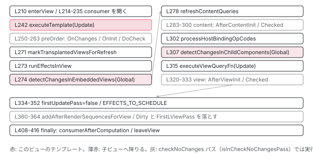

[目次](../README.md) › [変更検知の各ステップ](README.md) › 第 3 回 / 全 9 回

# refreshView の全ステップを上から下まで

> enterView → テンプレート Update → preOrder フック → view effect → 埋め込みビュー → content フック → host binding → 子コンポーネント → view フック → フラグの後始末。順番に理由がある。

angular/angular · 読了 約 15 分 · 中核 · [サイトで読む（デモが動きます）](https://angular-deep-dive-cyan.vercel.app/chapter/cd-refresh-view)

---

[前回](02-cd-detect-changes-in-view.md)の 540 行目で呼ばれる `refreshView` は、1 つのビューに対して「テンプレートを実行し、フックを呼び、子へ降りる」までを 1 本の関数で行います。190〜417 行目、約 230 行です。この章ではそれを 12 の塊に分けて**全部**引用し、各ステップが「なぜその位置にあるか」を、直前・直後のステップとの依存関係から説明します。`ngOnInit` より先にバインディングが更新されている理由、`ngAfterContentInit` が `ngAfterViewInit` より先な理由が、行の並びとして見えます。

読む対象は `packages/core/src/render3/instructions/change_detection.ts` の 181〜417 行目、補助として `render3/hooks.ts`、`render3/state.ts`、`render3/instructions/shared.ts` です。

1. 概観
2. detectChangesInView
3. **refreshView の全ステップ**（この章）
4. OnPush と markForCheck
5. ReactiveLViewConsumer
6. Targeted 走査
7. checkNoChanges
8. afterRender
9. effect

## 0. 全体の並び



*refreshView の try ブロック。上から下へ 1 回だけ流れる。灰色は checkNoChanges パスでは飛ばされるステップ。*

## 1. 入口：引数と早期 return

📄 `angular/packages/core/src/render3/instructions/change_detection.ts` L181–200 （▶ の行: 190, 193, 196, 198, 200）

```ts
181 │ /**
182 │  * Processes a view in update mode. This includes a number of steps in a specific order:
183 │  * - executing a template function in update mode;
184 │  * - executing hooks;
185 │  * - refreshing queries;
186 │  * - setting host bindings;
187 │  * - refreshing child (embedded and component) views.
188 │  */
189 │ 
190 ▶ export function refreshView<T>(
191 │   tView: TView,
192 │   lView: LView,
193 ▶   templateFn: ComponentTemplate<{}> | null,
194 │   context: T,
195 │ ) {
196 ▶   ngDevMode && assertEqual(isCreationMode(lView), false, 'Should be run in update mode');
197 │ 
198 ▶   if (isDestroyed(lView)) return;
199 │ 
200 ▶   const flags = lView[FLAGS];
```

193 行目の `templateFn` はコンポーネントのテンプレート関数（コンパイラが生成した `Cmp_Template`）、`context` はコンポーネントのインスタンスです。前章の 541 行目は `tView.template` と `lView[CONTEXT]` を渡していました。196 行目、この関数は**更新モード専用**です。作成モード（初回の DOM 生成）は `renderView` という別の関数が担当します（[Ivy シリーズ](../ivy/08-ivy-first-create-pass.md)）。198 行目、破棄済みなら何もしません。200 行目で `flags` をローカルに取り、後で `hooksInitPhaseCompleted` の判定に使います。

## 2. ステップ 1：enterView と reactive consumer を開く（202〜235 行目）

📄 `angular/packages/core/src/render3/instructions/change_detection.ts` L202–235 （▶ の行: 204–205, 210, 214–218, 229, 231–232）

```ts
202 │   // Check no changes mode is a dev only mode used to verify that bindings have not changed
203 │   // since they were assigned. We do not want to execute lifecycle hooks in that mode.
204 ▶   const isInCheckNoChangesPass = ngDevMode && isInCheckNoChangesMode();
205 ▶   const isInExhaustiveCheckNoChangesPass = ngDevMode && isExhaustiveCheckNoChanges();
206 │ 
207 │   // Start component reactive context
208 │   // - We might already be in a reactive context if this is an embedded view of the host.
209 │   // - We might be descending into a view that needs a consumer.
210 ▶   enterView(lView);
211 │   let returnConsumerToPool = true;
212 │   let prevConsumer: ReactiveNode | null = null;
213 │   let currentConsumer: ReactiveLViewConsumer | null = null;
214 ▶   if (!isInCheckNoChangesPass) {
215 ▶     if (viewShouldHaveReactiveConsumer(tView)) {
216 ▶       currentConsumer = getOrBorrowReactiveLViewConsumer(lView);
217 ▶       prevConsumer = consumerBeforeComputation(currentConsumer);
218 ▶     } else if (getActiveConsumer() === null) {
219 │       // If the current view should not have a reactive consumer but we don't have an active consumer,
220 │       // we still need to create a temporary consumer to track any signal reads in this template.
221 │       // This is a rare case that can happen with
222 │       // - `viewContainerRef.createEmbeddedView(...).detectChanges()`.
223 │       // - `viewContainerRef.createEmbeddedView(...)` without any other dirty marking on the parent,
224 │       //   flagging the parent component for traversal but not triggering a full `refreshView`.
225 │       // This temporary consumer marks the first parent that _should_ have a consumer for refresh.
226 │       // Once that refresh happens, the signals will be tracked in the parent consumer and we can destroy
227 │       // the temporary one.
228 │       returnConsumerToPool = false;
229 ▶       currentConsumer = getOrCreateTemporaryConsumer(lView);
230 │       prevConsumer = consumerBeforeComputation(currentConsumer);
231 ▶     } else if (lView[REACTIVE_TEMPLATE_CONSUMER]) {
232 ▶       consumerDestroy(lView[REACTIVE_TEMPLATE_CONSUMER]);
233 │       lView[REACTIVE_TEMPLATE_CONSUMER] = null;
234 │     }
235 │   }
```

1. **204〜205 行目：2 つの開発モードフラグを先に読む**

   `isInCheckNoChangesPass` と `isInExhaustiveCheckNoChangesPass`。本番ビルドでは `ngDevMode` が偽なので両方 `false` に畳まれます。以降、フックの実行と `Dirty` の後始末がこの値で分岐します。
2. **210 行目：`enterView(lView)`**

   「いまどのビューの命令を実行中か」を保持するグローバルな `LFrame` を 1 段押します。テンプレート関数の中の `ɵɵproperty` 等の命令は引数に LView を取らず、この LFrame から取ります。
3. **215〜217 行目：このビューが consumer を持つべきなら取り出して開く**

   `viewShouldHaveReactiveConsumer(tView)` は「埋め込みビューでない」とき真です。216 行目で `LView[REACTIVE_TEMPLATE_CONSUMER]`（無ければプールから借りる）、217 行目の `consumerBeforeComputation` がそれを**アクティブ consumer**にします。ここから `consumerAfterComputation`（410 行目）までの間に読まれた signal は、全部この consumer の依存として記録されます。中身は [5 回目](05-cd-signal-consumer.md)。
4. **218〜230 行目：埋め込みビューなのに親の consumer が無い場合**

   `viewContainerRef.createEmbeddedView(...).detectChanges()` のように、埋め込みビューが単独で `refreshView` されたとき、アクティブ consumer は `null` です。そのまま実行すると signal の読み取りが誰にも記録されません。229 行目で一時 consumer を作り、228 行目でプールに返さない印を付けます。
5. **231〜233 行目：埋め込みビューで親の consumer がある場合**

   以前に一時 consumer が付いていたら破棄します。親コンポーネントの consumer が今回の読み取りを引き継ぐからです。
6. **214 行目：checkNoChanges パスでは何もしない**

   `currentConsumer` は `null` のまま。2 回目の検証走査で依存グラフを書き換えないためです。

📄 `angular/packages/core/src/render3/state.ts` L634–658 （▶ の行: 637, 650, 653–654, 656）

```ts
634 │ export function enterView(newView: LView): void {
635 │   ngDevMode && assertNotEqual(newView[0], newView[1] as any, '????');
636 │   ngDevMode && assertLViewOrUndefined(newView);
637 ▶   const newLFrame = allocLFrame();
638 │   if (ngDevMode) {
639 │     assertEqual(newLFrame.isParent, true, 'Expected clean LFrame');
640 │     assertEqual(newLFrame.lView, null, 'Expected clean LFrame');
641 │     assertEqual(newLFrame.tView, null, 'Expected clean LFrame');
642 │     assertEqual(newLFrame.selectedIndex, -1, 'Expected clean LFrame');
643 │     assertEqual(newLFrame.elementDepthCount, 0, 'Expected clean LFrame');
644 │     assertEqual(newLFrame.currentDirectiveIndex, -1, 'Expected clean LFrame');
645 │     assertEqual(newLFrame.currentNamespace, null, 'Expected clean LFrame');
646 │     assertEqual(newLFrame.bindingRootIndex, -1, 'Expected clean LFrame');
647 │     assertEqual(newLFrame.currentQueryIndex, 0, 'Expected clean LFrame');
648 │   }
649 │   const tView = newView[TVIEW];
650 ▶   instructionState.lFrame = newLFrame;
651 │   ngDevMode && tView.firstChild && assertTNodeForTView(tView.firstChild, tView);
652 │   newLFrame.currentTNode = tView.firstChild!;
653 ▶   newLFrame.lView = newView;
654 ▶   newLFrame.tView = tView;
655 │   newLFrame.contextLView = newView;
656 ▶   newLFrame.bindingIndex = tView.bindingStartIndex;
657 │   newLFrame.inI18n = false;
658 │ }
```

637 行目で `LFrame` を 1 つ確保（再利用）し、650 行目でグローバルの `instructionState.lFrame` に差し替えます。653〜654 行目で `lView` と `tView`、656 行目で `bindingIndex` を `tView.bindingStartIndex` に戻します。これにより、テンプレート関数の中の各バインディング命令は「何番目のスロットか」を数え直せます （[LFrame の章](../ivy/15-ivy-lframe.md)）。

## 3. ステップ 2：テンプレートを Update モードで実行（237〜246 行目）

📄 `angular/packages/core/src/render3/instructions/change_detection.ts` L237–246 （▶ の行: 238, 240, 242, 245–246）

```ts
237 │   try {
238 ▶     resetPreOrderHookFlags(lView);
239 │ 
240 ▶     setBindingIndex(tView.bindingStartIndex);
241 │     if (templateFn !== null) {
242 ▶       executeTemplate(tView, lView, templateFn, RenderFlags.Update, context);
243 │     }
244 │ 
245 ▶     const hooksInitPhaseCompleted =
246 ▶       (flags & LViewFlags.InitPhaseStateMask) === InitPhaseState.InitPhaseCompleted;
```

1. **238 行目：`resetPreOrderHookFlags`**

   `LView[PREORDER_HOOK_FLAGS]` を 0 に戻します。pre-order フックは「テンプレート実行の途中で、該当要素に到達したときに」部分的に呼ばれるので、どこまで呼んだかのカーソルを毎回リセットする必要があります。
2. **240 行目：`setBindingIndex(tView.bindingStartIndex)`**

   バインディングの読み書き位置を先頭へ。`enterView` でも設定されますが、同じフレーム内で再度揃えています。
3. **242 行目：`executeTemplate(tView, lView, templateFn, RenderFlags.Update, context)`**

   ここで `{{ name }}` や `[value]="x"` が評価され、変わっていれば DOM に書かれます。ルートビュー（`TViewType.Root`）には `templateFn` が無く `null` なので飛ばします。
4. **245〜246 行目：`hooksInitPhaseCompleted`**

   200 行目で取った `flags` の下 2 ビット（`InitPhaseStateMask`）が `InitPhaseCompleted`（`0b11`）かどうか。**テンプレート実行前の値**で判定しています。これが真なら「このビューの init 系フック（`ngOnInit` / `ngAfterContentInit` / `ngAfterViewInit`）は全部呼び終わっている」ので、以降の 3 か所で軽い `executeCheckHooks` の方を使います。

📄 `angular/packages/core/src/render3/instructions/shared.ts` L86–116 （▶ の行: 96–97, 100, 107, 109）

```ts
 86 │ export function executeTemplate<T>(
 87 │   tView: TView,
 88 │   lView: LView<T>,
 89 │   templateFn: ComponentTemplate<T>,
 90 │   rf: RenderFlags,
 91 │   context: T,
 92 │ ) {
 93 │   const prevSelectedIndex = getSelectedIndex();
 94 │   const isUpdatePhase = rf & RenderFlags.Update;
 95 │   try {
 96 ▶     setSelectedIndex(-1);
 97 ▶     if (isUpdatePhase && lView.length > HEADER_OFFSET) {
 98 │       // When we're updating, inherently select 0 so we don't
 99 │       // have to generate that instruction for most update blocks.
100 ▶       selectIndexInternal(tView, lView, HEADER_OFFSET, !!ngDevMode && isInCheckNoChangesMode());
101 │     }
102 │ 
103 │     const preHookType = isUpdatePhase
104 │       ? ProfilerEvent.TemplateUpdateStart
105 │       : ProfilerEvent.TemplateCreateStart;
106 │     profiler(preHookType, context as unknown as {}, templateFn);
107 ▶     templateFn(rf, context);
108 │   } finally {
109 ▶     setSelectedIndex(prevSelectedIndex);
110 │ 
111 │     const postHookType = isUpdatePhase
112 │       ? ProfilerEvent.TemplateUpdateEnd
113 │       : ProfilerEvent.TemplateCreateEnd;
114 │     profiler(postHookType, context as unknown as {}, templateFn);
115 │   }
116 │ }
```

96 行目で選択インデックスを -1 にし、97〜101 行目で更新モードならインデックス 0（`HEADER_OFFSET`）を選択します。「選択」とは、次のバインディング命令がどの要素を対象にするかを決めることです。**100 行目の `selectIndexInternal` が pre-order フックを呼ぶ入口です**。テンプレートの途中で `ɵɵadvance(n)` が呼ばれるたびに、その要素より前のディレクティブの `ngOnChanges` / `ngOnInit` / `ngDoCheck` が呼ばれます。つまり pre-order フックの大半はこの 107 行目の `templateFn` の**中で**呼ばれており、次節の 250〜263 行目は「最後の要素以降に残った分」を流しているのです。

📄 `angular/packages/core/src/render3/instructions/advance.ts` L43–77 （▶ の行: 43, 45, 63, 69, 74）

```ts
43 ▶ export function ɵɵadvance(delta: number = 1): void {
44 │   ngDevMode && assertGreaterThan(delta, 0, 'Can only advance forward');
45 ▶   selectIndexInternal(
46 │     getTView(),
47 │     getLView(),
48 │     getSelectedIndex() + delta,
49 │     !!ngDevMode && isInCheckNoChangesMode(),
50 │   );
51 │ }
52 │ 
53 │ export function selectIndexInternal(
54 │   tView: TView,
55 │   lView: LView,
56 │   index: number,
57 │   checkNoChangesMode: boolean,
58 │ ) {
59 │   ngDevMode && assertIndexInDeclRange(lView[TVIEW], index);
60 │ 
61 │   // Flush the initial hooks for elements in the view that have been added up to this point.
62 │   // PERF WARNING: do NOT extract this to a separate function without running benchmarks
63 ▶   if (!checkNoChangesMode) {
64 │     const hooksInitPhaseCompleted =
65 │       (lView[FLAGS] & LViewFlags.InitPhaseStateMask) === InitPhaseState.InitPhaseCompleted;
66 │     if (hooksInitPhaseCompleted) {
67 │       const preOrderCheckHooks = tView.preOrderCheckHooks;
68 │       if (preOrderCheckHooks !== null) {
69 ▶         executeCheckHooks(lView, preOrderCheckHooks, index);
70 │       }
71 │     } else {
72 │       const preOrderHooks = tView.preOrderHooks;
73 │       if (preOrderHooks !== null) {
74 ▶         executeInitAndCheckHooks(lView, preOrderHooks, InitPhaseState.OnInitHooksToBeRun, index);
75 │       }
76 │     }
77 │   }
```

43〜45 行目、テンプレート関数の中の `ɵɵadvance(n)` は `selectIndexInternal` を呼びます。69 行目と 74 行目、第 3 引数に `index` を渡しているので、「保存されたカーソルからその要素インデックスの**手前まで**」の pre-order フックが実行されます。63 行目、checkNoChanges パスでは呼びません。

📄 `angular/packages/core/src/render3/hooks.ts` L53–77 （▶ の行: 56, 65, 70, 74–75）

```ts
53 │ export function registerPreOrderHooks(
54 │   directiveIndex: number,
55 │   directiveDef: DirectiveDef<any>,
56 ▶   tView: TView,
57 │ ): void {
58 │   ngDevMode && assertFirstCreatePass(tView);
59 │   const {ngOnChanges, ngOnInit, ngDoCheck} = directiveDef.type.prototype as OnChanges &
60 │     OnInit &
61 │     DoCheck;
62 │ 
63 │   if (ngOnChanges as Function | undefined) {
64 │     const wrappedOnChanges = getNgOnChangesFeatureImpl()(directiveDef);
65 ▶     (tView.preOrderHooks ??= []).push(directiveIndex, wrappedOnChanges);
66 │     (tView.preOrderCheckHooks ??= []).push(directiveIndex, wrappedOnChanges);
67 │   }
68 │ 
69 │   if (ngOnInit) {
70 ▶     (tView.preOrderHooks ??= []).push(0 - directiveIndex, ngOnInit);
71 │   }
72 │ 
73 │   if (ngDoCheck) {
74 ▶     (tView.preOrderHooks ??= []).push(directiveIndex, ngDoCheck);
75 ▶     (tView.preOrderCheckHooks ??= []).push(directiveIndex, ngDoCheck);
76 │   }
77 │ }
```

どのフックがどの `TView` に登録されるかも確認しておきます。56 行目の `tView` は、**そのディレクティブのホスト要素を宣言しているテンプレート**の TView です （呼び出し元は `di.ts` の、要素にディレクティブを割り当てる処理）。子コンポーネント `<app-child>` の `ngOnInit` / `ngDoCheck` は、`<app-child>` を書いた**親**の `tView.preOrderHooks`（70・74 行目）に入ります。70 行目、init 系は `0 - directiveIndex` と負数で登録され、`callHook` がこれで「1 回だけ」を判定します。75 行目、`ngDoCheck` は `preOrderCheckHooks` にも入るので毎回呼ばれます。

> [!NOTE]
> **ポイント**
>
> 「`ngOnInit` の時点で `@Input` の値は入っている」のはこの構造が理由です。入力はテンプレート関数の中の `ɵɵproperty` 命令で親から子へ書かれ、その直後の `ɵɵadvance` で子の `ngOnChanges` → `ngOnInit` が呼ばれます。入力の書き込みとフックの呼び出しは同じ `templateFn` の中で、要素ごとに交互に進みます。

## 4. ステップ 3：pre-order フック（248〜263 行目）

📄 `angular/packages/core/src/render3/instructions/change_detection.ts` L248–263 （▶ の行: 250–251, 254, 259, 261）

```ts
248 │     // execute pre-order hooks (OnInit, OnChanges, DoCheck)
249 │     // PERF WARNING: do NOT extract this to a separate function without running benchmarks
250 ▶     if (!isInCheckNoChangesPass) {
251 ▶       if (hooksInitPhaseCompleted) {
252 │         const preOrderCheckHooks = tView.preOrderCheckHooks;
253 │         if (preOrderCheckHooks !== null) {
254 ▶           executeCheckHooks(lView, preOrderCheckHooks, null);
255 │         }
256 │       } else {
257 │         const preOrderHooks = tView.preOrderHooks;
258 │         if (preOrderHooks !== null) {
259 ▶           executeInitAndCheckHooks(lView, preOrderHooks, InitPhaseState.OnInitHooksToBeRun, null);
260 │         }
261 ▶         incrementInitPhaseFlags(lView, InitPhaseState.OnInitHooksToBeRun);
262 │       }
263 │     }
```

1. **250 行目：checkNoChanges パスではフックを呼ばない**

   フックはユーザーコードであり、副作用を持ちます。2 回目の検証走査では「変わっていないこと」だけを見たいので、フックを呼ぶとその検証自体が壊れます。
2. **251〜255 行目：init が終わっているビューは `preOrderCheckHooks`**

   `ngOnChanges` と `ngDoCheck` だけが入った配列です。`executeCheckHooks` は init フラグの読み書きを省いた軽い版です。
3. **257〜261 行目：初回は `preOrderHooks` + `incrementInitPhaseFlags`**

   `ngOnInit` を含む配列を `InitPhaseState.OnInitHooksToBeRun` の状態で実行し、261 行目で init フェーズを `0b00` → `0b01`（`AfterContentInitHooksToBeRun`）へ進めます。この「フェーズを 1 つ進める」操作が、content → view と 2 回繰り返されます。
4. **第 3 引数 `null` の意味**

   「保存されたカーソル位置から配列の末尾まで」です。3 節で見たとおり、途中までは `templateFn` の中で呼ばれているので、ここでは**残りを流す**だけです。

📄 `angular/packages/core/src/render3/interfaces/view.ts` L488–500 （▶ の行: 496–499）

```ts
488 │ /**
489 │  * Possible states of the init phase:
490 │  * - 00: OnInit hooks to be run.
491 │  * - 01: AfterContentInit hooks to be run
492 │  * - 10: AfterViewInit hooks to be run
493 │  * - 11: All init hooks have been run
494 │  */
495 │ export const enum InitPhaseState {
496 ▶   OnInitHooksToBeRun = 0b00,
497 ▶   AfterContentInitHooksToBeRun = 0b01,
498 ▶   AfterViewInitHooksToBeRun = 0b10,
499 ▶   InitPhaseCompleted = 0b11,
500 │ }
```

📄 `angular/packages/core/src/render3/hooks.ts` L175–207 （▶ の行: 175–176, 192, 204–205）

```ts
175 ▶ export function executeCheckHooks(lView: LView, hooks: HookData, nodeIndex?: number | null) {
176 ▶   callHooks(lView, hooks, InitPhaseState.InitPhaseCompleted, nodeIndex);
177 │ }
178 │ 
179 │ /**
180 │  * Executes post-order init and check hooks (one of AfterContentInit, AfterContentChecked,
181 │  * AfterViewInit, AfterViewChecked) given a view where there are pending init hooks to be executed.
182 │  * @param lView The LView where hooks are defined
183 │  * @param hooks Hooks to be run
184 │  * @param initPhase A phase for which hooks should be run
185 │  * @param nodeIndex 3 cases depending on the value:
186 │  * - undefined: all hooks from the array should be executed (post-order case)
187 │  * - null: execute hooks only from the saved index until the end of the array (pre-order case, when
188 │  * flushing the remaining hooks)
189 │  * - number: execute hooks only from the saved index until that node index exclusive (pre-order
190 │  * case, when executing select(number))
191 │  */
192 ▶ export function executeInitAndCheckHooks(
193 │   lView: LView,
194 │   hooks: HookData,
195 │   initPhase: InitPhaseState,
196 │   nodeIndex?: number | null,
197 │ ) {
198 │   ngDevMode &&
199 │     assertNotEqual(
200 │       initPhase,
201 │       InitPhaseState.InitPhaseCompleted,
202 │       'Init pre-order hooks should not be called more than once',
203 │     );
204 ▶   if ((lView[FLAGS] & LViewFlags.InitPhaseStateMask) === initPhase) {
205 ▶     callHooks(lView, hooks, initPhase, nodeIndex);
206 │   }
207 │ }
```

176 行目、`executeCheckHooks` は `InitPhaseCompleted` を渡して `callHooks` を呼ぶだけです。204 行目、`executeInitAndCheckHooks` は**ビューの現在フェーズが引数の `initPhase` と一致するときだけ**実行します。たとえば `contentHooks` を `AfterContentInitHooksToBeRun`（`0b01`）で呼んだとき、ビューのフェーズがまだ `0b00` なら（pre-order でエラーが起きて進まなかった等）content フックは呼ばれません。フェーズは必ず順番に進む、ということをこの 1 行が保証しています。

📄 `angular/packages/core/src/render3/hooks.ts` L209–222 （▶ の行: 217–219）

```ts
209 │ export function incrementInitPhaseFlags(lView: LView, initPhase: InitPhaseState): void {
210 │   ngDevMode &&
211 │     assertNotEqual(
212 │       initPhase,
213 │       InitPhaseState.InitPhaseCompleted,
214 │       'Init hooks phase should not be incremented after all init hooks have been run.',
215 │     );
216 │   let flags = lView[FLAGS];
217 ▶   if ((flags & LViewFlags.InitPhaseStateMask) === initPhase) {
218 ▶     flags &= LViewFlags.IndexWithinInitPhaseReset;
219 ▶     flags += LViewFlags.InitPhaseStateIncrementer;
220 │     lView[FLAGS] = flags;
221 │   }
222 │ }
```

217 行目で現在フェーズが一致するか確認し、218 行目で「フェーズ内で何個目の init フックまで呼んだか」のカウンタ （上位ビット）をリセット、219 行目でフェーズを +1 します。`InitPhaseStateIncrementer` は `0b01` なので、`0b00` → `0b01` → `0b10` → `0b11` と進みます。

📄 `angular/packages/core/src/render3/hooks.ts` L286–295 （▶ の行: 288, 290, 292）

```ts
286 │ function callHookInternal(directive: any, hook: () => void) {
287 │   profiler(ProfilerEvent.LifecycleHookStart, directive, hook);
288 ▶   const prevConsumer = setActiveConsumer(null);
289 │   try {
290 ▶     hook.call(directive);
291 │   } finally {
292 ▶     setActiveConsumer(prevConsumer);
293 │     profiler(ProfilerEvent.LifecycleHookEnd, directive, hook);
294 │   }
295 │ }
```

288 行目、**すべてのライフサイクルフックは `setActiveConsumer(null)` の中で呼ばれます**。フックの中で signal を読んでも、テンプレートの consumer の依存にはなりません。「`ngOnInit` で signal を読んだだけでは再描画の理由にならない」のはこの行が理由です。

## 5. ステップ 4：transplanted view に印、effect、埋め込みビュー（265〜274 行目）

📄 `angular/packages/core/src/render3/instructions/change_detection.ts` L265–274 （▶ の行: 267, 271, 273–274）

```ts
265 │     // We do not need to mark transplanted views for refresh when doing exhaustive checks
266 │     // because all views will be reached anyways during the traversal.
267 ▶     if (!isInExhaustiveCheckNoChangesPass) {
268 │       // First mark transplanted views that are declared in this lView as needing a refresh at their
269 │       // insertion points. This is needed to avoid the situation where the template is defined in this
270 │       // `LView` but its declaration appears after the insertion component.
271 ▶       markTransplantedViewsForRefresh(lView);
272 │     }
273 ▶     runEffectsInView(lView);
274 ▶     detectChangesInEmbeddedViews(lView, ChangeDetectionMode.Global);
```

1. **271 行目：`markTransplantedViewsForRefresh(lView)`**

   「transplanted view（移植されたビュー）」とは、このビューの `ng-template` から作られたのに、別のコンポーネントの `ViewContainerRef` に挿入されたビューです。宣言元はここ、表示先は別の場所。宣言元のテンプレートが更新されたら、表示先でも更新しなければなりません。268〜270 行目のコメント：挿入先コンポーネントが木の中で**先に**処理されてしまう場合に備え、ここで挿入先に `RefreshView` を立てておきます。
2. **267 行目：exhaustive checkNoChanges では飛ばす**

   全ビューを辿るモードなので、印が無くても到達するからです。
3. **273 行目：`runEffectsInView(lView)`**

   このコンポーネントの中で作られた `effect()` を、dirty なものだけ実行します。テンプレート実行（242 行目）の**後**、埋め込みビュー（274 行目）の**前**です。入力 signal はテンプレート実行で最新になっているので、effect は新しい入力を読めます。詳細は [9 回目](09-cd-effects.md)。
4. **274 行目：`detectChangesInEmbeddedViews(lView, Global)`**

   `@if` / `@for` の中身へ降ります。ここが子コンポーネント（307 行目）より**前**にあることが、次節の content フックの順序に効きます。

📄 `angular/packages/core/src/render3/instructions/change_detection.ts` L436–456 （▶ の行: 447, 449, 453）

```ts
436 │ /**
437 │  * Mark transplanted views as needing to be refreshed at their attachment points.
438 │  *
439 │  * @param lView The `LView` that may have transplanted views.
440 │  */
441 │ function markTransplantedViewsForRefresh(lView: LView) {
442 │   for (
443 │     let lContainer = getFirstLContainer(lView);
444 │     lContainer !== null;
445 │     lContainer = getNextLContainer(lContainer)
446 │   ) {
447 ▶     if (!(lContainer[FLAGS] & LContainerFlags.HasTransplantedViews)) continue;
448 │ 
449 ▶     const movedViews = lContainer[MOVED_VIEWS]!;
450 │     ngDevMode && assertDefined(movedViews, 'Transplanted View flags set but missing MOVED_VIEWS');
451 │     for (let i = 0; i < movedViews.length; i++) {
452 │       const movedLView = movedViews[i]!;
453 ▶       markViewForRefresh(movedLView);
454 │     }
455 │   }
456 │ }
```

447 行目、`HasTransplantedViews` が立っているコンテナだけ対象です。449 行目の `MOVED_VIEWS` が「このコンテナで宣言されたが別の場所に挿入されたビュー」の配列で、453 行目で 1 つずつ `markViewForRefresh`（`RefreshView` を立て、先祖に `HasChildViewsToRefresh` を立てる。[6 回目](06-cd-targeted-traversal.md)）します。

📄 `angular/packages/core/src/render3/instructions/change_detection.ts` L419–434 （▶ の行: 425, 429, 431）

```ts
419 │ /**
420 │  * Goes over embedded views (ones created through ViewContainerRef APIs) and refreshes
421 │  * them by executing an associated template function.
422 │  */
423 │ function detectChangesInEmbeddedViews(lView: LView, mode: ChangeDetectionMode) {
424 │   for (
425 ▶     let lContainer = getFirstLContainer(lView);
426 │     lContainer !== null;
427 │     lContainer = getNextLContainer(lContainer)
428 │   ) {
429 ▶     for (let i = CONTAINER_HEADER_OFFSET; i < lContainer.length; i++) {
430 │       const embeddedLView = lContainer[i];
431 ▶       detectChangesInViewIfAttached(embeddedLView, mode);
432 │     }
433 │   }
434 │ }
```

## 6. ステップ 5：content クエリと content フック（276〜300 行目）

📄 `angular/packages/core/src/render3/instructions/change_detection.ts` L276–300 （▶ の行: 277–278, 283–284, 287, 292, 298）

```ts
276 │     // Content query results must be refreshed before content hooks are called.
277 ▶     if (tView.contentQueries !== null) {
278 ▶       refreshContentQueries(tView, lView);
279 │     }
280 │ 
281 │     // execute content hooks (AfterContentInit, AfterContentChecked)
282 │     // PERF WARNING: do NOT extract this to a separate function without running benchmarks
283 ▶     if (!isInCheckNoChangesPass) {
284 ▶       if (hooksInitPhaseCompleted) {
285 │         const contentCheckHooks = tView.contentCheckHooks;
286 │         if (contentCheckHooks !== null) {
287 ▶           executeCheckHooks(lView, contentCheckHooks);
288 │         }
289 │       } else {
290 │         const contentHooks = tView.contentHooks;
291 │         if (contentHooks !== null) {
292 ▶           executeInitAndCheckHooks(
293 │             lView,
294 │             contentHooks,
295 │             InitPhaseState.AfterContentInitHooksToBeRun,
296 │           );
297 │         }
298 ▶         incrementInitPhaseFlags(lView, InitPhaseState.AfterContentInitHooksToBeRun);
299 │       }
300 │     }
```

1. **277〜278 行目：`refreshContentQueries` を先に**

   276 行目のコメントどおり、「content クエリの結果は content フックより前に更新されていなければならない」。`@ContentChildren` の結果を `ngAfterContentInit` で読むためです。
2. **なぜ埋め込みビュー（274 行目）の後、子コンポーネント（307 行目）の前なのか**

   content とは「このコンポーネントのテンプレートに書かれた、子コンポーネントのタグの**中身**」です。中身の要素はこのビュー（親）のテンプレートが所有しており、242 行目でもう更新済みです。`@if` で囲まれた中身は 274 行目で更新済みです。だから content フックはここで呼べます。一方、**子コンポーネント自身のビュー**はまだ更新していません。`ngAfterContentInit` で子コンポーネントの `@ViewChild` の結果を期待してはいけない理由がこれです。
3. **284〜298 行目：init 済みなら `contentCheckHooks`、初回は `contentHooks` + フェーズ進行**

   4 節とまったく同じ形です。292 行目は `AfterContentInitHooksToBeRun`（`0b01`）のときだけ実行され、298 行目で `0b10` へ進めます。

📄 `angular/packages/core/src/render3/queries/query_execution.ts` L18–39 （▶ の行: 21, 32, 36）

```ts
18 │ export function refreshContentQueries(tView: TView, lView: LView): void {
19 │   const contentQueries = tView.contentQueries;
20 │   if (contentQueries !== null) {
21 ▶     const prevConsumer = setActiveConsumer(null);
22 │     try {
23 │       for (let i = 0; i < contentQueries.length; i += 2) {
24 │         const queryStartIdx = contentQueries[i];
25 │         const directiveDefIdx = contentQueries[i + 1];
26 │         if (directiveDefIdx !== -1) {
27 │           const directiveDef = tView.data[directiveDefIdx] as DirectiveDef<any>;
28 │           ngDevMode && assertDefined(directiveDef, 'DirectiveDef not found.');
29 │           ngDevMode &&
30 │             assertDefined(directiveDef.contentQueries, 'contentQueries function should be defined');
31 │           setCurrentQueryIndex(queryStartIdx);
32 ▶           directiveDef.contentQueries!(RenderFlags.Update, lView[directiveDefIdx], directiveDefIdx);
33 │         }
34 │       }
35 │     } finally {
36 ▶       setActiveConsumer(prevConsumer);
37 │     }
38 │   }
39 │ }
```

21 行目と 36 行目、クエリの再計算も `setActiveConsumer(null)` の中です。32 行目で各ディレクティブの `contentQueries` 関数を `RenderFlags.Update` で呼び、結果リストを作り直します。

## 7. ステップ 6：ホストバインディング（302〜308 行目）

📄 `angular/packages/core/src/render3/instructions/change_detection.ts` L302–308 （▶ の行: 302, 305, 307）

```ts
302 ▶     processHostBindingOpCodes(tView, lView);
303 │ 
304 │     // Refresh child component views.
305 ▶     const components = tView.components;
306 │     if (components !== null) {
307 ▶       detectChangesInChildComponents(lView, components, ChangeDetectionMode.Global);
308 │     }
```

📄 `angular/packages/core/src/render3/instructions/change_detection.ts` L583–610 （▶ の行: 584, 589, 591, 595–597, 601）

```ts
583 │ function processHostBindingOpCodes(tView: TView, lView: LView): void {
584 ▶   const hostBindingOpCodes = tView.hostBindingOpCodes;
585 │   if (hostBindingOpCodes === null) return;
586 │   try {
587 │     for (let i = 0; i < hostBindingOpCodes.length; i++) {
588 │       const opCode = hostBindingOpCodes[i] as number;
589 ▶       if (opCode < 0) {
590 │         // Negative numbers are element indexes.
591 ▶         setSelectedIndex(~opCode);
592 │       } else {
593 │         // Positive numbers are NumberTuple which store bindingRootIndex and directiveIndex.
594 │         const directiveIdx = opCode;
595 ▶         const bindingRootIndx = hostBindingOpCodes[++i] as number;
596 ▶         const hostBindingFn = hostBindingOpCodes[++i] as HostBindingsFunction<any>;
597 ▶         setBindingRootForHostBindings(bindingRootIndx, directiveIdx);
598 │         const context = lView[directiveIdx];
599 │         profiler(ProfilerEvent.HostBindingsUpdateStart, context);
600 │         try {
601 ▶           hostBindingFn(RenderFlags.Update, context);
602 │         } finally {
603 │           profiler(ProfilerEvent.HostBindingsUpdateEnd, context);
604 │         }
605 │       }
606 │     }
607 │   } finally {
608 │     setSelectedIndex(-1);
609 │   }
610 │ }
```

1. **584 行目：`tView.hostBindingOpCodes`**

   このビュー内の全ディレクティブの `host: { '[class.x]': ... }` / `@HostBinding` を、要素ごとにまとめた命令列です。589〜591 行目、負の数は「要素インデックス」で、`~opCode` で復元して選択します。
2. **595〜601 行目：正の数はディレクティブ**

   `directiveIdx`、`bindingRootIndx`、`hostBindingFn` の 3 つ組です。597 行目でホストバインディング専用のバインディング位置を設定し、601 行目でディレクティブのインスタンス（`lView[directiveIdx]`）を `this` にして呼びます。
3. **なぜ content フックの後か**

   ホストバインディングの式は `ngAfterContentInit` で設定した値を参照することがあります （例：`@ContentChildren` の件数をクラスに反映する）。逆に、ホストバインディングは**子コンポーネントのビューの中身**には依存しないので、307 行目より前で問題ありません。
4. **307 行目：`detectChangesInChildComponents(lView, components, Global)`**

   ここで初めて子コンポーネントのビューへ降ります。子の中で `refreshView` が再帰的に呼ばれ、子の全ステップが完了して戻ってきます。

## 8. ステップ 7：view クエリと view フック（310〜333 行目）

📄 `angular/packages/core/src/render3/instructions/change_detection.ts` L310–333 （▶ の行: 313, 315, 320–321, 324, 329, 331）

```ts
310 │     // View queries must execute after refreshing child components because a template in this view
311 │     // could be inserted in a child component. If the view query executes before child component
312 │     // refresh, the template might not yet be inserted.
313 ▶     const viewQuery = tView.viewQuery;
314 │     if (viewQuery !== null) {
315 ▶       executeViewQueryFn<T>(RenderFlags.Update, viewQuery, context);
316 │     }
317 │ 
318 │     // execute view hooks (AfterViewInit, AfterViewChecked)
319 │     // PERF WARNING: do NOT extract this to a separate function without running benchmarks
320 ▶     if (!isInCheckNoChangesPass) {
321 ▶       if (hooksInitPhaseCompleted) {
322 │         const viewCheckHooks = tView.viewCheckHooks;
323 │         if (viewCheckHooks !== null) {
324 ▶           executeCheckHooks(lView, viewCheckHooks);
325 │         }
326 │       } else {
327 │         const viewHooks = tView.viewHooks;
328 │         if (viewHooks !== null) {
329 ▶           executeInitAndCheckHooks(lView, viewHooks, InitPhaseState.AfterViewInitHooksToBeRun);
330 │         }
331 ▶         incrementInitPhaseFlags(lView, InitPhaseState.AfterViewInitHooksToBeRun);
332 │       }
333 │     }
```

1. **313〜315 行目：`executeViewQueryFn(Update, viewQuery, context)`**

   `@ViewChild` / `viewChild()` の結果を更新します。310〜312 行目のコメント：「このビューのテンプレートが子コンポーネントの中に挿入されることがある。子を更新する前に view クエリを実行すると、そのテンプレートがまだ挿入されていない」。だから 307 行目の**後**です。
2. **321〜331 行目：`viewCheckHooks` / `viewHooks`**

   `ngAfterViewInit` / `ngAfterViewChecked`。329 行目は `AfterViewInitHooksToBeRun`（`0b10`）のときだけ実行され、331 行目で `0b11`（`InitPhaseCompleted`）へ。次回からは 245 行目の `hooksInitPhaseCompleted` が真になり、3 か所すべて check 系だけになります。
3. **なぜ最後か**

   「view」とはこのコンポーネント自身のテンプレート全体で、子コンポーネントのビューも含みます。子の全ステップ（307 行目）が終わり、view クエリ（315 行目）が最新になった時点が、「このビューの描画が完了した」と言える最初の瞬間です。だから `ngAfterViewInit` で子コンポーネントのインスタンスやその DOM を安全に触れます。同時に、ここで**このビューのバインディングを変えても、242 行目はもう終わっています**。開発モードの 2 回目走査で `ExpressionChangedAfterItHasBeenCheckedError` になるのはこのためです （[7 回目](07-cd-check-no-changes.md)）。

> [!TIP]
> **新卒エンジニアへ**
>
> フックの順番は「どの位置で呼ばれるか」で決まっているだけで、フック同士の優先度表のようなものはありません。`ngDoCheck`（250 行目付近）→ `ngAfterContentChecked`（283 行目付近）→ `ngAfterViewChecked`（320 行目付近）が毎回この順で、間に埋め込みビュー（274 行目）と 子コンポーネント（307 行目）が挟まります。

## 9. ステップ 8：後始末（334〜364 行目）

📄 `angular/packages/core/src/render3/instructions/change_detection.ts` L334–364 （▶ の行: 334, 341, 345, 347, 351, 360–361, 363）

```ts
334 ▶     if (tView.firstUpdatePass === true) {
335 │       // We need to make sure that we only flip the flag on successful `refreshView` only
336 │       // Don't do this in `finally` block.
337 │       // If we did this in `finally` block then an exception could block the execution of styling
338 │       // instructions which in turn would be unable to insert themselves into the styling linked
339 │       // list. The result of this would be that if the exception would not be throw on subsequent CD
340 │       // the styling would be unable to process it data and reflect to the DOM.
341 ▶       tView.firstUpdatePass = false;
342 │     }
343 │ 
344 │     // Schedule any effects that are waiting on the update pass of this view.
345 ▶     if (lView[EFFECTS_TO_SCHEDULE]) {
346 │       for (const notifyEffect of lView[EFFECTS_TO_SCHEDULE]) {
347 ▶         notifyEffect();
348 │       }
349 │ 
350 │       // Once they've been run, we can drop the array.
351 ▶       lView[EFFECTS_TO_SCHEDULE] = null;
352 │     }
353 │ 
354 │     // Do not reset the dirty state when running in check no changes mode. We don't want components
355 │     // to behave differently depending on whether check no changes is enabled or not. For example:
356 │     // Marking an OnPush component as dirty from within the `ngAfterViewInit` hook in order to
357 │     // refresh a `NgClass` binding should work. If we would reset the dirty state in the check
358 │     // no changes cycle, the component would be not be dirty for the next update pass. This would
359 │     // be different in production mode where the component dirty state is not reset.
360 ▶     if (!isInCheckNoChangesPass) {
361 ▶       addAfterRenderSequencesForView(lView);
362 │ 
363 ▶       lView[FLAGS] &= ~(LViewFlags.Dirty | LViewFlags.FirstLViewPass);
364 │     }
```

1. **334〜342 行目：`tView.firstUpdatePass = false`**

   `TView` はコンポーネント型ごとに 1 つなので、これは「この型の最初のインスタンスの最初の更新が成功した」印です。335〜340 行目のコメント：`finally` に置かない理由は、例外で styling 命令が途中で止まったとき、次回も「初回」として処理し直せるようにするためです。
2. **345〜352 行目：`EFFECTS_TO_SCHEDULE`**

   「このビューの初回 Update が終わってから」動かしたい処理のコールバック配列です。347 行目で呼び、351 行目で配列を捨てます。1 回限りです。
3. **361 行目：`addAfterRenderSequencesForView(lView)`**

   このビューの注入コンテキストで登録された `afterRender` / `afterNextRender` を、ここで初めて `AfterRenderManager` に渡します（[8 回目](08-cd-after-render.md)）。登録直後ではなく「ビューが 1 回描画された後」に渡すので、初回の描画より前に afterRender が走ることはありません。
4. **363 行目：`Dirty` と `FirstLViewPass` を落とす**

   `refreshView` の中で**唯一**`Dirty` を落とす場所です。前章で見たとおり、`RefreshView` と `HasChildViewsToRefresh` は `detectChangesInView` の 538 行目で先に落とされています。360 行目、checkNoChanges パスでは落としません。354〜359 行目のコメントの例： `ngAfterViewInit` で OnPush コンポーネントを `markForCheck` するコードは、本番では次の走査で拾われます。開発モードの 2 回目走査がそこで `Dirty` を落としてしまうと、本番と開発で挙動が変わるので、落とさないのです。

## 10. catch：エラー境界を探して上る（365〜407 行目）

📄 `angular/packages/core/src/render3/instructions/change_detection.ts` L365–407 （▶ の行: 369–370, 374, 386–387, 392, 395, 404, 406）

```ts
365 │   } catch (e) {
366 │     let handled = false;
367 │     let errorToHandle = e;
368 │     let currentLView: LView | LContainer | null = lView;
369 ▶     while (currentLView !== null) {
370 ▶       if (isLContainer(currentLView)) {
371 │         currentLView = currentLView[PARENT];
372 │         continue;
373 │       }
374 ▶       const onError = currentLView[ON_ERROR];
375 │       if (onError) {
376 │         // We found an error boundary / explicit error handler in the LView chain.
377 │         try {
378 │           const declarationInstance = lView[DECLARATION_COMPONENT_VIEW][CONTEXT] as any;
379 │           const declarationType: Type<unknown> = declarationInstance?.constructor;
380 │ 
381 │           const details: ErrorDetails = {
382 │             declarationInstance,
383 │             declarationType,
384 │             caughtBy: onError,
385 │           };
386 ▶           onError(encapsulateBoundaryError(errorToHandle), details);
387 ▶           handled = true;
388 │           break;
389 │         } catch (boundaryError) {
390 │           // If the error handler itself throws, capture the new error and
391 │           // continue propagating it up the tree to the next error boundary.
392 ▶           errorToHandle = boundaryError;
393 │         }
394 │       }
395 ▶       currentLView = currentLView[PARENT];
396 │     }
397 │ 
398 │     if (!handled) {
399 │       if (!isInCheckNoChangesPass) {
400 │         // If refreshing a view causes an error, we need to remark the ancestors as needing traversal
401 │         // because the error might have caused a situation where views below the current location are
402 │         // dirty but will be unreachable because the "has dirty children" flag in the ancestors has been
403 │         // cleared during change detection and we failed to run to completion.
404 ▶         markAncestorsForTraversal(lView);
405 │       }
406 ▶       throw errorToHandle;
407 │     }
```

369 行目から `PARENT` を辿って上ります（370〜373 行目、`LContainer` は飛ばす）。374 行目、`LView[ON_ERROR]` を持つビュー（エラー境界）があれば 386 行目でそのハンドラを呼び、387 行目で処理済みにします。392 行目、ハンドラ自体が投げたら、その新しいエラーで引き続き上ります。誰も処理しなかったら 404 行目で `markAncestorsForTraversal(lView)`。400〜403 行目のコメント：途中で止まったので、子孫に dirty が残っているのに先祖の「子に用がある」フラグ （538 行目で落とした）が消えたままになる。それを立て直してから 406 行目で再 throw します。

## 11. finally：consumer を閉じて leaveView（408〜417 行目）

📄 `angular/packages/core/src/render3/instructions/change_detection.ts` L408–417 （▶ の行: 409–410, 412, 415）

```ts
408 │   } finally {
409 ▶     if (currentConsumer !== null) {
410 ▶       consumerAfterComputation(currentConsumer, prevConsumer);
411 │       if (returnConsumerToPool) {
412 ▶         maybeReturnReactiveLViewConsumer(currentConsumer);
413 │       }
414 │     }
415 ▶     leaveView();
416 │   }
417 │ }
```

410 行目、`consumerAfterComputation(currentConsumer, prevConsumer)`。217 行目で開いた consumer を閉じ、アクティブ consumer を元に戻し、今回読まれなかった古い依存リンクを切ります。412 行目、`maybeReturnReactiveLViewConsumer` は「テンプレートが signal を 1 つも読まなかった」場合に consumer をプールへ返します（読んだ場合は `LView[REACTIVE_TEMPLATE_CONSUMER]` に確定していて返されません。[5 回目](05-cd-signal-consumer.md)）。415 行目で 210 行目に対応する `leaveView()`。

📄 `angular/packages/core/src/render3/state.ts` L725–737 （▶ の行: 726, 728, 735）

```ts
725 │ export function leaveView() {
726 ▶   const oldLFrame = leaveViewLight();
727 │   oldLFrame.isParent = true;
728 ▶   oldLFrame.tView = null!;
729 │   oldLFrame.selectedIndex = -1;
730 │   oldLFrame.contextLView = null;
731 │   oldLFrame.elementDepthCount = 0;
732 │   oldLFrame.currentDirectiveIndex = -1;
733 │   oldLFrame.currentNamespace = null;
734 │   oldLFrame.bindingRootIndex = -1;
735 ▶   oldLFrame.bindingIndex = -1;
736 │   oldLFrame.currentQueryIndex = 0;
737 │ }
```

726 行目で `LFrame` を 1 段戻し、728〜736 行目で古いフレームの中身をゼロに戻します。722〜723 行目のコメントどおり、`LFrame` は再利用されるため、参照を残すとメモリリークになるからです。

> **🧪 DEMO — どのパスで何が実行されるか**
>
> refreshView の try / finally の各ステップが、「初回の Update パス」「2 回目以降」「checkNoChanges パス」で 実行されるかどうかを、ソースの if 条件（isInCheckNoChangesPass / hooksInitPhaseCompleted）どおりに並べます。
>
> ▶ [このデモはサイトで動かせます](https://angular-deep-dive-cyan.vercel.app/chapter/cd-refresh-view)

## ここまでの呼び出し

- `refreshView(tView, lView, templateFn, context)` — change\_detection.ts L190
  - `enterView(lView)` — state.ts L634 — *LFrame を 1 段押す*
  - `consumerBeforeComputation(consumer)` — primitives/signals graph.ts — *以降の signal 読み取りを記録*
  - `executeTemplate(..., RenderFlags.Update, ...)` — shared.ts L86
    - `templateFn(rf, ctx)` — コンパイラ生成 — *ɵɵadvance のたびに pre-order フックが部分実行*
  - `executeCheckHooks / executeInitAndCheckHooks(preOrder)` — hooks.ts L175 / L192 — *残りの OnChanges / OnInit / DoCheck*
  - `markTransplantedViewsForRefresh(lView)` — L441
  - `runEffectsInView(lView)` — view\_effect\_runner.ts L11
  - `detectChangesInEmbeddedViews(lView, Global)` — L423 — *@if / @for の中へ*
  - `refreshContentQueries(tView, lView)` — query\_execution.ts L18
  - `executeCheckHooks / executeInitAndCheckHooks(content)` — hooks.ts — *AfterContentInit / Checked*
  - `processHostBindingOpCodes(tView, lView)` — L583
  - `detectChangesInChildComponents(lView, components, Global)` — L564 — *子で refreshView が再帰*
  - `executeViewQueryFn(Update, viewQuery, context)` — query\_execution.ts L41
  - `executeCheckHooks / executeInitAndCheckHooks(view)` — hooks.ts — *AfterViewInit / Checked*
  - `addAfterRenderSequencesForView(lView)` — after\_render/view.ts L11
  - `lView[FLAGS] &= ~(Dirty | FirstLViewPass)` — L363
  - `consumerAfterComputation(consumer, prev)` — finally L410
  - `leaveView()` — state.ts L725

## 聞かれそうな質問

**Q. ngDoCheck は OnPush のコンポーネントでも毎回呼ばれますか？**

呼ばれます。ただし「子の `refreshView` で」ではなく「**親の**`refreshView` で」です。`registerPreOrderHooks`（hooks.ts 74〜75 行目）は、子コンポーネントの `ngDoCheck` を `<app-child>` を書いた親の `tView.preOrderHooks` / `preOrderCheckHooks` に登録します。親の `refreshView` が走れば、`executeTemplate`（242 行目）内の `ɵɵadvance` （advance.ts 69・74 行目）か 250〜263 行目で、子の `shouldRefreshView` とは無関係に呼ばれます。子が OnPush で `Dirty` でなくても呼ばれる、ということです。逆に親が OnPush で更新されなければ、子の `ngDoCheck` も呼ばれません。

**Q. ngAfterContentInit と ngAfterViewInit の順番はどこで決まりますか？**

`refreshView` の行の並びです。content フックは 283〜300 行目、view フックは 320〜333 行目で、間に 307 行目の `detectChangesInChildComponents` があります。さらに `executeInitAndCheckHooks`（hooks.ts 204 行目）がビューの init フェーズと一致するときだけ実行し、`incrementInitPhaseFlags`（209〜222 行目）が `0b00 → 0b01 → 0b10 → 0b11` と 1 つずつ進めるので、順番が入れ替わることはありません。

**Q. ngOnInit の中で signal を読んだら、その signal が変わったときにコンポーネントは再描画されますか？**

されません。`callHookInternal`（hooks.ts 288 行目）がフックを `setActiveConsumer(null)` の中で呼ぶので、フック内の読み取りはテンプレートの consumer に記録されません。記録されるのは 217 行目から 410 行目の間で、かつアクティブ consumer が `null` にされていない区間、つまり `executeTemplate`（242 行目）とホストバインディング（302 行目）の中の読み取りだけです。

**Q. ngAfterViewInit で子の @ViewChild を触れるのに、ngAfterContentInit で触れないのはなぜですか？**

content フック（283 行目）の時点では子コンポーネントのビュー（307 行目）がまだ更新されていないからです。view フック（320 行目）は 307 行目の後、さらに 315 行目で view クエリを更新した後にあります。310〜312 行目のコメントに、view クエリが子の後でなければならない理由が書かれています。

**Q. refreshView の中で例外が出たら、次の変更検知はどうなりますか？**

365〜407 行目の `catch` で、まず `ON_ERROR` を持つ先祖（エラー境界）を探します（369〜396 行目）。見つからなければ 404 行目で `markAncestorsForTraversal(lView)` を呼んでから再 throw します。これにより、途中で止まった分の子孫に残っている印へ次回たどり着けます。なお 334 行目の `firstUpdatePass = false` は `try` の中なので、例外時は次回も初回として扱われます。

## 読み終えて

- `refreshView` は 1 回だけ上から下へ流れる。順序は「依存するものが先」で決まっている： テンプレート → pre-order フック → 埋め込みビュー → content クエリ → content フック → host binding → 子コンポーネント → view クエリ → view フック
- pre-order フックの大半は `executeTemplate`（242 行目）の**中**で、要素ごとに呼ばれる。250〜263 行目は残りを流すだけ
- init フェーズは `LView[FLAGS]` の下 2 ビットで、`incrementInitPhaseFlags` が `0b00 → 0b11` と 3 回進める。2 回目以降は `hooksInitPhaseCompleted` が真で check 系だけ
- すべてのフックとクエリは `setActiveConsumer(null)` の中。signal の依存はテンプレートとホストバインディングの読み取りだけ
- `Dirty` は 363 行目で落ちる。checkNoChanges パスでは落とさない（360 行目）

---

← 前: [detectChangesInView：更新する 4 つの理由と 2 つのモード](02-cd-detect-changes-in-view.md)  
次: [OnPush と markForCheck：Dirty を根まで伸ばす](04-cd-onpush-markforcheck.md) →
