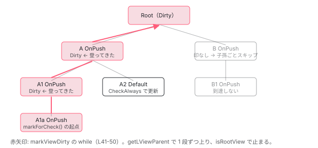

[目次](../README.md) › [変更検知の各ステップ](README.md) › 第 4 回 / 全 9 回

# OnPush と markForCheck：Dirty を根まで伸ばす

> CheckAlways が立っていないビューは Dirty がないと飛ばされる。markViewDirty は親へ親へと Dirty を立てながら根まで登り、途中で止まらない。

angular/angular · 読了 約 11 分 · 中核 · [サイトで読む（デモが動きます）](https://angular-deep-dive-cyan.vercel.app/chapter/cd-onpush-markforcheck)

---

「OnPush にすると `@Input` が変わったときだけ更新される」とよく説明されます。この章ではその説明をソースに置き換えます。OnPush とは `CheckAlways` ビットが無いこと、更新されるのは `Dirty` ビットが立っているとき、そして `Dirty` を立てる関数は `markViewDirty` 1 つだけ。それを誰が呼ぶのか（`markForCheck`、イベントリスナ、`@Input` の書き込み、`setInput`）を 1 つずつ確認し、`markViewDirty` が**先祖を根まで登る**のはなぜかを読みます。

読む対象は `packages/core/src/render3/instructions/mark_view_dirty.ts`（52 行）と、それを呼ぶ `render3/view_ref.ts`、`render3/view/listeners.ts`、`render3/instructions/shared.ts`、`render3/component_ref.ts` です。

1. 概観
2. detectChangesInView
3. refreshView の全ステップ
4. **OnPush と markForCheck**（この章）
5. ReactiveLViewConsumer
6. Targeted 走査
7. checkNoChanges
8. afterRender
9. effect

## 1. OnPush は「CheckAlways が無い」こと

📄 `angular/packages/core/src/render3/view/construction.ts` L259–271 （▶ の行: 264–268）

```ts
259 │ /**
260 │  * Gets the initial set of LView flags based on the component definition that the LView represents.
261 │  * @param def Component definition from which to determine the flags.
262 │  */
263 │ export function getInitialLViewFlagsFromDef(def: ComponentDef<unknown>): LViewFlags {
264 ▶   let flags = LViewFlags.CheckAlways;
265 ▶   if (def.signals) {
266 ▶     flags = LViewFlags.SignalView;
267 ▶   } else if (def.onPush) {
268 ▶     flags = LViewFlags.Dirty;
269 │   }
270 │   return flags;
271 │ }
```

📄 `angular/packages/core/src/render3/interfaces/view.ts` L434–441 （▶ の行: 435, 441）

```ts
434 │   /** Whether this view has default change detection strategy (checks always) or onPush */
435 ▶   CheckAlways = 1 << 4,
436 │ 
437 │   /** Whether there are any i18n blocks inside this LView. */
438 │   HasI18n = 1 << 5,
439 │ 
440 │   /** Whether or not this view is currently dirty (needing check) */
441 ▶   Dirty = 1 << 6,
```

264 行目、関数の初期値は `CheckAlways`（435 行目）。267〜268 行目、`def.onPush` （`ɵɵdefineComponent` が `changeDetection !== Eager` で計算する値。この v22 スナップショットでは未指定でも true。[Ivy の章](../ivy/02-ivy-overview.md)）が真なら `CheckAlways` を**付けず**、代わりに `Dirty`（441 行目）を付けます。初回描画のために最初から dirty なのです。265〜266 行目の `SignalView` は実験的な signal コンポーネント用で、こちらも `CheckAlways` を持ちません。

📄 `angular/packages/core/src/render3/instructions/change_detection.ts` L508–523 （▶ の行: 509–510, 519–521）

```ts
508 │   // Refresh CheckAlways views in Global mode.
509 ▶   let shouldRefreshView: boolean = !!(
510 ▶     mode === ChangeDetectionMode.Global && flags & LViewFlags.CheckAlways
511 │   );
512 │ 
513 │   // Refresh Dirty views in Global mode, as long as we're not in checkNoChanges.
514 │   // CheckNoChanges never worked with `OnPush` components because the `Dirty` flag was
515 │   // cleared before checkNoChanges ran. Because there is now a loop for to check for
516 │   // backwards views, it gives an opportunity for `OnPush` components to be marked `Dirty`
517 │   // before the CheckNoChanges pass. We don't want existing errors that are hidden by the
518 │   // current CheckNoChanges bug to surface when making unrelated changes.
519 ▶   shouldRefreshView ||= !!(
520 ▶     flags & LViewFlags.Dirty &&
521 ▶     mode === ChangeDetectionMode.Global &&
522 │     !isInCheckNoChangesPass
523 │   );
```

[前々回](02-cd-detect-changes-in-view.md)の 2 条件を OnPush の目で読み直します。510 行目、`CheckAlways` が無いので理由 1 は**常に偽**。520〜521 行目、残るのは「`Dirty` があり、`Global` モード」だけです。OnPush コンポーネントが（signal 以外の経路で）更新されるのは、この 1 行が真のときだけです。

📄 `angular/packages/core/src/render3/instructions/change_detection.ts` L354–364 （▶ の行: 363）

```ts
354 │     // Do not reset the dirty state when running in check no changes mode. We don't want components
355 │     // to behave differently depending on whether check no changes is enabled or not. For example:
356 │     // Marking an OnPush component as dirty from within the `ngAfterViewInit` hook in order to
357 │     // refresh a `NgClass` binding should work. If we would reset the dirty state in the check
358 │     // no changes cycle, the component would be not be dirty for the next update pass. This would
359 │     // be different in production mode where the component dirty state is not reset.
360 │     if (!isInCheckNoChangesPass) {
361 │       addAfterRenderSequencesForView(lView);
362 │ 
363 ▶       lView[FLAGS] &= ~(LViewFlags.Dirty | LViewFlags.FirstLViewPass);
364 │     }
```

363 行目、`refreshView` の末尾で `Dirty` は落ちます。つまり OnPush コンポーネントは**更新されるたびに「次は更新しない」状態に戻る**のです。次に更新されるには、誰かがまた `Dirty` を立てなければなりません。

## 2. Dirty を立てる唯一の関数：markViewDirty

📄 `angular/packages/core/src/render3/instructions/mark_view_dirty.ts` L15–52 （▶ の行: 26–27, 33, 39–43, 45–46, 49）

```ts
15 │ /**
16 │  * Marks current view and all ancestors dirty.
17 │  *
18 │  * Returns the root view because it is found as a byproduct of marking the view tree
19 │  * dirty, and can be used by methods that consume markViewDirty() to easily schedule
20 │  * change detection. Otherwise, such methods would need to traverse up the view tree
21 │  * an additional time to get the root view and schedule a tick on it.
22 │  *
23 │  * @param lView The starting LView to mark dirty
24 │  * @returns the root LView
25 │  */
26 ▶ export function markViewDirty(lView: LView, source: NotificationSource): LView | null {
27 ▶   const dirtyBitsToUse = isRefreshingViews()
28 │     ? // When we are actively refreshing views, we only use the `Dirty` bit to mark a view
29 │       // for check. This bit is ignored in ChangeDetectionMode.Targeted, which is used to
30 │       // synchronously rerun change detection on a specific set of views (those which have
31 │       // the `RefreshView` flag and those with dirty signal consumers). `LViewFlags.Dirty`
32 │       // does not support re-entrant change detection on its own.
33 ▶       LViewFlags.Dirty
34 │     : // When we are not actively refreshing a view tree, it is absolutely
35 │       // valid to update state and mark views dirty. We use the `RefreshView` flag in this
36 │       // case to allow synchronously rerunning change detection. This applies today to
37 │       // afterRender hooks as well as animation listeners which execute after detecting
38 │       // changes in a view when the render factory flushes.
39 ▶       LViewFlags.RefreshView | LViewFlags.Dirty;
40 ▶   lView[ENVIRONMENT].changeDetectionScheduler?.notify(source);
41 ▶   while (lView) {
42 ▶     lView[FLAGS] |= dirtyBitsToUse;
43 ▶     const parent = getLViewParent(lView);
44 │     // Stop traversing up as soon as you find a root view that wasn't attached to any container
45 ▶     if (isRootView(lView) && !parent) {
46 ▶       return lView;
47 │     }
48 │     // continue otherwise
49 ▶     lView = parent!;
50 │   }
51 │   return null;
52 │ }
```

1. **27〜39 行目：立てるビットを決める**

   `isRefreshingViews()` が真（変更検知の**最中**に呼ばれた）なら `Dirty` だけ。偽（イベントハンドラや `setTimeout` から呼ばれた）なら `RefreshView | Dirty` の両方です。28〜33 行目のコメント：`Dirty` は `Targeted` モードで無視されるので、走査中に再度 dirty にされても、その走査のやり直しループ（`while (requiresRefreshOrTraversal)`）では拾われません。34〜39 行目：走査の外から呼ばれたときは `RefreshView` も立てることで、次の走査が `Targeted`（zoneless の既定）でも確実に更新されるようにします。
2. **40 行目：スケジューラに通知**

   `ChangeDetectionSchedulerImpl.notify(source)`。印を付けるだけでは走査は始まらないので、「tick を予約してほしい」と伝えます。zoneless ではこれが唯一の起動経路です （[zoneless シリーズ](../zoneless/03-zoneless-notify.md)）。
3. **41〜42 行目：`while (lView)` でフラグを立て続ける**

   自分に立て、43 行目で親を取り、49 行目で親へ移って繰り返します。
4. **45〜46 行目：ルートで止まる**

   `isRootView` かつ親が無い（`ApplicationRef` に直接 attach されたルート）なら、そのルート LView を返します。呼び出し元が「どのルートを tick すべきか」を知るためです（18〜21 行目のコメント）。

📄 `angular/packages/core/src/render3/util/view_utils.ts` L310–319 （▶ の行: 317–318）

```ts
310 │ /**
311 │  * Gets the parent LView of the passed LView, if the PARENT is an LContainer, will get the parent of
312 │  * that LContainer, which is an LView
313 │  * @param lView the lView whose parent to get
314 │  */
315 │ export function getLViewParent(lView: LView): LView | null {
316 │   ngDevMode && assertLView(lView);
317 ▶   const parent = lView[PARENT];
318 ▶   return isLContainer(parent) ? parent[PARENT] : parent;
319 │ }
```

📄 `angular/packages/core/src/render3/interfaces/type_checks.ts` L47–50 （▶ の行: 49）

```ts
47 │ export function isRootView(target: LView): boolean {
48 │   // Determines whether a given LView is marked as a root view.
49 ▶   return (target[FLAGS] & LViewFlags.IsRoot) !== 0;
50 │ }
```

318 行目、`PARENT` が `LContainer`（`@if` の中など）なら、そのコンテナの `PARENT`、つまりコンテナを持つ LView を返します。埋め込みビューの「親」は宣言元ではなく**挿入先**のビューです。`markViewDirty` は挿入先の経路を登ります。

📄 `angular/packages/core/src/render3/state.ts` L433–441 （▶ の行: 434, 439）

```ts
433 │ export function isRefreshingViews(): boolean {
434 ▶   return _isRefreshingViews;
435 │ }
436 │ 
437 │ export function setIsRefreshingViews(mode: boolean): boolean {
438 │   const prev = _isRefreshingViews;
439 ▶   _isRefreshingViews = mode;
440 │   return prev;
441 │ }
```

27 行目が読むモジュール変数です。`detectChangesInViewWhileDirty` が 115 行目で `true` にし、147 行目で戻します（[2 回目](02-cd-detect-changes-in-view.md)）。

### なぜ根まで登るのか

走査は必ずルートから始まり、`detectChangesInView` は「更新しないビューの子孫へは降りない」からです。OnPush の親 A の下に OnPush の子 A1 がいて、A1 だけに `Dirty` を立てたとします。走査が A に来たとき、A は `CheckAlways` 無し・`Dirty` 無し・印無しなので、前々回の 540 行目も 542 行目も偽で、**A の子孫ごとスキップ**されます。A1 の `Dirty` は見られません。だから A1 に立てるときは A にも、Root にも立てるのです。



*markViewDirty は A1a から Root まで経路上の全員に Dirty を立てる。兄弟（A2, B, B1）には触らない。Global 走査は Dirty か CheckAlways のビューだけを refreshView し、どちらも無い B で木が切れる。*

> **🧪 DEMO — markForCheck で Dirty がどこまで立ち、Global 走査がどこまで届くか**
>
> ノードをクリックすると、そのビューで `markForCheck()` を呼んだことになります（mark\_view\_dirty.ts L41-50 の while）。「Global 走査」は detectChangesInView の理由 1（CheckAlways）と理由 2（Dirty）だけで判定し、refreshView 末尾（L363）で Dirty を落とします。
>
> ▶ [このデモはサイトで動かせます](https://angular-deep-dive-cyan.vercel.app/chapter/cd-onpush-markforcheck)

## 3. 呼び出し元 1：ChangeDetectorRef.markForCheck()

📄 `angular/packages/core/src/render3/view_ref.ts` L162–164 （▶ の行: 163）

```ts
162 │   markForCheck(): void {
163 ▶     markViewDirty(this._cdRefInjectingView || this._lView, NotificationSource.MarkForCheck);
164 │   }
```

📄 `angular/packages/core/src/render3/view_ref.ts` L56–77 （▶ の行: 68, 74, 76）

```ts
56 │   constructor(
57 │     /**
58 │      * This represents `LView` associated with the component when ViewRef is a ChangeDetectorRef.
59 │      *
60 │      * When ViewRef is created for a dynamic component, this also represents the `LView` for the
61 │      * component.
62 │      *
63 │      * For a "regular" ViewRef created for an embedded view, this is the `LView` for the embedded
64 │      * view.
65 │      *
66 │      * @internal
67 │      */
68 ▶     public _lView: LView,
69 │ 
70 │     /**
71 │      * This represents the `LView` associated with the point where `ChangeDetectorRef` was
72 │      * requested.
73 │      *
74 ▶      * This may be different from `_lView` if the `_cdRefInjectingView` is an embedded view.
75 │      */
76 ▶     private _cdRefInjectingView?: LView,
77 │   ) {}
```

163 行目、`markForCheck()` は `markViewDirty` を `NotificationSource.MarkForCheck` で呼ぶだけです。起点は `this._cdRefInjectingView || this._lView`。76 行目の `_cdRefInjectingView` は「`ChangeDetectorRef` を inject した場所の LView」で、74 行目のコメントどおり、埋め込みビューの中のディレクティブが inject したときは `_lView`（コンポーネントビュー）と異なります。その場合は**埋め込みビューから**登り始めます。登る経路は同じなので結果は変わりませんが、埋め込みビュー自身にも `Dirty` が立ちます。

📄 `angular/packages/core/src/change_detection/scheduling/zoneless_scheduling_impl.ts` L151–163 （▶ の行: 158, 161）

```ts
151 │     switch (source) {
152 │       case NotificationSource.MarkAncestorsForTraversal:
153 │       case NotificationSource.DeferBlockStateUpdate: {
154 │         this.appRef.dirtyFlags |= ApplicationRefDirtyFlags.ViewTreeTraversal;
155 │         break;
156 │       }
157 │       case NotificationSource.DebugApplyChanges:
158 ▶       case NotificationSource.MarkForCheck:
159 │       case NotificationSource.Listener:
160 │       case NotificationSource.SetInput: {
161 ▶         this.appRef.dirtyFlags |= ApplicationRefDirtyFlags.ViewTreeCheck;
162 │         break;
163 │       }
```

158〜161 行目、`MarkForCheck`（と `Listener`、`SetInput`）は `ApplicationRef.dirtyFlags` に `ViewTreeCheck` を立てます。これが tick を予約し、tick は `Targeted` で走ります。`Targeted` で `Dirty` は無視されるのに届くのは、27〜39 行目で `RefreshView` も立てているからです （走査の外から呼んだ場合）。

📄 `angular/packages/core/src/application/application_ref.ts` L657–660 （▶ の行: 657–658, 660）

```ts
657 ▶       // If `markForCheck()` was called during view checking, it will have set the `ViewTreeCheck`
658 ▶       // flag. We clear the flag here because, for backwards compatibility, `markForCheck()`
659 │       // during view checking doesn't cause the view to be re-checked.
660 ▶       this.dirtyFlags &= ~ApplicationRefDirtyFlags.ViewTreeCheck;
```

660 行目、走査**中**に `markForCheck()` が立てた `ViewTreeCheck` は、走査後に消されます。657〜659 行目のコメント：「後方互換のため、走査中の `markForCheck()` は再チェックを起こさない」。27〜33 行目で `Dirty` しか立てない設計と対になっています。`Dirty` は残るので、**次の**何かの走査が `Global` で来たときには拾われます。

## 4. 呼び出し元 2：テンプレートの (click) などのリスナ

📄 `angular/packages/core/src/render3/view/listeners.ts` L46–66 （▶ の行: 53, 64–65）

```ts
46 │ export function wrapListener(
47 │   tNode: TNode,
48 │   lView: LView,
49 │   listenerFn: EventCallback,
50 │ ): WrappedEventCallback {
51 │   // Note: we are performing most of the work in the listener function itself
52 │   // to optimize listener registration.
53 ▶   return function wrapListenerIn_markDirtyAndPreventDefault(event: any) {
54 │     // When a native element is stored on this function (set by listenToDomEvent for
55 │     // non-global-target listeners), mark the (event, element) pair as handled so that
56 │     // jsaction does not replay an event already dispatched by the real DOM listener.
57 │     const nativeEl = (wrapListenerIn_markDirtyAndPreventDefault as any).__ngNativeEl__;
58 │     if (nativeEl !== undefined) {
59 │       markEventHandledForElement(event, nativeEl);
60 │     }
61 │ 
62 │     // In order to be backwards compatible with View Engine, events on component host nodes
63 │     // must also mark the component view itself dirty (i.e. the view that it owns).
64 ▶     const startView = isComponentHost(tNode) ? getComponentLViewByIndex(tNode.index, lView) : lView;
65 ▶     markViewDirty(startView, NotificationSource.Listener);
66 │ 
```

53 行目、テンプレートの `(click)="onClick()"` は、あなたの `onClick` をそのまま登録するのではなく、この `wrapListenerIn_markDirtyAndPreventDefault` で包んで登録します。65 行目、**あなたのハンドラを呼ぶ前に**`markViewDirty` を呼びます。64 行目、ホスト要素のイベント（`<app-child (click)=...>`）なら子コンポーネントのビューから、通常の要素なら自分のビューから登ります。「OnPush でもテンプレートのイベントなら画面が更新される」のはこの 65 行目のおかげで、ハンドラの中で何をしたかは見ていません。

> [!WARNING]
> **ハマりどころ**
>
> 逆に、テンプレートを通らない非同期（`setTimeout`、`subscribe`、`addEventListener` を直接呼んだもの）は この関数を通りません。OnPush でそれらから値を変えても `Dirty` が立たず、521 行目の条件が偽のまま → 画面が変わらない。`markForCheck()` を呼ぶか、signal にして [consumer の経路](05-cd-signal-consumer.md)に乗せるかの 2 択です。

## 5. 呼び出し元 3：親テンプレートからの @Input 書き込み

📄 `angular/packages/core/src/render3/instructions/shared.ts` L250–266 （▶ の行: 260, 262–263）

```ts
250 │ export function setPropertyAndInputs<T>(
251 │   tNode: TNode,
252 │   lView: LView,
253 │   propName: string,
254 │   value: T,
255 │   renderer: Renderer,
256 │   sanitizer: SanitizerFn | null | undefined,
257 │ ): void {
258 │   ngDevMode && assertNotSame(value, NO_CHANGE as any, 'Incoming value should never be NO_CHANGE.');
259 │   const tView = lView[TVIEW];
260 ▶   const hasSetInput = setAllInputsForProperty(tNode, tView, lView, propName, value);
261 │ 
262 ▶   if (hasSetInput) {
263 ▶     isComponentHost(tNode) && markDirtyIfOnPush(lView, tNode.index);
264 │     ngDevMode && setNgReflectProperties(lView, tView, tNode, propName, value);
265 │     return; // Stop propcessing if we've matched at least one input.
266 │   }
```

📄 `angular/packages/core/src/render3/instructions/shared.ts` L318–325 （▶ の行: 321–323）

```ts
318 │ /** If node is an OnPush component, marks its LView dirty. */
319 │ export function markDirtyIfOnPush(lView: LView, viewIndex: number): void {
320 │   ngDevMode && assertLView(lView);
321 ▶   const childComponentLView = getComponentLViewByIndex(viewIndex, lView);
322 ▶   if (!(childComponentLView[FLAGS] & LViewFlags.CheckAlways)) {
323 ▶     childComponentLView[FLAGS] |= LViewFlags.Dirty;
324 │   }
325 │ }
```

親テンプレートの `[value]="x"` は `ɵɵproperty` 命令になり、値が変わったときだけ `setPropertyAndInputs` に来ます（`bindingUpdated` で前回値と `Object.is` 比較。[7 回目](07-cd-check-no-changes.md)）。260 行目でディレクティブの入力に書き、262〜263 行目、書き先がコンポーネントなら `markDirtyIfOnPush`。322〜323 行目、`CheckAlways` が無ければ子コンポーネントビューに `Dirty` を立てます。

ここは `markViewDirty` を**呼びません**。親へ登らないし、スケジューラにも通知しません。理由は、この処理が親の `refreshView` の**中**（`executeTemplate`）で起きるからです。親はいま更新中なので、親とその先祖は既に走査の経路上にあります。子に `Dirty` を立てれば、この直後の `detectChangesInChildComponents`（親の 307 行目）で 521 行目が真になり、子が更新されます。

> [!NOTE]
> **さらに深く**
>
> 「OnPush は `@Input` の**参照**が変わったときだけ更新される」の正確な意味がここにあります。判定しているのは `bindingUpdated` の `Object.is(oldValue, value)` であって、`markDirtyIfOnPush` は「入力に書き込んだ」という事実だけを見ています。オブジェクトのプロパティを書き換えても参照は同じなので `bindingUpdated` が偽、ここに到達しません。

## 6. 呼び出し元 4：ComponentRef.setInput()

📄 `angular/packages/core/src/render3/component_ref.ts` L607–631 （▶ の行: 619, 621, 627, 629–630）

```ts
607 │   override setInput(name: string, value: unknown): void {
608 │     if (this._hasInputBindings && ngDevMode) {
609 │       throw new RuntimeError(
610 │         RuntimeErrorCode.INVALID_SET_INPUT_CALL,
611 │         'Cannot call `setInput` on a component that is using the `inputBinding` or `twoWayBinding` functions.',
612 │       );
613 │     }
614 │ 
615 │     const tNode = this._tNode;
616 │     this.previousInputValues ??= new Map();
617 │     // Do not set the input if it is the same as the last value
618 │     // This behavior matches `bindingUpdated` when binding inputs in templates.
619 ▶     if (
620 │       this.previousInputValues.has(name) &&
621 ▶       Object.is(this.previousInputValues.get(name), value)
622 │     ) {
623 │       return;
624 │     }
625 │ 
626 │     const lView = this._rootLView;
627 ▶     const hasSetInput = setAllInputsForProperty(tNode, lView[TVIEW], lView, name, value);
628 │     this.previousInputValues.set(name, value);
629 ▶     const childComponentLView = getComponentLViewByIndex(tNode.index, lView);
630 ▶     markViewDirty(childComponentLView, NotificationSource.SetInput);
631 │ 
```

動的に作ったコンポーネント（`createComponent` / `ViewContainerRef.createComponent`）に 入力を渡す API です。619〜623 行目、前回と同じ値なら何もしません（`bindingUpdated` と同じ `Object.is`）。627 行目で入力に書き、629〜630 行目で `markViewDirty(childComponentLView, SetInput)`。5 節と違い**こちらは `markViewDirty`** です。テンプレートの外（走査の外）から呼ばれる API なので、親へ登ってスケジューラにも通知しなければ、誰も走査を始めてくれないからです。

## 7. 走査中に Dirty にされたら

📄 `angular/packages/core/src/render3/instructions/change_detection.ts` L125–144 （▶ の行: 130, 143）

```ts
125 │     let retries = 0;
126 │     // If after running change detection, this view still needs to be refreshed or there are
127 │     // descendants views that need to be refreshed due to re-dirtying during the change detection
128 │     // run, detect changes on the view again. We run change detection in `Targeted` mode to only
129 │     // refresh views with the `RefreshView` flag.
130 ▶     while (requiresRefreshOrTraversal(lView)) {
131 │       if (retries === MAXIMUM_REFRESH_RERUNS) {
132 │         throw new RuntimeError(
133 │           RuntimeErrorCode.INFINITE_CHANGE_DETECTION,
134 │           ngDevMode &&
135 │             'Infinite change detection while trying to refresh views. ' +
136 │               'There may be components which each cause the other to require a refresh, ' +
137 │               'causing an infinite loop.',
138 │         );
139 │       }
140 │       retries++;
141 │       // Even if this view is detached, we still detect changes in targeted mode because this was
142 │       // the root of the change detection run.
143 ▶       detectChangesInView(lView, ChangeDetectionMode.Targeted);
144 │     }
```

📄 `angular/packages/core/src/render3/util/view_utils.ts` L236–241 （▶ の行: 238–239）

```ts
236 │ export function requiresRefreshOrTraversal(lView: LView) {
237 │   return !!(
238 ▶     lView[FLAGS] & (LViewFlags.RefreshView | LViewFlags.HasChildViewsToRefresh) ||
239 ▶     lView[REACTIVE_TEMPLATE_CONSUMER]?.dirty
240 │   );
241 │ }
```

走査中（`isRefreshingViews() === true`）の `markForCheck()` は `Dirty` だけを立てます。130 行目の `while` の条件 `requiresRefreshOrTraversal` は 238〜239 行目のとおり `Dirty` を見ないので、ループは回りません。143 行目の `Targeted` でも `Dirty` は無視されます。結果、**走査中の `markForCheck()` は、その走査では効かない**。`Dirty` はビューに残るので、次に `Global` モードでそのビューに到達したときに効きます。`Global` で到達するのは、zone.js ありの `ApplicationRef.tick()`、`ViewRef.detectChanges()`、そして「先祖のどれかが `refreshView` され、その中の 274・307 行目から `Global` で降りてきた」ときです。zoneless の tick は `Targeted` で始まりますが、走査の外からの `markViewDirty`（イベントなど）が根に `RefreshView` を立てれば根が `refreshView` され、そこからは `Global` です。逆に、次の変更が深い signal の変化だけなら根は `refreshView` されず（通り抜け）、残った `Dirty` は拾われません。`ngAfterViewInit` で `markForCheck()` を呼んで「効くときと効かないときがある」と感じた人は、これが原因です。

## ここまでの呼び出し

- 👤 `cdRef.markForCheck()` — あなたのコンポーネント
  - `ViewRef.markForCheck()` — view\_ref.ts L162 — *\_cdRefInjectingView || \_lView から*
    - `markViewDirty(lView, NotificationSource.MarkForCheck)` — mark\_view\_dirty.ts L26
      - `isRefreshingViews()` — state.ts L433 — *走査中なら Dirty のみ、外なら RefreshView | Dirty*
      - `changeDetectionScheduler.notify(MarkForCheck)` — zoneless\_scheduling\_impl.ts L138 — *dirtyFlags |= ViewTreeCheck → tick 予約*
      - `while (lView) { lView[FLAGS] |= bits; lView = getLViewParent(lView) }` — L41-50 — *isRootView で止まる*
- 👤 `(click)="onClick()"` — テンプレート
  - `wrapListenerIn_markDirtyAndPreventDefault(event)` — listeners.ts L53 — *65 行目で markViewDirty(startView, Listener) → それから onClick()*
- 👤 `[value]="x"`（親テンプレート） — ɵɵproperty
  - `setPropertyAndInputs(...)` — shared.ts L250 — *bindingUpdated が真のときだけ*
    - `markDirtyIfOnPush(lView, tNode.index)` — shared.ts L319 — *子ビューに Dirty だけ。登らない・通知しない*

## 聞かれそうな質問

**Q. markForCheck は親も更新しますか？兄弟は？**

親には `Dirty` が立ちます（mark\_view\_dirty.ts 41〜50 行目の `while` が `getLViewParent` で根まで登る）。ただし親が `CheckAlways` なら元から更新対象なので変化はなく、親が OnPush なら「次の `Global` 走査で親も `refreshView` される」ことになります。親の `refreshView` は親のテンプレートを実行するので、親の他の子（兄弟）への `@Input` 書き込みも起きますが、**兄弟のビューに `Dirty` は立ちません**。`getLViewParent` は親方向にしか進まないからです。兄弟が OnPush なら、入力が変わっていなければスキップされます。

**Q. OnPush で @Input が変わっていないのに子が更新されるのはどんなときですか？**

`Dirty` が別経路で立ったときです。(1) 子のテンプレート内のイベントが発火した（listeners.ts 65 行目）、(2) 子やその子孫で `markForCheck()` が呼ばれた（根まで登るので子にも立つ）、(3) 子のテンプレートが読んでいる signal が変わった（consumer 経路、[5 回目](05-cd-signal-consumer.md)。これは `Dirty` ではなく 529 行目の条件）、(4) 子の中で transplanted view に `RefreshView` が立った（[6 回目](06-cd-targeted-traversal.md)）。`@Input` の経路（shared.ts 263 行目）はこれらのうちの 1 つに過ぎません。

**Q. setTimeout の中で値を変えたら OnPush の画面が変わらないのはなぜですか？**

`markViewDirty` を呼ぶ 4 つの経路（`markForCheck`、テンプレートのリスナ、親からの入力書き込み、`setInput`）の どれも通らないからです。`Dirty` が立たず、change\_detection.ts 520 行目が偽、`CheckAlways` も無いので 510 行目も偽。`detectChangesInView` はそのビューを子孫ごとスキップします。

**Q. @Input の書き込みは markViewDirty を呼ばないのに、なぜ子が更新されるのですか？**

`markDirtyIfOnPush`（shared.ts 323 行目）が子ビューに直接 `Dirty` を立てるからです。これは親の `refreshView` の中（`executeTemplate`）で起きるので、親は既に更新中で、同じ `refreshView` の 307 行目 `detectChangesInChildComponents` が `Global` で子に降りてきます。登る必要も通知する必要もありません。

**Q. ngAfterViewInit の中で markForCheck() を呼ぶと効きますか？**

その走査では効きません。走査中は `isRefreshingViews()` が真で、mark\_view\_dirty.ts 27〜33 行目により `Dirty` しか立ちません。`Dirty` は `requiresRefreshOrTraversal`（view\_utils.ts 238〜239 行目）に含まれず、`Targeted` でも無視されます。`ApplicationRef.synchronizeOnce` 660 行目で `ViewTreeCheck` も消されます。`Dirty` は残るので、次に `Global` モードで到達したとき（zone.js ありの `tick()`、または先祖の `refreshView` から 274・307 行目で降りてきたとき）に拾われます。zoneless で確実に効かせたいなら、signal を使うか、`afterNextRender` の中で呼ぶ（走査の外なので `RefreshView` も立つ）のが解決策です。

## 読み終えて

- OnPush = `CheckAlways` が無い（construction.ts 264〜268 行目）。更新条件は「`Dirty` かつ `Global`」（521 行目）だけ
- `Dirty` は `refreshView` 末尾（363 行目）で落ちる。立て直す関数は `markViewDirty` と `markDirtyIfOnPush` の 2 つ
- `markViewDirty` は根まで登る（41〜50 行目）。走査がルートから始まり、更新しないビューの子孫は見ないから
- 走査の外からなら `RefreshView | Dirty`、走査中なら `Dirty` だけ（27〜39 行目）。走査中の `markForCheck()` はその走査では効かない
- 親からの `@Input` 書き込みは登らず通知もしない（shared.ts 323 行目）。親が更新中だから

---

← 前: [refreshView の全ステップを上から下まで](03-cd-refresh-view.md)  
次: [テンプレートの ReactiveLViewConsumer](05-cd-signal-consumer.md) →
