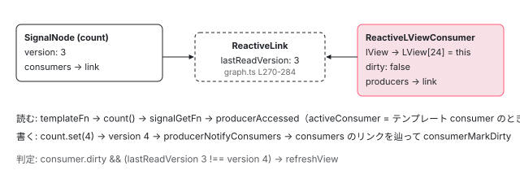

[目次](../README.md) › [変更検知の各ステップ](README.md) › 第 5 回 / 全 9 回

# テンプレートの ReactiveLViewConsumer

> LView\[REACTIVE\_TEMPLATE\_CONSUMER\] に入る consumer。consumerBeforeComputation で依存を集め、signal が変わると consumerMarkedDirty → markAncestorsForTraversal。CheckAlways 用の一時 consumer も。

angular/angular · 読了 約 13 分 · 発展 · [サイトで読む（デモが動きます）](https://angular-deep-dive-cyan.vercel.app/chapter/cd-signal-consumer)

---

テンプレートが `{{ count() }}` と signal を読むと、そのコンポーネントは signal の 「consumer（購読者）」になります。`computed` や `effect` と同じ reactive graph に、`LView` ごとに 1 つのノードとして参加するのです。この章では、そのノード `ReactiveLViewConsumer` が `LView[REACTIVE_TEMPLATE_CONSUMER]` にどう入るか、テンプレート実行中に `graph.ts` のどの関数が依存を記録するか、`set()` したときにどの関数を通って `detectChangesInView` の 529 行目に戻ってくるかを、関数単位で追います。

読む対象は `packages/core/src/render3/reactive_lview_consumer.ts`（115 行、全部）、`packages/core/primitives/signals/src/graph.ts`、`signal.ts` です。signal 自体の仕組み（version と epoch）は [signals シリーズ](../signals/01-signals.md)で読んでいる前提で、ここではテンプレートとの接点だけを見ます。

1. 概観
2. detectChangesInView
3. refreshView の全ステップ
4. OnPush と markForCheck
5. **ReactiveLViewConsumer**（この章）
6. Targeted 走査
7. checkNoChanges
8. afterRender
9. effect

## 1. LView の 24 番目のスロット

📄 `angular/packages/core/src/render3/interfaces/view.ts` L70–77 （▶ の行: 73）

```ts
70 │ export const ON_DESTROY_HOOKS = 21;
71 │ export const EFFECTS_TO_SCHEDULE = 22;
72 │ export const EFFECTS = 23;
73 ▶ export const REACTIVE_TEMPLATE_CONSUMER = 24;
74 │ export const AFTER_RENDER_SEQUENCES_TO_ADD = 25;
75 │ export const ANIMATIONS = 26;
76 │ export const ON_ERROR = 27;
77 │ 
```

73 行目、`REACTIVE_TEMPLATE_CONSUMER = 24`。`LView` は配列で、ヘッダ部分の各インデックスに名前が付いています （[LView の章](../ivy/06-ivy-lview.md)）。24 番目に、このビューのテンプレートを代表する consumer ノードが入ります。初期値は `null` で、**テンプレートが初めて signal を読んだ瞬間**に埋まります（3 節）。

## 2. ノードの形：REACTIVE\_NODE を 3 か所だけ上書き

📄 `angular/packages/core/primitives/signals/src/graph.ts` L64–80 （▶ の行: 65, 67–68, 70, 74, 78–79）

```ts
64 │ export const REACTIVE_NODE: ReactiveNode = {
65 ▶   version: 0 as Version,
66 │   lastCleanEpoch: 0 as Version,
67 ▶   dirty: false,
68 ▶   producers: undefined,
69 │   producersTail: undefined,
70 ▶   consumers: undefined,
71 │   consumersTail: undefined,
72 │   recomputing: false,
73 │   consumerAllowSignalWrites: false,
74 ▶   consumerIsAlwaysLive: false,
75 │   kind: 'unknown',
76 │   producerMustRecompute: () => false,
77 │   producerRecomputeValue: () => {},
78 ▶   consumerMarkedDirty: () => {},
79 ▶   consumerOnSignalRead: () => {},
80 │ };
```

グラフの全ノードの原型です。67 行目 `dirty`、68 行目 `producers`（自分が読んだ依存のリンクリスト）、70 行目 `consumers`（自分を読んでいる購読者のリンクリスト）、74 行目 `consumerIsAlwaysLive`、78〜79 行目の 2 つのフック `consumerMarkedDirty` / `consumerOnSignalRead`。テンプレート consumer はこのうち 3 つを差し替えます。

📄 `angular/packages/core/src/render3/reactive_lview_consumer.ts` L43–53 （▶ の行: 44–48, 50–51）

```ts
43 │ export const REACTIVE_LVIEW_CONSUMER_NODE: Omit<ReactiveLViewConsumer, 'lView'> = {
44 ▶   ...REACTIVE_NODE,
45 ▶   consumerIsAlwaysLive: true,
46 ▶   kind: 'template',
47 ▶   consumerMarkedDirty: (node: ReactiveLViewConsumer) => {
48 ▶     markAncestorsForTraversal(node.lView!);
49 │   },
50 ▶   consumerOnSignalRead(this: ReactiveLViewConsumer): void {
51 ▶     this.lView![REACTIVE_TEMPLATE_CONSUMER] = this;
52 │   },
53 │ };
```

1. **45 行目：`consumerIsAlwaysLive: true`**

   「live」な consumer とは、producer 側の `consumers` リストに逆向きのリンクを持ち、値が変わったときに**push 通知を受ける**ものです。`computed` は誰かに読まれているときだけ live になりますが、テンプレートは誰にも読まれない末端なので、常に live と宣言します。これが無いと、signal を set しても誰も `markAncestorsForTraversal` を呼べません。
2. **47〜49 行目：`consumerMarkedDirty` → `markAncestorsForTraversal(node.lView)`**

   dirty にされたときの反応です。`Dirty` ビットではなく、先祖に `HasChildViewsToRefresh` を立て、スケジューラに通知します。自分自身にはフラグを立てません。自分の印は `consumer.dirty` そのものです （[6 回目](06-cd-targeted-traversal.md)）。
3. **50〜52 行目：`consumerOnSignalRead` → `lView[REACTIVE_TEMPLATE_CONSUMER] = this`**

   signal が 1 つ読まれるたびに呼ばれ、自分を LView のスロットに書き込みます。**この行が「スロットが埋まる瞬間」です**。読まれなければ一度も呼ばれず、スロットは `null` のままです。

📄 `angular/packages/core/primitives/signals/src/graph.ts` L137–168 （▶ の行: 143, 153, 160, 167）

```ts
137 │   /**
138 │    * Whether this node (in its consumer capacity) is dirty.
139 │    *
140 │    * Only live consumers become dirty, when receiving a change notification from a dependency
141 │    * producer.
142 │    */
143 ▶   dirty: boolean;
144 │ 
145 │   /**
146 │    * Whether this node is currently rebuilding its producer list.
147 │    */
148 │   recomputing: boolean;
149 │ 
150 │   /**
151 │    * Producers which are dependencies of this consumer.
152 │    */
153 ▶   producers: ReactiveLink | undefined;
154 │ 
155 │   /**
156 │    * Points to the last linked list node in the `producers` linked list.
157 │    *
158 │    * When this node is recomputing, this is used to track the producers that we have accessed so far.
159 │    */
160 ▶   producersTail: ReactiveLink | undefined;
161 │ 
162 │   /**
163 │    * Linked list of consumers of this producer that are "live" (they require push notifications).
164 │    *
165 │    * The length of this list is effectively our reference count for this node.
166 │    */
167 ▶   consumers: ReactiveLink | undefined;
168 │   consumersTail: ReactiveLink | undefined;
```

143 行目のコメント：**dirty になるのは live な consumer だけ**。153 行目 `producers` は「このテンプレートが読んだ signal たち」、167 行目 `consumers` は 「この signal を読んでいるテンプレート（や computed）たち」。リンク 1 本（`ReactiveLink`）が両方のリストに属します。

## 3. refreshView がノードを借りて開く

📄 `angular/packages/core/src/render3/instructions/change_detection.ts` L207–235 （▶ の行: 215–217, 229–230）

```ts
207 │   // Start component reactive context
208 │   // - We might already be in a reactive context if this is an embedded view of the host.
209 │   // - We might be descending into a view that needs a consumer.
210 │   enterView(lView);
211 │   let returnConsumerToPool = true;
212 │   let prevConsumer: ReactiveNode | null = null;
213 │   let currentConsumer: ReactiveLViewConsumer | null = null;
214 │   if (!isInCheckNoChangesPass) {
215 ▶     if (viewShouldHaveReactiveConsumer(tView)) {
216 ▶       currentConsumer = getOrBorrowReactiveLViewConsumer(lView);
217 ▶       prevConsumer = consumerBeforeComputation(currentConsumer);
218 │     } else if (getActiveConsumer() === null) {
219 │       // If the current view should not have a reactive consumer but we don't have an active consumer,
220 │       // we still need to create a temporary consumer to track any signal reads in this template.
221 │       // This is a rare case that can happen with
222 │       // - `viewContainerRef.createEmbeddedView(...).detectChanges()`.
223 │       // - `viewContainerRef.createEmbeddedView(...)` without any other dirty marking on the parent,
224 │       //   flagging the parent component for traversal but not triggering a full `refreshView`.
225 │       // This temporary consumer marks the first parent that _should_ have a consumer for refresh.
226 │       // Once that refresh happens, the signals will be tracked in the parent consumer and we can destroy
227 │       // the temporary one.
228 │       returnConsumerToPool = false;
229 ▶       currentConsumer = getOrCreateTemporaryConsumer(lView);
230 ▶       prevConsumer = consumerBeforeComputation(currentConsumer);
231 │     } else if (lView[REACTIVE_TEMPLATE_CONSUMER]) {
232 │       consumerDestroy(lView[REACTIVE_TEMPLATE_CONSUMER]);
233 │       lView[REACTIVE_TEMPLATE_CONSUMER] = null;
234 │     }
235 │   }
```

📄 `angular/packages/core/src/render3/reactive_lview_consumer.ts` L95–111 （▶ の行: 98–99, 110）

```ts
 95 │ /**
 96 │  * Indicates if the view should get its own reactive consumer node.
 97 │  *
 98 ▶  * In the current design, all embedded views share a consumer with the component view. This allows
 99 ▶  * us to refresh at the component level rather than at a per-view level. In addition, root views get
100 │  * their own reactive node because root component will have a host view that executes the
101 │  * component's host bindings. This needs to be tracked in a consumer as well.
102 │  *
103 │  * To get a more granular change detection than per-component, all we would just need to update the
104 │  * condition here so that a given view gets a reactive consumer which can become dirty independently
105 │  * from its parent component. For example embedded views for signal components could be created with
106 │  * a new type "SignalEmbeddedView" and the condition here wouldn't even need updating in order to
107 │  * get granular per-view change detection for signal components.
108 │  */
109 │ export function viewShouldHaveReactiveConsumer(tView: TView) {
110 ▶   return tView.type !== TViewType.Embedded;
111 │ }
```

📄 `angular/packages/core/src/render3/interfaces/view.ts` L591–615 （▶ の行: 597, 603, 609）

```ts
591 │ export const enum TViewType {
592 │   /**
593 │    * Root `TView` is the used to bootstrap components into. It is used in conjunction with
594 │    * `LView` which takes an existing DOM node not owned by Angular and wraps it in `TView`/`LView`
595 │    * so that other components can be loaded into it.
596 │    */
597 ▶   Root = 0,
598 │ 
599 │   /**
600 │    * `TView` associated with a Component. This would be the `TView` directly associated with the
601 │    * component view (as opposed an `Embedded` `TView` which would be a child of `Component` `TView`)
602 │    */
603 ▶   Component = 1,
604 │ 
605 │   /**
606 │    * `TView` associated with a template. Such as `*ngIf`, `<ng-template>` etc... A `Component`
607 │    * can have zero or more `Embedded` `TView`s.
608 │    */
609 ▶   Embedded = 2,
610 │ 
611 │   /**
612 │    * Foreign `TView` associated with a range of nodes between `head` and `tail` comment nodes.
613 │    */
614 │   Foreign = 3,
615 │ }
```

215 行目の `viewShouldHaveReactiveConsumer(tView)` は 110 行目、`Embedded`（609 行目）でないこと。`Root`（597 行目）と `Component`（603 行目）は自分の consumer を持ち、`@if` / `@for` の中身（`Embedded`）は持ちません。98〜99 行目のコメント：**埋め込みビューはコンポーネントビューの consumer を共有する**。`@for` の中で signal を読んでも、依存は親コンポーネントの consumer に記録され、更新単位はコンポーネントです。103〜107 行目は「ここの条件を変えれば、もっと細かい単位の更新にできる」という設計メモです。

📄 `angular/packages/core/src/render3/reactive_lview_consumer.ts` L19–41 （▶ の行: 25, 29–30, 35, 39–40）

```ts
19 │ /**
20 │  * Create a new template consumer pointing at the specified LView.
21 │  * Sometimes, a previously created consumer may be reused, in order to save on allocations. In that
22 │  * case, the LView will be updated.
23 │  */
24 │ export function getOrBorrowReactiveLViewConsumer(lView: LView): ReactiveLViewConsumer {
25 ▶   return lView[REACTIVE_TEMPLATE_CONSUMER] ?? borrowReactiveLViewConsumer(lView);
26 │ }
27 │ 
28 │ function borrowReactiveLViewConsumer(lView: LView): ReactiveLViewConsumer {
29 ▶   const consumer = freeConsumers.pop() ?? Object.create(REACTIVE_LVIEW_CONSUMER_NODE);
30 ▶   consumer.lView = lView;
31 │   return consumer;
32 │ }
33 │ 
34 │ export function maybeReturnReactiveLViewConsumer(consumer: ReactiveLViewConsumer): void {
35 ▶   if (consumer.lView![REACTIVE_TEMPLATE_CONSUMER] === consumer) {
36 │     // The consumer got committed.
37 │     return;
38 │   }
39 ▶   consumer.lView = null;
40 ▶   freeConsumers.push(consumer);
41 │ }
```

1. **25 行目：スロットにあればそれ、無ければ借りる**

   2 回目以降の `refreshView` では、前回確定したノードがそのまま使われます。依存リンクを持ち越すためです。
2. **29〜30 行目：`freeConsumers` プールから pop、無ければ `Object.create`**

   `REACTIVE_LVIEW_CONSUMER_NODE` をプロトタイプにした空オブジェクトです。30 行目で `lView` を結び付けます。まだスロットには書きません。
3. **35〜40 行目：テンプレートが signal を読まなかったら返却**

   35 行目、スロットに自分が入っていれば（= `consumerOnSignalRead` が一度でも呼ばれた）確定なので何もしない。入っていなければ 39〜40 行目で `lView` を切ってプールに戻します。signal を使わないコンポーネントは、毎回同じ 1 個のノードを借りて返すだけで、メモリを消費しません。

📄 `angular/packages/core/primitives/signals/src/graph.ts` L382–418 （▶ の行: 389–390, 392, 408, 411, 416–417）

```ts
382 │ /**
383 │  * Prepare this consumer to run a computation in its reactive context and set
384 │  * it as the active consumer.
385 │  *
386 │  * Must be called by subclasses which represent reactive computations, before those computations
387 │  * begin.
388 │  */
389 ▶ export function consumerBeforeComputation(node: ReactiveNode | null): ReactiveNode | null {
390 ▶   if (node) resetConsumerBeforeComputation(node);
391 │ 
392 ▶   return setActiveConsumer(node);
393 │ }
394 │ 
395 │ /**
396 │  * Prepare this consumer to run a computation in its reactive context.
397 │  *
398 │  * We expose this mainly for code where we manually batch effects into a single
399 │  * consumer. In those cases we may wish to "reopen" a consumer multiple times
400 │  * in initial render before finalizing it. Most code should just call
401 │  * `consumerBeforeComputation` instead of calling this directly.
402 │  */
403 │ export function resetConsumerBeforeComputation(node: ReactiveNode): void {
404 │   // Clear link validity state before running a computation, such that links that were captured in a prior computation
405 │   // (which may have happened in the same epoch) are not mistakenly considered valid. This is only necessary if any of
406 │   // the links has `knownValidAtEpoch` equal to the current epoch, for which the producer that was accessed last is used
407 │   // as proxy: any earlier producers cannot exceed its epoch.
408 ▶   if (node.producersTail?.knownValidAtEpoch === epoch) {
409 │     let producer = node.producers;
410 │     while (producer !== undefined) {
411 ▶       producer.knownValidAtEpoch = null;
412 │       producer = producer.nextProducer;
413 │     }
414 │   }
415 │ 
416 ▶   node.producersTail = undefined;
417 ▶   node.recomputing = true;
418 │ }
```

217 行目の `consumerBeforeComputation(currentConsumer)` です。392 行目でグローバルの `activeConsumer` を差し替え、前の値を返します（`prevConsumer` として保存）。416〜417 行目、`producersTail` を `undefined` に戻し `recomputing = true`。「依存リストを先頭から作り直す」モードに入ります。408〜414 行目は同じ epoch 内で前回のリンクを有効と誤認しないための無効化です。

## 4. テンプレートが signal を読む：producerAccessed

📄 `angular/packages/core/primitives/signals/src/signal.ts` L81–84 （▶ の行: 82）

```ts
81 │ export function signalGetFn<T>(node: SignalNode<T>): T {
82 ▶   producerAccessed(node);
83 │   return node.value;
84 │ }
```

`count()` と書くと 82 行目の `producerAccessed(node)` が呼ばれます。`node` はこの signal の `SignalNode` です。

📄 `angular/packages/core/primitives/signals/src/graph.ts` L212–234 （▶ の行: 213, 221–222, 226, 228, 232）

```ts
212 │ export function producerAccessed(node: ReactiveNode): void {
213 ▶   if (inNotificationPhase) {
214 │     throw new Error(
215 │       typeof ngDevMode !== 'undefined' && ngDevMode
216 │         ? `Assertion error: signal read during notification phase`
217 │         : '',
218 │     );
219 │   }
220 │ 
221 ▶   if (activeConsumer === null) {
222 ▶     // Accessed outside of a reactive context, so nothing to record.
223 │     return;
224 │   }
225 │ 
226 ▶   activeConsumer.consumerOnSignalRead(node);
227 │ 
228 ▶   const prevProducerLink = activeConsumer.producersTail;
229 │ 
230 │   // If the last producer we accessed is the same as the current one, we can skip adding a new
231 │   // link
232 ▶   if (prevProducerLink !== undefined && prevProducerLink.producer === node) {
233 │     return;
234 │   }
```

1. **213 行目：通知フェーズ中の読み取りは assert**

   `producerNotifyConsumers`（6 節）の中で signal を読むとここで落ちます。
2. **221〜222 行目：`activeConsumer` が `null` なら何もしない**

   ライフサイクルフック（`callHookInternal` が `setActiveConsumer(null)`）やイベントハンドラから読んでも、ここで return します。**依存が記録されるのは、`activeConsumer` がテンプレート consumer である区間だけ**です。
3. **226 行目：`activeConsumer.consumerOnSignalRead(node)`**

   2 節の 50〜52 行目です。ここで `lView[REACTIVE_TEMPLATE_CONSUMER] = this` が実行され、スロットが埋まります。リンクを作る前に、まず「読まれた」事実をビューに刻みます。
4. **228〜234 行目：直前と同じ producer なら何もしない**

   `{{ count() }} {{ count() }}` のように連続で読んでもリンクは 1 本です。

📄 `angular/packages/core/primitives/signals/src/graph.ts` L268–295 （▶ の行: 269–272, 282, 285, 292–293）

```ts
268 │   // If we got here, it means that we need to create a new link between the producer and the consumer.
269 ▶   const isLive = consumerIsLive(activeConsumer);
270 ▶   const newLink: ReactiveLink = {
271 ▶     producer: node,
272 ▶     consumer: activeConsumer,
273 │     // instead of eagerly destroying the previous link, we delay until we've finished recomputing
274 │     // the producers list, so that we can destroy all of the old links at once.
275 │     nextProducer: nextProducerLink,
276 │     // Don't set prevConsumer here — it's only meaningful when the link is part of
277 │     // the producer's consumer list. producerAddLiveConsumer sets it correctly when
278 │     // the link is actually inserted. Setting it eagerly would create a dangling
279 │     // reference into the consumer list that prevents GC of removed entries.
280 │     prevConsumer: undefined,
281 │     knownValidAtEpoch: epoch,
282 ▶     lastReadVersion: node.version,
283 │     nextConsumer: undefined,
284 │   };
285 ▶   activeConsumer.producersTail = newLink;
286 │   if (prevProducerLink !== undefined) {
287 │     prevProducerLink.nextProducer = newLink;
288 │   } else {
289 │     activeConsumer.producers = newLink;
290 │   }
291 │ 
292 ▶   if (isLive) {
293 ▶     producerAddLiveConsumer(node, newLink);
294 │   }
295 │ }
```

📄 `angular/packages/core/primitives/signals/src/graph.ts` L572–574 （▶ の行: 573）

```ts
572 │ function consumerIsLive(node: ReactiveNode): boolean {
573 ▶   return node.consumerIsAlwaysLive || node.consumers !== undefined;
574 │ }
```

1. **270〜284 行目：`ReactiveLink` を 1 本作る**

   271〜272 行目で `producer`（signal）と `consumer`（テンプレート）を結び、**282 行目 `lastReadVersion: node.version`** で「読んだ時点の signal のバージョン」を記録します。これが後で `consumerPollProducersForChange` が比較する値です。
2. **285〜290 行目：consumer 側の `producers` リストに追加**

   「このテンプレートが読んだもの」のリストです。
3. **292〜293 行目：live なら producer 側の `consumers` リストにも追加**

   269 行目の `consumerIsLive` は 573 行目、`consumerIsAlwaysLive || consumers !== undefined`。テンプレート consumer は 2 節の 45 行目で常に真です。`producerAddLiveConsumer` で **signal 側から テンプレートへの逆向きリンク**が張られ、`set()` のときの通知先になります。



*テンプレート実行中、count() の読み取りが ReactiveLink を 1 本作る。consumer.producers と signal.consumers の両方に同じリンクが入る。lastReadVersion に読んだ時点の version を記録。*

> [!NOTE]
> **さらに深く**
>
> `computed` も同じ `producerAccessed` で依存を集めます。違いは 2 節の 3 つの上書きだけです。`computed` は `consumerIsAlwaysLive: false` で、誰かに読まれているときだけ live になり、dirty になっても「値を再計算すべき」と記録するだけで誰にも通知しません。テンプレート consumer は always live で、dirty になった瞬間に `markAncestorsForTraversal` を呼びます。「テンプレートは末端の computed のようなもので、再計算の代わりに走査の予約をする」と言い換えられます。

## 5. refreshView の finally：依存リストを確定する

📄 `angular/packages/core/src/render3/instructions/change_detection.ts` L408–417 （▶ の行: 410, 412）

```ts
408 │   } finally {
409 │     if (currentConsumer !== null) {
410 ▶       consumerAfterComputation(currentConsumer, prevConsumer);
411 │       if (returnConsumerToPool) {
412 ▶         maybeReturnReactiveLViewConsumer(currentConsumer);
413 │       }
414 │     }
415 │     leaveView();
416 │   }
417 │ }
```

📄 `angular/packages/core/primitives/signals/src/graph.ts` L427–466 （▶ の行: 431, 433, 445, 449–450, 455, 461）

```ts
427 │ export function consumerAfterComputation(
428 │   node: ReactiveNode | null,
429 │   prevConsumer: ReactiveNode | null,
430 │ ): void {
431 ▶   setActiveConsumer(prevConsumer);
432 │ 
433 ▶   if (node) finalizeConsumerAfterComputation(node);
434 │ }
435 │ 
436 │ /**
437 │  * Finalize this consumer's state after a reactive computation has run.
438 │  *
439 │  * We expose this mainly for code where we manually batch effects into a single
440 │  * consumer. In those cases we may wish to "reopen" a consumer multiple times
441 │  * in initial render before finalizing it. Most code should just call
442 │  * `consumerAfterComputation` instead of calling this directly.
443 │  */
444 │ export function finalizeConsumerAfterComputation(node: ReactiveNode): void {
445 ▶   node.recomputing = false;
446 │ 
447 │   // We've finished incrementally rebuilding the producers list, now if there are any producers
448 │   // that are after producersTail, they are stale and should be removed.
449 ▶   const producersTail = node.producersTail as ReactiveLink | undefined;
450 ▶   let toRemove = producersTail !== undefined ? producersTail.nextProducer : node.producers;
451 │   if (toRemove !== undefined) {
452 │     if (consumerIsLive(node)) {
453 │       // For each stale link, we first unlink it from the producers list of consumers
454 │       do {
455 ▶         toRemove = producerRemoveLiveConsumerLink(toRemove);
456 │       } while (toRemove !== undefined);
457 │     }
458 │ 
459 │     // Now, we can truncate the producers list to remove all stale links.
460 │     if (producersTail !== undefined) {
461 ▶       producersTail.nextProducer = undefined;
462 │     } else {
463 │       node.producers = undefined;
464 │     }
465 │   }
466 │ }
```

410 行目の `consumerAfterComputation`。431 行目で `activeConsumer` を `prevConsumer` に戻し、445 行目で `recomputing = false`。449〜450 行目、`producersTail`（今回最後に読んだリンク）の**後ろ**に残っているリンクは、前回は読んだが今回は読まなかった依存です。455 行目で producer 側の `consumers` からも外し、461 行目でリストを切ります。`@if (show()) { {{ detail() }} }` で `show` が偽になった回に `detail` への依存が消える、という動きです。

412 行目の `maybeReturnReactiveLViewConsumer` は 3 節で見たとおり、signal を 1 つも読まなかったときだけプールへ返します。

## 6. set() から戻ってくる経路

📄 `angular/packages/core/primitives/signals/src/signal.ts` L86–95 （▶ の行: 87, 91–93）

```ts
86 │ export function signalSetFn<T>(node: SignalNode<T>, newValue: T) {
87 ▶   if (!producerUpdatesAllowed()) {
88 │     throwInvalidWriteToSignalError(node);
89 │   }
90 │ 
91 ▶   if (!node.equal(node.value, newValue)) {
92 ▶     node.value = newValue;
93 ▶     signalValueChanged(node);
94 │   }
95 │ }
```

📄 `angular/packages/core/primitives/signals/src/signal.ts` L120–125 （▶ の行: 121–123）

```ts
120 │ function signalValueChanged<T>(node: SignalNode<T>): void {
121 ▶   node.version++;
122 ▶   producerIncrementEpoch();
123 ▶   producerNotifyConsumers(node);
124 │   postSignalSetFn?.(node);
125 │ }
```

1. **91 行目：`equal` が真なら何も起きない**

   同じ値を set しても version は変わらず、通知も飛びません。
2. **121 行目：`version++`、122 行目：epoch++**

   この 2 つのカウンタの意味は [signals の章](../signals/01-signals.md)。
3. **123 行目：`producerNotifyConsumers(node)`**

   4 節の 293 行目で張った逆向きリンクを辿ります。

📄 `angular/packages/core/primitives/signals/src/graph.ts` L339–361 （▶ の行: 340, 346, 349, 354–355）

```ts
339 │ export function producerNotifyConsumers(node: ReactiveNode): void {
340 ▶   if (node.consumers === undefined) {
341 │     return;
342 │   }
343 │ 
344 │   // Prevent signal reads when we're updating the graph
345 │   const prev = inNotificationPhase;
346 ▶   inNotificationPhase = true;
347 │   try {
348 │     for (
349 ▶       let link: ReactiveLink | undefined = node.consumers;
350 │       link !== undefined;
351 │       link = link.nextConsumer
352 │     ) {
353 │       const consumer = link.consumer;
354 ▶       if (!consumer.dirty) {
355 ▶         consumerMarkDirty(consumer);
356 │       }
357 │     }
358 │   } finally {
359 │     inNotificationPhase = prev;
360 │   }
361 │ }
```

📄 `angular/packages/core/primitives/signals/src/graph.ts` L371–380 （▶ の行: 372–374）

```ts
371 │ export function consumerMarkDirty(node: ReactiveNode): void {
372 ▶   node.dirty = true;
373 ▶   producerNotifyConsumers(node);
374 ▶   node.consumerMarkedDirty?.(node);
375 │ }
376 │ 
377 │ export function producerMarkClean(node: ReactiveNode): void {
378 │   node.dirty = false;
379 │   node.lastCleanEpoch = epoch;
380 │ }
```

1. **340 行目：誰も読んでいなければ return**

   テンプレートに現れない signal は `consumers` が `undefined` で、ここで終わります。
2. **346 行目：通知フェーズに入る**

   この間 signal を読むと 4 節の 213 行目で assert です。グラフを書き換え中だからです。
3. **349〜356 行目：各 consumer を `consumerMarkDirty`**

   354 行目、**既に dirty な consumer は飛ばします**。1 回の走査の間に同じ signal を 10 回 set しても、通知は 1 回です。
4. **372 行目：`dirty = true`**

   テンプレート consumer の印はこのプロパティです。`LView[FLAGS]` ではありません。
5. **373 行目：さらに自分の consumers へ伝播**

   テンプレートは末端なので `consumers` は `undefined`、すぐ return です。`computed` を挟んでいる場合はここで連鎖します。
6. **374 行目：`consumerMarkedDirty(node)` → `markAncestorsForTraversal(lView)`**

   2 節の 47〜49 行目。先祖に `HasChildViewsToRefresh` を立て、スケジューラに `NotificationSource.MarkAncestorsForTraversal` を通知し、tick が予約されます。

## 7. detectChangesInView での問い直し

📄 `angular/packages/core/src/render3/instructions/change_detection.ts` L525–538 （▶ の行: 529, 535–536）

```ts
525 │   // Always refresh views marked for refresh, regardless of mode.
526 │   shouldRefreshView ||= !!(flags & LViewFlags.RefreshView);
527 │ 
528 │   // Refresh views when they have a dirty reactive consumer, regardless of mode.
529 ▶   shouldRefreshView ||= !!(consumer?.dirty && consumerPollProducersForChange(consumer));
530 │ 
531 │   shouldRefreshView ||= !!(ngDevMode && isExhaustiveCheckNoChanges());
532 │ 
533 │   // Mark the Flags and `ReactiveNode` as not dirty before refreshing the component, so that they
534 │   // can be re-dirtied during the refresh process.
535 ▶   if (consumer) {
536 ▶     consumer.dirty = false;
537 │   }
538 │   lView[FLAGS] &= ~(LViewFlags.HasChildViewsToRefresh | LViewFlags.RefreshView);
```

📄 `angular/packages/core/primitives/signals/src/graph.ts` L468–496 （▶ の行: 474–476, 480, 486, 490）

```ts
468 │ /**
469 │  * Determine whether this consumer has any dependencies which have changed since the last time
470 │  * they were read.
471 │  */
472 │ export function consumerPollProducersForChange(node: ReactiveNode): boolean {
473 │   // Poll producers for change.
474 ▶   for (let link = node.producers; link !== undefined; link = link.nextProducer) {
475 ▶     const producer = link.producer;
476 ▶     const seenVersion = link.lastReadVersion;
477 │ 
478 │     // First check the versions. A mismatch means that the producer's value is known to have
479 │     // changed since the last time we read it.
480 ▶     if (seenVersion !== producer.version) {
481 │       return true;
482 │     }
483 │ 
484 │     // The producer's version is the same as the last time we read it, but it might itself be
485 │     // stale. Force the producer to recompute its version (calculating a new value if necessary).
486 ▶     producerUpdateValueVersion(producer);
487 │ 
488 │     // Now when we do this check, `producer.version` is guaranteed to be up to date, so if the
489 │     // versions still match then it has not changed since the last time we read it.
490 ▶     if (seenVersion !== producer.version) {
491 │       return true;
492 │     }
493 │   }
494 │ 
495 │   return false;
496 │ }
```

1. **529 行目：`consumer?.dirty && consumerPollProducersForChange(consumer)`**

   6 節で `dirty = true` にされたビューに tick が到達すると、ここで「本当に変わったか」を問い直します。
2. **474〜476 行目：`producers` リンクを順に、`lastReadVersion` を取り出す**

   4 節の 282 行目で記録した値です。
3. **480 行目：producer の現在 `version` と違えば `true`**

   `count.set(4)` で version が 3 → 4 になっていれば、ここで即 `true`。
4. **486〜490 行目：同じでも、producer が `computed` なら再計算させて再確認**

   `computed` は遅延評価なので、dirty でも version がまだ上がっていないことがあります。`producerUpdateValueVersion` で値を計算させ、結果が前と同じ（`equal`）なら version は上がらず、490 行目で `false`。**「signal は変わったが computed の結果は同じ」ならテンプレートは実行されません**。
5. **536 行目：判定が終わったら `dirty = false`**

   `refreshView` を呼ぶ前です。実行中に再び set されたら 6 節の経路で再度 `dirty = true` になり、`requiresRefreshOrTraversal`（239 行目）が拾います。

📄 `angular/packages/core/src/render3/util/view_utils.ts` L236–241 （▶ の行: 239）

```ts
236 │ export function requiresRefreshOrTraversal(lView: LView) {
237 │   return !!(
238 │     lView[FLAGS] & (LViewFlags.RefreshView | LViewFlags.HasChildViewsToRefresh) ||
239 ▶     lView[REACTIVE_TEMPLATE_CONSUMER]?.dirty
240 │   );
241 │ }
```

> **🧪 DEMO — ReactiveLink の lastReadVersion と signal の version**
>
> テンプレートが `count()` と `name()` を読むコンポーネント 1 つを再現します。ボタンの順番を変えて、consumer.dirty と poll の結果がどう変わるかを見てください。
>
> ▶ [このデモはサイトで動かせます](https://angular-deep-dive-cyan.vercel.app/chapter/cd-signal-consumer)

## 8. 一時 consumer：埋め込みビューを直接 detectChanges したとき

📄 `angular/packages/core/src/render3/reactive_lview_consumer.ts` L55–93 （▶ の行: 68, 77–79, 82, 88, 91）

```ts
55 │ /**
56 │  * Creates a temporary consumer for use with `LView`s that should not have consumers.
57 │  * If the LView already has a consumer, returns the existing one instead.
58 │  *
59 │  * This is necessary because some APIs may cause change detection directly on an LView
60 │  * that we do not want to have a consumer (Embedded views today). As a result, there
61 │  * would be no active consumer from running change detection on its host component
62 │  * and any signals in the LView template would be untracked. Instead, we create
63 │  * this temporary consumer that marks the first parent that _should_ have a consumer
64 │  * for refresh. Once change detection runs as part of that refresh, we throw away
65 │  * this consumer because its signals will then be tracked by the parent's consumer.
66 │  */
67 │ export function getOrCreateTemporaryConsumer(lView: LView): ReactiveLViewConsumer {
68 ▶   const consumer = lView[REACTIVE_TEMPLATE_CONSUMER] ?? Object.create(TEMPORARY_CONSUMER_NODE);
69 │   consumer.lView = lView;
70 │   return consumer;
71 │ }
72 │ 
73 │ export const TEMPORARY_CONSUMER_NODE: ReactiveNode = {
74 │   ...REACTIVE_NODE,
75 │   consumerIsAlwaysLive: true,
76 │   kind: 'template',
77 ▶   consumerMarkedDirty: (node: ReactiveLViewConsumer) => {
78 ▶     let parent = getLViewParent(node.lView!);
79 ▶     while (parent && !viewShouldHaveReactiveConsumer(parent[TVIEW])) {
80 │       parent = getLViewParent(parent);
81 │     }
82 ▶     if (!parent) {
83 │       // If we can't find an appropriate parent that should have a consumer, we
84 │       // don't have a way of appropriately refreshing this LView as part of application synchronization.
85 │       return;
86 │     }
87 │ 
88 ▶     markViewForRefresh(parent);
89 │   },
90 │   consumerOnSignalRead(this: ReactiveLViewConsumer): void {
91 ▶     this.lView![REACTIVE_TEMPLATE_CONSUMER] = this;
92 │   },
93 │ };
```

3 節で見た `refreshView` 229 行目の経路です。`createEmbeddedView(...)` で作ったビューに `viewRef.detectChanges()` を直接呼ぶと、`Embedded` なので通常の consumer を持たず、親コンポーネントの `refreshView` の中でもないので `activeConsumer` も `null`。そのまま実行すると signal の読み取りが誰にも記録されません。68 行目で `TEMPORARY_CONSUMER_NODE` から一時ノードを作り、埋め込みビューのスロットに入れます。

77〜89 行目、dirty にされたときの反応が通常の consumer と違います。78〜81 行目で `getLViewParent` を登り、**consumer を持つべき最初の親**（コンポーネントビュー）を探し、88 行目でそれに `markViewForRefresh`（`RefreshView` を立てる）。次の走査で親コンポーネントが `refreshView` され、その中で埋め込みビューも `Global` で更新されます。そのとき `refreshView` 231〜233 行目が一時ノードを破棄し、以降は親の consumer が依存を引き継ぎます （64〜65 行目のコメント）。

## ここまでの呼び出し

- `refreshView(tView, lView, ...)` — change\_detection.ts L190
  - `getOrBorrowReactiveLViewConsumer(lView)` — reactive\_lview\_consumer.ts L24 — *スロットかプールから*
  - `consumerBeforeComputation(consumer)` — graph.ts L389 — *activeConsumer = consumer、recomputing = true*
  - `executeTemplate(...)` → `count()` — signal.ts L81
    - `producerAccessed(node)` — graph.ts L212
      - `activeConsumer.consumerOnSignalRead(node)` — reactive\_lview\_consumer.ts L50 — *lView\[REACTIVE\_TEMPLATE\_CONSUMER\] = this*
      - `new ReactiveLink { lastReadVersion: node.version }` — graph.ts L270
      - `producerAddLiveConsumer(node, link)` — graph.ts L523 — *signal.consumers に追加*
  - `consumerAfterComputation(consumer, prev)` — graph.ts L427 — *読まれなかったリンクを切る*
  - `maybeReturnReactiveLViewConsumer(consumer)` — L34 — *読まれなければプールへ*
- 👤 `count.set(4)` — あなたのコード
  - `signalSetFn` → `signalValueChanged` — signal.ts L86 / L120 — *version++、epoch++*
    - `producerNotifyConsumers(node)` — graph.ts L339
      - `consumerMarkDirty(templateConsumer)` — graph.ts L371 — *dirty = true*
        - `consumerMarkedDirty` → `markAncestorsForTraversal(lView)` — reactive\_lview\_consumer.ts L47 — *先祖に HasChildViewsToRefresh、notify*
- `detectChangesInView(lView, mode)` — change\_detection.ts L502 — *次の tick*
  - `consumer.dirty && consumerPollProducersForChange(consumer)` — L529 / graph.ts L472 — *lastReadVersion !== version → refreshView*

## 聞かれそうな質問

**Q. テンプレートで signal を読むと、コンポーネントは何になるのですか？**

reactive graph の consumer ノードになります。`refreshView` 216 行目が `ReactiveLViewConsumer` を借り、`producerAccessed`（graph.ts 226 行目）が `consumerOnSignalRead` を呼んで `lView[REACTIVE_TEMPLATE_CONSUMER] = this`（reactive\_lview\_consumer.ts 51 行目）で確定します。`consumerIsAlwaysLive: true`（45 行目）なので signal 側にも逆リンクが張られ、set 時に push 通知を受けます。

**Q. @for の中で読んだ signal は、どこに記録されますか？**

親コンポーネントの consumer です。`viewShouldHaveReactiveConsumer`（109〜111 行目）が `Embedded` には consumer を与えず、`refreshView` は親の `activeConsumer` を保ったまま 埋め込みビューへ降りるので、`producerAccessed` の `activeConsumer` は親の consumer です。更新の単位はコンポーネント全体になります。

**Q. signal を set したのに、computed 経由のテンプレートが再描画されないことがあるのはなぜですか？**

`consumerPollProducersForChange`（graph.ts 486〜491 行目）が computed を再計算させ、結果が前と等しければ version が上がらないからです。consumer は dirty になります（`producerNotifyConsumers` は computed を通って伝播する）が、529 行目の後半が `false` になり `refreshView` は呼ばれません。536 行目で dirty は落とされます。

**Q. ngOnInit やイベントハンドラの中で signal を読んだら依存になりますか？**

なりません。`producerAccessed` の 221〜223 行目で `activeConsumer === null` なら即 return です。フックは `callHookInternal`（[3 回目](03-cd-refresh-view.md)）が `setActiveConsumer(null)` で呼び、イベントハンドラは `refreshView` の外で動くので `activeConsumer` は `null` です。

**Q. signal を使わないコンポーネントにも consumer のコストはかかりますか？**

ほぼかかりません。`refreshView` のたびに `freeConsumers` プールから 1 個借り（29 行目）、signal が読まれなければスロットは `null` のままなので `maybeReturnReactiveLViewConsumer`（35〜40 行目）が プールに戻します。アプリ全体で同じ 1 個のノードを使い回すだけです。

## 読み終えて

- `LView[24]` に入る `ReactiveLViewConsumer` は `REACTIVE_NODE` + 3 つの上書き（always live、markedDirty → 先祖に印、onSignalRead → スロットに自分）
- 依存の記録は `producerAccessed`（graph.ts 212 行目）。`activeConsumer` がテンプレート consumer である区間、つまり `executeTemplate` とホストバインディングの中だけ
- `ReactiveLink.lastReadVersion`（282 行目）が「読んだ時点の version」。set は version を上げ、`producerNotifyConsumers` → `consumerMarkDirty` で `dirty = true`
- `detectChangesInView` 529 行目が `consumerPollProducersForChange` で version を比べ直す。computed の結果が同じなら更新しない
- 埋め込みビューは親コンポーネントの consumer を共有する。単独で detectChanges したときだけ一時 consumer

テンプレートの consumer が乗っている Signal のグラフそのもの（`ReactiveLink` の張り方、push と pull、live と non-live）は [Signal の内側](../signals/README.md)のシリーズで 1 章ずつ追います。

---

← 前: [OnPush と markForCheck：Dirty を根まで伸ばす](04-cd-onpush-markforcheck.md)  
次: [HasChildViewsToRefresh と Targeted モード：通り道だけ降りる](06-cd-targeted-traversal.md) →
