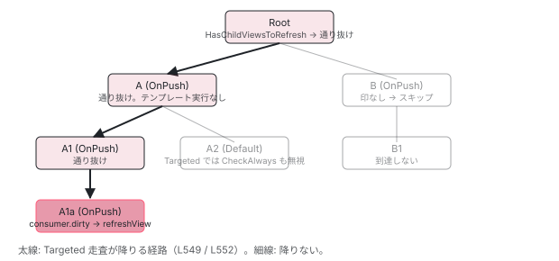

[目次](../README.md) › [変更検知の各ステップ](README.md) › 第 6 回 / 全 9 回

# HasChildViewsToRefresh と Targeted モード：通り道だけ降りる

> markAncestorsForTraversal は Dirty ではなく HasChildViewsToRefresh を立てる。Targeted モードは RefreshView か「通り道」のビューしか触らない。OnPush でも signal で更新される理由。

angular/angular · 読了 約 12 分 · 発展 · [サイトで読む（デモが動きます）](https://angular-deep-dive-cyan.vercel.app/chapter/cd-targeted-traversal)

---

[前回](04-cd-onpush-markforcheck.md)の `markViewDirty` は根まで `Dirty` を立て、経路上のビューを**全部更新**させました。signal の変化はもっと安く済ませます。経路上には `HasChildViewsToRefresh`（「子孫に用がある」）だけを立て、走査は `Targeted` モードで、印のあるビューを**通り抜ける**だけでテンプレートは実行しません。この章では印を立てる `markAncestorsForTraversal` と `markViewForRefresh`、それを呼ぶ 5 つの場所、そして `Targeted` 走査が `ApplicationRef` からどう始まるかを読みます。OnPush のコンポーネントが `@Input` も `markForCheck` も無しに signal で更新される理由がここにあります。

読む対象は `packages/core/src/render3/util/view_utils.ts` の 204〜280 行目、`render3/instructions/change_detection.ts`、`application/application_ref.ts` の 624〜714 行目です。

1. 概観
2. detectChangesInView
3. refreshView の全ステップ
4. OnPush と markForCheck
5. ReactiveLViewConsumer
6. **Targeted 走査**（この章）
7. checkNoChanges
8. afterRender
9. effect

## 1. 2 つのビット：RefreshView と HasChildViewsToRefresh

📄 `angular/packages/core/src/render3/interfaces/view.ts` L452–471 （▶ の行: 453–455, 458, 467–468, 471）

```ts
452 │   /**
453 ▶    * Whether this moved LView needs to be refreshed. Similar to the Dirty flag, but used for
454 ▶    * transplanted and signal views where the parent/ancestor views are not marked dirty as well.
455 ▶    * i.e. "Refresh just this view". Used in conjunction with the HAS_CHILD_VIEWS_TO_REFRESH
456 │    * flag.
457 │    */
458 ▶   RefreshView = 1 << 10,
459 │ 
460 │   /** Indicates that the view **or any of its ancestors** have an embedded view injector. */
461 │   HasEmbeddedViewInjector = 1 << 11,
462 │ 
463 │   /** Indicates that the view was created with `signals: true`. */
464 │   SignalView = 1 << 12,
465 │ 
466 │   /**
467 ▶    * Indicates that this LView has a view underneath it that needs to be refreshed during change
468 ▶    * detection. This flag indicates that even if this view is not dirty itself, we still need to
469 │    * traverse its children during change detection.
470 │    */
471 ▶   HasChildViewsToRefresh = 1 << 13,
```

453〜455 行目、`RefreshView` は「`Dirty` に似ているが、**親や先祖を dirty にせず**このビューだけ更新したい」ときの印。「transplanted view と signal のビューで使う」と書かれています。467〜469 行目、`HasChildViewsToRefresh` は「自分は dirty でないが、子孫に更新が必要なものがあるので、走査では子へ降りる」印。2 つは組で使われます：末端に `RefreshView`（または consumer.dirty）、そこから根までの経路に `HasChildViewsToRefresh`。

📄 `angular/packages/core/src/render3/instructions/change_detection.ts` L169–179 （▶ の行: 176, 178）

```ts
169 │ export const enum ChangeDetectionMode {
170 │   /**
171 │    * In `Global` mode, `Dirty` and `CheckAlways` views are refreshed as well as views with the
172 │    * `RefreshView` flag.
173 │    */
174 │   Global,
175 │   /**
176 ▶    * In `Targeted` mode, only views with the `RefreshView` flag or updated signals are refreshed.
177 │    */
178 ▶   Targeted,
179 │ }
```

176 行目、`Targeted` はこの 2 種類（`RefreshView` と signal の変化）だけを更新対象にします。`CheckAlways` も `Dirty` も見ません。

## 2. 経路に印を立てる：markAncestorsForTraversal

📄 `angular/packages/core/src/render3/util/view_utils.ts` L257–280 （▶ の行: 265–267, 270–271, 274–276, 278）

```ts
257 │ /**
258 │  * Ensures views above the given `lView` are traversed during change detection even when they are
259 │  * not dirty.
260 │  *
261 │  * This is done by setting the `HAS_CHILD_VIEWS_TO_REFRESH` flag up to the root, stopping when the
262 │  * flag is already `true` or the `lView` is detached.
263 │  */
264 │ export function markAncestorsForTraversal(lView: LView) {
265 ▶   lView[ENVIRONMENT].changeDetectionScheduler?.notify(NotificationSource.MarkAncestorsForTraversal);
266 ▶   let parent = getLViewParent(lView);
267 ▶   while (parent !== null) {
268 │     // We stop adding markers to the ancestors once we reach one that already has the marker. This
269 │     // is to avoid needlessly traversing all the way to the root when the marker already exists.
270 ▶     if (parent[FLAGS] & LViewFlags.HasChildViewsToRefresh) {
271 ▶       break;
272 │     }
273 │ 
274 ▶     parent[FLAGS] |= LViewFlags.HasChildViewsToRefresh;
275 ▶     if (!viewAttachedToChangeDetector(parent)) {
276 ▶       break;
277 │     }
278 ▶     parent = getLViewParent(parent);
279 │   }
280 │ }
```

1. **265 行目：スケジューラに `MarkAncestorsForTraversal` を通知**

   印を立てる前に tick を予約します。通知の中身は次の引用。
2. **266 行目：`getLViewParent(lView)` から始める**

   **自分には立てません**。自分の印は呼び出し元が別に持っています （consumer の `dirty`、または `RefreshView`）。
3. **270〜271 行目：既に立っている先祖に当たったら `break`**

   268〜269 行目のコメント：その先祖より上は、前にその印を立てた誰かが既に根まで立てているので、登る必要がありません。同じ tick の中で 100 個の signal が変わっても、根への経路を 100 回登り直すことはなく、2 回目以降は合流点で止まります。`markViewDirty`（前回）にはこの最適化はありません。
4. **274 行目：`HasChildViewsToRefresh` を立てる**

   `Dirty` でも `RefreshView` でもありません。この先祖のテンプレートは実行されないという宣言です。
5. **275〜276 行目：detach された先祖に当たったら `break`**

   印は立てた上で止まります。detach された木の中の変化は、その木の根が `reattach` されるまで走査に到達しません （6 節）。

📄 `angular/packages/core/src/change_detection/scheduling/zoneless_scheduling_impl.ts` L151–156 （▶ の行: 152, 154）

```ts
151 │     switch (source) {
152 ▶       case NotificationSource.MarkAncestorsForTraversal:
153 │       case NotificationSource.DeferBlockStateUpdate: {
154 ▶         this.appRef.dirtyFlags |= ApplicationRefDirtyFlags.ViewTreeTraversal;
155 │         break;
156 │       }
```

152〜154 行目、`ApplicationRef.dirtyFlags` に `ViewTreeTraversal` を立てます。前回の `MarkForCheck` が `ViewTreeCheck` だったのと区別されていますが、どちらも tick を予約し、tick は 5 節のとおり同じ `Targeted` 走査になります。

## 3. markAncestorsForTraversal を呼ぶ 4 か所

📄 `angular/packages/core/src/render3/reactive_lview_consumer.ts` L43–53 （▶ の行: 47–48）

```ts
43 │ export const REACTIVE_LVIEW_CONSUMER_NODE: Omit<ReactiveLViewConsumer, 'lView'> = {
44 │   ...REACTIVE_NODE,
45 │   consumerIsAlwaysLive: true,
46 │   kind: 'template',
47 ▶   consumerMarkedDirty: (node: ReactiveLViewConsumer) => {
48 ▶     markAncestorsForTraversal(node.lView!);
49 │   },
50 │   consumerOnSignalRead(this: ReactiveLViewConsumer): void {
51 │     this.lView![REACTIVE_TEMPLATE_CONSUMER] = this;
52 │   },
53 │ };
```

**(1) テンプレート consumer が dirty になったとき**（47〜48 行目）。[前回](05-cd-signal-consumer.md)読んだ経路です。自分の印は `consumer.dirty`。

📄 `angular/packages/core/src/render3/reactivity/effect.ts` L284–288 （▶ の行: 285–287）

```ts
284 │   consumerMarkedDirty(this: ViewEffectNode): void {
285 ▶     this.view[FLAGS] |= LViewFlags.HasChildViewsToRefresh;
286 ▶     markAncestorsForTraversal(this.view);
287 ▶     this.notifier.notify(NotificationSource.ViewEffect);
288 │   },
```

**(2) コンポーネント内の `effect()` が dirty になったとき**（284〜288 行目）。285 行目で**自分のビューにも**`HasChildViewsToRefresh` を立てるのが consumer と違う点です。effect はテンプレートを実行する理由にはならず、`detectChangesInView` 542 行目の「通り抜け」の中の 547 行目 `runEffectsInView` で実行されます（[9 回目](09-cd-effects.md)）。

📄 `angular/packages/core/src/render3/after_render/manager.ts` L125–139 （▶ の行: 129, 132–133）

```ts
125 │   register(sequence: AfterRenderSequence): void {
126 │     const {view} = sequence;
127 │     if (view !== undefined) {
128 │       // Delay adding it to the manager, add it to the view instead.
129 ▶       (view[AFTER_RENDER_SEQUENCES_TO_ADD] ??= []).push(sequence);
130 │ 
131 │       // Mark the view for traversal to ensure we eventually schedule the afterNextRender.
132 ▶       markAncestorsForTraversal(view);
133 ▶       view[FLAGS] |= LViewFlags.HasChildViewsToRefresh;
134 │     } else if (!this.executing) {
135 │       this.addSequence(sequence);
136 │     } else {
137 │       this.deferredRegistrations.add(sequence);
138 │     }
139 │   }
```

**(3) コンポーネント内で `afterRender` / `afterNextRender` を登録したとき**（129〜133 行目）。effect と同じく自分にも立てます。通り抜けの 555 行目 `addAfterRenderSequencesForView` で管理者に渡されます （[8 回目](08-cd-after-render.md)）。

📄 `angular/packages/core/src/render3/util/view_utils.ts` L204–216 （▶ の行: 209, 212–214）

```ts
204 │ /**
205 │  * Adds the `RefreshView` flag from the lView and updates HAS_CHILD_VIEWS_TO_REFRESH flag of
206 │  * parents.
207 │  */
208 │ export function markViewForRefresh(lView: LView) {
209 ▶   if (lView[FLAGS] & LViewFlags.RefreshView) {
210 │     return;
211 │   }
212 ▶   lView[FLAGS] |= LViewFlags.RefreshView;
213 ▶   if (viewAttachedToChangeDetector(lView)) {
214 ▶     markAncestorsForTraversal(lView);
215 │   }
216 │ }
```

**(4) `markViewForRefresh`**。212 行目で自分に `RefreshView` を立て、213〜214 行目、attach されていれば先祖に印。209 行目、既に立っていれば何もしません（先祖の印も既にあるはず）。この関数を呼ぶのは次の 2 か所です。

📄 `angular/packages/core/src/render3/instructions/change_detection.ts` L436–456 （▶ の行: 447, 453）

```ts
436 │ /**
437 │  * Mark transplanted views as needing to be refreshed at their attachment points.
438 │  *
439 │  * @param lView The `LView` that may have transplanted views.
440 │  */
441 │ function markTransplantedViewsForRefresh(lView: LView) {
442 │   for (
443 │     let lContainer = getFirstLContainer(lView);
444 │     lContainer !== null;
445 │     lContainer = getNextLContainer(lContainer)
446 │   ) {
447 ▶     if (!(lContainer[FLAGS] & LContainerFlags.HasTransplantedViews)) continue;
448 │ 
449 │     const movedViews = lContainer[MOVED_VIEWS]!;
450 │     ngDevMode && assertDefined(movedViews, 'Transplanted View flags set but missing MOVED_VIEWS');
451 │     for (let i = 0; i < movedViews.length; i++) {
452 │       const movedLView = movedViews[i]!;
453 ▶       markViewForRefresh(movedLView);
454 │     }
455 │   }
456 │ }
```

📄 `angular/packages/core/src/render3/reactive_lview_consumer.ts` L73–89 （▶ の行: 78–79, 88）

```ts
73 │ export const TEMPORARY_CONSUMER_NODE: ReactiveNode = {
74 │   ...REACTIVE_NODE,
75 │   consumerIsAlwaysLive: true,
76 │   kind: 'template',
77 │   consumerMarkedDirty: (node: ReactiveLViewConsumer) => {
78 ▶     let parent = getLViewParent(node.lView!);
79 ▶     while (parent && !viewShouldHaveReactiveConsumer(parent[TVIEW])) {
80 │       parent = getLViewParent(parent);
81 │     }
82 │     if (!parent) {
83 │       // If we can't find an appropriate parent that should have a consumer, we
84 │       // don't have a way of appropriately refreshing this LView as part of application synchronization.
85 │       return;
86 │     }
87 │ 
88 ▶     markViewForRefresh(parent);
89 │   },
```

453 行目、`refreshView` が自分のテンプレートから作られて別の場所に挿入されたビュー（transplanted view）に `RefreshView` を立てる （[3 回目](03-cd-refresh-view.md)の 271 行目）。88 行目、埋め込みビューを直接 `detectChanges()` したときの一時 consumer が、consumer を持つべき最初の親に `RefreshView` を立てる（[5 回目](05-cd-signal-consumer.md)の 8 節）。

📄 `angular/packages/core/src/render3/view_ref.ts` L307–315 （▶ の行: 313–314）

```ts
307 │   detectChanges(): void {
308 │     // Add `RefreshView` flag to ensure this view is refreshed if not already dirty.
309 │     // `RefreshView` flag is used intentionally over `Dirty` because it gets cleared before
310 │     // executing any of the actual refresh code while the `Dirty` flag doesn't get cleared
311 │     // until the end of the refresh. Using `RefreshView` prevents creating a potential difference
312 │     // in the state of the LViewFlags during template execution.
313 ▶     this._lView[FLAGS] |= LViewFlags.RefreshView;
314 ▶     detectChangesInternal(this._lView);
315 │   }
```

📄 `angular/packages/core/src/render3/instructions/mark_view_dirty.ts` L26–40 （▶ の行: 27, 33, 39）

```ts
26 │ export function markViewDirty(lView: LView, source: NotificationSource): LView | null {
27 ▶   const dirtyBitsToUse = isRefreshingViews()
28 │     ? // When we are actively refreshing views, we only use the `Dirty` bit to mark a view
29 │       // for check. This bit is ignored in ChangeDetectionMode.Targeted, which is used to
30 │       // synchronously rerun change detection on a specific set of views (those which have
31 │       // the `RefreshView` flag and those with dirty signal consumers). `LViewFlags.Dirty`
32 │       // does not support re-entrant change detection on its own.
33 ▶       LViewFlags.Dirty
34 │     : // When we are not actively refreshing a view tree, it is absolutely
35 │       // valid to update state and mark views dirty. We use the `RefreshView` flag in this
36 │       // case to allow synchronously rerunning change detection. This applies today to
37 │       // afterRender hooks as well as animation listeners which execute after detecting
38 │       // changes in a view when the render factory flushes.
39 ▶       LViewFlags.RefreshView | LViewFlags.Dirty;
40 │   lView[ENVIRONMENT].changeDetectionScheduler?.notify(source);
```

`RefreshView` を立てる残り 2 か所も挙げておきます。313 行目、`ViewRef.detectChanges()` は自分に立ててから 直接 `detectChangesInternal` を呼ぶので、先祖への印は不要です。39 行目、`markViewDirty` は走査の外から呼ばれたとき `RefreshView | Dirty` を**根までの全員に**立てます。こちらは `HasChildViewsToRefresh` ではなく `RefreshView` なので、経路上の全ビューが `Targeted` でも更新されます。「`markForCheck` は親も更新する」の zoneless 版の根拠です。

| 起点 | 自分の印 | 先祖の印 | 先祖のテンプレート |
| --- | --- | --- | --- |
| signal の変化（consumer） | `consumer.dirty` | `HasChildViewsToRefresh` | 実行しない |
| view effect / afterRender 登録 | `HasChildViewsToRefresh` | `HasChildViewsToRefresh` | 実行しない（自分も） |
| transplanted view / 一時 consumer | `RefreshView` | `HasChildViewsToRefresh` | 実行しない |
| `markViewDirty`（走査の外） | `RefreshView \| Dirty` | `RefreshView \| Dirty` | **実行する** |
| `markViewDirty`（走査中） | `Dirty` | `Dirty` | Global のときだけ |

> [!TIP]
> **新卒エンジニアへ**
>
> 「`Dirty` を立てる `markViewDirty`」と「`HasChildViewsToRefresh` を立てる `markAncestorsForTraversal`」は、どちらも根まで登りますが、前者は経路上の全ビューを**更新させる**印、後者は**通らせる**だけの印です。自分のコードから直接呼べるのは前者（`markForCheck()`）だけで、後者は signal / effect / afterRender / transplanted view の内部経路からしか立ちません。「signal を使うと親が再描画されない」のは、後者の経路に乗るからです。

## 4. Targeted 走査で何が起きるか

📄 `angular/packages/core/src/render3/instructions/change_detection.ts` L525–538 （▶ の行: 526, 529, 536, 538）

```ts
525 │   // Always refresh views marked for refresh, regardless of mode.
526 ▶   shouldRefreshView ||= !!(flags & LViewFlags.RefreshView);
527 │ 
528 │   // Refresh views when they have a dirty reactive consumer, regardless of mode.
529 ▶   shouldRefreshView ||= !!(consumer?.dirty && consumerPollProducersForChange(consumer));
530 │ 
531 │   shouldRefreshView ||= !!(ngDevMode && isExhaustiveCheckNoChanges());
532 │ 
533 │   // Mark the Flags and `ReactiveNode` as not dirty before refreshing the component, so that they
534 │   // can be re-dirtied during the refresh process.
535 │   if (consumer) {
536 ▶     consumer.dirty = false;
537 │   }
538 ▶   lView[FLAGS] &= ~(LViewFlags.HasChildViewsToRefresh | LViewFlags.RefreshView);
```

📄 `angular/packages/core/src/render3/instructions/change_detection.ts` L540–561 （▶ の行: 540, 542, 544, 547, 549, 552, 555, 558）

```ts
540 ▶   if (shouldRefreshView) {
541 │     refreshView(tView, lView, tView.template, lView[CONTEXT]);
542 ▶   } else if (flags & LViewFlags.HasChildViewsToRefresh) {
543 │     // Set active consumer to null to avoid inheriting an improper reactive context
544 ▶     const prevConsumer = setActiveConsumer(null);
545 │     try {
546 │       if (!isInCheckNoChangesPass) {
547 ▶         runEffectsInView(lView);
548 │       }
549 ▶       detectChangesInEmbeddedViews(lView, ChangeDetectionMode.Targeted);
550 │       const components = tView.components;
551 │       if (components !== null) {
552 ▶         detectChangesInChildComponents(lView, components, ChangeDetectionMode.Targeted);
553 │       }
554 │       if (!isInCheckNoChangesPass) {
555 ▶         addAfterRenderSequencesForView(lView);
556 │       }
557 │     } finally {
558 ▶       setActiveConsumer(prevConsumer);
559 │     }
560 │   }
561 │ }
```

1. **経路上のビュー（`HasChildViewsToRefresh` だけ）**

   `Targeted` なので 509・519 行目の理由は偽、`RefreshView` も consumer.dirty も無いので 526・529 行目も偽。538 行目で `HasChildViewsToRefresh` を落とし、542 行目へ。544 行目で `setActiveConsumer(null)`（親の consumer を子へ漏らさない）、547 行目で effect、549・552 行目で子へ `Targeted` のまま降り、555 行目で afterRender を渡し、558 行目で consumer を戻します。**このビューのテンプレート関数は呼ばれず、フックも呼ばれません**。
2. **末端のビュー（consumer.dirty または `RefreshView`）**

   526 または 529 行目が真。536・538 行目で印を落とし、540 行目で `refreshView`。その中からは `Global` で子へ降ります（3 回目の 274・307 行目）。末端より下の `CheckAlways` の子は、ここで通常どおり更新されます。
3. **経路外のビュー（印なし）**

   540 も 542 も偽。子孫ごとスキップされます。OnPush かどうかは関係ありません。`Targeted` では `CheckAlways` も見ないからです。



*A1a の signal が変わったとき。A1a は consumer.dirty、A1 → A → Root は HasChildViewsToRefresh。Targeted 走査は Root・A・A1 を通り抜け（テンプレート実行なし）、A1a だけ refreshView。B・A2 は印が無いので子孫ごとスキップ。*

> **🧪 DEMO — signal の変化で印がどう立ち、Targeted 走査がどこを通るか**
>
> 全部 OnPush の木です。ノードをクリックすると、そのコンポーネントのテンプレートが読む signal を set したことになります （consumer.dirty + markAncestorsForTraversal）。複数クリックしてから「Targeted 走査」を押すと、既に立っている先祖で break する様子（view\_utils.ts L270）も見られます。
>
> ▶ [このデモはサイトで動かせます](https://angular-deep-dive-cyan.vercel.app/chapter/cd-targeted-traversal)

## 5. tick はどこから Targeted で始まるか

📄 `angular/packages/core/src/application/application_ref.ts` L533–538 （▶ の行: 534–535）

```ts
533 │   tick(): void {
534 ▶     if (!this.zonelessEnabled) {
535 ▶       this.dirtyFlags |= ApplicationRefDirtyFlags.ViewTreeGlobal;
536 │     }
537 │     this._tick();
538 │   }
```

📄 `angular/packages/core/src/application/application_ref.ts` L624–655 （▶ の行: 630, 639, 641, 645–646, 650, 652–653）

```ts
624 │     // First check dirty views, if there are any.
625 │     let ranDetectChanges = false;
626 │     if (this.dirtyFlags & ApplicationRefDirtyFlags.ViewTreeAny) {
627 │       // Change detection on views starts in targeted mode (only check components if they're
628 │       // marked as dirty) unless global checking is specifically requested via APIs like
629 │       // `ApplicationRef.tick()` and the `NgZone` integration.
630 ▶       const useGlobalCheck = Boolean(this.dirtyFlags & ApplicationRefDirtyFlags.ViewTreeGlobal);
631 │ 
632 │       // Clear the view-related dirty flags.
633 │       this.dirtyFlags &= ~ApplicationRefDirtyFlags.ViewTreeAny;
634 │ 
635 │       // Set the AfterRender bit, as we're checking views and will need to run afterRender hooks.
636 │       this.dirtyFlags |= ApplicationRefDirtyFlags.AfterRender;
637 │ 
638 │       // Check all potentially dirty views.
639 ▶       for (let {_lView} of this.allViews) {
640 │         // When re-checking, only check views which actually need it.
641 ▶         if (!useGlobalCheck && !requiresRefreshOrTraversal(_lView)) {
642 │           continue;
643 │         }
644 │ 
645 ▶         const mode =
646 ▶           useGlobalCheck && !this.zonelessEnabled
647 │             ? // Global mode includes `CheckAlways` views.
648 │               // When using zoneless, all root views must be explicitly marked for refresh, even if they are
649 │               // `CheckAlways`.
650 ▶               ChangeDetectionMode.Global
651 │             : // Only refresh views with the `RefreshView` flag or views is a changed signal
652 ▶               ChangeDetectionMode.Targeted;
653 ▶         detectChangesInternal(_lView, mode);
654 │         ranDetectChanges = true;
655 │       }
```

1. **534〜535 行目：zone.js ありの `tick()` だけ `ViewTreeGlobal`**

   zoneless では公開 API の `tick()` でも立ちません。スケジューラ経由の tick（`_tick`）も立てません。
2. **639〜643 行目：ルートビューごとに、印が無ければ飛ばす**

   `allViews` は `ApplicationRef` に attach された全ルートビューです（通常 1 つ）。641 行目、`Global` でなく `requiresRefreshOrTraversal` も偽なら、そのルートは触りません。
3. **645〜652 行目：モードの決定**

   `useGlobalCheck && !zonelessEnabled` のときだけ `Global`。648〜649 行目のコメント：「zoneless では、ルートビューが `CheckAlways` であっても明示的に印が付いていなければならない」。**zoneless の tick は常に `Targeted`** で、2〜3 節の印だけを頼りに降ります。
4. **653 行目：`detectChangesInternal(_lView, mode)`**

   [2 回目](02-cd-detect-changes-in-view.md)の入口へ。ルートビューから 4 節の判定が始まります。

📄 `angular/packages/core/src/render3/instructions/change_detection.ts` L125–144 （▶ の行: 130, 143）

```ts
125 │     let retries = 0;
126 │     // If after running change detection, this view still needs to be refreshed or there are
127 │     // descendants views that need to be refreshed due to re-dirtying during the change detection
128 │     // run, detect changes on the view again. We run change detection in `Targeted` mode to only
129 │     // refresh views with the `RefreshView` flag.
130 ▶     while (requiresRefreshOrTraversal(lView)) {
131 │       if (retries === MAXIMUM_REFRESH_RERUNS) {
132 │         throw new RuntimeError(
133 │           RuntimeErrorCode.INFINITE_CHANGE_DETECTION,
134 │           ngDevMode &&
135 │             'Infinite change detection while trying to refresh views. ' +
136 │               'There may be components which each cause the other to require a refresh, ' +
137 │               'causing an infinite loop.',
138 │         );
139 │       }
140 │       retries++;
141 │       // Even if this view is detached, we still detect changes in targeted mode because this was
142 │       // the root of the change detection run.
143 ▶       detectChangesInView(lView, ChangeDetectionMode.Targeted);
144 │     }
```

📄 `angular/packages/core/src/render3/util/view_utils.ts` L236–241 （▶ の行: 238–239）

```ts
236 │ export function requiresRefreshOrTraversal(lView: LView) {
237 │   return !!(
238 ▶     lView[FLAGS] & (LViewFlags.RefreshView | LViewFlags.HasChildViewsToRefresh) ||
239 ▶     lView[REACTIVE_TEMPLATE_CONSUMER]?.dirty
240 │   );
241 │ }
```

走査中に signal が set されると、2 節の経路で根まで再び `HasChildViewsToRefresh` が立ちます。130 行目の `while` はそれを 238 行目で検知し、143 行目で `Targeted` をやり直します。`Global` の 1 周目でも、2 周目以降は必ず `Targeted` です。

📄 `angular/packages/core/src/application/application_ref.ts` L704–714 （▶ の行: 705, 707, 712）

```ts
704 │   private syncDirtyFlagsWithViews(): void {
705 ▶     if (this.allViews.some(({_lView}) => requiresRefreshOrTraversal(_lView))) {
706 │       // If after running all afterRender callbacks new views are dirty, ensure we loop back.
707 ▶       this.dirtyFlags |= ApplicationRefDirtyFlags.ViewTreeTraversal;
708 │       return;
709 │     } else {
710 │       // Even though this flag may be set, none of _our_ views require traversal, and so the
711 │       // `ApplicationRef` doesn't require any repeated checking.
712 ▶       this.dirtyFlags &= ~ApplicationRefDirtyFlags.ViewTreeAny;
713 │     }
714 │   }
```

走査が終わったあと、`synchronizeOnce` は 705 行目で全ルートビューを見直します。まだ印が残っていれば 707 行目で `ViewTreeTraversal` を立て直し（`synchronize` の `while` がもう 1 周）、無ければ 712 行目でビュー関連の dirtyFlags を全部落とします。通知は来たがどのルートからも到達できない（detach された木の中）印は、ここで「`ApplicationRef` の仕事ではない」と判定されます。

## 6. reattach したときの印の付け直し

📄 `angular/packages/core/src/render3/view_ref.ts` L281–284 （▶ の行: 282–283）

```ts
281 │   reattach(): void {
282 ▶     updateAncestorTraversalFlagsOnAttach(this._lView);
283 ▶     this._lView[FLAGS] |= LViewFlags.Attached;
284 │   }
```

📄 `angular/packages/core/src/render3/util/view_utils.ts` L243–255 （▶ の行: 248–250, 252–253）

```ts
243 │ /**
244 │  * Updates the `HasChildViewsToRefresh` flag on the parents of the `LView` as well as the
245 │  * parents above.
246 │  */
247 │ export function updateAncestorTraversalFlagsOnAttach(lView: LView) {
248 ▶   lView[ENVIRONMENT].changeDetectionScheduler?.notify(NotificationSource.ViewAttached);
249 ▶   if (lView[FLAGS] & LViewFlags.Dirty) {
250 ▶     lView[FLAGS] |= LViewFlags.RefreshView;
251 │   }
252 ▶   if (requiresRefreshOrTraversal(lView)) {
253 ▶     markAncestorsForTraversal(lView);
254 │   }
255 │ }
```

2 節の 275〜276 行目で見たとおり、detach された先祖で印の伝播は止まります。282 行目、`reattach()` は `Attached` を戻す前に `updateAncestorTraversalFlagsOnAttach` を呼びます。249〜250 行目、detach 中に `Dirty` になっていれば `RefreshView` に昇格させ（`Targeted` で拾えるように）、252〜253 行目、印があれば先祖へ `HasChildViewsToRefresh` を伸ばします。248 行目で `ViewAttached` を通知して tick を予約します。

## ここまでの呼び出し

- 👤 `count.set(1)`（A1a のテンプレートが読んでいる signal） — あなたのコード
  - `consumerMarkDirty(A1a の consumer)` — graph.ts L371 — *dirty = true*
    - `consumerMarkedDirty → markAncestorsForTraversal(A1a の LView)` — view\_utils.ts L264
      - `scheduler.notify(MarkAncestorsForTraversal)` — zoneless\_scheduling\_impl.ts L152 — *dirtyFlags |= ViewTreeTraversal、tick 予約*
      - `A1[FLAGS] |= HasChildViewsToRefresh` → A → Root — L274 — *既に立っていれば break*
- `ApplicationRef.synchronizeOnce()` — application\_ref.ts L617 — *次のマクロタスク / rAF*
  - `detectChangesInternal(rootLView, Targeted)` — L653 — *zoneless は常に Targeted*
    - `detectChangesInView(Root, Targeted)` — change\_detection.ts L502 — *HasChildViewsToRefresh → 542 行目 通り抜け*
      - `detectChangesInChildComponents(Root, [A, B], Targeted)` — L552
        - `detectChangesInView(A, Targeted)` — L502 — *通り抜け*
        - `detectChangesInView(B, Targeted)` — L502 — *印なし → 何もしない。B1 には降りない*
          - `detectChangesInView(A1, Targeted)` — L502 — *通り抜け*
            - `detectChangesInView(A1a, Targeted)` — L502 — *consumer.dirty && poll → 540 行目*
              - `refreshView(A1a)` — L190 — *ここだけテンプレート実行。子へは Global*
  - `syncDirtyFlagsWithViews()` — L704 — *印が残っていればもう 1 周*

## 聞かれそうな質問

**Q. OnPush のコンポーネントが、@Input も markForCheck も無しに signal で更新されるのはなぜですか？**

`detectChangesInView` の 529 行目（consumer.dirty かつ poll）がモードも `CheckAlways` も `Dirty` も見ないからです。そこまで走査が到達できるのは、`markAncestorsForTraversal`（view\_utils.ts 264〜280 行目）が先祖に `HasChildViewsToRefresh` を立て、542 行目の通り抜けが `Targeted` のまま子へ降りる（549・552 行目）からです。先祖が OnPush かどうかは一切関係ありません。

**Q. Targeted 走査で「通り抜け」たコンポーネントでは何が起きますか？**

テンプレート関数とライフサイクルフックは呼ばれません。542〜560 行目で起きるのは、538 行目で `HasChildViewsToRefresh` を落とす、547 行目で dirty な `effect` を実行する、549・552 行目で子へ降りる、555 行目で登録済みの `afterRender` を管理者に渡す、の 4 つだけです。

**Q. HasChildViewsToRefresh と Dirty の違いは何ですか？**

`Dirty`（`markViewDirty` が立てる）は「このビューを更新せよ」で、519 行目で `refreshView` の理由になります。`HasChildViewsToRefresh`（`markAncestorsForTraversal` が立てる）は「子孫に用がある」で、`refreshView` の理由にはならず、542 行目で子へ降りる理由にだけなります。前者は `Global` でしか効かず、後者はモードを問いません。

**Q. zoneless で ApplicationRef.tick() を呼んだら Global で全部更新されますか？**

されません。`tick()`（application\_ref.ts 534〜535 行目）は `zonelessEnabled` なら `ViewTreeGlobal` を立てず、`synchronizeOnce` の 645〜652 行目は `!zonelessEnabled` も条件にしているので、zoneless では常に `Targeted` です。印の無い `CheckAlways` コンポーネントは更新されません。更新したいなら `ViewRef.detectChanges()` （313 行目で `RefreshView` を立て、その中からは `Global`）を使います。

**Q. 同じ tick で 100 個の signal が変わったら、100 回根まで登りますか？**

登りません。`markAncestorsForTraversal` の 270〜271 行目で、既に `HasChildViewsToRefresh` が立っている先祖に 当たったら `break` します。2 個目以降は合流する先祖で止まります。なお `consumerMarkDirty` 側でも、既に dirty な consumer には通知しません（graph.ts 354 行目）。

## 読み終えて

- `markAncestorsForTraversal`（264〜280 行目）は親から根へ `HasChildViewsToRefresh` を立てる。自分には立てず、既に立っていれば止まる
- 呼ぶのは 4 か所：テンプレート consumer の `consumerMarkedDirty`、view effect、afterRender の登録、`markViewForRefresh`（transplanted / 一時 consumer）
- `Targeted` は `RefreshView` と consumer.dirty だけを更新し、`HasChildViewsToRefresh` のビューは 542 行目で通り抜ける。テンプレートもフックも実行しない
- zoneless の tick は常に `Targeted`（application\_ref.ts 645〜652 行目）。`Global` になるのは zone.js の `tick()` か `refreshView` の中から子へ降りるときだけ
- detach された先祖で伝播は止まり、`reattach`（`updateAncestorTraversalFlagsOnAttach`）で付け直される

---

← 前: [テンプレートの ReactiveLViewConsumer](05-cd-signal-consumer.md)  
次: [checkNoChanges と ExpressionChangedAfterItHasBeenChecked](07-cd-check-no-changes.md) →
