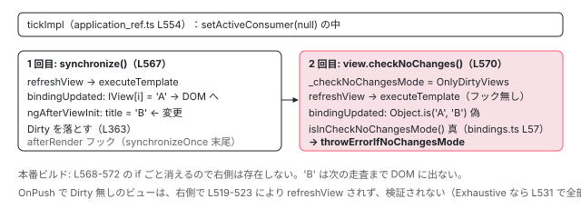

[目次](../README.md) › [変更検知の各ステップ](README.md) › 第 7 回 / 全 9 回

# checkNoChanges と ExpressionChangedAfterItHasBeenChecked

> 開発モードでは tick のあとに 2 回目の走査がある。bindingUpdated が CheckNoChangesMode で値の変化を見つけると例外。exhaustive モードとの違い。

angular/angular · 読了 約 11 分 · 中核 · [サイトで読む（デモが動きます）](https://angular-deep-dive-cyan.vercel.app/chapter/cd-check-no-changes)

---

開発モードでは、1 回の `tick` の中で変更検知が**2 回**走ります。1 回目が本物で、2 回目は「1 回目で DOM に書いた値が、もう変わっていないか」を確かめるだけの走査です。2 回目で値が変わっていれば `ExpressionChangedAfterItHasBeenCheckedError`。この章では、2 回目がどこから呼ばれ、どのモジュール変数で「検証中」を表し、`refreshView` の中の何を飛ばし、どの 1 行が例外を投げるかを読みます。本番で出ない理由、OnPush のコンポーネントで見逃される理由、`exhaustive` オプションが何を変えるかも分かります。

読む対象は `packages/core/src/application/application_ref.ts` の `tickImpl`、`render3/view_ref.ts` の `checkNoChanges`、`render3/state.ts`、`render3/bindings.ts` の `bindingUpdated`、`render3/errors.ts` です。

1. 概観
2. detectChangesInView
3. refreshView の全ステップ
4. OnPush と markForCheck
5. ReactiveLViewConsumer
6. Targeted 走査
7. **checkNoChanges**（この章）
8. afterRender
9. effect

## 1. 2 回目の走査はどこから呼ばれるか

📄 `angular/packages/core/src/application/application_ref.ts` L554–582 （▶ の行: 564, 567–570, 577）

```ts
554 │   private tickImpl = (): void => {
555 │     (typeof ngDevMode === 'undefined' || ngDevMode) && warnIfDestroyed(this._destroyed);
556 │     if (this._runningTick) {
557 │       profiler(ProfilerEvent.ChangeDetectionEnd);
558 │       throw new RuntimeError(
559 │         RuntimeErrorCode.RECURSIVE_APPLICATION_REF_TICK,
560 │         ngDevMode && 'ApplicationRef.tick is called recursively',
561 │       );
562 │     }
563 │ 
564 ▶     const prevConsumer = setActiveConsumer(null);
565 │     try {
566 │       this._runningTick = true;
567 ▶       this.synchronize();
568 ▶       if (typeof ngDevMode === 'undefined' || ngDevMode) {
569 ▶         for (let view of this.allViews) {
570 ▶           view.checkNoChanges();
571 │         }
572 │       }
573 │     } finally {
574 │       this._runningTick = false;
575 │       this.tracingSnapshot?.dispose();
576 │       this.tracingSnapshot = null;
577 ▶       setActiveConsumer(prevConsumer);
578 │       this.afterTick.next();
579 │ 
580 │       profiler(ProfilerEvent.ChangeDetectionEnd);
581 │     }
582 │   };
```

567 行目の `synchronize()` が 1 回目（`synchronizeOnce` のループ。afterRender フックまで含む）。568〜572 行目、`ngDevMode` のときだけ、全ルートビューに `view.checkNoChanges()`。**これが 2 回目です**。`typeof ngDevMode === 'undefined' || ngDevMode` という書き方は、本番ビルドで `ngDevMode` が `false` に定数畳み込みされ、この `if` ごと削除されるためのものです。本番で `ExpressionChangedAfterItHasBeenCheckedError` が出ないのは、投げる側のコードが消えているからではなく、**呼ぶ側のこの 4 行が消えている**からです。

564 行目と 577 行目、tick 全体は `setActiveConsumer(null)` の中です。tick を起動したコードの reactive context を持ち込まないためです。

📄 `angular/packages/core/src/render3/view_ref.ts` L317–340 （▶ の行: 329, 331–333, 338）

```ts
317 │   /**
318 │    * Checks the change detector and its children, and throws if any changes are detected.
319 │    *
320 │    * This is used in development mode to verify that running change detection doesn't
321 │    * introduce other changes.
322 │    */
323 │   checkNoChanges(): void {
324 │     // Note: we use `if (ngDevMode) { ... }` instead of an early return.
325 │     // ESBuild is conservative about removing dead code that follows `return;`
326 │     // inside a function body, so the block may remain in the bundle.
327 │     // Using a conditional ensures the dev-only logic is reliably tree-shaken
328 │     // in production builds.
329 ▶     if (ngDevMode) {
330 │       try {
331 ▶         this.exhaustive ??= this._lView[INJECTOR].get(
332 ▶           UseExhaustiveCheckNoChanges,
333 ▶           USE_EXHAUSTIVE_CHECK_NO_CHANGES_DEFAULT,
334 │         );
335 │       } catch {
336 │         this.exhaustive = USE_EXHAUSTIVE_CHECK_NO_CHANGES_DEFAULT;
337 │       }
338 ▶       checkNoChangesInternal(this._lView, this.exhaustive);
339 │     }
340 │   }
```

📄 `angular/packages/core/src/change_detection/use_exhaustive_check_no_changes.ts` L11–15 （▶ の行: 11, 13）

```ts
11 ▶ export const USE_EXHAUSTIVE_CHECK_NO_CHANGES_DEFAULT = false;
12 │ 
13 ▶ export const UseExhaustiveCheckNoChanges = new InjectionToken<boolean>(
14 │   typeof ngDevMode !== 'undefined' && ngDevMode ? 'exhaustive checkNoChanges' : '',
15 │ );
```

329 行目、ここでも `ngDevMode` ガード（324〜328 行目のコメント：ESBuild が `return;` 以降のデッドコードを消しきれないので、`if` で包む）。331〜333 行目、`UseExhaustiveCheckNoChanges` トークンを inject し、既定は 11 行目の `false`。338 行目で `checkNoChangesInternal(lView, exhaustive)`。

📄 `angular/packages/core/src/change_detection/provide_check_no_changes_config.ts` L41–56 （▶ の行: 46, 49–50, 52）

```ts
41 │ export function provideCheckNoChangesConfig(options: {
42 │   interval?: number;
43 │   exhaustive: boolean;
44 │ }): EnvironmentProviders {
45 │   return makeEnvironmentProviders(
46 ▶     typeof ngDevMode === 'undefined' || ngDevMode
47 │       ? [
48 │           {
49 ▶             provide: UseExhaustiveCheckNoChanges,
50 ▶             useValue: options.exhaustive,
51 │           },
52 ▶           options?.interval !== undefined ? exhaustiveCheckNoChangesInterval(options.interval) : [],
53 │         ]
54 │       : [],
55 │   );
56 │ }
```

`provideCheckNoChangesConfig({ exhaustive: true })` が 49〜50 行目でそのトークンを `true` にします。46 行目、本番では空配列です。52 行目の `interval` は 7 節で見ます。

## 2. 「検証中」を表すモジュール変数

📄 `angular/packages/core/src/render3/instructions/change_detection.ts` L151–160 （▶ の行: 152–153, 156, 158）

```ts
151 │ export function checkNoChangesInternal(lView: LView, exhaustive: boolean) {
152 ▶   setIsInCheckNoChangesMode(
153 ▶     exhaustive ? CheckNoChangesMode.Exhaustive : CheckNoChangesMode.OnlyDirtyViews,
154 │   );
155 │   try {
156 ▶     detectChangesInternal(lView);
157 │   } finally {
158 ▶     setIsInCheckNoChangesMode(CheckNoChangesMode.Off);
159 │   }
160 │ }
```

📄 `angular/packages/core/src/render3/state.ts` L211–225 （▶ の行: 212–214, 225）

```ts
211 │ export enum CheckNoChangesMode {
212 ▶   Off,
213 ▶   Exhaustive,
214 ▶   OnlyDirtyViews,
215 │ }
216 │ 
217 │ /**
218 │  * In this mode, any changes in bindings will throw an ExpressionChangedAfterChecked error.
219 │  *
220 │  * Necessary to support ChangeDetectorRef.checkNoChanges().
221 │  *
222 │  * The `checkNoChanges` function is invoked only in ngDevMode=true and verifies that no unintended
223 │  * changes exist in the change detector or its children.
224 │  */
225 ▶ let _checkNoChangesMode: CheckNoChangesMode = 0; /* CheckNoChangesMode.Off */
```

📄 `angular/packages/core/src/render3/state.ts` L418–431 （▶ の行: 419–420, 425, 430）

```ts
418 │ export function isInCheckNoChangesMode(): boolean {
419 ▶   !ngDevMode && throwError('Must never be called in production mode');
420 ▶   return _checkNoChangesMode !== CheckNoChangesMode.Off;
421 │ }
422 │ 
423 │ export function isExhaustiveCheckNoChanges(): boolean {
424 │   !ngDevMode && throwError('Must never be called in production mode');
425 ▶   return _checkNoChangesMode === CheckNoChangesMode.Exhaustive;
426 │ }
427 │ 
428 │ export function setIsInCheckNoChangesMode(mode: CheckNoChangesMode): void {
429 │   !ngDevMode && throwError('Must never be called in production mode');
430 ▶   _checkNoChangesMode = mode;
431 │ }
```

1. **152〜154 行目：モードを `Exhaustive` か `OnlyDirtyViews` に**

   225 行目のモジュール変数 `_checkNoChangesMode` に書きます。`Off`（212 行目）が通常、`OnlyDirtyViews`（214 行目）が既定の 2 回目走査、`Exhaustive`（213 行目）がオプション有効時です。
2. **156 行目：通常の `detectChangesInternal` をそのまま呼ぶ**

   2 回目の走査に専用のコードはありません。[2 回目の章](02-cd-detect-changes-in-view.md)で読んだ同じ関数が、各所で `isInCheckNoChangesMode()`（420 行目）を見て振る舞いを変えるだけです。
3. **158 行目：`finally` で `Off` に戻す**

   例外が投げられても必ず戻ります。
4. **419・424・429 行目：本番で呼ばれたら `throwError`**

   これらの関数は `ngDevMode &&` の右側にしか現れないので、本番では到達しません。到達したらバグです。

## 3. 2 回目走査で飛ばされるもの

`detectChangesInternal` から `refreshView` まで、`isInCheckNoChangesMode()` を見ている箇所を順に挙げます。

📄 `angular/packages/core/src/render3/instructions/change_detection.ts` L90–110 （▶ の行: 97, 99–100, 106–107）

```ts
 90 │ export function detectChangesInternal(lView: LView, mode = ChangeDetectionMode.Global) {
 91 │   const environment = lView[ENVIRONMENT];
 92 │   const rendererFactory = environment.rendererFactory;
 93 │ 
 94 │   // Check no changes mode is a dev only mode used to verify that bindings have not changed
 95 │   // since they were assigned. We do not want to invoke renderer factory functions in that mode
 96 │   // to avoid any possible side-effects.
 97 ▶   const checkNoChangesMode = !!ngDevMode && isInCheckNoChangesMode();
 98 │ 
 99 ▶   if (!checkNoChangesMode) {
100 ▶     rendererFactory.begin?.();
101 │   }
102 │ 
103 │   try {
104 │     detectChangesInViewWhileDirty(lView, mode);
105 │   } finally {
106 ▶     if (!checkNoChangesMode) {
107 ▶       rendererFactory.end?.();
108 │     }
109 │   }
110 │ }
```

**(1) 97〜108 行目：`rendererFactory.begin() / end()` を呼ばない。** 94〜96 行目のコメント：レンダラの副作用（アニメーションのフラッシュなど）を 2 回目で起こさないためです。

📄 `angular/packages/core/src/render3/instructions/change_detection.ts` L112–123 （▶ の行: 121–122）

```ts
112 │ function detectChangesInViewWhileDirty(lView: LView, mode: ChangeDetectionMode) {
113 │   const lastIsRefreshingViewsValue = isRefreshingViews();
114 │   try {
115 │     setIsRefreshingViews(true);
116 │     detectChangesInView(lView, mode);
117 │ 
118 │     // We don't need or want to do any looping when in exhaustive checkNoChanges because we
119 │     // already traverse all the views and nothing should change so we shouldn't have to do
120 │     // another pass to pick up new changes.
121 ▶     if (ngDevMode && isExhaustiveCheckNoChanges()) {
122 ▶       return;
123 │     }
```

**(2) 121〜122 行目：`Exhaustive` なら「やり直しループ」に入らない。** 全ビューを 1 回辿るので、2 周目は不要です。`OnlyDirtyViews` ではループに入りますが、2 回目走査で印が付くことは通常ありません。

📄 `angular/packages/core/src/render3/instructions/change_detection.ts` L513–531 （▶ の行: 519, 522, 531）

```ts
513 │   // Refresh Dirty views in Global mode, as long as we're not in checkNoChanges.
514 │   // CheckNoChanges never worked with `OnPush` components because the `Dirty` flag was
515 │   // cleared before checkNoChanges ran. Because there is now a loop for to check for
516 │   // backwards views, it gives an opportunity for `OnPush` components to be marked `Dirty`
517 │   // before the CheckNoChanges pass. We don't want existing errors that are hidden by the
518 │   // current CheckNoChanges bug to surface when making unrelated changes.
519 ▶   shouldRefreshView ||= !!(
520 │     flags & LViewFlags.Dirty &&
521 │     mode === ChangeDetectionMode.Global &&
522 ▶     !isInCheckNoChangesPass
523 │   );
524 │ 
525 │   // Always refresh views marked for refresh, regardless of mode.
526 │   shouldRefreshView ||= !!(flags & LViewFlags.RefreshView);
527 │ 
528 │   // Refresh views when they have a dirty reactive consumer, regardless of mode.
529 │   shouldRefreshView ||= !!(consumer?.dirty && consumerPollProducersForChange(consumer));
530 │ 
531 ▶   shouldRefreshView ||= !!(ngDevMode && isExhaustiveCheckNoChanges());
```

**(3) 522 行目：`Dirty` を理由に更新しない。** 513〜518 行目のコメントがこの章で最も重要な説明です。OnPush コンポーネントの `Dirty` は 1 回目の `refreshView`（363 行目）で落ちているので、歴史的に 2 回目走査は OnPush コンポーネントを**一度も検証していませんでした**。いまは「やり直しループ」があるため、1 回目の途中で OnPush が再び `Dirty` になることがあります。それを 2 回目で拾うと、今まで隠れていたエラーが無関係の変更で急に出るようになるので、互換性のために拾わない、と書かれています。

**(4) 531 行目：`Exhaustive` なら全ビューを更新対象にする。**`CheckAlways` も `Dirty` も印も見ず、到達したビューはすべて `refreshView` です。上の互換性問題を、オプトインで解消するのがこの行です。

📄 `angular/packages/core/src/render3/instructions/change_detection.ts` L202–205 （▶ の行: 204–205）

```ts
202 │   // Check no changes mode is a dev only mode used to verify that bindings have not changed
203 │   // since they were assigned. We do not want to execute lifecycle hooks in that mode.
204 ▶   const isInCheckNoChangesPass = ngDevMode && isInCheckNoChangesMode();
205 ▶   const isInExhaustiveCheckNoChangesPass = ngDevMode && isExhaustiveCheckNoChanges();
```

📄 `angular/packages/core/src/render3/instructions/change_detection.ts` L248–263 （▶ の行: 250）

```ts
248 │     // execute pre-order hooks (OnInit, OnChanges, DoCheck)
249 │     // PERF WARNING: do NOT extract this to a separate function without running benchmarks
250 ▶     if (!isInCheckNoChangesPass) {
251 │       if (hooksInitPhaseCompleted) {
252 │         const preOrderCheckHooks = tView.preOrderCheckHooks;
253 │         if (preOrderCheckHooks !== null) {
254 │           executeCheckHooks(lView, preOrderCheckHooks, null);
255 │         }
256 │       } else {
257 │         const preOrderHooks = tView.preOrderHooks;
258 │         if (preOrderHooks !== null) {
259 │           executeInitAndCheckHooks(lView, preOrderHooks, InitPhaseState.OnInitHooksToBeRun, null);
260 │         }
261 │         incrementInitPhaseFlags(lView, InitPhaseState.OnInitHooksToBeRun);
262 │       }
263 │     }
```

📄 `angular/packages/core/src/render3/hooks.ts` L238–249 （▶ の行: 244–246, 248）

```ts
238 │ function callHooks(
239 │   currentView: LView,
240 │   arr: HookData,
241 │   initPhase: InitPhaseState,
242 │   currentNodeIndex: number | null | undefined,
243 │ ): void {
244 ▶   ngDevMode &&
245 ▶     assertEqual(
246 ▶       isInCheckNoChangesMode(),
247 │       false,
248 ▶       'Hooks should never be run when in check no changes mode.',
249 │     );
```

**(5) 250 行目（同じ形が 283 行目と 320 行目にも）：ライフサイクルフックを呼ばない。**[3 回目](03-cd-refresh-view.md)で見た 3 か所すべてが `!isInCheckNoChangesPass` で囲まれています。244〜249 行目、`callHooks` 側にも「checkNoChanges 中にフックを呼んではならない」という assert があります。フックはユーザーコードで副作用を持つので、「変わっていないことの確認」の最中に呼べません。加えて `refreshView` 214 行目で reactive consumer も開きません（依存グラフを書き換えない）。

📄 `angular/packages/core/src/render3/instructions/change_detection.ts` L354–364 （▶ の行: 360–361, 363）

```ts
354 │     // Do not reset the dirty state when running in check no changes mode. We don't want components
355 │     // to behave differently depending on whether check no changes is enabled or not. For example:
356 │     // Marking an OnPush component as dirty from within the `ngAfterViewInit` hook in order to
357 │     // refresh a `NgClass` binding should work. If we would reset the dirty state in the check
358 │     // no changes cycle, the component would be not be dirty for the next update pass. This would
359 │     // be different in production mode where the component dirty state is not reset.
360 ▶     if (!isInCheckNoChangesPass) {
361 ▶       addAfterRenderSequencesForView(lView);
362 │ 
363 ▶       lView[FLAGS] &= ~(LViewFlags.Dirty | LViewFlags.FirstLViewPass);
364 │     }
```

**(6) 360〜364 行目：`afterRender` の登録も `Dirty` の後始末もしない。** 354〜359 行目のコメント：`ngAfterViewInit` で OnPush を `markForCheck` した場合、本番では `Dirty` が残って次の走査で拾われる。2 回目走査が `Dirty` を落としてしまうと、開発モードだけ拾われなくなり、本番と挙動が変わる。だから**2 回目走査はビューの状態を一切変えません**。

| 行 | 1 回目（通常） | 2 回目（checkNoChanges） |
| --- | --- | --- |
| change\_detection.ts 100 / 107 | `rendererFactory.begin() / end()` | 呼ばない |
| 519〜523 | `Dirty` で `refreshView` | `Dirty` は無視（`Exhaustive` なら 531 行目で全部） |
| 214〜235 | consumer を開く | 開かない |
| 242 | `executeTemplate` | **実行する**（ここで検証） |
| 250 / 283 / 320 | フックを呼ぶ | 呼ばない |
| 302 | ホストバインディング | **実行する** |
| 361 / 363 | afterRender 登録、`Dirty` を落とす | どちらもしない |

## 4. 例外を投げる 1 行：bindingUpdated

2 回目でも `executeTemplate` は実行されます。テンプレート関数の中の `ɵɵproperty` や `ɵɵtextInterpolate` は、すべて `bindingUpdated` で「前回の値と変わったか」を判定します。

📄 `angular/packages/core/src/render3/instructions/property.ts` L38–52 （▶ の行: 44–45, 48）

```ts
38 │ export function ɵɵproperty<T>(
39 │   propName: string,
40 │   value: T,
41 │   sanitizer?: SanitizerFn | null,
42 │ ): typeof ɵɵproperty {
43 │   const lView = getLView();
44 ▶   const bindingIndex = nextBindingIndex();
45 ▶   if (bindingUpdated(lView, bindingIndex, value)) {
46 │     const tView = getTView();
47 │     const tNode = getSelectedTNode();
48 ▶     setPropertyAndInputs(tNode, lView, propName, value, lView[RENDERER], sanitizer);
49 │     ngDevMode && storePropertyBindingMetadata(tView.data, tNode, propName, bindingIndex);
50 │   }
51 │   return ɵɵproperty;
52 │ }
```

📄 `angular/packages/core/src/render3/bindings.ts` L44–85 （▶ の行: 48, 52, 54, 57, 60–62, 68, 80, 82–83）

```ts
44 │ export function bindingUpdated(lView: LView, bindingIndex: number, value: any): boolean {
45 │   ngDevMode &&
46 │     assertLessThan(bindingIndex, lView.length, `Slot should have been initialized to NO_CHANGE`);
47 │ 
48 ▶   if (value === NO_CHANGE) {
49 │     return false;
50 │   }
51 │ 
52 ▶   const oldValue = lView[bindingIndex];
53 │ 
54 ▶   if (Object.is(oldValue, value)) {
55 │     return false;
56 │   } else {
57 ▶     if (ngDevMode && isInCheckNoChangesMode()) {
58 │       // View engine didn't report undefined values as changed on the first checkNoChanges pass
59 │       // (before the change detection was run).
60 ▶       const oldValueToCompare = oldValue !== NO_CHANGE ? oldValue : undefined;
61 ▶       if (!devModeEqual(oldValueToCompare, value)) {
62 ▶         const details = getExpressionChangedErrorDetails(
63 │           lView,
64 │           bindingIndex,
65 │           oldValueToCompare,
66 │           value,
67 │         );
68 ▶         throwErrorIfNoChangesMode(
69 │           oldValue === NO_CHANGE,
70 │           details.oldValue,
71 │           details.newValue,
72 │           details.propName,
73 │           lView,
74 │         );
75 │       }
76 │       // There was a change, but the `devModeEqual` decided that the change is exempt from an error.
77 │       // For this reason we exit as if no change. The early exit is needed to prevent the changed
78 │       // value to be written into `LView` (If we would write the new value that we would not see it
79 │       // as change on next CD.)
80 ▶       return false;
81 │     }
82 ▶     lView[bindingIndex] = value;
83 ▶     return true;
84 │   }
85 │ }
```

1. **52〜55 行目：`lView[bindingIndex]` と `Object.is` で比べる**

   `LView` のバインディング領域には、前回テンプレートを実行したときの**式の値**が保存されています。同じなら `false` を返し、DOM には触りません。これが 1 回目・2 回目を問わず、変更検知の「変わったか」の正体です。
2. **57 行目：違っていて、かつ `isInCheckNoChangesMode()`**

   1 回目なら 82〜83 行目で新しい値を保存して `true`（DOM 更新へ）。2 回目でここに来たということは、**1 回目で保存した値と、いま評価した値が違う**、つまり 1 回目の後で何かが式の値を変えたということです。
3. **60〜61 行目：`devModeEqual` で再比較**

   `Object.is` では違うが、エラーにしなくてよい変化があります（次の引用）。60 行目、1 回目で一度も評価されなかった `NO_CHANGE` は `undefined` として扱います。
4. **62〜74 行目：詳細を組み立てて `throwErrorIfNoChangesMode`**

   69 行目、`oldValue === NO_CHANGE` なら「ビューが親子のチェック後に作られた」というヒントを付けます（5 節）。
5. **80 行目：免除された変化は `false` を返し、保存もしない**

   76〜79 行目のコメント：新しい値を書いてしまうと、次の 1 回目走査で「変化なし」と見なされて DOM が更新されなくなるからです。

📄 `angular/packages/core/src/util/comparison.ts` L11–25 （▶ の行: 14–15, 19–20, 22）

```ts
11 │ export function devModeEqual(a: any, b: any): boolean {
12 │   const isListLikeIterableA = isListLikeIterable(a);
13 │   const isListLikeIterableB = isListLikeIterable(b);
14 ▶   if (isListLikeIterableA && isListLikeIterableB) {
15 ▶     return areIterablesEqual(a, b, devModeEqual);
16 │   } else {
17 │     const isAObject = a && (typeof a === 'object' || typeof a === 'function');
18 │     const isBObject = b && (typeof b === 'object' || typeof b === 'function');
19 ▶     if (!isListLikeIterableA && isAObject && !isListLikeIterableB && isBObject) {
20 ▶       return true;
21 │     } else {
22 ▶       return Object.is(a, b);
23 │     }
24 │   }
25 │ }
```

14〜15 行目、両方が配列などの反復可能なら**要素ごと**に比較します。`[1, 2]` を毎回新しく作っても中身が同じならエラーになりません。19〜20 行目、両方がオブジェクト（配列でない）なら**無条件で等しい**とします。テンプレートで `{ a: 1 }` のようなオブジェクトリテラルを返す getter を書いてもエラーにならないのはこのためです。22 行目、それ以外（プリミティブ同士、オブジェクトとプリミティブ）は `Object.is`。「`ExpressionChanged` はプリミティブと配列で出て、オブジェクトでは出ない」の根拠です。

📄 `angular/packages/core/src/render3/errors.ts` L64–86 （▶ の行: 72–73, 75, 80, 85）

```ts
64 │ /** Throws an ExpressionChangedAfterChecked error if checkNoChanges mode is on. */
65 │ export function throwErrorIfNoChangesMode(
66 │   creationMode: boolean,
67 │   oldValue: any,
68 │   currValue: any,
69 │   propName: string | undefined,
70 │   lView: LView,
71 │ ): never {
72 ▶   const hostComponentDef = getDeclarationComponentDef(lView);
73 ▶   const componentClassName = hostComponentDef?.type?.name;
74 │   const field = propName ? ` for '${propName}'` : '';
75 ▶   let msg = `ExpressionChangedAfterItHasBeenCheckedError: Expression has changed after it was checked. Previous value${field}: '${formatValue(
76 │     oldValue,
77 │   )}'. Current value: '${formatValue(currValue)}'.${
78 │     componentClassName ? ` Expression location: ${componentClassName} component` : ''
79 │   }`;
80 ▶   if (creationMode) {
81 │     msg +=
82 │       ` It seems like the view has been created after its parent and its children have been dirty checked.` +
83 │       ` Has it been created in a change detection hook?`;
84 │   }
85 ▶   throw new RuntimeError(RuntimeErrorCode.EXPRESSION_CHANGED_AFTER_CHECKED, msg);
86 │ }
```

📄 `angular/packages/core/src/render3/errors.ts` L128–150 （▶ の行: 134–135, 137, 139, 149）

```ts
128 │ export function getExpressionChangedErrorDetails(
129 │   lView: LView,
130 │   bindingIndex: number,
131 │   oldValue: any,
132 │   newValue: any,
133 │ ): {propName?: string; oldValue: any; newValue: any} {
134 ▶   const tData = lView[TVIEW].data;
135 ▶   const metadata = tData[bindingIndex];
136 │ 
137 ▶   if (typeof metadata === 'string') {
138 │     // metadata for property interpolation
139 ▶     if (metadata.indexOf(INTERPOLATION_DELIMITER) > -1) {
140 │       return constructDetailsForInterpolation(
141 │         lView,
142 │         bindingIndex,
143 │         bindingIndex,
144 │         metadata,
145 │         newValue,
146 │       );
147 │     }
148 │     // metadata for property binding
149 ▶     return {propName: metadata, oldValue, newValue};
150 │   }
```

72〜73 行目でコンポーネントのクラス名、75〜79 行目で「Previous value / Current value / Expression location」のメッセージ。80〜84 行目、`creationMode`（1 回目で `NO_CHANGE` だった）なら 「ビューが親と子のチェック後に作られたようだ。変更検知フックの中で作っていないか」と追記します。134〜135 行目、`tView.data[bindingIndex]` にはプロパティ名（`ngDevMode` のとき `storePropertyBindingMetadata` が保存。`ɵɵproperty` の 49 行目）が入っていて、139 行目、補間（`{{ }}`）なら前後の文字列ごと復元して表示します。エラーメッセージに `'for 'title''` と出るのは 149 行目の `propName` です。



*1 回の tick。1 回目の refreshView が式の値を lView に保存し DOM へ書く。ngAfterViewInit で値を変えると、2 回目の bindingUpdated で保存値と違うので throw。*

> **🧪 DEMO — どこで値を変えると例外になるか**
>
> テンプレートが `{{ title }}` と読んでいるフィールドを、どこで書き換えるかを選びます。判定はこの章で読んだ行番号どおりです（プリミティブ値、zoneless 前提）。
>
> ▶ [このデモはサイトで動かせます](https://angular-deep-dive-cyan.vercel.app/chapter/cd-check-no-changes)

> [!WARNING]
> **ハマりどころ**
>
> 「このエラーは `setTimeout` で囲めば消える」という対処を見かけますが、消えるのは 2 回目走査（568〜572 行目）が 終わった後に値が変わるようになるからで、本番でも「1 回描いた後にもう 1 回描き直す」挙動になります。エラーが指しているのは「1 回の走査の中で、評価し終わった式の値を後から変えている」という設計上の問題です。値を決める場所を `ngOnInit` 以前に移すか、`afterNextRender`（走査の外、[8 回目](08-cd-after-render.md)）に移すのが正しい直し方です。

## 5. なぜ ngAfterViewInit で出て、ngOnInit で出ないのか

どちらもフックなのに結果が違うのは、**そのコンポーネント自身のテンプレート（`executeTemplate`）との前後関係**が違うからです。

1. **`ngOnInit`：自分のテンプレート実行より*前***

   [3 回目](03-cd-refresh-view.md)で見たとおり、子コンポーネントの `ngOnInit` は親の `TView.preOrderHooks` に登録され、親の `executeTemplate` の途中（`ɵɵadvance`）で呼ばれます。子のテンプレートが実行される（子の `refreshView`、親の 307 行目）のはその後です。`ngOnInit` で `title = 'B'` にしても、1 回目の `bindingUpdated` が初めて評価するのは `'B'` なので、2 回目も `'B'`。一致します。
2. **`ngAfterViewInit`：自分のテンプレート実行より*後***

   子の `ngAfterViewInit` も親の `TView.viewHooks` に登録され、親の 320〜333 行目で呼ばれます。親の 307 行目で子のテンプレートは既に実行され、`lView` に `'A'` が保存されています。そこで `title = 'B'` にすると、2 回目の `bindingUpdated` で `Object.is('A', 'B')` が偽 → throw。
3. **変更検知フックの中で `createEmbeddedView` した場合**

   新しいビューの `lView` のバインディング領域は `NO_CHANGE` で初期化されており、2 回目走査が初めて評価します。`bindingUpdated` 69 行目で `oldValue === NO_CHANGE` が真になり、errors.ts 80〜84 行目の追記「view has been created after its parent and its children have been dirty checked」が出ます。

## 6. OnPush のコンポーネントは検証されない

3 節の (3) で見た 522 行目の結果です。親が `CheckAlways` で、子が OnPush、子の `ngAfterViewInit` で自分のフィールドを書き換えたとします。1 回目で子の `Dirty` は落ちています（363 行目）。2 回目走査が子に来たとき、`CheckAlways` 無し（509 行目偽）、`Dirty` は 522 行目で無視、印も無いので、**子の `refreshView` は呼ばれず、`bindingUpdated` も走りません**。不整合は存在しますが検出されない。これが「OnPush にしたらエラーが消えた」の正体で、直ったわけではありません。`provideCheckNoChangesConfig({ exhaustive: true })` を付けると 531 行目で子も対象になり、エラーが表に出ます。

## 7. interval オプション：zoneless で「通知し忘れ」を見つける

📄 `angular/packages/core/src/change_detection/scheduling/exhaustive_check_no_changes.ts` L18–50 （▶ の行: 26–27, 31–32, 36, 38, 40, 44）

```ts
18 │ export function exhaustiveCheckNoChangesInterval(interval: number) {
19 │   return provideEnvironmentInitializer(() => {
20 │     const applicationRef = inject(ApplicationRef);
21 │     const errorHandler = inject(ErrorHandler);
22 │     const scheduler = inject(ChangeDetectionSchedulerImpl);
23 │     const ngZone = inject(NgZone);
24 │ 
25 │     function scheduleCheckNoChanges() {
26 ▶       ngZone.runOutsideAngular(() => {
27 ▶         setTimeout(() => {
28 │           if (applicationRef.destroyed) {
29 │             return;
30 │           }
31 ▶           if (scheduler.pendingRenderTaskId || scheduler.runningTick) {
32 ▶             scheduleCheckNoChanges();
33 │             return;
34 │           }
35 │ 
36 ▶           for (const view of applicationRef.allViews) {
37 │             try {
38 ▶               checkNoChangesInternal(view._lView, true /** exhaustive */);
39 │             } catch (e) {
40 ▶               errorHandler.handleError(e);
41 │             }
42 │           }
43 │ 
44 ▶           scheduleCheckNoChanges();
45 │         }, interval);
46 │       });
47 │     }
48 │     scheduleCheckNoChanges();
49 │   });
50 │ }
```

`provideCheckNoChangesConfig({ exhaustive: true, interval: 1000 })` の中身です。26〜27 行目、Angular zone の外で `setTimeout`。31〜33 行目、tick が予約済みか実行中なら今回は見送って次を予約。36〜38 行目、全ルートビューに `checkNoChangesInternal(view._lView, true)` を **exhaustive で**呼び、40 行目でエラーは `ErrorHandler` へ。44 行目で次を予約し、永久に繰り返します。

用途は zoneless 特有です。zoneless では「値を変えたが signal でも `markForCheck` でもないので誰も tick を予約しなかった」というバグが起きます。tick が無いので通常の 2 回目走査も走りません。この定期チェックは tick と無関係に全ビューの式を評価し直し、DOM に出ていない変化を `ExpressionChanged` として報告します。

## ここまでの呼び出し

- `ApplicationRef.tickImpl()` — application\_ref.ts L554
  - `synchronize()` — L567 — *1 回目。refreshView → bindingUpdated が lView\[i\] に保存、DOM へ*
  - `for (view of allViews) view.checkNoChanges()` — L569-571 — *ngDevMode のみ*
    - `ViewRef.checkNoChanges()` — view\_ref.ts L323 — *UseExhaustiveCheckNoChanges を inject（既定 false）*
      - `checkNoChangesInternal(lView, exhaustive)` — change\_detection.ts L151 — *\_checkNoChangesMode = OnlyDirtyViews / Exhaustive*
        - `detectChangesInternal(lView)` — L90 — *rendererFactory.begin/end は呼ばない*
          - `detectChangesInView(lView, Global)` — L502 — *Dirty は無視（L522）。Exhaustive なら全部（L531）*
            - `refreshView(...)` — L190 — *consumer 無し、フック無し、Dirty を落とさない*
              - `executeTemplate(...)` → `ɵɵproperty('title', ctx.title)` — property.ts L38
                - `bindingUpdated(lView, idx, value)` — bindings.ts L44 — *Object.is が偽 && isInCheckNoChangesMode() → devModeEqual*
                  - `throwErrorIfNoChangesMode(...)` — errors.ts L65 — *ExpressionChangedAfterItHasBeenCheckedError*
      - `setIsInCheckNoChangesMode(Off)` — finally L158

## 聞かれそうな質問

**Q. ExpressionChangedAfterItHasBeenCheckedError は本番でも出ますか？なぜ開発だけですか？**

出ません。2 回目走査を呼ぶ `tickImpl` の 568〜572 行目が `ngDevMode` ガードの中にあり、本番ビルドで削除されます。`bindingUpdated` の 57 行目も `ngDevMode &&` で始まるので、本番では `isInCheckNoChangesMode()` 自体が呼ばれません。本番では「1 回目の後で変わった値」は単に次の走査まで DOM に反映されないだけです。エラーは「本番で画面と状態がずれる」バグを開発時に見つけるための仕組みです。

**Q. OnPush にしたらエラーが消えました。直ったのですか？**

直っていません。2 回目走査は `detectChangesInView` の 519〜523 行目で `Dirty` を理由に更新せず、OnPush は `CheckAlways` も無いので、1 回目で `Dirty` が落ちた OnPush コンポーネントは**検証されない**だけです（513〜518 行目のコメント）。`provideCheckNoChangesConfig({ exhaustive: true })` で 531 行目を有効にすると、再び出ます。

**Q. オブジェクトを返す getter をテンプレートで使ってもエラーにならないのはなぜですか？**

`bindingUpdated` 61 行目の `devModeEqual`（comparison.ts 19〜20 行目）が、配列でないオブジェクト同士を無条件で等しいとみなすからです。配列や反復可能オブジェクトは 14〜15 行目で要素ごとに比較されるので、要素が変わっていればエラーになります。プリミティブは 22 行目の `Object.is` です。

**Q. 2 回目走査では ngDoCheck や ngAfterViewChecked は呼ばれますか？**

呼ばれません。`refreshView` の 250・283・320 行目がすべて `!isInCheckNoChangesPass` で囲まれ、`callHooks`（hooks.ts 244〜249 行目）にも assert があります。2 回目で実行されるのは `executeTemplate`（242 行目）とホストバインディング（302 行目）、そして子への降下だけです。

**Q. 2 回目走査でも refreshView 末尾の Dirty 落としや afterRender 登録はされますか？**

されません。360 行目の `if (!isInCheckNoChangesPass)` の中です。354〜359 行目のコメントどおり、2 回目走査が状態を変えると「開発モードだけ `markForCheck` が効かない」といった本番との差が生まれるためです。`detectChangesInView` の 538 行目（`RefreshView` / `HasChildViewsToRefresh` を落とす）は 2 回目でも実行されますが、2 回目では通常それらの印は立っていません。

## 読み終えて

- 2 回目走査は `tickImpl` 568〜572 行目（`ngDevMode` のみ）→ `ViewRef.checkNoChanges()` → `checkNoChangesInternal`。専用のコードは無く、`_checkNoChangesMode` を見て同じ関数が振る舞いを変える
- 飛ばすもの：レンダラの begin/end、`Dirty` による更新、consumer、全フック、afterRender 登録、`Dirty` の後始末。**テンプレートは実行する**
- 例外は `bindingUpdated` 57〜74 行目の 1 か所。`Object.is` で違い、`devModeEqual` でも違うとき
- `ngAfterViewInit` は自分のテンプレート実行の後、`ngOnInit` は前。だから前者だけ出る
- OnPush は 522 行目で検証対象外。`exhaustive: true` で 531 行目が全ビューを対象にする。`interval` は zoneless の通知漏れ検出

---

← 前: [HasChildViewsToRefresh と Targeted モード：通り道だけ降りる](06-cd-targeted-traversal.md)  
次: [afterRender / afterNextRender はいつ走るか](08-cd-after-render.md) →
