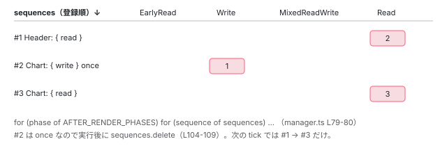

[目次](../README.md) › [変更検知の各ステップ](README.md) › 第 8 回 / 全 9 回

# afterRender / afterNextRender はいつ走るか

> AfterRenderManager.execute が synchronizeOnce の末尾で呼ばれる。4 つのフェーズの順番と、フックの中でビューを dirty にするとループに戻る仕組み。

angular/angular · 読了 約 11 分 · 発展 · [サイトで読む（デモが動きます）](https://angular-deep-dive-cyan.vercel.app/chapter/cd-after-render)

---

`afterRender`（v20 で `afterEveryRender` に改名）と `afterNextRender` は、「DOM が最新になった後」に走るフックです。`ngAfterViewInit` と違い、**ビューの走査の中ではなく、走査が全部終わった後**に、アプリ全体で 1 か所（`AfterRenderManager`）がまとめて実行します。この章では、登録が `LView` にいったん溜められて `refreshView` の末尾で管理者に渡される経路、`ApplicationRef.synchronizeOnce` の中で `execute()` が呼ばれる位置、4 つのフェーズの順番、そしてフックの中でビューを dirty にすると `synchronize` のループに戻る仕組みを読みます。

読む対象は `packages/core/src/render3/after_render/` の `hooks.ts`、`manager.ts`、`view.ts`、`api.ts` と、`application/application_ref.ts` の 588〜714 行目です。

1. 概観
2. detectChangesInView
3. refreshView の全ステップ
4. OnPush と markForCheck
5. ReactiveLViewConsumer
6. Targeted 走査
7. checkNoChanges
8. **afterRender**（この章）
9. effect

## 1. 登録：afterEveryRender / afterNextRender が作るもの

📄 `angular/packages/core/src/render3/after_render/hooks.ts` L444–467 （▶ の行: 448, 451, 455–457, 460–461, 465）

```ts
444 │   injector: Injector,
445 │   options: AfterRenderOptions | undefined,
446 │   once: boolean,
447 │ ): AfterRenderRef {
448 ▶   const manager = injector.get(AfterRenderManager);
449 │   // Lazily initialize the handler implementation, if necessary. This is so that it can be
450 │   // tree-shaken if `afterEveryRender` and `afterNextRender` aren't used.
451 ▶   manager.impl ??= injector.get(AfterRenderImpl);
452 │ 
453 │   const tracing = injector.get(TracingService, null, {optional: true});
454 │ 
455 ▶   const destroyRef = options?.manualCleanup !== true ? injector.get(DestroyRef) : null;
456 ▶   const viewContext = injector.get(ViewContext, null, {optional: true});
457 ▶   const sequence = new AfterRenderSequence(
458 │     manager.impl,
459 │     getHooks(callbackOrSpec),
460 ▶     viewContext?.view,
461 ▶     once,
462 │     destroyRef,
463 │     tracing?.snapshot(null),
464 │   );
465 ▶   manager.impl.register(sequence);
466 │   return sequence;
467 │ }
```

`afterEveryRender(fn)` も `afterNextRender(fn)` も、最終的にこの `afterEveryRenderImpl` に来ます（違いは 461 行目の `once` だけ）。448 行目で `AfterRenderManager`（root 提供）を取り、451 行目で実装 `AfterRenderImpl` を遅延初期化します （449〜450 行目のコメント：使わないアプリでは tree-shake される）。455 行目で `DestroyRef`（破棄時に自動解除）、**456 行目で `ViewContext` を `optional` に inject**。コンポーネントやディレクティブの注入コンテキストで呼ばれていれば、その `LView` が `viewContext.view` に入ります。root の service から呼ばれていれば `null` です。457〜464 行目で `AfterRenderSequence` を作り、465 行目で `register`。

📄 `angular/packages/core/src/render3/after_render/manager.ts` L184–208 （▶ の行: 189, 195, 201–203, 207）

```ts
184 │ export class AfterRenderSequence implements AfterRenderRef {
185 │   /**
186 │    * Whether this sequence errored or was destroyed during this execution, and hooks should no
187 │    * longer run for it.
188 │    */
189 ▶   erroredOrDestroyed: boolean = false;
190 │ 
191 │   /**
192 │    * The value returned by the last hook execution (if any), ready to be pipelined into the next
193 │    * one.
194 │    */
195 ▶   pipelinedValue: unknown = undefined;
196 │ 
197 │   private unregisterOnDestroy: (() => void) | undefined;
198 │ 
199 │   constructor(
200 │     readonly impl: AfterRenderImpl,
201 ▶     readonly hooks: AfterRenderHooks,
202 ▶     readonly view: LView | undefined,
203 ▶     public once: boolean,
204 │     destroyRef: DestroyRef | null,
205 │     public snapshot: TracingSnapshot | null = null,
206 │   ) {
207 ▶     this.unregisterOnDestroy = destroyRef?.onDestroy(() => this.destroy());
208 │   }
```

「sequence（連なり）」と呼ぶのは、201 行目の `hooks` が 4 フェーズ分の関数の組だからです。`afterEveryRender({ earlyRead, write, mixedReadWrite, read })` と書けば 4 つ、関数 1 つなら `mixedReadWrite` だけが入ります。195 行目 `pipelinedValue`、前のフェーズの戻り値が次のフェーズの引数になる仕組みです。202 行目 `view` が `undefined` か `LView` かで、次節の登録経路が分かれます。

📄 `angular/packages/core/src/render3/after_render/api.ts` L27–69 （▶ の行: 42, 48, 62, 68）

```ts
27 │ export const enum AfterRenderPhase {
28 │   /**
29 │    * Use `AfterRenderPhase.EarlyRead` for callbacks that only need to **read** from the
30 │    * DOM before a subsequent `AfterRenderPhase.Write` callback, for example to perform
31 │    * custom layout that the browser doesn't natively support. Prefer the
32 │    * `AfterRenderPhase.Read` phase if reading can wait until after the write phase.
33 │    * **Never** write to the DOM in this phase.
34 │    *
35 │    * <div class="docs-alert docs-alert-important">
36 │    *
37 │    * Using this value can degrade performance.
38 │    * Instead, prefer using built-in browser functionality when possible.
39 │    *
40 │    * </div>
41 │    */
42 ▶   EarlyRead,
43 │ 
44 │   /**
45 │    * Use `AfterRenderPhase.Write` for callbacks that only **write** to the DOM. **Never**
46 │    * read from the DOM in this phase.
47 │    */
48 ▶   Write,
49 │ 
50 │   /**
51 │    * Use `AfterRenderPhase.MixedReadWrite` for callbacks that read from or write to the
52 │    * DOM, that haven't been refactored to use a different phase. **Never** use this phase if
53 │    * it is possible to divide the work among the other phases instead.
54 │    *
55 │    * <div class="docs-alert docs-alert-critical">
56 │    *
57 │    * Using this value can **significantly** degrade performance.
58 │    * Instead, prefer dividing work into the appropriate phase callbacks.
59 │    *
60 │    * </div>
61 │    */
62 ▶   MixedReadWrite,
63 │ 
64 │   /**
65 │    * Use `AfterRenderPhase.Read` for callbacks that only **read** from the DOM. **Never**
66 │    * write to the DOM in this phase.
67 │    */
68 ▶   Read,
69 │ }
```

4 フェーズの定義です。42 行目 `EarlyRead`、48 行目 `Write`、62 行目 `MixedReadWrite`、68 行目 `Read`。const enum なので値は 0〜3。順番の意味は「読む → 書く → 混在 → 読む」で、DOM を書いてから読む（レイアウトの再計算を強制する）回数を減らすための並びです。

## 2. register：ビューがあれば LView に溜める

📄 `angular/packages/core/src/render3/after_render/manager.ts` L125–146 （▶ の行: 127, 129, 132–135, 137, 142, 145）

```ts
125 │   register(sequence: AfterRenderSequence): void {
126 │     const {view} = sequence;
127 ▶     if (view !== undefined) {
128 │       // Delay adding it to the manager, add it to the view instead.
129 ▶       (view[AFTER_RENDER_SEQUENCES_TO_ADD] ??= []).push(sequence);
130 │ 
131 │       // Mark the view for traversal to ensure we eventually schedule the afterNextRender.
132 ▶       markAncestorsForTraversal(view);
133 ▶       view[FLAGS] |= LViewFlags.HasChildViewsToRefresh;
134 ▶     } else if (!this.executing) {
135 ▶       this.addSequence(sequence);
136 │     } else {
137 ▶       this.deferredRegistrations.add(sequence);
138 │     }
139 │   }
140 │ 
141 │   addSequence(sequence: AfterRenderSequence): void {
142 ▶     this.sequences.add(sequence);
143 │     // Trigger an `ApplicationRef.tick()` if one is not already pending/running, because we have a
144 │     // new render hook that needs to run.
145 ▶     this.scheduler.notify(NotificationSource.RenderHook);
146 │   }
```

1. **127〜133 行目：ビューがある → `LView[AFTER_RENDER_SEQUENCES_TO_ADD]` に push**

   **管理者の `sequences` にはまだ入れません**。128 行目のコメント「ビューに足して、管理者への追加は遅らせる」。コンポーネントの constructor で `afterNextRender` を呼んだ時点では、そのコンポーネントはまだ一度も描画されていません。その状態で管理者に入れると、他のビューの描画が終わった時点で「描画後」として走ってしまいます。このコンポーネント自身が 1 回描画された後まで待たせるのがこの配列です。
2. **132〜133 行目：先祖と自分に `HasChildViewsToRefresh`**

   `markAncestorsForTraversal` で tick を予約し（[6 回目](06-cd-targeted-traversal.md)）、自分にも印を立てます。次の走査でこのビューに必ず到達し、`refreshView` か「通り抜け」のどちらかで 3 節の処理が走るようにするためです。
3. **134〜135 行目：ビューが無く、実行中でもない → 即 `addSequence`**

   142 行目で `sequences` に追加、145 行目で `notify(RenderHook)`。root の service から呼ばれた場合です。
4. **136〜137 行目：ビューが無く、`execute()` の最中 → `deferredRegistrations`**

   フックの中で別の `afterNextRender` を登録したケースです。`Set` を反復中に追加できないので、別の集合に入れて 4 節の末尾で合流させます。

## 3. refreshView の末尾と「通り抜け」で管理者に渡す

📄 `angular/packages/core/src/render3/after_render/view.ts` L11–18 （▶ の行: 12, 14, 16）

```ts
11 │ export function addAfterRenderSequencesForView(lView: LView) {
12 ▶   if (lView[AFTER_RENDER_SEQUENCES_TO_ADD] !== null) {
13 │     for (const sequence of lView[AFTER_RENDER_SEQUENCES_TO_ADD]) {
14 ▶       sequence.impl.addSequence(sequence);
15 │     }
16 ▶     lView[AFTER_RENDER_SEQUENCES_TO_ADD].length = 0;
17 │   }
18 │ }
```

📄 `angular/packages/core/src/render3/instructions/change_detection.ts` L354–364 （▶ の行: 360–361）

```ts
354 │     // Do not reset the dirty state when running in check no changes mode. We don't want components
355 │     // to behave differently depending on whether check no changes is enabled or not. For example:
356 │     // Marking an OnPush component as dirty from within the `ngAfterViewInit` hook in order to
357 │     // refresh a `NgClass` binding should work. If we would reset the dirty state in the check
358 │     // no changes cycle, the component would be not be dirty for the next update pass. This would
359 │     // be different in production mode where the component dirty state is not reset.
360 ▶     if (!isInCheckNoChangesPass) {
361 ▶       addAfterRenderSequencesForView(lView);
362 │ 
363 │       lView[FLAGS] &= ~(LViewFlags.Dirty | LViewFlags.FirstLViewPass);
364 │     }
```

📄 `angular/packages/core/src/render3/instructions/change_detection.ts` L542–560 （▶ の行: 542, 554–555）

```ts
542 ▶   } else if (flags & LViewFlags.HasChildViewsToRefresh) {
543 │     // Set active consumer to null to avoid inheriting an improper reactive context
544 │     const prevConsumer = setActiveConsumer(null);
545 │     try {
546 │       if (!isInCheckNoChangesPass) {
547 │         runEffectsInView(lView);
548 │       }
549 │       detectChangesInEmbeddedViews(lView, ChangeDetectionMode.Targeted);
550 │       const components = tView.components;
551 │       if (components !== null) {
552 │         detectChangesInChildComponents(lView, components, ChangeDetectionMode.Targeted);
553 │       }
554 ▶       if (!isInCheckNoChangesPass) {
555 ▶         addAfterRenderSequencesForView(lView);
556 │       }
557 │     } finally {
558 │       setActiveConsumer(prevConsumer);
559 │     }
560 │   }
```

361 行目、`refreshView` の後始末の中（`Dirty` を落とす直前）、555 行目、`detectChangesInView` の通り抜け分岐の中。この 2 か所が `addAfterRenderSequencesForView` を呼びます。14 行目で 1 つずつ `impl.addSequence`（`sequences` に追加 + `notify(RenderHook)`）、16 行目で配列を空に。360 行目と 554 行目、checkNoChanges パスでは呼びません（[7 回目](07-cd-check-no-changes.md)）。

ここで初めて管理者が sequence を知ります。「このビューが描画された（か、少なくとも走査が到達した）後」という条件が、配列の受け渡しの位置で保証されています。

📄 `angular/packages/core/src/change_detection/scheduling/zoneless_scheduling_impl.ts` L184–194 （▶ の行: 186, 192）

```ts
184 │       case NotificationSource.ViewDetachedFromDOM:
185 │       case NotificationSource.ViewAttached:
186 ▶       case NotificationSource.RenderHook:
187 │       case NotificationSource.AsyncAnimationsLoaded:
188 │       default: {
189 │         // These notifications only schedule a tick but do not change whether we should refresh
190 │         // views. Instead, we only need to run render hooks unless another notification from the
191 │         // other set is also received before `tick` happens.
192 ▶         this.appRef.dirtyFlags |= ApplicationRefDirtyFlags.AfterRender;
193 │       }
194 │     }
```

186 行目、`RenderHook` は `default` 側で、192 行目 `dirtyFlags |= AfterRender` だけ。ビューの走査を要求しない通知です。「afterRender を登録しただけでは、どのビューも更新されない。ただし tick は走り、フックは実行される」。

## 4. 実行：synchronizeOnce の末尾

📄 `angular/packages/core/src/application/application_ref.ts` L867–899 （▶ の行: 873, 878, 883, 888, 893, 898）

```ts
867 │ export const enum ApplicationRefDirtyFlags {
868 │   None = 0,
869 │ 
870 │   /**
871 │    * A global change detection round has been requested.
872 │    */
873 ▶   ViewTreeGlobal = 0b00000001,
874 │ 
875 │   /**
876 │    * Part of the view tree is marked for traversal.
877 │    */
878 ▶   ViewTreeTraversal = 0b00000010,
879 │ 
880 │   /**
881 │    * Part of the view tree is marked to be checked (dirty).
882 │    */
883 ▶   ViewTreeCheck = 0b00000100,
884 │ 
885 │   /**
886 │    * Helper for any view tree bit being set.
887 │    */
888 ▶   ViewTreeAny = ViewTreeGlobal | ViewTreeTraversal | ViewTreeCheck,
889 │ 
890 │   /**
891 │    * After render hooks need to run.
892 │    */
893 ▶   AfterRender = 0b00001000,
894 │ 
895 │   /**
896 │    * Effects at the `ApplicationRef` level.
897 │    */
898 ▶   RootEffects = 0b00010000,
899 │ }
```

📄 `angular/packages/core/src/application/application_ref.ts` L588–612 （▶ の行: 593–594, 597, 603）

```ts
588 │   private synchronize(): void {
589 │     if (this._rendererFactory === null && !(this._injector as R3Injector).destroyed) {
590 │       this._rendererFactory = this._injector.get(RendererFactory2, null, {optional: true});
591 │     }
592 │ 
593 ▶     let runs = 0;
594 ▶     while (this.dirtyFlags !== ApplicationRefDirtyFlags.None && runs++ < MAXIMUM_REFRESH_RERUNS) {
595 │       profiler(ProfilerEvent.ChangeDetectionSyncStart);
596 │       try {
597 ▶         this.synchronizeOnce();
598 │       } finally {
599 │         profiler(ProfilerEvent.ChangeDetectionSyncEnd);
600 │       }
601 │     }
602 │ 
603 ▶     if ((typeof ngDevMode === 'undefined' || ngDevMode) && runs >= MAXIMUM_REFRESH_RERUNS) {
604 │       throw new RuntimeError(
605 │         RuntimeErrorCode.INFINITE_CHANGE_DETECTION,
606 │         ngDevMode &&
607 │           'Infinite change detection while refreshing application views. ' +
608 │             'Ensure views are not calling `markForCheck` on every template execution or ' +
609 │             'that afterRender hooks always mark views for check.',
610 │       );
611 │     }
612 │   }
```

594 行目、`synchronize` は `dirtyFlags` が `None` になるまで `synchronizeOnce` を繰り返します（上限 100 回、603 行目）。6 節の「フックの中で dirty にするとループに戻る」はこの `while` です。

📄 `angular/packages/core/src/application/application_ref.ts` L617–637 （▶ の行: 619, 626, 633, 636）

```ts
617 │   private synchronizeOnce(): void {
618 │     // First, process any dirty root effects.
619 ▶     if (this.dirtyFlags & ApplicationRefDirtyFlags.RootEffects) {
620 │       this.dirtyFlags &= ~ApplicationRefDirtyFlags.RootEffects;
621 │       this.rootEffectScheduler.flush();
622 │     }
623 │ 
624 │     // First check dirty views, if there are any.
625 │     let ranDetectChanges = false;
626 ▶     if (this.dirtyFlags & ApplicationRefDirtyFlags.ViewTreeAny) {
627 │       // Change detection on views starts in targeted mode (only check components if they're
628 │       // marked as dirty) unless global checking is specifically requested via APIs like
629 │       // `ApplicationRef.tick()` and the `NgZone` integration.
630 │       const useGlobalCheck = Boolean(this.dirtyFlags & ApplicationRefDirtyFlags.ViewTreeGlobal);
631 │ 
632 │       // Clear the view-related dirty flags.
633 ▶       this.dirtyFlags &= ~ApplicationRefDirtyFlags.ViewTreeAny;
634 │ 
635 │       // Set the AfterRender bit, as we're checking views and will need to run afterRender hooks.
636 ▶       this.dirtyFlags |= ApplicationRefDirtyFlags.AfterRender;
637 │ 
```

📄 `angular/packages/core/src/application/application_ref.ts` L657–688 （▶ の行: 663–664, 670, 673, 681–683, 687）

```ts
657 │       // If `markForCheck()` was called during view checking, it will have set the `ViewTreeCheck`
658 │       // flag. We clear the flag here because, for backwards compatibility, `markForCheck()`
659 │       // during view checking doesn't cause the view to be re-checked.
660 │       this.dirtyFlags &= ~ApplicationRefDirtyFlags.ViewTreeCheck;
661 │ 
662 │       // Check if any views are still dirty after checking and we need to loop back.
663 ▶       this.syncDirtyFlagsWithViews();
664 ▶       if (
665 │         this.dirtyFlags &
666 │         (ApplicationRefDirtyFlags.ViewTreeAny | ApplicationRefDirtyFlags.RootEffects)
667 │       ) {
668 │         // If any views or effects are still dirty after checking, loop back before running render
669 │         // hooks.
670 ▶         return;
671 │       }
672 │     }
673 ▶     if (!ranDetectChanges) {
674 │       // If we skipped refreshing views above, there might still be unflushed animations
675 │       // because we never called `detectChangesInternal` on the views.
676 │       this._rendererFactory?.begin?.();
677 │       this._rendererFactory?.end?.();
678 │     }
679 │ 
680 │     // Even if there were no dirty views, afterRender hooks might still be dirty.
681 ▶     if (this.dirtyFlags & ApplicationRefDirtyFlags.AfterRender) {
682 ▶       this.dirtyFlags &= ~ApplicationRefDirtyFlags.AfterRender;
683 ▶       this.afterRenderManager.execute();
684 │ 
685 │       // afterRender hooks might influence dirty flags.
686 │     }
687 ▶     this.syncDirtyFlagsWithViews();
688 │   }
```

1. **619〜622 行目：root effect の flush（[9 回目](09-cd-effects.md)）**
2. **626〜655 行目：ビューの走査。636 行目で `AfterRender` を立てる**

   「ビューを走査したなら DOM が変わったはずなので、afterRender を走らせる」という宣言です。
3. **663〜671 行目：走査後にまだ印が残っていれば `return`**

   `syncDirtyFlagsWithViews` が `ViewTreeTraversal` を立て直し、664〜670 行目でフックを**走らせずに**`synchronizeOnce` を抜けます。`synchronize` の `while` がもう 1 周し、ビューを更新し直してから、改めてここに来ます。**afterRender は「全ビューが整合した後」にしか走りません**。
4. **673〜678 行目：ビューを走査しなかったときのレンダラ begin/end**

   `RenderHook` 通知だけの tick でも、保留中のアニメーションをフラッシュするためです。
5. **681〜683 行目：`AfterRender` を落として `afterRenderManager.execute()`**

   ここが実行位置です。`tickImpl` の中では `synchronize()`（567 行目）の内側なので、`checkNoChanges`（568〜572 行目）より**前**です。
6. **687 行目：フック実行後にもう一度 `syncDirtyFlagsWithViews`**

   685 行目のコメント「afterRender フックが dirtyFlags に影響するかもしれない」。6 節へ。

## 5. execute：フェーズ外側、登録順内側

📄 `angular/packages/core/src/render3/after_render/manager.ts` L25–46 （▶ の行: 26, 28–29, 40, 42–45）

```ts
25 │ export class AfterRenderManager {
26 ▶   impl: AfterRenderImpl | null = null;
27 │ 
28 ▶   execute(): void {
29 ▶     this.impl?.execute();
30 │   }
31 │ 
32 │   /** @nocollapse */
33 │   static ɵprov = /** @pureOrBreakMyCode */ /* @__PURE__ */ ɵɵdefineInjectable({
34 │     token: AfterRenderManager,
35 │     providedIn: 'root',
36 │     factory: () => new AfterRenderManager(),
37 │   });
38 │ }
39 │ 
40 ▶ export const AFTER_RENDER_PHASES: AfterRenderPhase[] = /* @__PURE__ **/ (() =>
41 │   [
42 ▶     AfterRenderPhase.EarlyRead,
43 ▶     AfterRenderPhase.Write,
44 ▶     AfterRenderPhase.MixedReadWrite,
45 ▶     AfterRenderPhase.Read,
46 │   ] as const)();
```

26 行目、`AfterRenderManager` は `impl` を 1 つ持つだけの殻で、28〜29 行目の `execute()` は `impl` に委譲します （`impl` が `null`、つまり誰も `afterRender` を使っていなければ何もしません）。40〜46 行目、`AFTER_RENDER_PHASES` が実行順の配列です。

📄 `angular/packages/core/src/render3/after_render/manager.ts` L71–99 （▶ の行: 78–81, 86, 88–89, 94–95）

```ts
71 │   execute(): void {
72 │     const hasSequencesToExecute = this.sequences.size > 0;
73 │ 
74 │     if (hasSequencesToExecute) {
75 │       profiler(ProfilerEvent.AfterRenderHooksStart);
76 │     }
77 │ 
78 ▶     this.executing = true;
79 ▶     for (const phase of AFTER_RENDER_PHASES) {
80 ▶       for (const sequence of this.sequences) {
81 ▶         if (sequence.erroredOrDestroyed || !sequence.hooks[phase]) {
82 │           continue;
83 │         }
84 │ 
85 │         try {
86 ▶           sequence.pipelinedValue = this.ngZone.runOutsideAngular(() =>
87 │             this.maybeTrace(() => {
88 ▶               const hookFn = sequence.hooks[phase]!;
89 ▶               const value = hookFn(sequence.pipelinedValue);
90 │               return value;
91 │             }, sequence.snapshot),
92 │           );
93 │         } catch (err) {
94 ▶           sequence.erroredOrDestroyed = true;
95 ▶           this.errorHandler?.handleError(err);
96 │         }
97 │       }
98 │     }
99 │     this.executing = false;
```

1. **79 行目：外側は `AFTER_RENDER_PHASES`（4 フェーズ）**

   manager.ts 40〜46 行目の配列で、`EarlyRead → Write → MixedReadWrite → Read` の順です。
2. **80 行目：内側は `sequences`（登録順）**

   `Set` は挿入順を保つので、同じフェーズの中では `addSequence` された順です。つまり**「A の read」より「B の write」が先**。コンポーネントごとにまとめて走るのではなく、アプリ全体の write を全部済ませてから read に移ります。これがフェーズを分ける目的です。
3. **81〜83 行目：そのフェーズの関数が無い sequence は飛ばす**
4. **86〜92 行目：`ngZone.runOutsideAngular` の中で呼ぶ**

   zone.js ありの環境でフックの中の非同期処理が `onMicrotaskEmpty` を発火させないようにです。zoneless では `NoopNgZone` なので関数を呼ぶだけ。89 行目、戻り値を `pipelinedValue` に入れ、次のフェーズの引数にします。
5. **93〜96 行目：例外は `ErrorHandler` へ、その sequence は以降のフェーズをスキップ**

   他の sequence は続行します。

📄 `angular/packages/core/src/render3/after_render/manager.ts` L101–123 （▶ の行: 102–105, 108, 112–113, 116）

```ts
101 │     // Cleanup step to reset sequence state and also collect one-shot sequences for removal.
102 ▶     for (const sequence of this.sequences) {
103 ▶       sequence.afterRun();
104 ▶       if (sequence.once) {
105 ▶         this.sequences.delete(sequence);
106 │         // Destroy the sequence so its on destroy callbacks can be cleaned up
107 │         // immediately, instead of waiting until the injector is destroyed.
108 ▶         sequence.destroy();
109 │       }
110 │     }
111 │ 
112 ▶     for (const sequence of this.deferredRegistrations) {
113 ▶       this.sequences.add(sequence);
114 │     }
115 │     if (this.deferredRegistrations.size > 0) {
116 ▶       this.scheduler.notify(NotificationSource.RenderHook);
117 │     }
118 │     this.deferredRegistrations.clear();
119 │ 
120 │     if (hasSequencesToExecute) {
121 │       profiler(ProfilerEvent.AfterRenderHooksEnd);
122 │     }
123 │   }
```

📄 `angular/packages/core/src/render3/after_render/manager.ts` L210–229 （▶ の行: 211–212, 222–223, 225, 227）

```ts
210 │   afterRun(): void {
211 ▶     this.erroredOrDestroyed = false;
212 ▶     this.pipelinedValue = undefined;
213 │ 
214 │     // Clear the tracing snapshot after the initial run. This snapshot only
215 │     // associates the initial run of the hook with the context that created it.
216 │     // Follow-up runs are independent of that initial context and have different
217 │     // triggers.
218 │     this.snapshot?.dispose();
219 │     this.snapshot = null;
220 │   }
221 │ 
222 ▶   destroy(): void {
223 ▶     this.impl.unregister(this);
224 │     this.unregisterOnDestroy?.();
225 ▶     const scheduled = this.view?.[AFTER_RENDER_SEQUENCES_TO_ADD];
226 │     if (scheduled) {
227 ▶       this.view[AFTER_RENDER_SEQUENCES_TO_ADD] = scheduled.filter((s) => s !== this);
228 │     }
229 │   }
```

1. **102〜110 行目：後始末。`once` は削除して `destroy`**

   103 行目 `afterRun` で 211〜212 行目、エラー状態と `pipelinedValue` をリセット。104〜109 行目、`afterNextRender`（`once: true`）は 1 回走ったら `sequences` から消え、108 行目の `destroy` で `DestroyRef` の登録（223 行目）も解除します。`afterEveryRender` は残り、次の tick でも走ります。
2. **112〜118 行目：実行中に登録されたものを合流**

   2 節の 137 行目で `deferredRegistrations` に入ったものを `sequences` へ移し、116 行目で `notify(RenderHook)`。**この tick では走らず、次の tick で走ります**。

📄 `angular/packages/core/src/render3/after_render/manager.ts` L148–161 （▶ の行: 149, 153, 155, 158）

```ts
148 │   unregister(sequence: AfterRenderSequence): void {
149 ▶     if (this.executing && this.sequences.has(sequence)) {
150 │       // We can't remove an `AfterRenderSequence` in the middle of iteration.
151 │       // Instead, mark it as destroyed so it doesn't run any more, and mark it as one-shot so it'll
152 │       // be removed at the end of the current execution.
153 ▶       sequence.erroredOrDestroyed = true;
154 │       sequence.pipelinedValue = undefined;
155 ▶       sequence.once = true;
156 │     } else {
157 │       // It's safe to directly remove this sequence.
158 ▶       this.sequences.delete(sequence);
159 │       this.deferredRegistrations.delete(sequence);
160 │     }
161 │   }
```

フックの中で別の sequence を `destroy()` したとき（149 行目）は、反復中の `Set` から削除できないので、153 行目で「もう走らない」印、155 行目で `once` にして上の 104〜109 行目で消えるようにします。



*execute の 2 重ループ。外側がフェーズ、内側が登録順。Header(read) が先に登録されていても、Chart(write) の方が先に走る。*

> **🧪 DEMO — execute() の実行順**
>
> sequence を追加して「execute()」を押すと、manager.ts L79-80 の 2 重ループどおりの順番が出ます。破線は once（afterNextRender）で、1 回走ると消えます。
>
> ▶ [このデモはサイトで動かせます](https://angular-deep-dive-cyan.vercel.app/chapter/cd-after-render)

## 6. フックの中でビューを dirty にすると

📄 `angular/packages/core/src/render3/instructions/mark_view_dirty.ts` L26–40 （▶ の行: 27, 37–40）

```ts
26 │ export function markViewDirty(lView: LView, source: NotificationSource): LView | null {
27 ▶   const dirtyBitsToUse = isRefreshingViews()
28 │     ? // When we are actively refreshing views, we only use the `Dirty` bit to mark a view
29 │       // for check. This bit is ignored in ChangeDetectionMode.Targeted, which is used to
30 │       // synchronously rerun change detection on a specific set of views (those which have
31 │       // the `RefreshView` flag and those with dirty signal consumers). `LViewFlags.Dirty`
32 │       // does not support re-entrant change detection on its own.
33 │       LViewFlags.Dirty
34 │     : // When we are not actively refreshing a view tree, it is absolutely
35 │       // valid to update state and mark views dirty. We use the `RefreshView` flag in this
36 │       // case to allow synchronously rerunning change detection. This applies today to
37 ▶       // afterRender hooks as well as animation listeners which execute after detecting
38 ▶       // changes in a view when the render factory flushes.
39 ▶       LViewFlags.RefreshView | LViewFlags.Dirty;
40 ▶   lView[ENVIRONMENT].changeDetectionScheduler?.notify(source);
```

📄 `angular/packages/core/src/application/application_ref.ts` L704–714 （▶ の行: 705, 707, 712）

```ts
704 │   private syncDirtyFlagsWithViews(): void {
705 ▶     if (this.allViews.some(({_lView}) => requiresRefreshOrTraversal(_lView))) {
706 │       // If after running all afterRender callbacks new views are dirty, ensure we loop back.
707 ▶       this.dirtyFlags |= ApplicationRefDirtyFlags.ViewTreeTraversal;
708 │       return;
709 │     } else {
710 │       // Even though this flag may be set, none of _our_ views require traversal, and so the
711 │       // `ApplicationRef` doesn't require any repeated checking.
712 ▶       this.dirtyFlags &= ~ApplicationRefDirtyFlags.ViewTreeAny;
713 │     }
714 │   }
```

1. **フックは走査の外で走る**

   `execute()` は `detectChangesInternal` の外（`synchronizeOnce` 683 行目）なので、`isRefreshingViews()` は `false`。フックの中で `markForCheck()` を呼ぶと 27・39 行目で `RefreshView | Dirty` が根まで立ちます。37〜38 行目のコメントに「afterRender フック」が名指しで書かれています。signal を書いた場合は consumer 経路で `HasChildViewsToRefresh` が立ちます。
2. **687 行目 → 705〜707 行目：印を検知して `ViewTreeTraversal`**

   `synchronizeOnce` を抜けたとき `dirtyFlags !== None` なので、`synchronize` の `while`（594 行目）がもう 1 周します。2 周目で `Targeted` 走査が `RefreshView` / consumer.dirty のビューを更新し、636 行目で再び `AfterRender` が立ち、683 行目で**フックがもう一度走ります**。`afterEveryRender` なら 2 回呼ばれる、ということです。
3. **毎回 dirty にすると 100 回で `INFINITE_CHANGE_DETECTION`**

   `synchronize` 603〜611 行目のメッセージに「afterRender hooks always mark views for check」と書かれているのがこのケースです。`afterEveryRender` の中で無条件に signal を書くと起きます。
4. **checkNoChanges との関係**

   フックで値を変えても印が付けば 2 周目で `refreshView` され、`lView` の保存値も更新されます。その後に `tickImpl` の 2 回目走査（[7 回目](07-cd-check-no-changes.md)）が来るので、`ExpressionChangedAfterItHasBeenCheckedError` にはなりません。印を付けずにフィールドだけ変えた場合は、`bindingUpdated` を通っていないので保存値と DOM は古いままで、こちらもエラーにはなりません（画面が古いだけです）。

> [!TIP]
> **新卒エンジニアへ**
>
> `ngAfterViewInit` で DOM のサイズを測って値をセットすると `ExpressionChanged` になりますが、`afterNextRender` で同じことをすると、走査の外なので `RefreshView` が立ち、`synchronize` がもう 1 周してから検証されます。「DOM を測ってから状態を変える」は `afterNextRender` に書く、という指針の根拠がこの位置の違いです。

## ここまでの呼び出し

- 👤 `afterNextRender(() => { ... })` — コンポーネントの constructor
  - `afterEveryRenderImpl(cb, injector, options, once=true)` — after\_render/hooks.ts L435 — *ViewContext を optional inject*
    - `new AfterRenderSequence(impl, hooks, view, once, destroyRef)` — manager.ts L199
    - `impl.register(sequence)` — manager.ts L125 — *view があれば LView\[AFTER\_RENDER\_SEQUENCES\_TO\_ADD\] に push、markAncestorsForTraversal*
- `ApplicationRef.synchronize()` — application\_ref.ts L588 — *while (dirtyFlags !== None)*
  - `synchronizeOnce()` — L617
    - `detectChangesInternal(rootLView, Targeted)` — L653 — *dirtyFlags |= AfterRender（L636）*
      - `refreshView(...)` → `addAfterRenderSequencesForView(lView)` — change\_detection.ts L361 / after\_render/view.ts L11 — *impl.addSequence → sequences に追加*
    - `syncDirtyFlagsWithViews()` — L663 — *印が残っていれば return → もう 1 周*
    - `afterRenderManager.execute()` — L683
      - `AfterRenderImpl.execute()` — manager.ts L71 — *for phase → for sequence → ngZone.runOutsideAngular(hook)*
      - `sequence.afterRun()` / once なら `destroy()` — L102-110
    - `syncDirtyFlagsWithViews()` — L687 — *フックが印を付けていれば ViewTreeTraversal → while がもう 1 周*
- `view.checkNoChanges()` × allViews — tickImpl L569-571 — *synchronize が完全に終わった後*

## 聞かれそうな質問

**Q. afterRender の中で signal を書いたら何が起きますか？**

consumer 経路で先祖に `HasChildViewsToRefresh` が立ち、`synchronizeOnce` 687 行目の `syncDirtyFlagsWithViews`（705〜707 行目）が `ViewTreeTraversal` を立てます。`synchronize` の `while`（594 行目）がもう 1 周して `Targeted` 走査で該当ビューを更新し、636 行目で `AfterRender` が再び立つので、683 行目でフックがもう一度走ります。`afterEveryRender` で無条件に書くと 100 周して `INFINITE_CHANGE_DETECTION`（603〜611 行目）です。`ExpressionChanged` にはなりません。検証（`tickImpl` 568〜572 行目）は `synchronize` が終わった後だからです。

**Q. afterNextRender と ngAfterViewInit はどちらが先に走りますか？**

`ngAfterViewInit` です。`ngAfterViewInit` は親の `refreshView` の 320〜333 行目、つまり走査の中で走ります。`afterNextRender` は 361 行目で管理者に渡された後、走査が全部終わり、`syncDirtyFlagsWithViews` が「もう印は無い」と判定した後の 683 行目で走ります。間に他のコンポーネントの走査が全部挟まります。

**Q. constructor で afterNextRender を呼ぶと、自分のビューが描画される前に走ることはありますか？**

ありません。`register`（manager.ts 127〜133 行目）はビューがある場合、管理者ではなく `LView[AFTER_RENDER_SEQUENCES_TO_ADD]` に溜めます。管理者に渡るのは `refreshView` の 361 行目か、通り抜けの 555 行目、つまり走査がそのビューに到達した後です。

**Q. フェーズを分ける意味はどこにありますか？**

`execute`（manager.ts 79〜80 行目）が「フェーズ外側、sequence 内側」の 2 重ループだからです。アプリ内の全 `write` が、全 `read` より前に走ります。DOM を書いた直後に読むとブラウザがレイアウトを再計算するので、書く・読むを交互に繰り返すより、まとめた方が再計算が少なくて済みます。フェーズを指定しない関数 1 つの形は `mixedReadWrite` に入ります。

**Q. root の service で afterEveryRender を呼んだら、どのビューの描画後に走りますか？**

`ViewContext` が `null`（hooks.ts 456 行目）なので `sequence.view` は `undefined`、`register` は 134〜135 行目で即 `addSequence` します。「どのビュー」という結び付きは無く、`synchronizeOnce` が 683 行目に来るたび（= アプリ全体の走査が整合するたび）に走ります。

## 読み終えて

- 登録はまず `LView[AFTER_RENDER_SEQUENCES_TO_ADD]` に溜まり（manager.ts 129 行目）、`refreshView` 361 行目か通り抜け 555 行目で管理者に渡る。自分が描画される前には走らない
- 実行は `synchronizeOnce` 683 行目。ビュー走査の後、印が残っていれば走らせずにループへ戻る（664〜670 行目）。`checkNoChanges` より前
- `execute` はフェーズ外側・登録順内側の 2 重ループ（79〜80 行目）。`once` は 1 回で削除（104〜109 行目）
- フックは走査の外なので `markForCheck` は `RefreshView | Dirty`、signal は `HasChildViewsToRefresh`。687 行目が検知して `synchronize` がもう 1 周
- 毎回 dirty にすると 100 周で `INFINITE_CHANGE_DETECTION`。`ExpressionChanged` にはならない

フェーズを signal でつなぐ `afterRenderEffect` は [afterRenderEffect の章](../signals/10-signals-after-render-effect.md)で読みます。

---

← 前: [checkNoChanges と ExpressionChangedAfterItHasBeenChecked](07-cd-check-no-changes.md)  
次: [effect はいつ走るか：root effect と view effect](09-cd-effects.md) →
