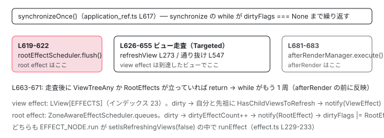

[目次](../README.md) › [変更検知の各ステップ](README.md) › 第 9 回 / 全 9 回

# effect はいつ走るか：root effect と view effect

> コンポーネントの中で作った effect は LView\[EFFECTS\] に入り refreshView の中で走る。外で作った effect は ZoneAwareEffectScheduler.flush で tick の冒頭に走る。

angular/angular · 読了 約 12 分 · 発展 · [サイトで読む（デモが動きます）](https://angular-deep-dive-cyan.vercel.app/chapter/cd-effects)

---

`effect()` は 1 つの API ですが、中身は 2 種類あります。コンポーネント（やディレクティブ、その注入コンテキストの service）で作ると **view effect** になり、`LView[EFFECTS]` に入って `refreshView` の中で走ります。root の service で作ると **root effect** になり、`ZoneAwareEffectScheduler` のキューに入って `synchronizeOnce` の**冒頭**、ビューの走査より前に flush されます。この章では分岐の 1 行、2 種類のノードが dirty になったときに何をするか、それぞれの実行位置を行番号で確認します。

読む対象は `packages/core/src/render3/reactivity/effect.ts`（342 行）、`root_effect_scheduler.ts`（137 行）、`view_effect_runner.ts`（48 行）、`primitives/signals/src/effect.ts`、そして `change_detection.ts` と `application_ref.ts` の呼び出し位置です。

1. 概観
2. detectChangesInView
3. refreshView の全ステップ
4. OnPush と markForCheck
5. ReactiveLViewConsumer
6. Targeted 走査
7. checkNoChanges
8. afterRender
9. **effect**（この章）

## 1. 分岐の 1 行：ViewContext があるか

📄 `angular/packages/core/src/render3/reactivity/effect.ts` L117–130 （▶ の行: 121–123, 126–128）

```ts
117 │ /**
118 │  * Registers an "effect" that will be scheduled & executed whenever the signals that it reads
119 │  * changes.
120 │  *
121 ▶  * Angular has two different kinds of effect: component effects and root effects. Component effects
122 ▶  * are created when `effect()` is called from a component, directive, or within a service of a
123 ▶  * component/directive. Root effects are created when `effect()` is called from outside the
124 │  * component tree, such as in a root service.
125 │  *
126 ▶  * The two effect types differ in their timing. Component effects run as a component lifecycle
127 ▶  * event during Angular's synchronization (change detection) process, and can safely read input
128 ▶  * signals or create/destroy views that depend on component state. Root effects run as microtasks
129 │  * and have no connection to the component tree or change detection.
130 │  *
```

121〜129 行目の doc コメントが結論です。「component effect はコンポーネントのライフサイクルイベントとして同期処理（変更検知）の中で走り、input signal を安全に読める。root effect は変更検知と無関係」。この章はこれをコードで確認します。

📄 `angular/packages/core/src/render3/reactivity/effect.ts` L158–184 （▶ の行: 158–159, 163–165, 167–168, 171, 175, 181）

```ts
158 ▶   const injector = options?.injector ?? inject(Injector);
159 ▶   let destroyRef = options?.manualCleanup !== true ? injector.get(DestroyRef) : null;
160 │ 
161 │   let node: EffectNode;
162 │ 
163 ▶   const viewContext = injector.get(ViewContext, null, {optional: true});
164 ▶   const notifier = injector.get(ChangeDetectionScheduler);
165 ▶   if (viewContext !== null) {
166 │     // This effect was created in the context of a view, and will be associated with the view.
167 ▶     node = createViewEffect(viewContext.view, notifier, effectFn);
168 ▶     if (destroyRef instanceof NodeInjectorDestroyRef && destroyRef._lView === viewContext.view) {
169 │       // The effect is being created in the same view as the `DestroyRef` references, so it will be
170 │       // automatically destroyed without the need for an explicit `DestroyRef` registration.
171 ▶       destroyRef = null;
172 │     }
173 │   } else {
174 │     // This effect was created outside the context of a view, and will be scheduled independently.
175 ▶     node = createRootEffect(effectFn, injector.get(EffectScheduler), notifier);
176 │   }
177 │   node.injector = injector;
178 │ 
179 │   if (destroyRef !== null) {
180 │     // If we need to register for cleanup, do that here.
181 ▶     node.onDestroyFns = [destroyRef.onDestroy(() => node.destroy())];
182 │   }
183 │ 
184 │   const effectRef = new EffectRefImpl(node);
```

1. **158 行目：`injector` を決める**

   `options.injector` があればそれ、無ければ `inject(Injector)`。コンポーネントの constructor なら `NodeInjector` です。
2. **163 行目：`injector.get(ViewContext, null, { optional: true })`**

   `ViewContext` は「いまどの `LView` の中か」を表す特殊トークンです（次の引用）。`NodeInjector` からなら取れ、`R3Injector`（root / environment）からなら `null`。**この 1 行が view effect か root effect かを決めます**。
3. **165〜167 行目：`createViewEffect(viewContext.view, notifier, effectFn)`**

   168〜172 行目、`DestroyRef` が同じビューのものなら `destroyRef = null`。ビューの破棄で自動的に消えるので、別途登録する必要が無いためです。
4. **175 行目：`createRootEffect(effectFn, injector.get(EffectScheduler), notifier)`**

   `EffectScheduler` は root 提供のシングルトン（`ZoneAwareEffectScheduler`）です。
5. **181 行目：`destroyRef.onDestroy(() => node.destroy())`**

   root effect と、ビューと違う `DestroyRef` を持つ view effect はここで破棄を登録します。

📄 `angular/packages/core/src/render3/view_context.ts` L13–28 （▶ の行: 15, 23, 27）

```ts
13 │ export class ViewContext {
14 │   constructor(
15 ▶     readonly view: LView,
16 │     readonly node: TNode,
17 │   ) {}
18 │ 
19 │   /**
20 │    * @internal
21 │    * @nocollapse
22 │    */
23 ▶   static __NG_ELEMENT_ID__ = injectViewContext;
24 │ }
25 │ 
26 │ export function injectViewContext(): ViewContext {
27 ▶   return new ViewContext(getLView()!, getCurrentTNode()!);
28 │ }
```

23 行目、`__NG_ELEMENT_ID__` を持つクラスは `NodeInjector` が特別扱いし、27 行目の `injectViewContext` を呼びます。`getLView()` は「いま命令を実行中の LView」（`LFrame` から取る）です。コンポーネントの constructor が走るのは、親テンプレートの作成パスでホスト要素にディレクティブをインスタンス化しているときなので、返るのは**ホスト要素を宣言している親の LView** であり、コンポーネント自身のビューではありません。15 行目の `view` がそれで、effect はその親 LView の `EFFECTS` に入ります。

## 2. ノードの共通部分：BASE\_EFFECT\_NODE と run

📄 `angular/packages/core/primitives/signals/src/effect.ts` L36–58 （▶ の行: 39–41, 46–47, 50–51, 53–54, 56）

```ts
36 │ export const BASE_EFFECT_NODE: Omit<BaseEffectNode, 'fn' | 'destroy' | 'cleanup' | 'run'> =
37 │   /* @__PURE__ */ (() => ({
38 │     ...REACTIVE_NODE,
39 ▶     consumerIsAlwaysLive: true,
40 ▶     consumerAllowSignalWrites: true,
41 ▶     dirty: true,
42 │     kind: 'effect',
43 │   }))();
44 │ 
45 │ export function runEffect(node: BaseEffectNode) {
46 ▶   node.dirty = false;
47 ▶   if (node.version > 0 && !consumerPollProducersForChange(node)) {
48 │     return;
49 │   }
50 ▶   node.version++;
51 ▶   const prevNode = consumerBeforeComputation(node);
52 │   try {
53 ▶     node.cleanup();
54 ▶     node.fn();
55 │   } finally {
56 ▶     consumerAfterComputation(node, prevNode);
57 │   }
58 │ }
```

1. **39〜41 行目：always live、signal 書き込み可、**作成時点で `dirty: true`****

   作ったばかりの effect は「まだ一度も走っていない」ので dirty です。これが初回実行の理由になります。
2. **46〜49 行目：`runEffect` は `dirty = false` にしてから、本当に変わったか確認**

   `version > 0`（一度は走った）で `consumerPollProducersForChange` が偽なら何もしません。テンプレート consumer の 529 行目と同じ「dirty と言われたが本当に変わったか」の確認です（[5 回目](05-cd-signal-consumer.md)）。
3. **51〜56 行目：`consumerBeforeComputation` で自分を active consumer にし、`cleanup()` → `fn()`**

   53 行目、前回登録した `onCleanup` を先に実行してから、54 行目でユーザー関数。読まれた signal は `producerAccessed` でこのノードの依存になります。

📄 `angular/packages/core/src/render3/reactivity/effect.ts` L217–235 （▶ の行: 224, 229, 231, 233）

```ts
217 │ export const EFFECT_NODE: Omit<EffectNode, 'fn' | 'userFn' | 'destroy' | 'injector' | 'notifier'> =
218 │   /* @__PURE__ */ (() => ({
219 │     ...BASE_EFFECT_NODE,
220 │     cleanupFns: undefined,
221 │     zone: null,
222 │     onDestroyFns: null,
223 │     run(this: EffectNode): void {
224 ▶       if (ngDevMode && isInNotificationPhase()) {
225 │         throw new Error(`Schedulers cannot synchronously execute watches while scheduling.`);
226 │       }
227 │       // We clear `setIsRefreshingViews` so that `markForCheck()` within the body of an effect will
228 │       // cause CD to reach the component in question.
229 ▶       const prevRefreshingViews = setIsRefreshingViews(false);
230 │       try {
231 ▶         runEffect(this);
232 │       } finally {
233 ▶         setIsRefreshingViews(prevRefreshingViews);
234 │       }
235 │     },
```

Angular 側の `EFFECT_NODE` が `run` を足します。224 行目、通知フェーズ中（`producerNotifyConsumers` の中）に同期実行しようとしたらエラー。**229 行目、`setIsRefreshingViews(false)` の中で `runEffect`**。227〜228 行目のコメント：effect の中で `markForCheck()` を呼んだとき、「走査中」扱いだと `Dirty` しか立たず届かない （[4 回目](04-cd-onpush-markforcheck.md)）ので、一時的に「走査の外」に見せて `RefreshView | Dirty` を立てさせます。

## 3. view effect：LView\[EFFECTS\] に入り、refreshView で走る

📄 `angular/packages/core/src/render3/reactivity/effect.ts` L303–320 （▶ の行: 308–310, 315–316, 318）

```ts
303 │ export function createViewEffect(
304 │   view: LView,
305 │   notifier: ChangeDetectionScheduler,
306 │   fn: (onCleanup: EffectCleanupRegisterFn) => void,
307 │ ): ViewEffectNode {
308 ▶   const node = Object.create(VIEW_EFFECT_NODE) as ViewEffectNode;
309 ▶   node.view = view;
310 ▶   node.zone = typeof Zone !== 'undefined' ? Zone.current : null;
311 │   node.notifier = notifier;
312 │   node.userFn = fn;
313 │   node.fn = createEffectFn(node, fn);
314 │ 
315 ▶   view[EFFECTS] ??= new Set();
316 ▶   view[EFFECTS].add(node);
317 │ 
318 ▶   node.consumerMarkedDirty(node);
319 │   return node;
320 │ }
```

📄 `angular/packages/core/src/render3/interfaces/view.ts` L70–74 （▶ の行: 71–72）

```ts
70 │ export const ON_DESTROY_HOOKS = 21;
71 ▶ export const EFFECTS_TO_SCHEDULE = 22;
72 ▶ export const EFFECTS = 23;
73 │ export const REACTIVE_TEMPLATE_CONSUMER = 24;
74 │ export const AFTER_RENDER_SEQUENCES_TO_ADD = 25;
```

1. **308〜309 行目：`VIEW_EFFECT_NODE` から作り、`view` を結ぶ**
2. **310 行目：`Zone.current` を記録**

   zone.js ありなら作成時の zone。無ければ `null`。実行時に同じ zone で走らせるため（5 節）。
3. **315〜316 行目：`view[EFFECTS]`（72 行目、インデックス 23）の `Set` に追加**
4. **318 行目：`node.consumerMarkedDirty(node)` を手で呼ぶ**

   作成直後は dirty なので、「dirty になったときの処理」をその場で起こして、次の走査でこのビューに到達させます。

📄 `angular/packages/core/src/render3/reactivity/effect.ts` L279–301 （▶ の行: 284–287, 289–290, 299）

```ts
279 │ export const VIEW_EFFECT_NODE: Omit<
280 │   ViewEffectNode,
281 │   'fn' | 'userFn' | 'view' | 'injector' | 'notifier'
282 │ > = /* @__PURE__ */ (() => ({
283 │   ...EFFECT_NODE,
284 ▶   consumerMarkedDirty(this: ViewEffectNode): void {
285 ▶     this.view[FLAGS] |= LViewFlags.HasChildViewsToRefresh;
286 ▶     markAncestorsForTraversal(this.view);
287 ▶     this.notifier.notify(NotificationSource.ViewEffect);
288 │   },
289 ▶   destroy(this: ViewEffectNode): void {
290 ▶     consumerDestroy(this);
291 │ 
292 │     if (this.onDestroyFns !== null) {
293 │       for (const fn of this.onDestroyFns) {
294 │         fn();
295 │       }
296 │     }
297 │ 
298 │     this.cleanup();
299 ▶     this.view[EFFECTS]?.delete(this);
300 │   },
301 │ }))();
```

1. **285 行目：`this.view[FLAGS] |= HasChildViewsToRefresh`**

   **自分のビューにも**立てます。テンプレート consumer（[5 回目](05-cd-signal-consumer.md)）は自分には立てませんでした。effect はテンプレートを実行する理由にはならないので、`RefreshView` でも `Dirty` でもなく、「通り抜けてよい」印を自分に付けます。
2. **286 行目：`markAncestorsForTraversal(this.view)`**

   先祖に同じ印（[6 回目](06-cd-targeted-traversal.md)）。
3. **287 行目：`notify(ViewEffect)`**

   次の引用のとおり、`ViewTreeTraversal` を立てます（286 行目の通知と重複、176〜177 行目のコメントに「論理的な一貫性のため」）。
4. **289〜300 行目：`destroy` はグラフから切り、`onDestroyFns`、`cleanup`、`view[EFFECTS]` から削除**

📄 `angular/packages/core/src/change_detection/scheduling/zoneless_scheduling_impl.ts` L171–180 （▶ の行: 171–172, 175, 178）

```ts
171 ▶       case NotificationSource.RootEffect: {
172 ▶         this.appRef.dirtyFlags |= ApplicationRefDirtyFlags.RootEffects;
173 │         break;
174 │       }
175 ▶       case NotificationSource.ViewEffect: {
176 │         // This is technically a no-op, since view effects will also send a
177 │         // `MarkAncestorsForTraversal` notification. Still, we set this for logical consistency.
178 ▶         this.appRef.dirtyFlags |= ApplicationRefDirtyFlags.ViewTreeTraversal;
179 │         break;
180 │       }
```

### 実行位置 1：refreshView の 273 行目

📄 `angular/packages/core/src/render3/instructions/change_detection.ts` L265–274 （▶ の行: 273–274）

```ts
265 │     // We do not need to mark transplanted views for refresh when doing exhaustive checks
266 │     // because all views will be reached anyways during the traversal.
267 │     if (!isInExhaustiveCheckNoChangesPass) {
268 │       // First mark transplanted views that are declared in this lView as needing a refresh at their
269 │       // insertion points. This is needed to avoid the situation where the template is defined in this
270 │       // `LView` but its declaration appears after the insertion component.
271 │       markTransplantedViewsForRefresh(lView);
272 │     }
273 ▶     runEffectsInView(lView);
274 ▶     detectChangesInEmbeddedViews(lView, ChangeDetectionMode.Global);
```

[3 回目](03-cd-refresh-view.md)で見た位置です。`executeTemplate`（242 行目）と pre-order フック（250〜263 行目）の**後**、埋め込みビュー（274 行目）の**前**。つまり effect が走る時点で、このビューのバインディングは評価済み、`ngOnInit` / `ngOnChanges` は呼び終わっています。1 節の `ViewContext` で見たとおり、コンポーネントの constructor で作った effect は**親ビュー**の `EFFECTS` に入るので、親の `refreshView` 273 行目で走ります。親の `executeTemplate` が子の input に書き込んだ後なので、effect は**最新の input signal を読めます**。121〜129 行目の doc コメントの「can safely read input signals」はこの順序のことです。

### 実行位置 2：detectChangesInView の 547 行目（通り抜け）

📄 `angular/packages/core/src/render3/instructions/change_detection.ts` L540–549 （▶ の行: 542, 544, 546–547）

```ts
540 │   if (shouldRefreshView) {
541 │     refreshView(tView, lView, tView.template, lView[CONTEXT]);
542 ▶   } else if (flags & LViewFlags.HasChildViewsToRefresh) {
543 │     // Set active consumer to null to avoid inheriting an improper reactive context
544 ▶     const prevConsumer = setActiveConsumer(null);
545 │     try {
546 ▶       if (!isInCheckNoChangesPass) {
547 ▶         runEffectsInView(lView);
548 │       }
549 │       detectChangesInEmbeddedViews(lView, ChangeDetectionMode.Targeted);
```

effect だけが dirty でテンプレートは dirty でないとき、ビューは 542 行目の通り抜けになり、547 行目で `runEffectsInView`。**テンプレートは実行されず、effect だけが走ります**。effect が読む signal が変わっただけなら、再描画のコストはかかりません。544 行目で `setActiveConsumer(null)` にしてから呼ぶので、effect が作る reactive context は親から独立です。546 行目、checkNoChanges パスでは走りません。

📄 `angular/packages/core/src/render3/reactivity/view_effect_runner.ts` L11–48 （▶ の行: 12, 20, 22–23, 30–31, 33, 37, 46）

```ts
11 │ export function runEffectsInView(view: LView): void {
12 ▶   if (view[EFFECTS] === null) {
13 │     return;
14 │   }
15 │ 
16 │   // Since effects can make other effects dirty, we flush them in a loop until there are no more to
17 │   // flush.
18 │   let tryFlushEffects = true;
19 │ 
20 ▶   while (tryFlushEffects) {
21 │     let foundDirtyEffect = false;
22 ▶     for (const effect of view[EFFECTS]) {
23 ▶       if (!effect.dirty) {
24 │         continue;
25 │       }
26 │       foundDirtyEffect = true;
27 │ 
28 │       // `runEffectsInView` is called during change detection, and therefore runs
29 │       // in the Angular zone if it's available.
30 ▶       if (effect.zone === null || Zone.current === effect.zone) {
31 ▶         effect.run();
32 │       } else {
33 ▶         effect.zone.run(() => effect.run());
34 │       }
35 │ 
36 │       // Stop immediately if the view was destroyed during effect execution.
37 ▶       if (view[EFFECTS] === null) {
38 │         return;
39 │       }
40 │     }
41 │ 
42 │     // Check if we need to continue flushing. If we didn't find any dirty effects, then there's
43 │     // no need to loop back. Otherwise, check the view to see if it was marked for traversal
44 │     // again. If so, there's a chance that one of the effects we ran caused another effect to
45 │     // become dirty.
46 ▶     tryFlushEffects = foundDirtyEffect && !!(view[FLAGS] & LViewFlags.HasChildViewsToRefresh);
47 │   }
48 │ }
```

1. **12 行目：`EFFECTS` が `null` なら即 return**

   effect を作っていないビューではコストはこの 1 比較だけです。
2. **22〜23 行目：`Set` を順に、dirty なものだけ**

   作成順です。
3. **30〜34 行目：作成時の zone で `run()`**

   zone.js ありで、いまの zone と違えば `effect.zone.run(...)`。zoneless では `zone === null` で直接呼びます。
4. **37〜39 行目：effect の中でビューが破棄されたら即 return**
5. **46 行目：ループを続ける条件**

   「今回 1 つでも走った」かつ「`HasChildViewsToRefresh` がまた立った」。effect A が signal を書いて effect B を dirty にした場合、B の `consumerMarkedDirty`（285 行目）が自分のビューに印を立て直すので、もう 1 周して B を走らせます。

> [!NOTE]
> **ポイント**
>
> view effect が走るのは `refreshView` 273 行目か通り抜け 547 行目で、どちらも `detectChangesInView` が**そのビューに到達した**ときです。到達させるのが 285〜286 行目の印です。ビューが `detach()` されていると到達せず、effect も走りません。「effect は変更検知の一部である」という doc コメントの意味です。

## 4. root effect：スケジューラのキューに入り、synchronizeOnce の冒頭で走る

📄 `angular/packages/core/src/render3/reactivity/effect.ts` L322–336 （▶ の行: 327, 330, 332–334）

```ts
322 │ export function createRootEffect(
323 │   fn: (onCleanup: EffectCleanupRegisterFn) => void,
324 │   scheduler: EffectScheduler,
325 │   notifier: ChangeDetectionScheduler,
326 │ ): RootEffectNode {
327 ▶   const node = Object.create(ROOT_EFFECT_NODE) as RootEffectNode;
328 │   node.userFn = fn;
329 │   node.fn = createEffectFn(node, fn);
330 ▶   node.scheduler = scheduler;
331 │   node.notifier = notifier;
332 ▶   node.zone = typeof Zone !== 'undefined' ? Zone.current : null;
333 ▶   node.scheduler.add(node);
334 ▶   node.notifier.notify(NotificationSource.RootEffect);
335 │   return node;
336 │ }
```

📄 `angular/packages/core/src/render3/reactivity/effect.ts` L256–277 （▶ の行: 261–263, 265, 275）

```ts
256 │ export const ROOT_EFFECT_NODE: Omit<
257 │   RootEffectNode,
258 │   'fn' | 'userFn' | 'scheduler' | 'notifier' | 'injector'
259 │ > = /* @__PURE__ */ (() => ({
260 │   ...EFFECT_NODE,
261 ▶   consumerMarkedDirty(this: RootEffectNode) {
262 ▶     this.scheduler.schedule(this);
263 ▶     this.notifier.notify(NotificationSource.RootEffect);
264 │   },
265 ▶   destroy(this: RootEffectNode) {
266 │     consumerDestroy(this);
267 │ 
268 │     if (this.onDestroyFns !== null) {
269 │       for (const fn of this.onDestroyFns) {
270 │         fn();
271 │       }
272 │     }
273 │ 
274 │     this.cleanup();
275 ▶     this.scheduler.remove(this);
276 │   },
277 │ }))();
```

1. **333 行目：`scheduler.add(node)`、334 行目：`notify(RootEffect)`**

   view effect の 318 行目に対応する「作成直後の dirty 処理」です。`LView` は一切出てきません。
2. **261〜264 行目：dirty になったら `scheduler.schedule(this)` + `notify(RootEffect)`**

   `markAncestorsForTraversal` は呼びません。ビューの木とは無関係です。`notify(RootEffect)` は `dirtyFlags |= RootEffects`（3 節の引用 171〜173 行目）。
3. **275 行目：`destroy` で `scheduler.remove`**

📄 `angular/packages/core/src/render3/reactivity/root_effect_scheduler.ts` L25–49 （▶ の行: 25–26, 33, 38, 47）

```ts
25 ▶ export abstract class EffectScheduler {
26 ▶   abstract add(e: SchedulableEffect): void;
27 │ 
28 │   /**
29 │    * Schedule the given effect to be executed at a later time.
30 │    *
31 │    * It is an error to attempt to execute any effects synchronously during a scheduling operation.
32 │    */
33 ▶   abstract schedule(e: SchedulableEffect): void;
34 │ 
35 │   /**
36 │    * Run any scheduled effects.
37 │    */
38 ▶   abstract flush(): void;
39 │ 
40 │   /** Remove a scheduled effect */
41 │   abstract remove(e: SchedulableEffect): void;
42 │ 
43 │   /** @nocollapse */
44 │   static ɵprov = /** @pureOrBreakMyCode */ /* @__PURE__ */ ɵɵdefineInjectable({
45 │     token: EffectScheduler,
46 │     providedIn: 'root',
47 ▶     factory: () => new ZoneAwareEffectScheduler(),
48 │   });
49 │ }
```

📄 `angular/packages/core/src/render3/reactivity/root_effect_scheduler.ts` L55–69 （▶ の行: 56–57, 60–61, 65, 68）

```ts
55 │ export class ZoneAwareEffectScheduler implements EffectScheduler {
56 ▶   private dirtyEffectCount = 0;
57 ▶   private queues = new Map<Zone | null, Set<SchedulableEffect>>();
58 │ 
59 │   add(handle: SchedulableEffect): void {
60 ▶     this.enqueue(handle);
61 ▶     this.schedule(handle);
62 │   }
63 │ 
64 │   schedule(handle: SchedulableEffect): void {
65 ▶     if (!handle.dirty) {
66 │       return;
67 │     }
68 ▶     this.dirtyEffectCount++;
69 │   }
```

📄 `angular/packages/core/src/render3/reactivity/root_effect_scheduler.ts` L84–95 （▶ の行: 85, 87, 94）

```ts
84 │   private enqueue(handle: SchedulableEffect): void {
85 ▶     const zone = handle.zone as Zone | null;
86 │     if (!this.queues.has(zone)) {
87 ▶       this.queues.set(zone, new Set());
88 │     }
89 │ 
90 │     const queue = this.queues.get(zone)!;
91 │     if (queue.has(handle)) {
92 │       return;
93 │     }
94 ▶     queue.add(handle);
95 │   }
```

1. **57 行目：`Map<Zone | null, Set<SchedulableEffect>>`**

   zone ごとのキュー。zoneless では `null` キーの 1 つだけです。
2. **60〜61 行目：`add` = `enqueue`（キューに入れる）+ `schedule`（dirty 数を数える）**

   85〜94 行目、`enqueue` は zone のキューに 1 回だけ追加。65〜68 行目、`schedule` は dirty なら `dirtyEffectCount++`。
3. **56 行目：`dirtyEffectCount` が flush の継続条件**

   キューは全 effect を持ち続け、dirty なものだけを数で管理します。

📄 `angular/packages/core/src/render3/reactivity/root_effect_scheduler.ts` L97–136 （▶ の行: 104, 106, 108–109, 111, 117–118, 126, 129, 133）

```ts
 97 │   /**
 98 │    * Run all scheduled effects.
 99 │    *
100 │    * Execution order of effects within the same zone is guaranteed to be FIFO, but there is no
101 │    * ordering guarantee between effects scheduled in different zones.
102 │    */
103 │   flush(): void {
104 ▶     while (this.dirtyEffectCount > 0) {
105 │       let ranOneEffect = false;
106 ▶       for (const [zone, queue] of this.queues) {
107 │         // `zone` here must be defined.
108 ▶         if (zone === null) {
109 ▶           ranOneEffect ||= this.flushQueue(queue);
110 │         } else {
111 ▶           ranOneEffect ||= zone.run(() => this.flushQueue(queue));
112 │         }
113 │       }
114 │ 
115 │       // Safeguard against infinite looping if somehow our dirty effect count gets out of sync with
116 │       // the dirty flag across all the effects.
117 ▶       if (!ranOneEffect) {
118 ▶         this.dirtyEffectCount = 0;
119 │       }
120 │     }
121 │   }
122 │ 
123 │   private flushQueue(queue: Set<SchedulableEffect>): boolean {
124 │     let ranOneEffect = false;
125 │     for (const handle of queue) {
126 ▶       if (!handle.dirty) {
127 │         continue;
128 │       }
129 ▶       this.dirtyEffectCount--;
130 │       ranOneEffect = true;
131 │ 
132 │       // TODO: what happens if this throws an error?
133 ▶       handle.run();
134 │     }
135 │     return ranOneEffect;
136 │   }
```

1. **104 行目：`dirtyEffectCount > 0` の間**

   effect が別の root effect を dirty にすれば、同じ flush の中で続けて走ります（100〜101 行目のコメント：同じ zone 内は FIFO）。
2. **106〜112 行目：zone ごとに `flushQueue`。zone があればその中で**
3. **126〜133 行目：dirty なものだけ `run()`、数を減らす**
4. **117〜119 行目：1 つも走らなかったらカウンタを 0 に**

   カウンタと実際の dirty 状態がずれたときの無限ループ防止です。

### 実行位置：synchronizeOnce の 619〜622 行目

📄 `angular/packages/core/src/application/application_ref.ts` L617–622 （▶ の行: 618–621）

```ts
617 │   private synchronizeOnce(): void {
618 ▶     // First, process any dirty root effects.
619 ▶     if (this.dirtyFlags & ApplicationRefDirtyFlags.RootEffects) {
620 ▶       this.dirtyFlags &= ~ApplicationRefDirtyFlags.RootEffects;
621 ▶       this.rootEffectScheduler.flush();
622 │     }
```

📄 `angular/packages/core/src/application/application_ref.ts` L662–671 （▶ の行: 663–664, 666, 670）

```ts
662 │       // Check if any views are still dirty after checking and we need to loop back.
663 ▶       this.syncDirtyFlagsWithViews();
664 ▶       if (
665 │         this.dirtyFlags &
666 ▶         (ApplicationRefDirtyFlags.ViewTreeAny | ApplicationRefDirtyFlags.RootEffects)
667 │       ) {
668 │         // If any views or effects are still dirty after checking, loop back before running render
669 │         // hooks.
670 ▶         return;
671 │       }
```

618 行目のコメント「First, process any dirty root effects」。619〜621 行目、`RootEffects` が立っていれば落として `rootEffectScheduler.flush()`。**ビューの走査（626 行目以降）より前**です。root effect が signal を書けば、その直後の走査がテンプレートに反映します。逆に、ビュー走査の中で root effect が dirty になった場合は、663〜671 行目で `RootEffects` を検知して `return`、`synchronize` の `while` がもう 1 周し、次の `synchronizeOnce` の冒頭で flush されます。afterRender フック（683 行目）より前に必ず効果を反映させる、という順序です。



*1 回の synchronizeOnce の中での位置。root effect は冒頭で flush、view effect は走査の中（refreshView 273 行目か通り抜け 547 行目）、afterRender は末尾。*

> **🧪 DEMO — どこで作った effect が、いつ、どの関数を通って走るか**
>
> 作った場所（コンポーネントの constructor / root の service）と、きっかけ（作成直後 / 読んでいる signal の set）を選ぶと、通る関数が順に並びます。
>
> ▶ [このデモはサイトで動かせます](https://angular-deep-dive-cyan.vercel.app/chapter/cd-effects)

## 5. EFFECTS\_TO\_SCHEDULE：初回 Update の後に動かすもの

📄 `angular/packages/core/src/render3/instructions/change_detection.ts` L344–352 （▶ の行: 345–347, 351）

```ts
344 │     // Schedule any effects that are waiting on the update pass of this view.
345 ▶     if (lView[EFFECTS_TO_SCHEDULE]) {
346 ▶       for (const notifyEffect of lView[EFFECTS_TO_SCHEDULE]) {
347 ▶         notifyEffect();
348 │       }
349 │ 
350 │       // Once they've been run, we can drop the array.
351 ▶       lView[EFFECTS_TO_SCHEDULE] = null;
352 │     }
```

`EFFECTS`（23）の隣、`EFFECTS_TO_SCHEDULE`（22）は別物です。「このビューの Update パスが終わってから通知したい」コールバックの配列で、`refreshView` の後始末（345〜352 行目）で 1 回だけ呼ばれ、351 行目で捨てられます。`afterRenderEffect` など、ビューの初回描画を待ってから登録を始めたい API が使います。通常の `effect()` はこの配列を使いません。

## ここまでの呼び出し

- 👤 `effect(() => console.log(count()))`（コンポーネントの constructor） — あなたのコード
  - `injector.get(ViewContext, null, { optional: true })` — effect.ts L163 — *NodeInjector → ViewContext あり*
  - `createViewEffect(viewContext.view, notifier, fn)` — L303 — *view\[EFFECTS\].add(node)*
    - `node.consumerMarkedDirty(node)` — L318 → L284 — *view に HasChildViewsToRefresh、markAncestorsForTraversal、notify(ViewEffect)*
- `synchronizeOnce()` — application\_ref.ts L617 — *RootEffects 無し → L626 からビュー走査*
  - `detectChangesInView(view)` — change\_detection.ts L502 — *初回なら refreshView → L273。以降は通り抜け → L547*
    - `runEffectsInView(view)` — view\_effect\_runner.ts L11 — *dirty な effect を作成順に*
      - `effect.run()` — effect.ts L223 — *setIsRefreshingViews(false) の中で*
        - `runEffect(node)` — primitives/signals effect.ts L45 — *dirty = false → poll → cleanup → fn*
- 👤 `effect(() => ...)`（root の service） — あなたのコード
  - `createRootEffect(fn, EffectScheduler, notifier)` — effect.ts L322 — *scheduler.add + notify(RootEffect)*
- `synchronizeOnce()` — L617 — *L619: dirtyFlags & RootEffects*
  - `rootEffectScheduler.flush()` — root\_effect\_scheduler.ts L103 — *ビュー走査の前*
    - `flushQueue(queue)` → `handle.run()` — L123-136

## 聞かれそうな質問

**Q. effect はコンポーネントの中と外で実行タイミングが違いますか？**

違います。`effect()`（effect.ts 163〜176 行目）が `ViewContext` の有無で分岐します。中（view effect）は `LView[EFFECTS]` に入り、`detectChangesInView` がそのビューに到達したときに `refreshView` 273 行目か通り抜け 547 行目の `runEffectsInView` で走ります。外（root effect）は `ZoneAwareEffectScheduler` のキューに入り、`synchronizeOnce` 619〜622 行目でビュー走査の前に flush されます。どちらも tick の中ですが、view effect は「そのビューの番が来たとき」、root effect は「tick の冒頭」です。

**Q. コンポーネントの effect で input signal を読むと、新しい値が読めるのはなぜですか？**

constructor で作った effect は `ViewContext`（view\_context.ts 27 行目 `getLView()`）により、ホスト要素を持つ**親ビュー**の `EFFECTS` に入ります。親の `refreshView` では `executeTemplate`（242 行目）が子の input に書き込んだ後、273 行目で `runEffectsInView` が走るので、effect は書き込み済みの input を読めます。

**Q. effect が読む signal だけ変わったとき、テンプレートも再実行されますか？**

されません。`VIEW_EFFECT_NODE.consumerMarkedDirty`（285〜286 行目）は `HasChildViewsToRefresh` しか立てないので、`detectChangesInView` では 540 行目が偽、542 行目の通り抜けになり、547 行目で effect だけが走ります。テンプレート consumer が dirty でなければ `executeTemplate` は呼ばれません。

**Q. effect の中で markForCheck() を呼んだら効きますか？**

効きます。`EFFECT_NODE.run`（effect.ts 229〜233 行目）が `setIsRefreshingViews(false)` の中で `runEffect` を呼ぶので、走査の最中でも `markViewDirty` は「走査の外」と判定し `RefreshView | Dirty` を立てます。`detectChangesInViewWhileDirty` の `while` が `RefreshView` を拾って `Targeted` でやり直します。227〜228 行目のコメントがこの意図です。

**Q. detach() したコンポーネントの effect は走りますか？**

走りません。view effect の実行位置（273 / 547 行目）はどちらも `detectChangesInView` がそのビューに到達した後です。`detectChangesInViewIfAttached`（[2 回目](02-cd-detect-changes-in-view.md)）で止まるので到達しません。`markAncestorsForTraversal` も detach された先祖で止まります。root effect はビューと無関係なので走ります。

## 読み終えて

- 分岐は `effect()` 163 行目の `injector.get(ViewContext, null, { optional: true })`。`NodeInjector` なら view effect、`R3Injector` なら root effect
- view effect：`LView[EFFECTS]`（23）に入り、dirty で自分と先祖に `HasChildViewsToRefresh`。実行は `refreshView` 273 行目（テンプレートの後、埋め込みビューの前）か通り抜け 547 行目
- root effect：`ZoneAwareEffectScheduler` の zone 別キュー。dirty で `dirtyEffectCount++` と `notify(RootEffect)`。実行は `synchronizeOnce` 619〜622 行目、ビュー走査の前
- どちらも `EFFECT_NODE.run` が `setIsRefreshingViews(false)` の中で `runEffect`。`markForCheck` が効く
- `runEffect` は `dirty = false` にしてから `consumerPollProducersForChange`。テンプレート consumer と同じ「本当に変わったか」の確認

effect のノードそのもの（`runEffect` が cleanup と依存の記録をどの順で包むか、`EffectRef.destroy` が何を外すか）は [effect のノードと寿命の章](../signals/09-signals-effect-node.md)で読みます。

---

← 前: [afterRender / afterNextRender はいつ走るか](08-cd-after-render.md)  
次: [Router は 1 本の RxJS パイプライン](../router/01-router.md) →
