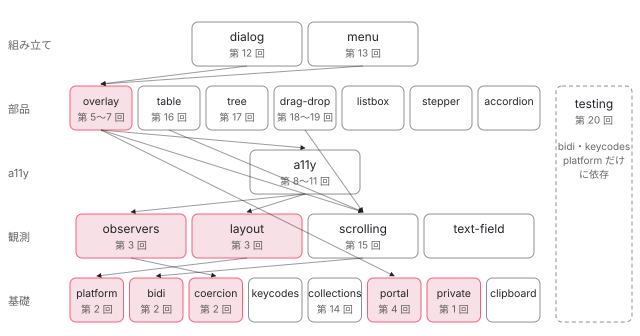

[目次](../README.md) › [CDK の内側](README.md) › 第 1 回 / 全 21 回

# CDK の概観：見た目を持たない部品と、エントリポイントの層

> @angular/cdk が @angular/cdk/overlay のような 20 あまりの二次エントリポイントに分かれている理由と、BUILD.bazel の deps で決まる依存の層（platform・bidi・coercion・collections・portal → observers・layout・scrolling → a11y → overlay・table・tree・drag-drop → dialog・menu）。見た目を持たない CDK が構造の CSS だけを \_CdkPrivateStyleLoader で読み込む仕組み。Material や新しい @angular/aria が CDK のどこを使っているか、どの回がどこを扱うかの地図。

angular/components · 読了 約 12 分 · 基礎 · [サイトで読む（デモが動きます）](https://angular-deep-dive-cyan.vercel.app/chapter/cdk-overview)

---

`@angular/cdk`（Component Dev Kit）は、ダイアログやメニューやドラッグを作るための「見た目を持たない部品」の集まりです。この章では、CDK が `@angular/cdk/overlay` のような 20 あまりの入口（エントリポイント）に分かれていること、その入口どうしが層になっていて下の層だけを import すること、見た目を持たない CDK が「構造のスタイル」だけは自分で読み込む仕組みを、ビルドの設定とソースの行で確かめます。最後に、Material と Angular Aria がどの入口を使っているかを見ます。

読む対象は angular/components の `src/cdk/config.bzl`・`src/cdk/a11y/BUILD.bazel`・`src/cdk/a11y/public-api.ts`・`src/cdk/private/style-loader.ts`・`src/cdk/private/visually-hidden/visually-hidden.ts` です。

1. **1. 概観**（この章）
2. [2. Platform と向き](02-cdk-platform-bidi.md)
3. [3. Observer と画面幅](03-cdk-observers-layout.md)
4. [4. Portal](04-cdk-portal.md)
5. [5. Overlay](05-cdk.md)
6. [6. 位置の計算](06-cdk-overlay-position.md)
7. [7. スクロールと Esc](07-cdk-overlay-scroll-dispatch.md)
8. [8. FocusTrap](08-cdk-focus-trap.md)
9. [9. FocusMonitor](09-cdk-focus-monitor.md)
10. [10. ListKeyManager](10-cdk-key-manager.md)
11. [11. LiveAnnouncer](11-cdk-live-announcer.md)
12. [12. Dialog](12-cdk-dialog.md)
13. [13. Menu](13-cdk-menu.md)
14. [14. DataSource と選択](14-cdk-collections.md)
15. [15. 仮想スクロール](15-virtual-scroll.md)
16. [16. table](16-table.md)
17. [17. tree](17-cdk-tree.md)
18. [18. DragRef](18-drag-drop.md)
19. [19. DropListRef](19-cdk-drop-list.md)
20. [20. ハーネス](20-harness.md)
21. [21. Material のテーマ](21-theming.md)

> [!TIP]
> **新卒エンジニアへ**
>
> 「見た目を持たない」とは、色・余白・フォントのような**見た目の CSS を持たない**ということです。持っているのは振る舞い（キーボード操作、フォーカスの移動、位置の計算、DOM の付け外し）と、それが動くための最小限の CSS（たとえば overlay のコンテナを `position: fixed` にする）だけです。Angular Material は、この CDK の上に Material Design の見た目を足したものです。

## 1. 1 つのパッケージに 27 の入口

📄 `components/src/cdk/config.bzl` L1–30 （▶ の行: 2, 7, 10, 17, 19, 23, 26, 29）

```python
 1 │ # List of all entry-points of the Angular CDK package.
 2 ▶ CDK_ENTRYPOINTS = [
 3 │     "a11y",
 4 │     "accordion",
 5 │     "bidi",
 6 │     "clipboard",
 7 ▶     "coercion",
 8 │     "coercion/private",
 9 │     "collections",
10 ▶     "dialog",
11 │     "drag-drop",
12 │     "keycodes",
13 │     "layout",
14 │     "listbox",
15 │     "menu",
16 │     "observers",
17 ▶     "observers/private",
18 │     "overlay",
19 ▶     "platform",
20 │     "portal",
21 │     "scrolling",
22 │     "stepper",
23 ▶     "table",
24 │     "text-field",
25 │     "tree",
26 ▶     "testing",
27 │     "testing/testbed",
28 │     "testing/selenium-webdriver",
29 ▶     "private",
30 │ ]
```
*CDK のビルド設定。ここに並んだ名前の 1 つ 1 つが import の入口になる*

2 行目の `CDK_ENTRYPOINTS` が CDK の入口の一覧です。数えると 27 個あります。そのうち 7 行目の `coercion/private`、17 行目の `observers/private`、29 行目の `private` は CDK と Material の中だけで使う入口で、26〜28 行目の `testing` 系 3 つはテスト用（[第 20 回](20-harness.md)）です。アプリが普段 import するのは残りの 21 個です。

一覧の名前は、そのまま import のパスになります。`"overlay"` は `import { Overlay } from '@angular/cdk/overlay'` の `overlay` です。このような「パッケージ名のあとに `/` で続く入口」を**二次エントリポイント**（secondary entry point）と呼びます。`@angular/cdk` そのもの（一次エントリポイント）からは、`src/cdk/public-api.ts` の `export * from './version'` の 1 行、つまり `VERSION` しか export されていません。CDK を使うときは必ずどれかの二次エントリポイントから import します。

### 入口ごとに別のファイルになる

ビルドの結果も入口ごとに分かれます。このサイトに入っている `@angular/cdk` 22.1.8 の `package.json` の `exports` を見ると、`"./overlay"` は `"default": "./fesm2022/overlay.mjs"`、`"types": "./types/overlay.d.ts"` を指しています。入口どうしで共有するコードは `fesm2022/_platform-chunk.mjs` や `_overlay-module-chunk.mjs` のような共有チャンクに切り出されています。さらに `src/cdk/package.json` に `"sideEffects": false` があり、バンドラーは「import しただけで何かが起きるコードは無い」とみなして、使っていない export を捨てられます。

1. **使う入口のファイルだけが読まれる**

   `@angular/cdk/portal` だけを import したアプリのバンドルに、drag-drop のコードは入りません。入口が別のファイルなので、バンドラーがそもそも読まないからです。
2. **入口の中でも、使わない export は捨てられる**

   `sideEffects: false` と ES モジュールの静的な `import` のおかげで、`@angular/cdk/a11y` から `FocusMonitor` だけを使えば `LiveAnnouncer` のコードは残りません（ツリーシェイキング）。
3. **遅延チャンクに入れられる**

   このサイトでは CDK を章のコンポーネントからだけ import しています。章は遅延ロードのチャンクなので、CDK のコードもそのチャンクに入り、最初に読む JS（Initial total）は増えません（チャンクの切り方は [CLI の遅延チャンクの章](../cli/07-cli-code-splitting.md)）。

## 2. 入口どうしの層は BUILD.bazel の deps で決まる

angular/components は Bazel でビルドします。入口ごとに `BUILD.bazel` があり、そこに「この入口が使ってよい他の入口」が書かれています。a11y を例に読みます。

📄 `components/src/cdk/a11y/BUILD.bazel` L12–32 （▶ の行: 13, 18, 24, 26–30）

```python
12 │ ng_project(
13 ▶     name = "a11y",
14 │     srcs = glob(
15 │         ["**/*.ts"],
16 │         exclude = ["**/*.spec.ts"],
17 │     ),
18 ▶     deps = [
19 │         "//:node_modules/@angular/common",
20 │         "//:node_modules/@angular/core",
21 │         "//:node_modules/@angular/platform-browser",
22 │         "//:node_modules/rxjs",
23 │         "//src:dev_mode_types",
24 ▶         "//src/cdk/coercion",
25 │         "//src/cdk/coercion/private",
26 ▶         "//src/cdk/keycodes",
27 ▶         "//src/cdk/layout",
28 ▶         "//src/cdk/observers",
29 ▶         "//src/cdk/platform",
30 ▶         "//src/cdk/private",
31 │     ],
32 │ )
```

12〜13 行目の `ng_project(name = "a11y")` が a11y の入口です。18 行目からの `deps` に並んだ `//src/cdk/…` が、a11y が import してよい CDK の入口です。24〜30 行目を見ると、a11y は `coercion`・`keycodes`・`layout`・`observers`・`platform`・`private` を使います。ここに書いていない入口（たとえば `overlay`）を a11y のソースから import すると、ビルドが通りません。だから層が崩れません。

実際のソースの import も一致しています。`a11y/live-announcer/live-announcer.ts` の先頭が `import {ContentObserver} from '../../observers'`、`a11y/high-contrast-mode/high-contrast-mode-detector.ts` の先頭が `import {BreakpointObserver} from '../../layout'` です。各入口の `.ts`（spec を除く）の `from '../…'` と `from '@angular/cdk/…'` を grep で全部集めると、次の図になります。



*CDK の入口の層。線は「上が下を import する」。赤い枠はこのシリーズの第 1〜5 回で読む入口。下の段ほど他の CDK に依存しない*

| 入口 | 中身（主なもの） | 使う CDK の入口（実物の import） | 扱う回 |
| --- | --- | --- | --- |
| `platform` | `Platform`、passive リスナー・スクロールの機能判定、shadow DOM の補助 | なし | [第 2 回](02-cdk-platform-bidi.md) |
| `bidi` | `Directionality`・`Dir`（ltr / rtl） | なし | [第 2 回](02-cdk-platform-bidi.md) |
| `coercion` | `coerceNumberProperty`・`coerceElement`・`coerceArray` など | なし | [第 2 回](02-cdk-platform-bidi.md) |
| `keycodes` | `ESCAPE` などのキーの番号、`hasModifierKey` | なし | 各回で使う |
| `collections` | `DataSource`・`SelectionModel`・ViewRepeater | なし | [第 14 回](14-cdk-collections.md) |
| `portal` | `ComponentPortal`・`TemplatePortal`・`DomPortalOutlet`・`CdkPortalOutlet` | なし | [第 4 回](04-cdk-portal.md) |
| `private` | `_CdkPrivateStyleLoader`・`_VisuallyHiddenLoader` | なし | この章 4 節 |
| `observers` | `ContentObserver`・`cdkObserveContent`（`/private` に `SharedResizeObserver`） | coercion | [第 3 回](03-cdk-observers-layout.md) |
| `layout` | `BreakpointObserver`・`MediaMatcher`・`Breakpoints` | coercion・platform | [第 3 回](03-cdk-observers-layout.md) |
| `scrolling` | `ScrollDispatcher`・`ViewportRuler`・仮想スクロール | bidi・coercion・collections・platform | [第 7 回](07-cdk-overlay-scroll-dispatch.md)・[第 15 回](15-virtual-scroll.md) |
| `a11y` | FocusTrap・FocusMonitor・ListKeyManager・LiveAnnouncer・`_IdGenerator` | coercion・keycodes・layout・observers・platform・private | 第 8〜11 回 |
| `overlay` | `createOverlayRef`・`OverlayRef`・位置とスクロールの戦略 | a11y・bidi・coercion・keycodes・platform・portal・private・scrolling | [第 5〜7 回](05-cdk.md) |
| `table` / `tree` | `CdkTable` / `CdkTree` | table: bidi・collections・platform・scrolling ／ tree: a11y・bidi・collections | [第 16 回](16-table.md)・[第 17 回](17-cdk-tree.md) |
| `drag-drop` | `DragRef`・`DropListRef`・`cdkDrag` | a11y・bidi・coercion・platform・private・scrolling | [第 18〜19 回](18-drag-drop.md) |
| `dialog` / `menu` | `Dialog` / `cdkMenu` | どちらも a11y・bidi・keycodes・overlay・platform・portal（menu は collections も） | [第 12 回](12-cdk-dialog.md)・[第 13 回](13-cdk-menu.md) |
| `testing` | `ComponentHarness`・`HarnessEnvironment` | bidi・keycodes・platform | [第 20 回](20-harness.md) |

> [!NOTE]
> **ポイント**
>
> 図で分かる 3 つのことがあります。**portal は他の CDK に依存しない基礎**で、overlay・dialog・menu がそれを使います。**a11y は思ったより上の段**にあります。`LiveAnnouncer` が `ContentObserver` を、ハイコントラストの検出が `BreakpointObserver` を使うからです。**table・tree・drag-drop は overlay を使いません**。浮く UI ではないので、overlay とは同じ段の別の部品です。

## 3. 入口の中身は public-api.ts の export で決まる

📄 `components/src/cdk/a11y/public-api.ts` L30–39 （▶ の行: 30, 32, 35–39）

```ts
30 ▶ export * from './live-announcer/live-announcer';
31 │ export * from './live-announcer/live-announcer-tokens';
32 ▶ export * from './focus-monitor/focus-monitor';
33 │ export * from './fake-event-detection';
34 │ export * from './a11y-module';
35 ▶ export {
36 ▶   HighContrastModeDetector,
37 ▶   HighContrastMode,
38 ▶ } from './high-contrast-mode/high-contrast-mode-detector';
39 ▶ export {_IdGenerator} from './id-generator';
```

各入口の `index.ts` は `export * from './public-api'` の 1 行だけで、何を外に見せるかは `public-api.ts` が決めます。30 行目と 32 行目は `LiveAnnouncer` と `FocusMonitor` のファイルを丸ごと見せています。35〜38 行目のように、ファイルの中の一部だけを名前で選んで見せることもあります。

39 行目の `_IdGenerator` のように名前が `_` で始まるものは、「export はするが、CDK と Material の中で使うためのもの」という約束です。入口をまたいで使うには export するしかないので、名前で区別しています。実際に overlay は `overlay.ts` の先頭で `import {_IdGenerator} from '../a11y'` とし、pane の `id` を作るのに使います（[第 5 回](05-cdk.md)）。

## 4. 見た目は持たないが、構造のスタイルは自分で読み込む

overlay のコンテナは `position: fixed` で画面全体を覆わないと、浮く UI の位置がずれます。読み上げ専用の要素は画面から見えなくする CSS が要ります。overlay の説明書（`src/cdk/overlay/overlay.md` の冒頭）には今も「CDK だけで使うならグローバルな CSS で `overlay-prebuilt.css` を読み込む」と書かれていますが、今のソースは、必要になった時点で自分で読み込みます。その仕組みが `private` の入口にある `_CdkPrivateStyleLoader` です。

📄 `components/src/cdk/private/style-loader.ts` L36–68 （▶ の行: 36, 46, 48–49, 52–54, 57–58, 64–66）

```ts
36 ▶ @Service()
37 │ export class _CdkPrivateStyleLoader {
38 │   private _appRef: ApplicationRef | undefined;
39 │   private _injector = inject(Injector);
40 │   private _environmentInjector = inject(EnvironmentInjector);
41 │ 
42 │   /**
43 │    * Loads a set of styles.
44 │    * @param loader Component which will be instantiated to load the styles.
45 │    */
46 ▶   load(loader: Type<unknown>): void {
47 │     // Resolve the app ref lazily to avoid circular dependency errors if this is called too early.
48 ▶     const appRef = (this._appRef = this._appRef || this._injector.get(ApplicationRef));
49 ▶     let data = appsWithLoaders.get(appRef);
50 │ 
51 │     // If we haven't loaded for this app before, we have to initialize it.
52 ▶     if (!data) {
53 ▶       data = {loaders: new Set(), refs: []};
54 ▶       appsWithLoaders.set(appRef, data);
55 │ 
56 │       // When the app is destroyed, we need to clean up all the related loaders.
57 ▶       appRef.onDestroy(() => {
58 ▶         appsWithLoaders.get(appRef)?.refs.forEach(ref => ref.destroy());
59 │         appsWithLoaders.delete(appRef);
60 │       });
61 │     }
62 │ 
63 │     // If the loader hasn't been loaded before, we need to instatiate it.
64 ▶     if (!data.loaders.has(loader)) {
65 ▶       data.loaders.add(loader);
66 ▶       data.refs.push(createComponent(loader, {environmentInjector: this._environmentInjector}));
67 │     }
68 │   }
```

📄 `components/src/cdk/private/visually-hidden/visually-hidden.ts` L11–21 （▶ の行: 16, 18–19, 21）

```ts
11 │ /**
12 │  * Component used to load the .cdk-visually-hidden styles.
13 │  * @docs-private
14 │  */
15 │ @Component({
16 ▶   styleUrl: 'visually-hidden.css',
17 │   exportAs: 'cdkVisuallyHidden',
18 ▶   encapsulation: ViewEncapsulation.None,
19 ▶   template: '',
20 │ })
21 ▶ export class _VisuallyHiddenLoader {}
```
*読み込む側の例。中身の無いコンポーネントに、スタイルだけを持たせている*

1. **スタイルを持つ「空のコンポーネント」を用意する**

   visually-hidden.ts 16 行目で `styleUrl` に CSS を指定し、19 行目で `template: ''`。18 行目の `ViewEncapsulation.None` で、属性セレクタを付けずにそのままグローバルに効く CSS にしています。
2. **使う側が `load(_VisuallyHiddenLoader)` を呼ぶ**

   たとえば `LiveAnnouncer`・`FocusTrap`・`AriaDescriber` の constructor の中で `inject(_CdkPrivateStyleLoader).load(_VisuallyHiddenLoader)` と書いてが、作られるときに呼びます。overlay は自分用の `_CdkOverlayStyleLoader` を呼びます（[第 5 回](05-cdk.md)）。
3. **アプリごとに一度だけ**

   48〜49 行目で `ApplicationRef` をキーにした `WeakMap` を引きます。初めてのアプリなら 52〜54 行目で記録を作り、57〜60 行目でアプリが破棄されたら作ったものを消す予約をします。64 行目で、同じローダーがもう読み込まれていれば何もしません。
4. **コンポーネントを作るだけで、スタイルが head に入る**

   66 行目の `createComponent(loader, {environmentInjector})` は、`hostElement` を渡していないので DOM のどこにも置かれません。それでも、カプセル化が `None` のコンポーネントの renderer を作る時点で、Angular の renderer がそのスタイルを `<style>` として document の head に足します（renderer は [DOM の章](../template/05-dom.md)）。目的はこの副作用だけです。

36 行目の `@Service()` は v22 の新しいデコレーターで、`@Injectable({providedIn: 'root'})` と同じく「root の注入器に 1 つ」を表します（中身は[第 2 回](02-cdk-platform-bidi.md)で読みます）。CDK のサービスはほとんどがこの形です。

> **🧪 DEMO — このページにいま残っている CDK の痕跡**
>
> いまの document を `querySelectorAll` で数えます。class 名はどれも CDK のソースで付けているものです。このページで他の章のデモ（Overlay を開く、Tab キーでフォーカスを動かす、など）を動かしてから「数え直す」を押すと数が変わります。シリーズを 1 ページで読んでいるときは、他の章のデモが描画された分も数えます。
>
> ブラウザで表示されると数えます。
>
> ▶ [このデモはサイトで動かせます](https://angular-deep-dive-cyan.vercel.app/chapter/cdk-overview)

最初に開いた直後は、ほとんどが 0 のはずです。CDK は「使われたときに初めて DOM を作る」作りだからです。たとえば `cdk-overlay-container` は、最初の overlay を作るときに `OverlayContainer.getContainerElement()` が作ります（[第 5 回](05-cdk.md)）。head の `<style>` も同じで、上の 4 節の `load` が呼ばれるまでは入りません。

## 5. Material と Angular Aria は CDK のどこを使うか

同じリポジトリの `src/material`（Angular Material）と `src/aria`（Angular Aria）を、`from '@angular/cdk/…'` で grep した結果です（spec とテスト用のハーネスを除く）。

|   | import している CDK の入口 | 例 |
| --- | --- | --- |
| Material | ほぼ全部。多い順に bidi（60 ファイル）・a11y（51）・keycodes（32）・platform（27）・private（25）・portal（25）・overlay（22）… | `material/select/select.ts` の import で `ActiveDescendantKeyManager`・`LiveAnnouncer`・`Directionality`・`SelectionModel`、overlay と `ViewportRuler`。`material/dialog/dialog.ts` で `Dialog`（CDK の dialog をそのまま包む） |
| Aria | a11y・bidi・platform の 3 つだけ。使うのも `_IdGenerator`・`Directionality`・`_getEventTarget` の 3 つだけ | `aria/listbox/listbox.ts` の import で `Directionality` と `_IdGenerator`。キーボード操作やフォーカスの移動は `aria/private/behaviors/`（list-navigation・list-focus・list-typeahead など）に自前で持ち、CDK の `ListKeyManager` も overlay も使っていない |

Material は「CDK の振る舞い + Material Design の見た目」です。`MatDialog` は CDK の `Dialog` を、`mat-select` は CDK の overlay と key manager を中で使います。Angular Aria（`@angular/aria`）は、WAI-ARIA のパターン（listbox・menu・tabs・tree・grid など）を signal ベースの指示子として書き直した、もう 1 つの「見た目を持たない」パッケージです。`src/aria/package.json` の `peerDependencies` に `@angular/cdk` がありますが、CDK から借りているのは ID の採番と向きとイベントの target の取り出しだけです。

## ここまでの地図

- 👤 `import { Overlay } from '@angular/cdk/overlay'` — あなたのコード
  - `exports["./overlay"] → fesm2022/overlay.mjs` — @angular/cdk/package.json — *入口ごとのファイル（1 節）*
    - `overlay → a11y・bidi・portal・scrolling・platform・private…` — overlay/BUILD.bazel の deps — *下の段だけを import（2 節）*
    - `public-api.ts の export` — overlay/public-api.ts — *外に見せる名前（3 節）*
  - `createOverlayRef → _CdkPrivateStyleLoader.load(_CdkOverlayStyleLoader)` — overlay.ts（第 5 回）→ style-loader.ts L46 — *構造の CSS を一度だけ（4 節）*

## 聞かれそうな質問

**Q. CDK と Material の違いは何ですか？**

CDK は振る舞いだけ、Material は CDK の振る舞いに Material Design の見た目を足したものです。CDK が持つ CSS は 4 節の `_CdkPrivateStyleLoader` で読み込む構造の CSS（overlay のコンテナを `position: fixed` にする、読み上げ専用の要素を見えなくする、など）だけです。Material の部品は中で CDK を使っています。たとえば `material/dialog/dialog.ts` は CDK の `Dialog` を import し、それを包んで `MatDialog` にしています。

**Q. CDK と Angular Aria の違いは何ですか？**

どちらも見た目を持ちませんが、作りが別物です。CDK は overlay・portal・table・drag-drop のような「仕組み」の部品を、サービスや `Ref` クラスで提供します。Angular Aria は listbox・menu・tabs のような ARIA のパターンを、signal と `input()` で書いた指示子として提供します。5 節の grep のとおり、Aria が CDK から使っているのは `_IdGenerator`・`Directionality`・`_getEventTarget` の 3 つだけで、キーボード操作は `aria/private/behaviors/` に自前で持っています。

**Q. Material を入れずに CDK だけを使ってよいのですか？**

使えます。`@angular/cdk` の `peerDependencies` は `@angular/core`・`common`・`forms`・`platform-browser` と rxjs だけで、Material は要りません（このサイトも Material を入れずに CDK だけを入れています）。ただし見た目はすべて自分で書きます。たとえば overlay の中身の背景や影、ダイアログの余白は CDK が付けないので、中身のコンポーネントのスタイルに書きます。

**Q. CDK を入れるとバンドルが大きくなりませんか？**

使う入口のファイルしか読まれず、入口の中でも使わない export はツリーシェイキングで捨てられます（1 節。`sideEffects: false`）。たとえば `@angular/cdk/bidi` だけを使えば、overlay や drag-drop のコードは入りません。ただし overlay を使えば、2 節の層のとおり a11y・portal・scrolling の必要な部分も一緒に入ります。

**Q. CDK だけで overlay を使うとき、`overlay-prebuilt.css` を読み込む必要はありますか？**

overlay.md の冒頭は「読み込む」と説明していますが、今のソースでは要りません。overlay を作るときに `_CdkPrivateStyleLoader.load(_CdkOverlayStyleLoader)` が呼ばれ、style-loader.ts 66 行目の `createComponent` で構造の CSS が head に入ります。64 行目の確認でアプリごとに一度だけです。`overlay-prebuilt.css` や Sass の mixin は、CSS の読み込み順を自分で決めたいときのために残っています。

## 読み終えて

- `@angular/cdk` は config.bzl の 27 の入口に分かれ、アプリは `@angular/cdk/overlay` のような二次エントリポイントから import する。一次エントリポイントは `VERSION` だけ。
- 入口どうしの依存は BUILD.bazel の `deps` で決まり、下の段だけを import する。portal・platform・bidi・coercion は依存なしの基礎、a11y は observers と layout の上、overlay は a11y と portal の上、dialog と menu は overlay の上。
- 入口の中身は `public-api.ts` の export で、`_` で始まる名前は CDK と Material の中で使うためのもの。
- CDK は見た目の CSS を持たないが、構造の CSS は `_CdkPrivateStyleLoader` が空のコンポーネントを作ってアプリごとに一度だけ head に入れる。
- Material は CDK をほぼ全部使い、Angular Aria は ID・向き・イベントの target の 3 つしか使わない。

---

← 前: [ng add と ng update：パッケージを入れて、migrations を走らせる](../cli/16-cli-add-update.md)  
次: [Platform と Directionality：ブラウザの判定と、右から左の向き](02-cdk-platform-bidi.md) →
