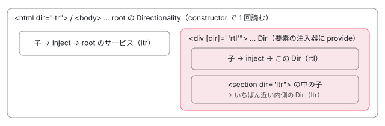

[目次](../README.md) › [CDK の内側](README.md) › 第 2 回 / 全 21 回

# Platform と Directionality：ブラウザの判定と、右から左の向き

> Platform が userAgent と機能の有無からブラウザを判定する行、サーバーで描画するときに isBrowser が false になる理由、passive なイベントや scroll の挙動を調べる features の関数。Directionality が dir 属性と DIR\_DOCUMENT から ltr / rtl を決め、Dir ディレクティブが子に向きを伝える仕組み。coercion の関数が入力を数値や真偽に直す行。

angular/components · 読了 約 12 分 · 中核 · [サイトで読む（デモが動きます）](https://angular-deep-dive-cyan.vercel.app/chapter/cdk-platform-bidi)

---

CDK の部品の多くは「いまブラウザで動いているか」「どのブラウザか」「文字は右から左か」を知る必要があります。この章では、その答えを返す 3 つの基礎の入口を読みます。`Platform` が userAgent と window の持ち物からブラウザを判定する行、passive リスナーや RTL のスクロールを実際に試して調べる features の関数、`Directionality` と `Dir` が ltr / rtl を決めて子に伝える仕組み、そして入力値を真偽や数値に直す coercion の関数です。

読む対象は angular/components の `src/cdk/platform/platform.ts`・`platform/features/passive-listeners.ts`・`platform/features/scrolling.ts`・`bidi/directionality.ts`・`bidi/dir-document-token.ts`・`bidi/dir.ts`・`coercion/boolean-property.ts`・`coercion/number-property.ts`、Angular 本体の `core/src/di/interface/service.ts` と `core/src/util/coercion.ts` です。

1. [1. 概観](01-cdk-overview.md)
2. **2. Platform と向き**（この章）
3. [3. Observer と画面幅](03-cdk-observers-layout.md)
4. [4. Portal](04-cdk-portal.md)
5. [5. Overlay](05-cdk.md)
6. [6. 位置の計算](06-cdk-overlay-position.md)
7. [7. スクロールと Esc](07-cdk-overlay-scroll-dispatch.md)
8. [8. FocusTrap](08-cdk-focus-trap.md)
9. [9. FocusMonitor](09-cdk-focus-monitor.md)
10. [10. ListKeyManager](10-cdk-key-manager.md)
11. [11. LiveAnnouncer](11-cdk-live-announcer.md)
12. [12. Dialog](12-cdk-dialog.md)
13. [13. Menu](13-cdk-menu.md)
14. [14. DataSource と選択](14-cdk-collections.md)
15. [15. 仮想スクロール](15-virtual-scroll.md)
16. [16. table](16-table.md)
17. [17. tree](17-cdk-tree.md)
18. [18. DragRef](18-drag-drop.md)
19. [19. DropListRef](19-cdk-drop-list.md)
20. [20. ハーネス](20-harness.md)
21. [21. Material のテーマ](21-theming.md)

## 1. @Service() は root に 1 つ

この章で読むサービス（`Platform`・`Directionality`）は、どちらもクラスに `@Service()` が付いています。v22 の Angular に入った新しいデコレーターです。コンパイラはこれを `ɵɵdefineService` の呼び出しに変えます（インストール版 22.1.8 の `fesm2022/_platform-chunk.mjs` でも `static ɵprov = i0.ɵɵngDeclareService(…)` になっています）。

中身は Angular 本体の `ɵɵdefineService` で、`autoProvided: false` と書かない限り `providedIn: 'root'` になります（その行は[注入器の章](../boot/08-boot-injectors.md)で引用しています）。つまり `@Injectable({providedIn: 'root'})` と同じで、アプリの root の注入器に 1 つだけ作られ、どこで `inject(Platform)` しても同じインスタンスが返ります（`providedIn` の仕組みは [providedIn の章](../ngmodule/10-ngmodule-provided-in.md)）。

## 2. Platform：userAgent と window の持ち物で判定する

📄 `components/src/cdk/platform/platform.ts` L31–56 （▶ の行: 33, 39–41, 44, 47, 51–56）

```ts
31 │ @Service()
32 │ export class Platform {
33 ▶   private _platformId = inject(PLATFORM_ID);
34 │ 
35 │   // We want to use the Angular platform check because if the Document is shimmed
36 │   // without the navigator, the following checks will fail. This is preferred because
37 │   // sometimes the Document may be shimmed without the user's knowledge or intention
38 │   /** Whether the Angular application is being rendered in the browser. */
39 ▶   isBrowser: boolean = this._platformId
40 ▶     ? isPlatformBrowser(this._platformId)
41 ▶     : typeof document === 'object' && !!document;
42 │ 
43 │   /** Whether the current browser is Microsoft Edge. */
44 ▶   EDGE: boolean = this.isBrowser && /(edge)/i.test(navigator.userAgent);
45 │ 
46 │   /** Whether the current rendering engine is Microsoft Trident. */
47 ▶   TRIDENT: boolean = this.isBrowser && /(msie|trident)/i.test(navigator.userAgent);
48 │ 
49 │   // EdgeHTML and Trident mock Blink specific things and need to be excluded from this check.
50 │   /** Whether the current rendering engine is Blink. */
51 ▶   BLINK: boolean =
52 ▶     this.isBrowser &&
53 ▶     !!((window as any).chrome || hasV8BreakIterator) &&
54 ▶     typeof CSS !== 'undefined' &&
55 ▶     !this.EDGE &&
56 ▶     !this.TRIDENT;
```

1. **まず「ブラウザか」**

   33 行目で Angular の `PLATFORM_ID` を inject し、39〜40 行目の `isPlatformBrowser` で決めます。`PLATFORM_ID` はブラウザで起動すれば `'browser'`、サーバーで描画するときは `'server'` です（[platform-server の章](../platform/03-ssr-platform-server.md)）。41 行目は `PLATFORM_ID` が無いときの予備で、`document` があるかで決めます。
2. **以後の判定はすべて `this.isBrowser &&` から始まる**

   44 行目以降のどのフィールドも先頭が `this.isBrowser &&` です。`isBrowser` が `false` ならそこで評価が止まり、`navigator` にも `window` にも触りません。サーバーで `navigator is not defined` にならないための書き方です。
3. **userAgent の文字列で見る**

   44 行目の EDGE（旧 EdgeHTML）、47 行目の TRIDENT（IE）は userAgent の正規表現です。
4. **window の持ち物で見る**

   51〜56 行目の BLINK（Chrome 系のエンジン）は userAgent を見ません。53 行目の `window.chrome` か、ファイルの先頭で調べた `Intl.v8BreakIterator`（V8 にだけある）の有無と、54 行目の `CSS` の有無で決め、55〜56 行目で EDGE と TRIDENT を除きます。

📄 `components/src/cdk/platform/platform.ts` L58–88 （▶ の行: 61, 63–64, 70, 77, 81, 87）

```ts
58 │   // Webkit is part of the userAgent in EdgeHTML, Blink and Trident. Therefore we need to
59 │   // ensure that Webkit runs standalone and is not used as another engine's base.
60 │   /** Whether the current rendering engine is WebKit. */
61 ▶   WEBKIT: boolean =
62 │     this.isBrowser &&
63 ▶     /AppleWebKit/i.test(navigator.userAgent) &&
64 ▶     !this.BLINK &&
65 │     !this.EDGE &&
66 │     !this.TRIDENT;
67 │ 
68 │   /** Whether the current platform is Apple iOS. */
69 │   IOS: boolean =
70 ▶     this.isBrowser && /iPad|iPhone|iPod/.test(navigator.userAgent) && !('MSStream' in window);
71 │ 
72 │   // It's difficult to detect the plain Gecko engine, because most of the browsers identify
73 │   // them self as Gecko-like browsers and modify the userAgent's according to that.
74 │   // Since we only cover one explicit Firefox case, we can simply check for Firefox
75 │   // instead of having an unstable check for Gecko.
76 │   /** Whether the current browser is Firefox. */
77 ▶   FIREFOX: boolean = this.isBrowser && /(firefox|minefield)/i.test(navigator.userAgent);
78 │ 
79 │   /** Whether the current platform is Android. */
80 │   // Trident on mobile adds the android platform to the userAgent to trick detections.
81 ▶   ANDROID: boolean = this.isBrowser && /android/i.test(navigator.userAgent) && !this.TRIDENT;
82 │ 
83 │   // Safari browsers will include the Safari keyword in their userAgent. Some browsers may fake
84 │   // this and just place the Safari keyword in the userAgent. To be more safe about Safari every
85 │   // Safari browser should also use Webkit as its layout engine.
86 │   /** Whether the current browser is Safari. */
87 ▶   SAFARI: boolean = this.isBrowser && /safari/i.test(navigator.userAgent) && this.WEBKIT;
88 │ }
```

フィールドは上から順に初期化されるので、後のフィールドは前の結果を使えます。61〜66 行目の WEBKIT は「userAgent に `AppleWebKit` があり（63 行目）、BLINK ではない（64 行目）」です。Chrome の userAgent にも `AppleWebKit` が入っているので、BLINK を先に決めておく必要があります。87 行目の SAFARI は「userAgent に `safari` があり、かつ WEBKIT」。Chrome の userAgent には `Safari` も入っているので、エンジンの判定で絞っています。70 行目の IOS は機種名、77 行目の FIREFOX、81 行目の ANDROID は userAgent の文字列です。

> [!NOTE]
> **ポイント**
>
> CDK の中でこのフラグを使うのは、ブラウザごとの癖を避ける所です。たとえば `layout/media-matcher.ts` は WEBKIT か BLINK のときだけ空のスタイル規則を足します（[第 3 回](03-cdk-observers-layout.md)）。機能があるかどうかを知りたいときは、次の節のように**実際に試して調べる**関数を使います。

## 3. features：実際に試して調べ、結果をとっておく

### passive なイベントリスナー

📄 `components/src/cdk/platform/features/passive-listeners.ts` L16–44 （▶ の行: 17, 19–23, 27, 31, 43）

```ts
16 │ export function supportsPassiveEventListeners(): boolean {
17 ▶   if (supportsPassiveEvents == null && typeof window !== 'undefined') {
18 │     try {
19 ▶       window.addEventListener(
20 ▶         'test',
21 ▶         null!,
22 ▶         Object.defineProperty({}, 'passive', {
23 ▶           get: () => (supportsPassiveEvents = true),
24 │         }),
25 │       );
26 │     } finally {
27 ▶       supportsPassiveEvents = supportsPassiveEvents || false;
28 │     }
29 │   }
30 │ 
31 ▶   return supportsPassiveEvents;
32 │ }
33 │ 
34 │ /**
35 │  * Normalizes an `AddEventListener` object to something that can be passed
36 │  * to `addEventListener` on any browser, no matter whether it supports the
37 │  * `options` parameter.
38 │  * @param options Object to be normalized.
39 │  */
40 │ export function normalizePassiveListenerOptions(
41 │   options: AddEventListenerOptions,
42 │ ): AddEventListenerOptions | boolean {
43 ▶   return supportsPassiveEventListeners() ? options : !!options.capture;
44 │ }
```

passive（`{passive: true}`）は「このリスナーは `preventDefault` を呼ばない」とブラウザに約束するオプションで、スクロールやタッチを待たせずに済みます。古いブラウザは第 3 引数をオブジェクトとして読まないので、読むかどうかを試します。19〜25 行目で `'test'` という存在しないイベントに、`passive` を読むとき（getter）に印を付けるオブジェクトを渡します。ブラウザがオプションを読めば 23 行目の getter が動いて `true`、読まなければ 27 行目で `false`。17 行目の `== null` で、2 回目からはモジュールの変数に覚えた結果を返します。43 行目の `normalizePassiveListenerOptions` は、対応していないブラウザ向けに `capture` の真偽だけに直します。FocusMonitor（focus-monitor.ts の `captureEventListenerOptions`）や Material のリップルがこれを使います。

### RTL のときの scrollLeft

📄 `components/src/cdk/platform/features/scrolling.ts` L9–26 （▶ の行: 15, 20, 25）

```ts
 9 │ /** The possible ways the browser may handle the horizontal scroll axis in RTL languages. */
10 │ export enum RtlScrollAxisType {
11 │   /**
12 │    * scrollLeft is 0 when scrolled all the way left and (scrollWidth - clientWidth) when scrolled
13 │    * all the way right.
14 │    */
15 ▶   NORMAL,
16 │   /**
17 │    * scrollLeft is -(scrollWidth - clientWidth) when scrolled all the way left and 0 when scrolled
18 │    * all the way right.
19 │    */
20 ▶   NEGATED,
21 │   /**
22 │    * scrollLeft is (scrollWidth - clientWidth) when scrolled all the way left and 0 when scrolled
23 │    * all the way right.
24 │    */
25 ▶   INVERTED,
26 │ }
```

右から左（RTL）に書く要素を横にスクロールしたとき、`scrollLeft` の値の意味がブラウザによって 3 通りありました。15 行目の NORMAL は「左端が 0、右端が最大」、20 行目の NEGATED は「右端が 0、左端に行くほど負」、25 行目の INVERTED は「右端が 0、左端に行くほど正」です。

📄 `components/src/cdk/platform/features/scrolling.ts` L77–113 （▶ の行: 77, 79, 81–82, 90, 94, 96, 101, 106–108, 111）

```ts
 77 ▶   if (rtlScrollAxisType == null) {
 78 │     // Create a 1px wide scrolling container and a 2px wide content element.
 79 ▶     const scrollContainer = document.createElement('div');
 80 │     const containerStyle = scrollContainer.style;
 81 ▶     scrollContainer.dir = 'rtl';
 82 ▶     containerStyle.width = '1px';
 83 │     containerStyle.overflow = 'auto';
 84 │     containerStyle.visibility = 'hidden';
 85 │     containerStyle.pointerEvents = 'none';
 86 │     containerStyle.position = 'absolute';
 87 │ 
 88 │     const content = document.createElement('div');
 89 │     const contentStyle = content.style;
 90 ▶     contentStyle.width = '2px';
 91 │     contentStyle.height = '1px';
 92 │ 
 93 │     scrollContainer.appendChild(content);
 94 ▶     document.body.appendChild(scrollContainer);
 95 │ 
 96 ▶     rtlScrollAxisType = RtlScrollAxisType.NORMAL;
 97 │ 
 98 │     // The viewport starts scrolled all the way to the right in RTL mode. If we are in a NORMAL
 99 │     // browser this would mean that the scrollLeft should be 1. If it's zero instead we know we're
100 │     // dealing with one of the other two types of browsers.
101 ▶     if (scrollContainer.scrollLeft === 0) {
102 │       // In a NEGATED browser the scrollLeft is always somewhere in [-maxScrollAmount, 0]. For an
103 │       // INVERTED browser it is always somewhere in [0, maxScrollAmount]. We can determine which by
104 │       // setting to the scrollLeft to 1. This is past the max for a NEGATED browser, so it will
105 │       // return 0 when we read it again.
106 ▶       scrollContainer.scrollLeft = 1;
107 ▶       rtlScrollAxisType =
108 ▶         scrollContainer.scrollLeft === 0 ? RtlScrollAxisType.NEGATED : RtlScrollAxisType.INVERTED;
109 │     }
110 │ 
111 ▶     scrollContainer.remove();
112 │   }
113 │   return rtlScrollAxisType;
```

1. **幅 1px の RTL の箱に、幅 2px の中身**

   79〜94 行目。`dir = 'rtl'`（81 行目）、幅 1px（82 行目）でスクロールできる箱に、幅 2px（90 行目）の中身を入れて body に足します。スクロールできる量はちょうど 1px です。
2. **RTL の箱は右端から始まる**

   NORMAL のブラウザなら右端は `scrollLeft = 1` です。101 行目で 0 なら NORMAL ではありません。
3. **1 を代入して読み直す**

   106 行目。NEGATED なら取りうる値は −1〜0 なので、1 は範囲外で 0 のまま。INVERTED なら 0〜1 なので 1 になります。107〜108 行目でこれを見分けます。
4. **箱を消して結果を覚える**

   111 行目で箱を取り除きます。77 行目の `== null` で、判定はページで 1 回だけです。

📄 `components/src/cdk/scrolling/scrollable.ts` L172–187 （▶ の行: 172, 176, 180, 184, 186）

```ts
172 ▶     if (isRtl && getRtlScrollAxisType() == RtlScrollAxisType.INVERTED) {
173 │       // For INVERTED, scrollLeft is (scrollWidth - clientWidth) when scrolled all the way left and
174 │       // 0 when scrolled all the way right.
175 │       if (from == LEFT) {
176 ▶         return el.scrollWidth - el.clientWidth - el.scrollLeft;
177 │       } else {
178 │         return el.scrollLeft;
179 │       }
180 ▶     } else if (isRtl && getRtlScrollAxisType() == RtlScrollAxisType.NEGATED) {
181 │       // For NEGATED, scrollLeft is -(scrollWidth - clientWidth) when scrolled all the way left and
182 │       // 0 when scrolled all the way right.
183 │       if (from == LEFT) {
184 ▶         return el.scrollLeft + el.scrollWidth - el.clientWidth;
185 │       } else {
186 ▶         return -el.scrollLeft;
187 │       }
```
*使う側。CdkScrollable.measureScrollOffset が、どのブラウザでも同じ意味の値に直す*

`CdkScrollable`（スクロールする要素の指示子）は、この型を見て値を直します。180〜186 行目の NEGATED なら「右端からの距離」は `-el.scrollLeft`、172〜178 行目の INVERTED なら `el.scrollLeft` そのものです。今の仕様（CSSOM View）は NEGATED の動きなので、現行の Chrome・Firefox・Safari は下のデモで NEGATED と出ます。この関数の説明コメントにある「Chrome は NORMAL」は書かれた当時の話です。

> **🧪 DEMO 1 — このブラウザでの Platform と features の結果**
>
> 本物の `inject(Platform)` と、`@angular/cdk/platform` の関数を呼んだ結果です。描画のあと（`afterNextRender`）に読みます。このページはプリレンダーされていて、サーバーで描いたときは `isBrowser` が `false` でした（39〜40 行目）。いま見えているのはブラウザで作り直したインスタンスの値です。
>
> ブラウザで表示されると読みます。
>
> ▶ [このデモはサイトで動かせます](https://angular-deep-dive-cyan.vercel.app/chapter/cdk-platform-bidi)

## 4. Directionality：document の dir を 1 回だけ読む

📄 `components/src/cdk/bidi/directionality.ts` L14–27 （▶ の行: 15–16, 19–20, 22–23, 26）

```ts
14 │ /** Regex that matches locales with an RTL script. Taken from `goog.i18n.bidi.isRtlLanguage`. */
15 ▶ const RTL_LOCALE_PATTERN =
16 ▶   /^(ar|ckb|dv|he|iw|fa|nqo|ps|sd|ug|ur|yi|.*[-_](Adlm|Arab|Hebr|Nkoo|Rohg|Thaa))(?!.*[-_](Latn|Cyrl)($|-|_))($|-|_)/i;
17 │ 
18 │ /** Resolves a string value to a specific direction. */
19 ▶ export function _resolveDirectionality(rawValue: string): Direction {
20 ▶   const value = rawValue?.toLowerCase() || '';
21 │ 
22 ▶   if (value === 'auto' && typeof navigator !== 'undefined' && navigator?.language) {
23 ▶     return RTL_LOCALE_PATTERN.test(navigator.language) ? 'rtl' : 'ltr';
24 │   }
25 │ 
26 ▶   return value === 'rtl' ? 'rtl' : 'ltr';
27 │ }
```

`_resolveDirectionality` は、属性に書かれた文字を `'ltr'` か `'rtl'` の 2 つに直す関数です。26 行目、`'rtl'` 以外は全部 `'ltr'` です。22〜23 行目の `'auto'` だけは、ブラウザの言語（`navigator.language`）が 15〜16 行目の RTL の言語（アラビア語 `ar`、ヘブライ語 `he`、ペルシア語 `fa` など）なら `'rtl'` にします。ブラウザ本来の `dir="auto"` は要素の中の文字で決めますが、CDK は言語の設定で決めます（dir.ts 51〜53 行目のコメント）。

📄 `components/src/cdk/bidi/directionality.ts` L33–61 （▶ の行: 33, 36–37, 43, 46, 49, 52–54）

```ts
33 ▶ @Service()
34 │ export class Directionality implements OnDestroy {
35 │   /** The current 'ltr' or 'rtl' value. */
36 ▶   get value() {
37 ▶     return this.valueSignal();
38 │   }
39 │ 
40 │   /**
41 │    * The current 'ltr' or 'rtl' value.
42 │    */
43 ▶   readonly valueSignal = signal<Direction>('ltr');
44 │ 
45 │   /** Stream that emits whenever the 'ltr' / 'rtl' state changes. */
46 ▶   readonly change = new EventEmitter<Direction>();
47 │ 
48 │   constructor() {
49 ▶     const _document = inject(DIR_DOCUMENT, {optional: true});
50 │ 
51 │     if (_document) {
52 ▶       const bodyDir = _document.body ? _document.body.dir : null;
53 ▶       const htmlDir = _document.documentElement ? _document.documentElement.dir : null;
54 ▶       this.valueSignal.set(_resolveDirectionality(bodyDir || htmlDir || 'ltr'));
55 │     }
56 │   }
57 │ 
58 │   ngOnDestroy() {
59 │     this.change.complete();
60 │   }
61 │ }
```

📄 `components/src/cdk/bidi/dir-document-token.ts` L11–29 （▶ の行: 15, 26–28）

```ts
11 │ /**
12 │  * Injection token used to inject the document into Directionality.
13 │  * This is used so that the value can be faked in tests.
14 │  *
15 ▶  * We can't use the real document in tests because changing the real `dir` causes geometry-based
16 │  * tests in Safari to fail.
17 │  *
18 │  * We also can't re-provide the DOCUMENT token from platform-browser because the unit tests
19 │  * themselves use things like `querySelector` in test code.
20 │  *
21 │  * This token is defined in a separate file from Directionality as a workaround for
22 │  * https://github.com/angular/angular/issues/22559
23 │  *
24 │  * @docs-private
25 │  */
26 ▶ export const DIR_DOCUMENT = new InjectionToken<Document>('cdk-dir-doc', {
27 ▶   providedIn: 'root',
28 ▶   factory: () => inject(DOCUMENT),
29 │ });
```

1. **root に 1 つ**

   33 行目の `@Service()` で、アプリ全体の既定の向きを持つサービスが root に 1 つできます。
2. **document から読む**

   49 行目で `DIR_DOCUMENT` を inject します。dir-document-token.ts 26〜28 行目のとおり中身はただの `DOCUMENT` で、15 行目のコメントのとおり、テストで偽の document に差し替えるためだけに別のトークンになっています。
3. **body、なければ html の dir**

   52〜54 行目。`<body dir>` を先に、空なら `<html dir>` を見て、`_resolveDirectionality` に通した値を 43 行目の `valueSignal` に入れます。
4. **読むのはこの constructor の 1 回だけ**

   このファイルには、あとで dir 属性の変化を監視する行も、46 行目の `change` に値を流す行もありません。root のサービスの `change` は一度も流れません。

36〜38 行目の `value` は `valueSignal()` を読むだけの getter です。値の本体が signal なので、テンプレートや `computed` で読めば向きに追従します。Angular Aria はこちらを使っていて、たとえば `aria/listbox/listbox.ts` は `inject(Directionality).valueSignal.asReadonly()` です。

## 5. Dir：要素の注入器で Directionality を上書きする

📄 `components/src/cdk/bidi/dir.ts` L27–60 （▶ の行: 28–30, 33, 41, 48, 54–55, 57–58）

```ts
27 │ @Directive({
28 ▶   selector: '[dir]',
29 ▶   providers: [{provide: Directionality, useExisting: Dir}],
30 ▶   host: {'[attr.dir]': '_rawDir'},
31 │   exportAs: 'dir',
32 │ })
33 ▶ export class Dir implements Directionality, AfterContentInit, OnDestroy {
34 │   /** Whether the `value` has been set to its initial value. */
35 │   private _isInitialized: boolean = false;
36 │ 
37 │   /** Direction as passed in by the consumer. */
38 │   _rawDir: string = '';
39 │ 
40 │   /** Event emitted when the direction changes. */
41 ▶   @Output('dirChange') readonly change = new EventEmitter<Direction>();
42 │ 
43 │   /** @docs-private */
44 │   @Input()
45 │   get dir(): Direction {
46 │     return this.valueSignal();
47 │   }
48 ▶   set dir(value: Direction | 'auto') {
49 │     const previousValue = this.valueSignal();
50 │ 
51 │     // Note: `_resolveDirectionality` resolves the language based on the browser's language,
52 │     // whereas the browser does it based on the content of the element. Since doing so based
53 │     // on the content can be expensive, for now we're doing the simpler matching.
54 ▶     this.valueSignal.set(_resolveDirectionality(value));
55 ▶     this._rawDir = value;
56 │ 
57 ▶     if (previousValue !== this.valueSignal() && this._isInitialized) {
58 ▶       this.change.emit(this.valueSignal());
59 │     }
60 │   }
```

📄 `components/src/cdk/bidi/dir.ts` L62–76 （▶ の行: 63–64, 67, 70–71）

```ts
62 │   /** Current layout direction of the element. */
63 ▶   get value(): Direction {
64 ▶     return this.dir;
65 │   }
66 │ 
67 ▶   readonly valueSignal = signal<Direction>('ltr');
68 │ 
69 │   /** Initialize once default value has been set. */
70 ▶   ngAfterContentInit() {
71 ▶     this._isInitialized = true;
72 │   }
73 │ 
74 │   ngOnDestroy() {
75 │     this.change.complete();
76 │   }
```

1. **dir 属性を持つ要素すべてに付く**

   28 行目の selector は `[dir]`。テンプレートで `Dir`（または `BidiModule`）を imports に入れたコンポーネントの中では、`dir="rtl"` と書いた要素にも `[dir]="…"` と書いた要素にもこの指示子が付きます。
2. **自分を Directionality として provide する**

   29 行目の `providers: [{provide: Directionality, useExisting: Dir}]` が、この要素の注入器（Node Injector）に入ります。33 行目で `implements Directionality` なので形も同じです。その要素の内側で `inject(Directionality)` すると、注入器を親へたどって**いちばん近い `Dir`** が見つかり、root のサービスまで行きません（たどり方は [Node Injector の章](../di/11-di-node-injector-lookup.md)）。
3. **入力の setter で値を直す**

   48〜55 行目。入力の値を 54 行目で `_resolveDirectionality` に通して `valueSignal` に入れ、55 行目で元の文字（`'auto'` のまま）を `_rawDir` に取っておきます。30 行目の host バインディングが `_rawDir` を DOM の `dir` 属性に書き戻すので、ブラウザ本来の向きの処理（文字の並び、CSS の `:dir()`）もそのまま効きます。
4. **変わったら change を流す。ただし最初の 1 回は流さない**

   57 行目、値が前と違い、かつ `_isInitialized` のときだけ 58 行目で `change`（41 行目の `dirChange` 出力）を流します。`_isInitialized` は 70〜71 行目の `ngAfterContentInit` で立つので、テンプレートに書いた最初の値の設定では流れません。



*inject(Directionality) が受け取るもの。Dir の付いた要素の内側では Dir、その外では root のサービス*

> **🧪 DEMO 2 — Dir を ltr / rtl / auto に切り替える**
>
> 点線の枠は `<div [dir]="dirValue()">` です（本物の `Dir` を imports に入れています）。中と外に同じ子コンポーネントを置き、それぞれが `inject(Directionality)` で受け取ったものを表示します。外の子は root のサービスを受け取るので、何を押しても変わらず、`change` も流れません。
>
> `'auto'` を押すと、ブラウザの言語が日本語や英語なら `ltr` になります（directionality.ts 22〜23 行目）。そのとき DOM の `dir` 属性は 30 行目の host バインディングで `auto` のままです。
>
> ▶ [このデモはサイトで動かせます](https://angular-deep-dive-cyan.vercel.app/chapter/cdk-platform-bidi)

## 6. coercion：入力を真偽や数値に直す

テンプレートで `<x disabled>` と書くと、入力に届くのは空文字 `''` です。`debounce="200"` なら文字の `'200'` です。これを真偽や数値に直すのが coercion の関数です。

📄 `components/src/cdk/coercion/boolean-property.ts` L9–18 （▶ の行: 13, 16–17）

```ts
 9 │ /**
10 │  * Type describing the allowed values for a boolean input.
11 │  * @docs-private
12 │  */
13 ▶ export type BooleanInput = string | boolean | null | undefined;
14 │ 
15 │ /** Coerces a data-bound value (typically a string) to a boolean. */
16 ▶ export function coerceBooleanProperty(value: any): boolean {
17 ▶   return value != null && `${value}` !== 'false';
18 │ }
```

📄 `components/src/cdk/coercion/number-property.ts` L15–34 （▶ の行: 18–20, 22, 33）

```ts
15 │ /** Coerces a data-bound value (typically a string) to a number. */
16 │ export function coerceNumberProperty(value: any): number;
17 │ export function coerceNumberProperty<D>(value: any, fallback: D): number | D;
18 ▶ export function coerceNumberProperty(value: any, fallbackValue = 0) {
19 ▶   if (_isNumberValue(value)) {
20 ▶     return Number(value);
21 │   }
22 ▶   return arguments.length === 2 ? fallbackValue : 0;
23 │ }
24 │ 
25 │ /**
26 │  * Whether the provided value is considered a number.
27 │  * @docs-private
28 │  */
29 │ export function _isNumberValue(value: any): boolean {
30 │   // parseFloat(value) handles most of the cases we're interested in (it treats null, empty string,
31 │   // and other non-number values as NaN, where Number just uses 0) but it considers the string
32 │   // '123hello' to be a valid number. Therefore we also check if Number(value) is NaN.
33 ▶   return !isNaN(parseFloat(value as any)) && !isNaN(Number(value));
34 │ }
```

17 行目、`coerceBooleanProperty` は「`null` / `undefined` ではなく、文字にしたとき `'false'` でない」なら `true`。空文字は `true` なので、`<x disabled>` が「有効」になります。number-property.ts 33 行目の `_isNumberValue` は `parseFloat` と `Number` の両方で数として読めるかを見ます（`parseFloat('12px')` は 12 ですが、`Number('12px')` は NaN なので数ではない）。22 行目、読めなければ第 2 引数、無ければ 0 です。

### v22 での位置づけ：Angular 本体の booleanAttribute / numberAttribute へ

📄 `angular/packages/core/src/util/coercion.ts` L23–47 （▶ の行: 23–24, 41, 45–46）

````ts
23 ▶ export function booleanAttribute(value: unknown): boolean {
24 ▶   return typeof value === 'boolean' ? value : value != null && value !== 'false';
25 │ }
26 │ 
27 │ /**
28 │  * Transforms a value (typically a string) to a number.
29 │  * Intended to be used as a transform function of an input.
30 │  * @param value Value to be transformed.
31 │  * @param fallbackValue Value to use if the provided value can't be parsed as a number.
32 │  *
33 │  *  @usageNotes
34 │  *  ```ts
35 │  *  status = input({ transform: numberAttribute });
36 │  *  ```
37 │  *
38 │  * @publicApi
39 │  * @see [Built-in transformations](guide/components/inputs#built-in-transformations)
40 │  */
41 ▶ export function numberAttribute(value: unknown, fallbackValue = NaN): number {
42 │   // parseFloat(value) handles most of the cases we're interested in (it treats null, empty string,
43 │   // and other non-number values as NaN, where Number just uses 0) but it considers the string
44 │   // '123hello' to be a valid number. Therefore we also check if Number(value) is NaN.
45 ▶   const isNumberValue = !isNaN(parseFloat(value as any)) && !isNaN(Number(value));
46 ▶   return isNumberValue ? Number(value) : fallbackValue;
47 │ }
````

Angular 本体にも同じ役目の関数があり、`input({transform: booleanAttribute})` や `@Input({transform: booleanAttribute})` のように入力の `transform` に渡して使います。24 行目の判定は `coerceBooleanProperty` とほぼ同じで、45 行目は `_isNumberValue` と同じ式です。違いは 41 行目、`numberAttribute` の既定の予備の値が `NaN`（CDK は 0）なことです。

CDK 自身はもう移っています。`src/cdk` の spec 以外を grep すると、`transform: booleanAttribute` は 47 か所、`coerceBooleanProperty(` の呼び出しは定義（boolean-property.ts）以外に 0 か所です。`coerceNumberProperty` は、予備の値 0 や第 2 引数を使う所に 9 か所残っています（例: `cdkObserveContent` の `debounce`、[第 3 回](03-cdk-observers-layout.md)）。coercion の入口には、他に `coerceElement`（`ElementRef` か要素かを問わず要素を返す）・`coerceArray`・`coerceCssPixelValue` などがあり、こちらは CDK の中で今も使われています。

> **🧪 DEMO 3 — 同じ入力を 4 つの関数に通す**
>
> 本物の `coerceBooleanProperty`・`booleanAttribute`・`coerceNumberProperty`・`numberAttribute` を呼んだ結果です。違いが出るのは数のほうの予備の値です。
>
> ▶ [このデモはサイトで動かせます](https://angular-deep-dive-cyan.vercel.app/chapter/cdk-platform-bidi)

## ここまでの呼び出し

- 👤 `inject(Directionality)` — あなたの子コンポーネント
  - `要素の注入器を親へたどる → Dir があれば Dir` — dir.ts L29 — *useExisting: Dir*
  - `無ければ root の Directionality` — directionality.ts L33 — *@Service() = providedIn: 'root'*
    - `inject(DIR_DOCUMENT) → body.dir || html.dir` — directionality.ts L49-54 — *constructor で 1 回*
      - `_resolveDirectionality(raw)` — directionality.ts L19 — *'rtl' 以外は 'ltr'、'auto' は言語で*
- 👤 `inject(Platform).isBrowser` — CDK の部品の中
  - `isPlatformBrowser(inject(PLATFORM_ID))` — platform.ts L39-40 — *サーバーなら false、以後の判定も全部 false*

## 聞かれそうな質問

**Q. サーバーで描画するとき、Platform.isBrowser はどうなりますか？**

`false` です。platform.ts 39〜40 行目で `PLATFORM_ID` が `'server'` なので `isPlatformBrowser` が偽になります。44 行目以降のフラグはすべて `this.isBrowser &&` で始まるので、全部 `false` になり、`navigator` にも触りません。CDK の部品はこれを見てサーバーでは DOM の操作を飛ばします。たとえば `MediaMatcher` はサーバーでは本物の `matchMedia` の代わりに何もしない関数を使います（[第 3 回](03-cdk-observers-layout.md)）。クライアントで起動し直すと、ブラウザの注入器に新しい `Platform` が作られて `true` になります。

**Q. &lt;html dir="rtl"&gt; を付けたら、CDK の部品にどう伝わりますか？**

root の `Directionality` が constructor で読みます（directionality.ts 52〜54 行目。body が先、無ければ html）。サービスは最初に inject されたときに作られるので、その時点の属性で決まります。あとで JavaScript から `document.documentElement.dir = 'rtl'` と変えても、監視する行が無いので `valueSignal` は変わらず、`change` も流れません。画面の途中で向きを切り替えたいなら、切り替える範囲を `[dir]="…"` を付けた要素で包み、`Dir` を imports に入れます（5 節）。

**Q. テンプレートに dir="rtl" と書いたのに、中の CDK の部品が ltr のままです。**

そのコンポーネントの imports に `Dir` か `BidiModule` が入っているかを確かめてください。入っていなければ、`dir="rtl"` はただの HTML の属性で、dir.ts 29 行目の provide が起きません。すると子の `inject(Directionality)` は root のサービス（document の dir を読んだもの）を受け取ります。見た目の文字の並びはブラウザが属性で変えるので rtl になり、CDK の部品だけが ltr、という食い違いになります。

**Q. RTL のとき scrollLeft が負になるブラウザがあると聞きました。**

今の Chrome・Firefox・Safari はどれも負になります（NEGATED。右端が 0、左端に行くほど負）。scrolling.ts 77〜113 行目の `getRtlScrollAxisType` が、1px だけスクロールできる RTL の箱を作って実際に確かめます。CDK の `CdkScrollable.measureScrollOffset` はこの結果を見て、scrollable.ts 180〜186 行目のように直した値を返すので、CDK の API を通せばブラウザの違いを気にしなくて済みます。`el.scrollLeft` を直接読むと、ブラウザによって符号が違うことがあります。

**Q. coerceBooleanProperty と booleanAttribute はどちらを使えばよいですか？**

新しく書くなら Angular 本体の `booleanAttribute` を `input({transform: booleanAttribute})` で使います。CDK 自身も `transform: booleanAttribute` に移っていて、`coerceBooleanProperty` の呼び出しは CDK の中に残っていません。判定はほぼ同じです（boolean-property.ts 17 行目と coercion.ts 24 行目）。数のほうは予備の値が違い、`coerceNumberProperty` は 0、`numberAttribute` は `NaN` です。

## 読み終えて

- `@Service()` は `providedIn: 'root'` と同じ。`Platform` も `Directionality` もアプリに 1 つ。
- `Platform` はまず `PLATFORM_ID` で `isBrowser` を決め、他のフラグは全部 `isBrowser &&` から始まる。BLINK は window の持ち物、他は userAgent の文字で、前のフラグを使って絞る。
- features の関数は実際に試して調べ、結果をモジュールの変数に覚える。RTL の scrollLeft は 1px の箱を作って 3 通りを見分ける。
- root の `Directionality` は document の dir を constructor で 1 回読むだけ。途中で変えるなら `Dir` を付けた要素で包む。`Dir` は要素の注入器に自分を `Directionality` として provide する。
- coercion の真偽の関数は Angular 本体の `booleanAttribute` に置き換わった。数の関数は予備の値の違いに注意。

---

← 前: [CDK の概観：見た目を持たない部品と、エントリポイントの層](01-cdk-overview.md)  
次: [ContentObserver と BreakpointObserver：DOM と画面幅の変化を知らせる](03-cdk-observers-layout.md) →
