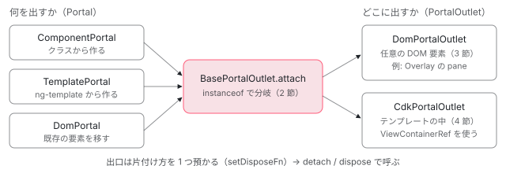

[目次](../README.md) › [CDK の内側](README.md) › 第 4 回 / 全 21 回

# Portal と PortalOutlet：「何を出すか」と「どこに出すか」を分ける

> ComponentPortal・TemplatePortal・DomPortal が「出す中身」を、PortalOutlet が「出す場所」を表す設計。BasePortalOutlet.attach が種類で分岐する行、DomPortalOutlet が createComponent で作った要素を外の DOM ノードに移し、ApplicationRef に attachView する行、CdkPortalOutlet ディレクティブが ViewContainerRef を使う違い。破棄の順番。

angular/components · 読了 約 13 分 · 中核 · [サイトで読む（デモが動きます）](https://angular-deep-dive-cyan.vercel.app/chapter/cdk-portal)

---

ダイアログやメニューは、書いた場所ではなく body の下のような「別の場所」に描きたい UI です。CDK はこれを 2 つの役に分けます。**Portal** は「何を出すか」（コンポーネント・テンプレート・既存の DOM 要素）、**PortalOutlet** は「どこに出すか」です。この章では、3 種類の Portal の中身、`BasePortalOutlet.attach` が種類で分岐する行、`DomPortalOutlet` が作った要素を外の DOM に移して `ApplicationRef` に attachView する行、`CdkPortalOutlet` ディレクティブが `ViewContainerRef` を使う違い、破棄の順番を読みます。[第 5 回](05-cdk.md)の Overlay は、この `DomPortalOutlet` の上に立っています。

読む対象は angular/components の `src/cdk/portal/portal.ts`・`portal/dom-portal-outlet.ts`・`portal/portal-directives.ts` です。

1. [1. 概観](01-cdk-overview.md)
2. [2. Platform と向き](02-cdk-platform-bidi.md)
3. [3. Observer と画面幅](03-cdk-observers-layout.md)
4. **4. Portal**（この章）
5. [5. Overlay](05-cdk.md)
6. [6. 位置の計算](06-cdk-overlay-position.md)
7. [7. スクロールと Esc](07-cdk-overlay-scroll-dispatch.md)
8. [8. FocusTrap](08-cdk-focus-trap.md)
9. [9. FocusMonitor](09-cdk-focus-monitor.md)
10. [10. ListKeyManager](10-cdk-key-manager.md)
11. [11. LiveAnnouncer](11-cdk-live-announcer.md)
12. [12. Dialog](12-cdk-dialog.md)
13. [13. Menu](13-cdk-menu.md)
14. [14. DataSource と選択](14-cdk-collections.md)
15. [15. 仮想スクロール](15-virtual-scroll.md)
16. [16. table](16-table.md)
17. [17. tree](17-cdk-tree.md)
18. [18. DragRef](18-drag-drop.md)
19. [19. DropListRef](19-cdk-drop-list.md)
20. [20. ハーネス](20-harness.md)
21. [21. Material のテーマ](21-theming.md)

> [!TIP]
> **新卒エンジニアへ**
>
> portal は「入口・扉」という意味の英語です。ゲームの「ワープの扉」のように、こちらで入れたものが別の場所に出てくる、と考えると名前の意味がつかめます。実物は、次の図と 1 節からのクラスです。



*Portal（何を出すか）を PortalOutlet（どこに出すか）に attach する。どの組み合わせでも、BasePortalOutlet.attach が種類で分岐する*

## 1. Portal：「出す中身」を表す小さなクラス

📄 `components/src/cdk/portal/portal.ts` L38–67 （▶ の行: 38–39, 42, 48, 53–54, 58, 62–63）

```ts
38 ▶ export abstract class Portal<T> {
39 ▶   private _attachedHost: PortalOutlet | null = null;
40 │ 
41 │   /** Attach this portal to a host. */
42 ▶   attach(host: PortalOutlet): T {
43 │     if (typeof ngDevMode === 'undefined' || ngDevMode) {
44 │       if (host == null) {
45 │         throwNullPortalOutletError();
46 │       }
47 │ 
48 ▶       if (host.hasAttached()) {
49 │         throwPortalAlreadyAttachedError();
50 │       }
51 │     }
52 │ 
53 ▶     this._attachedHost = host;
54 ▶     return <T>host.attach(this);
55 │   }
56 │ 
57 │   /** Detach this portal from its host */
58 ▶   detach(): void {
59 │     let host = this._attachedHost;
60 │ 
61 │     if (host != null) {
62 ▶       this._attachedHost = null;
63 ▶       host.detach();
64 │     } else if (typeof ngDevMode === 'undefined' || ngDevMode) {
65 │       throwNoPortalAttachedError();
66 │     }
67 │   }
```

`Portal` 自身は描画の処理を持ちません。持っているのは 39 行目の「いまどの出口に付いているか」だけです。42 行目の `attach(host)` は、53 行目で出口を覚えて、54 行目で**出口の `attach` に自分を渡す**だけです。実際に DOM を作るのは出口の側です。48 行目の確認（出口に既に何か付いていたらエラー）のとおり、1 つの出口に出せる Portal は 1 つです。58〜67 行目の `detach` も、62〜63 行目で出口の `detach` を呼ぶだけです。

📄 `components/src/cdk/portal/portal.ts` L86–108 （▶ の行: 86, 88, 90–93, 95, 98, 103）

```ts
 86 ▶ export class ComponentPortal<T> extends Portal<ComponentRef<T>> {
 87 │   /** The type of the component that will be instantiated for attachment. */
 88 ▶   component: ComponentType<T>;
 89 │ 
 90 ▶   /**
 91 ▶    * Where the attached component should live in Angular's *logical* component tree.
 92 ▶    * This is different from where the component *renders*, which is determined by the PortalOutlet.
 93 ▶    * The origin is necessary when the host is outside of the Angular application context.
 94 │    */
 95 ▶   viewContainerRef?: ViewContainerRef | null;
 96 │ 
 97 │   /** Injector used for the instantiation of the component. */
 98 ▶   injector?: Injector | null;
 99 │ 
100 │   /**
101 │    * List of DOM nodes that should be projected through `<ng-content>` of the attached component.
102 │    */
103 ▶   projectableNodes?: Node[][] | null;
104 │ 
105 │   /**
106 │    * Bindings to apply to the created component.
107 │    */
108 │   readonly bindings: Binding[] | null;
```

📄 `components/src/cdk/portal/portal.ts` L136–168 （▶ の行: 136, 139, 141, 143, 145, 159–160, 165）

```ts
136 ▶ export class TemplatePortal<C = any> extends Portal<EmbeddedViewRef<C>> {
137 │   constructor(
138 │     /** The embedded template that will be used to instantiate an embedded View in the host. */
139 ▶     public templateRef: TemplateRef<C>,
140 │     /** Reference to the ViewContainer into which the template will be stamped out. */
141 ▶     public viewContainerRef: ViewContainerRef,
142 │     /** Contextual data to be passed in to the embedded view. */
143 ▶     public context?: C,
144 │     /** The injector to use for the embedded view. */
145 ▶     public injector?: Injector,
146 │   ) {
147 │     super();
148 │   }
149 │ 
150 │   get origin(): ElementRef {
151 │     return this.templateRef.elementRef;
152 │   }
153 │ 
154 │   /**
155 │    * Attach the portal to the provided `PortalOutlet`.
156 │    * When a context is provided it will override the `context` property of the `TemplatePortal`
157 │    * instance.
158 │    */
159 ▶   override attach(host: PortalOutlet, context: C | undefined = this.context): EmbeddedViewRef<C> {
160 ▶     this.context = context;
161 │     return super.attach(host);
162 │   }
163 │ 
164 │   override detach(): void {
165 ▶     this.context = undefined;
166 │     return super.detach();
167 │   }
168 │ }
```

📄 `components/src/cdk/portal/portal.ts` L170–183 （▶ の行: 171–173, 175, 181）

```ts
170 │ /**
171 ▶  * A `DomPortal` is a portal whose DOM element will be taken from its current position
172 ▶  * in the DOM and moved into a portal outlet, when it is attached. On detach, the content
173 ▶  * will be restored to its original position.
174 │  */
175 ▶ export class DomPortal<T = HTMLElement> extends Portal<T> {
176 │   /** DOM node hosting the portal's content. */
177 │   readonly element: T;
178 │ 
179 │   constructor(element: T | ElementRef<T>) {
180 │     super();
181 ▶     this.element = element instanceof ElementRef ? element.nativeElement : element;
182 │   }
183 │ }
```

| Portal | 持っているもの | attach の結果 |
| --- | --- | --- |
| `ComponentPortal` | 88 行目のコンポーネントのクラス。95 行目の `viewContainerRef`（論理的な置き場所）、98 行目の `injector`、103 行目の `projectableNodes`（`<ng-content>` に入れる DOM）はどれも省略できる | `ComponentRef`（86 行目の型引数） |
| `TemplatePortal` | 139 行目の `TemplateRef` と、141 行目の `ViewContainerRef`（必須）、143 行目の context、145 行目の injector | `EmbeddedViewRef`（136 行目） |
| `DomPortal` | 177 行目の、もう DOM にある要素だけ。181 行目で `ElementRef` なら中の要素を取り出す | その要素（175 行目） |

90〜93 行目のコメントが Portal の考え方の中心です。**描く場所**（DOM のどこに要素を置くか）と、**論理的な場所**（Angular のコンポーネントの木のどこにぶら下がるか。つまり変更検知や DI の親）は別のものだ、と書いています。`viewContainerRef` を渡すと、論理的な場所はその `ViewContainerRef` になり、描く場所は出口が決めます。171〜173 行目の `DomPortal` は「いまある場所から抜き取って出口に移し、外したら元の場所に戻す」ものです。

## 2. BasePortalOutlet：種類で分岐し、破棄の関数を 1 つ持つ

📄 `components/src/cdk/portal/portal.ts` L224–254 （▶ の行: 230, 234, 239–242, 244, 246, 248, 252）

```ts
224 │   attach(portal: Portal<any>): any {
225 │     if (typeof ngDevMode === 'undefined' || ngDevMode) {
226 │       if (!portal) {
227 │         throwNullPortalError();
228 │       }
229 │ 
230 ▶       if (this.hasAttached()) {
231 │         throwPortalAlreadyAttachedError();
232 │       }
233 │ 
234 ▶       if (this._isDisposed) {
235 │         throwPortalOutletAlreadyDisposedError();
236 │       }
237 │     }
238 │ 
239 ▶     if (portal instanceof ComponentPortal) {
240 ▶       this._attachedPortal = portal;
241 ▶       return this.attachComponentPortal(portal);
242 ▶     } else if (portal instanceof TemplatePortal) {
243 │       this._attachedPortal = portal;
244 ▶       return this.attachTemplatePortal(portal);
245 │       // @breaking-change 10.0.0 remove null check for `this.attachDomPortal`.
246 ▶     } else if (this.attachDomPortal && portal instanceof DomPortal) {
247 │       this._attachedPortal = portal;
248 ▶       return this.attachDomPortal(portal);
249 │     }
250 │ 
251 │     if (typeof ngDevMode === 'undefined' || ngDevMode) {
252 ▶       throwUnknownPortalTypeError();
253 │     }
254 │   }
```

239〜249 行目が分岐です。`instanceof` で `ComponentPortal` なら `attachComponentPortal`、`TemplatePortal` なら `attachTemplatePortal`、`DomPortal` なら `attachDomPortal` を呼びます。この 3 つは抽象メソッドで、出口の種類（次の 3 節・4 節）がそれぞれ書きます。どれにも当たらなければ 252 行目でエラーです。230 行目で「既に付いている」、234 行目で「もう dispose された出口」も弾きます。

📄 `components/src/cdk/portal/portal.ts` L263–293 （▶ の行: 264, 266–267, 270, 274–276, 279–280, 284–285, 289–291）

```ts
263 │   /** Detaches a previously attached portal. */
264 ▶   detach(): void {
265 │     if (this._attachedPortal) {
266 ▶       this._attachedPortal.setAttachedHost(null);
267 ▶       this._attachedPortal = null;
268 │     }
269 │ 
270 ▶     this._invokeDisposeFn();
271 │   }
272 │ 
273 │   /** Permanently dispose of this portal host. */
274 ▶   dispose(): void {
275 ▶     if (this.hasAttached()) {
276 ▶       this.detach();
277 │     }
278 │ 
279 ▶     this._invokeDisposeFn();
280 ▶     this._isDisposed = true;
281 │   }
282 │ 
283 │   /** @docs-private */
284 ▶   setDisposeFn(fn: () => void) {
285 ▶     this._disposeFn = fn;
286 │   }
287 │ 
288 │   private _invokeDisposeFn() {
289 ▶     if (this._disposeFn) {
290 ▶       this._disposeFn();
291 ▶       this._disposeFn = null;
292 │     }
293 │   }
```

1. **attach のときに「片付け方」を預ける**

   出口の各 `attach…Portal` は、作ったものの壊し方を 284〜286 行目の `setDisposeFn` で 1 つ預けます（3 節・4 節で、何を預けるかを見ます）。
2. **detach：Portal との縁を切ってから、預けた関数を呼ぶ**

   266〜267 行目で Portal の `_attachedHost` を `null` にし、270 行目で 288〜293 行目の `_invokeDisposeFn`。預けた関数を呼んで 291 行目で捨てるので、2 回呼んでも 2 回は壊しません。
3. **dispose：detach して、もう使えない印を付ける**

   274〜281 行目。付いていれば 276 行目で detach、280 行目で `_isDisposed`。以後の attach は 234 行目で弾かれます。detach した出口には別の Portal を付け直せますが、dispose した出口には付けられません。

## 3. DomPortalOutlet：Angular の外の DOM 要素を出口にする

`DomPortalOutlet` は「ただの DOM 要素」を出口にします。Overlay の pane（[第 5 回](05-cdk.md)）がこれです。constructor は出口の要素、`ApplicationRef`、予備の `Injector` の 3 つを受け取ります。

### ComponentPortal：viewContainerRef があるとき

📄 `components/src/cdk/portal/dom-portal-outlet.ts` L46–66 （▶ の行: 53–55, 57–59, 66）

```ts
46 │   attachComponentPortal<T>(portal: ComponentPortal<T>): ComponentRef<T> {
47 │     let componentRef: ComponentRef<T>;
48 │ 
49 │     // If the portal specifies a ViewContainerRef, we will use that as the attachment point
50 │     // for the component (in terms of Angular's component tree, not rendering).
51 │     // When the ViewContainerRef is missing, we use the factory to create the component directly
52 │     // and then manually attach the view to the application.
53 ▶     if (portal.viewContainerRef) {
54 ▶       const injector = portal.injector || portal.viewContainerRef.injector;
55 ▶       const ngModuleRef = injector.get(NgModuleRef, null, {optional: true}) || undefined;
56 │ 
57 ▶       componentRef = portal.viewContainerRef.createComponent(portal.component, {
58 ▶         index: portal.viewContainerRef.length,
59 ▶         injector,
60 │         ngModuleRef,
61 │         projectableNodes: portal.projectableNodes || undefined,
62 │         bindings: portal.bindings || undefined,
63 │         directives: portal.directives || undefined,
64 │       });
65 │ 
66 ▶       this.setDisposeFn(() => componentRef.destroy());
```

53 行目、Portal に `viewContainerRef` があれば、57 行目でその `ViewContainerRef` の末尾（58 行目）にコンポーネントを作ります。これで変更検知と DI の親は、その `ViewContainerRef` を持つビューになります（`ViewContainerRef` の中身は [ViewContainerRef の章](../template/04-view-container.md)）。注入器は Portal の `injector`、無ければ 54 行目でその `ViewContainerRef` の注入器です。66 行目で預ける片付けは `componentRef.destroy()` です。

### ComponentPortal：viewContainerRef が無いとき

📄 `components/src/cdk/portal/dom-portal-outlet.ts` L67–99 （▶ の行: 71, 73–77, 83–84, 87–88, 90, 95–96）

```ts
67 │     } else {
68 │       if ((typeof ngDevMode === 'undefined' || ngDevMode) && !this._appRef) {
69 │         throw Error('Cannot attach component portal to outlet without an ApplicationRef.');
70 │       }
71 ▶       const appRef = this._appRef!;
72 │ 
73 ▶       const elementInjector = portal.injector || this._defaultInjector || Injector.NULL;
74 ▶       const environmentInjector = elementInjector.get(EnvironmentInjector, appRef.injector);
75 ▶       componentRef = createComponent(portal.component, {
76 ▶         elementInjector,
77 ▶         environmentInjector,
78 │         projectableNodes: portal.projectableNodes || undefined,
79 │         bindings: portal.bindings || undefined,
80 │         directives: portal.directives || undefined,
81 │       });
82 │ 
83 ▶       appRef.attachView(componentRef.hostView);
84 ▶       this.setDisposeFn(() => {
85 │         // Verify that the ApplicationRef has registered views before trying to detach a host view.
86 │         // This check also protects the `detachView` from being called on a destroyed ApplicationRef.
87 ▶         if (appRef.viewCount > 0) {
88 ▶           appRef.detachView(componentRef.hostView);
89 │         }
90 ▶         componentRef.destroy();
91 │       });
92 │     }
93 │     // At this point the component has been instantiated, so we move it to the location in the DOM
94 │     // where we want it to be rendered.
95 ▶     this.outletElement.appendChild(this._getComponentRootNode(componentRef));
96 ▶     this._attachedPortal = portal;
97 │ 
98 │     return componentRef;
99 │   }
```

1. **どの注入器で作るかを決める**

   73 行目、要素の注入器は「Portal の `injector` → 出口に渡した予備の注入器 → `Injector.NULL`」の順に最初にあるもの。74 行目、環境の注入器（サービスの置き場）はその注入器から `EnvironmentInjector` を引き、無ければ `appRef.injector`（アプリの root）です。
2. **どこにも属さないコンポーネントを作る**

   75〜81 行目の `createComponent` は Angular 本体の関数で、`hostElement` を渡していないので、ホストの要素も新しく作られ、まだ DOM のどこにもありません。
3. **変更検知の対象に入れる**

   83 行目の `appRef.attachView(componentRef.hostView)`。`ViewContainerRef` の子ではないので、このままでは誰もこのビューを変更検知しません。`ApplicationRef` の `tick()` が見るビューの一覧に足すことで、アプリの変更検知のたびに更新されるようになります（`attachView` の中身は [Ref の章](../ivy/16-ivy-refs.md)）。
4. **ホストの要素を出口に移す**

   95 行目。173〜175 行目の `_getComponentRootNode` で `hostView.rootNodes[0]`（ホストの要素）を取り、出口の要素に `appendChild` します。これで**描く場所**が決まります。この移動は 53 行目の道（`viewContainerRef` あり）でも同じです。
5. **片付け方を預ける**

   84〜91 行目。87〜88 行目で `ApplicationRef` から外し（アプリがもう壊れていれば外さない）、90 行目で `destroy()`。

### TemplatePortal と DomPortal

📄 `components/src/cdk/portal/dom-portal-outlet.ts` L106–134 （▶ の行: 107–108, 116, 121, 123–124, 126）

```ts
106 │   attachTemplatePortal<C>(portal: TemplatePortal<C>): EmbeddedViewRef<C> {
107 ▶     let viewContainer = portal.viewContainerRef;
108 ▶     let viewRef = viewContainer.createEmbeddedView(portal.templateRef, portal.context, {
109 │       injector: portal.injector,
110 │     });
111 │ 
112 │     // The method `createEmbeddedView` will add the view as a child of the viewContainer.
113 │     // But for the DomPortalOutlet the view can be added everywhere in the DOM
114 │     // (e.g Overlay Container) To move the view to the specified host element. We just
115 │     // re-append the existing root nodes.
116 ▶     viewRef.rootNodes.forEach(rootNode => this.outletElement.appendChild(rootNode));
117 │ 
118 │     // Note that we want to detect changes after the nodes have been moved so that
119 │     // any directives inside the portal that are looking at the DOM inside a lifecycle
120 │     // hook won't be invoked too early.
121 ▶     viewRef.detectChanges();
122 │ 
123 ▶     this.setDisposeFn(() => {
124 ▶       let index = viewContainer.indexOf(viewRef);
125 │       if (index !== -1) {
126 ▶         viewContainer.remove(index);
127 │       }
128 │     });
129 │ 
130 │     this._attachedPortal = portal;
131 │ 
132 │     // TODO(jelbourn): Return locals from view.
133 │     return viewRef;
134 │   }
```

TemplatePortal は、108 行目で Portal が持っている `ViewContainerRef` にいったん埋め込みビューを作り、116 行目でそのビューの `rootNodes`（最上位の DOM ノード）を 1 つずつ出口に移します。121 行目の `detectChanges()` は、移した**あと**で 1 回目の変更検知をするためです（118〜120 行目のコメント。中の指示子が初期化のフックで DOM の位置を見ても、正しい場所にいるように）。論理的な親は Portal の `ViewContainerRef` のままなので、以後の変更検知はそのビューと一緒に走ります。片付けは 124〜126 行目で `ViewContainerRef` から取り除くことです。

📄 `components/src/cdk/portal/dom-portal-outlet.ts` L142–175 （▶ の行: 144, 150, 152–153, 156, 158–159, 167–169, 174）

```ts
142 │   override attachDomPortal = (portal: DomPortal) => {
143 │     const element = portal.element;
144 ▶     if (!element.parentNode && (typeof ngDevMode === 'undefined' || ngDevMode)) {
145 │       throw Error('DOM portal content must be attached to a parent node.');
146 │     }
147 │ 
148 │     // Anchor used to save the element's previous position so
149 │     // that we can restore it when the portal is detached.
150 ▶     const anchorNode = this.outletElement.ownerDocument.createComment('dom-portal');
151 │ 
152 ▶     element.parentNode!.insertBefore(anchorNode, element);
153 ▶     this.outletElement.appendChild(element);
154 │     this._attachedPortal = portal;
155 │ 
156 ▶     super.setDisposeFn(() => {
157 │       // We can't use `replaceWith` here because IE doesn't support it.
158 ▶       if (anchorNode.parentNode) {
159 ▶         anchorNode.parentNode.replaceChild(element, anchorNode);
160 │       }
161 │     });
162 │   };
163 │ 
164 │   /**
165 │    * Clears out a portal from the DOM.
166 │    */
167 ▶   override dispose(): void {
168 ▶     super.dispose();
169 ▶     this.outletElement.remove();
170 │   }
171 │ 
172 │   /** Gets the root HTMLElement for an instantiated component. */
173 │   private _getComponentRootNode(componentRef: ComponentRef<any>): HTMLElement {
174 ▶     return (componentRef.hostView as EmbeddedViewRef<any>).rootNodes[0] as HTMLElement;
175 │   }
```

1. **元の場所に印を置く**

   150 行目で `<!--dom-portal-->` というコメントを作り、152 行目で要素の直前に差し込みます。
2. **要素を出口に移す**

   153 行目の `appendChild`。DOM の要素は同時に 2 か所には居られないので、これで元の場所から抜けます。144 行目のとおり、DOM に無い要素は渡せません。
3. **外すときは印と入れ替える**

   156〜161 行目で預ける片付けは、159 行目の `replaceChild(element, anchorNode)`。印のコメントがあった場所に要素が戻り、印は消えます。

167〜170 行目の `dispose` は、2 節の dispose（detach して預けた関数を呼ぶ）のあとで、169 行目で**出口の要素そのものを DOM から消します**。Overlay が閉じたあと pane が残らないのはこのためです。

## 4. CdkPortalOutlet：テンプレートに置く出口は ViewContainerRef を使う

📄 `components/src/cdk/portal/portal-directives.ts` L72–96 （▶ の行: 73, 78, 83, 87–88, 91–92, 95）

```ts
72 │   /** Portal associated with the Portal outlet. */
73 ▶   @Input('cdkPortalOutlet')
74 │   get portal(): Portal<any> | null {
75 │     return this._attachedPortal;
76 │   }
77 │ 
78 ▶   set portal(portal: Portal<any> | null | undefined | '') {
79 │     // Ignore the cases where the `portal` is set to a falsy value before the lifecycle hooks have
80 │     // run. This handles the cases where the user might do something like `<div cdkPortalOutlet>`
81 │     // and attach a portal programmatically in the parent component. When Angular does the first CD
82 │     // round, it will fire the setter with empty string, causing the user's content to be cleared.
83 ▶     if (this.hasAttached() && !portal && !this._isInitialized) {
84 │       return;
85 │     }
86 │ 
87 ▶     if (this.hasAttached()) {
88 ▶       super.detach();
89 │     }
90 │ 
91 ▶     if (portal) {
92 ▶       super.attach(portal);
93 │     }
94 │ 
95 ▶     this._attachedPortal = portal || null;
96 │   }
```

`<ng-template [cdkPortalOutlet]="portal">` と書く指示子です。73 行目の入力に Portal を渡すと、78 行目の setter が 87〜88 行目で前の中身を detach し、91〜92 行目で新しい Portal を attach します（2 節の分岐を通る）。`null` を渡せば外すだけです。83〜85 行目は、`<div cdkPortalOutlet>` と値を書かずに置き、コードから attach した場合に、最初の変更検知で入る空文字で中身が消されないための例外です。

📄 `components/src/cdk/portal/portal-directives.ts` L122–152 （▶ の行: 123, 127–128, 130–132, 142–143, 146, 149）

```ts
122 │   attachComponentPortal<T>(portal: ComponentPortal<T>): ComponentRef<T> {
123 ▶     portal.setAttachedHost(this);
124 │ 
125 │     // If the portal specifies an origin, use that as the logical location of the component
126 │     // in the application tree. Otherwise use the location of this PortalOutlet.
127 ▶     const viewContainerRef =
128 ▶       portal.viewContainerRef != null ? portal.viewContainerRef : this._viewContainerRef;
129 │ 
130 ▶     const ref = viewContainerRef.createComponent(portal.component, {
131 ▶       index: viewContainerRef.length,
132 ▶       injector: portal.injector || viewContainerRef.injector,
133 │       projectableNodes: portal.projectableNodes || undefined,
134 │       ngModuleRef: this._moduleRef || undefined,
135 │       bindings: portal.bindings || undefined,
136 │       directives: portal.directives || undefined,
137 │     });
138 │ 
139 │     // If we're using a view container that's different from the injected one (e.g. when the portal
140 │     // specifies its own) we need to move the component into the outlet, otherwise it'll be rendered
141 │     // inside of the alternate view container.
142 ▶     if (viewContainerRef !== this._viewContainerRef) {
143 ▶       this._getRootNode().appendChild((ref.hostView as EmbeddedViewRef<any>).rootNodes[0]);
144 │     }
145 │ 
146 ▶     super.setDisposeFn(() => ref.destroy());
147 │     this._attachedPortal = portal;
148 │     this._attachedRef = ref;
149 ▶     this.attached.emit(ref);
150 │ 
151 │     return ref;
152 │   }
```

📄 `components/src/cdk/portal/portal-directives.ts` L159–171 （▶ の行: 160–161, 164, 168）

```ts
159 │   attachTemplatePortal<C>(portal: TemplatePortal<C>): EmbeddedViewRef<C> {
160 ▶     portal.setAttachedHost(this);
161 ▶     const viewRef = this._viewContainerRef.createEmbeddedView(portal.templateRef, portal.context, {
162 │       injector: portal.injector,
163 │     });
164 ▶     super.setDisposeFn(() => this._viewContainerRef.clear());
165 │ 
166 │     this._attachedPortal = portal;
167 │     this._attachedRef = viewRef;
168 ▶     this.attached.emit(viewRef);
169 │ 
170 │     return viewRef;
171 │   }
```

📄 `components/src/cdk/portal/portal-directives.ts` L201–212 （▶ の行: 203, 207–210）

```ts
201 │   /** Gets the root node of the portal outlet. */
202 │   private _getRootNode(): HTMLElement {
203 ▶     const nativeElement: Node = this._viewContainerRef.element.nativeElement;
204 │ 
205 │     // The directive could be set on a template which will result in a comment
206 │     // node being the root. Use the comment's parent node if that is the case.
207 ▶     return (
208 ▶       nativeElement.nodeType === nativeElement.ELEMENT_NODE
209 ▶         ? nativeElement
210 ▶         : nativeElement.parentNode!
211 │     ) as HTMLElement;
212 │   }
```

📄 `components/src/cdk/portal/portal-directives.ts` L32–43 （▶ の行: 33, 36, 38–39, 41）

```ts
32 │ @Directive({
33 ▶   selector: '[cdkPortal]',
34 │   exportAs: 'cdkPortal',
35 │ })
36 ▶ export class CdkPortal extends TemplatePortal {
37 │   constructor() {
38 ▶     const templateRef = inject<TemplateRef<any>>(TemplateRef);
39 ▶     const viewContainerRef = inject(ViewContainerRef);
40 │ 
41 ▶     super(templateRef, viewContainerRef);
42 │   }
43 │ }
```
*Portal の側にもテンプレートで書く指示子がある*

`<ng-template cdkPortal #p="cdkPortal">…</ng-template>` と書くと、36 行目のとおり指示子そのものが `TemplatePortal` になります。38〜39 行目で自分の `TemplateRef` と `ViewContainerRef` を inject し、41 行目で親の constructor に渡すだけです。これを `[cdkPortalOutlet]="p"` に渡せば、テンプレートの中だけで「ここで書いた中身を、あちらに出す」が書けます。

|   | DomPortalOutlet（3 節） | CdkPortalOutlet（4 節） |
| --- | --- | --- |
| 出口 | 任意の DOM 要素 | 指示子を置いた場所の `ViewContainerRef` |
| ComponentPortal | `viewContainerRef` があればそこに、無ければ `createComponent` + `appRef.attachView`。どちらでもホストを出口へ `appendChild` | 128 行目、Portal の `viewContainerRef` が無ければ**自分の**`ViewContainerRef` に作る。`ApplicationRef` は使わない。別の `ViewContainerRef` を渡されたときだけ 142〜143 行目で要素を自分の所に移す |
| TemplatePortal | Portal の `ViewContainerRef` に作って rootNodes を移す | 161 行目、Portal の `ViewContainerRef` は使わず**自分の**`ViewContainerRef` に作る。移す必要が無い |
| 片付け | `destroy` / `remove(index)`、dispose で出口の要素も消す | 146 行目の `ref.destroy()` / 164 行目の `clear()`。指示子の破棄（`ngOnDestroy`）で dispose |
| 通知 | なし | 149 行目・168 行目で `attached` 出力に `ComponentRef` / `EmbeddedViewRef` を流す |

📄 `components/src/cdk/portal/portal-directives.ts` L107–114 （▶ の行: 111–113）

```ts
107 │   ngOnInit() {
108 │     this._isInitialized = true;
109 │   }
110 │ 
111 ▶   ngOnDestroy() {
112 ▶     super.dispose();
113 ▶     this._attachedRef = this._attachedPortal = null;
114 │   }
```

指示子が置かれたビューが壊れるとき、112 行目で `dispose()`（2 節）を呼びます。中身のコンポーネントやビューは、出口のビューと一緒に片付きます。203〜211 行目の `_getRootNode` は、`<ng-template>` に置いたとき `ViewContainerRef` の要素がコメントになるので、その親の要素を返します。DomPortal の移し先もここです。

> **🧪 DEMO 1 — 本物の CdkPortalOutlet に 3 種類の Portal を出す**
>
> 下の「出口」は `<ng-template [cdkPortalOutlet]="portal()" (attached)="…">` を入れた div です。ボタンで渡す Portal を切り替えると、78 行目の setter が前の中身を外して新しい中身を付けます。DOM の木は、描画のあとに `childNodes` を読んで文字にしたものです（Angular が付ける属性は省いています）。
>
> （まだ何も出していない）
>
> DomPortal を出すと、元の場所に `<!--dom-portal-->` が残ります（portal-directives.ts の `attachDomPortal` も 3 節の 150〜153 行目と同じ手順）。別のボタンを押すと、印と入れ替わって span が戻ります。ComponentPortal の中身は、出口の `ViewContainerRef` の注入器（132 行目）から、この章のコンポーネントの `providers` にあるトークンを見つけます。
>
> ▶ [このデモはサイトで動かせます](https://angular-deep-dive-cyan.vercel.app/chapter/cdk-portal)

> **🧪 DEMO 2 — DomPortalOutlet で、Angular の外の div に出す**
>
> 下の点線の div の中に、`document.createElement('div')` で作った div を足し、それを本物の `DomPortalOutlet` の出口にします。ComponentPortal に `viewContainerRef` を渡さないので、3 節の 71〜92 行目（`createComponent` + `attachView`）の道です。「注入器を渡さない」で出すと、73 行目で `Injector.NULL`、74 行目で `appRef.injector` になり、章のコンポーネントの `providers` は見えません。どちらでも中のボタンは動きます（83 行目で `ApplicationRef` の変更検知の対象に入っているから）。
>
> 状態: まだ作っていない
>
> detach では 2 節の手順で中身だけが消え、出口の `div.my-outlet` は残ります。dispose では 169 行目で出口の div も消えます。
>
> ▶ [このデモはサイトで動かせます](https://angular-deep-dive-cyan.vercel.app/chapter/cdk-portal)

## ここまでの呼び出し

- 👤 `outlet.attach(new ComponentPortal(Hello))` — あなたのコード（Overlay も同じ）
  - `BasePortalOutlet.attach` — portal.ts L224 — *instanceof で分岐*
    - `DomPortalOutlet.attachComponentPortal` — dom-portal-outlet.ts L46
      - `createComponent(Hello, {elementInjector, environmentInjector})` — L75 — *viewContainerRef が無いとき*
      - `appRef.attachView(hostView)` — L83 — *変更検知の対象に*
      - `outletElement.appendChild(rootNodes[0])` — L95 — *描く場所へ*
      - `setDisposeFn(() => detachView + destroy)` — L84-91
- 👤 `outlet.dispose()` — あなたのコード
  - `detach → _attachedPortal.setAttachedHost(null) → _invokeDisposeFn()` — portal.ts L264-293
  - `outletElement.remove()` — dom-portal-outlet.ts L169

## 聞かれそうな質問

**Q. ngTemplateOutlet や ViewContainerRef.createComponent と何が違いますか？**

`CdkPortalOutlet` の中身はほぼそれと同じです。4 節 130 行目は `viewContainerRef.createComponent`、161 行目は `createEmbeddedView` を呼んでいるだけです。違いは「出す中身」を `Portal` という値にして、出口と切り離したことです。同じ `ComponentPortal` を、テンプレートの出口（`CdkPortalOutlet`）にも、body の下の pane（`DomPortalOutlet`）にも渡せます。Overlay や Dialog は利用者から Portal を受け取り、自分の pane に出します。`ngTemplateOutlet` はテンプレートの中の決まった場所にしか出せず、`DomPortalOutlet` のように Angular の外の DOM には出せません。

**Q. DomPortal を外すと、なぜ元の場所に戻るのですか？**

attach のときに元の場所へ印のコメント `<!--dom-portal-->` を置いているからです（dom-portal-outlet.ts 150〜152 行目）。detach で呼ばれる片付けの関数は 159 行目の `anchorNode.parentNode.replaceChild(element, anchorNode)` で、印のあった場所に要素を戻し、印を消します。要素は作り直されないので、中の入力欄の文字やイベントリスナーはそのまま残ります。

**Q. 出した中身の DI は、どこの注入器から解決されますか？**

描く場所ではなく、論理的な場所の注入器です。`DomPortalOutlet` では、Portal に `viewContainerRef` があればその注入器（54 行目）、無ければ「Portal の `injector` → 出口を作るときに渡した注入器 → `Injector.NULL`」の最初のもの（73 行目）で、サービスの置き場は 74 行目でそこから引いた `EnvironmentInjector` か `appRef.injector` です。Overlay は `createOverlayRef` に渡した注入器を出口の予備の注入器にします（[第 5 回](05-cdk.md)）。`CdkPortalOutlet` では、Portal の `injector` が無ければ出口の `ViewContainerRef` の注入器（132 行目）なので、出口を置いたコンポーネントの `providers` が見えます。

**Q. DomPortalOutlet で出したコンポーネントで、変更検知は走りますか？**

走ります。`viewContainerRef` が無いときは 83 行目の `appRef.attachView` で `ApplicationRef` のビューの一覧に入るので、アプリの `tick()` のたびに更新されます。`viewContainerRef` があるときは、その `ViewContainerRef` の子として親のビューと一緒に更新されます。どちらでも DOM の位置は出口の中です。

**Q. 破棄はどの順番で起きますか？**

`dispose()` を呼ぶと、portal.ts 276 行目で `detach()`、その中で 266〜267 行目に Portal との縁を切り、270 行目で attach のときに預けた片付けの関数（コンポーネントなら `detachView` と `destroy`、テンプレートなら `ViewContainerRef` から remove、DomPortal なら元の場所に戻す）を呼びます。280 行目で使えない印を付け、`DomPortalOutlet` なら最後に 169 行目で出口の要素を消します。

## 読み終えて

- Portal は「何を出すか」、PortalOutlet は「どこに出すか」。`Portal.attach` は出口の `attach` を呼ぶだけで、DOM を作るのは出口。
- `BasePortalOutlet.attach` が `instanceof` で 3 種類に分岐し、各出口は作ったものの片付け方を `setDisposeFn` で 1 つ預ける。detach はそれを呼び、dispose は detach して使えなくする。
- `DomPortalOutlet` は、`viewContainerRef` が無ければ `createComponent` で作って `appRef.attachView`、ホストの要素を出口へ `appendChild`。dispose で出口の要素も消す。
- `CdkPortalOutlet` は自分の `ViewContainerRef` に作るので、DOM を移す必要も `ApplicationRef` も要らない。
- DomPortal は元の場所に印のコメントを置き、外すとそれと入れ替えて戻る。

---

← 前: [ContentObserver と BreakpointObserver：DOM と画面幅の変化を知らせる](03-cdk-observers-layout.md)  
次: [Overlay：浮く UI を body の下に出す](05-cdk.md) →
