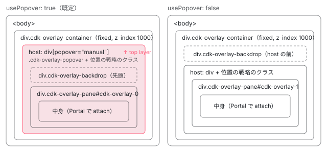

[目次](../README.md) › [CDK の内側](README.md) › 第 5 回 / 全 21 回

# Overlay：浮く UI を body の下に出す

> createOverlayRef が OverlayContainer（body 直下の cdk-overlay-container）の中に host と pane を作り、OverlayRef が中身の attach・位置の更新・backdrop・破棄を受け持つ行。既定で使うネイティブの popover（popover="manual" と showPopover）でトップレイヤーに上げる理由、スタイルを最初の 1 回だけ読み込む仕組み、SSR で作られたコンテナの掃除。

angular/components · 読了 約 14 分 · 中核 · [サイトで読む（デモが動きます）](https://angular-deep-dive-cyan.vercel.app/chapter/cdk)

---

ダイアログ・メニュー・ツールチップ・セレクトの選択肢。画面の上に「浮く」UI は、CDK ではすべて Overlay の上に作られています。この章では、`createOverlayRef` が body 直下の `cdk-overlay-container` の中に host と pane を作る行、`OverlayRef` が中身の attach・位置の更新・backdrop・破棄を受け持つ行、ネイティブの popover（`popover="manual"` と `showPopover()`）を既定で使う理由、構造のスタイルを最初の 1 回だけ読み込む仕組みを読みます。位置の計算は[第 6 回](06-cdk-overlay-position.md)、スクロールと Esc・外側のクリックは[第 7 回](07-cdk-overlay-scroll-dispatch.md)で読みます。

読む対象は angular/components の `src/cdk/overlay/overlay.ts`・`overlay/overlay-container.ts`・`overlay/overlay-ref.ts`・`overlay/backdrop-ref.ts`・`overlay/_index.scss` です。

1. [1. 概観](01-cdk-overview.md)
2. [2. Platform と向き](02-cdk-platform-bidi.md)
3. [3. Observer と画面幅](03-cdk-observers-layout.md)
4. [4. Portal](04-cdk-portal.md)
5. **5. Overlay**（この章）
6. [6. 位置の計算](06-cdk-overlay-position.md)
7. [7. スクロールと Esc](07-cdk-overlay-scroll-dispatch.md)
8. [8. FocusTrap](08-cdk-focus-trap.md)
9. [9. FocusMonitor](09-cdk-focus-monitor.md)
10. [10. ListKeyManager](10-cdk-key-manager.md)
11. [11. LiveAnnouncer](11-cdk-live-announcer.md)
12. [12. Dialog](12-cdk-dialog.md)
13. [13. Menu](13-cdk-menu.md)
14. [14. DataSource と選択](14-cdk-collections.md)
15. [15. 仮想スクロール](15-virtual-scroll.md)
16. [16. table](16-table.md)
17. [17. tree](17-cdk-tree.md)
18. [18. DragRef](18-drag-drop.md)
19. [19. DropListRef](19-cdk-drop-list.md)
20. [20. ハーネス](20-harness.md)
21. [21. Material のテーマ](21-theming.md)

## 0. 出来上がる DOM



*overlay を 1 つ開いたときの DOM。host のクラスは位置の戦略が付ける（第 6 回）。popover を使うと host がトップレイヤーに上がり、backdrop は host の中に入る*

1. **作る**

   `createOverlayRef` が host と pane の 2 つの div を作り、コンテナに入れ、pane を出口にした `DomPortalOutlet` と一緒に `OverlayRef` を返す（1〜3 節）。
2. **付ける**

   `OverlayRef.attach(portal)` が host を DOM に戻して `showPopover()`、中身を pane に出し、位置・大きさ・向き・backdrop・クラスを整える（4〜6 節）。
3. **外す・捨てる**

   `detach()` は中身だけを外して host を DOM から退け、`dispose()` は host ごと全部を片付ける（7 節）。

## 1. createOverlayRef（前半）：依存を集め、popover を使うか決める

📄 `components/src/cdk/overlay/overlay.ts` L52–79 （▶ の行: 52, 55, 57, 59–64, 66–68, 70, 75–76, 78）

```ts
52 ▶ export function createOverlayRef(injector: Injector, config?: OverlayConfig): OverlayRef {
53 │   // This is done in the overlay container as well, but we have it here
54 │   // since it's common to mock out the overlay container in tests.
55 ▶   injector.get(_CdkPrivateStyleLoader).load(_CdkOverlayStyleLoader);
56 │ 
57 ▶   const overlayContainer = injector.get(OverlayContainer);
58 │   const doc = injector.get(DOCUMENT);
59 ▶   const idGenerator = injector.get(_IdGenerator);
60 ▶   const appRef = injector.get(ApplicationRef);
61 ▶   const directionality = injector.get(Directionality);
62 ▶   const renderer =
63 ▶     injector.get(Renderer2, null, {optional: true}) ||
64 ▶     injector.get(RendererFactory2).createRenderer(null, null);
65 │ 
66 ▶   const overlayConfig = new OverlayConfig(config);
67 ▶   const defaultUsePopover =
68 ▶     injector.get(OVERLAY_DEFAULT_CONFIG, null, {optional: true})?.usePopover ?? true;
69 │ 
70 ▶   overlayConfig.direction = overlayConfig.direction || directionality.value;
71 │ 
72 │   // `document.body` can be null during page navigation or unload cycles per the WHATWG spec
73 │   // (https://html.spec.whatwg.org/multipage/dom.html#dom-document-body), even though TypeScript
74 │   // types it as non-nullable. Guard against it to avoid "Cannot use 'in' operator ... in null".
75 ▶   if (!doc.body || !('showPopover' in doc.body)) {
76 ▶     overlayConfig.usePopover = false;
77 │   } else {
78 ▶     overlayConfig.usePopover = config?.usePopover ?? defaultUsePopover;
79 │   }
```

1. **構造のスタイルを読み込む**

   55 行目。`_CdkPrivateStyleLoader` がアプリごとに一度だけ、overlay の構造の CSS を head に入れます（仕組みは[第 1 回](01-cdk-overview.md)の 4 節）。53〜54 行目のコメントのとおり、`OverlayContainer` の側（3 節）でも同じことをしています。テストで `OverlayContainer` を差し替えても CSS が入るようにするためです。
2. **渡された注入器から全部を引く**

   57〜64 行目。`OverlayContainer`・`DOCUMENT`・`_IdGenerator`・`ApplicationRef`・`Directionality`・`Renderer2` を、引数の `injector` から `get` します。`inject()` ではないので、注入コンテキストの外（ボタンのハンドラーの中など）からでも呼べます。
3. **設定の既定値を埋める**

   66 行目で `OverlayConfig` に既定値を足し、70 行目で向きが指定されていなければ `Directionality.value`（[第 2 回](02-cdk-platform-bidi.md)）を写します。作った**時点**の向きを写すだけなので、あとで変えるなら `OverlayRef.setDirection` を呼びます。
4. **popover を使うか**

   67〜68 行目、`OVERLAY_DEFAULT_CONFIG` が無ければ既定は `true`。75〜76 行目、`document.body` が無いか、`showPopover` を持たないブラウザなら必ず `false`。そうでなければ 78 行目で、設定の `usePopover`、無ければ既定の値です。

📄 `components/src/cdk/overlay/overlay.ts` L129–142 （▶ の行: 129–130, 133, 140–141）

```ts
129 ▶ @Service()
130 ▶ export class Overlay {
131 │   scrollStrategies = inject(ScrollStrategyOptions);
132 │   private _positionBuilder = inject(OverlayPositionBuilder);
133 ▶   private _injector = inject(Injector);
134 │ 
135 │   /**
136 │    * Creates an overlay.
137 │    * @param config Configuration applied to the overlay.
138 │    * @returns Reference to the created overlay.
139 │    */
140 ▶   create(config?: OverlayConfig): OverlayRef {
141 ▶     return createOverlayRef(this._injector, config);
142 │   }
```
*おなじみの Overlay サービスは、注入器を持って createOverlayRef を呼ぶだけの包み*

141 行目のとおり、`Overlay.create(config)` は自分の注入器（133 行目。root の注入器）で `createOverlayRef` を呼ぶだけです。`createOverlayRef(inject(Injector), config)` と直接呼べば、呼んだ場所の注入器が使われ、そこにある provider（このページのデモではトークン 1 つ）が中身から見えます。

## 2. createOverlayRef（後半）：host と pane を作ってコンテナに入れる

📄 `components/src/cdk/overlay/overlay.ts` L81–119 （▶ の行: 81–85, 88–89, 92–93, 101, 104–107, 114–116）

```ts
 81 ▶   const pane = doc.createElement('div');
 82 ▶   const host = doc.createElement('div');
 83 ▶   pane.id = idGenerator.getId('cdk-overlay-');
 84 ▶   pane.classList.add('cdk-overlay-pane');
 85 ▶   host.appendChild(pane);
 86 │ 
 87 │   if (overlayConfig.usePopover) {
 88 ▶     host.setAttribute('popover', 'manual');
 89 ▶     host.classList.add('cdk-overlay-popover');
 90 │   }
 91 │ 
 92 ▶   const customInsertionPoint = overlayConfig.usePopover
 93 ▶     ? overlayConfig.positionStrategy?.getPopoverInsertionPoint?.()
 94 │     : null;
 95 │ 
 96 │   if (isElement(customInsertionPoint)) {
 97 │     customInsertionPoint.after(host);
 98 │   } else if (customInsertionPoint?.type === 'parent') {
 99 │     customInsertionPoint.element.appendChild(host);
100 │   } else {
101 ▶     overlayContainer.getContainerElement().appendChild(host);
102 │   }
103 │ 
104 ▶   return new OverlayRef(
105 ▶     new DomPortalOutlet(pane, appRef, injector),
106 ▶     host,
107 ▶     pane,
108 │     overlayConfig,
109 │     injector.get(NgZone),
110 │     injector.get(OverlayKeyboardDispatcher),
111 │     doc,
112 │     injector.get(Location),
113 │     injector.get(OverlayOutsideClickDispatcher),
114 ▶     config?.disableAnimations ??
115 ▶       injector.get(ANIMATION_MODULE_TYPE, null, {optional: true}) === 'NoopAnimations',
116 ▶     injector.get(EnvironmentInjector),
117 │     renderer,
118 │   );
119 │ }
```

1. **2 つの div**

   81〜85 行目。中身を入れる **pane**（`cdk-overlay-pane`、83 行目で `cdk-overlay-0` のような id）と、それを包む **host**。host は位置の戦略が自由に使う枠で、画面中央に置く戦略なら flex の箱、要素の横に置く戦略なら範囲を表す箱になります（[第 6 回](06-cdk-overlay-position.md)）。
2. **popover の印**

   87〜90 行目。popover を使うなら host に `popover="manual"` と `cdk-overlay-popover` クラスを付けます。`manual` は「ブラウザが自動で閉じない」popover で、開け閉めは CDK が `showPopover()` と DOM からの取り外しで行います。
3. **どこに入れるか**

   92〜102 行目。popover のときだけ、位置の戦略に「ここに入れて」と頼めます（93 行目の `getPopoverInsertionPoint`。要素の横に置く戦略で `'inline'` を選ぶと起点の要素の隣になる）。それ以外は 101 行目で `OverlayContainer` の要素に `appendChild` します。
4. **OverlayRef を返す**

   104〜118 行目。105 行目の `new DomPortalOutlet(pane, appRef, injector)` が「pane を出口にした PortalOutlet」です（[第 4 回](04-cdk-portal.md)）。3 番目の `injector` が予備の注入器になるので、Portal に注入器を付けなければ、中身のコンポーネントは `createOverlayRef` に渡した注入器から DI を解決します。114〜115 行目、`NoopAnimations` なら backdrop のアニメーションを切ります。

## 3. OverlayContainer：body 直下に 1 つ、サーバーの残りは消す

📄 `components/src/cdk/overlay/overlay-container.ts` L13–48 （▶ の行: 13, 15–17, 19, 22, 26, 41, 43–44, 47）

```ts
13 ▶ @Component({
14 │   template: '',
15 ▶   encapsulation: ViewEncapsulation.None,
16 ▶   styleUrl: 'overlay-structure.css',
17 ▶   host: {'cdk-overlay-style-loader': ''},
18 │ })
19 ▶ export class _CdkOverlayStyleLoader {}
20 │ 
21 │ /** Container inside which all overlays will render. */
22 ▶ @Service()
23 │ export class OverlayContainer implements OnDestroy {
24 │   protected _platform = inject(Platform);
25 │ 
26 ▶   protected _containerElement: HTMLElement | undefined;
27 │   protected _document = inject(DOCUMENT);
28 │   protected _styleLoader = inject(_CdkPrivateStyleLoader);
29 │ 
30 │   ngOnDestroy() {
31 │     this._containerElement?.remove();
32 │   }
33 │ 
34 │   /**
35 │    * This method returns the overlay container element. It will lazily
36 │    * create the element the first time it is called to facilitate using
37 │    * the container in non-browser environments.
38 │    * @returns the container element
39 │    */
40 │   getContainerElement(): HTMLElement {
41 ▶     this._loadStyles();
42 │ 
43 ▶     if (!this._containerElement) {
44 ▶       this._createContainer();
45 │     }
46 │ 
47 ▶     return this._containerElement!;
48 │   }
```

13〜19 行目の `_CdkOverlayStyleLoader` は、[第 1 回](01-cdk-overview.md)で見た「スタイルだけを持つ空のコンポーネント」の overlay 版です。15 行目でカプセル化なし、16 行目で `overlay-structure.css`。`getContainerElement()` は 41 行目でスタイルを読み込み、43〜44 行目で、まだ無ければ初めてコンテナを作ります。サービスは root に 1 つ（22 行目）で、要素も 26 行目の 1 つを使い回すので、overlay をいくつ開いてもコンテナは 1 つです。

📄 `components/src/cdk/overlay/overlay-container.ts` L54–92 （▶ の行: 55, 60–62, 67–68, 72–73, 84–87, 90）

```ts
54 │   protected _createContainer(): void {
55 ▶     const containerClass = 'cdk-overlay-container';
56 │ 
57 │     // TODO(crisbeto): remove the testing check once we have an overlay testing
58 │     // module or Angular starts tearing down the testing `NgModule`. See:
59 │     // https://github.com/angular/angular/issues/18831
60 ▶     if (this._platform.isBrowser || _isTestEnvironment()) {
61 ▶       const oppositePlatformContainers = this._document.querySelectorAll(
62 ▶         `.${containerClass}[platform="server"], ` + `.${containerClass}[platform="test"]`,
63 │       );
64 │ 
65 │       // Remove any old containers from the opposite platform.
66 │       // This can happen when transitioning from the server to the client.
67 ▶       for (let i = 0; i < oppositePlatformContainers.length; i++) {
68 ▶         oppositePlatformContainers[i].remove();
69 │       }
70 │     }
71 │ 
72 ▶     const container = this._document.createElement('div');
73 ▶     container.classList.add(containerClass);
74 │ 
75 │     // A long time ago we kept adding new overlay containers whenever a new app was instantiated,
76 │     // but at some point we added logic which clears the duplicate ones in order to avoid leaks.
77 │     // The new logic was a little too aggressive since it was breaking some legitimate use cases.
78 │     // To mitigate the problem we made it so that only containers from a different platform are
79 │     // cleared, but the side-effect was that people started depending on the overly-aggressive
80 │     // logic to clean up their tests for them. Until we can introduce an overlay-specific testing
81 │     // module which does the cleanup, we try to detect that we're in a test environment and we
82 │     // always clear the container. See #17006.
83 │     // TODO(crisbeto): remove the test environment check once we have an overlay testing module.
84 ▶     if (_isTestEnvironment()) {
85 ▶       container.setAttribute('platform', 'test');
86 ▶     } else if (!this._platform.isBrowser) {
87 ▶       container.setAttribute('platform', 'server');
88 │     }
89 │ 
90 ▶     this._document.body.appendChild(container);
91 │     this._containerElement = container;
92 │   }
```

1. **ブラウザなら、別の環境が作ったコンテナを消す**

   60〜70 行目。`platform="server"` か `platform="test"` の付いたコンテナを探して消します。サーバーで描画した HTML にコンテナが入っていた場合、ブラウザで起動し直したときにそれが残らないようにするためです（66 行目のコメント）。
2. **新しいコンテナ**

   72〜73 行目で `div.cdk-overlay-container` を作ります。
3. **サーバーで作るなら印を付ける**

   84〜88 行目。テスト環境なら `platform="test"`、ブラウザでなければ（つまりサーバーなら）`platform="server"`。これが次にブラウザで 1 番目の手順に見つけてもらう印です。
4. **body の最後に足す**

   90 行目の `document.body.appendChild`。アプリのルート要素の外、body の直下です。

📄 `components/src/cdk/overlay/_index.scss` L29–53 （▶ の行: 31, 34–37, 42, 45, 48, 51）

```scss
29 │   .cdk-overlay-container, .cdk-global-overlay-wrapper {
30 │     // Disable events from being captured on the overlay container.
31 ▶     pointer-events: none;
32 │ 
33 │     // The container should be the size of the viewport.
34 ▶     top: 0;
35 ▶     left: 0;
36 ▶     height: 100%;
37 ▶     width: 100%;
38 │   }
39 │ 
40 │   // The overlay-container is an invisible element which contains all individual overlays.
41 │   .cdk-overlay-container {
42 ▶     position: fixed;
43 │ 
44 │     @include _conditional-layer($wrap-customizable-styles) {
45 ▶       z-index: $overlay-container-z-index;
46 │     }
47 │ 
48 ▶     &:empty {
49 │       // Hide the element when it doesn't have any child nodes. This doesn't
50 │       // include overlays that have been detached, rather than disposed.
51 ▶       display: none;
52 │     }
53 │   }
```
*16 行目で読み込む CSS の元。コンテナは画面全体を覆うが、クリックは通す*

42 行目で `position: fixed`、34〜37 行目で画面全体の大きさ、45 行目で `z-index`（既定値はファイルの先頭の変数で 1000）。31 行目の `pointer-events: none` で、コンテナが画面を覆っていても下のページはクリックできます（クリックを受けるのは pane。4 節で `pointer-events` を戻します）。48〜52 行目、中が空なら `display: none` です。

## 4. OverlayRef.attach：中身を出して、周りを整える

📄 `components/src/cdk/overlay/overlay-ref.ts` L138–160 （▶ の行: 139, 145, 147–152, 154–155）

```ts
138 │   attach(portal: Portal<any>): any {
139 ▶     if (this._disposed) {
140 │       return null;
141 │     }
142 │ 
143 │     // Insert the host into the DOM before attaching the portal, otherwise
144 │     // the animations module will skip animations on repeat attachments.
145 ▶     this._attachHost();
146 │ 
147 ▶     const attachResult = this._portalOutlet.attach(portal);
148 ▶     this._positionStrategy?.attach(this);
149 ▶     this._updateStackingOrder();
150 ▶     this._updateElementSize();
151 ▶     this._updateElementDirection();
152 ▶     attachedOverlays.add(this);
153 │ 
154 ▶     if (this._scrollStrategy) {
155 ▶       this._scrollStrategy.enable();
156 │     }
157 │ 
158 │     // We need to clean this up ourselves, because we're passing in an
159 │     // `EnvironmentInjector` below which won't ever be destroyed.
160 │     // Otherwise it causes some callbacks to be retained (see #29696).
```

📄 `components/src/cdk/overlay/overlay-ref.ts` L161–197 （▶ の行: 161, 165, 169, 172, 176, 178–179, 182–183, 187, 191, 193–194, 197）

```ts
161 ▶     this._afterNextRenderRef?.destroy();
162 │ 
163 │     // Update the position once the overlay is fully rendered before attempting to position it,
164 │     // as the position may depend on the size of the rendered content.
165 ▶     this._afterNextRenderRef = afterNextRender(
166 │       () => {
167 │         // The overlay could've been detached before the callback executed.
168 │         if (this.hasAttached()) {
169 ▶           this.updatePosition();
170 │         }
171 │       },
172 ▶       {injector: this._injector},
173 │     );
174 │ 
175 │     // Enable pointer events for the overlay pane element.
176 ▶     this._togglePointerEvents(true);
177 │ 
178 ▶     if (this._config.hasBackdrop) {
179 ▶       this._attachBackdrop();
180 │     }
181 │ 
182 ▶     if (this._config.panelClass) {
183 ▶       this._toggleClasses(this._pane, this._config.panelClass, true);
184 │     }
185 │ 
186 │     // Only emit the `attachments` event once all other setup is done.
187 ▶     this._attachments.next();
188 │     this._completeDetachContent();
189 │ 
190 │     // Track this overlay by the keyboard dispatcher
191 ▶     this._keyboardDispatcher.add(this);
192 │ 
193 ▶     if (this._config.disposeOnNavigation) {
194 ▶       this._locationChanges = this._location.subscribe(() => this.dispose());
195 │     }
196 │ 
197 ▶     this._outsideClickDispatcher.add(this);
```

1. **host を DOM に戻して開く**

   145 行目の `_attachHost`（次の引用）。
2. **中身を pane に出す**

   147 行目。`_portalOutlet` は 2 節の `DomPortalOutlet` なので、[第 4 回](04-cdk-portal.md)の手順で、コンポーネントなら作って `appRef.attachView` し、ホストの要素を pane に `appendChild` します。
3. **位置の戦略を付ける**

   148 行目。画面中央の戦略なら host に `cdk-global-overlay-wrapper` を付けるなど、戦略が DOM を準備します（[第 6 回](06-cdk-overlay-position.md)）。
4. **重なり・大きさ・向き**

   149 行目で重なりの順を直し（下の 500〜511 行目）、150 行目で `width` などを pane の style に、151 行目で `dir` 属性を host に書きます。152 行目でモジュールの `attachedOverlays`（開いている overlay の一覧）に足します。
5. **スクロールの戦略を有効にする**

   154〜156 行目（[第 7 回](07-cdk-overlay-scroll-dispatch.md)）。
6. **描画のあとに位置を計算する**

   165〜173 行目。中身の大きさは描画するまで分からないので、`afterNextRender` で次の描画のあとに `updatePosition()`（位置の戦略の `apply`）を呼びます。169 行目の前に、その間に外されていないかを確かめます。
7. **クリックを受けられるようにする**

   176 行目で pane の `pointer-events` を戻し、178〜180 行目で backdrop（5 節）、182〜184 行目で `panelClass` を pane に付けます。
8. **知らせて、見張りに登録する**

   187 行目で `attachments()` を流し、191 行目のキーボード（Esc など）と 197 行目の外側のクリックの見張り役に自分を登録します（[第 7 回](07-cdk-overlay-scroll-dispatch.md)）。193〜195 行目、`disposeOnNavigation` なら `Location` の変化（ブラウザの戻る）で dispose します。

📄 `components/src/cdk/overlay/overlay-ref.ts` L439–462 （▶ の行: 440–441, 450, 454, 458–460）

```ts
439 │   private _attachHost() {
440 ▶     if (!this._host.parentElement) {
441 ▶       const customInsertionPoint = this._config.usePopover
442 │         ? this._positionStrategy?.getPopoverInsertionPoint?.()
443 │         : null;
444 │ 
445 │       if (isElement(customInsertionPoint)) {
446 │         customInsertionPoint.after(this._host);
447 │       } else if (customInsertionPoint?.type === 'parent') {
448 │         customInsertionPoint.element.appendChild(this._host);
449 │       } else {
450 ▶         this._previousHostParent?.appendChild(this._host);
451 │       }
452 │     }
453 │ 
454 ▶     if (this._config.usePopover) {
455 │       // We need the try/catch because the browser will throw if the
456 │       // host or any of the parents are outside the DOM. Also note
457 │       // the string access which is there for compatibility with Closure.
458 ▶       try {
459 ▶         this._host['showPopover']();
460 ▶       } catch {}
461 │     }
462 │   }
```

440 行目、host が DOM に無ければ戻します。初回は 2 節で既にコンテナに入っているので何もしません。2 回目以降（一度 detach したあと）は、450 行目で「前に居た親」（7 節で覚える）に戻します。454〜461 行目、popover なら `showPopover()` を呼びます。ここでブラウザが host を**トップレイヤー**に上げます。DOM の外にあるとブラウザが例外を投げるので try / catch で包んでいます。

📄 `components/src/cdk/overlay/overlay-ref.ts` L500–511 （▶ の行: 508–509）

```ts
500 │   /**
501 │    * Updates the stacking order of the element, moving it to the top if necessary.
502 │    * This is required in cases where one overlay was detached, while another one,
503 │    * that should be behind it, was destroyed. The next time both of them are opened,
504 │    * the stacking will be wrong, because the detached element's pane will still be
505 │    * in its original DOM position.
506 │    */
507 │   private _updateStackingOrder() {
508 ▶     if (!this._config.usePopover && this._host.nextSibling) {
509 ▶       this._host.parentNode!.appendChild(this._host);
510 │     }
511 │   }
```

popover を使わないときの重なりは、コンテナの中の DOM の順番で決まります（後ろの兄弟ほど上）。508〜509 行目、自分の後ろに兄弟がいれば、自分を末尾に付け直して一番上にします。popover なら、トップレイヤーの中で `showPopover()` を呼んだ順に上に積まれるので、この並べ直しは要りません。

## 5. backdrop：pane の後ろの半透明の幕

📄 `components/src/cdk/overlay/overlay-ref.ts` L464–498 （▶ の行: 468–470, 481, 483, 487, 491, 493）

```ts
464 │   /** Attaches a backdrop for this overlay. */
465 │   private _attachBackdrop() {
466 │     const showingClass = 'cdk-overlay-backdrop-showing';
467 │ 
468 ▶     this._backdropRef?.dispose();
469 ▶     this._backdropRef = new BackdropRef(this._document, this._renderer, this._ngZone, event => {
470 ▶       this._backdropClick.next(event);
471 │     });
472 │ 
473 │     if (this._animationsDisabled) {
474 │       this._backdropRef.element.classList.add('cdk-overlay-backdrop-noop-animation');
475 │     }
476 │ 
477 │     if (this._config.backdropClass) {
478 │       this._toggleClasses(this._backdropRef.element, this._config.backdropClass, true);
479 │     }
480 │ 
481 ▶     if (this._config.usePopover) {
482 │       // When using popovers, the backdrop needs to be inside the popover.
483 ▶       this._host.prepend(this._backdropRef.element);
484 │     } else {
485 │       // Insert the backdrop before the pane in the DOM order,
486 │       // in order to handle stacked overlays properly.
487 ▶       this._host.parentElement!.insertBefore(this._backdropRef.element, this._host);
488 │     }
489 │ 
490 │     // Add class to fade-in the backdrop after one frame.
491 ▶     if (!this._animationsDisabled && typeof requestAnimationFrame !== 'undefined') {
492 │       this._ngZone.runOutsideAngular(() => {
493 ▶         requestAnimationFrame(() => this._backdropRef?.element.classList.add(showingClass));
494 │       });
495 │     } else {
496 │       this._backdropRef.element.classList.add(showingClass);
497 │     }
498 │   }
```

📄 `components/src/cdk/overlay/backdrop-ref.ts` L24–50 （▶ の行: 24–26, 34–35, 39–40, 44, 49）

```ts
24 ▶     this.element = document.createElement('div');
25 ▶     this.element.classList.add('cdk-overlay-backdrop');
26 ▶     this._cleanupClick = _renderer.listen(this.element, 'click', onClick);
27 │   }
28 │ 
29 │   detach() {
30 │     this._ngZone.runOutsideAngular(() => {
31 │       const element = this.element;
32 │       clearTimeout(this._fallbackTimeout);
33 │       this._cleanupTransitionEnd?.();
34 ▶       this._cleanupTransitionEnd = this._renderer.listen(element, 'transitionend', this.dispose);
35 ▶       this._fallbackTimeout = setTimeout(this.dispose, 500);
36 │ 
37 │       // If the backdrop doesn't have a transition, the `transitionend` event won't fire.
38 │       // In this case we make it unclickable and we try to remove it after a delay.
39 ▶       element.style.pointerEvents = 'none';
40 ▶       element.classList.remove('cdk-overlay-backdrop-showing');
41 │     });
42 │   }
43 │ 
44 ▶   dispose = () => {
45 │     clearTimeout(this._fallbackTimeout);
46 │     this._cleanupClick?.();
47 │     this._cleanupTransitionEnd?.();
48 │     this._cleanupClick = this._cleanupTransitionEnd = this._fallbackTimeout = undefined;
49 ▶     this.element.remove();
50 │   };
```

1. **div を 1 つ作り、クリックを `backdropClick()` に流す**

   469〜471 行目で `BackdropRef` を作ります。backdrop-ref.ts 24〜26 行目で `div.cdk-overlay-backdrop` を作り、`Renderer2.listen` で click を待ちます。押されると 470 行目で `_backdropClick` に流します。閉じるかどうかは利用者が決めます（下のデモは閉じています）。
2. **popover なら host の中、そうでなければ host の前**

   481〜488 行目。popover の host はトップレイヤーにあるので、backdrop も同じ host の中の先頭（483 行目の `prepend`）に入れないと pane の後ろに来ません。popover でなければ 487 行目で host の直前に入れ、DOM の順で「backdrop → host」の重なりにします。
3. **1 フレーム後にフェードイン**

   491〜494 行目。`requestAnimationFrame` で次のフレームに `cdk-overlay-backdrop-showing` を足すと、CSS の transition で濃くなります。
4. **外すときはフェードアウトを待つ**

   backdrop-ref.ts 29〜42 行目。`showing` を外して 40 行目でフェードを始め、39 行目でクリックを止め、34 行目の `transitionend` と 35 行目の 500ms のタイマーの、先に来たほうで 44〜50 行目の `dispose` が走り、49 行目で要素を消します。

## 6. なぜ popover を既定で使うのか

📄 `components/src/cdk/overlay/_index.scss` L189–222 （▶ の行: 189, 194–196, 202–203, 207, 214–215, 218–220）

```scss
189 ▶   .cdk-overlay-popover {
190 │     background: none;
191 │     border: none;
192 │     padding: 0;
193 │     outline: 0;
194 ▶     overflow: visible;
195 ▶     position: fixed;
196 ▶     pointer-events: none;
197 │     white-space: normal;
198 │     color: inherit;
199 │     text-decoration: none;
200 │ 
201 │     // These are important so the overlay can be measured before it's fully inserted.
202 ▶     width: 100%;
203 ▶     height: 100%;
204 │ 
205 │     // Chrome sets a user agent style of `inset: 0` which combined
206 │     // with `align-self` can break the positioning (see #29809).
207 ▶     inset: auto;
208 │ 
209 │     // Some older versions of Chrome won't render the popover properly without these.
210 │     top: 0;
211 │     left: 0;
212 │ 
213 │     // For the time being we're using our `.cdk-overlay-backdrop` element instead of the native one.
214 ▶     &::backdrop {
215 ▶       display: none;
216 │     }
217 │ 
218 ▶     .cdk-overlay-backdrop {
219 ▶       position: fixed;
220 ▶       z-index: auto;
221 │     }
222 │   }
```

popover の要素は `showPopover()` で**トップレイヤー**に上がります。トップレイヤーは、ページのどの要素の `z-index` や重なりの文脈（stacking context）よりも上に描かれる、ブラウザが持つ特別な層です。コンテナを body 直下に置く旧来の方法でも `overflow: hidden` の親からは逃げられますが、ページの側に `z-index` が 1000 より大きい要素があれば、その下に隠れます。popover ならその心配がありません。「要素の隣に置く」設定（2 節の 93 行目）でも、トップレイヤーに上がるので親の `overflow` や `z-index` の影響を受けません。

CSS の側は、ブラウザが popover に付ける既定のスタイルを打ち消しています。189〜199 行目で背景・枠・余白を消し、196 行目で `pointer-events: none`（コンテナと同じく、クリックは pane だけが受ける）。202〜203 行目で大きさを画面いっぱいに、207 行目の `inset: auto` で Chrome の既定の `inset: 0` を消し、214〜216 行目でネイティブの `::backdrop` を隠して CDK 自身の backdrop（5 節）を使います。218〜221 行目は host の中に入った backdrop の重なりです。

> [!NOTE]
> **ポイント**
>
> ソース（22.2.0-next.5）でも、このサイトに入っている 22.1.8 でも、67〜68 行目の既定は `true` です。アプリ全体で切るには `{provide: OVERLAY_DEFAULT_CONFIG, useValue: {usePopover: false}}` を providers に足します。このトークンは CHANGELOG では 21.0.0 の「overlay: add DI token to opt out of popovers」で入っています。

> **🧪 DEMO — 本物の Overlay を開いて DOM を読む**
>
> ボタンを押すと、本物の `createOverlayRef` で画面中央・backdrop ありの overlay を開きます。中身は `ComponentPortal` で出したコンポーネントで、開いたあと（描画のあと）の body 以下の overlay の DOM と、popover の状態を表示します。backdrop のクリック、Esc、閉じるボタンで `dispose()` します。2 つのボタンで、backdrop の位置（5 節の 481〜488 行目）と popover 属性の有無を比べてください。
>
> ▶ [このデモはサイトで動かせます](https://angular-deep-dive-cyan.vercel.app/chapter/cdk)

## 7. detach と dispose：外す順番、捨てる順番

📄 `components/src/cdk/overlay/overlay-ref.ts` L225–261 （▶ の行: 226, 230, 235, 237–238, 241–242, 245, 248, 252, 256, 258–259）

```ts
225 │   detach(): any {
226 ▶     if (!this.hasAttached()) {
227 │       return;
228 │     }
229 │ 
230 ▶     this.detachBackdrop();
231 │ 
232 │     // When the overlay is detached, the pane element should disable pointer events.
233 │     // This is necessary because otherwise the pane element will cover the page and disable
234 │     // pointer events therefore. Depends on the position strategy and the applied pane boundaries.
235 ▶     this._togglePointerEvents(false);
236 │ 
237 ▶     if (this._positionStrategy && this._positionStrategy.detach) {
238 ▶       this._positionStrategy.detach();
239 │     }
240 │ 
241 ▶     if (this._scrollStrategy) {
242 ▶       this._scrollStrategy.disable();
243 │     }
244 │ 
245 ▶     const detachmentResult = this._portalOutlet.detach();
246 │ 
247 │     // Only emit after everything is detached.
248 ▶     this._detachments.next();
249 │     this._completeDetachContent();
250 │ 
251 │     // Remove this overlay from keyboard dispatcher tracking.
252 ▶     this._keyboardDispatcher.remove(this);
253 │ 
254 │     // Keeping the host element in the DOM can cause scroll jank, because it still gets
255 │     // rendered, even though it's transparent and unclickable which is why we remove it.
256 ▶     this._detachContentWhenEmpty();
257 │     this._locationChanges.unsubscribe();
258 ▶     this._outsideClickDispatcher.remove(this);
259 ▶     attachedOverlays.delete(this);
260 │     return detachmentResult;
261 │   }
```

1. **まわりから先に外す**

   230 行目で backdrop（フェードアウト）、235 行目で pane のクリックを止め、237〜243 行目で位置とスクロールの戦略を外します。
2. **中身を外す**

   245 行目の `_portalOutlet.detach()`。[第 4 回](04-cdk-portal.md)の 2 節のとおり、attach のときに預けた片付け（`detachView` と `destroy`）が走ります。
3. **知らせて、見張りから外す**

   248 行目で `detachments()`、252 行目と 258 行目でキーボードと外側のクリックの見張りから外し、259 行目で一覧から消します。
4. **空になったら host を DOM から退ける**

   256 行目の `_detachContentWhenEmpty`（次の引用）。host を残すと透明でも描画され続けてスクロールが重くなるからです（254〜255 行目のコメント）。

📄 `components/src/cdk/overlay/overlay-ref.ts` L533–563 （▶ の行: 537, 541, 554, 557–559, 561）

```ts
533 │   private _detachContentWhenEmpty() {
534 │     let rethrow = false;
535 │     // Attempt to detach on the next render.
536 │     try {
537 ▶       this._detachContentAfterRenderRef = afterNextRender(
538 │         () => {
539 │           // Rethrow if we encounter an actual error detaching.
540 │           rethrow = true;
541 ▶           this._detachContent();
542 │         },
543 │         {
544 │           injector: this._injector,
545 │         },
546 │       );
547 │     } catch (e) {
548 │       if (rethrow) {
549 │         throw e;
550 │       }
551 │       // afterNextRender throws if the EnvironmentInjector is has already been destroyed.
552 │       // This may happen in tests that don't properly flush all async work.
553 │       // In order to avoid breaking those tests, we just detach immediately in this case.
554 ▶       this._detachContent();
555 │     }
556 │     // Otherwise wait until the content finishes animating out and detach.
557 ▶     if (globalThis.MutationObserver && this._pane) {
558 ▶       this._detachContentMutationObserver ||= new globalThis.MutationObserver(() => {
559 ▶         this._detachContent();
560 │       });
561 ▶       this._detachContentMutationObserver.observe(this._pane, {childList: true});
562 │     }
563 │   }
```

📄 `components/src/cdk/overlay/overlay-ref.ts` L565–580 （▶ の行: 568, 573–575）

```ts
565 │   private _detachContent() {
566 │     // Needs a couple of checks for the pane and host, because
567 │     // they may have been removed by the time the zone stabilizes.
568 ▶     if (!this._pane || !this._host || this._pane.children.length === 0) {
569 │       if (this._pane && this._config.panelClass) {
570 │         this._toggleClasses(this._pane, this._config.panelClass, false);
571 │       }
572 │ 
573 ▶       if (this._host && this._host.parentElement) {
574 ▶         this._previousHostParent = this._host.parentElement;
575 ▶         this._host.remove();
576 │       }
577 │ 
578 │       this._completeDetachContent();
579 │     }
580 │   }
```

中身に閉じるアニメーションがあると、`destroy` のあともしばらく pane の中に要素が残ります。そこで 2 つの方法で「pane が空になった」ときを待ちます。537〜546 行目の `afterNextRender`（次の描画のあと）と、557〜562 行目の `MutationObserver`（pane の子が変わったとき）です。どちらでも 568 行目で pane が空なら、574 行目で今の親（コンテナ）を `_previousHostParent` に覚えてから 575 行目で host を DOM から外します。これが 4 節 450 行目で戻す先です。popover の host は DOM から外れるとトップレイヤーからも降ります。

📄 `components/src/cdk/overlay/overlay-ref.ts` L264–297 （▶ の行: 265, 271–272, 275–276, 278–280, 285, 287, 290, 293, 295）

```ts
264 │   dispose(): void {
265 ▶     if (this._disposed) {
266 │       return;
267 │     }
268 │ 
269 │     const isAttached = this.hasAttached();
270 │ 
271 ▶     if (this._positionStrategy) {
272 ▶       this._positionStrategy.dispose();
273 │     }
274 │ 
275 ▶     this._disposeScrollStrategy();
276 ▶     this._backdropRef?.dispose();
277 │     this._locationChanges.unsubscribe();
278 ▶     this._keyboardDispatcher.remove(this);
279 ▶     this._portalOutlet.dispose();
280 ▶     this._attachments.complete();
281 │     this._backdropClick.complete();
282 │     this._keydownEvents.complete();
283 │     this._outsidePointerEvents.complete();
284 │     this._outsideClickDispatcher.remove(this);
285 ▶     this._host?.remove();
286 │     this._afterNextRenderRef?.destroy();
287 ▶     this._previousHostParent = this._pane = this._host = this._backdropRef = null!;
288 │ 
289 │     if (isAttached) {
290 ▶       this._detachments.next();
291 │     }
292 │ 
293 ▶     this._detachments.complete();
294 │     this._completeDetachContent();
295 ▶     this._disposed = true;
296 │     attachedOverlays.delete(this);
297 │   }
```

1. **戦略と backdrop を捨てる**

   271〜276 行目。detach と違い、backdrop はフェードを待たずに 276 行目で即座に消します。
2. **出口を dispose**

   279 行目。`DomPortalOutlet.dispose` は中身を片付けたうえで出口の要素（pane）を消します（[第 4 回](04-cdk-portal.md) 3 節）。
3. **流れを閉じ、host を消す**

   280〜283 行目で Subject を complete、285 行目で host を DOM から消し、287 行目で参照を全部 `null` にします。
4. **付いていたなら detachments も流す**

   289〜291 行目。295 行目で `_disposed` を立て、以後の `attach` は 4 節 139 行目で `null` を返すだけになります。コンテナ（3 節）は消さないので、次の overlay はそれを使い回します。

📄 `components/src/cdk/overlay/overlay-ref.ts` L199–218 （▶ の行: 202, 208–209, 213）

```ts
199 │     // TODO(crisbeto): the null check is here, because the portal outlet returns `any`.
200 │     // We should be guaranteed for the result to be `ComponentRef | EmbeddedViewRef`, but
201 │     // `instanceof EmbeddedViewRef` doesn't appear to work at the moment.
202 ▶     if (typeof attachResult?.onDestroy === 'function') {
203 │       // In most cases we control the portal and we know when it is being detached so that
204 │       // we can finish the disposal process. The exception is if the user passes in a custom
205 │       // `ViewContainerRef` that isn't destroyed through the overlay API. Note that we use
206 │       // `detach` here instead of `dispose`, because we don't know if the user intends to
207 │       // reattach the overlay at a later point. It also has the advantage of waiting for animations.
208 ▶       attachResult.onDestroy(() => {
209 ▶         if (this.hasAttached()) {
210 │           // We have to delay the `detach` call, because detaching immediately prevents
211 │           // other destroy hooks from running. This is likely a framework bug similar to
212 │           // https://github.com/angular/angular/issues/46119
213 ▶           this._ngZone.runOutsideAngular(() => Promise.resolve().then(() => this.detach()));
214 │         }
215 │       });
216 │     }
217 │ 
218 │     return attachResult;
```
*attach の最後。中身が overlay の外から壊されたら、自分も detach する*

4 節の続きです。中身（`ComponentRef` / `EmbeddedViewRef`）が overlay の API を通さずに壊されたとき（たとえば利用者が渡した `ViewContainerRef` ごと消えたとき）、208 行目の `onDestroy` で気づき、213 行目で次のマイクロタスクに `detach()` します。dispose ではなく detach なのは、再び attach するかもしれないからです（205〜207 行目のコメント）。

## ここまでの呼び出し

- 👤 `overlay.create(config)` または `createOverlayRef(injector, config)` — あなたのコード
  - `_CdkPrivateStyleLoader.load(_CdkOverlayStyleLoader)` — overlay.ts L55 — *構造の CSS を一度だけ*
  - `usePopover = config.usePopover ?? OVERLAY_DEFAULT_CONFIG ?? true` — L67-79
  - `pane / host を作る、host[popover="manual"]` — L81-90
  - `OverlayContainer.getContainerElement().appendChild(host)` — L101 → overlay-container.ts L40-92 — *body 直下に 1 つ*
  - `new OverlayRef(new DomPortalOutlet(pane, appRef, injector), host, pane, …)` — L104-118
- 👤 `overlayRef.attach(portal)` — あなたのコード
  - `_attachHost → host.showPopover()` — overlay-ref.ts L145, L459 — *トップレイヤーへ*
  - `_portalOutlet.attach(portal)` — L147 — *第 4 回*
  - `positionStrategy.attach / scrollStrategy.enable` — L148, L155 — *第 6・7 回*
  - `afterNextRender(() => updatePosition())` — L165-173
  - `_attachBackdrop` — L179 → L464-498
- 👤 `overlayRef.dispose()` — あなたのコード
  - `positionStrategy.dispose → backdrop.dispose → _portalOutlet.dispose → host.remove()` — L271-285

## 聞かれそうな質問

**Q. なぜ浮く UI を、書いた場所ではなく body の下に出すのですか？**

書いた場所の祖先に `overflow: hidden` があると、はみ出した部分が切り取られます。祖先に `transform` があると `position: fixed` がその祖先基準になり、画面に固定できません。祖先が重なりの文脈（stacking context）を作っていると、`z-index` をどれだけ大きくしても文脈の外の要素より上に出られません。body 直下のコンテナ（overlay-container.ts 90 行目）に出せば、祖先は body だけなのでこれらを受けません。コンテナ自身は \_index.scss 42〜45 行目で `position: fixed` と `z-index: 1000` です。

**Q. popover を使うと何が良いのですか？**

host がトップレイヤーに上がるので、ページのどんな `z-index` よりも上に出ます（overlay-ref.ts 459 行目の `showPopover()`）。body 直下のコンテナだけでは、ページに `z-index` が 1000 を超える要素があると負けます。また、要素の隣に host を置いても（overlay.ts 92〜99 行目）親の `overflow` に切られないので、DOM の順番が起点の要素の近くになり、スクリーンリーダーの読む順やフォーカスの移動が自然になります。backdrop は host の中に入れ（483 行目）、ネイティブの `::backdrop` は使いません（\_index.scss 214〜216 行目）。

**Q. SSR で描画すると、コンテナが二重になりませんか？**

なりません。サーバーで overlay を作ると、overlay-container.ts 86〜88 行目でコンテナに `platform="server"` が付き、その HTML がブラウザに届きます。ブラウザで最初にコンテナを作るとき、60〜70 行目で `platform="server"`（と `"test"`）のコンテナを探して消してから、72〜90 行目で新しいコンテナを作ります。コンテナはアプリのルート要素の外（body 直下）にあるので、hydration の対象にもなりません。

**Q. detach と dispose はどう使い分けますか？**

同じ overlay をまた開くなら `detach()`、もう使わないなら `dispose()` です。detach は中身を外して host を DOM から退けるだけで（overlay-ref.ts 225〜261 行目、575 行目）、host・pane・設定・戦略は残り、次の `attach` で 450 行目の元の親に戻ります。dispose は 271〜287 行目で戦略・backdrop・出口・host をすべて片付け、295 行目以降は attach できません。開きっぱなしで捨てると、pane と見張りの登録が残り続けるので、コンポーネントの破棄（`DestroyRef`）で dispose します。

**Q. Overlay サービスと createOverlayRef のどちらを使えばよいですか？**

中身は同じです。overlay.ts 141 行目のとおり、`Overlay.create` は root の注入器で `createOverlayRef` を呼びます。違いは注入器だけで、`createOverlayRef(inject(Injector), …)` にすると、その場所の注入器が 57〜64 行目の依存の解決と、105 行目の出口の予備の注入器に使われます。中身のコンポーネントに、呼んだコンポーネントの `providers` を見せたいときはこちらです。

## 読み終えて

- `Overlay.create` は `createOverlayRef` の包み。`createOverlayRef` は渡された注入器から依存を集め、host と pane を作ってコンテナに入れ、`DomPortalOutlet(pane)` を持つ `OverlayRef` を返す。
- `OverlayContainer` は body 直下に 1 つだけコンテナを作る。サーバーで作ったものには `platform="server"` を付け、ブラウザで消す。構造の CSS は `_CdkOverlayStyleLoader` で一度だけ。
- `attach` は host を戻して `showPopover()`、中身を pane に出し、描画のあとに位置を計算し、backdrop と見張りを付ける。
- popover は既定で使われ、host がトップレイヤーに上がるので `z-index` と `overflow` に負けない。そのとき backdrop は host の中に入る。
- `detach` は中身だけ外して host を退け、`dispose` は全部を片付ける。

---

← 前: [Portal と PortalOutlet：「何を出すか」と「どこに出すか」を分ける](04-cdk-portal.md)  
次: [FlexibleConnectedPositionStrategy：はみ出したら別の位置を試す](06-cdk-overlay-position.md) →
