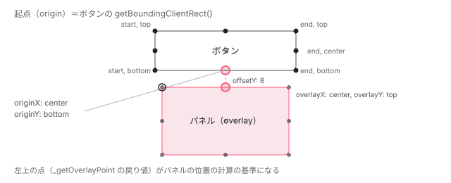
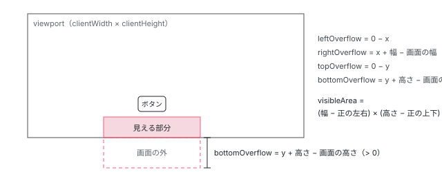

[目次](../README.md) › [CDK の内側](README.md) › 第 6 回 / 全 21 回

# FlexibleConnectedPositionStrategy：はみ出したら別の位置を試す

> ボタンの下にメニューを出すとき、指定した位置の候補を前から順に試し、画面に収まるかを測って選ぶ計算。\_getOriginPoint と \_getOverlayPoint が基準点を出す行、\_getOverlayFit が画面からはみ出す量と見える面積を測る行、全部はみ出すときに「縮めれば収まる候補」→「一番よく見える候補を withPush で押し戻す」の順で選ぶ行、minWidth/minHeight が無いと withFlexibleDimensions が効かない理由、GlobalPositionStrategy との違い。

angular/components · 読了 約 14 分 · 発展 · [サイトで読む（デモが動きます）](https://angular-deep-dive-cyan.vercel.app/chapter/cdk-overlay-position)

---

ボタンの下にメニューを出したいのに、ボタンが画面の下の端にあったら、メニューは画面の外に出てしまいます。CDK の `FlexibleConnectedPositionStrategy` は、利用者が渡した「位置の候補」を前から順に試し、それぞれ画面からどれだけはみ出すかを測って 1 つを選びます。この章では、その計算を `apply()` の 1 行目から順に追い、全部はみ出したときに何が起きるか、`withPush` が何をずらすのかまで確かめます。

読む対象は `src/cdk/overlay/position/` の `flexible-connected-position-strategy.ts` （約 1450 行。ここでは 20 か所に分けて読みます）、`connected-position.ts`、対比で `global-position-strategy.ts` です（components リポジトリ）。

1. [1. 概観](01-cdk-overview.md)
2. [2. Platform と向き](02-cdk-platform-bidi.md)
3. [3. Observer と画面幅](03-cdk-observers-layout.md)
4. [4. Portal](04-cdk-portal.md)
5. [5. Overlay](05-cdk.md)
6. **6. 位置の計算**（この章）
7. [7. スクロールと Esc](07-cdk-overlay-scroll-dispatch.md)
8. [8. FocusTrap](08-cdk-focus-trap.md)
9. [9. FocusMonitor](09-cdk-focus-monitor.md)
10. [10. ListKeyManager](10-cdk-key-manager.md)
11. [11. LiveAnnouncer](11-cdk-live-announcer.md)
12. [12. Dialog](12-cdk-dialog.md)
13. [13. Menu](13-cdk-menu.md)
14. [14. DataSource と選択](14-cdk-collections.md)
15. [15. 仮想スクロール](15-virtual-scroll.md)
16. [16. table](16-table.md)
17. [17. tree](17-cdk-tree.md)
18. [18. DragRef](18-drag-drop.md)
19. [19. DropListRef](19-cdk-drop-list.md)
20. [20. ハーネス](20-harness.md)
21. [21. Material のテーマ](21-theming.md)

## 0. 全体の流れ

[第 5 回](05-cdk.md)で、Overlay は `body` 直下の `cdk-overlay-container` の中に「箱（host）」と「パネル（pane）」を作り、中身を pane に入れると読みました。位置戦略（position strategy）は、その箱と pane に `top` や `left` の style を書き込む係です。書き込むまでの手順は次の 7 段です。

1. **attach**

   OverlayRef が戦略に自分を渡す。戦略は host に `cdk-overlay-connected-position-bounding-box` クラスを付け、画面の大きさの変化を購読する（2 節）。
2. **apply が呼ばれる**

   中身が描かれたあとの `updatePosition()`、画面の大きさの変化、スクロール（[第 7 回](07-cdk-overlay-scroll-dispatch.md)）のたびに呼ばれる（2 節）。
3. **4 つの矩形を測る**

   画面（viewport）・起点（origin）・パネル・コンテナの `getBoundingClientRect()`（3 節）。
4. **候補ごとに 2 つの点を出す**

   起点の上のつなぎ目の点と、そこから決まるパネルの左上の点（4 節）。
5. **はみ出し量を測る**

   上下左右それぞれ何 px 画面の外に出るか、見える面積はいくつか（5 節）。
6. **候補を選ぶ**

   完全に収まる最初の候補 → 縮めれば収まる候補 → 一番ましな候補を押し戻す → 一番ましな候補のまま、の順（6〜7 節）。
7. **style を書いて知らせる**

   選んだ候補で style を書き、`positionChanges` に流す（8 節）。

## 1. 候補の書き方：ConnectedPosition

📄 `components/src/cdk/overlay/position/flexible-connected-position-strategy.ts` L1373–1385 （▶ の行: 1375–1376, 1378–1379, 1381–1383）

```ts
1373 │ /** A connected position as specified by the user. */
1374 │ export interface ConnectedPosition {
1375 ▶   originX: 'start' | 'center' | 'end';
1376 ▶   originY: 'top' | 'center' | 'bottom';
1377 │ 
1378 ▶   overlayX: 'start' | 'center' | 'end';
1379 ▶   overlayY: 'top' | 'center' | 'bottom';
1380 │ 
1381 ▶   weight?: number;
1382 ▶   offsetX?: number;
1383 ▶   offsetY?: number;
1384 │   panelClass?: string | string[];
1385 │ }
```

1 つの候補は「起点のどの点」と「パネルのどの点」を重ねるか、の組です。1375〜1376 行目が起点（origin）の側、1378〜1379 行目がパネル（overlay）の側です。横は `start / center / end`、縦は `top / center / bottom` の 3 通りずつなので、1 つの矩形の上に 3 × 3 = 9 個の点があります。横が `left / right` でなく `start / end` なのは、右から左に書く言語（RTL）で左右を入れ替えるためです （[第 2 回](02-cdk-platform-bidi.md)の `Directionality`）。

1382〜1383 行目の `offsetX / offsetY` は、重ねた点から更にずらす px 数です。1381 行目の `weight` は 6 節で使います。



*起点（ボタン）の 9 点とパネルの 9 点。「下に出す」は起点の (center, bottom) にパネルの (center, top) を重ねる。重ねたあと offsetY だけ下にずらす。*

## 2. 誰が apply を呼ぶのか

📄 `components/src/cdk/overlay/position/flexible-connected-position-strategy.ts` L48–64 （▶ の行: 53, 59–60, 62）

```ts
48 │ /**
49 │  * Creates a flexible position strategy.
50 │  * @param injector Injector used to resolve dependnecies for the position strategy.
51 │  * @param origin Origin relative to which to position the overlay.
52 │  */
53 ▶ export function createFlexibleConnectedPositionStrategy(
54 │   injector: Injector,
55 │   origin: FlexibleConnectedPositionStrategyOrigin,
56 │ ): FlexibleConnectedPositionStrategy {
57 │   return new FlexibleConnectedPositionStrategy(
58 │     origin,
59 ▶     injector.get(ViewportRuler),
60 ▶     injector.get(DOCUMENT),
61 │     injector.get(Platform),
62 ▶     injector.get(OverlayContainer),
63 │   );
64 │ }
```

v22 では戦略も `createFlexibleConnectedPositionStrategy(injector, origin)` という関数で作れます（53 行目）。注入器から取り出しているのは 4 つで、計算に効くのは 59 行目の `ViewportRuler`（スクロール位置と画面の大きさ）、60 行目の `DOCUMENT`（`clientWidth` を読む）、62 行目の `OverlayContainer`（コンテナの矩形）です。

📄 `components/src/cdk/overlay/position/flexible-connected-position-strategy.ts` L188–216 （▶ の行: 200, 203–204, 206, 209, 213–214）

```ts
188 │   /** Attaches this position strategy to an overlay. */
189 │   attach(overlayRef: OverlayRef): void {
190 │     if (
191 │       this._overlayRef &&
192 │       overlayRef !== this._overlayRef &&
193 │       (typeof ngDevMode === 'undefined' || ngDevMode)
194 │     ) {
195 │       throw Error('This position strategy is already attached to an overlay');
196 │     }
197 │ 
198 │     this._validatePositions();
199 │ 
200 ▶     overlayRef.hostElement.classList.add(boundingBoxClass);
201 │ 
202 │     this._overlayRef = overlayRef;
203 ▶     this._boundingBox = overlayRef.hostElement;
204 ▶     this._pane = overlayRef.overlayElement;
205 │     this._isDisposed = false;
206 ▶     this._isInitialRender = true;
207 │     this._lastPosition = null;
208 │     this._resizeSubscription.unsubscribe();
209 ▶     this._resizeSubscription = this._viewportRuler.change().subscribe(() => {
210 │       // When the window is resized, we want to trigger the next reposition as if it
211 │       // was an initial render, in order for the strategy to pick a new optimal position,
212 │       // otherwise position locking will cause it to stay at the old one.
213 ▶       this._isInitialRender = true;
214 ▶       this.apply();
215 │     });
216 │   }
```

200 行目で host（OverlayRef の `hostElement`）に `cdk-overlay-connected-position-bounding-box` を付け、203〜204 行目で host を `_boundingBox`、pane を `_pane` として覚えます。この 2 つが、あとで style を書き込む相手です。

209〜215 行目。`ViewportRuler.change()`（ウィンドウの resize と orientationchange）を購読し、来たら 213 行目で `_isInitialRender = true` に戻してから 214 行目で `apply()` を呼びます。「初回と同じ扱い」にすることで、7 節の位置の固定（`withLockedPosition`）や「開いたあとは大きくしない」制限を外し、候補を選び直させます。

📄 `components/src/cdk/overlay/overlay-ref.ts` L334–339 （▶ の行: 337）

```ts
334 │   /** Updates the position of the overlay based on the position strategy. */
335 │   updatePosition(): void {
336 │     if (this._positionStrategy) {
337 ▶       this._positionStrategy.apply();
338 │     }
339 │   }
```

もう 1 つの入口が `OverlayRef.updatePosition()` で、337 行目で戦略の `apply()` を呼ぶだけです。これを呼んでいるのは、components リポジトリの `src/cdk/overlay` 全体を `grep` すると次のとおりです。

| 呼ぶ場所 | いつ | 詳しく |
| --- | --- | --- |
| `OverlayRef.attach` の `afterNextRender` | 中身を pane に入れ、描画が終わった直後（中身の大きさが決まってから測るため） | [第 5 回](05-cdk.md) |
| `OverlayRef.updatePositionStrategy` | 戦略を差し替えたとき | — |
| `RepositionScrollStrategy` / `CloseScrollStrategy` | ページや `cdkScrollable` がスクロールしたとき | [第 7 回](07-cdk-overlay-scroll-dispatch.md) |
| 戦略自身（上の 214 行目） | ウィンドウの大きさが変わったとき | この節 |
| `CdkConnectedOverlay.ngOnChanges` | テンプレートで `cdkConnectedOverlayOrigin` が変わったとき（`_position.apply()` を直接呼ぶ） | — |

> [!WARNING]
> **ハマりどころ**
>
> 逆に言うと、**起点のボタンが CSS のアニメーションや別の要素の伸び縮みで動いても、自動では追いかけません**。スクロールでもリサイズでもない動きのあとは、自分で `overlayRef.updatePosition()` を呼びます。下のデモでスライダーを動かしたときも、デモのコードが `updatePosition()` を呼んでいます。

## 3. 測る：4 つの矩形

📄 `components/src/cdk/overlay/position/flexible-connected-position-strategy.ts` L232–261 （▶ の行: 234, 241–242, 246–248, 253–256）

```ts
232 │   apply(): void {
233 │     // We shouldn't do anything if the strategy was disposed or we're on the server.
234 ▶     if (this._isDisposed || !this._platform.isBrowser) {
235 │       return;
236 │     }
237 │ 
238 │     // If the position has been applied already (e.g. when the overlay was opened) and the
239 │     // consumer opted into locking in the position, re-use the old position, in order to
240 │     // prevent the overlay from jumping around.
241 ▶     if (!this._isInitialRender && this._positionLocked && this._lastPosition) {
242 ▶       this.reapplyLastPosition();
243 │       return;
244 │     }
245 │ 
246 ▶     this._clearPanelClasses();
247 ▶     this._resetOverlayElementStyles();
248 ▶     this._resetBoundingBoxStyles();
249 │ 
250 │     // We need the bounding rects for the origin, the overlay and the container to determine how to position
251 │     // the overlay relative to the origin.
252 │     // We use the viewport rect to determine whether a position would go off-screen.
253 ▶     this._viewportRect = this._getNarrowedViewportRect();
254 ▶     this._originRect = this._getOriginRect();
255 ▶     this._overlayRect = this._pane.getBoundingClientRect();
256 ▶     this._containerRect = this._getContainerRect();
257 │ 
258 │     const originRect = this._originRect;
259 │     const overlayRect = this._overlayRect;
260 │     const viewportRect = this._viewportRect;
261 │     const containerRect = this._containerRect;
```

1. **234 行目：破棄後とサーバーでは何もしない**

   `Platform.isBrowser` が `false` なら即 return。プリレンダー中に `getBoundingClientRect` を呼ばないのはこの行のおかげです。
2. **241〜244 行目：位置の固定**

   `withLockedPosition()` を付けていて、初回でなく、前回の位置があれば、候補を選び直さず前回の候補で当て直すだけ（`reapplyLastPosition`）。[Menu（第 13 回）](13-cdk-menu.md)のトリガーはこれを付けています。
3. **246〜248 行目：前回の style を消す**

   pane と箱の `top/left/…` を消してから測ります。消さないと、前回の位置で縮んだ大きさを測ってしまうからです。
4. **253〜256 行目：測る**

   画面・起点・パネル（`this._pane.getBoundingClientRect()`）・コンテナの 4 つ。パネルの大きさはここで 1 回だけ測り、全部の候補で使い回します。

📄 `components/src/cdk/overlay/position/flexible-connected-position-strategy.ts` L1156–1175 （▶ の行: 1163–1164, 1168, 1172–1173）

```ts
1156 │   /** Narrows the given viewport rect by the current _viewportMargin. */
1157 │   private _getNarrowedViewportRect(): Dimensions {
1158 │     // We recalculate the viewport rect here ourselves, rather than using the ViewportRuler,
1159 │     // because we want to use the `clientWidth` and `clientHeight` as the base. The difference
1160 │     // being that the client properties don't include the scrollbar, as opposed to `innerWidth`
1161 │     // and `innerHeight` that do. This is necessary, because the overlay container uses
1162 │     // 100% `width` and `height` which don't include the scrollbar either.
1163 ▶     const width = this._document.documentElement!.clientWidth;
1164 ▶     const height = this._document.documentElement!.clientHeight;
1165 │     const scrollPosition = this._viewportRuler.getViewportScrollPosition();
1166 │ 
1167 │     return {
1168 ▶       top: scrollPosition.top + this._getViewportMarginTop(),
1169 │       left: scrollPosition.left + this._getViewportMarginStart(),
1170 │       right: scrollPosition.left + width - this._getViewportMarginEnd(),
1171 │       bottom: scrollPosition.top + height - this._getViewportMarginBottom(),
1172 ▶       width: width - this._getViewportMarginStart() - this._getViewportMarginEnd(),
1173 ▶       height: height - this._getViewportMarginTop() - this._getViewportMarginBottom(),
1174 │     };
1175 │   }
```

画面の大きさは 1163〜1164 行目で `documentElement.clientWidth / clientHeight` から取ります。1158〜1162 行目のコメントのとおり、`window.innerWidth` と違って**スクロールバーの幅を含みません**。コンテナが `width: 100%` で、スクロールバーの下には描けないからです。1168〜1173 行目で `withViewportMargin()` の余白の分だけ内側に狭めます（既定は 0）。

## 4. 2 つの点：起点のつなぎ目と、パネルの左上

📄 `components/src/cdk/overlay/position/flexible-connected-position-strategy.ts` L557–596 （▶ の行: 563, 566, 568–570, 575–576, 580–581, 583）

```ts
557 │   private _getOriginPoint(
558 │     originRect: Dimensions,
559 │     containerRect: Dimensions,
560 │     pos: ConnectedPosition,
561 │   ): Point {
562 │     let x: number;
563 ▶     if (pos.originX == 'center') {
564 │       // Note: when centering we should always use the `left`
565 │       // offset, otherwise the position will be wrong in RTL.
566 ▶       x = originRect.left + originRect.width / 2;
567 │     } else {
568 ▶       const startX = this._isRtl() ? originRect.right : originRect.left;
569 ▶       const endX = this._isRtl() ? originRect.left : originRect.right;
570 ▶       x = pos.originX == 'start' ? startX : endX;
571 │     }
572 │ 
573 │     // When zooming in Safari the container rectangle contains negative values for the position
574 │     // and we need to re-add them to the calculated coordinates.
575 ▶     if (containerRect.left < 0) {
576 ▶       x -= containerRect.left;
577 │     }
578 │ 
579 │     let y: number;
580 ▶     if (pos.originY == 'center') {
581 ▶       y = originRect.top + originRect.height / 2;
582 │     } else {
583 ▶       y = pos.originY == 'top' ? originRect.top : originRect.bottom;
584 │     }
585 │ 
586 │     // Normally the containerRect's top value would be zero, however when the overlay is attached to an input
587 │     // (e.g. in an autocomplete), mobile browsers will shift everything in order to put the input in the middle
588 │     // of the screen and to make space for the virtual keyboard. We need to account for this offset,
589 │     // otherwise our positioning will be thrown off.
590 │     // Additionally, when zooming in Safari this fixes the vertical position.
591 │     if (containerRect.top < 0) {
592 │       y -= containerRect.top;
593 │     }
594 │ 
595 │     return {x, y};
596 │   }
```

`_getOriginPoint` は候補の `originX / originY` を、起点の矩形の上の 1 点 (x, y) に変えます。563〜566 行目、`center` なら `left + width / 2`。568〜570 行目、`start` は LTR なら `left`、RTL なら `right`。580〜583 行目が縦で、`top` は矩形の上辺、`bottom` は下辺です。575〜576 行目と 591〜593 行目は、Safari のズームやモバイルの仮想キーボードでコンテナの矩形が負の値になったときの補正です。

📄 `components/src/cdk/overlay/position/flexible-connected-position-strategy.ts` L602–630 （▶ の行: 611, 613, 615, 620, 622, 627–628）

```ts
602 │   private _getOverlayPoint(
603 │     originPoint: Point,
604 │     overlayRect: Dimensions,
605 │     pos: ConnectedPosition,
606 │   ): Point {
607 │     // Calculate the (overlayStartX, overlayStartY), the start of the
608 │     // potential overlay position relative to the origin point.
609 │     let overlayStartX: number;
610 │     if (pos.overlayX == 'center') {
611 ▶       overlayStartX = -overlayRect.width / 2;
612 │     } else if (pos.overlayX === 'start') {
613 ▶       overlayStartX = this._isRtl() ? -overlayRect.width : 0;
614 │     } else {
615 ▶       overlayStartX = this._isRtl() ? 0 : -overlayRect.width;
616 │     }
617 │ 
618 │     let overlayStartY: number;
619 │     if (pos.overlayY == 'center') {
620 ▶       overlayStartY = -overlayRect.height / 2;
621 │     } else {
622 ▶       overlayStartY = pos.overlayY == 'top' ? 0 : -overlayRect.height;
623 │     }
624 │ 
625 │     // The (x, y) coordinates of the overlay.
626 │     return {
627 ▶       x: originPoint.x + overlayStartX,
628 ▶       y: originPoint.y + overlayStartY,
629 │     };
630 │   }
```

`_getOverlayPoint` は、つなぎ目の点からパネルの**左上の角**までの差を足します。パネルの (center, …) をつなぎ目に重ねたいなら、左上は幅の半分だけ左（611 行目の `-overlayRect.width / 2`）。(end, …) なら幅の分だけ左（615 行目、LTR）。縦も同じで、622 行目、`top` なら 0、`bottom` なら高さの分だけ上です。以降の計算はすべてこの左上の点で行い、最後に `top / bottom / left / right` のどれで書くかを決めます（7 節）。

### 数字で 1 回なぞる

画面が 1280 × 720、ボタンの矩形が `left 100, top 640, width 80, height 32`、パネルが 220 × 120、候補は「下」（起点 center/bottom にパネル center/top、`offsetY: 8`）とします。

1. **つなぎ目**

   x = 100 + 80 / 2 = 140（566 行目）、y = 640 + 32 = 672（583 行目の bottom）。
2. **左上**

   x = 140 − 220 / 2 = 30（611 行目）、y = 672 + 0 = 672（622 行目の top）。
3. **offset を足す**

   y = 672 + 8 = 680（次の節の 651〜653 行目）。

## 5. はみ出し量と、見える面積

📄 `components/src/cdk/overlay/position/flexible-connected-position-strategy.ts` L633–672 （▶ の行: 641, 647, 651, 656–659, 662–664, 668–670）

```ts
633 │   private _getOverlayFit(
634 │     point: Point,
635 │     rawOverlayRect: Dimensions,
636 │     viewport: Dimensions,
637 │     position: ConnectedPosition,
638 │   ): OverlayFit {
639 │     // Round the overlay rect when comparing against the
640 │     // viewport, because the viewport is always rounded.
641 ▶     const overlay = getRoundedBoundingClientRect(rawOverlayRect);
642 │     let {x, y} = point;
643 │     let offsetX = this._getOffset(position, 'x');
644 │     let offsetY = this._getOffset(position, 'y');
645 │ 
646 │     // Account for the offsets since they could push the overlay out of the viewport.
647 ▶     if (offsetX) {
648 │       x += offsetX;
649 │     }
650 │ 
651 ▶     if (offsetY) {
652 │       y += offsetY;
653 │     }
654 │ 
655 │     // How much the overlay would overflow at this position, on each side.
656 ▶     let leftOverflow = 0 - x;
657 ▶     let rightOverflow = x + overlay.width - viewport.width;
658 ▶     let topOverflow = 0 - y;
659 ▶     let bottomOverflow = y + overlay.height - viewport.height;
660 │ 
661 │     // Visible parts of the element on each axis.
662 ▶     let visibleWidth = this._subtractOverflows(overlay.width, leftOverflow, rightOverflow);
663 ▶     let visibleHeight = this._subtractOverflows(overlay.height, topOverflow, bottomOverflow);
664 ▶     let visibleArea = visibleWidth * visibleHeight;
665 │ 
666 │     return {
667 │       visibleArea,
668 ▶       isCompletelyWithinViewport: overlay.width * overlay.height === visibleArea,
669 ▶       fitsInViewportVertically: visibleHeight === overlay.height,
670 ▶       fitsInViewportHorizontally: visibleWidth == overlay.width,
671 │     };
672 │   }
```

656〜659 行目が「はみ出し量」です。左は `0 − x`、右は `x + 幅 − 画面の幅`、上下も同じ。**正の値なら、その px 数だけ画面の外**、負なら余裕がある、という意味です。662〜663 行目の `_subtractOverflows` は、正のはみ出しだけを長さから引きます（`Math.max(overflow, 0)`）。664 行目で見える幅 × 見える高さ = `visibleArea`。668 行目、見える面積がパネル全体の面積と等しければ「完全に収まる」です。641 行目でパネルの矩形を丸めるのは、画面の大きさ（`clientWidth`）が整数だからです。

4 節の数字の続き：下へのはみ出しは 680 + 120 − 720 = **80 px**。見える高さは 120 − 80 = 40、見える面積は 220 × 40 = 8800。全体は 26400 なので `isCompletelyWithinViewport` は `false` です。



*\_getOverlayFit が測る 4 つのはみ出し量。正の値だけが「外に出た量」で、見える部分（濃い所）の面積が visibleArea。*

## 6. 候補のループ

📄 `components/src/cdk/overlay/position/flexible-connected-position-strategy.ts` L263–288 （▶ の行: 271, 273, 278, 281, 284–287）

```ts
263 │     // Positions where the overlay will fit with flexible dimensions.
264 │     const flexibleFits: FlexibleFit[] = [];
265 │ 
266 │     // Fallback if none of the preferred positions fit within the viewport.
267 │     let fallback: FallbackPosition | undefined;
268 │ 
269 │     // Go through each of the preferred positions looking for a good fit.
270 │     // If a good fit is found, it will be applied immediately.
271 ▶     for (let pos of this._preferredPositions) {
272 │       // Get the exact (x, y) coordinate for the point-of-origin on the origin element.
273 ▶       let originPoint = this._getOriginPoint(originRect, containerRect, pos);
274 │ 
275 │       // From that point-of-origin, get the exact (x, y) coordinate for the top-left corner of the
276 │       // overlay in this position. We use the top-left corner for calculations and later translate
277 │       // this into an appropriate (top, left, bottom, right) style.
278 ▶       let overlayPoint = this._getOverlayPoint(originPoint, overlayRect, pos);
279 │ 
280 │       // Calculate how well the overlay would fit into the viewport with this point.
281 ▶       let overlayFit = this._getOverlayFit(overlayPoint, overlayRect, viewportRect, pos);
282 │ 
283 │       // If the overlay, without any further work, fits into the viewport, use this position.
284 ▶       if (overlayFit.isCompletelyWithinViewport) {
285 ▶         this._isPushed = false;
286 ▶         this._applyPosition(pos, originPoint);
287 ▶         return;
288 │       }
```

271 行目、`withPositions()` で渡した配列を**前から順に**試します。273・278・281 行目で 4〜5 節の 3 つの関数を呼び、284〜287 行目、完全に収まった時点で `_applyPosition` して `return`。つまり**完全に収まる候補が複数あっても、配列で前にあるほうが選ばれます**。「なるべく下、だめなら上」を表したければ、下を先に書きます。

📄 `components/src/cdk/overlay/position/flexible-connected-position-strategy.ts` L290–311 （▶ の行: 292, 295, 299, 302, 308–309）

```ts
290 │       // If the overlay has flexible dimensions, we can use this position
291 │       // so long as there's enough space for the minimum dimensions.
292 ▶       if (this._canFitWithFlexibleDimensions(overlayFit, overlayPoint, viewportRect)) {
293 │         // Save positions where the overlay will fit with flexible dimensions. We will use these
294 │         // if none of the positions fit *without* flexible dimensions.
295 ▶         flexibleFits.push({
296 │           position: pos,
297 │           origin: originPoint,
298 │           overlayRect,
299 ▶           boundingBoxRect: this._calculateBoundingBoxRect(originPoint, pos),
300 │         });
301 │ 
302 ▶         continue;
303 │       }
304 │ 
305 │       // If the current preferred position does not fit on the screen, remember the position
306 │       // if it has more visible area on-screen than we've seen and move onto the next preferred
307 │       // position.
308 ▶       if (!fallback || fallback.overlayFit.visibleArea < overlayFit.visibleArea) {
309 ▶         fallback = {overlayFit, overlayPoint, originPoint, position: pos, overlayRect};
310 │       }
311 │     }
```

完全には収まらない候補は 2 つの箱に振り分けられます。292 行目、「大きさを縮めれば収まる」なら `flexibleFits` に積んで次へ（302 行目の `continue`）。そうでなければ 308〜309 行目、**これまでで一番 `visibleArea` が大きい候補**だけを `fallback` に残します。比較が `<` なので、面積が同じなら先に来た候補が残ります。

📄 `components/src/cdk/overlay/position/flexible-connected-position-strategy.ts` L680–695 （▶ の行: 681–685, 687–690）

```ts
680 │   private _canFitWithFlexibleDimensions(fit: OverlayFit, point: Point, viewport: Dimensions) {
681 ▶     if (this._hasFlexibleDimensions) {
682 ▶       const availableHeight = viewport.bottom - point.y;
683 ▶       const availableWidth = viewport.right - point.x;
684 ▶       const minHeight = getPixelValue(this._overlayRef.getConfig().minHeight);
685 ▶       const minWidth = getPixelValue(this._overlayRef.getConfig().minWidth);
686 │ 
687 ▶       const verticalFit =
688 ▶         fit.fitsInViewportVertically || (minHeight != null && minHeight <= availableHeight);
689 ▶       const horizontalFit =
690 ▶         fit.fitsInViewportHorizontally || (minWidth != null && minWidth <= availableWidth);
691 │ 
692 │       return verticalFit && horizontalFit;
693 │     }
694 │     return false;
695 │   }
```

「縮めれば収まる」の判定です。681 行目、`withFlexibleDimensions()`（既定で有効）のときだけ。687〜690 行目、縦は「そのままで縦に収まる」か「`minHeight` が、つなぎ目から画面の下端までの高さ（682 行目）以下」、横も同じ。**注意：`minWidth` と `minHeight` を OverlayConfig に書いていないと、684〜685 行目が `null` になり、縦も横も「そのままで収まる」ときしか通りません**。それは 284 行目で先に return 済みなので、最小の大きさを書かない限り、この箱には何も入りません。

## 7. 全部はみ出したとき

📄 `components/src/cdk/overlay/position/flexible-connected-position-strategy.ts` L313–344 （▶ の行: 315, 319–320, 328, 334, 336–337, 343）

```ts
313 │     // If there are any positions where the overlay would fit with flexible dimensions, choose the
314 │     // one that has the greatest area available modified by the position's weight
315 ▶     if (flexibleFits.length) {
316 │       let bestFit: FlexibleFit | null = null;
317 │       let bestScore = -1;
318 │       for (const fit of flexibleFits) {
319 ▶         const score =
320 ▶           fit.boundingBoxRect.width * fit.boundingBoxRect.height * (fit.position.weight || 1);
321 │         if (score > bestScore) {
322 │           bestScore = score;
323 │           bestFit = fit;
324 │         }
325 │       }
326 │ 
327 │       this._isPushed = false;
328 ▶       this._applyPosition(bestFit!.position, bestFit!.origin);
329 │       return;
330 │     }
331 │ 
332 │     // When none of the preferred positions fit within the viewport, take the position
333 │     // that went off-screen the least and attempt to push it on-screen.
334 ▶     if (this._canPush) {
335 │       // TODO(jelbourn): after pushing, the opening "direction" of the overlay might not make sense.
336 ▶       this._isPushed = true;
337 ▶       this._applyPosition(fallback!.position, fallback!.originPoint);
338 │       return;
339 │     }
340 │ 
341 │     // All options for getting the overlay within the viewport have been exhausted, so go with the
342 │     // position that went off-screen the least.
343 ▶     this._applyPosition(fallback!.position, fallback!.originPoint);
344 │   }
```

1. **315〜330 行目：縮めれば収まる候補があれば、点数で選ぶ**

   点数は 319〜320 行目、その候補で使える箱（bounding box）の幅 × 高さ × `weight`（省略時 1）。広く使える候補ほど勝ちます。`weight` はこの掛け算にしか出てきません。
2. **334〜338 行目：押し戻せるなら（withPush）**

   6 節の `fallback`（一番ましな候補）を、`_isPushed = true` の印を付けて当てます。実際にずらすのは次の `_pushOverlayOnScreen` です。
3. **343 行目：押し戻せないなら**

   `withPush(false)` のときは、一番ましな候補を**はみ出したまま**当てます。

📄 `components/src/cdk/overlay/position/flexible-connected-position-strategy.ts` L836–851 （▶ の行: 841, 843–845, 849, 851）

```ts
836 │   private _calculateBoundingBoxRect(origin: Point, position: ConnectedPosition): BoundingBoxRect {
837 │     const viewport = this._viewportRect;
838 │     const isRtl = this._isRtl();
839 │     let height: number, top: number, bottom: number;
840 │ 
841 ▶     if (position.overlayY === 'top') {
842 │       // Overlay is opening "downward" and thus is bound by the bottom viewport edge.
843 ▶       top = origin.y;
844 ▶       height = viewport.height - top + this._getViewportMarginBottom();
845 ▶     } else if (position.overlayY === 'bottom') {
846 │       // Overlay is opening "upward" and thus is bound by the top viewport edge. We need to add
847 │       // the viewport margin back in, because the viewport rect is narrowed down to remove the
848 │       // margin, whereas the `origin` position is calculated based on its `DOMRect`.
849 ▶       bottom =
850 │         viewport.height - origin.y + this._getViewportMarginTop() + this._getViewportMarginBottom();
851 ▶       height = viewport.height - bottom + this._getViewportMarginTop();
```

点数に使う箱の大きさは `_calculateBoundingBoxRect` の入口で決まります。841〜844 行目、パネルの上辺をつなぎ目に合わせる（下に開く）なら、箱の上はつなぎ目の y、高さは画面の下端まで。845〜851 行目、下辺を合わせる（上に開く）なら、箱の下端がつなぎ目で、高さは画面の上端まで。つまり「その向きに開いたとき、画面の端まで使える広さ」です。flexible のときは、この箱を host に style として書き、pane を箱の中で flex で寄せて置きます（pane は `position: static`）。

📄 `components/src/cdk/overlay/position/flexible-connected-position-strategy.ts` L723–764 （▶ の行: 730–733, 742–743, 745–747, 751–752, 758）

```ts
723 │     // Round the overlay rect when comparing against the
724 │     // viewport, because the viewport is always rounded.
725 │     const overlay = getRoundedBoundingClientRect(rawOverlayRect);
726 │     const viewport = this._viewportRect;
727 │ 
728 │     // Determine how much the overlay goes outside the viewport on each
729 │     // side, which we'll use to decide which direction to push it.
730 ▶     const overflowRight = Math.max(start.x + overlay.width - viewport.width, 0);
731 ▶     const overflowBottom = Math.max(start.y + overlay.height - viewport.height, 0);
732 ▶     const overflowTop = Math.max(viewport.top - scrollPosition.top - start.y, 0);
733 ▶     const overflowLeft = Math.max(viewport.left - scrollPosition.left - start.x, 0);
734 │ 
735 │     // Amount by which to push the overlay in each axis such that it remains on-screen.
736 │     let pushX = 0;
737 │     let pushY = 0;
738 │ 
739 │     // If the overlay fits completely within the bounds of the viewport, push it from whichever
740 │     // direction is goes off-screen. Otherwise, push the top-left corner such that its in the
741 │     // viewport and allow for the trailing end of the overlay to go out of bounds.
742 ▶     if (overlay.width <= viewport.width) {
743 ▶       pushX = overflowLeft || -overflowRight;
744 │     } else {
745 ▶       pushX =
746 ▶         start.x < this._getViewportMarginStart()
747 ▶           ? viewport.left - scrollPosition.left - start.x
748 │           : 0;
749 │     }
750 │ 
751 ▶     if (overlay.height <= viewport.height) {
752 ▶       pushY = overflowTop || -overflowBottom;
753 │     } else {
754 │       pushY =
755 │         start.y < this._getViewportMarginTop() ? viewport.top - scrollPosition.top - start.y : 0;
756 │     }
757 │ 
758 ▶     this._previousPushAmount = {x: pushX, y: pushY};
759 │ 
760 │     return {
761 │       x: start.x + pushX,
762 │       y: start.y + pushY,
763 │     };
764 │   }
```

`withPush` が**ずらすのはパネルの左上の点**で、候補（向き）は変えません。730〜733 行目で 4 辺のはみ出し量（0 未満は 0）を出し、742〜743 行目、パネルが画面の幅に収まる大きさなら `overflowLeft || -overflowRight`：左にはみ出していれば右へその分、右にはみ出していれば左へその分ずらします。751〜752 行目の縦も同じです。745〜747 行目、パネルが画面より大きいときは、左上の角が画面に入るようにだけずらし、右下ははみ出したままにします。758 行目で押した量を覚えておき、位置を固定している（`withLockedPosition`）ときは、この関数の冒頭で計算をせず同じ量を使い回します。

📄 `components/src/cdk/overlay/position/flexible-connected-position-strategy.ts` L1182–1185 （▶ の行: 1184）

```ts
1182 │   /** Determines whether the overlay uses exact or flexible positioning. */
1183 │   private _hasExactPosition() {
1184 ▶     return !this._hasFlexibleDimensions || this._isPushed;
1185 │   }
```

📄 `components/src/cdk/overlay/position/flexible-connected-position-strategy.ts` L1058–1084 （▶ の行: 1066, 1068–1069, 1074, 1077–1078, 1080）

```ts
1058 │   private _getExactOverlayY(
1059 │     position: ConnectedPosition,
1060 │     originPoint: Point,
1061 │     scrollPosition: ViewportScrollPosition,
1062 │   ) {
1063 │     // Reset any existing styles. This is necessary in case the
1064 │     // preferred position has changed since the last `apply`.
1065 │     let styles = {top: '', bottom: ''} as CSSStyleDeclaration;
1066 ▶     let overlayPoint = this._getOverlayPoint(originPoint, this._overlayRect, position);
1067 │ 
1068 ▶     if (this._isPushed) {
1069 ▶       overlayPoint = this._pushOverlayOnScreen(overlayPoint, this._overlayRect, scrollPosition);
1070 │     }
1071 │ 
1072 │     // We want to set either `top` or `bottom` based on whether the overlay wants to appear
1073 │     // above or below the origin and the direction in which the element will expand.
1074 ▶     if (position.overlayY === 'bottom') {
1075 │       // When using `bottom`, we adjust the y position such that it is the distance
1076 │       // from the bottom of the viewport rather than the top.
1077 ▶       const documentHeight = this._document.documentElement!.clientHeight;
1078 ▶       styles.bottom = `${documentHeight - (overlayPoint.y + this._overlayRect.height)}px`;
1079 │     } else {
1080 ▶       styles.top = coerceCssPixelValue(overlayPoint.y);
1081 │     }
1082 │ 
1083 │     return styles;
1084 │   }
```

1184 行目、flexible でないか、押し戻したときは「正確な位置（exact）」の書き方になります。1066 行目で左上の点をもう一度出し、1068〜1069 行目で押し戻しを足し、1074〜1078 行目、上に開く候補（`overlayY: 'bottom'`）なら `bottom` を、それ以外は 1080 行目で `top` を pane に直接書きます。上に開くのに `bottom` で書くのは、中身が増えたときに上へ伸びるようにするためです（1072〜1073 行目のコメント）。横の `_getExactOverlayX` も同じ形で、`left` か `right` を選びます。

## 8. 決まった位置を当てて、知らせる

📄 `components/src/cdk/overlay/position/flexible-connected-position-strategy.ts` L771–803 （▶ の行: 772–774, 776–777, 783, 788–791, 794, 801–802）

```ts
771 │   private _applyPosition(position: ConnectedPosition, originPoint: Point) {
772 ▶     this._setTransformOrigin(position);
773 ▶     this._setOverlayElementStyles(originPoint, position);
774 ▶     this._setBoundingBoxStyles(originPoint, position);
775 │ 
776 ▶     if (position.panelClass) {
777 ▶       this._addPanelClasses(position.panelClass);
778 │     }
779 │ 
780 │     // Notify that the position has been changed along with its change properties.
781 │     // We only emit if we've got any subscriptions, because the scroll visibility
782 │     // calculations can be somewhat expensive.
783 ▶     if (this._positionChanges.observers.length) {
784 │       const scrollVisibility = this._getScrollVisibility();
785 │ 
786 │       // We're recalculating on scroll, but we only want to emit if anything
787 │       // changed since downstream code might be hitting the `NgZone`.
788 ▶       if (
789 ▶         position !== this._lastPosition ||
790 ▶         !this._lastScrollVisibility ||
791 ▶         !compareScrollVisibility(this._lastScrollVisibility, scrollVisibility)
792 │       ) {
793 │         const changeEvent = new ConnectedOverlayPositionChange(position, scrollVisibility);
794 ▶         this._positionChanges.next(changeEvent);
795 │       }
796 │ 
797 │       this._lastScrollVisibility = scrollVisibility;
798 │     }
799 │ 
800 │     // Save the last connected position in case the position needs to be re-calculated.
801 ▶     this._lastPosition = position;
802 ▶     this._isInitialRender = false;
803 │   }
```

1. **772〜774 行目：style を書く**

   `transform-origin`（`withTransformOriginOn` を使ったときだけ）、pane、箱の順。`offsetX / offsetY` は pane の `transform: translateX/Y` として書かれます。
2. **776〜778 行目：候補ごとのクラス**

   候補に `panelClass` を書いておくと、その候補が選ばれている間だけ pane に付きます。「上に出たときだけ矢印を下向きにする」などに使います。
3. **783 行目：購読者がいるときだけ知らせる**

   知らせる前にスクロール容器との重なり（`_getScrollVisibility`）を測るのが重いので、誰も聞いていなければ測りません。
4. **788〜791 行目：変わったときだけ**

   候補が前回と違うか、スクロールで隠れ具合が変わったときだけ 794 行目で流します。スクロールのたびに同じ候補が流れてくることはありません。
5. **801〜802 行目：覚える**

   選んだ候補を `_lastPosition` に入れ、`_isInitialRender` を下ろします。

📄 `components/src/cdk/overlay/position/connected-position.ts` L90–98 （▶ の行: 94, 96）

```ts
90 │ /** The change event emitted by the strategy when a fallback position is used. */
91 │ export class ConnectedOverlayPositionChange {
92 │   constructor(
93 │     /** The position used as a result of this change. */
94 ▶     public connectionPair: ConnectionPositionPair,
95 │     /** @docs-private */
96 ▶     public scrollableViewProperties: ScrollingVisibility,
97 │   ) {}
98 │ }
```

流れてくる `ConnectedOverlayPositionChange` の 94 行目 `connectionPair` は、`withPositions()` に渡した**オブジェクトそのもの**です（`withPositions` は配列をそのまま `_preferredPositions` に入れ、6 節のループの `pos` がそのまま 794 行目まで渡るため）。下のデモは、受け取ったオブジェクトを自分の候補の配列と `===` で比べて、どれが選ばれたかを表示しています。

> **🧪 DEMO — 本物の FlexibleConnectedPositionStrategy に 4 つの候補を渡す**
>
> 候補は 下 → 上 → 右 → 左 の順。「開く」を押してから、スライダーでボタンを動かす・パネルを大きくする・ページをスクロールしてボタンを画面の上端や下端に寄せる、で候補が切り替わります。表は 5 節と同じ式をこのページで計算し直したもの（px、正の値が画面の外）、「選ばれた候補」は本物の `positionChanges` の値です。
>
> ▶ [このデモはサイトで動かせます](https://angular-deep-dive-cyan.vercel.app/chapter/cdk-overlay-position)

> [!NOTE]
> **ポイント**
>
> 幅を 900 にして全部の候補をはみ出させ、withPush を切り替えてみてください。オンなら「一番ましな候補」が画面の内側へ押し戻され、オフならはみ出したまま置かれます。どちらでも「選ばれた候補」は同じで、変わるのは pane の座標だけです（7 節）。押し戻したとき、パネルが画面の端から `offsetY` の 8px だけはみ出して見えることがあります。`_pushOverlayOnScreen` は offset を足す前の左上の点（1066〜1069 行目）を押し戻し、offset はそのあと pane の `transform` として足されるためです。

## 9. GlobalPositionStrategy との違い

📄 `components/src/cdk/overlay/position/global-position-strategy.ts` L219–241 （▶ の行: 227–229, 235–236, 240–241）

```ts
219 │     } else if (isRtl) {
220 │       if (xPosition === 'left' || xPosition === 'end') {
221 │         justifyContent = 'flex-end';
222 │         marginLeft = xOffset;
223 │       } else if (xPosition === 'right' || xPosition === 'start') {
224 │         justifyContent = 'flex-start';
225 │         marginRight = xOffset;
226 │       }
227 ▶     } else if (xPosition === 'left' || xPosition === 'start') {
228 ▶       justifyContent = 'flex-start';
229 ▶       marginLeft = xOffset;
230 │     } else if (xPosition === 'right' || xPosition === 'end') {
231 │       justifyContent = 'flex-end';
232 │       marginRight = xOffset;
233 │     }
234 │ 
235 ▶     styles.position = this._cssPosition;
236 ▶     styles.marginLeft = shouldBeFlushHorizontally ? '0' : marginLeft;
237 │     styles.marginTop = shouldBeFlushVertically ? '0' : this._topOffset;
238 │     styles.marginBottom = this._bottomOffset;
239 │     styles.marginRight = shouldBeFlushHorizontally ? '0' : marginRight;
240 ▶     parentStyles.justifyContent = justifyContent;
241 ▶     parentStyles.alignItems = shouldBeFlushVertically ? 'flex-start' : this._alignItems;
```

画面の中央にダイアログを出すときなどに使う `GlobalPositionStrategy` は、**何も測りません**。`getBoundingClientRect` は 1 回も出てこず、227〜229 行目のように「左寄せなら `justify-content: flex-start` と `margin-left`」と、設定をそのまま CSS に置き換えるだけです。240〜241 行目で host（`cdk-global-overlay-wrapper`、`display: flex`）の `justify-content / align-items` を書き、pane は 235〜236 行目の margin でずらします。配置はブラウザの flexbox に任せるので、はみ出しの判定も候補もありません。[Dialog（第 12 回）](12-cdk-dialog.md)の既定はこちらで、中央寄せです。

## ここまでの呼び出し

- 👤 `overlayRef.attach(portal)` — あなたのコード
  - `strategy.attach(overlayRef)` — flexible-connected-position-strategy.ts L189 — *host にクラス、resize を購読*
  - `afterNextRender → overlayRef.updatePosition()` — overlay-ref.ts L335
    - `strategy.apply()` — L232 — *4 つの矩形を測る*
      - `_getOriginPoint(originRect, containerRect, pos)` — L557 — *× 候補の数*
      - `_getOverlayPoint(originPoint, overlayRect, pos)` — L602
      - `_getOverlayFit(point, overlayRect, viewport, pos)` — L633 — *完全に収まれば即 \_applyPosition*
      - `_canFitWithFlexibleDimensions(...)` — L680 — *min の大きさがあるときだけ意味がある*
      - `_applyPosition(fallback.position, ...)` — L771 — *flexible → 点数 / push → \_isPushed / どちらでもない → そのまま*
        - `_setOverlayElementStyles → _getExactOverlayY / X` — L1000 / L1058 — *押し戻すなら \_pushOverlayOnScreen（L708）*
        - `_setBoundingBoxStyles → _calculateBoundingBoxRect` — L918 / L836
        - `_positionChanges.next(change)` — L794 — *購読者がいて、変わったときだけ*

## 聞かれそうな質問

**Q. 候補が全部はみ出したらどうなりますか？**

3 段で決まります。`minWidth / minHeight` を設定していて「縮めれば収まる」候補があれば、使える箱の面積 × `weight` が最大のものを選びます（319〜320 行目）。なければ、ループ中に覚えた**見える面積が最大の候補**（308〜309 行目）を使い、`withPush` が有効（既定）なら画面内へ押し戻し（334〜338 行目）、無効ならはみ出したまま置きます（343 行目）。どの場合も「何も表示しない」にはなりません。

**Q. withPush は何をずらすのですか？**

パネルの左上の点です。向き（候補）は変えません。`_pushOverlayOnScreen` の 742〜743 行目で、左にはみ出した量だけ右へ、右にはみ出した量だけ左へ。縦も 751〜752 行目で同じです。パネルが画面より大きければ、左上の角だけが画面に入るようにずらします（745〜747 行目）。押したときは 1184 行目で exact の書き方になり、pane に `top / left` が直接書かれます。その結果、ボタンとパネルが離れたり重なったりすることがあります（335 行目の TODO コメントも、押したあとの「向き」が意味を失うことを認めています）。

**Q. 位置が再計算されるのはいつですか？**

`apply()` が呼ばれたときだけです。呼ぶのは、`OverlayRef.attach` 後の `afterNextRender`、ウィンドウの大きさの変化（214 行目）、スクロール戦略（[第 7 回](07-cdk-overlay-scroll-dispatch.md)）、`updatePositionStrategy`、`CdkConnectedOverlay` の origin の変更です（2 節の表）。どれも `overlay-ref.ts` 337 行目の `updatePosition()` を通るか、`apply()` を直接呼びます。起点の要素が CSS で動いただけでは呼ばれないので、そのときは自分で `updatePosition()` を呼びます。

**Q. withFlexibleDimensions を付けても何も変わらないのですが？**

`_canFitWithFlexibleDimensions` は `minHeight / minWidth` と「つなぎ目から画面の端までの長さ」を比べます（687〜690 行目）。OverlayConfig に最小の大きさを書いていなければ `null` になり、「そのままで収まる」ときしか通らないので、flexible の箱（`flexibleFits`）は空のままです。縮めて収める動きを使いたいなら、`minHeight` などを必ず書きます。

**Q. 一度上に出たメニューが、スクロールすると下に飛ぶのを止めたい**

`withLockedPosition()` を付けます。241〜244 行目で、初回でなければ候補を選び直さず、前回の候補で当て直すだけになります。ただしウィンドウの大きさが変わったときは 213 行目で初回扱いに戻るので、選び直されます。[CDK Menu](13-cdk-menu.md) のトリガーはこれを付けています。

## 読み終えて

- 候補は「起点の 9 点のどれ」と「パネルの 9 点のどれ」を重ねるかの組で、配列の前から順に試される。
- 測るのは 1 回（L253-256）。候補ごとに、つなぎ目 → パネルの左上 → 4 辺のはみ出し量 → 見える面積、を計算する。
- 選ぶ順は「完全に収まる最初の候補」→「縮めれば収まる候補の中で一番広い」→「一番よく見える候補を押し戻す」→「そのまま」。
- `withPush` は向きを変えず座標だけをずらす。`withFlexibleDimensions` は最小の大きさを書かないと効かない。
- 再計算は `apply()` が呼ばれたときだけ。呼び出し元は attach 後・resize・スクロール戦略など決まった場所しかない。

---

← 前: [Overlay：浮く UI を body の下に出す](05-cdk.md)  
次: [スクロール戦略と Dispatcher：スクロール・Esc・外側のクリック](07-cdk-overlay-scroll-dispatch.md) →
