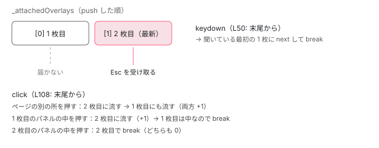

[目次](../README.md) › [CDK の内側](README.md) › 第 7 回 / 全 21 回

# スクロール戦略と Dispatcher：スクロール・Esc・外側のクリック

> 開いた Overlay を、ページがスクロールしたとき位置を直す（reposition）・閉じる（close）・スクロールを止める（block）・何もしない（noop）の 4 つの戦略と、それぞれの行。ScrollDispatcher が document と cdkScrollable のスクロールだけを聞く理由、OverlayKeyboardDispatcher が Esc を一番上の Overlay にだけ渡す行、OverlayOutsideClickDispatcher が pointerdown の起点も見て外側のクリックを判定する行、複数の Overlay が重なったときの順番。

angular/components · 読了 約 13 分 · 中核 · [サイトで読む（デモが動きます）](https://angular-deep-dive-cyan.vercel.app/chapter/cdk-overlay-scroll-dispatch)

---

Overlay を開いたままページをスクロールしたら、パネルはボタンについていくべきでしょうか、閉じるべきでしょうか。CDK はこの答えを「スクロール戦略（scroll strategy）」という差し替えられる部品にしていて、reposition（位置を直す）・close（閉じる）・block（ページのスクロールを止める）・noop（何もしない）の 4 つを持っています。もう 1 つ、Esc キーと「パネルの外側のクリック」を、開いている Overlay のどれに渡すかを決めるのが 2 つの Dispatcher です。この章では、それぞれが何を listen し、どの行で何を判定しているかを読みます。

読む対象は `src/cdk/overlay/scroll/` の 6 ファイル、`src/cdk/scrolling/scroll-dispatcher.ts`、`src/cdk/overlay/dispatchers/` の 3 ファイルです（components リポジトリ）。

1. [1. 概観](01-cdk-overview.md)
2. [2. Platform と向き](02-cdk-platform-bidi.md)
3. [3. Observer と画面幅](03-cdk-observers-layout.md)
4. [4. Portal](04-cdk-portal.md)
5. [5. Overlay](05-cdk.md)
6. [6. 位置の計算](06-cdk-overlay-position.md)
7. **7. スクロールと Esc**（この章）
8. [8. FocusTrap](08-cdk-focus-trap.md)
9. [9. FocusMonitor](09-cdk-focus-monitor.md)
10. [10. ListKeyManager](10-cdk-key-manager.md)
11. [11. LiveAnnouncer](11-cdk-live-announcer.md)
12. [12. Dialog](12-cdk-dialog.md)
13. [13. Menu](13-cdk-menu.md)
14. [14. DataSource と選択](14-cdk-collections.md)
15. [15. 仮想スクロール](15-virtual-scroll.md)
16. [16. table](16-table.md)
17. [17. tree](17-cdk-tree.md)
18. [18. DragRef](18-drag-drop.md)
19. [19. DropListRef](19-cdk-drop-list.md)
20. [20. ハーネス](20-harness.md)
21. [21. Material のテーマ](21-theming.md)

## 0. 誰がいつ呼ぶのか

スクロール戦略も Dispatcher も、自分からは動き出しません。呼ぶのは `OverlayRef` で、その中身は [第 5 回](05-cdk.md)で読みました。ここでは呼ばれる順番だけを並べます。

1. **OverlayRef の constructor**

   設定にスクロール戦略があれば `scrollStrategy.attach(overlayRef)`。戦略が「自分の Overlay」を覚える。
2. **OverlayRef.attach(portal)**

   中身を入れたあと `scrollStrategy.enable()`。続けて `OverlayKeyboardDispatcher.add(this)` と `OverlayOutsideClickDispatcher.add(this)`。
3. **OverlayRef.detach()**

   `scrollStrategy.disable()`、両方の Dispatcher から `remove(this)`。
4. **OverlayRef.dispose()**

   戦略の `disable()` と `detach()`（あれば）、Dispatcher からの `remove`。`keydownEvents` などの Subject を complete。

## 1. ScrollStrategy の形と、既定値

📄 `components/src/cdk/overlay/scroll/scroll-strategy.ts` L14–26 （▶ の行: 16, 19, 22, 25）

```ts
14 │ export interface ScrollStrategy {
15 │   /** Enable this scroll strategy (called when the attached overlay is attached to a portal). */
16 ▶   enable: () => void;
17 │ 
18 │   /** Disable this scroll strategy (called when the attached overlay is detached from a portal). */
19 ▶   disable: () => void;
20 │ 
21 │   /** Attaches this `ScrollStrategy` to an overlay. */
22 ▶   attach: (overlayRef: OverlayRef) => void;
23 │ 
24 │   /** Detaches the scroll strategy from the current overlay. */
25 ▶   detach?: () => void;
26 │ }
```

約束は 4 つのメソッドだけです。16 行目 `enable`（開いたとき）、19 行目 `disable`（閉じたとき）、22 行目 `attach`（Overlay を覚える）、25 行目 `detach`（省略可）。「スクロールしたら何をするか」は、`enable` の中で何を購読するかで決まります。

📄 `components/src/cdk/overlay/overlay-config.ts` L14–19 （▶ の行: 19）

```ts
14 │ export class OverlayConfig {
15 │   /** Strategy with which to position the overlay. */
16 │   positionStrategy?: PositionStrategy;
17 │ 
18 │   /** Strategy to be used when handling scroll events while the overlay is open. */
19 ▶   scrollStrategy?: ScrollStrategy = new NoopScrollStrategy();
```

19 行目。`OverlayConfig` に何も書かなければ **`NoopScrollStrategy`**、つまり何もしません。素の Overlay を開いてページをスクロールすると、パネルは画面の同じ場所に留まり、ボタンだけが流れていきます。

📄 `components/src/cdk/overlay/scroll/scroll-strategy-options.ts` L24–47 （▶ の行: 24, 29, 35, 38, 45–46）

```ts
24 ▶ @Service()
25 │ export class ScrollStrategyOptions {
26 │   private _injector = inject(Injector);
27 │ 
28 │   /** Do nothing on scroll. */
29 ▶   noop = () => new NoopScrollStrategy();
30 │ 
31 │   /**
32 │    * Close the overlay as soon as the user scrolls.
33 │    * @param config Configuration to be used inside the scroll strategy.
34 │    */
35 ▶   close = (config?: CloseScrollStrategyConfig) => createCloseScrollStrategy(this._injector, config);
36 │ 
37 │   /** Block scrolling. */
38 ▶   block = () => createBlockScrollStrategy(this._injector);
39 │ 
40 │   /**
41 │    * Update the overlay's position on scroll.
42 │    * @param config Configuration to be used inside the scroll strategy.
43 │    * Allows debouncing the reposition calls.
44 │    */
45 ▶   reposition = (config?: RepositionScrollStrategyConfig) =>
46 ▶     createRepositionScrollStrategy(this._injector, config);
47 │ }
```

`ScrollStrategyOptions` は 4 つの戦略の工場です（24 行目の `@Service()` はアプリ全体で 1 つ自動で provide されるデコレータ。[DI の章](../di/05-di-injectable-compile.md)）。v22 では 35・38・46 行目のように、中身は `createCloseScrollStrategy(injector)` などの関数を呼ぶだけで、関数を直接 import して使うこともできます（下のデモはそうしています）。戦略は Overlay ごとに**新しいインスタンス**を作ります。`attach` で 1 つの Overlay を覚えるので、使い回せません。

## 2. noop：本当に何もしない

📄 `components/src/cdk/overlay/scroll/noop-scroll-strategy.ts` L11–24 （▶ の行: 19, 21, 23）

```ts
11 │ /** Creates a scroll strategy that does nothing. */
12 │ export function createNoopScrollStrategy(): NoopScrollStrategy {
13 │   return new NoopScrollStrategy();
14 │ }
15 │ 
16 │ /** Scroll strategy that doesn't do anything. */
17 │ export class NoopScrollStrategy implements ScrollStrategy {
18 │   /** Does nothing, as this scroll strategy is a no-op. */
19 ▶   enable() {}
20 │   /** Does nothing, as this scroll strategy is a no-op. */
21 ▶   disable() {}
22 │   /** Does nothing, as this scroll strategy is a no-op. */
23 ▶   attach() {}
24 │ }
```

19〜23 行目、3 つとも空の関数です。`attach` で Overlay すら覚えません。

## 3. 「スクロールした」をどう知るか：ScrollDispatcher

reposition と close は、どちらも `ScrollDispatcher.scrolled()` を購読します。先にこちらを読みます。

📄 `components/src/cdk/scrolling/scroll-dispatcher.ts` L87–118 （▶ の行: 88, 93–95, 101–104, 112–113）

```ts
 87 │   scrolled(auditTimeInMs: number = DEFAULT_SCROLL_TIME): Observable<ScrollDispatcherTarget | void> {
 88 ▶     if (!this._platform.isBrowser) {
 89 │       return observableOf<void>();
 90 │     }
 91 │ 
 92 │     return new Observable((observer: Observer<ScrollDispatcherTarget | void>) => {
 93 ▶       if (!this._cleanupGlobalListener) {
 94 ▶         this._cleanupGlobalListener = this._ngZone.runOutsideAngular(() =>
 95 ▶           this._renderer.listen('document', 'scroll', () => this._scrolled.next()),
 96 │         );
 97 │       }
 98 │ 
 99 │       // In the case of a 0ms delay, use an observable without auditTime
100 │       // since it does add a perceptible delay in processing overhead.
101 ▶       const subscription =
102 ▶         auditTimeInMs > 0
103 ▶           ? this._scrolled.pipe(auditTime(auditTimeInMs)).subscribe(observer)
104 ▶           : this._scrolled.subscribe(observer);
105 │ 
106 │       this._scrolledCount++;
107 │ 
108 │       return () => {
109 │         subscription.unsubscribe();
110 │         this._scrolledCount--;
111 │ 
112 ▶         if (!this._scrolledCount) {
113 ▶           this._cleanupGlobalListener?.();
114 │           this._cleanupGlobalListener = undefined;
115 │         }
116 │       };
117 │     });
118 │   }
```

1. **88〜90 行目：サーバーでは空**

   ブラウザでなければ、何も流さない Observable を返します。
2. **93〜97 行目：最初の購読者が来たら、document の scroll を 1 本だけ listen**

   95 行目、`'document'` の `scroll` を zone の外で聞き、来たら `_scrolled.next()`（引数なし）。購読者が何人いてもリスナーは 1 本です。
3. **101〜104 行目：間引き**

   引数のミリ秒が 0 より大きければ `auditTime`（その時間に 1 回、最後の値だけ流す）。0 ならそのまま。引数を省略すると既定の 20ms（`DEFAULT_SCROLL_TIME`）です。
4. **112〜115 行目：最後の購読者が抜けたら外す**

   Overlay が全部閉じれば、document のリスナーも消えます。

ここで大事なのは、**95 行目が聞いているのは document のスクロールだけ**ということです。`scroll` イベントはバブリングしないので、`overflow: auto` の div の中をスクロールしても、この行には届きません。

📄 `components/src/cdk/scrolling/scroll-dispatcher.ts` L50–62 （▶ の行: 55, 57–59）

```ts
50 │   /**
51 │    * Registers a scrollable instance with the service and listens for its scrolled events. When the
52 │    * scrollable is scrolled, the service emits the event to its scrolled observable.
53 │    * @param target Scrollable instance to be registered.
54 │    */
55 ▶   register(target: ScrollDispatcherTarget): void {
56 │     if (!this.scrollContainers.has(target)) {
57 ▶       this.scrollContainers.set(
58 ▶         target,
59 ▶         target.elementScrolled().subscribe(() => this._scrolled.next(target)),
60 │       );
61 │     }
62 │   }
```

div のスクロールを届けるには、その div に `cdkScrollable` を付けます。`CdkScrollable` は自分の要素の `scroll` を listen し、生成時にこの `register(this)` を呼びます。59 行目、その div がスクロールすると `_scrolled.next(target)`（今度は「どの容器か」付き）が流れます。下のデモのスクロール箱にも `cdkScrollable` が付いています。

## 4. reposition：スクロールのたびに apply し直す

📄 `components/src/cdk/overlay/scroll/reposition-scroll-strategy.ts` L67–91 （▶ の行: 69–70, 72–73, 76–77, 82, 84–86）

```ts
67 │   /** Enables repositioning of the attached overlay on scroll. */
68 │   enable() {
69 ▶     if (!this._scrollSubscription) {
70 ▶       const throttle = this._config ? this._config.scrollThrottle : 0;
71 │ 
72 ▶       this._scrollSubscription = this._scrollDispatcher.scrolled(throttle).subscribe(() => {
73 ▶         this._overlayRef.updatePosition();
74 │ 
75 │         // TODO(crisbeto): make `close` on by default once all components can handle it.
76 ▶         if (this._config && this._config.autoClose) {
77 ▶           const overlayRect = this._overlayRef.overlayElement.getBoundingClientRect();
78 │           const {width, height} = this._viewportRuler.getViewportSize();
79 │ 
80 │           // TODO(crisbeto): include all ancestor scroll containers here once
81 │           // we have a way of exposing the trigger element to the scroll strategy.
82 ▶           const parentRects = [{width, height, bottom: height, right: width, top: 0, left: 0}];
83 │ 
84 ▶           if (isElementScrolledOutsideView(overlayRect, parentRects)) {
85 ▶             this.disable();
86 ▶             this._ngZone.run(() => this._overlayRef.detach());
87 │           }
88 │         }
89 │       });
90 │     }
91 │   }
```

1. **70 行目：間引きの時間**

   設定を渡さなければ `0`（間引かない）。`{ autoClose: true }` のように設定を渡して `scrollThrottle` を書かなかった場合は `undefined` が渡り、`scrolled()` の既定値 20ms が効きます。
2. **72〜73 行目：スクロールのたびに updatePosition**

   これが reposition の本体です。中身は [第 6 回](06-cdk-overlay-position.md)の `apply()` で、候補を選び直すところから全部やり直します。
3. **76〜88 行目：autoClose**

   パネルが画面から完全に外れたら閉じます。82 行目、比べる相手は画面全体の矩形 1 つだけで、TODO コメント（80〜81 行目）のとおり祖先のスクロール容器は見ていません。

📄 `components/src/cdk/overlay/position/scroll-clip.ts` L22–31 （▶ の行: 24–27, 29）

```ts
22 │ export function isElementScrolledOutsideView(element: Dimensions, scrollContainers: Dimensions[]) {
23 │   return scrollContainers.some(containerBounds => {
24 ▶     const outsideAbove = element.bottom < containerBounds.top;
25 ▶     const outsideBelow = element.top > containerBounds.bottom;
26 ▶     const outsideLeft = element.right < containerBounds.left;
27 ▶     const outsideRight = element.left > containerBounds.right;
28 │ 
29 ▶     return outsideAbove || outsideBelow || outsideLeft || outsideRight;
30 │   });
31 │ }
```

「完全に外れた」の判定は、24〜27 行目の 4 つのどれか（下端が容器の上端より上、など）です。1 px でも重なっていれば外れていません。

## 5. close：スクロールしたら閉じる

📄 `components/src/cdk/overlay/scroll/close-scroll-strategy.ts` L64–94 （▶ の行: 70–71, 73–74, 79–80, 83, 85–86, 88, 92）

```ts
64 │   /** Enables the closing of the attached overlay on scroll. */
65 │   enable() {
66 │     if (this._scrollSubscription) {
67 │       return;
68 │     }
69 │ 
70 ▶     const stream = this._scrollDispatcher.scrolled(0).pipe(
71 ▶       filter(scrollable => {
72 │         return (
73 ▶           !scrollable ||
74 ▶           !this._overlayRef.overlayElement.contains(scrollable.getElementRef().nativeElement)
75 │         );
76 │       }),
77 │     );
78 │ 
79 ▶     if (this._config && this._config.threshold && this._config.threshold > 1) {
80 ▶       this._initialScrollPosition = this._viewportRuler.getViewportScrollPosition().top;
81 │ 
82 │       this._scrollSubscription = stream.subscribe(() => {
83 ▶         const scrollPosition = this._viewportRuler.getViewportScrollPosition().top;
84 │ 
85 ▶         if (Math.abs(scrollPosition - this._initialScrollPosition) > this._config!.threshold!) {
86 ▶           this._detach();
87 │         } else {
88 ▶           this._overlayRef.updatePosition();
89 │         }
90 │       });
91 │     } else {
92 ▶       this._scrollSubscription = stream.subscribe(this._detach);
93 │     }
94 │   }
```

1. **70〜77 行目：パネルの中のスクロールは数えない**

   流れてきた容器が、パネル（`overlayElement`）の*中*にあれば捨てます（74 行目）。パネルの中の長いリストをスクロールしただけで閉じないためです。73 行目、容器が無い（document のスクロール）なら通します。
2. **92 行目：しきい値なし**

   1 回でも流れてきたら `_detach`。
3. **79〜90 行目：しきい値あり**

   開いたときのスクロール位置（80 行目）から、`threshold` px を超えて動いたら閉じ、それまでは 88 行目で位置を直します。80・83 行目が読むのは `ViewportRuler.getViewportScrollPosition().top`、つまり**ページ全体の縦のスクロール位置だけ**です。`cdkScrollable` の div の中をスクロールしてもこの値は変わらないので、そのときは閉じずに位置を直し続けます。

📄 `components/src/cdk/overlay/scroll/close-scroll-strategy.ts` L109–116 （▶ の行: 111, 113–114）

```ts
109 │   /** Detaches the overlay ref and disables the scroll strategy. */
110 │   private _detach = () => {
111 ▶     this.disable();
112 │ 
113 ▶     if (this._overlayRef.hasAttached()) {
114 ▶       this._ngZone.run(() => this._overlayRef.detach());
115 │     }
116 │   };
```

閉じ方は 114 行目の `overlayRef.detach()` です（`dispose` ではない）。中身は外れますが、OverlayRef は残るので、同じ OverlayRef にもう一度 `attach` できます。`detachments()` を購読していれば、ここで通知が来ます （[Dialog](12-cdk-dialog.md) はこの通知で自分を閉じます）。

## 6. block：ページのスクロールを止める

📄 `components/src/cdk/overlay/scroll/block-scroll-strategy.ts` L45–63 （▶ の行: 47, 50, 53–54, 58–60）

```ts
45 │   /** Blocks page-level scroll while the attached overlay is open. */
46 │   enable() {
47 ▶     if (this._canBeEnabled()) {
48 │       const root = this._document.documentElement!;
49 │ 
50 ▶       this._previousScrollPosition = this._viewportRuler.getViewportScrollPosition();
51 │ 
52 │       // Cache the previous inline styles in case the user had set them.
53 ▶       this._previousHTMLStyles.left = root.style.left || '';
54 ▶       this._previousHTMLStyles.top = root.style.top || '';
55 │ 
56 │       // Note: we're using the `html` node, instead of the `body`, because the `body` may
57 │       // have the user agent margin, whereas the `html` is guaranteed not to have one.
58 ▶       root.style.left = coerceCssPixelValue(-this._previousScrollPosition.left);
59 ▶       root.style.top = coerceCssPixelValue(-this._previousScrollPosition.top);
60 ▶       root.classList.add('cdk-global-scrollblock');
61 │       this._isEnabled = true;
62 │     }
63 │   }
```

block は `ScrollDispatcher` を使いません。CSS で止めます。50 行目で今のスクロール位置を覚え、53〜54 行目で利用者が `html` に書いていた `top / left` も覚えてから、58〜59 行目で `html` の `top` を「−スクロール量」に、60 行目でクラス `cdk-global-scrollblock` を付けます。56〜57 行目のコメントのとおり、`body` でなく `html` に付けるのは、`body` には UA の margin があり得るからです。

📄 `components/src/cdk/overlay/_index.scss` L174–187 （▶ の行: 176, 181, 186）

```scss
174 │   // Used when disabling global scrolling.
175 │   .cdk-global-scrollblock {
176 ▶     position: fixed;
177 │ 
178 │     // Necessary for the content not to lose its width. Note that we're using 100%, instead of
179 │     // 100vw, because 100vw includes the width plus the scrollbar, whereas 100% is the width
180 │     // that the element had before we made it `fixed`.
181 ▶     width: 100%;
182 │ 
183 │     // Note: this will always add a scrollbar to whatever element it is on, which can
184 │     // potentially result in double scrollbars. It shouldn't be an issue, because we won't
185 │     // block scrolling on a page that doesn't have a scrollbar in the first place.
186 ▶     overflow-y: scroll;
187 │   }
```

1. **176 行目：position: fixed**

   `html` を画面に固定すると、ページはスクロールできなくなります。そのままだと先頭に戻って見えるので、上の 59 行目で `top` を負にして、今見ていた位置を画面に残します。
2. **181 行目：width: 100%**

   fixed にすると幅が中身に縮むので、元の幅を保ちます。コメントのとおり `100vw` でないのは、vw がスクロールバーの幅を含むからです。
3. **186 行目：overflow-y: scroll**

   **スクロールバーを出したままにします**。消すとその幅（多くの環境で十数 px）だけページが横に広がり、中身が右へずれます。止める前からスクロールバーがあるページでしか block しない（次の `_canBeEnabled`）ので、二重になる心配も無い、とコメントにあります。

📄 `components/src/cdk/overlay/scroll/block-scroll-strategy.ts` L99–112 （▶ の行: 105–106, 111）

```ts
 99 │   private _canBeEnabled(): boolean {
100 │     // Since the scroll strategies can't be singletons, we have to use a global CSS class
101 │     // (`cdk-global-scrollblock`) to make sure that we don't try to disable global
102 │     // scrolling multiple times.
103 │     const html = this._document.documentElement!;
104 │ 
105 ▶     if (html.classList.contains('cdk-global-scrollblock') || this._isEnabled) {
106 ▶       return false;
107 │     }
108 │ 
109 │     const rootElement = this._document.documentElement;
110 │     const viewport = this._viewportRuler.getViewportSize();
111 ▶     return rootElement.scrollHeight > viewport.height || rootElement.scrollWidth > viewport.width;
112 │   }
```

105 行目、すでに誰かが block していれば何もしません。戦略は Overlay ごとのインスタンスなので、「止めているか」は 1 つの共有の印（`html` のクラス）で判断します（100〜102 行目のコメント）。111 行目、ページが画面より高くも広くもなければ、止める必要が無いので何もしません。

📄 `components/src/cdk/overlay/scroll/block-scroll-strategy.ts` L65–97 （▶ の行: 77–79, 86–87, 90, 93–94）

```ts
65 │   /** Unblocks page-level scroll while the attached overlay is open. */
66 │   disable() {
67 │     if (this._isEnabled) {
68 │       const html = this._document.documentElement!;
69 │       const body = this._document.body!;
70 │       const htmlStyle = html.style;
71 │       const bodyStyle = body.style;
72 │       const previousHtmlScrollBehavior = htmlStyle.scrollBehavior || '';
73 │       const previousBodyScrollBehavior = bodyStyle.scrollBehavior || '';
74 │ 
75 │       this._isEnabled = false;
76 │ 
77 ▶       htmlStyle.left = this._previousHTMLStyles.left;
78 ▶       htmlStyle.top = this._previousHTMLStyles.top;
79 ▶       html.classList.remove('cdk-global-scrollblock');
80 │ 
81 │       // Disable user-defined smooth scrolling temporarily while we restore the scroll position.
82 │       // See https://developer.mozilla.org/en-US/docs/Web/CSS/scroll-behavior
83 │       // Note that we don't mutate the property if the browser doesn't support `scroll-behavior`,
84 │       // because it can throw off feature detections in `supportsScrollBehavior` which
85 │       // checks for `'scrollBehavior' in documentElement.style`.
86 ▶       if (scrollBehaviorSupported) {
87 ▶         htmlStyle.scrollBehavior = bodyStyle.scrollBehavior = 'auto';
88 │       }
89 │ 
90 ▶       window.scroll(this._previousScrollPosition!.left, this._previousScrollPosition!.top);
91 │ 
92 │       if (scrollBehaviorSupported) {
93 ▶         htmlStyle.scrollBehavior = previousHtmlScrollBehavior;
94 ▶         bodyStyle.scrollBehavior = previousBodyScrollBehavior;
95 │       }
96 │     }
97 │   }
```

戻すときは、77〜79 行目で `top / left` とクラスを元に戻し、90 行目の `window.scroll` で覚えておいた位置へ戻します。86〜87 行目、利用者が `scroll-behavior: smooth` を付けていると、ここで「上からスーッと戻る」動きが見えてしまうので、一瞬だけ `auto` にして、93〜94 行目で元に戻します。

| 戦略 | enable で何を始める | スクロールしたら | 既定で使う部品 |
| --- | --- | --- | --- |
| noop | 何もしない | 何もしない（パネルは画面に残る） | 素の OverlayConfig |
| reposition | `scrolled(throttle)` を購読 | `updatePosition()`（autoClose なら外れたら detach） | [CDK Menu](13-cdk-menu.md) |
| close | `scrolled(0)` を購読（パネル内は除く） | `detach()` | — |
| block | `html` を fixed にする | ページはスクロールできない（`cdkScrollable` の div は動く） | [CDK Dialog](12-cdk-dialog.md) |

## 7. Dispatcher：Overlay の一覧を 1 つ持つ

次は Esc と外側のクリックです。どちらも「開いている Overlay の一覧」を持つ 1 つのサービスが、`body` に 1 本だけリスナーを張って配ります。共通の部分が `BaseOverlayDispatcher` です。

📄 `components/src/cdk/overlay/dispatchers/base-overlay-dispatcher.ts` L30–65 （▶ の行: 33–34, 46–47, 56–57, 60–61）

```ts
30 │   /** Add a new overlay to the list of attached overlay refs. */
31 │   add(overlayRef: OverlayRef): void {
32 │     // Ensure that we don't get the same overlay multiple times.
33 ▶     this.remove(overlayRef);
34 ▶     this._attachedOverlays.push(overlayRef);
35 │   }
36 │ 
37 │   /** Remove an overlay from the list of attached overlay refs. */
38 │   remove(overlayRef: OverlayRef): void {
39 │     const index = this._attachedOverlays.indexOf(overlayRef);
40 │ 
41 │     if (index > -1) {
42 │       this._attachedOverlays.splice(index, 1);
43 │     }
44 │ 
45 │     // Remove the global listener once there are no more overlays.
46 ▶     if (this._attachedOverlays.length === 0) {
47 ▶       this.detach();
48 │     }
49 │   }
50 │ 
51 │   /** Detaches the global event listener. */
52 │   protected abstract detach(): void;
53 │ 
54 │   /** Determines whether an overlay is allowed to receive an event. */
55 │   protected canReceiveEvent<T>(overlayRef: OverlayRef, event: Event, stream: Subject<T>): boolean {
56 ▶     if (stream.observers.length < 1) {
57 ▶       return false;
58 │     }
59 │ 
60 ▶     if (overlayRef.eventPredicate) {
61 ▶       return overlayRef.eventPredicate(event);
62 │     }
63 │ 
64 │     return true;
65 │   }
```

1. **33〜34 行目：add は「いったん外して末尾に積む」**

   だから `_attachedOverlays` の**末尾が一番最近 attach された Overlay**です。閉じて開き直した Overlay も末尾に来ます。
2. **46〜48 行目：空になったらリスナーを外す**

   Overlay が 1 つも開いていない間、`body` にリスナーはありません。
3. **56〜58 行目：購読者のいない Overlay は飛ばす**

   `keydownEvents()` や `outsidePointerEvents()` を誰も購読していない Overlay には、そもそも配りません。
4. **60〜62 行目：eventPredicate**

   OverlayConfig に `eventPredicate` を書くと、配るかどうかをイベントごとに決められます。

## 8. OverlayKeyboardDispatcher：Esc は一番上の 1 枚にだけ

📄 `components/src/cdk/overlay/dispatchers/overlay-keyboard-dispatcher.ts` L24–63 （▶ の行: 29, 31, 50, 58–60）

```ts
24 │   /** Add a new overlay to the list of attached overlay refs. */
25 │   override add(overlayRef: OverlayRef): void {
26 │     super.add(overlayRef);
27 │ 
28 │     // Lazily start dispatcher once first overlay is added
29 ▶     if (!this._isAttached) {
30 │       this._ngZone.runOutsideAngular(() => {
31 ▶         this._cleanupKeydown = this._renderer.listen('body', 'keydown', this._keydownListener);
32 │       });
33 │ 
34 │       this._isAttached = true;
35 │     }
36 │   }
37 │ 
38 │   /** Detaches the global keyboard event listener. */
39 │   protected detach() {
40 │     if (this._isAttached) {
41 │       this._cleanupKeydown?.();
42 │       this._isAttached = false;
43 │     }
44 │   }
45 │ 
46 │   /** Keyboard event listener that will be attached to the body. */
47 │   private _keydownListener = (event: KeyboardEvent) => {
48 │     const overlays = this._attachedOverlays;
49 │ 
50 ▶     for (let i = overlays.length - 1; i > -1; i--) {
51 │       // Dispatch the keydown event to the top overlay which has subscribers to its keydown events.
52 │       // We want to target the most recent overlay, rather than trying to match where the event came
53 │       // from, because some components might open an overlay, but keep focus on a trigger element
54 │       // (e.g. for select and autocomplete). We skip overlays without keydown event subscriptions,
55 │       // because we don't want overlays that don't handle keyboard events to block the ones below
56 │       // them that do.
57 │       const overlayRef = overlays[i];
58 ▶       if (this.canReceiveEvent(overlayRef, event, overlayRef._keydownEvents)) {
59 ▶         this._ngZone.run(() => overlayRef._keydownEvents.next(event));
60 ▶         break;
61 │       }
62 │     }
63 │   };
```

29〜32 行目、最初の Overlay が来たときに `body` の `keydown` を 1 本だけ listen します。50 行目、一覧を**末尾（一番新しい）から**見て、58 行目で購読者がいる最初の 1 枚を見つけたら、59 行目でその Overlay の `_keydownEvents` に流し、60 行目の `break` で終わります。下の Overlay には届きません。

51〜56 行目のコメントが理由を書いています。「イベントが起きた要素」で Overlay を探さないのは、select や autocomplete のように**フォーカスをトリガー（入力欄）に残したまま Overlay を開く部品**があるからです。そのとき keydown の target は入力欄で、どの Overlay の中でもありません。それでも Esc はパネルを閉じてほしい。だから「一番上の、聞いている Overlay」に渡します。Esc で閉じるかどうか自体は Dispatcher は決めず、受け取った側（たとえば [DialogRef](12-cdk-dialog.md)）が決めます。

## 9. OverlayOutsideClickDispatcher：外側のクリックは「上から順に、中に当たるまで」

📄 `components/src/cdk/overlay/dispatchers/overlay-outside-click-dispatcher.ts` L40–50 （▶ の行: 42, 46–49）

```ts
40 │     if (!this._isAttached) {
41 │       const body = this._document.body;
42 ▶       const eventOptions = {capture: true};
43 │       const renderer = this._renderer;
44 │ 
45 │       this._cleanups = this._ngZone.runOutsideAngular(() => [
46 ▶         renderer.listen(body, 'pointerdown', this._pointerDownListener, eventOptions),
47 ▶         renderer.listen(body, 'click', this._clickListener, eventOptions),
48 ▶         renderer.listen(body, 'auxclick', this._clickListener, eventOptions),
49 ▶         renderer.listen(body, 'contextmenu', this._clickListener, eventOptions),
50 │       ]);
```

こちらは 4 本です。46 行目の `pointerdown` と、47〜49 行目の `click / auxclick（中ボタンなど）/ contextmenu（右クリック）`。42 行目で全部 **capture**（下に降りていく途中）で聞くので、ページの誰かが `stopPropagation()` しても先に受け取れます。

📄 `components/src/cdk/overlay/dispatchers/overlay-outside-click-dispatcher.ts` L77–97 （▶ の行: 79, 84, 91–94, 97）

```ts
77 │   /** Store pointerdown event target to track origin of click. */
78 │   private _pointerDownListener = (event: PointerEvent) => {
79 ▶     this._pointerDownEventTarget = _getEventTarget<HTMLElement>(event);
80 │   };
81 │ 
82 │   /** Click event listener that will be attached to the body propagate phase. */
83 │   private _clickListener = (event: MouseEvent) => {
84 ▶     const target = _getEventTarget<HTMLElement>(event);
85 │     // In case of a click event, we want to check the origin of the click
86 │     // (e.g. in case where a user starts a click inside the overlay and
87 │     // releases the click outside of it).
88 │     // This is done by using the event target of the preceding pointerdown event.
89 │     // Every click event caused by a pointer device has a preceding pointerdown
90 │     // event, unless the click was programmatically triggered (e.g. in a unit test).
91 ▶     const origin =
92 ▶       event.type === 'click' && this._pointerDownEventTarget
93 ▶         ? this._pointerDownEventTarget
94 ▶         : target;
95 │     // Reset the stored pointerdown event target, to avoid having it interfere
96 │     // in subsequent events.
97 ▶     this._pointerDownEventTarget = null;
```

79 行目、`pointerdown` では押された要素を覚えるだけです。91〜94 行目、`click` が来たら、判定に使う「起点（origin）」を、覚えておいた pointerdown の要素にします。なぜかというと、**パネルの中で押して、ドラッグして外で離す**と、ブラウザは押した要素と離した要素の共通の祖先（多くは `body`）で `click` を出すからです。target だけを見ると「外側のクリック」になってしまい、パネルの中の文字を選択しようとしただけで閉じてしまいます。97 行目で覚えた値を消し、次のクリックに持ち越しません。

📄 `components/src/cdk/overlay/dispatchers/overlay-outside-click-dispatcher.ts` L99–137 （▶ の行: 102, 108, 114–115, 117, 124–125, 127, 132）

```ts
 99 │     // We copy the array because the original may be modified asynchronously if the
100 │     // outsidePointerEvents listener decides to detach overlays resulting in index errors inside
101 │     // the for loop.
102 ▶     const overlays = this._attachedOverlays.slice();
103 │ 
104 │     // Dispatch the mouse event to the top overlay which has subscribers to its mouse events.
105 │     // We want to target all overlays for which the click could be considered as outside click.
106 │     // As soon as we reach an overlay for which the click is not outside click we break off
107 │     // the loop.
108 ▶     for (let i = overlays.length - 1; i > -1; i--) {
109 │       const overlayRef = overlays[i];
110 │       const outsidePointerEvents = overlayRef._outsidePointerEvents;
111 │ 
112 │       if (
113 │         // TODO(crisbeto): this should move into `canReceiveEvent` but may be breaking.
114 ▶         !overlayRef.hasAttached() ||
115 ▶         !this.canReceiveEvent(overlayRef, event, outsidePointerEvents)
116 │       ) {
117 ▶         continue;
118 │       }
119 │ 
120 │       // If it's a click inside the overlay, just break - we should do nothing
121 │       // If it's an outside click (both origin and target of the click) dispatch the mouse event,
122 │       // and proceed with the next overlay
123 │       if (
124 ▶         containsPierceShadowDom(overlayRef.overlayElement, target) ||
125 ▶         containsPierceShadowDom(overlayRef.overlayElement, origin)
126 │       ) {
127 ▶         break;
128 │       }
129 │ 
130 │       /** @breaking-change 14.0.0 _ngZone will be required. */
131 │       if (this._ngZone) {
132 ▶         this._ngZone.run(() => outsidePointerEvents.next(event));
133 │       } else {
134 │         outsidePointerEvents.next(event);
135 │       }
136 │     }
137 │   };
```

1. **102 行目：一覧を複製**

   受け取った側がその場で Overlay を閉じる（一覧から remove する）と、ループの添え字がずれるので、コピーの上で回します。
2. **108 行目：一番新しいものから**

   keyboard と同じく末尾から見ます。
3. **114〜117 行目：中身が無い、または聞いていない Overlay は飛ばす**

   `continue` なので、その下の Overlay の判定に進みます。
4. **124〜128 行目：target か origin のどちらかがパネルの中なら、そこで止める**

   どちらも外のときだけ「外側のクリック」。`containsPierceShadowDom` は Shadow DOM の境界も越えて親をたどる `contains` です。
5. **132 行目：外側なら流して、次（下の Overlay）へ**

   `break` しないので、重なった Overlay の外側を押すと、上から順に全部に届きます。



*2 枚重ねたときの配り方。Esc は聞いている一番上の 1 枚だけ。外側のクリックは上から順に配り、パネルの中に当たった Overlay で止まる。*

> **🧪 DEMO — 本物の 4 つの戦略と 2 つの Dispatcher**
>
> 戦略を選んで「開く」を押し、灰色の箱（`cdkScrollable` 付き）の中をスクロールしたり、ページ全体をスクロールしたりしてください。パネルの中の「もう 1 枚」で 2 枚目を重ねてから Esc を押すと、上の 1 枚だけが閉じます。外側のクリックの回数は `outsidePointerEvents()` を購読して数えています。
>
> updatePosition は開いた直後の 1 回（attach のあとの afterNextRender）を含みます。Keyboard の一覧の枚数は `OverlayKeyboardDispatcher._attachedOverlays.length` で、このページの他の章で開いている Overlay も数えます。
>
> ▶ [このデモはサイトで動かせます](https://angular-deep-dive-cyan.vercel.app/chapter/cdk-overlay-scroll-dispatch)

> [!NOTE]
> **ポイント**
>
> 試すと分かること：reposition では箱をスクロールするたびに updatePosition が増え、ボタンが箱の外へ消えてもパネルはついていきます（autoClose を付けていないため）。close では箱を 1 px スクロールしただけで「戦略が閉じた」が増えます。block では `html` にクラスが付いてページはスクロールできなくなりますが、`cdkScrollable` の箱の中は動き、パネルは動きません。noop では何も起きません。

## ここまでの呼び出し

- 👤 `overlayRef.attach(portal)` — あなたのコード
  - `scrollStrategy.enable()` — scroll/\*.ts — *reposition / close は ScrollDispatcher.scrolled() を購読、block は html を fixed に*
    - `ScrollDispatcher.scrolled(ms)` — scrolling/scroll-dispatcher.ts L87 — *document の scroll を 1 本 listen + register された cdkScrollable*
  - `OverlayKeyboardDispatcher.add(ref)` — overlay-keyboard-dispatcher.ts L25 — *body の keydown を 1 本*
  - `OverlayOutsideClickDispatcher.add(ref)` — overlay-outside-click-dispatcher.ts L31 — *body の pointerdown / click / auxclick / contextmenu を capture で*
- `（スクロール）→ _scrolled.next()` — scroll-dispatcher.ts L95
  - `overlayRef.updatePosition()` — reposition-scroll-strategy.ts L73 — *close なら \_detach → overlayRef.detach()（L114）*
- `（Esc）→ _keydownListener` — overlay-keyboard-dispatcher.ts L47
  - `overlayRef._keydownEvents.next(event)` — L59 — *末尾から見て、聞いている最初の 1 枚だけ*
- `（click）→ _clickListener` — overlay-outside-click-dispatcher.ts L83
  - `outsidePointerEvents.next(event)` — L132 — *上から順に、パネルの中に当たるまで*

## 聞かれそうな質問

**Q. block でスクロールを止めたとき、ページが横にガタッとずれないのはなぜですか？**

`cdk-global-scrollblock` の CSS（\_index.scss 186 行目）が `overflow-y: scroll` で **スクロールバーを出したままにする**からです。`overflow: hidden` で止めるとスクロールバーが消え、その幅だけ中身が右へずれます。さらに 181 行目で幅を `100%`（スクロールバーを含まない幅）に保ち、block-scroll-strategy.ts 59 行目で `top` を負にして、見ていた位置を画面に残します。そもそもスクロールバーが無いページでは 111 行目の判定で block しません。

**Q. パネルの中で押して、外までドラッグして離したら「外側のクリック」になりますか？**

なりません。overlay-outside-click-dispatcher.ts 79 行目で `pointerdown` の要素を覚えておき、91〜94 行目で `click` の判定に使う origin をその要素にします。124〜125 行目で target と origin の**どちらか**がパネルの中なら break するので、押した場所がパネルの中なら流れません。逆に、外で押してパネルの中で離した場合も、target が中なので流れません。ただし `auxclick` と `contextmenu` は 92 行目の条件（`event.type === 'click'`）に当たらないので、target だけで判定します。

**Q. Esc を Overlay ごとに自分で listen しないのはなぜですか？**

重なったときに「一番上だけ」を決められないからです。各 Overlay が自分の要素で keydown を聞くと、フォーカスがトリガーに残る部品（select や autocomplete）では Esc が届かず、document で聞くと、重なった全部が同時に閉じます。`OverlayKeyboardDispatcher` は body に 1 本だけ聞いて、一覧の末尾から購読者のいる最初の 1 枚に渡して break します（overlay-keyboard-dispatcher.ts 50〜61 行目）。さらに 46〜48 行目（base-overlay-dispatcher.ts）で Overlay が 0 枚になればリスナーも外れます。

**Q. div の中をスクロールしても reposition されません**

`ScrollDispatcher.scrolled()` の 95 行目が聞いているのは document の `scroll` だけで、`scroll` イベントはバブリングしません。その div に `cdkScrollable` を付けると、`register`（59 行目）でその div のスクロールも `_scrolled` に流れるようになります。

**Q. close 戦略に threshold を付けたのに、div のスクロールで閉じません**

close-scroll-strategy.ts 80・83 行目で比べているのが `getViewportScrollPosition().top`、つまりページ全体の縦のスクロール位置だからです。div の中のスクロールではこの値が変わらないので、85 行目の条件を満たさず、88 行目で位置を直すだけになります。しきい値なし（92 行目）なら、div のスクロールでも 1 回目で閉じます。

## 読み終えて

- スクロール戦略は `enable / disable / attach` の 3 つ（+ 任意の `detach`）。何もしなければ noop。
- reposition と close は `ScrollDispatcher.scrolled()` を購読する。聞いているのは document の scroll と、`cdkScrollable` を付けた要素だけ。
- block は `html` を `position: fixed` にし、`overflow-y: scroll` でスクロールバーを残してガタつきを防ぐ。
- Esc は一覧の末尾から「聞いている最初の 1 枚」だけ。外側のクリックは末尾から順に、パネルの中に当たるまで全部。
- 外側のクリックは pointerdown の要素も見るので、中で押して外で離しても閉じない。

---

← 前: [FlexibleConnectedPositionStrategy：はみ出したら別の位置を試す](06-cdk-overlay-position.md)  
次: [FocusTrap：見えない番兵でフォーカスを閉じ込める](08-cdk-focus-trap.md) →
