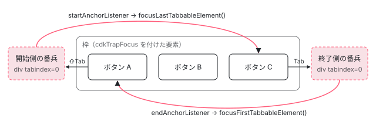

[目次](../README.md) › [CDK の内側](README.md) › 第 8 回 / 全 21 回

# FocusTrap：見えない番兵でフォーカスを閉じ込める

> FocusTrap が中身の前後に tabindex=0 の番兵要素を置き、番兵にフォーカスが来たら反対側の端に戻す行。InteractivityChecker が要素の可視性・無効・tabindex からフォーカスできるかを判定する行、cdkFocusInitial と cdkFocusRegionStart の探し方。クリックでの脱出まで止める ConfigurableFocusTrap（document の capture の focus で引き戻す inert 戦略）と、重なった罠の一番上だけを有効にする FocusTrapManager。

angular/components · 読了 約 13 分 · 中核 · [サイトで読む（デモが動きます）](https://angular-deep-dive-cyan.vercel.app/chapter/cdk-focus-trap)

---

ダイアログを開いている間、Tab キーを押し続けてもフォーカスはダイアログの外へ出ません。この章では、CDK の `FocusTrap` がそれを「中身の前後に置いた 2 つの見えない `div`（番兵）」で実現していること、番兵にフォーカスが来たときに反対側の端を探す `InteractivityChecker` の判定、`cdkFocusInitial` の探し方、そしてマウスのクリックまで止める `ConfigurableFocusTrap` を、行番号を追って読みます。

読む対象は components の `src/cdk/a11y/focus-trap/focus-trap.ts`・`configurable-focus-trap.ts`・`configurable-focus-trap-factory.ts`・`focus-trap-manager.ts`・`event-listener-inert-strategy.ts`、`src/cdk/a11y/interactivity-checker/interactivity-checker.ts` です。

1. [1. 概観](01-cdk-overview.md)
2. [2. Platform と向き](02-cdk-platform-bidi.md)
3. [3. Observer と画面幅](03-cdk-observers-layout.md)
4. [4. Portal](04-cdk-portal.md)
5. [5. Overlay](05-cdk.md)
6. [6. 位置の計算](06-cdk-overlay-position.md)
7. [7. スクロールと Esc](07-cdk-overlay-scroll-dispatch.md)
8. **8. FocusTrap**（この章）
9. [9. FocusMonitor](09-cdk-focus-monitor.md)
10. [10. ListKeyManager](10-cdk-key-manager.md)
11. [11. LiveAnnouncer](11-cdk-live-announcer.md)
12. [12. Dialog](12-cdk-dialog.md)
13. [13. Menu](13-cdk-menu.md)
14. [14. DataSource と選択](14-cdk-collections.md)
15. [15. 仮想スクロール](15-virtual-scroll.md)
16. [16. table](16-table.md)
17. [17. tree](17-cdk-tree.md)
18. [18. DragRef](18-drag-drop.md)
19. [19. DropListRef](19-cdk-drop-list.md)
20. [20. ハーネス](20-harness.md)
21. [21. Material のテーマ](21-theming.md)

> [!TIP]
> **新卒エンジニアへ**
>
> 「フォーカス」は、キーボードの入力を受け取る要素がいまどれか、という状態です（`document.activeElement` で読めます）。Tab キーはフォーカスを「Tab で止まれる要素（tabbable）」の順に次へ移し、Shift+Tab は前へ戻します。モーダルなダイアログでは、この移動がダイアログの外の、見えていない要素に行かないようにする必要があります。これを「フォーカストラップ」と呼びます。

## 0. 全体の形



*FocusTrap は対象の要素（枠）の直前と直後に tabindex=0 の div を 1 つずつ差し込む。Tab で終了側の番兵に来たら先頭の要素へ、Shift+Tab で開始側の番兵に来たら末尾の要素へ、フォーカスを移し直す。*

1. **番兵を作って差し込む**

   `attachAnchors` が `div` を 2 つ作り、枠の前と後ろに `insertBefore` する（1 節）。
2. **番兵は tabindex=0 で、見えない**

   `_createAnchor` が `tabindex="0"`・`cdk-visually-hidden`・`aria-hidden="true"` を付ける。Tab では止まるが画面と読み上げには出ない（2 節）。
3. **番兵がフォーカスを受けたら、反対の端へ**

   終了側の番兵の `focus` で `focusFirstTabbableElement`、開始側で `focusLastTabbableElement` を呼ぶ（3 節）。
4. **端の要素は DOM を再帰でたどって探す**

   `_getFirstTabbableElement` が子を前から（末尾なら後ろから）たどり、`InteractivityChecker` で「フォーカスでき、Tab で止まる」最初の要素を返す（4〜5 節）。
5. **ディレクティブと初期フォーカス**

   `CdkTrapFocus` が `ngAfterContentInit` で番兵を差し込み、`cdkTrapFocusAutoCapture` なら `cdkFocusInitial` の要素へ動かす（6 節）。
6. **マウスで外を押されたら**

   番兵は Tab しか止めない。`ConfigurableFocusTrap` は document の capture の `focus` で外に出たフォーカスを引き戻し、重なった罠は `FocusTrapManager` が一番上だけ有効にする（7 節）。

## 1. 番兵を作り、枠の前後に差し込む

📄 `components/src/cdk/a11y/focus-trap/focus-trap.ts` L60–85 （▶ の行: 64, 67–69, 79, 82–83）

```ts
60 │   /** Whether the focus trap is active. */
61 │   get enabled(): boolean {
62 │     return this._enabled;
63 │   }
64 ▶   set enabled(value: boolean) {
65 │     this._enabled = value;
66 │ 
67 ▶     if (this._startAnchor && this._endAnchor) {
68 ▶       this._toggleAnchorTabIndex(value, this._startAnchor);
69 ▶       this._toggleAnchorTabIndex(value, this._endAnchor);
70 │     }
71 │   }
72 │   protected _enabled: boolean = true;
73 │ 
74 │   constructor(
75 │     readonly _element: HTMLElement,
76 │     private _checker: InteractivityChecker,
77 │     readonly _ngZone: NgZone,
78 │     readonly _document: Document,
79 ▶     deferAnchors = false,
80 │     readonly _injector: Injector,
81 │   ) {
82 ▶     if (!deferAnchors) {
83 ▶       this.attachAnchors();
84 │     }
85 │   }
```

コンストラクタの 82〜83 行目、`deferAnchors` が `false` ならその場で `attachAnchors()` を呼びます。ディレクティブから作るときは `true` を渡し、あとで呼びます（6 節）。64〜69 行目の `enabled` のセッターは、番兵が既にあれば両方の `tabindex` を付け外しします。罠の「オン/オフ」は、番兵が Tab で止まるかどうか、それだけです。

📄 `components/src/cdk/a11y/focus-trap/focus-trap.ts` L112–137 （▶ の行: 114, 118, 120–121, 125–126, 130–133）

```ts
112 │   attachAnchors(): boolean {
113 │     // If we're not on the browser, there can be no focus to trap.
114 ▶     if (this._hasAttached) {
115 │       return true;
116 │     }
117 │ 
118 ▶     this._ngZone.runOutsideAngular(() => {
119 │       if (!this._startAnchor) {
120 ▶         this._startAnchor = this._createAnchor();
121 ▶         this._startAnchor!.addEventListener('focus', this.startAnchorListener);
122 │       }
123 │ 
124 │       if (!this._endAnchor) {
125 ▶         this._endAnchor = this._createAnchor();
126 ▶         this._endAnchor!.addEventListener('focus', this.endAnchorListener);
127 │       }
128 │     });
129 │ 
130 ▶     if (this._element.parentNode) {
131 ▶       this._element.parentNode.insertBefore(this._startAnchor!, this._element);
132 ▶       this._element.parentNode.insertBefore(this._endAnchor!, this._element.nextSibling);
133 ▶       this._hasAttached = true;
134 │     }
135 │ 
136 │     return this._hasAttached;
137 │   }
```

1. **114 行目：一度だけ**

   `_hasAttached` が立っていれば何もしません。
2. **118〜128 行目：番兵を作ってリスナーを付ける**

   `runOutsideAngular` の中で `_createAnchor()` を 2 回呼び、開始側に `startAnchorListener`、終了側に `endAnchorListener` を `focus` イベントで付けます。zone.js がある構成でも、番兵の `focus` で変更検知が走らないようにするためです。
3. **130〜133 行目：親の中で、枠の前と後ろに入れる**

   131 行目は枠の直前に開始側、132 行目は `nextSibling` の前（＝枠の直後）に終了側を入れます。親がまだ無い（DOM に入っていない）ときは入れずに `false` を返します。

> [!NOTE]
> **ポイント**
>
> 番兵は枠の**中**ではなく**外側の兄弟**です。番兵は `tabindex="0"` で大きさもあるので、もし枠の中にあれば、枠の中から端を探す `_getFirstTabbableElement`（4 節）が番兵自身を「最初の tabbable」として返してしまいます。外側にあるので、枠の中を探す処理は番兵を見ません。

## 2. 番兵の正体：tabindex=0 の見えない div

📄 `components/src/cdk/a11y/focus-trap/focus-trap.ts` L340–359 （▶ の行: 342–346, 356–358）

```ts
340 │   /** Creates an anchor element. */
341 │   private _createAnchor(): HTMLElement {
342 ▶     const anchor = this._document.createElement('div');
343 ▶     this._toggleAnchorTabIndex(this._enabled, anchor);
344 ▶     anchor.classList.add('cdk-visually-hidden');
345 ▶     anchor.classList.add('cdk-focus-trap-anchor');
346 ▶     anchor.setAttribute('aria-hidden', 'true');
347 │     return anchor;
348 │   }
349 │ 
350 │   /**
351 │    * Toggles the `tabindex` of an anchor, based on the enabled state of the focus trap.
352 │    * @param isEnabled Whether the focus trap is enabled.
353 │    * @param anchor Anchor on which to toggle the tabindex.
354 │    */
355 │   private _toggleAnchorTabIndex(isEnabled: boolean, anchor: HTMLElement) {
356 ▶     // Remove the tabindex completely, rather than setting it to -1, because if the
357 ▶     // element has a tabindex, the user might still hit it when navigating with the arrow keys.
358 ▶     isEnabled ? anchor.setAttribute('tabindex', '0') : anchor.removeAttribute('tabindex');
359 │   }
```

342 行目でただの `div` を作り、343 行目で `tabindex` を決めます。358 行目、有効なら `tabindex="0"`（Tab の順番に DOM の順で入る）、無効なら属性ごと消します。356〜357 行目のコメントのとおり、`-1` にしないのは、`-1` でも要素はフォーカスを受けられる（矢印キーで読み進める支援技術から届きうる）からです。属性を消した `div` はフォーカスを受けません。

344 行目の `cdk-visually-hidden` は「1px に縮めて切り抜く」クラスで、要素は画面から消えますが、レイアウト上の大きさは残ります。`display: none` にしないのは、`display: none` の要素はブラウザがフォーカスを与えないからです。346 行目の `aria-hidden="true"` で、スクリーンリーダーの読み上げからも外します。このクラスの CSS は `FocusTrapFactory` のコンストラクタが `_CdkPrivateStyleLoader` で読み込みます。

## 3. 番兵にフォーカスが来たら、反対側の端へ

📄 `components/src/cdk/a11y/focus-trap/focus-trap.ts` L31–58 （▶ の行: 34–36, 44–45, 47–48, 52–53, 55–56）

```ts
31 │ /**
32 │  * Class that allows for trapping focus within a DOM element.
33 │  *
34 ▶  * This class currently uses a relatively simple approach to focus trapping.
35 ▶  * It assumes that the tab order is the same as DOM order, which is not necessarily true.
36 ▶  * Things like `tabIndex > 0`, flex `order`, and shadow roots can cause the two to be misaligned.
37 │  */
38 │ export class FocusTrap {
39 │   private _startAnchor: HTMLElement | null = null;
40 │   private _endAnchor: HTMLElement | null = null;
41 │   private _hasAttached = false;
42 │ 
43 │   // Event listeners for the anchors. Need to be regular functions so that we can unbind them later.
44 ▶   protected startAnchorListener = () => {
45 ▶     const isSuccess = this.focusLastTabbableElement();
46 │ 
47 ▶     if (!isSuccess && this._checker.isFocusable(this._element)) {
48 ▶       this._element.focus();
49 │     }
50 │   };
51 │ 
52 ▶   protected endAnchorListener = () => {
53 ▶     const isSuccess = this.focusFirstTabbableElement();
54 │ 
55 ▶     if (!isSuccess && this._checker.isFocusable(this._element)) {
56 ▶       this._element.focus();
57 │     }
58 │   };
```

枠の最後のボタンで Tab を押すと、ブラウザは DOM の順で次の tabbable、つまり**終了側の番兵**にフォーカスを移します。その `focus` で 52 行目の `endAnchorListener` が走り、53 行目で `focusFirstTabbableElement()`、つまり枠の先頭へ移し直します。Shift+Tab で開始側の番兵に来たときは、44〜45 行目で末尾へ移します。枠の中に tabbable が 1 つも無ければ（戻り値が `false`）、47〜48 行目と 55〜56 行目で枠そのものにフォーカスを置きます（枠がフォーカスできるときだけ）。

📄 `components/src/cdk/a11y/focus-trap/focus-trap.ts` L260–286 （▶ の行: 265, 268, 271, 279, 282）

```ts
260 │   /**
261 │    * Focuses the first tabbable element within the focus trap region.
262 │    * @returns Whether focus was moved successfully.
263 │    */
264 │   focusFirstTabbableElement(options?: FocusOptions): boolean {
265 ▶     const redirectToElement = this._getRegionBoundary('start');
266 │ 
267 │     if (redirectToElement) {
268 ▶       redirectToElement.focus(options);
269 │     }
270 │ 
271 ▶     return !!redirectToElement;
272 │   }
273 │ 
274 │   /**
275 │    * Focuses the last tabbable element within the focus trap region.
276 │    * @returns Whether focus was moved successfully.
277 │    */
278 │   focusLastTabbableElement(options?: FocusOptions): boolean {
279 ▶     const redirectToElement = this._getRegionBoundary('end');
280 │ 
281 │     if (redirectToElement) {
282 ▶       redirectToElement.focus(options);
283 │     }
284 │ 
285 │     return !!redirectToElement;
286 │   }
```

どちらも 265 行目・279 行目の `_getRegionBoundary` で行き先を決め、見つかれば `focus()` します。

📄 `components/src/cdk/a11y/focus-trap/focus-trap.ts` L179–212 （▶ の行: 181–182, 206–207, 209–211）

```ts
179 │   private _getRegionBoundary(bound: 'start' | 'end'): HTMLElement | null {
180 │     // Contains the deprecated version of selector, for temporary backwards comparability.
181 ▶     const markers = this._element.querySelectorAll(
182 ▶       `[cdk-focus-region-${bound}], [cdkFocusRegion${bound}], [cdk-focus-${bound}]`,
183 │     ) as NodeListOf<HTMLElement>;
184 │ 
185 │     if (typeof ngDevMode === 'undefined' || ngDevMode) {
186 │       for (let i = 0; i < markers.length; i++) {
187 │         // @breaking-change 8.0.0
188 │         if (markers[i].hasAttribute(`cdk-focus-${bound}`)) {
189 │           console.warn(
190 │             `Found use of deprecated attribute 'cdk-focus-${bound}', ` +
191 │               `use 'cdkFocusRegion${bound}' instead. The deprecated ` +
192 │               `attribute will be removed in 8.0.0.`,
193 │             markers[i],
194 │           );
195 │         } else if (markers[i].hasAttribute(`cdk-focus-region-${bound}`)) {
196 │           console.warn(
197 │             `Found use of deprecated attribute 'cdk-focus-region-${bound}', ` +
198 │               `use 'cdkFocusRegion${bound}' instead. The deprecated attribute ` +
199 │               `will be removed in 8.0.0.`,
200 │             markers[i],
201 │           );
202 │         }
203 │       }
204 │     }
205 │ 
206 ▶     if (bound == 'start') {
207 ▶       return markers.length ? markers[0] : this._getFirstTabbableElement(this._element);
208 │     }
209 ▶     return markers.length
210 ▶       ? markers[markers.length - 1]
211 ▶       : this._getLastTabbableElement(this._element);
212 │   }
```

181〜182 行目、枠の中に `cdkFocusRegionStart` / `cdkFocusRegionEnd` 属性の要素があれば、それを端とみなします（185〜204 行目は古い綴りへの警告だけ）。207 行目、開始側は印の**最初**の要素、210 行目、終了側は印の**最後**の要素。印が無ければ `_getFirstTabbableElement` / `_getLastTabbableElement` で探します。属性名は `querySelectorAll` の文字列なので、テンプレートに `cdkFocusRegionStart` と書いた属性が、そのまま（HTML は大文字小文字を区別しないので）一致します。

## 4. 端の要素を DOM の再帰で探す

📄 `components/src/cdk/a11y/focus-trap/focus-trap.ts` L295–315 （▶ の行: 297–298, 301, 303, 305–306, 309–310）

```ts
295 │   /** Get the first tabbable element from a DOM subtree (inclusive). */
296 │   private _getFirstTabbableElement(root: HTMLElement): HTMLElement | null {
297 ▶     if (this._checker.isFocusable(root) && this._checker.isTabbable(root)) {
298 ▶       return root;
299 │     }
300 │ 
301 ▶     const children = root.children;
302 │ 
303 ▶     for (let i = 0; i < children.length; i++) {
304 │       const tabbableChild =
305 ▶         children[i].nodeType === this._document.ELEMENT_NODE
306 ▶           ? this._getFirstTabbableElement(children[i] as HTMLElement)
307 │           : null;
308 │ 
309 ▶       if (tabbableChild) {
310 ▶         return tabbableChild;
311 │       }
312 │     }
313 │ 
314 │     return null;
315 │   }
```

297 行目、いま見ている要素自体が「フォーカスでき（`isFocusable`）、かつ Tab で止まる（`isTabbable`）」ならそれを返します。そうでなければ 303 行目で子を前から順に、306 行目で**再帰**して調べ、最初に見つかったものを返します（深さ優先・前から）。すぐ後ろの `_getLastTabbableElement` は同じ形で、子を後ろから（`i--`）たどります。

3 節の最初の引用、クラスの先頭のコメント（34〜36 行目）にあるとおり、この探し方は「Tab の順＝DOM の順」を前提にしています。`tabindex` が 1 以上の要素や、CSS の `order` で並びを変えた要素があると、ブラウザの Tab の順とずれます。

## 5. InteractivityChecker：フォーカスできるか、Tab で止まるか

📄 `components/src/cdk/a11y/interactivity-checker/interactivity-checker.ts` L128–153 （▶ の行: 134, 144, 148–150）

```ts
128 │       // Otherwise (when no explicit tabindex is set), a video is only tabbable if it
129 │       // has controls enabled. Firefox is special as videos are always tabbable regardless
130 │       // of whether there are controls or not.
131 │       return this._platform.FIREFOX || element.hasAttribute('controls');
132 │     }
133 │ 
134 ▶     return element.tabIndex >= 0;
135 │   }
136 │ 
137 │   /**
138 │    * Gets whether an element can be focused by the user.
139 │    *
140 │    * @param element Element to be checked.
141 │    * @param config The config object with options to customize this method's behavior
142 │    * @returns Whether the element is focusable.
143 │    */
144 ▶   isFocusable(element: HTMLElement, config?: IsFocusableConfig): boolean {
145 │     // Perform checks in order of left to most expensive.
146 │     // Again, naive approach that does not capture many edge cases and browser quirks.
147 │     return (
148 ▶       isPotentiallyFocusable(element) &&
149 ▶       !this.isDisabled(element) &&
150 ▶       (config?.ignoreVisibility || this.isVisible(element))
151 │     );
152 │   }
153 │ }
```

`isFocusable` は 148〜150 行目の 3 つの AND です。安い判定から順に並んでいます（145 行目のコメント）。

📄 `components/src/cdk/a11y/interactivity-checker/interactivity-checker.ts` L248–264 （▶ の行: 254, 259–262）

```ts
248 │ /**
249 │  * Gets whether an element is potentially focusable without taking current visible/disabled state
250 │  * into account.
251 │  */
252 │ function isPotentiallyFocusable(element: HTMLElement): boolean {
253 │   // Inputs are potentially focusable *unless* they're type="hidden".
254 ▶   if (isHiddenInput(element)) {
255 │     return false;
256 │   }
257 │ 
258 │   return (
259 ▶     isNativeFormElement(element) ||
260 ▶     isAnchorWithHref(element) ||
261 ▶     element.hasAttribute('contenteditable') ||
262 ▶     hasValidTabIndex(element)
263 │   );
264 │ }
```

1. **① 要素の種類（252〜264 行目）**

   `input`（`type="hidden"` を除く）・`select`・`button`・`textarea`、`href` のある `a`、`contenteditable`、数字の `tabindex` 属性を持つ要素。`div` は `tabindex` が無ければここで落ちます。
2. **② 無効でない（次の引用の 43 行目）**

   `disabled` 属性が無いこと。
3. **③ 見えている（55 行目）**

   大きさがあり、`visibility` が `visible`。

📄 `components/src/cdk/a11y/interactivity-checker/interactivity-checker.ts` L34–56 （▶ の行: 43, 55）

```ts
34 │   /**
35 │    * Gets whether an element is disabled.
36 │    *
37 │    * @param element Element to be checked.
38 │    * @returns Whether the element is disabled.
39 │    */
40 │   isDisabled(element: HTMLElement): boolean {
41 │     // This does not capture some cases, such as a non-form control with a disabled attribute or
42 │     // a form control inside of a disabled form, but should capture the most common cases.
43 ▶     return element.hasAttribute('disabled');
44 │   }
45 │ 
46 │   /**
47 │    * Gets whether an element is visible for the purposes of interactivity.
48 │    *
49 │    * This will capture states like `display: none` and `visibility: hidden`, but not things like
50 │    * being clipped by an `overflow: hidden` parent or being outside the viewport.
51 │    *
52 │    * @returns Whether the element is visible.
53 │    */
54 │   isVisible(element: HTMLElement): boolean {
55 ▶     return hasGeometry(element) && getComputedStyle(element).visibility === 'visible';
56 │   }
```

📄 `components/src/cdk/a11y/interactivity-checker/interactivity-checker.ts` L168–177 （▶ の行: 173–175）

```ts
168 │ /** Checks whether the specified element has any geometry / rectangles. */
169 │ function hasGeometry(element: HTMLElement): boolean {
170 │   // Use logic from jQuery to check for an invisible element.
171 │   // See https://github.com/jquery/jquery/blob/master/src/css/hiddenVisibleSelectors.js#L12
172 │   return !!(
173 ▶     element.offsetWidth ||
174 ▶     element.offsetHeight ||
175 ▶     (typeof element.getClientRects === 'function' && element.getClientRects().length)
176 │   );
177 │ }
```

173〜175 行目、`offsetWidth`・`offsetHeight`・`getClientRects()` のどれかが 0 でなければ「大きさがある」。`display: none` の要素（とその子孫）はこの 3 つがすべて 0 になるので、ここで外れます。`visibility: hidden` は大きさが残るので、55 行目の `getComputedStyle` のほうで外れます。49〜50 行目のコメントのとおり、親の `overflow: hidden` で切れて見えない要素や、画面の外の要素は「見えている」と判定されます。

📄 `components/src/cdk/a11y/interactivity-checker/interactivity-checker.ts` L65–103 （▶ の行: 67, 71, 75, 80, 88–89, 92, 96, 100）

```ts
 65 │   isTabbable(element: HTMLElement): boolean {
 66 │     // Nothing is tabbable on the server 😎
 67 ▶     if (!this._platform.isBrowser) {
 68 │       return false;
 69 │     }
 70 │ 
 71 ▶     const frameElement = getFrameElement(getWindow(element));
 72 │ 
 73 │     if (frameElement) {
 74 │       // Frame elements inherit their tabindex onto all child elements.
 75 ▶       if (getTabIndexValue(frameElement) === -1) {
 76 │         return false;
 77 │       }
 78 │ 
 79 │       // Browsers disable tabbing to an element inside of an invisible frame.
 80 ▶       if (!this.isVisible(frameElement)) {
 81 │         return false;
 82 │       }
 83 │     }
 84 │ 
 85 │     let nodeName = element.nodeName.toLowerCase();
 86 │     let tabIndexValue = getTabIndexValue(element);
 87 │ 
 88 ▶     if (element.hasAttribute('contenteditable')) {
 89 ▶       return tabIndexValue !== -1;
 90 │     }
 91 │ 
 92 ▶     if (nodeName === 'iframe' || nodeName === 'object') {
 93 │       // The frame or object's content may be tabbable depending on the content, but it's
 94 │       // not possibly to reliably detect the content of the frames. We always consider such
 95 │       // elements as non-tabbable.
 96 ▶       return false;
 97 │     }
 98 │ 
 99 │     // In iOS, the browser only considers some specific elements as tabbable.
100 ▶     if (this._platform.WEBKIT && this._platform.IOS && !isPotentiallyTabbableIOS(element)) {
101 │       return false;
102 │     }
103 │ 
```

`isTabbable` は「フォーカスできる要素のうち、Tab で止まるか」です。67 行目、サーバーでは常に `false`。71〜83 行目、iframe の中の要素なら、iframe 自体が `tabindex="-1"` か見えていなければ `false`。88〜89 行目、`contenteditable` は `tabindex` が `-1` でなければ止まる。92〜96 行目、`iframe` と `object` は中身が分からないので常に止まらない扱い。100 行目、iOS の Safari は文字入力の要素にしか Tab で止まらないので、それ以外を外します。`audio` / `video` の特別扱い（引用は省略）を過ぎると、最後は 134 行目（上の引用）の `element.tabIndex >= 0`、ブラウザが計算した `tabIndex` で決まります。

> **🧪 DEMO — 本物の cdkTrapFocus**
>
> 枠の中のボタンを 1 つクリックしてから Tab / Shift+Tab を押してください。罠がオンの間は Tab で枠の外に出られません（ボタン C か、枠の外をマウスでクリックすれば出られます）。記録は外側の枠に張った capture の `focus` リスナーで取っているので、番兵の `focus` リスナーより先に「番兵に来た」ことが残ります。
>
> （ブラウザで読み込むと、ここに cdkTrapFocus の枠が出ます）
>
> フォーカスを受けた順（新しいものが下、最大 8 件）
>
> 枠の前後にある番兵の DOM（罠を切り替えると tabindex が付け外しされる）
>
> ▶ [このデモはサイトで動かせます](https://angular-deep-dive-cyan.vercel.app/chapter/cdk-focus-trap)

ボタン C で Tab を押すと、記録に「終了側の番兵」が出た直後に「ボタン A」が来ます。3 節の 53 行目が走った跡です。罠をオフにすると、番兵の DOM から `tabindex` が消えます（2 節の 358 行目）。この状態では番兵に Tab が止まらないので、記録にも出ず、そのまま枠の外へ出ていきます。

## 6. CdkTrapFocus：テンプレートから使う形

📄 `components/src/cdk/a11y/focus-trap/focus-trap.ts` L412–451 （▶ の行: 414, 428, 433–434, 442, 448–449）

```ts
412 │ /** Directive for trapping focus within a region. */
413 │ @Directive({
414 ▶   selector: '[cdkTrapFocus]',
415 │   exportAs: 'cdkTrapFocus',
416 │ })
417 │ export class CdkTrapFocus implements OnDestroy, AfterContentInit, OnChanges, DoCheck {
418 │   private _elementRef = inject<ElementRef<HTMLElement>>(ElementRef);
419 │   private _focusTrapFactory = inject(FocusTrapFactory);
420 │ 
421 │   /** Underlying FocusTrap instance. */
422 │   focusTrap: FocusTrap = undefined!;
423 │ 
424 │   /** Previously focused element to restore focus to upon destroy when using autoCapture. */
425 │   private _previouslyFocusedElement: HTMLElement | null = null;
426 │ 
427 │   /** Whether the focus trap is active. */
428 ▶   @Input({alias: 'cdkTrapFocus', transform: booleanAttribute})
429 │   get enabled(): boolean {
430 │     return this.focusTrap?.enabled || false;
431 │   }
432 │   set enabled(value: boolean) {
433 ▶     if (this.focusTrap) {
434 ▶       this.focusTrap.enabled = value;
435 │     }
436 │   }
437 │ 
438 │   /**
439 │    * Whether the directive should automatically move focus into the trapped region upon
440 │    * initialization and return focus to the previous activeElement upon destruction.
441 │    */
442 ▶   @Input({alias: 'cdkTrapFocusAutoCapture', transform: booleanAttribute})
443 │   autoCapture: boolean = false;
444 │ 
445 │   constructor() {
446 │     const platform = inject(Platform);
447 │ 
448 ▶     if (platform.isBrowser) {
449 ▶       this.focusTrap = this._focusTrapFactory.create(this._elementRef.nativeElement, true);
450 │     }
451 │   }
```

448〜449 行目、ブラウザのときだけ `FocusTrapFactory.create(要素, true)` で `FocusTrap` を作ります。第 2 引数の `true` が 1 節の `deferAnchors` で、この時点では番兵を入れません。`@if` の中の要素のように、ビューが DOM に入る前にディレクティブが作られることがあり、そのときは 1 節の 130 行目の `parentNode` がまだ無いからです（上の DEMO の枠もまさに `@if` の中です）。428〜436 行目、`[cdkTrapFocus]` に渡した値は `booleanAttribute` で真偽値にされ、`focusTrap.enabled`（1 節の 64 行目）へそのまま流れます。

📄 `components/src/cdk/a11y/focus-trap/focus-trap.ts` L453–476 （▶ の行: 454, 458–459, 465, 467–468, 473–474）

```ts
453 │   ngOnDestroy() {
454 ▶     this.focusTrap?.destroy();
455 │ 
456 │     // If we stored a previously focused element when using autoCapture, return focus to that
457 │     // element now that the trapped region is being destroyed.
458 ▶     if (this._previouslyFocusedElement) {
459 ▶       this._previouslyFocusedElement.focus();
460 │       this._previouslyFocusedElement = null;
461 │     }
462 │   }
463 │ 
464 │   ngAfterContentInit() {
465 ▶     this.focusTrap?.attachAnchors();
466 │ 
467 ▶     if (this.autoCapture) {
468 ▶       this._captureFocus();
469 │     }
470 │   }
471 │ 
472 │   ngDoCheck() {
473 ▶     if (this.focusTrap && !this.focusTrap.hasAttached()) {
474 ▶       this.focusTrap.attachAnchors();
475 │     }
476 │   }
```

465 行目、`ngAfterContentInit` で番兵を差し込みます。親がまだ無くて失敗したときのために、473〜474 行目で `ngDoCheck` のたびに「まだなら入れる」をやり直します。454 行目、破棄のときは番兵を外し（下の `destroy`）、458〜459 行目で、自動で取り込む前にフォーカスがあった要素へ戻します。

📄 `components/src/cdk/a11y/focus-trap/focus-trap.ts` L87–104 （▶ の行: 93–94, 98–99, 102–103）

```ts
 87 │   /** Destroys the focus trap by cleaning up the anchors. */
 88 │   destroy() {
 89 │     const startAnchor = this._startAnchor;
 90 │     const endAnchor = this._endAnchor;
 91 │ 
 92 │     if (startAnchor) {
 93 ▶       startAnchor.removeEventListener('focus', this.startAnchorListener);
 94 ▶       startAnchor.remove();
 95 │     }
 96 │ 
 97 │     if (endAnchor) {
 98 ▶       endAnchor.removeEventListener('focus', this.endAnchorListener);
 99 ▶       endAnchor.remove();
100 │     }
101 │ 
102 ▶     this._startAnchor = this._endAnchor = null;
103 ▶     this._hasAttached = false;
104 │   }
```

93〜94 行目・98〜99 行目でリスナーを外してから番兵を `remove()` し、102〜103 行目で参照と `_hasAttached` を戻します。

📄 `components/src/cdk/a11y/focus-trap/focus-trap.ts` L478–494 （▶ の行: 492–493）

```ts
478 │   ngOnChanges(changes: SimpleChanges<this>) {
479 │     const autoCaptureChange = changes['autoCapture'];
480 │ 
481 │     if (
482 │       autoCaptureChange &&
483 │       !autoCaptureChange.firstChange &&
484 │       this.autoCapture &&
485 │       this.focusTrap?.hasAttached()
486 │     ) {
487 │       this._captureFocus();
488 │     }
489 │   }
490 │ 
491 │   private _captureFocus() {
492 ▶     this._previouslyFocusedElement = _getFocusedElementPierceShadowDom();
493 ▶     this.focusTrap?.focusInitialElementWhenReady();
494 │   }
```

`cdkTrapFocusAutoCapture` が真なら 492 行目でいまのフォーカス（Shadow DOM の中まで降りた要素）を覚え、493 行目で `focusInitialElementWhenReady()` を呼びます。

📄 `components/src/cdk/a11y/focus-trap/focus-trap.ts` L139–148 （▶ の行: 146）

```ts
139 │   /**
140 │    * Waits for the zone to stabilize, then focuses the first tabbable element.
141 │    * @returns Returns a promise that resolves with a boolean, depending
142 │    * on whether focus was moved successfully.
143 │    */
144 │   focusInitialElementWhenReady(options?: FocusOptions): Promise<boolean> {
145 │     return new Promise<boolean>(resolve => {
146 ▶       this._executeOnStable(() => resolve(this.focusInitialElement(options)));
147 │     });
148 │   }
```

📄 `components/src/cdk/a11y/focus-trap/focus-trap.ts` L372–375 （▶ の行: 374）

```ts
372 │   /** Executes a function when the zone is stable. */
373 │   private _executeOnStable(fn: () => any): void {
374 ▶     afterNextRender(fn, {injector: this._injector});
375 │   }
```

コメントは「zone が安定するまで待つ」のままですが、v22 の実体は 374 行目の `afterNextRender` です。次の描画が終わってから 146 行目で `focusInitialElement` を呼ぶので、枠の中身がまだ描かれていない瞬間に探してしまうことがありません（`afterNextRender` の仕組みは[描画後フックの章](../cd/08-cd-after-render.md)）。

📄 `components/src/cdk/a11y/focus-trap/focus-trap.ts` L218–257 （▶ の行: 220–221, 247–249, 253, 257）

```ts
218 │   focusInitialElement(options?: FocusOptions): boolean {
219 │     // Contains the deprecated version of selector, for temporary backwards comparability.
220 ▶     const redirectToElement = this._element.querySelector(
221 ▶       `[cdk-focus-initial], ` + `[cdkFocusInitial]`,
222 │     ) as HTMLElement;
223 │ 
224 │     if (redirectToElement) {
225 │       // @breaking-change 8.0.0
226 │       if (
227 │         (typeof ngDevMode === 'undefined' || ngDevMode) &&
228 │         redirectToElement.hasAttribute(`cdk-focus-initial`)
229 │       ) {
230 │         console.warn(
231 │           `Found use of deprecated attribute 'cdk-focus-initial', ` +
232 │             `use 'cdkFocusInitial' instead. The deprecated attribute ` +
233 │             `will be removed in 8.0.0`,
234 │           redirectToElement,
235 │         );
236 │       }
237 │ 
238 │       // Warn the consumer if the element they've pointed to
239 │       // isn't focusable, when not in production mode.
240 │       if (
241 │         (typeof ngDevMode === 'undefined' || ngDevMode) &&
242 │         !this._checker.isFocusable(redirectToElement)
243 │       ) {
244 │         console.warn(`Element matching '[cdkFocusInitial]' is not focusable.`, redirectToElement);
245 │       }
246 │ 
247 ▶       if (!this._checker.isFocusable(redirectToElement)) {
248 ▶         const focusableChild = this._getFirstTabbableElement(redirectToElement) as HTMLElement;
249 ▶         focusableChild?.focus(options);
250 │         return !!focusableChild;
251 │       }
252 │ 
253 ▶       redirectToElement.focus(options);
254 │       return true;
255 │     }
256 │ 
257 ▶     return this.focusFirstTabbableElement(options);
```

1. **220〜221 行目：`cdkFocusInitial` を探す**

   枠の中で最初に見つかった `[cdkFocusInitial]` の要素が行き先です。
2. **247〜250 行目：その要素がフォーカスできなければ、中を探す**

   印を付けた要素の子孫から `_getFirstTabbableElement`（4 節）で最初の tabbable を探して `focus`。
3. **253 行目：フォーカスできればそれへ**

   そのまま `focus(options)`。
4. **257 行目：印が無ければ先頭へ**

   3 節の `focusFirstTabbableElement`（`cdkFocusRegionStart` か最初の tabbable）。

## 7. ConfigurableFocusTrap：Tab 以外の抜け道もふさぐ

番兵が止めるのは、ブラウザが Tab で番兵にフォーカスを移したときだけです。枠の外の要素をマウスでクリックすると、フォーカスは番兵を通らずにそのまま外へ出ます。これもふさぐのが `ConfigurableFocusTrapFactory` で作る `ConfigurableFocusTrap` です。

📄 `components/src/cdk/a11y/focus-trap/configurable-focus-trap-factory.ts` L17–34 （▶ の行: 22, 30, 33）

```ts
17 │ /** Factory that allows easy instantiation of configurable focus traps. */
18 │ @Service()
19 │ export class ConfigurableFocusTrapFactory {
20 │   private _checker = inject(InteractivityChecker);
21 │   private _ngZone = inject(NgZone);
22 ▶   private _focusTrapManager = inject(FocusTrapManager);
23 │ 
24 │   private _document = inject(DOCUMENT);
25 │   private _inertStrategy: FocusTrapInertStrategy;
26 │ 
27 │   private readonly _injector = inject(Injector);
28 │ 
29 │   constructor() {
30 ▶     const inertStrategy = inject(FOCUS_TRAP_INERT_STRATEGY, {optional: true});
31 │ 
32 │     // TODO split up the strategies into different modules, similar to DateAdapter.
33 ▶     this._inertStrategy = inertStrategy || new EventListenerFocusTrapInertStrategy();
34 │   }
```

30 行目、`FOCUS_TRAP_INERT_STRATEGY` トークンで「外へのフォーカスを止める戦略」を差し替えられます。無ければ 33 行目で `EventListenerFocusTrapInertStrategy` を使います。

📄 `components/src/cdk/a11y/focus-trap/configurable-focus-trap.ts` L22–48 （▶ の行: 27, 30, 32, 46–47）

```ts
22 │ export class ConfigurableFocusTrap extends FocusTrap implements ManagedFocusTrap {
23 │   /** Whether the FocusTrap is enabled. */
24 │   override get enabled(): boolean {
25 │     return this._enabled;
26 │   }
27 ▶   override set enabled(value: boolean) {
28 │     this._enabled = value;
29 │     if (this._enabled) {
30 ▶       this._focusTrapManager.register(this);
31 │     } else {
32 ▶       this._focusTrapManager.deregister(this);
33 │     }
34 │   }
35 │ 
36 │   constructor(
37 │     _element: HTMLElement,
38 │     _checker: InteractivityChecker,
39 │     _ngZone: NgZone,
40 │     _document: Document,
41 │     private _focusTrapManager: FocusTrapManager,
42 │     private _inertStrategy: FocusTrapInertStrategy,
43 │     config: ConfigurableFocusTrapConfig,
44 │     injector: Injector,
45 │   ) {
46 ▶     super(_element, _checker, _ngZone, _document, config.defer, injector);
47 ▶     this._focusTrapManager.register(this);
48 │   }
```

📄 `components/src/cdk/a11y/focus-trap/configurable-focus-trap.ts` L50–66 （▶ の行: 52, 58–59, 64–65）

```ts
50 │   /** Notifies the FocusTrapManager that this FocusTrap will be destroyed. */
51 │   override destroy() {
52 ▶     this._focusTrapManager.deregister(this);
53 │     super.destroy();
54 │   }
55 │ 
56 │   /** @docs-private Implemented as part of ManagedFocusTrap. */
57 │   _enable() {
58 ▶     this._inertStrategy.preventFocus(this);
59 ▶     this.toggleAnchors(true);
60 │   }
61 │ 
62 │   /** @docs-private Implemented as part of ManagedFocusTrap. */
63 │   _disable() {
64 ▶     this._inertStrategy.allowFocus(this);
65 ▶     this.toggleAnchors(false);
66 │   }
```

47 行目、作った時点で `FocusTrapManager` に登録します。27〜33 行目、`enabled` のセッターは基底クラスと違い、番兵を直接いじらずに登録・解除をします。実際に番兵の `tabindex` を付けるのは 58〜59 行目の `_enable`、外すのは 64〜65 行目の `_disable` で、どちらも inert 戦略と組で呼ばれます。

📄 `components/src/cdk/a11y/focus-trap/focus-trap-manager.ts` L23–62 （▶ の行: 26, 34, 38–39, 42–43, 51, 56–59）

```ts
23 │ export class FocusTrapManager {
24 │   // A stack of the FocusTraps on the page. Only the FocusTrap at the
25 │   // top of the stack is active.
26 ▶   private _focusTrapStack: ManagedFocusTrap[] = [];
27 │ 
28 │   /**
29 │    * Disables the FocusTrap at the top of the stack, and then pushes
30 │    * the new FocusTrap onto the stack.
31 │    */
32 │   register(focusTrap: ManagedFocusTrap): void {
33 │     // Dedupe focusTraps that register multiple times.
34 ▶     this._focusTrapStack = this._focusTrapStack.filter(ft => ft !== focusTrap);
35 │ 
36 │     let stack = this._focusTrapStack;
37 │ 
38 ▶     if (stack.length) {
39 ▶       stack[stack.length - 1]._disable();
40 │     }
41 │ 
42 ▶     stack.push(focusTrap);
43 ▶     focusTrap._enable();
44 │   }
45 │ 
46 │   /**
47 │    * Removes the FocusTrap from the stack, and activates the
48 │    * FocusTrap that is the new top of the stack.
49 │    */
50 │   deregister(focusTrap: ManagedFocusTrap): void {
51 ▶     focusTrap._disable();
52 │ 
53 │     const stack = this._focusTrapStack;
54 │ 
55 │     const i = stack.indexOf(focusTrap);
56 ▶     if (i !== -1) {
57 ▶       stack.splice(i, 1);
58 ▶       if (stack.length) {
59 ▶         stack[stack.length - 1]._enable();
60 │       }
61 │     }
62 │   }
```

ダイアログの上にダイアログを開くと、罠が 2 つ重なります。`FocusTrapManager` は 26 行目のスタックで「一番上だけ有効」を保ちます。登録では 39 行目でいまの一番上を `_disable` し、42〜43 行目で新しい罠を積んで `_enable`。解除では 51 行目で自分を無効にし、56〜59 行目で自分を抜いて、下にあった罠を `_enable` し直します。

📄 `components/src/cdk/a11y/focus-trap/event-listener-inert-strategy.ts` L16–40 （▶ の行: 23–24, 27, 29, 38）

```ts
16 │ export class EventListenerFocusTrapInertStrategy implements FocusTrapInertStrategy {
17 │   /** Focus event handler. */
18 │   private _listener: ((e: FocusEvent) => void) | null = null;
19 │ 
20 │   /** Adds a document event listener that keeps focus inside the FocusTrap. */
21 │   preventFocus(focusTrap: ConfigurableFocusTrap): void {
22 │     // Ensure there's only one listener per document
23 ▶     if (this._listener) {
24 ▶       focusTrap._document.removeEventListener('focus', this._listener!, true);
25 │     }
26 │ 
27 ▶     this._listener = (e: FocusEvent) => this._trapFocus(focusTrap, e);
28 │     focusTrap._ngZone.runOutsideAngular(() => {
29 ▶       focusTrap._document.addEventListener('focus', this._listener!, true);
30 │     });
31 │   }
32 │ 
33 │   /** Removes the event listener added in preventFocus. */
34 │   allowFocus(focusTrap: ConfigurableFocusTrap): void {
35 │     if (!this._listener) {
36 │       return;
37 │     }
38 ▶     focusTrap._document.removeEventListener('focus', this._listener!, true);
39 │     this._listener = null;
40 │   }
```

📄 `components/src/cdk/a11y/focus-trap/event-listener-inert-strategy.ts` L49–66 （▶ の行: 55, 59, 61–62）

```ts
49 │   private _trapFocus(focusTrap: ConfigurableFocusTrap, event: FocusEvent) {
50 │     const target = event.target as HTMLElement;
51 │     const focusTrapRoot = focusTrap._element;
52 │ 
53 │     // Don't refocus if target was in an overlay, because the overlay might be associated
54 │     // with an element inside the FocusTrap, ex. mat-select.
55 ▶     if (target && !focusTrapRoot.contains(target) && !target.closest?.('div.cdk-overlay-pane')) {
56 │       // Some legacy FocusTrap usages have logic that focuses some element on the page
57 │       // just before FocusTrap is destroyed. For backwards compatibility, wait
58 │       // to be sure FocusTrap is still enabled before refocusing.
59 ▶       setTimeout(() => {
60 │         // Check whether focus wasn't put back into the focus trap while the timeout was pending.
61 ▶         if (focusTrap.enabled && !focusTrapRoot.contains(focusTrap._document.activeElement)) {
62 ▶           focusTrap.focusFirstTabbableElement();
63 │         }
64 │       });
65 │     }
66 │   }
```

1. **29 行目：document に capture の focus を 1 つ**

   `focus` は泡立たない（親に伝わらない）イベントなので、capture（第 3 引数 `true`）で document が先に受け取ります。23〜24 行目で前の罠のリスナーを外し、document あたり 1 つに保ちます。
2. **55 行目：外へ出たかを調べる**

   フォーカスを受けた要素が枠の中でなく、Overlay のパネル（`div.cdk-overlay-pane`）の中でもなければ、外へ出たとみなします。パネルを除くのは、枠の中の部品が開いたドロップダウンなどが body 直下の Overlay に描かれるからです（[第 5 回](05-cdk.md)）。
3. **59〜62 行目：一拍おいて引き戻す**

   `setTimeout` のあと、罠がまだ有効で、フォーカスがまだ外にあれば `focusFirstTabbableElement()`（3 節）で先頭に戻します。

> [!WARNING]
> **ハマりどころ**
>
> 名前に inert（不活性）と付いていますが、この戦略は HTML の `inert` 属性を使っていません。CDK の a11y にある実装は、上の document のリスナーだけです。`inert` 属性で外側を止めたいときは、`FocusTrapInertStrategy`（`preventFocus` / `allowFocus` の 2 つのメソッド）を自分で実装して `FOCUS_TRAP_INERT_STRATEGY` で渡します。

CDK の [Dialog（第 12 回）](12-cdk-dialog.md)のコンテナは、`ConfigurableFocusTrapFactory` ではなく 6 節までの素の `FocusTrapFactory` を inject して罠を作ります。

## 全体の呼び出し

- 👤 `<div [cdkTrapFocus]="true">` — テンプレート — *利用者のコード*
  - `new CdkTrapFocus() → FocusTrapFactory.create(el, true)` — focus-trap.ts L448-L449 — *番兵はまだ*
  - `ngAfterContentInit() → focusTrap.attachAnchors()` — L465
    - `_createAnchor() ×2` — L120 / L125 — *div tabindex=0, cdk-visually-hidden, aria-hidden*
    - `parentNode.insertBefore(start, el) / insertBefore(end, el.nextSibling)` — L131-L132
- `（Tab で終了側の番兵に focus）` — ブラウザ
  - `endAnchorListener()` — L52-L58
    - `focusFirstTabbableElement() → _getRegionBoundary('start')` — L264-L265
      - `[cdkFocusRegionStart] があればそれ、無ければ _getFirstTabbableElement(el)` — L181-L207
        - `InteractivityChecker.isFocusable(x) && isTabbable(x)` — interactivity-checker.ts L144-L152, L65-L135 — *子を前から再帰*
    - `redirectToElement.focus()` — focus-trap.ts L268 — *先頭へ*

## 聞かれそうな質問

**Q. keydown で Tab を止めて自分でフォーカスを動かさないのはなぜ？**

番兵の方式では、枠の中での Tab の移動はすべてブラウザ自身がやり、CDK は端に来たとき（番兵の `focus`、L121 / L126）だけ動きます。keydown で止めるなら、Tab のたびに「次の tabbable」を自分で計算して `preventDefault` する必要があり、`tabindex` の値・`disabled`・可視性などブラウザの判定をすべて再現しなければなりません。番兵なら再現が要るのは端の 1 つを探すときだけです（L297-L312）。リスナーも番兵 2 つに付くだけで、document 全体に keydown を張りません。ただしクラスのコメント（L34-L36）のとおり、端の探し方は DOM の順が前提なので、`tabindex` を 1 以上にした要素があるとずれます。

**Q. HTML の inert 属性とはどういう関係？**

CDK の a11y は `inert` 属性を付けません。`ConfigurableFocusTrap` の「inert 戦略」の既定実装は、document に capture の `focus` リスナーを張り（event-listener-inert-strategy.ts L29）、外に出たフォーカスを `setTimeout` のあとで先頭に戻すもの（L55-L63）です。戦略は `FOCUS_TRAP_INERT_STRATEGY`（configurable-focus-trap-factory.ts L30-L33）で差し替えられるので、外側の要素に `inert` を付ける戦略を自分で書くことはできます。なお Angular Material のサイドナビ（`material/sidenav/drawer.ts`）は、`inert` 属性を自分で付け外ししています。

**Q. display: none の要素は飛ばされる？**

飛ばされます。`isFocusable` の 3 つ目の条件 `isVisible`（L55）が `hasGeometry` を呼び、`display: none` の要素は `offsetWidth`・`offsetHeight`・`getClientRects().length` がすべて 0 なので（L173-L175）`false` になります。再帰（L303-L312）はその子孫にも降りますが、子孫も大きさが 0 なので同じく外れます。`visibility: hidden` は L55 の `getComputedStyle` で外れます。`disabled` 属性の付いた要素は L43 で外れます。

**Q. 罠をオフにしたとき、番兵は DOM から消える？**

消えません。`enabled` のセッター（L64-L70）は `tabindex` 属性を外すだけ（L358）で、番兵の `div` は残ります。`tabindex` の無い `div` はフォーカスを受けないので、Tab は素通りします。DOM から外すのは `destroy()`（L88-L104、ディレクティブなら `ngOnDestroy` の L454）です。上の DEMO で切り替えると、DOM の表示で確かめられます。

**Q. マウスで枠の外をクリックしたら？**

素の `FocusTrap`（`cdkTrapFocus`）では外にフォーカスが移ります。番兵は Tab で番兵自身に来たときしか動かないからです（L44-L58）。止めたいときは `ConfigurableFocusTrapFactory` で作ります。document の capture の `focus` で外へのフォーカスを見つけ、先頭へ戻します（event-listener-inert-strategy.ts L55-L63）。

## 読み終えて

- `FocusTrap` は枠の前後に `tabindex="0"`・`cdk-visually-hidden`・`aria-hidden` の `div` を差し込み、その `focus` で反対側の端へフォーカスを移し直す。
- 端は `cdkFocusRegionStart` / `End` の印か、DOM を深さ優先でたどって最初（最後）に見つかる「`isFocusable` かつ `isTabbable`」の要素。
- `isFocusable` は「要素の種類・`disabled` でない・大きさがあり `visibility: visible`」、`isTabbable` は最後に `tabIndex >= 0` で決まる。
- `CdkTrapFocus` は番兵を `ngAfterContentInit` で入れ、`cdkFocusInitial` への移動は `afterNextRender` のあとで行う。
- 番兵が止めるのは Tab だけ。クリックでの脱出まで止めるのは `ConfigurableFocusTrap` の document の capture リスナーで、重なった罠は `FocusTrapManager` が一番上だけ有効にする。

---

← 前: [スクロール戦略と Dispatcher：スクロール・Esc・外側のクリック](07-cdk-overlay-scroll-dispatch.md)  
次: [FocusMonitor：キーボードかマウスか、フォーカスの出どころを見分ける](09-cdk-focus-monitor.md) →
