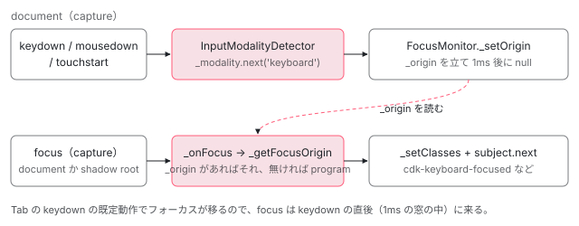

[目次](../README.md) › [CDK の内側](README.md) › 第 9 回 / 全 21 回

# FocusMonitor：キーボードかマウスか、フォーカスの出どころを見分ける

> InputModalityDetector が keydown・mousedown・touchstart を document の capture で拾い、直前の入力手段を覚える行。FocusMonitor が focus を受けたとき、その記録と 1ms（タッチは 650ms）の時間窓から origin（keyboard / mouse / touch / program）を決め、cdk-keyboard-focused などのクラスを付ける行。キーボードのときだけ枠を見せる CSS の書き方、スクリーンリーダーの偽イベントの見分け方、Shadow DOM の扱い。

angular/components · 読了 約 13 分 · 中核 · [サイトで読む（デモが動きます）](https://angular-deep-dive-cyan.vercel.app/chapter/cdk-focus-monitor)

---

ボタンをマウスでクリックしたときはフォーカスの枠を出さず、Tab キーで来たときだけ出したい。そのためには「このフォーカスはキーボードで来たのか、マウスか」を知る必要があります。この章では、`InputModalityDetector` が document の capture で直前の入力手段を覚える行、`FocusMonitor` がその記録と時間窓から `focus` の出どころ（origin）を決めて `cdk-keyboard-focused` などのクラスを付ける行、Shadow DOM のための root ごとのリスナーを、順に読みます。

読む対象は components の `src/cdk/a11y/input-modality/input-modality-detector.ts`・`src/cdk/a11y/fake-event-detection.ts`・`src/cdk/a11y/focus-monitor/focus-monitor.ts` です。

1. [1. 概観](01-cdk-overview.md)
2. [2. Platform と向き](02-cdk-platform-bidi.md)
3. [3. Observer と画面幅](03-cdk-observers-layout.md)
4. [4. Portal](04-cdk-portal.md)
5. [5. Overlay](05-cdk.md)
6. [6. 位置の計算](06-cdk-overlay-position.md)
7. [7. スクロールと Esc](07-cdk-overlay-scroll-dispatch.md)
8. [8. FocusTrap](08-cdk-focus-trap.md)
9. **9. FocusMonitor**（この章）
10. [10. ListKeyManager](10-cdk-key-manager.md)
11. [11. LiveAnnouncer](11-cdk-live-announcer.md)
12. [12. Dialog](12-cdk-dialog.md)
13. [13. Menu](13-cdk-menu.md)
14. [14. DataSource と選択](14-cdk-collections.md)
15. [15. 仮想スクロール](15-virtual-scroll.md)
16. [16. table](16-table.md)
17. [17. tree](17-cdk-tree.md)
18. [18. DragRef](18-drag-drop.md)
19. [19. DropListRef](19-cdk-drop-list.md)
20. [20. ハーネス](20-harness.md)
21. [21. Material のテーマ](21-theming.md)

> [!TIP]
> **新卒エンジニアへ**
>
> `focus` イベントそのものには「何で来たか」が書かれていません。そこで CDK は、`focus` の**直前**に起きた `keydown`・`mousedown`・`touchstart` を覚えておき、「直前にキーが押されていたならキーボードで来た」と推定します。直前に何も無ければ、コードの `el.focus()` で来た（`program`）とみなします。

## 0. 全体の流れ



*入力イベントは InputModalityDetector が document の capture で拾い、FocusMonitor の \_origin に 1ms（タッチは 650ms）だけ残す。その間に来た focus の origin をそれで決め、クラスを付けて Observable に流す。*

1. **入力手段を覚える**

   `InputModalityDetector` が document に capture・passive で 3 つのリスナーを張り、最後の入力手段を `BehaviorSubject` に入れる（1〜2 節）。
2. **監視の登録**

   `FocusMonitor.monitor(el)` が要素ごとの情報を Map に入れ、要素の root（document か shadow root）に capture の `focus` / `blur` を張る（3 節）。
3. **origin を一時的に立てる**

   入力のたびに `_setOrigin` が `_origin` を立て、1ms（タッチは 650ms）後に消す（4 節）。
4. **focus で origin を決める**

   `_onFocus` → `_getFocusOrigin` が `_origin` を読み、無ければ `program` にする（5 節）。
5. **クラスと通知**

   `_setClasses` が 5 つのクラスを付け外しし、`monitor()` の Observable に origin を流す（6 節）。

## 1. InputModalityDetector：document の capture で 3 つのイベントを拾う

📄 `components/src/cdk/a11y/input-modality/input-modality-detector.ts` L186–213 （▶ の行: 191–193, 197–198, 202, 205, 207–209）

```ts
186 │   constructor() {
187 │     const ngZone = inject(NgZone);
188 │     const document = inject<Document>(DOCUMENT);
189 │     const options = inject(INPUT_MODALITY_DETECTOR_OPTIONS, {optional: true});
190 │ 
191 ▶     this._options = {
192 ▶       ...INPUT_MODALITY_DETECTOR_DEFAULT_OPTIONS,
193 ▶       ...options,
194 │     };
195 │ 
196 │     // Skip the first emission as it's null.
197 ▶     this.modalityDetected = this._modality.pipe(skip(1));
198 ▶     this.modalityChanged = this.modalityDetected.pipe(distinctUntilChanged());
199 │ 
200 │     // If we're not in a browser, this service should do nothing, as there's no relevant input
201 │     // modality to detect.
202 ▶     if (this._platform.isBrowser) {
203 │       const renderer = inject(RendererFactory2).createRenderer(null, null);
204 │ 
205 ▶       this._listenerCleanups = ngZone.runOutsideAngular(() => {
206 │         return [
207 ▶           renderer.listen(document, 'keydown', this._onKeydown, modalityEventListenerOptions),
208 ▶           renderer.listen(document, 'mousedown', this._onMousedown, modalityEventListenerOptions),
209 ▶           renderer.listen(document, 'touchstart', this._onTouchstart, modalityEventListenerOptions),
210 │         ];
211 │       });
212 │     }
213 │   }
```

📄 `components/src/cdk/a11y/input-modality/input-modality-detector.ts` L47–83 （▶ の行: 53, 55–56, 64, 74, 80–82）

```ts
47 │ /**
48 │  * Default options for the InputModalityDetector.
49 │  *
50 │  * Modifier keys are ignored by default (i.e. when pressed won't cause the service to detect
51 │  * keyboard input modality) for two reasons:
52 │  *
53 ▶  * 1. Modifier keys are commonly used with mouse to perform actions such as 'right click' or 'open
54 │  *    in new tab', and are thus less representative of actual keyboard interaction.
55 ▶  * 2. VoiceOver triggers some keyboard events when linearly navigating with Control + Option (but
56 ▶  *    confusingly not with Caps Lock). Thus, to have parity with other screen readers, we ignore
57 │  *    these keys so as to not update the input modality.
58 │  *
59 │  * Note that we do not by default ignore the right Meta key on Safari because it has the same key
60 │  * code as the ContextMenu key on other browsers. When we switch to using event.key, we can
61 │  * distinguish between the two.
62 │  */
63 │ export const INPUT_MODALITY_DETECTOR_DEFAULT_OPTIONS: InputModalityDetectorOptions = {
64 ▶   ignoreKeys: [ALT, CONTROL, MAC_META, META, SHIFT],
65 │ };
66 │ 
67 │ /**
68 │  * The amount of time needed to pass after a touchstart event in order for a subsequent mousedown
69 │  * event to be attributed as mouse and not touch.
70 │  *
71 │  * This is the value used by AngularJS Material. Through trial and error (on iPhone 6S) they found
72 │  * that a value of around 650ms seems appropriate.
73 │  */
74 ▶ export const TOUCH_BUFFER_MS = 650;
75 │ 
76 │ /**
77 │  * Event listener options that enable capturing and also mark the listener as passive if the browser
78 │  * supports it.
79 │  */
80 ▶ const modalityEventListenerOptions = {
81 ▶   passive: true,
82 ▶   capture: true,
83 │ };
```

207〜209 行目、`keydown`・`mousedown`・`touchstart` の 3 つを document に張ります。オプションは 80〜83 行目の `passive: true, capture: true`。capture（捕捉段階）なので、イベントが目的の要素に届く**前**に document が受け取ります。途中で誰かが `stopPropagation()` しても取りこぼしません。passive なので `preventDefault` はせず、スクロールを遅らせません。202 行目、ブラウザのときだけ張ります。

197 行目の `modalityDetected` は、検出のたびに流れる Observable です（`skip(1)` で `BehaviorSubject` の初期値 `null` を飛ばす）。198 行目の `modalityChanged` は値が変わったときだけ流れます。191〜193 行目、`INPUT_MODALITY_DETECTOR_OPTIONS` を既定値（64 行目）に浅くマージします。既定では Alt・Ctrl・Meta・Shift を**無視**します。修飾キーはマウスと一緒に使われることが多く（Ctrl+クリック など）、VoiceOver は読み進めるときに Control+Option のキーイベントを出すからです（50〜57 行目のコメント）。

## 2. 3 つのハンドラーと、偽物のイベント

📄 `components/src/cdk/a11y/input-modality/input-modality-detector.ts` L137–164 （▶ の行: 140, 144–145, 156–157, 162–163）

```ts
137 │   private _onKeydown = (event: KeyboardEvent) => {
138 │     // If this is one of the keys we should ignore, then ignore it and don't update the input
139 │     // modality to keyboard.
140 ▶     if (this._options?.ignoreKeys?.some(keyCode => keyCode === event.keyCode)) {
141 │       return;
142 │     }
143 │ 
144 ▶     this._modality.next('keyboard');
145 ▶     this._mostRecentTarget = _getEventTarget(event);
146 │   };
147 │ 
148 │   /**
149 │    * Handles mousedown events. Must be an arrow function in order to preserve the context when it
150 │    * gets bound.
151 │    */
152 │   private _onMousedown = (event: MouseEvent) => {
153 │     // Touches trigger both touch and mouse events, so we need to distinguish between mouse events
154 │     // that were triggered via mouse vs touch. To do so, check if the mouse event occurs closely
155 │     // after the previous touch event.
156 ▶     if (Date.now() - this._lastTouchMs < TOUCH_BUFFER_MS) {
157 ▶       return;
158 │     }
159 │ 
160 │     // Fake mousedown events are fired by some screen readers when controls are activated by the
161 │     // screen reader. Attribute them to keyboard input modality.
162 ▶     this._modality.next(isFakeMousedownFromScreenReader(event) ? 'keyboard' : 'mouse');
163 ▶     this._mostRecentTarget = _getEventTarget(event);
164 │   };
```

`keydown` は、無視するキーでなければ 144 行目で `keyboard`。`mousedown` は 156 行目、直前のタッチから 650ms（74 行目の `TOUCH_BUFFER_MS`）以内なら何もしません。タッチ画面はタッチのあとに互換用のマウスイベントも出すので、それを「マウス」と数えないためです。162 行目、スクリーンリーダーが出す**偽物の**`mousedown` は `keyboard` として数えます。145 行目・163 行目の `_mostRecentTarget` は、イベントが起きた要素です（5 節で使います）。

📄 `components/src/cdk/a11y/input-modality/input-modality-detector.ts` L166–184 （▶ の行: 173–174, 180, 182）

```ts
166 │   /**
167 │    * Handles touchstart events. Must be an arrow function in order to preserve the context when it
168 │    * gets bound.
169 │    */
170 │   private _onTouchstart = (event: TouchEvent) => {
171 │     // Same scenario as mentioned in _onMousedown, but on touch screen devices, fake touchstart
172 │     // events are fired. Again, attribute to keyboard input modality.
173 ▶     if (isFakeTouchstartFromScreenReader(event)) {
174 ▶       this._modality.next('keyboard');
175 │       return;
176 │     }
177 │ 
178 │     // Store the timestamp of this touch event, as it's used to distinguish between mouse events
179 │     // triggered via mouse vs touch.
180 ▶     this._lastTouchMs = Date.now();
181 │ 
182 ▶     this._modality.next('touch');
183 │     this._mostRecentTarget = _getEventTarget(event);
184 │   };
```

📄 `components/src/cdk/a11y/fake-event-detection.ts` L9–34 （▶ の行: 16, 30–32）

```ts
 9 │ /** Gets whether an event could be a faked `mousedown` event dispatched by a screen reader. */
10 │ export function isFakeMousedownFromScreenReader(event: MouseEvent): boolean {
11 │   // Some screen readers will dispatch a fake `mousedown` event when pressing enter or space on
12 │   // a clickable element. We can distinguish these events when `event.buttons` is zero, or
13 │   // `event.detail` is zero depending on the browser:
14 │   // - `event.buttons` works on Firefox, but fails on Chrome.
15 │   // - `detail` works on Chrome, but fails on Firefox.
16 ▶   return event.buttons === 0 || event.detail === 0;
17 │ }
18 │ 
19 │ /** Gets whether an event could be a faked `touchstart` event dispatched by a screen reader. */
20 │ export function isFakeTouchstartFromScreenReader(event: TouchEvent): boolean {
21 │   const touch: Touch | undefined =
22 │     (event.touches && event.touches[0]) || (event.changedTouches && event.changedTouches[0]);
23 │ 
24 │   // A fake `touchstart` can be distinguished from a real one by looking at the `identifier`
25 │   // which is typically >= 0 on a real device versus -1 from a screen reader. Just to be safe,
26 │   // we can also look at `radiusX` and `radiusY`. This behavior was observed against a Windows 10
27 │   // device with a touch screen running NVDA v2020.4 and Firefox 85 or Chrome 88.
28 │   return (
29 │     !!touch &&
30 ▶     touch.identifier === -1 &&
31 ▶     (touch.radiusX == null || touch.radiusX === 1) &&
32 ▶     (touch.radiusY == null || touch.radiusY === 1)
33 │   );
34 │ }
```

スクリーンリーダーで Enter や Space を押してボタンを押すと、スクリーンリーダーが `mousedown` を作って送ることがあります。16 行目、本物のクリックでは `buttons`（押されているボタン）と `detail`（クリック回数）が 1 以上になるので、どちらかが 0 なら偽物とみなします。タッチは 30〜32 行目、`identifier` が `-1` で、接触の半径が無いか 1 なら偽物です（24〜27 行目のコメントに、NVDA で観察した値だと書かれています）。

## 3. monitor()：要素を登録し、root にリスナーを張る

📄 `components/src/cdk/a11y/focus-monitor/focus-monitor.ts` L196–232 （▶ の行: 199, 201, 207, 211–212, 216, 219, 223–226, 228–229）

```ts
196 │     const nativeElement = coerceElement(element);
197 │ 
198 │     // Do nothing if we're not on the browser platform or the passed in node isn't an element.
199 ▶     if (!this._platform.isBrowser || nativeElement.nodeType !== 1) {
200 │       // Note: we don't want the observable to emit at all so we don't pass any parameters.
201 ▶       return observableOf();
202 │     }
203 │ 
204 │     // If the element is inside the shadow DOM, we need to bind our focus/blur listeners to
205 │     // the shadow root, rather than the `document`, because the browser won't emit focus events
206 │     // to the `document`, if focus is moving within the same shadow root.
207 ▶     const rootNode = _getShadowRoot(nativeElement) || this._document;
208 │     const cachedInfo = this._elementInfo.get(nativeElement);
209 │ 
210 │     // Check if we're already monitoring this element.
211 ▶     if (cachedInfo) {
212 ▶       if (checkChildren) {
213 │         // TODO(COMP-318): this can be problematic, because it'll turn all non-checkChildren
214 │         // observers into ones that behave as if `checkChildren` was turned on. We need a more
215 │         // robust solution.
216 ▶         cachedInfo.checkChildren = true;
217 │       }
218 │ 
219 ▶       return cachedInfo.subject;
220 │     }
221 │ 
222 │     // Create monitored element info.
223 ▶     const info: MonitoredElementInfo = {
224 ▶       checkChildren: checkChildren,
225 ▶       subject: new Subject<FocusOrigin>(),
226 ▶       rootNode,
227 │     };
228 ▶     this._elementInfo.set(nativeElement, info);
229 ▶     this._registerGlobalListeners(info);
230 │ 
231 │     return info.subject;
232 │   }
```

1. **199〜201 行目：サーバーでは何もしない**

   何も流れない Observable（`of()`）を返します。
2. **207 行目：root を決める**

   要素が Shadow DOM の中なら、その shadow root。そうでなければ document。
3. **211〜219 行目：既に監視中なら同じ Subject を返す**

   新しく `checkChildren` が真で呼ばれたら、既存の情報も真に上書きします。
4. **223〜229 行目：情報を作って Map に入れ、リスナーを張る**

   `checkChildren`（子のフォーカスも自分のフォーカスとみなすか）・`Subject`・`rootNode` を `_elementInfo` に入れ、`_registerGlobalListeners` を呼びます。

📄 `components/src/cdk/a11y/focus-monitor/focus-monitor.ts` L463–499 （▶ の行: 464, 466, 468, 473, 481, 484, 489, 493–494, 496）

```ts
463 │     const rootNode = elementInfo.rootNode;
464 ▶     const rootNodeFocusListeners = this._rootNodeFocusListenerCount.get(rootNode) || 0;
465 │ 
466 ▶     if (!rootNodeFocusListeners) {
467 │       this._ngZone.runOutsideAngular(() => {
468 ▶         rootNode.addEventListener(
469 │           'focus',
470 │           this._rootNodeFocusAndBlurListener,
471 │           captureEventListenerOptions,
472 │         );
473 ▶         rootNode.addEventListener(
474 │           'blur',
475 │           this._rootNodeFocusAndBlurListener,
476 │           captureEventListenerOptions,
477 │         );
478 │       });
479 │     }
480 │ 
481 ▶     this._rootNodeFocusListenerCount.set(rootNode, rootNodeFocusListeners + 1);
482 │ 
483 │     // Register global listeners when first element is monitored.
484 ▶     if (++this._monitoredElementCount === 1) {
485 │       // Note: we listen to events in the capture phase so we
486 │       // can detect them even if the user stops propagation.
487 │       this._ngZone.runOutsideAngular(() => {
488 │         const window = this._getWindow();
489 ▶         window.addEventListener('focus', this._windowFocusListener);
490 │       });
491 │ 
492 │       // The InputModalityDetector is also just a collection of global listeners.
493 ▶       this._inputModalityDetector.modalityDetected
494 ▶         .pipe(takeUntil(this._stopInputModalityDetector))
495 │         .subscribe(modality => {
496 ▶           this._setOrigin(modality, true /* isFromInteraction */);
497 │         });
498 │     }
499 │   }
```

464〜481 行目、`focus` と `blur` のリスナーは **root ごとに 1 組**です。`_rootNodeFocusListenerCount` に root ごとの監視数を数え、0 → 1 のときだけ張ります。なぜ root ごとか：shadow root の中でフォーカスが移っても、ブラウザは document に `focus` を届けないからです（204〜206 行目のコメント）。484 行目、最初の 1 要素を監視したときだけ、window の `focus`（489 行目）と、`InputModalityDetector.modalityDetected` の購読（493〜496 行目）を始めます。検出のたびに `_setOrigin(modality, true)` です。

📄 `components/src/cdk/a11y/focus-monitor/focus-monitor.ts` L157–172 （▶ の行: 162, 165, 167, 169）

```ts
157 │   /**
158 │    * Event listener for `focus` and 'blur' events on the document.
159 │    * Needs to be an arrow function in order to preserve the context when it gets bound.
160 │    */
161 │   private _rootNodeFocusAndBlurListener = (event: Event) => {
162 ▶     const target = _getEventTarget<HTMLElement>(event);
163 │ 
164 │     // We need to walk up the ancestor chain in order to support `checkChildren`.
165 ▶     for (let element = target; element; element = element.parentElement) {
166 │       if (event.type === 'focus') {
167 ▶         this._onFocus(event as FocusEvent, element);
168 │       } else {
169 ▶         this._onBlur(event as FocusEvent, element);
170 │       }
171 │     }
172 │   };
```

root のリスナーは 1 つの関数で `focus` と `blur` を受けます。162 行目、`_getEventTarget` は `composedPath()[0]`（Shadow DOM の中の本当の要素）を返します（[第 2 回](02-cdk-platform-bidi.md)）。165 行目、その要素から `parentElement` を**親へたどりながら**、1 段ごとに `_onFocus` / `_onBlur` を呼びます。子にフォーカスが来たとき、`checkChildren` の祖先にも知らせるためです。

## 4. \_setOrigin：origin を「1ms だけ」覚える

📄 `components/src/cdk/a11y/focus-monitor/focus-monitor.ts` L382–405 （▶ の行: 391–392, 399–402）

```ts
382 │   /**
383 │    * Updates the focus origin. If we're using immediate detection mode, we schedule an async
384 │    * function to clear the origin at the end of a timeout. The duration of the timeout depends on
385 │    * the origin being set.
386 │    * @param origin The origin to set.
387 │    * @param isFromInteraction Whether we are setting the origin from an interaction event.
388 │    */
389 │   private _setOrigin(origin: FocusOrigin, isFromInteraction = false): void {
390 │     this._ngZone.runOutsideAngular(() => {
391 ▶       this._origin = origin;
392 ▶       this._originFromTouchInteraction = origin === 'touch' && isFromInteraction;
393 │ 
394 │       // If we're in IMMEDIATE mode, reset the origin at the next tick (or in `TOUCH_BUFFER_MS` ms
395 │       // for a touch event). We reset the origin at the next tick because Firefox focuses one tick
396 │       // after the interaction event. We wait `TOUCH_BUFFER_MS` ms before resetting the origin for
397 │       // a touch event because when a touch event is fired, the associated focus event isn't yet in
398 │       // the event queue. Before doing so, clear any pending timeouts.
399 ▶       if (this._detectionMode === FocusMonitorDetectionMode.IMMEDIATE) {
400 ▶         clearTimeout(this._originTimeoutId);
401 ▶         const ms = this._originFromTouchInteraction ? TOUCH_BUFFER_MS : 1;
402 ▶         this._originTimeoutId = setTimeout(() => (this._origin = null), ms);
403 │       }
404 │     });
405 │   }
```

391 行目で `_origin` を立てます。399〜402 行目、既定の `IMMEDIATE` モードでは、前のタイマーを消してから `setTimeout` で **1ms 後**に `null` に戻します。タッチのとき（392 行目で `_originFromTouchInteraction` が立つ）は 650ms です。394〜398 行目のコメントのとおり、1ms 待つのは Firefox がキー操作の 1 tick 後にフォーカスを移すため、650ms 待つのはタッチの `touchstart` の時点ではまだ `focus` がイベントの列に入っていないためです。

📄 `components/src/cdk/a11y/focus-monitor/focus-monitor.ts` L34–58 （▶ の行: 34, 52, 57）

```ts
34 ▶ export type FocusOrigin = 'touch' | 'mouse' | 'keyboard' | 'program' | null;
35 │ 
36 │ /**
37 │  * Corresponds to the options that can be passed to the native `focus` event.
38 │  * via https://developer.mozilla.org/en-US/docs/Web/API/HTMLElement/focus
39 │  */
40 │ export interface FocusOptions {
41 │   /** Whether the browser should scroll to the element when it is focused. */
42 │   preventScroll?: boolean;
43 │ }
44 │ 
45 │ /** Detection mode used for attributing the origin of a focus event. */
46 │ export enum FocusMonitorDetectionMode {
47 │   /**
48 │    * Any mousedown, keydown, or touchstart event that happened in the previous
49 │    * tick or the current tick will be used to assign a focus event's origin (to
50 │    * either mouse, keyboard, or touch). This is the default option.
51 │    */
52 ▶   IMMEDIATE,
53 │   /**
54 │    * A focus event's origin is always attributed to the last corresponding
55 │    * mousedown, keydown, or touchstart event, no matter how long ago it occurred.
56 │    */
57 ▶   EVENTUAL,
58 │ }
```

34 行目、origin は 5 通り（`null` はフォーカスが外れたとき）。`FOCUS_MONITOR_DEFAULT_OPTIONS` で 57 行目の `EVENTUAL` にすると、399 行目の分岐に入らないので `_origin` が消えず、どれだけ前でも最後の入力手段がそのまま origin になります。

## 5. \_onFocus と \_getFocusOrigin：origin を決める

📄 `components/src/cdk/a11y/focus-monitor/focus-monitor.ts` L412–450 （▶ の行: 420, 422, 426, 439–443, 448–449）

```ts
412 │   private _onFocus(event: FocusEvent, element: HTMLElement) {
413 │     // NOTE(mmalerba): We currently set the classes based on the focus origin of the most recent
414 │     // focus event affecting the monitored element. If we want to use the origin of the first event
415 │     // instead we should check for the cdk-focused class here and return if the element already has
416 │     // it. (This only matters for elements that have includesChildren = true).
417 │ 
418 │     // If we are not counting child-element-focus as focused, make sure that the event target is the
419 │     // monitored element itself.
420 ▶     const elementInfo = this._elementInfo.get(element);
421 │     const focusEventTarget = _getEventTarget<HTMLElement>(event);
422 ▶     if (!elementInfo || (!elementInfo.checkChildren && element !== focusEventTarget)) {
423 │       return;
424 │     }
425 │ 
426 ▶     this._originChanged(element, this._getFocusOrigin(focusEventTarget), elementInfo);
427 │   }
428 │ 
429 │   /**
430 │    * Handles blur events on a registered element.
431 │    * @param event The blur event.
432 │    * @param element The monitored element.
433 │    */
434 │   _onBlur(event: FocusEvent, element: HTMLElement) {
435 │     // If we are counting child-element-focus as focused, make sure that we aren't just blurring in
436 │     // order to focus another child of the monitored element.
437 │     const elementInfo = this._elementInfo.get(element);
438 │ 
439 ▶     if (
440 ▶       !elementInfo ||
441 ▶       (elementInfo.checkChildren &&
442 ▶         event.relatedTarget instanceof Node &&
443 ▶         element.contains(event.relatedTarget))
444 │     ) {
445 │       return;
446 │     }
447 │ 
448 ▶     this._setClasses(element);
449 ▶     this._emitOrigin(elementInfo, null);
450 │   }
```

422 行目、監視していない要素か、`checkChildren` が偽で目的の要素そのものでなければ何もしません（3 節の親へたどる途中の祖先は、ここでほとんど抜けます）。426 行目で origin を決めて `_originChanged` へ。`blur` では 439〜443 行目、`checkChildren` のときに次のフォーカス先（`relatedTarget`）が自分の中なら「中で移っただけ」として無視します。そうでなければ 448〜449 行目でクラスを外して `null` を流します。

📄 `components/src/cdk/a11y/focus-monitor/focus-monitor.ts` L309–342 （▶ の行: 310, 313–314, 316, 329–330, 337–338, 341）

```ts
309 │   private _getFocusOrigin(focusEventTarget: HTMLElement | null): FocusOrigin {
310 ▶     if (this._origin) {
311 │       // If the origin was realized via a touch interaction, we need to perform additional checks
312 │       // to determine whether the focus origin should be attributed to touch or program.
313 ▶       if (this._originFromTouchInteraction) {
314 ▶         return this._shouldBeAttributedToTouch(focusEventTarget) ? 'touch' : 'program';
315 │       } else {
316 ▶         return this._origin;
317 │       }
318 │     }
319 │ 
320 │     // If the window has just regained focus, we can restore the most recent origin from before the
321 │     // window blurred. Otherwise, we've reached the point where we can't identify the source of the
322 │     // focus. This typically means one of two things happened:
323 │     //
324 │     // 1) The element was programmatically focused, or
325 │     // 2) The element was focused via screen reader navigation (which generally doesn't fire
326 │     //    events).
327 │     //
328 │     // Because we can't distinguish between these two cases, we default to setting `program`.
329 ▶     if (this._windowFocused && this._lastFocusOrigin) {
330 ▶       return this._lastFocusOrigin;
331 │     }
332 │ 
333 │     // If the interaction is coming from an input label, we consider it a mouse interactions.
334 │     // This is a special case where focus moves on `click`, rather than `mousedown` which breaks
335 │     // our detection, because all our assumptions are for `mousedown`. We need to handle this
336 │     // special case, because it's very common for checkboxes and radio buttons.
337 ▶     if (focusEventTarget && this._isLastInteractionFromInputLabel(focusEventTarget)) {
338 ▶       return 'mouse';
339 │     }
340 │ 
341 ▶     return 'program';
342 │   }
```

1. **310〜317 行目：`_origin` が立っていればそれ**

   ただしタッチから来た origin なら、314 行目で「タッチした要素がフォーカスされた要素の中か」をさらに調べます（下の引用）。
2. **329〜331 行目：ウィンドウに戻ってきた直後なら、前回の origin**

   別のウィンドウから戻ると、ブラウザはフォーカスのあった要素にもう一度 `focus` を出します。そのときは入力が無いので、前回の origin を使います。
3. **337〜338 行目：ラベルのクリックなら `mouse`**

   `<label>` をクリックすると、フォーカスは `mousedown` ではなく `click` で入力欄に移ります。そのころには 1ms の窓が過ぎているので、直前のマウス操作の対象がその入力欄のラベルの中なら `mouse` とします。
4. **341 行目：どれでもなければ `program`**

   320〜328 行目のコメントのとおり、コードの `focus()` と、イベントを出さないスクリーンリーダーの移動とは区別できないので、どちらも `program` になります。

📄 `components/src/cdk/a11y/focus-monitor/focus-monitor.ts` L352–367 （▶ の行: 364–365）

```ts
352 │   private _shouldBeAttributedToTouch(focusEventTarget: HTMLElement | null): boolean {
353 │     // Please note that this check is not perfect. Consider the following edge case:
354 │     //
355 │     // <div #parent tabindex="0">
356 │     //   <div #child tabindex="0" (click)="#parent.focus()"></div>
357 │     // </div>
358 │     //
359 │     // Suppose there is a FocusMonitor in IMMEDIATE mode attached to #parent. When the user touches
360 │     // #child, #parent is programmatically focused. This code will attribute the focus to touch
361 │     // instead of program. This is a relatively minor edge-case that can be worked around by using
362 │     // focusVia(parent, 'program') to focus #parent.
363 │     return (
364 ▶       this._detectionMode === FocusMonitorDetectionMode.EVENTUAL ||
365 ▶       !!focusEventTarget?.contains(this._inputModalityDetector._mostRecentTarget)
366 │     );
367 │   }
```

タッチの窓は 650ms と長いので、タッチしたあとにコードで別の要素へ `focus()` することがあります。365 行目、フォーカスされた要素がタッチした要素（`_mostRecentTarget`）を含むときだけ `touch`、そうでなければ `program` にします。

📄 `components/src/cdk/a11y/focus-monitor/focus-monitor.ts` L133–142 （▶ の行: 140–141）

```ts
133 │   /**
134 │    * Event listener for `focus` events on the window.
135 │    * Needs to be an arrow function in order to preserve the context when it gets bound.
136 │    */
137 │   private _windowFocusListener = () => {
138 │     // Make a note of when the window regains focus, so we can
139 │     // restore the origin info for the focused element.
140 ▶     this._windowFocused = true;
141 ▶     this._windowFocusTimeoutId = setTimeout(() => (this._windowFocused = false));
142 │   };
```

329 行目の `_windowFocused` は、window の `focus`（3 節の 489 行目で張ったもの）で 140 行目に立ち、141 行目の `setTimeout` で次の tick に下ります。

## 6. クラスを付けて、Observable に流す

📄 `components/src/cdk/a11y/focus-monitor/focus-monitor.ts` L538–547 （▶ の行: 544–546）

```ts
538 │   /** Updates all the state on an element once its focus origin has changed. */
539 │   private _originChanged(
540 │     element: HTMLElement,
541 │     origin: FocusOrigin,
542 │     elementInfo: MonitoredElementInfo,
543 │   ) {
544 ▶     this._setClasses(element, origin);
545 ▶     this._emitOrigin(elementInfo, origin);
546 ▶     this._lastFocusOrigin = origin;
547 │   }
```

📄 `components/src/cdk/a11y/focus-monitor/focus-monitor.ts` L369–380 （▶ の行: 375–379）

```ts
369 │   /**
370 │    * Sets the focus classes on the element based on the given focus origin.
371 │    * @param element The element to update the classes on.
372 │    * @param origin The focus origin.
373 │    */
374 │   private _setClasses(element: HTMLElement, origin?: FocusOrigin): void {
375 ▶     element.classList.toggle('cdk-focused', !!origin);
376 ▶     element.classList.toggle('cdk-touch-focused', origin === 'touch');
377 ▶     element.classList.toggle('cdk-keyboard-focused', origin === 'keyboard');
378 ▶     element.classList.toggle('cdk-mouse-focused', origin === 'mouse');
379 ▶     element.classList.toggle('cdk-program-focused', origin === 'program');
380 │   }
```

544 行目でクラス、545 行目で通知、546 行目で「前回の origin」（5 節の 329 行目で使う）を覚えます。375〜379 行目、`cdk-focused` はフォーカスがあれば常に、残り 4 つは origin に応じて 1 つだけ付きます。`origin` を渡さずに呼べば（`blur` のとき）5 つとも外れます。アプリの CSS は `.cdk-keyboard-focused` にだけ枠線を付ければ、「キーボードで来たときだけ枠を出す」ができます。

📄 `components/src/cdk/a11y/focus-monitor/focus-monitor.ts` L275–298 （▶ の行: 281, 286–288, 291, 295）

```ts
275 │   focusVia(
276 │     element: HTMLElement | ElementRef<HTMLElement>,
277 │     origin: FocusOrigin,
278 │     options?: FocusOptions,
279 │   ): void {
280 │     const nativeElement = coerceElement(element);
281 ▶     const focusedElement = this._document.activeElement;
282 │ 
283 │     // If the element is focused already, calling `focus` again won't trigger the event listener
284 │     // which means that the focus classes won't be updated. If that's the case, update the classes
285 │     // directly without waiting for an event.
286 ▶     if (nativeElement === focusedElement) {
287 ▶       this._getClosestElementsInfo(nativeElement).forEach(([currentElement, info]) =>
288 ▶         this._originChanged(currentElement, origin, info),
289 │       );
290 │     } else {
291 ▶       this._setOrigin(origin);
292 │ 
293 │       // `focus` isn't available on the server
294 │       if (typeof nativeElement.focus === 'function') {
295 ▶         nativeElement.focus(options);
296 │       }
297 │     }
298 │   }
```

`focusVia` は origin を指定してフォーカスします。291 行目で先に `_setOrigin(origin)` し、295 行目で `focus()`。その `focus` は 5 節の 310 行目で、いま立てた origin を読みます。286〜289 行目、既にフォーカスがある要素では `focus()` を呼んでもイベントが出ないので、直接 `_originChanged` を呼びます。

📄 `components/src/cdk/a11y/focus-monitor/focus-monitor.ts` L610–640 （▶ の行: 611, 621, 630, 632–633, 638）

```ts
610 │ @Directive({
611 ▶   selector: '[cdkMonitorElementFocus], [cdkMonitorSubtreeFocus]',
612 │   exportAs: 'cdkMonitorFocus',
613 │ })
614 │ export class CdkMonitorFocus implements AfterViewInit, OnDestroy {
615 │   private _elementRef = inject<ElementRef<HTMLElement>>(ElementRef);
616 │   private _focusMonitor = inject(FocusMonitor);
617 │ 
618 │   private _monitorSubscription: Subscription | undefined;
619 │   private _focusOrigin: FocusOrigin = null;
620 │ 
621 ▶   @Output() readonly cdkFocusChange = new EventEmitter<FocusOrigin>();
622 │ 
623 │   get focusOrigin(): FocusOrigin {
624 │     return this._focusOrigin;
625 │   }
626 │ 
627 │   ngAfterViewInit() {
628 │     const element = this._elementRef.nativeElement;
629 │     this._monitorSubscription = this._focusMonitor
630 ▶       .monitor(element, element.nodeType === 1 && element.hasAttribute('cdkMonitorSubtreeFocus'))
631 │       .subscribe(origin => {
632 ▶         this._focusOrigin = origin;
633 ▶         this.cdkFocusChange.emit(origin);
634 │       });
635 │   }
636 │ 
637 │   ngOnDestroy() {
638 ▶     this._focusMonitor.stopMonitoring(this._elementRef);
639 │     this._monitorSubscription?.unsubscribe();
640 │   }
```

テンプレートから使うときは `cdkMonitorElementFocus`（子は数えない）か `cdkMonitorSubtreeFocus`（子も数える）を付けます。630 行目、属性の名前で `checkChildren` を決めて `monitor` し、633 行目で `(cdkFocusChange)` に流します。638 行目、破棄のときに監視をやめます。

> **🧪 DEMO — 本物の FocusMonitor と InputModalityDetector**
>
> 「監視を始める」を押すと、枠に `monitor(枠, true)` を付けます。枠の中のボタンを、マウスでクリック・Tab キーで移動・タッチ、と手段を変えてフォーカスしてみてください。サービスはこのボタンを押したときに初めて作られ、document にリスナーが張られます（1 節の 207〜209 行目）。
>
> ▶ [このデモはサイトで動かせます](https://angular-deep-dive-cyan.vercel.app/chapter/cdk-focus-monitor)

マウスでクリックすると `mouse`、Tab で入ると `keyboard`、「focusVia」のボタンでは `program` になります。「focusVia」のボタン自体をマウスで押しているので、直前の入力は `mouse` ですが、291 行目で `program` に上書きされてから `focus()` されるので、origin は `program` です。ボタン 1 からボタン 2 へ Tab で移っても、枠の origin は `null` を挟みません。5 節の 439〜443 行目で、中で移っただけの `blur` を無視しているからです。

## 全体の呼び出し

- 👤 `focusMonitor.monitor(el, true).subscribe(...)` — 利用者のコード
  - `_registerGlobalListeners(info)` — focus-monitor.ts L229
    - `rootNode.addEventListener('focus' / 'blur', ..., capture)` — L468-L477 — *root ごとに 1 組*
    - `inputModalityDetector.modalityDetected.subscribe(m => _setOrigin(m, true))` — L493-L497
- `（Tab の keydown）InputModalityDetector._onKeydown` — input-modality-detector.ts L137-L146 — *document の capture*
  - `_modality.next('keyboard') → FocusMonitor._setOrigin('keyboard', true)` — L144 → focus-monitor.ts L389-L403 — *1ms 後に null*
- `（ブラウザがフォーカスを移す）_rootNodeFocusAndBlurListener` — L161-L172 — *祖先へたどる*
  - `_onFocus(event, element) → _getFocusOrigin(target)` — L412-L426, L309-L317 — *'keyboard'*
    - `_originChanged → _setClasses(el, 'keyboard') / _emitOrigin` — L538-L547, L374-L380 — *cdk-focused cdk-keyboard-focused*

## 聞かれそうな質問

**Q. CSS の :focus-visible と何が違う？**

`:focus-visible` は、ブラウザが自分の基準で「枠を見せるべきか」を決めて CSS にだけ見せる疑似クラスです。基準はブラウザが持っていて、TypeScript からは「何で来たか」を受け取れません。`FocusMonitor` は origin を 4 種類の値として決め（L309-L342）、クラス（L374-L380）と Observable（`monitor()` の戻り値、L231）の両方で渡します。そのため「キーボードで来たときだけツールチップを出す」のようにコードで分岐でき、`checkChildren` で「中の何かにフォーカスがある」も扱えます。`focusVia`（L291）で origin を自分で指定することもできます。[FocusKeyManager](10-cdk-key-manager.md) は項目の `focus(origin)` にこの origin を渡します。

**Q. スクリーンリーダーの仮想カーソルで来たフォーカスは？**

読み進めるだけの移動はキーイベントを出さないので、`_origin` が立たず `program` になります。L320-L328 のコメントに「コードの focus と区別できないので program にする」と書かれています。スクリーンリーダーでボタンを押したときに作られる偽物の `mousedown` / `touchstart` は、`buttons` / `detail` が 0（fake-event-detection.ts L16）や `identifier === -1`（L30）で見分けて `keyboard` にします（input-modality-detector.ts L162, L173-L174）。また VoiceOver が読み進めで出す Control+Option は、既定で無視するキー（L64）なので入力手段を変えません。

**Q. 同じ要素を 2 か所で monitor したら？**

2 回目の `monitor` は L211-L219 で**同じ Subject** を返します。どちらかが `checkChildren: true` で呼べば、もう片方も子を数えるようになります（L216、TODO のコメント付き）。そして `stopMonitoring` は要素単位なので、片方が呼ぶと Subject が `complete` され（下の L251）、もう片方の購読にも何も届かなくなります。

📄 `components/src/cdk/a11y/focus-monitor/focus-monitor.ts` L246–257 （▶ の行: 251, 253–255）

```ts
246 │   stopMonitoring(element: HTMLElement | ElementRef<HTMLElement>): void {
247 │     const nativeElement = coerceElement(element);
248 │     const elementInfo = this._elementInfo.get(nativeElement);
249 │ 
250 │     if (elementInfo) {
251 ▶       elementInfo.subject.complete();
252 │ 
253 ▶       this._setClasses(nativeElement);
254 ▶       this._elementInfo.delete(nativeElement);
255 ▶       this._removeGlobalListeners(elementInfo);
256 │     }
257 │   }
```

**Q. origin が 1ms で消えるなら、Tab のあとでフォーカスが遅れて移ったら？**

`program` になります。`IMMEDIATE` では L402 の `setTimeout` で `_origin` が消えるからです。遅れて移るのが分かっているなら、`FOCUS_MONITOR_DEFAULT_OPTIONS` で `EVENTUAL`（L57）にすると、L399 の分岐に入らず最後の入力手段が残ります。

**Q. Shadow DOM の中の要素も監視できる？**

できます。`monitor` の L207 で要素の shadow root を root にし、L466-L478 でその shadow root に `focus` / `blur` を張ります。shadow root の中での移動は document に `focus` が届かないので（L204-L206 のコメント）、document だけに張る作りでは取れません。`InputModalityDetector` のほうは document に張ったままですが、キーやマウスのイベントは shadow root の外へ泡立つ（composed）ので、document で受けられます。

## 読み終えて

- `InputModalityDetector` は document の capture・passive で `keydown`・`mousedown`・`touchstart` を拾い、最後の入力手段を覚える。修飾キーと偽物のイベントは除く。
- `FocusMonitor` は入力のたびに `_origin` を立て、`IMMEDIATE` なら 1ms（タッチは 650ms）で消す。その間に来た `focus` がその origin になる。
- 窓の外の `focus` は、ウィンドウ復帰なら前回の origin、ラベルのクリックなら `mouse`、それ以外は `program`。
- origin は `cdk-focused` と `cdk-(keyboard|mouse|touch|program)-focused` のクラス、そして `monitor()` の Observable で渡される。
- `focus` / `blur` のリスナーは root（document か shadow root）ごとに 1 組で、監視数を数えて付け外しする。

---

← 前: [FocusTrap：見えない番兵でフォーカスを閉じ込める](08-cdk-focus-trap.md)  
次: [ListKeyManager：矢印キーと頭文字で項目を選ぶ](10-cdk-key-manager.md) →
