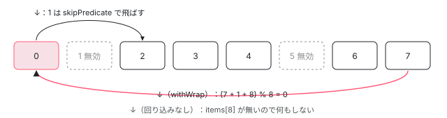

[目次](../README.md) › [CDK の内側](README.md) › 第 10 回 / 全 21 回

# ListKeyManager：矢印キーと頭文字で項目を選ぶ

> ListKeyManager.onKeydown が上下・Home・End・PageUp などを次の項目の番号に直す行、無効な項目を飛ばす行、withWrap で端から反対側へ回る行。頭文字で選ぶ typeahead が文字を溜めて一定時間で消す仕組み、ActiveDescendantKeyManager と FocusKeyManager の違い（aria-activedescendant か本物のフォーカスか）、TreeKeyManager。

angular/components · 読了 約 13 分 · 中核 · [サイトで読む（デモが動きます）](https://angular-deep-dive-cyan.vercel.app/chapter/cdk-key-manager)

---

メニューやリストボックスでは、Tab で 1 回入ったあとは矢印キーで項目を移り、頭文字を打つとその文字で始まる項目へ飛びます。この章では、その「どの項目が選ばれているか（active）」を持つ `ListKeyManager` が、`onKeydown` でキーを次の番号に直す行、無効な項目を飛ばす行、`withWrap` で端から反対側へ回る行、頭文字で選ぶ `Typeahead` が文字を溜めて 200ms で確定する仕組みを読みます。最後に、active を本物のフォーカスで表す `FocusKeyManager` と、`aria-activedescendant` で表す `ActiveDescendantKeyManager` の違い、木構造用の `TreeKeyManager` を見ます。

読む対象は components の `src/cdk/a11y/key-manager/list-key-manager.ts`・`typeahead.ts`・`focus-key-manager.ts`・`activedescendant-key-manager.ts`・`tree-key-manager.ts`、使う側の例として `src/cdk/listbox/listbox.ts` です。

1. [1. 概観](01-cdk-overview.md)
2. [2. Platform と向き](02-cdk-platform-bidi.md)
3. [3. Observer と画面幅](03-cdk-observers-layout.md)
4. [4. Portal](04-cdk-portal.md)
5. [5. Overlay](05-cdk.md)
6. [6. 位置の計算](06-cdk-overlay-position.md)
7. [7. スクロールと Esc](07-cdk-overlay-scroll-dispatch.md)
8. [8. FocusTrap](08-cdk-focus-trap.md)
9. [9. FocusMonitor](09-cdk-focus-monitor.md)
10. **10. ListKeyManager**（この章）
11. [11. LiveAnnouncer](11-cdk-live-announcer.md)
12. [12. Dialog](12-cdk-dialog.md)
13. [13. Menu](13-cdk-menu.md)
14. [14. DataSource と選択](14-cdk-collections.md)
15. [15. 仮想スクロール](15-virtual-scroll.md)
16. [16. table](16-table.md)
17. [17. tree](17-cdk-tree.md)
18. [18. DragRef](18-drag-drop.md)
19. [19. DropListRef](19-cdk-drop-list.md)
20. [20. ハーネス](20-harness.md)
21. [21. Material のテーマ](21-theming.md)

> [!TIP]
> **新卒エンジニアへ**
>
> `ListKeyManager` は DOM に触りません。持っているのは「項目の配列」と「active の番号」だけで、キーを受け取ると番号を変え、`change` で知らせます。DOM のどこで keydown を受けるか、active をどう見せるかは使う側（とサブクラス）が決めます。

## 0. 全体の流れ

1. **項目を渡して作る**

   配列・`QueryList`・signal のどれかを渡し、`withWrap()` などの設定をつなげて呼ぶ（1 節）。
2. **keydown を渡す**

   使う側が自分の要素の keydown で `onKeydown(event)` を呼ぶ。`switch` がキーを「次へ・前へ・先頭・末尾・N 個先」に直す（2 節）。
3. **番号を決める**

   `_setActiveItemByDelta` / `_setActiveItemByIndex` が、`skipPredicate`（既定は `disabled`）に当たる項目を飛ばしながら番号を決める（3 節）。
4. **頭文字**

   矢印でも Home でもないキーは `Typeahead.handleKey` へ。文字を溜め、200ms 入力が無ければその文字列で始まる項目を探す（4 節）。
5. **見せ方**

   `setActiveItem` をサブクラスが上書きし、`FocusKeyManager` は項目の `focus()`、`ActiveDescendantKeyManager` は `setActiveStyles()` を呼ぶ（5 節）。

## 1. 持っている状態と、設定のメソッド

📄 `components/src/cdk/a11y/key-manager/list-key-manager.ts` L25–59 （▶ の行: 28, 31, 42–44, 47–48, 50–51, 59）

```ts
25 │ /** This interface is for items that can be passed to a ListKeyManager. */
26 │ export interface ListKeyManagerOption {
27 │   /** Whether the option is disabled. */
28 ▶   disabled?: boolean;
29 │ 
30 │   /** Gets the label for this option. */
31 ▶   getLabel?(): string;
32 │ }
33 │ 
34 │ /** Modifier keys handled by the ListKeyManager. */
35 │ export type ListKeyManagerModifierKey = 'altKey' | 'ctrlKey' | 'metaKey' | 'shiftKey';
36 │ 
37 │ /**
38 │  * This class manages keyboard events for selectable lists. If you pass it a query list
39 │  * of items, it will set the active item correctly when arrow events occur.
40 │  */
41 │ export class ListKeyManager<T extends ListKeyManagerOption> {
42 ▶   private _activeItemIndex = signal(-1);
43 ▶   private _activeItem = signal<T | null>(null);
44 ▶   private _wrap = false;
45 │   private _typeaheadSubscription = Subscription.EMPTY;
46 │   private _itemChangesSubscription?: Subscription;
47 ▶   private _vertical = true;
48 ▶   private _horizontal: 'ltr' | 'rtl' | null = null;
49 │   private _allowedModifierKeys: ListKeyManagerModifierKey[] = [];
50 ▶   private _homeAndEnd = false;
51 ▶   private _pageUpAndDown = {enabled: false, delta: 10};
52 │   private _effectRef: EffectRef | undefined;
53 │   private _typeahead?: Typeahead<T>;
54 │ 
55 │   /**
56 │    * Predicate function that can be used to check whether an item should be skipped
57 │    * by the key manager. By default, disabled items are skipped.
58 │    */
59 ▶   private _skipPredicateFn = (item: T) => item.disabled;
```

42〜43 行目、active の番号と項目は signal です。44〜51 行目が設定（回り込み・縦・横・Home/End・PageUp/Down）。59 行目、「飛ばす項目」の判定の既定は `item.disabled` です。項目は 26〜32 行目の `ListKeyManagerOption`（`disabled` と `getLabel` を持てる）であればよく、DOM 要素である必要はありません。

📄 `components/src/cdk/a11y/key-manager/list-key-manager.ts` L63–81 （▶ の行: 70–72, 74, 79）

```ts
63 │   constructor(
64 │     private _items: QueryList<T> | T[] | readonly T[] | Signal<T[]> | Signal<readonly T[]>,
65 │     injector?: Injector,
66 │   ) {
67 │     // We allow for the items to be an array because, in some cases, the consumer may
68 │     // not have access to a QueryList of the items they want to manage (e.g. when the
69 │     // items aren't being collected via `ViewChildren` or `ContentChildren`).
70 ▶     if (_items instanceof QueryList) {
71 ▶       this._itemChangesSubscription = _items.changes.subscribe((newItems: QueryList<T>) =>
72 ▶         this._itemsChanged(newItems.toArray()),
73 │       );
74 ▶     } else if (isSignal(_items)) {
75 │       if (!injector && (typeof ngDevMode === 'undefined' || ngDevMode)) {
76 │         throw new Error('ListKeyManager constructed with a signal must receive an injector');
77 │       }
78 │ 
79 ▶       this._effectRef = effect(() => this._itemsChanged(_items()), {injector});
80 │     }
81 │   }
```

70〜72 行目、`QueryList`（`@ViewChildren` などで集めた一覧）なら `changes` を購読し、項目が入れ替わったら active の番号を付け直します。74〜79 行目、signal なら `effect` で同じことをします。そのため signal を渡すときは `injector` が必須です（75〜76 行目）。ただの配列なら購読しません。

📄 `components/src/cdk/a11y/key-manager/list-key-manager.ts` L92–129 （▶ の行: 97–98, 107–108, 116–117, 126–127）

```ts
 92 │   /**
 93 │    * Sets the predicate function that determines which items should be skipped by the
 94 │    * list key manager.
 95 │    * @param predicate Function that determines whether the given item should be skipped.
 96 │    */
 97 ▶   skipPredicate(predicate: (item: T) => boolean): this {
 98 ▶     this._skipPredicateFn = predicate;
 99 │     return this;
100 │   }
101 │ 
102 │   /**
103 │    * Configures wrapping mode, which determines whether the active item will wrap to
104 │    * the other end of list when there are no more items in the given direction.
105 │    * @param shouldWrap Whether the list should wrap when reaching the end.
106 │    */
107 ▶   withWrap(shouldWrap = true): this {
108 ▶     this._wrap = shouldWrap;
109 │     return this;
110 │   }
111 │ 
112 │   /**
113 │    * Configures whether the key manager should be able to move the selection vertically.
114 │    * @param enabled Whether vertical selection should be enabled.
115 │    */
116 ▶   withVerticalOrientation(enabled: boolean = true): this {
117 ▶     this._vertical = enabled;
118 │     return this;
119 │   }
120 │ 
121 │   /**
122 │    * Configures the key manager to move the selection horizontally.
123 │    * Passing in `null` will disable horizontal movement.
124 │    * @param direction Direction in which the selection can be moved.
125 │    */
126 ▶   withHorizontalOrientation(direction: 'ltr' | 'rtl' | null): this {
127 ▶     this._horizontal = direction;
128 │     return this;
129 │   }
```

📄 `components/src/cdk/a11y/key-manager/list-key-manager.ts` L173–192 （▶ の行: 178–179, 189–190）

```ts
173 │   /**
174 │    * Configures the key manager to activate the first and last items
175 │    * respectively when the Home or End key is pressed.
176 │    * @param enabled Whether pressing the Home or End key activates the first/last item.
177 │    */
178 ▶   withHomeAndEnd(enabled: boolean = true): this {
179 ▶     this._homeAndEnd = enabled;
180 │     return this;
181 │   }
182 │ 
183 │   /**
184 │    * Configures the key manager to activate every 10th, configured or first/last element in up/down direction
185 │    * respectively when the Page-Up or Page-Down key is pressed.
186 │    * @param enabled Whether pressing the Page-Up or Page-Down key activates the first/last item.
187 │    * @param delta Whether pressing the Home or End key activates the first/last item.
188 │    */
189 ▶   withPageUpDown(enabled: boolean = true, delta: number = 10): this {
190 ▶     this._pageUpAndDown = {enabled, delta};
191 │     return this;
192 │   }
```

どれもフィールドを 1 つ書き換えて `this` を返すだけなので、`new ListKeyManager(items).withWrap().withHomeAndEnd()` とつなげて書けます。126 行目の `withHorizontalOrientation` は `'ltr'` か `'rtl'` を受け取ります。この値が 2 節で左右の矢印の意味を入れ替えます。`Directionality`（[第 2 回](02-cdk-platform-bidi.md)）の値をそのまま渡す使い方です。

## 2. onKeydown：キーを「次の番号」に直す

📄 `components/src/cdk/a11y/key-manager/list-key-manager.ts` L226–268 （▶ の行: 227, 229–230, 234–236, 239–240, 243, 255–256, 263–264）

```ts
226 │   onKeydown(event: KeyboardEvent): void {
227 ▶     const keyCode = event.keyCode;
228 │     const modifiers: ListKeyManagerModifierKey[] = ['altKey', 'ctrlKey', 'metaKey', 'shiftKey'];
229 ▶     const isModifierAllowed = modifiers.every(modifier => {
230 ▶       return !event[modifier] || this._allowedModifierKeys.indexOf(modifier) > -1;
231 │     });
232 │ 
233 │     switch (keyCode) {
234 ▶       case TAB:
235 ▶         this.tabOut.next();
236 ▶         return;
237 │ 
238 │       case DOWN_ARROW:
239 ▶         if (this._vertical && isModifierAllowed) {
240 ▶           this.setNextItemActive();
241 │           break;
242 │         } else {
243 ▶           return;
244 │         }
245 │ 
246 │       case UP_ARROW:
247 │         if (this._vertical && isModifierAllowed) {
248 │           this.setPreviousItemActive();
249 │           break;
250 │         } else {
251 │           return;
252 │         }
253 │ 
254 │       case RIGHT_ARROW:
255 ▶         if (this._horizontal && isModifierAllowed) {
256 ▶           this._horizontal === 'rtl' ? this.setPreviousItemActive() : this.setNextItemActive();
257 │           break;
258 │         } else {
259 │           return;
260 │         }
261 │ 
262 │       case LEFT_ARROW:
263 ▶         if (this._horizontal && isModifierAllowed) {
264 ▶           this._horizontal === 'rtl' ? this.setNextItemActive() : this.setPreviousItemActive();
265 │           break;
266 │         } else {
267 │           return;
268 │         }
```

1. **227 行目：`keyCode` で分ける**

   `event.key`（文字列）ではなく数値の `keyCode` です。定数は `cdk/keycodes` にあります。
2. **229〜231 行目：修飾キーの許可**

   押されている修飾キー（Alt・Ctrl・Meta・Shift）が全部 `withAllowedModifierKeys` に入っていれば真。既定は空なので、修飾キーを押しながらの矢印は無視されます（Ctrl+↓ などはブラウザや OS に任せる）。
3. **234〜236 行目：Tab**

   番号は変えず `tabOut` を流して `return`。`preventDefault` しないので、フォーカスは普通に次の要素へ出ていきます。
4. **239〜243 行目：↓ / ↑**

   縦が有効なら次へ / 前へ。無効なら `return`（何もせず、既定動作も止めない）。
5. **255〜256・263〜264 行目：→ / ←**

   横が有効なとき、`'rtl'` なら → で**前**、← で**次**。右から左に読む言語では「次」が左にあるからです。

📄 `components/src/cdk/a11y/key-manager/list-key-manager.ts` L270–303 （▶ の行: 271–272, 279–280, 288–289, 297–299）

```ts
270 │       case HOME:
271 ▶         if (this._homeAndEnd && isModifierAllowed) {
272 ▶           this.setFirstItemActive();
273 │           break;
274 │         } else {
275 │           return;
276 │         }
277 │ 
278 │       case END:
279 ▶         if (this._homeAndEnd && isModifierAllowed) {
280 ▶           this.setLastItemActive();
281 │           break;
282 │         } else {
283 │           return;
284 │         }
285 │ 
286 │       case PAGE_UP:
287 │         if (this._pageUpAndDown.enabled && isModifierAllowed) {
288 ▶           const targetIndex = this._activeItemIndex() - this._pageUpAndDown.delta;
289 ▶           this._setActiveItemByIndex(targetIndex > 0 ? targetIndex : 0, 1);
290 │           break;
291 │         } else {
292 │           return;
293 │         }
294 │ 
295 │       case PAGE_DOWN:
296 │         if (this._pageUpAndDown.enabled && isModifierAllowed) {
297 ▶           const targetIndex = this._activeItemIndex() + this._pageUpAndDown.delta;
298 ▶           const itemsLength = this._getItemsArray().length;
299 ▶           this._setActiveItemByIndex(targetIndex < itemsLength ? targetIndex : itemsLength - 1, -1);
300 │           break;
301 │         } else {
302 │           return;
303 │         }
```

Home / End は 271〜272 行目・279〜280 行目、`withHomeAndEnd` のときだけ先頭 / 末尾へ。PageUp は 288〜289 行目、いまの番号から `delta`（既定 10）引き、0 より小さければ 0 にして、第 2 引数 `1`（無効なら後ろへずらす）で決めます。PageDown は 297〜299 行目、足して末尾を超えれば末尾、第 2 引数 `-1`（無効なら前へずらす）。

📄 `components/src/cdk/a11y/key-manager/list-key-manager.ts` L305–317 （▶ の行: 306–307, 312, 315–316）

```ts
305 │       default:
306 ▶         if (isModifierAllowed || hasModifierKey(event, 'shiftKey')) {
307 ▶           this._typeahead?.handleKey(event);
308 │         }
309 │ 
310 │         // Note that we return here, in order to avoid preventing
311 │         // the default action of non-navigational keys.
312 ▶         return;
313 │     }
314 │ 
315 ▶     this._typeahead?.reset();
316 ▶     event.preventDefault();
317 │   }
```

どのナビゲーションキーでもなければ 306〜307 行目で `Typeahead` に渡し（Shift は大文字のために許す）、312 行目で `return`。文字の入力欄の既定動作を止めないためです。ナビゲーションキーで `break` したときだけ 315〜316 行目に来て、溜まっていた頭文字を捨て、`preventDefault()` で矢印キーのスクロールなどを止めます。

## 3. 無効な項目を飛ばして番号を決める

📄 `components/src/cdk/a11y/key-manager/list-key-manager.ts` L334–354 （▶ の行: 336, 341, 346, 351–353）

```ts
334 │   /** Sets the active item to the first enabled item in the list. */
335 │   setFirstItemActive(): void {
336 ▶     this._setActiveItemByIndex(0, 1);
337 │   }
338 │ 
339 │   /** Sets the active item to the last enabled item in the list. */
340 │   setLastItemActive(): void {
341 ▶     this._setActiveItemByIndex(this._getItemsArray().length - 1, -1);
342 │   }
343 │ 
344 │   /** Sets the active item to the next enabled item in the list. */
345 │   setNextItemActive(): void {
346 ▶     this._activeItemIndex() < 0 ? this.setFirstItemActive() : this._setActiveItemByDelta(1);
347 │   }
348 │ 
349 │   /** Sets the active item to a previous enabled item in the list. */
350 │   setPreviousItemActive(): void {
351 ▶     this._activeItemIndex() < 0 && this._wrap
352 ▶       ? this.setLastItemActive()
353 ▶       : this._setActiveItemByDelta(-1);
354 │   }
```

346 行目、まだ何も active でない（`-1`）ときの ↓ は先頭へ。351〜353 行目、`-1` のときの ↑ は、回り込みが有効なら末尾へ。それ以外は `_setActiveItemByDelta` です。

📄 `components/src/cdk/a11y/key-manager/list-key-manager.ts` L394–424 （▶ の行: 395, 406–407, 410–411, 423）

```ts
394 │   private _setActiveItemByDelta(delta: -1 | 1): void {
395 ▶     this._wrap ? this._setActiveInWrapMode(delta) : this._setActiveInDefaultMode(delta);
396 │   }
397 │ 
398 │   /**
399 │    * Sets the active item properly given "wrap" mode. In other words, it will continue to move
400 │    * down the list until it finds an item that is not disabled, and it will wrap if it
401 │    * encounters either end of the list.
402 │    */
403 │   private _setActiveInWrapMode(delta: -1 | 1): void {
404 │     const items = this._getItemsArray();
405 │ 
406 ▶     for (let i = 1; i <= items.length; i++) {
407 ▶       const index = (this._activeItemIndex() + delta * i + items.length) % items.length;
408 │       const item = items[index];
409 │ 
410 ▶       if (!this._skipPredicateFn(item)) {
411 ▶         this.setActiveItem(index);
412 │         return;
413 │       }
414 │     }
415 │   }
416 │ 
417 │   /**
418 │    * Sets the active item properly given the default mode. In other words, it will
419 │    * continue to move down the list until it finds an item that is not disabled. If
420 │    * it encounters either end of the list, it will stop and not wrap.
421 │    */
422 │   private _setActiveInDefaultMode(delta: -1 | 1): void {
423 ▶     this._setActiveItemByIndex(this._activeItemIndex() + delta, delta);
424 │   }
```

📄 `components/src/cdk/a11y/key-manager/list-key-manager.ts` L426–447 （▶ の行: 434, 438–439, 441, 446）

```ts
426 │   /**
427 │    * Sets the active item to the first enabled item starting at the index specified. If the
428 │    * item is disabled, it will move in the fallbackDelta direction until it either
429 │    * finds an enabled item or encounters the end of the list.
430 │    */
431 │   private _setActiveItemByIndex(index: number, fallbackDelta: -1 | 1): void {
432 │     const items = this._getItemsArray();
433 │ 
434 ▶     if (!items[index]) {
435 │       return;
436 │     }
437 │ 
438 ▶     while (this._skipPredicateFn(items[index])) {
439 ▶       index += fallbackDelta;
440 │ 
441 ▶       if (!items[index]) {
442 │         return;
443 │       }
444 │     }
445 │ 
446 ▶     this.setActiveItem(index);
447 │   }
```



*8 項目のうち 1 と 5 が無効。0 から ↓ は 1 を飛ばして 2 へ。7 から ↓ は、withWrap なら剰余で 0 へ回り、回り込みなしなら配列の外（8）で止まって動かない。*

1. **回り込みあり（406〜411 行目）**

   `i` を 1 から項目数まで増やし、`(いまの番号 + delta × i + 項目数) % 項目数` を順に調べます。`+ 項目数` は、0 から ↑ したとき負の数にならないためです。最初に `_skipPredicateFn` が偽の項目で止まります。全部が無効なら何も変えません。
2. **回り込みなし（423 行目 → 431〜447 行目）**

   `いまの番号 + delta` から始め、438〜439 行目で無効な項目の間は同じ向きにずらし続けます。434 行目・441 行目、配列の外に出たら何もしない（端で止まる）。
3. **446 行目：確定**

   どちらも最後は `setActiveItem(index)` です。

📄 `components/src/cdk/a11y/key-manager/list-key-manager.ts` L206–220 （▶ の行: 213, 215, 217–218）

```ts
206 │   /**
207 │    * Sets the active item to the specified item.
208 │    * @param item The item to be set as active.
209 │    */
210 │   setActiveItem(item: T | number): void;
211 │ 
212 │   setActiveItem(item: any): void {
213 ▶     const previousActiveItem = this._activeItem();
214 │ 
215 ▶     this.updateActiveItem(item);
216 │ 
217 ▶     if (this._activeItem() !== previousActiveItem) {
218 ▶       this.change.next(this._activeItemIndex());
219 │     }
220 │   }
```

📄 `components/src/cdk/a11y/key-manager/list-key-manager.ts` L368–377 （▶ の行: 370, 374–376）

```ts
368 │   updateActiveItem(item: any): void {
369 │     const itemArray = this._getItemsArray();
370 ▶     const index = typeof item === 'number' ? item : itemArray.indexOf(item);
371 │     const activeItem = itemArray[index];
372 │ 
373 │     // Explicitly check for `null` and `undefined` because other falsy values are valid.
374 ▶     this._activeItem.set(activeItem == null ? null : activeItem);
375 ▶     this._activeItemIndex.set(index);
376 ▶     this._typeahead?.setCurrentSelectedItemIndex(index);
377 │   }
```

`setActiveItem` は 215 行目の `updateActiveItem` で signal を書き換え（374〜375 行目）、217〜218 行目で項目が変わったときだけ `change` に番号を流します。376 行目で `Typeahead` にも「いまここ」を教えます（4 節で、探し始める位置になる）。`updateActiveItem` を直接呼べば、`change` もサブクラスの処理（5 節）も起きません。

## 4. Typeahead：頭文字を溜めて、200ms で探す

📄 `components/src/cdk/a11y/key-manager/list-key-manager.ts` L140–165 （▶ の行: 147–148, 155–157, 160–161）

```ts
140 │   /**
141 │    * Turns on typeahead mode which allows users to set the active item by typing.
142 │    * @param debounceInterval Time to wait after the last keystroke before setting the active item.
143 │    */
144 │   withTypeAhead(debounceInterval: number = 200): this {
145 │     if (typeof ngDevMode === 'undefined' || ngDevMode) {
146 │       const items = this._getItemsArray();
147 ▶       if (items.length > 0 && items.some(item => typeof item.getLabel !== 'function')) {
148 ▶         throw Error('ListKeyManager items in typeahead mode must implement the `getLabel` method.');
149 │       }
150 │     }
151 │ 
152 │     this._typeaheadSubscription.unsubscribe();
153 │ 
154 │     const items = this._getItemsArray();
155 ▶     this._typeahead = new Typeahead(items, {
156 ▶       debounceInterval: typeof debounceInterval === 'number' ? debounceInterval : undefined,
157 ▶       skipPredicate: item => this._skipPredicateFn(item),
158 │     });
159 │ 
160 ▶     this._typeaheadSubscription = this._typeahead.selectedItem.subscribe(item => {
161 ▶       this.setActiveItem(item);
162 │     });
163 │ 
164 │     return this;
165 │   }
```

147〜148 行目、開発時は全項目が `getLabel` を持っているかを調べて投げます。155〜158 行目で `Typeahead` を作り、`skipPredicate` を共有します。160〜161 行目、`Typeahead` が項目を見つけたら `setActiveItem(item)`。v22 では頭文字の処理は `typeahead.ts` に分かれていて、`TreeKeyManager` も同じものを使います。

📄 `components/src/cdk/a11y/key-manager/typeahead.ts` L77–97 （▶ の行: 82–85, 91, 96）

```ts
77 │   handleKey(event: KeyboardEvent): void {
78 │     const keyCode = event.keyCode;
79 │ 
80 │     // Attempt to use the `event.key` which also maps it to the user's keyboard language,
81 │     // otherwise fall back to resolving alphanumeric characters via the keyCode.
82 ▶     if (event.key && event.key.length === 1) {
83 ▶       this._letterKeyStream.next(event.key.toLocaleUpperCase());
84 ▶     } else if ((keyCode >= A && keyCode <= Z) || (keyCode >= ZERO && keyCode <= NINE)) {
85 ▶       this._letterKeyStream.next(String.fromCharCode(keyCode));
86 │     }
87 │   }
88 │ 
89 │   /** Gets whether the user is currently typing into the manager using the typeahead feature. */
90 │   isTyping(): boolean {
91 ▶     return this._pressedLetters.length > 0;
92 │   }
93 │ 
94 │   /** Resets the currently stored sequence of typed letters. */
95 │   reset(): void {
96 ▶     this._pressedLetters = [];
97 │   }
```

82〜83 行目、`event.key` が 1 文字ならそれを大文字にして流します（キーボードの配列に従った文字になる）。無ければ 84〜85 行目で A〜Z・0〜9 の `keyCode` から文字を作ります。

📄 `components/src/cdk/a11y/key-manager/typeahead.ts` L99–128 （▶ の行: 105–108, 113–114, 117–119, 121, 126）

```ts
 99 │   private _setupKeyHandler(typeAheadInterval: number) {
100 │     // Debounce the presses of non-navigational keys, collect the ones that correspond to letters
101 │     // and convert those letters back into a string. Afterwards find the first item that starts
102 │     // with that string and select it.
103 │     this._letterKeyStream
104 │       .pipe(
105 ▶         tap(letter => this._pressedLetters.push(letter)),
106 ▶         debounceTime(typeAheadInterval),
107 ▶         filter(() => this._pressedLetters.length > 0),
108 ▶         map(() => this._pressedLetters.join('').toLocaleUpperCase()),
109 │       )
110 │       .subscribe(inputString => {
111 │         // Start at 1 because we want to start searching at the item immediately
112 │         // following the current active item.
113 ▶         for (let i = 1; i < this._items.length + 1; i++) {
114 ▶           const index = (this._selectedItemIndex + i) % this._items.length;
115 │           const item = this._items[index];
116 │ 
117 ▶           if (
118 ▶             !this._skipPredicateFn?.(item) &&
119 ▶             item.getLabel?.().toLocaleUpperCase().trim().indexOf(inputString) === 0
120 │           ) {
121 ▶             this._selectedItem.next(item);
122 │             break;
123 │           }
124 │         }
125 │ 
126 ▶         this._pressedLetters = [];
127 │       });
128 │   }
```

1. **105 行目：溜める**

   文字が来るたびに `_pressedLetters` に積みます（これは即座に、同期で）。
2. **106 行目：待つ**

   `debounceTime(200)`。最後の文字から 200ms 次の文字が来なければ、下へ流れます。
3. **107〜108 行目：つなげる**

   間にナビゲーションキー（2 節の 315 行目の `reset`）で空にされていれば流しません。残っていれば 1 つの文字列にします。
4. **113〜121 行目：いまの次から探す**

   114 行目、active の**次**から 1 周、無効でなく、ラベルの大文字がその文字列で**始まる**項目を探し、見つかれば流します。同じ頭文字を何度も打つと、同じ頭文字の項目を順に巡れるのはこのためです。
5. **126 行目：空にする**

   見つかっても見つからなくても、溜めた文字を捨てます。

## 5. FocusKeyManager と ActiveDescendantKeyManager

📄 `components/src/cdk/a11y/key-manager/focus-key-manager.ts` L22–60 （▶ の行: 23, 29–30, 54, 56–57）

```ts
22 │ export class FocusKeyManager<T> extends ListKeyManager<FocusableOption & T> {
23 ▶   private _origin: FocusOrigin = 'program';
24 │ 
25 │   /**
26 │    * Sets the focus origin that will be passed in to the items for any subsequent `focus` calls.
27 │    * @param origin Focus origin to be used when focusing items.
28 │    */
29 ▶   setFocusOrigin(origin: FocusOrigin): this {
30 ▶     this._origin = origin;
31 │     return this;
32 │   }
33 │ 
34 │   /**
35 │    * Sets the active item to the item at the specified
36 │    * index and focuses the newly active item.
37 │    * @param index Index of the item to be set as active.
38 │    */
39 │   override setActiveItem(index: number): void;
40 │ 
41 │   /**
42 │    * Sets the active item to the item that is specified and focuses it.
43 │    * @param item Item to be set as active.
44 │    */
45 │   override setActiveItem(item: T): void;
46 │ 
47 │   /**
48 │    * Sets the active item to the item that is specified and focuses it.
49 │    * @param item Item to be set as active.
50 │    */
51 │   override setActiveItem(item: T | number): void;
52 │ 
53 │   override setActiveItem(item: any): void {
54 ▶     super.setActiveItem(item);
55 │ 
56 ▶     if (this.activeItem) {
57 ▶       this.activeItem.focus(this._origin);
58 │     }
59 │   }
60 │ }
```

📄 `components/src/cdk/a11y/key-manager/activedescendant-key-manager.ts` L24–57 （▶ の行: 49–50, 52–54）

```ts
24 │ export class ActiveDescendantKeyManager<T> extends ListKeyManager<Highlightable & T> {
25 │   /**
26 │    * Sets the active item to the item at the specified index and adds the
27 │    * active styles to the newly active item. Also removes active styles
28 │    * from the previously active item.
29 │    * @param index Index of the item to be set as active.
30 │    */
31 │   override setActiveItem(index: number): void;
32 │ 
33 │   /**
34 │    * Sets the active item to the item to the specified one and adds the
35 │    * active styles to the it. Also removes active styles from the
36 │    * previously active item.
37 │    * @param item Item to be set as active.
38 │    */
39 │   override setActiveItem(item: T): void;
40 │   /**
41 │    * Sets the active item to the item to the specified one and adds the
42 │    * active styles to the it. Also removes active styles from the
43 │    * previously active item.
44 │    * @param item Item to be set as active.
45 │    */
46 │   override setActiveItem(item: T | number): void;
47 │ 
48 │   override setActiveItem(index: any): void {
49 ▶     if (this.activeItem) {
50 ▶       this.activeItem.setInactiveStyles();
51 │     }
52 ▶     super.setActiveItem(index);
53 ▶     if (this.activeItem) {
54 ▶       this.activeItem.setActiveStyles();
55 │     }
56 │   }
57 │ }
```

違いは `setActiveItem` の上書きだけです。`FocusKeyManager` は 54 行目で番号を変えたあと、57 行目で項目の `focus(origin)` を呼びます。origin は 23 行目の既定 `'program'` か、29〜30 行目の `setFocusOrigin` で決めた値で、項目は [FocusMonitor](09-cdk-focus-monitor.md) の `focusVia` に渡せます。`ActiveDescendantKeyManager` は 50 行目で前の項目の `setInactiveStyles()`、54 行目で新しい項目の `setActiveStyles()` を呼ぶだけで、フォーカスは動かしません。

|   | FocusKeyManager | ActiveDescendantKeyManager |
| --- | --- | --- |
| 本物のフォーカス | active の項目へ移る | リストの要素（や入力欄）に残る |
| 項目に要るもの | `focus()` | `setActiveStyles()` / `setInactiveStyles()` |
| 使う側の DOM | active の項目だけ `tabindex="0"`、他は `-1`（roving tabindex） | リストの要素に `aria-activedescendant="項目の id"` |
| スクロール | フォーカスでブラウザが見える位置へ動かす | 自分で `scrollIntoView` する |

> **🧪 DEMO — 本物の FocusKeyManager / ActiveDescendantKeyManager**
>
> リストを Tab かクリックで選んでから ↑↓・Home・End・PageUp/PageDown（3 個ずつ）、または英字キー（B を 2 回、BL など）を押してください。取り消し線の 2 つは `disabled` です。keydown はこのリストの要素だけで受けて `onKeydown` に渡しています。
>
> ▶ [このデモはサイトで動かせます](https://angular-deep-dive-cyan.vercel.app/chapter/cdk-key-manager)

FocusKeyManager では、↓ のたびに「呼ばれた」が `focus()` になり、本物のフォーカス（枠）が項目へ移ります。ActiveDescendantKeyManager に切り替えると `setActiveStyles()` になり、フォーカスはリストの枠に残ったまま、`aria-activedescendant` だけが変わります。回り込みを切ると、Lemon で ↓ を押しても動きません（3 節の 441 行目）。Apple から ↓ で Apricot（無効）を飛ばして Banana へ行くのは、回り込みの有無にかかわらず 410 行目か 438 行目の判定です。英字を打つと「溜まった文字」に文字が出て、200ms 後に空に戻ります（4 節の 105・126 行目）。

## 6. 使う側の例：cdk/listbox

📄 `components/src/cdk/listbox/listbox.ts` L855–876 （▶ の行: 857–862, 867, 869, 876）

```ts
855 │   /** Initialize the key manager. */
856 │   private _initKeyManager() {
857 ▶     this.listKeyManager = new ActiveDescendantKeyManager(this.options)
858 ▶       .withWrap(!this._navigationWrapDisabled)
859 ▶       .withTypeAhead()
860 ▶       .withHomeAndEnd()
861 ▶       .withAllowedModifierKeys(['shiftKey'])
862 ▶       .skipPredicate(
863 │         this._navigateDisabledOptions ? this._skipNonePredicate : this._skipDisabledPredicate,
864 │       );
865 │ 
866 │     if (this.orientation === 'vertical') {
867 ▶       this.listKeyManager.withVerticalOrientation();
868 │     } else {
869 ▶       this.listKeyManager.withHorizontalOrientation(this._dir?.value || 'ltr');
870 │     }
871 │ 
872 │     if (this.selectionModel.selected.length) {
873 │       Promise.resolve().then(() => this._setNextFocusToSelectedOption());
874 │     }
875 │ 
876 ▶     this.listKeyManager.change.subscribe(() => this._focusActiveOption());
```

📄 `components/src/cdk/listbox/listbox.ts` L890–896 （▶ の行: 892–893）

```ts
890 │   /** Focus the active option. */
891 │   private _focusActiveOption() {
892 ▶     if (!this.useActiveDescendant) {
893 ▶       this.listKeyManager.activeItem?.focus();
894 │     }
895 │     this.changeDetectorRef.markForCheck();
896 │   }
```

`CdkListbox` は 857 行目で常に `ActiveDescendantKeyManager` を作り、回り込み・頭文字・Home/End・Shift の許可（範囲選択のため）をつなげます。869 行目、横向きなら `Directionality` の値を渡します。そして 876 行目、`change` のたびに `_focusActiveOption` を呼び、892〜893 行目で `useActiveDescendant` が偽なら**自分で**項目の `focus()` を呼びます。つまり listbox は、クラスは ActiveDescendant のまま、入力 `useActiveDescendant` で「本物のフォーカス」と「`aria-activedescendant`」を切り替えています。

## 7. TreeKeyManager（1 片だけ）

📄 `components/src/cdk/a11y/key-manager/tree-key-manager.ts` L144–183 （▶ の行: 145, 148, 150, 160–163, 166–169, 180–182）

```ts
144 │   onKeydown(event: KeyboardEvent) {
145 ▶     const key = event.key;
146 │ 
147 │     switch (key) {
148 ▶       case 'Tab':
149 │         // Return early here, in order to allow Tab to actually tab out of the tree
150 ▶         return;
151 │ 
152 │       case 'ArrowDown':
153 │         this._focusNextItem();
154 │         break;
155 │ 
156 │       case 'ArrowUp':
157 │         this._focusPreviousItem();
158 │         break;
159 │ 
160 ▶       case 'ArrowRight':
161 ▶         this._horizontalOrientation === 'rtl'
162 ▶           ? this._collapseCurrentItem()
163 ▶           : this._expandCurrentItem();
164 │         break;
165 │ 
166 ▶       case 'ArrowLeft':
167 ▶         this._horizontalOrientation === 'rtl'
168 ▶           ? this._expandCurrentItem()
169 ▶           : this._collapseCurrentItem();
170 │         break;
171 │ 
172 │       case 'Home':
173 │         this._focusFirstItem();
174 │         break;
175 │ 
176 │       case 'End':
177 │         this._focusLastItem();
178 │         break;
179 │ 
180 ▶       case 'Enter':
181 ▶       case ' ':
182 ▶         this._activateCurrentItem();
183 │         break;
```

木構造では左右の矢印の意味が変わります。145 行目、こちらは `keyCode` ではなく `event.key` の文字列で分けます。160〜163 行目、→ は「開く（開いていれば最初の子へ）」、166〜169 行目、← は「閉じる（閉じていれば親へ）」で、`'rtl'` なら入れ替わります。180〜182 行目、Enter と Space で項目の `activate()`。`CdkTree` はこれを `TREE_KEY_MANAGER` トークンのファクトリーから作ります（[第 17 回](17-cdk-tree.md)）。

## 全体の呼び出し

- 👤 `(keydown)="keyManager.onKeydown($event)"` — 使う側のテンプレート — *↓ を押した*
  - `case DOWN_ARROW → setNextItemActive()` — list-key-manager.ts L238-L240
    - `_setActiveItemByDelta(1)` — L346, L394-L396
      - `_setActiveInWrapMode(1) / _setActiveInDefaultMode(1)` — L403-L415 / L422-L424 — *skipPredicate で無効を飛ばす*
        - `setActiveItem(index)` — L411 / L446
          - `FocusKeyManager: super.setActiveItem → item.focus(origin)` — focus-key-manager.ts L53-L58
          - `ActiveDescendantKeyManager: setInactiveStyles → super → setActiveStyles` — activedescendant-key-manager.ts L48-L56
            - `updateActiveItem → _activeItemIndex.set / change.next(index)` — list-key-manager.ts L374-L375, L218
  - `_typeahead?.reset(); event.preventDefault()` — L315-L316

## 聞かれそうな質問

**Q. aria-activedescendant と roving tabindex のどちらを選ぶ？**

本物のフォーカスを入力欄やトリガーに**残したい**ときは ActiveDescendant です。たとえばオートコンプリートは、文字を打ち続けながら ↓ で候補を選ぶので、フォーカスを入力欄から動かせません。Material の `autocomplete.ts`・`select.ts` は `ActiveDescendantKeyManager` を作ります。項目ごとにフォーカスが移ってよい（項目の中にボタンがある、ブラウザに見える位置へスクロールさせたい）なら FocusKeyManager（roving tabindex）です。ActiveDescendant では項目にフォーカスが無いので、listbox の `setActiveStyles` のように自分で `scrollIntoView` する必要があります。KeyManager 側の違いは `setActiveItem` の上書き（focus-key-manager.ts L53-L58 / activedescendant-key-manager.ts L48-L56）だけです。

**Q. disabled の項目を飛ばす判定はどこ？**

`_skipPredicateFn`（L59、既定は `item => item.disabled`）です。回り込みありは L410、回り込みなしと Home/End/PageUp/PageDown は L438、頭文字は `Typeahead` に渡した同じ判定（L157 → typeahead.ts L118）で使われます。`skipPredicate(fn)`（L97-L100）で差し替えられ、`CdkListbox` は「無効な項目にも移れる」設定のとき何も飛ばさない判定を渡します（listbox.ts L862-L864）。

**Q. Menu や Listbox はどちらを使っている？**

`src/` を grep すると、`FocusKeyManager` は `cdk/menu/menu-base.ts`・`cdk/stepper/stepper.ts`、Material の `menu.ts`・`chip-set.ts`・`selection-list.ts`・`paginated-tab-header.ts`。`ActiveDescendantKeyManager` は `cdk/listbox/listbox.ts`、Material の `select.ts`・`autocomplete.ts`。`cdk/tree/tree.ts` は `TreeKeyManager` です。ただし listbox は上の 6 節のとおり、`useActiveDescendant` が偽なら自分で `focus()` を呼ぶので、既定では本物のフォーカスが項目に移ります（listbox.ts L892-L893）。Menu の組み立ては[第 13 回](13-cdk-menu.md)で読みます。

**Q. Tab を押すと何が起きる？**

L234-L236 で `tabOut` を流して `return` するだけです。`preventDefault` しないので、フォーカスはブラウザの順でリストの外へ出ます。Material の `menu.ts` は `tabOut` を購読して `closed.emit('tab')` でメニューを閉じ、`select.ts`・`autocomplete-trigger.ts` もパネルを閉じるのに使います。

## 読み終えて

- `ListKeyManager` は DOM に触らず、「項目の配列」と「active の番号（signal）」を持つ。使う側が自分の keydown で `onKeydown` を呼ぶ。
- `onKeydown` は `keyCode` の `switch` で、↑↓（縦）・←→（横、`rtl` で逆）・Home/End・PageUp/Down を次の番号に直し、ナビゲーションのときだけ `preventDefault` する。
- 無効な項目は `_skipPredicateFn` で飛ばす。`withWrap` は剰余で 1 周探し、回り込みなしは端で止まる。
- 頭文字は `Typeahead` が溜めて `debounceTime(200)` のあとで、active の次から「その文字列で始まる」項目を探す。
- `FocusKeyManager` は項目の `focus()`、`ActiveDescendantKeyManager` は `setActiveStyles()`。違いは `setActiveItem` の上書きだけ。

---

← 前: [FocusMonitor：キーボードかマウスか、フォーカスの出どころを見分ける](09-cdk-focus-monitor.md)  
次: [LiveAnnouncer と AriaDescriber：画面読み上げに伝える](11-cdk-live-announcer.md) →
