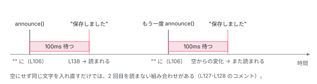

[目次](../README.md) › [CDK の内側](README.md) › 第 11 回 / 全 21 回

# LiveAnnouncer と AriaDescriber：画面読み上げに伝える

> LiveAnnouncer が aria-live の領域を 1 つ body に作り、文字を入れ直して読み上げさせる行（いったん空にしてから時間を置いて入れる理由）、politeness（polite / assertive）。aria-modal なダイアログが開いているとき領域を aria-owns でつなぐ行。AriaDescriber が説明の要素を共有し aria-describedby を付け外しする行。

angular/components · 読了 約 12 分 · 中核 · [サイトで読む（デモが動きます）](https://angular-deep-dive-cyan.vercel.app/chapter/cdk-live-announcer)

---

「保存しました」のような画面の変化は、目で見ている人には分かっても、スクリーンリーダー（画面を読み上げるソフト）の利用者には、フォーカスがそこに無い限り伝わりません。この章では、CDK の `LiveAnnouncer` が body に `aria-live` の領域を 1 つだけ作り、文字をいったん空にしてから 100ms 後に入れて読ませる行、politeness（`polite` / `assertive`）、`aria-modal` のダイアログに `aria-owns` でつなぐ行を読みます。後半では、ボタンなどに「補足の説明」を読ませる `AriaDescriber` が、説明の要素を共有して参照を数え、`aria-describedby` を付け外しする行を読みます。

読む対象は components の `src/cdk/a11y/live-announcer/live-announcer.ts`・`live-announcer-tokens.ts`、`src/cdk/a11y/aria-describer/aria-describer.ts`・`aria-reference.ts` です。

1. [1. 概観](01-cdk-overview.md)
2. [2. Platform と向き](02-cdk-platform-bidi.md)
3. [3. Observer と画面幅](03-cdk-observers-layout.md)
4. [4. Portal](04-cdk-portal.md)
5. [5. Overlay](05-cdk.md)
6. [6. 位置の計算](06-cdk-overlay-position.md)
7. [7. スクロールと Esc](07-cdk-overlay-scroll-dispatch.md)
8. [8. FocusTrap](08-cdk-focus-trap.md)
9. [9. FocusMonitor](09-cdk-focus-monitor.md)
10. [10. ListKeyManager](10-cdk-key-manager.md)
11. **11. LiveAnnouncer**（この章）
12. [12. Dialog](12-cdk-dialog.md)
13. [13. Menu](13-cdk-menu.md)
14. [14. DataSource と選択](14-cdk-collections.md)
15. [15. 仮想スクロール](15-virtual-scroll.md)
16. [16. table](16-table.md)
17. [17. tree](17-cdk-tree.md)
18. [18. DragRef](18-drag-drop.md)
19. [19. DropListRef](19-cdk-drop-list.md)
20. [20. ハーネス](20-harness.md)
21. [21. Material のテーマ](21-theming.md)

> [!TIP]
> **新卒エンジニアへ**
>
> `aria-live` 属性を付けた要素は「ライブリージョン」と呼ばれ、中の文字が変わるとスクリーンリーダーがその文字を読み上げます。値は `polite`（いま読んでいるものが終わってから読む）と `assertive`（いま読んでいるものを遮って読む）、`off` の 3 つです。`aria-describedby="id"` は「この要素の説明は id の要素の文字です」という指定で、要素にフォーカスが来たとき名前のあとに読まれます。

## 1. 領域は 1 つだけ、body の末尾に作る

📄 `components/src/cdk/a11y/live-announcer/live-announcer.ts` L36–53 （▶ の行: 36, 39, 51–52）

```ts
36 ▶ @Service()
37 │ export class LiveAnnouncer implements OnDestroy {
38 │   private _ngZone = inject(NgZone);
39 ▶   private _defaultOptions = inject<LiveAnnouncerDefaultOptions>(LIVE_ANNOUNCER_DEFAULT_OPTIONS, {
40 │     optional: true,
41 │   });
42 │ 
43 │   private _liveElement: HTMLElement;
44 │   private _document = inject(DOCUMENT);
45 │   private _sanitizer = inject(DomSanitizer);
46 │   private _previousTimeout: ReturnType<typeof setTimeout> | undefined;
47 │   private _currentPromise: Promise<void> | undefined;
48 │   private _currentResolve: (() => void) | undefined;
49 │ 
50 │   constructor() {
51 ▶     const elementToken = inject(LIVE_ANNOUNCER_ELEMENT_TOKEN, {optional: true});
52 ▶     this._liveElement = elementToken || this._createLiveElement();
53 │   }
```

📄 `components/src/cdk/a11y/live-announcer/live-announcer.ts` L176–196 （▶ の行: 177–178, 182–183, 186–187, 189–191, 193）

```ts
176 │   private _createLiveElement(): HTMLElement {
177 ▶     const elementClass = 'cdk-live-announcer-element';
178 ▶     const previousElements = this._document.getElementsByClassName(elementClass);
179 │     const liveEl = this._document.createElement('div');
180 │ 
181 │     // Remove any old containers. This can happen when coming in from a server-side-rendered page.
182 ▶     for (let i = 0; i < previousElements.length; i++) {
183 ▶       previousElements[i].remove();
184 │     }
185 │ 
186 ▶     liveEl.classList.add(elementClass);
187 ▶     liveEl.classList.add('cdk-visually-hidden');
188 │ 
189 ▶     liveEl.setAttribute('aria-atomic', 'true');
190 ▶     liveEl.setAttribute('aria-live', 'polite');
191 ▶     liveEl.id = `cdk-live-announcer-${uniqueIds++}`;
192 │ 
193 ▶     this._document.body.appendChild(liveEl);
194 │ 
195 │     return liveEl;
196 │   }
```

1. **36 行目：root のサービス**

   `@Service()` は v22 の Angular の印で、`providedIn: 'root'` と同じく自動でルートに provide されます。アプリに 1 つです。
2. **51〜52 行目：コンストラクタで領域を決める**

   `LIVE_ANNOUNCER_ELEMENT_TOKEN` で要素が渡されていればそれを使い、無ければ `_createLiveElement()` で作ります。つまり**最初に inject された瞬間**に body へ要素が足されます。
3. **178〜184 行目：古い領域を消す**

   同じクラスの要素が既にあれば消します。サーバーで描いた HTML に領域が入って届いた場合の掃除です（181 行目のコメント）。
4. **186〜191 行目：属性**

   `cdk-live-announcer-element` と `cdk-visually-hidden`（見えないが読み上げられる）、`aria-atomic="true"`（変わった部分だけでなく全体を読む）、`aria-live="polite"`、連番の id。
5. **193 行目：body の末尾に足す**

   以後、すべての `announce` がこの 1 つの要素を使い回します。

📄 `components/src/cdk/a11y/live-announcer/live-announcer-tokens.ts` L14–37 （▶ の行: 15, 17, 21, 28, 31, 35）

```ts
14 │ /** Possible politeness levels. */
15 ▶ export type AriaLivePoliteness = 'off' | 'polite' | 'assertive';
16 │ 
17 ▶ export const LIVE_ANNOUNCER_ELEMENT_TOKEN = new InjectionToken<HTMLElement | null>(
18 │   'liveAnnouncerElement',
19 │   {
20 │     providedIn: 'root',
21 ▶     factory: () => null,
22 │   },
23 │ );
24 │ 
25 │ /** Object that can be used to configure the default options for the LiveAnnouncer. */
26 │ export interface LiveAnnouncerDefaultOptions {
27 │   /** Default politeness for the announcements. */
28 ▶   politeness?: AriaLivePoliteness;
29 │ 
30 │   /** Default duration for the announcement messages. */
31 ▶   duration?: number;
32 │ }
33 │ 
34 │ /** Injection token that can be used to configure the default options for the LiveAnnouncer. */
35 ▶ export const LIVE_ANNOUNCER_DEFAULT_OPTIONS = new InjectionToken<LiveAnnouncerDefaultOptions>(
36 │   'LIVE_ANNOUNCER_DEFAULT_OPTIONS',
37 │ );
```

17〜23 行目の `LIVE_ANNOUNCER_ELEMENT_TOKEN` の既定は `null`（21 行目）なので、ふつうは作られます。35 行目の `LIVE_ANNOUNCER_DEFAULT_OPTIONS` で、politeness（28 行目）と duration（31 行目、文字を消すまでの時間）の既定値を変えられます。

> [!WARNING]
> **ハマりどころ**
>
> 186〜187 行目で `cdk-visually-hidden` クラスを付けますが、`LiveAnnouncer` のコンストラクタ（50〜53 行目）はそのクラスの CSS を読み込みません。読み込むのは `CdkAriaLive`（下の 6 節の 278 行目）や `AriaDescriber`（7 節の 55 行目）、`FocusTrapFactory` などで、これらは `_CdkPrivateStyleLoader` で `.cdk-visually-hidden` を 1 度だけ入れます。アプリのどこでも読み込まれていないと、領域の文字が body の末尾に見えてしまいます。下の DEMO は、同じ `_CdkPrivateStyleLoader` で先に読み込んでから `LiveAnnouncer` を取り出しています。

## 2. announce()：空にして、politeness を書き換える

📄 `components/src/cdk/a11y/live-announcer/live-announcer.ts` L95–123 （▶ の行: 100–101, 103, 106–107, 109–111, 114–115, 119, 121–122）

```ts
 95 │   announce(message: LiveAnnouncerMessage, ...args: any[]): Promise<void> {
 96 │     const defaultOptions = this._defaultOptions;
 97 │     let politeness: AriaLivePoliteness | undefined;
 98 │     let duration: number | undefined;
 99 │ 
100 ▶     if (args.length === 1 && typeof args[0] === 'number') {
101 ▶       duration = args[0];
102 │     } else {
103 ▶       [politeness, duration] = args;
104 │     }
105 │ 
106 ▶     this.clear();
107 ▶     clearTimeout(this._previousTimeout);
108 │ 
109 ▶     if (!politeness) {
110 ▶       politeness =
111 ▶         defaultOptions && defaultOptions.politeness ? defaultOptions.politeness : 'polite';
112 │     }
113 │ 
114 ▶     if (duration == null && defaultOptions) {
115 ▶       duration = defaultOptions.duration;
116 │     }
117 │ 
118 │     // TODO: ensure changing the politeness works on all environments we support.
119 ▶     this._liveElement.setAttribute('aria-live', politeness);
120 │ 
121 ▶     if (this._liveElement.id) {
122 ▶       this._exposeAnnouncerToModals(this._liveElement.id);
123 │     }
```

1. **100〜104 行目：引数の読み分け**

   `announce(msg, 3000)` のように数字 1 つなら duration、そうでなければ `[politeness, duration]`。
2. **106〜107 行目：前の文字を消し、前のタイマーを止める**

   162〜165 行目の `clear()` は `textContent = ''` です。続けて呼ばれたら、前の文字はここで消え、待っていた書き込みも取り消されます。
3. **109〜116 行目：既定値**

   politeness が無ければ設定の値、それも無ければ `'polite'`。duration が無ければ設定の値。
4. **119 行目：共有の領域の `aria-live` を書き換える**

   領域は 1 つなので、`assertive` で呼べば、その領域が `assertive` になります。次に politeness を省いて呼べば、111 行目で `polite` に戻ります。
5. **121〜122 行目：モーダルにつなぐ**

   領域に id があれば（191 行目で必ず付く）、4 節の `_exposeAnnouncerToModals` を呼びます。

📄 `components/src/cdk/a11y/live-announcer/live-announcer.ts` L157–174 （▶ の行: 164, 169–170, 172）

```ts
157 │   /**
158 │    * Clears the current text from the announcer element. Can be used to prevent
159 │    * screen readers from reading the text out again while the user is going
160 │    * through the page landmarks.
161 │    */
162 │   clear() {
163 │     if (this._liveElement) {
164 ▶       this._liveElement.textContent = '';
165 │     }
166 │   }
167 │ 
168 │   ngOnDestroy() {
169 ▶     clearTimeout(this._previousTimeout);
170 ▶     this._liveElement?.remove();
171 │     this._liveElement = null!;
172 ▶     this._currentResolve?.();
173 │     this._currentPromise = this._currentResolve = undefined;
174 │   }
```

## 3. 100ms 待ってから文字を入れる

📄 `components/src/cdk/a11y/live-announcer/live-announcer.ts` L125–155 （▶ の行: 127–128, 130–132, 136–138, 140, 143–144, 149, 151, 153）

```ts
125 │     // This 100ms timeout is necessary for some browser + screen-reader combinations:
126 │     // - Both JAWS and NVDA over IE11 will not announce anything without a non-zero timeout.
127 ▶     // - With Chrome and IE11 with NVDA or JAWS, a repeated (identical) message won't be read a
128 ▶     //   second time without clearing and then using a non-zero delay.
129 │     // (using JAWS 17 at time of this writing).
130 ▶     return this._ngZone.runOutsideAngular(() => {
131 ▶       if (!this._currentPromise) {
132 ▶         this._currentPromise = new Promise(resolve => (this._currentResolve = resolve));
133 │       }
134 │ 
135 │       clearTimeout(this._previousTimeout);
136 ▶       this._previousTimeout = setTimeout(() => {
137 ▶         if (!message || typeof message === 'string') {
138 ▶           this._liveElement.textContent = message;
139 │         } else {
140 ▶           _setInnerHtml(this._liveElement, message, this._sanitizer);
141 │         }
142 │ 
143 ▶         if (typeof duration === 'number') {
144 ▶           this._previousTimeout = setTimeout(() => this.clear(), duration);
145 │         }
146 │ 
147 │         // For some reason in tests this can be undefined
148 │         // Probably related to ZoneJS and every other thing that patches browser APIs in tests
149 ▶         this._currentResolve?.();
150 │         this._currentPromise = this._currentResolve = undefined;
151 ▶       }, 100);
152 │ 
153 ▶       return this._currentPromise;
154 │     });
155 │   }
```

1. **130 行目：zone の外で**

   zone.js のある構成でも、このタイマーで変更検知を起こしません。
2. **131〜133 行目：Promise を 1 つだけ作る**

   まだ解決していない Promise があれば使い回します。100ms の間に何度呼ばれても、全員が同じ Promise を受け取り、最後の文字が入ったときに一緒に解決します。
3. **136 行目・151 行目：100ms 後に**

   `setTimeout(…, 100)`。
4. **137〜141 行目：文字を入れる**

   文字列なら `textContent`。`SafeHtml` なら `_setInnerHtml` で、サニタイザーを通して HTML として入れます。
5. **143〜144 行目：duration があれば、その後で消す**

   文字が入ってから duration ミリ秒後に `clear()`。
6. **149〜150 行目：解決**

   `announce` の戻り値の Promise は「文字が DOM に入った」ときに解決します（読み上げが終わったときではありません）。

なぜ空にしてから時間を置くのか。125〜129 行目のコメントに理由が 2 つ書かれています。1 つは、IE11 の上の JAWS と NVDA は 0 でない待ち時間が無いと何も読まないこと。もう 1 つは、Chrome と IE11 の上の NVDA・JAWS では、**同じ文字**をもう一度入れても、いったん空にして待たないと 2 回目を読まないことです。そこで 106 行目で空にし、100ms 後に入れます。DOM の上では毎回「空 → 文字」という変化になり、前と同じ文字でも 2 回目が読まれます。



*announce('保存しました') を 2 回続けて呼んでも、毎回「空」を挟んでから 100ms 後に同じ文字が入るので、2 回目も変化として読まれる。*

> **🧪 DEMO — 本物の LiveAnnouncer**
>
> ボタンを押すと `LiveAnnouncer.announce` を呼び、body の末尾にある領域の DOM を 3 回読みます。スクリーンリーダーを有効にしていれば、実際に読み上げられます。領域は最初に押したときに作られ、root のサービスが持つので、この章を離れても残ります。
>
> ▶ [このデモはサイトで動かせます](https://angular-deep-dive-cyan.vercel.app/chapter/cdk-live-announcer)

① では中身が空で、`aria-live` だけが選んだ値になっています（2 節の 106・119 行目）。② で文字が入ります（3 節の 138 行目）。同じボタンを 2 回押しても、① で毎回いったん空になるのが分かります。duration を 3000ms にすると、③ で中身が空に戻ります（144 行目）。

## 4. aria-modal のダイアログが開いているとき

📄 `components/src/cdk/a11y/live-announcer/live-announcer.ts` L198–224 （▶ の行: 199–201, 210–211, 216, 218–221）

```ts
198 │   /**
199 ▶    * Some browsers won't expose the accessibility node of the live announcer element if there is an
200 ▶    * `aria-modal` and the live announcer is outside of it. This method works around the issue by
201 ▶    * pointing the `aria-owns` of all modals to the live announcer element.
202 │    */
203 │   private _exposeAnnouncerToModals(id: string) {
204 │     // TODO(http://github.com/angular/components/issues/26853): consider de-duplicating this with
205 │     // the `SnakBarContainer` and other usages.
206 │     //
207 │     // Note that the selector here is limited to CDK overlays at the moment in order to reduce the
208 │     // section of the DOM we need to look through. This should cover all the cases we support, but
209 │     // the selector can be expanded if it turns out to be too narrow.
210 ▶     const modals = this._document.querySelectorAll(
211 ▶       'body > .cdk-overlay-container [aria-modal="true"]',
212 │     );
213 │ 
214 │     for (let i = 0; i < modals.length; i++) {
215 │       const modal = modals[i];
216 ▶       const ariaOwns = modal.getAttribute('aria-owns');
217 │ 
218 ▶       if (!ariaOwns) {
219 ▶         modal.setAttribute('aria-owns', id);
220 ▶       } else if (ariaOwns.indexOf(id) === -1) {
221 ▶         modal.setAttribute('aria-owns', ariaOwns + ' ' + id);
222 │       }
223 │     }
224 │   }
```

`aria-modal="true"` のダイアログが開いていると、ブラウザによっては、ダイアログの外にある要素をアクセシビリティの木から外します（199〜201 行目のコメント）。body の末尾の領域もダイアログの外なので、読まれなくなります。そこで 210〜211 行目、**body 直下の `.cdk-overlay-container` の中**の `[aria-modal="true"]` を全部探し、218〜221 行目でその `aria-owns` に領域の id を足します（既にあれば足さない）。`aria-owns` は「この要素は DOM の位置にかかわらず、あの要素を子として持つ」という指定なので、領域がダイアログの子として扱われます。探す範囲が Overlay のコンテナだけなのは 207〜209 行目のコメントのとおりで、CDK の [Dialog](12-cdk-dialog.md) は Overlay の中に描かれます（[第 5 回](05-cdk.md)）。

## 5. 後片付け

2 節の 2 つ目の引用の 168〜173 行目、サービスが破棄されるとき（アプリの終了時）にタイマーを止め、領域を DOM から外し、待っていた Promise を解決します。

## 6. CdkAriaLive：テンプレートの中身を自動で読ませる

📄 `components/src/cdk/a11y/live-announcer/live-announcer.ts` L231–268 （▶ の行: 232, 247–248, 254–255, 257, 261–263）

```ts
231 │ @Directive({
232 ▶   selector: '[cdkAriaLive]',
233 │   exportAs: 'cdkAriaLive',
234 │ })
235 │ export class CdkAriaLive implements OnDestroy {
236 │   private _elementRef = inject(ElementRef);
237 │   private _liveAnnouncer = inject(LiveAnnouncer);
238 │   private _contentObserver = inject(ContentObserver);
239 │   private _ngZone = inject(NgZone);
240 │ 
241 │   /** The aria-live politeness level to use when announcing messages. */
242 │   @Input('cdkAriaLive')
243 │   get politeness(): AriaLivePoliteness {
244 │     return this._politeness;
245 │   }
246 │   set politeness(value: AriaLivePoliteness) {
247 ▶     this._politeness = value === 'off' || value === 'assertive' ? value : 'polite';
248 ▶     if (this._politeness === 'off') {
249 │       if (this._subscription) {
250 │         this._subscription.unsubscribe();
251 │         this._subscription = undefined;
252 │       }
253 │     } else if (!this._subscription) {
254 ▶       this._subscription = this._ngZone.runOutsideAngular(() => {
255 ▶         return this._contentObserver.observe(this._elementRef).subscribe(() => {
256 │           // Note that we use textContent here, rather than innerText, in order to avoid a reflow.
257 ▶           const elementText = this._elementRef.nativeElement.textContent;
258 │ 
259 │           // The `MutationObserver` fires also for attribute
260 │           // changes which we don't want to announce.
261 ▶           if (elementText !== this._previousAnnouncedText) {
262 ▶             this._liveAnnouncer.announce(elementText, this._politeness, this.duration);
263 ▶             this._previousAnnouncedText = elementText;
264 │           }
265 │         });
266 │       });
267 │     }
268 │   }
```

📄 `components/src/cdk/a11y/live-announcer/live-announcer.ts` L271–283 （▶ の行: 272, 278）

```ts
271 │   /** Time in milliseconds after which to clear out the announcer element. */
272 ▶   @Input('cdkAriaLiveDuration') duration!: number;
273 │ 
274 │   private _previousAnnouncedText?: string;
275 │   private _subscription: Subscription | undefined;
276 │ 
277 │   constructor() {
278 ▶     inject(_CdkPrivateStyleLoader).load(_VisuallyHiddenLoader);
279 │   }
280 │ 
281 │   ngOnDestroy() {
282 │     this._subscription?.unsubscribe();
283 │   }
```

`<div cdkAriaLive="polite">` と書くと、247 行目で politeness を正規化し、`off` 以外なら 255 行目で `ContentObserver`（[第 3 回](03-cdk-observers-layout.md)、中身の変化を `MutationObserver` で見る）を購読します。中身が変わるたびに 257 行目で `textContent` を読み、261 行目、前回と違えば 262 行目で `LiveAnnouncer.announce` に渡します。つまりこの要素自体はライブリージョンにならず、読ませるのは 1 節の共有の領域です。261 行目の比較は、`MutationObserver` が属性の変化でも呼ばれるため、文字が同じなら読ませないためです（259〜260 行目）。

## 7. AriaDescriber：説明の要素を共有する

📄 `components/src/cdk/a11y/aria-describer/aria-describer.ts` L40–57 （▶ の行: 46, 49, 55–56）

```ts
40 │ @Service()
41 │ export class AriaDescriber implements OnDestroy {
42 │   private _platform = inject(Platform);
43 │   private _document = inject(DOCUMENT);
44 │ 
45 │   /** Map of all registered message elements that have been placed into the document. */
46 ▶   private _messageRegistry = new Map<string | Element, RegisteredMessage>();
47 │ 
48 │   /** Container for all registered messages. */
49 ▶   private _messagesContainer: HTMLElement | null = null;
50 │ 
51 │   /** Unique ID for the service. */
52 │   private readonly _id = `${nextId++}`;
53 │ 
54 │   constructor() {
55 ▶     inject(_CdkPrivateStyleLoader).load(_VisuallyHiddenLoader);
56 ▶     this._id = inject(APP_ID) + '-' + nextId++;
57 │   }
```

46 行目、説明の文字（または要素）をキーにした Map。値は「説明の要素」と「その要素を参照している数」（`RegisteredMessage` 型）です。49 行目、説明の要素はすべて 1 つのコンテナに入ります。56 行目、id の接頭辞に `APP_ID` を混ぜ、同じページに複数のアプリがあっても id がぶつからないようにします。

📄 `components/src/cdk/a11y/aria-describer/aria-describer.ts` L59–89 （▶ の行: 72, 76, 78, 80–83, 86–87）

```ts
59 │   /**
60 │    * Adds to the host element an aria-describedby reference to a hidden element that contains
61 │    * the message. If the same message has already been registered, then it will reuse the created
62 │    * message element.
63 │    */
64 │   describe(hostElement: Element, message: string, role?: string): void;
65 │ 
66 │   /**
67 │    * Adds to the host element an aria-describedby reference to an already-existing message element.
68 │    */
69 │   describe(hostElement: Element, message: HTMLElement): void;
70 │ 
71 │   describe(hostElement: Element, message: string | HTMLElement, role?: string): void {
72 ▶     if (!this._canBeDescribed(hostElement, message)) {
73 │       return;
74 │     }
75 │ 
76 ▶     const key = getKey(message, role);
77 │ 
78 ▶     if (typeof message !== 'string') {
79 │       // We need to ensure that the element has an ID.
80 ▶       setMessageId(message, this._id);
81 ▶       this._messageRegistry.set(key, {messageElement: message, referenceCount: 0});
82 ▶     } else if (!this._messageRegistry.has(key)) {
83 ▶       this._createMessageElement(message, role);
84 │     }
85 │ 
86 ▶     if (!this._isElementDescribedByMessage(hostElement, key)) {
87 ▶       this._addMessageReference(hostElement, key);
88 │     }
89 │   }
```

1. **72 行目：付けてよいか**

   空の説明や、`aria-label` と同じ文字の説明は付けません（下の 259〜264 行目。同じ文を 2 回続けて読まれるのを避ける）。
2. **76 行目：キー**

   文字列なら `"role/文字"`、要素ならその要素（274〜275 行目）。
3. **82〜83 行目：まだ無ければ説明の要素を作る**

   同じ文字の説明が既にあれば作りません。ここで**共有**されます。
4. **86〜87 行目：参照を足す**

   まだこの要素から参照されていなければ、`aria-describedby` に id を足して数を 1 増やします。

📄 `components/src/cdk/a11y/aria-describer/aria-describer.ts` L139–161 （▶ の行: 144–146, 152–154, 159–160）

```ts
139 │   /**
140 │    * Creates a new element in the visually hidden message container element with the message
141 │    * as its content and adds it to the message registry.
142 │    */
143 │   private _createMessageElement(message: string, role?: string) {
144 ▶     const messageElement = this._document.createElement('div');
145 ▶     setMessageId(messageElement, this._id);
146 ▶     messageElement.textContent = message;
147 │ 
148 │     if (role) {
149 │       messageElement.setAttribute('role', role);
150 │     }
151 │ 
152 ▶     this._createMessagesContainer();
153 ▶     this._messagesContainer!.appendChild(messageElement);
154 ▶     this._messageRegistry.set(getKey(message, role), {messageElement, referenceCount: 0});
155 │   }
156 │ 
157 │   /** Deletes the message element from the global messages container. */
158 │   private _deleteMessageElement(key: string | Element) {
159 ▶     this._messageRegistry.get(key)?.messageElement?.remove();
160 ▶     this._messageRegistry.delete(key);
161 │   }
```

📄 `components/src/cdk/a11y/aria-describer/aria-describer.ts` L163–200 （▶ の行: 165, 170–171, 179, 188, 191–192, 195, 198）

```ts
163 │   /** Creates the global container for all aria-describedby messages. */
164 │   private _createMessagesContainer() {
165 ▶     if (this._messagesContainer) {
166 │       return;
167 │     }
168 │ 
169 │     const containerClassName = 'cdk-describedby-message-container';
170 ▶     const serverContainers = this._document.querySelectorAll(
171 ▶       `.${containerClassName}[platform="server"]`,
172 │     );
173 │ 
174 │     for (let i = 0; i < serverContainers.length; i++) {
175 │       // When going from the server to the client, we may end up in a situation where there's
176 │       // already a container on the page, but we don't have a reference to it. Clear the
177 │       // old container so we don't get duplicates. Doing this, instead of emptying the previous
178 │       // container, should be slightly faster.
179 ▶       serverContainers[i].remove();
180 │     }
181 │ 
182 │     const messagesContainer = this._document.createElement('div');
183 │ 
184 │     // We add `visibility: hidden` in order to prevent text in this container from
185 │     // being searchable by the browser's Ctrl + F functionality.
186 │     // Screen-readers will still read the description for elements with aria-describedby even
187 │     // when the description element is not visible.
188 ▶     messagesContainer.style.visibility = 'hidden';
189 │     // Even though we use `visibility: hidden`, we still apply `cdk-visually-hidden` so that
190 │     // the description element doesn't impact page layout.
191 ▶     messagesContainer.classList.add(containerClassName);
192 ▶     messagesContainer.classList.add('cdk-visually-hidden');
193 │ 
194 │     if (!this._platform.isBrowser) {
195 ▶       messagesContainer.setAttribute('platform', 'server');
196 │     }
197 │ 
198 ▶     this._document.body.appendChild(messagesContainer);
199 │     this._messagesContainer = messagesContainer;
200 │   }
```

144〜146 行目、`div` を作って id と文字を入れ、152〜153 行目でコンテナに入れます。コンテナは 165 行目のとおり 1 回だけ作ります。188 行目、コンテナに `visibility: hidden` を付けます。ブラウザの「ページ内検索」で説明の文字が見つからないようにするためで、`aria-describedby` で参照された文字は、見えない要素でも読み上げに使われます（184〜187 行目のコメント）。192 行目の `cdk-visually-hidden` はレイアウトに影響させないため。170〜180 行目と 195 行目は SSR の扱いで、サーバーで作ったコンテナには `platform="server"` を付けておき、ブラウザで最初に作るときにそれを消します。

📄 `components/src/cdk/a11y/aria-describer/aria-describer.ts` L211–235 （▶ の行: 220–222, 231, 233–234）

```ts
211 │   /**
212 │    * Adds a message reference to the element using aria-describedby and increments the registered
213 │    * message's reference count.
214 │    */
215 │   private _addMessageReference(element: Element, key: string | Element) {
216 │     const registeredMessage = this._messageRegistry.get(key)!;
217 │ 
218 │     // Add the aria-describedby reference and set the
219 │     // describedby_host attribute to mark the element.
220 ▶     addAriaReferencedId(element, 'aria-describedby', registeredMessage.messageElement.id);
221 ▶     element.setAttribute(CDK_DESCRIBEDBY_HOST_ATTRIBUTE, this._id);
222 ▶     registeredMessage.referenceCount++;
223 │   }
224 │ 
225 │   /**
226 │    * Removes a message reference from the element using aria-describedby
227 │    * and decrements the registered message's reference count.
228 │    */
229 │   private _removeMessageReference(element: Element, key: string | Element) {
230 │     const registeredMessage = this._messageRegistry.get(key)!;
231 ▶     registeredMessage.referenceCount--;
232 │ 
233 ▶     removeAriaReferencedId(element, 'aria-describedby', registeredMessage.messageElement.id);
234 ▶     element.removeAttribute(CDK_DESCRIBEDBY_HOST_ATTRIBUTE);
235 │   }
```

📄 `components/src/cdk/a11y/aria-describer/aria-reference.ts` L9–41 （▶ の行: 17, 19, 22, 24, 34, 36–37, 39）

```ts
 9 │ /** IDs are delimited by an empty space, as per the spec. */
10 │ const ID_DELIMITER = ' ';
11 │ 
12 │ /**
13 │  * Adds the given ID to the specified ARIA attribute on an element.
14 │  * Used for attributes such as aria-labelledby, aria-owns, etc.
15 │  */
16 │ export function addAriaReferencedId(el: Element, attr: `aria-${string}`, id: string) {
17 ▶   const ids = getAriaReferenceIds(el, attr);
18 │   id = id.trim();
19 ▶   if (ids.some(existingId => existingId.trim() === id)) {
20 │     return;
21 │   }
22 ▶   ids.push(id);
23 │ 
24 ▶   el.setAttribute(attr, ids.join(ID_DELIMITER));
25 │ }
26 │ 
27 │ /**
28 │  * Removes the given ID from the specified ARIA attribute on an element.
29 │  * Used for attributes such as aria-labelledby, aria-owns, etc.
30 │  */
31 │ export function removeAriaReferencedId(el: Element, attr: `aria-${string}`, id: string) {
32 │   const ids = getAriaReferenceIds(el, attr);
33 │   id = id.trim();
34 ▶   const filteredIds = ids.filter(val => val !== id);
35 │ 
36 ▶   if (filteredIds.length) {
37 ▶     el.setAttribute(attr, filteredIds.join(ID_DELIMITER));
38 │   } else {
39 ▶     el.removeAttribute(attr);
40 │   }
41 │ }
```

220 行目の `addAriaReferencedId` は、`aria-describedby` の値を空白で区切った id の列として読み（同じファイルの `getAriaReferenceIds`）、19 行目で同じ id が無いときだけ末尾に足します。もともと利用者が書いていた id は消しません。外すときは 34 行目で自分の id だけを除き、残りが空なら 39 行目で属性ごと消します。221 行目の `cdk-describedby-host` 属性は、サービスの破棄時に「自分が説明を付けた要素」を探すための印です。

📄 `components/src/cdk/a11y/aria-describer/aria-describer.ts` L97–121 （▶ の行: 104–105, 110, 112–113, 117–119）

```ts
 97 │   removeDescription(hostElement: Element, message: string | HTMLElement, role?: string): void {
 98 │     if (!message || !this._isElementNode(hostElement)) {
 99 │       return;
100 │     }
101 │ 
102 │     const key = getKey(message, role);
103 │ 
104 ▶     if (this._isElementDescribedByMessage(hostElement, key)) {
105 ▶       this._removeMessageReference(hostElement, key);
106 │     }
107 │ 
108 │     // If the message is a string, it means that it's one that we created for the
109 │     // consumer so we can remove it safely, otherwise we should leave it in place.
110 ▶     if (typeof message === 'string') {
111 │       const registeredMessage = this._messageRegistry.get(key);
112 ▶       if (registeredMessage && registeredMessage.referenceCount === 0) {
113 ▶         this._deleteMessageElement(key);
114 │       }
115 │     }
116 │ 
117 ▶     if (this._messagesContainer?.childNodes.length === 0) {
118 ▶       this._messagesContainer.remove();
119 ▶       this._messagesContainer = null;
120 │     }
121 │   }
```

外すときは 105 行目で参照を外して数を 1 減らし、110〜114 行目、自分で作った（文字列の）説明で数が 0 になったら説明の要素を消します。117〜119 行目、コンテナが空になればコンテナも消します。利用者が要素を渡した説明（78〜81 行目）は利用者のものなので、消しません。

📄 `components/src/cdk/a11y/aria-describer/aria-describer.ts` L246–283 （▶ の行: 259–260, 264, 275, 281）

```ts
246 │   /** Determines whether a message can be described on a particular element. */
247 │   private _canBeDescribed(element: Element, message: string | HTMLElement | void): boolean {
248 │     if (!this._isElementNode(element)) {
249 │       return false;
250 │     }
251 │ 
252 │     if (message && typeof message === 'object') {
253 │       // We'd have to make some assumptions about the description element's text, if the consumer
254 │       // passed in an element. Assume that if an element is passed in, the consumer has verified
255 │       // that it can be used as a description.
256 │       return true;
257 │     }
258 │ 
259 ▶     const trimmedMessage = message == null ? '' : `${message}`.trim();
260 ▶     const ariaLabel = element.getAttribute('aria-label');
261 │ 
262 │     // We shouldn't set descriptions if they're exactly the same as the `aria-label` of the
263 │     // element, because screen readers will end up reading out the same text twice in a row.
264 ▶     return trimmedMessage ? !ariaLabel || ariaLabel.trim() !== trimmedMessage : false;
265 │   }
266 │ 
267 │   /** Checks whether a node is an Element node. */
268 │   private _isElementNode(element: Node): element is Element {
269 │     return element.nodeType === this._document.ELEMENT_NODE;
270 │   }
271 │ }
272 │ 
273 │ /** Gets a key that can be used to look messages up in the registry. */
274 │ function getKey(message: string | Element, role?: string): string | Element {
275 ▶   return typeof message === 'string' ? `${role || ''}/${message}` : message;
276 │ }
277 │ 
278 │ /** Assigns a unique ID to an element, if it doesn't have one already. */
279 │ function setMessageId(element: HTMLElement, serviceId: string) {
280 │   if (!element.id) {
281 ▶     element.id = `${CDK_DESCRIBEDBY_ID_PREFIX}-${serviceId}-${nextId++}`;
282 │   }
283 │ }
```

> **🧪 DEMO — 本物の AriaDescriber**
>
> 2 つのボタンに同じ説明「この操作は取り消せません」を付け外しして、ボタンの属性と、body の末尾に作られるコンテナの DOM を表示します。最初に押したときにサービスが作られます。
>
> ▶ [このデモはサイトで動かせます](https://angular-deep-dive-cyan.vercel.app/chapter/cdk-live-announcer)

A と B の両方に付けても、コンテナの中の説明の要素は 1 つで、2 つのボタンの `aria-describedby` が同じ id を指します（82 行目で作らない）。A だけ外しても要素は残り、B も外すと数が 0 になって要素が消え（112〜113 行目）、空になったコンテナも消えます（117〜119 行目）。

## 全体の呼び出し

- 👤 `inject(LiveAnnouncer).announce('保存しました')` — 利用者のコード
  - `（初回だけ）new LiveAnnouncer() → _createLiveElement()` — live-announcer.ts L52, L176-L196 — *body の末尾に div*
  - `clear(); clearTimeout(_previousTimeout)` — L106-L107 — *textContent = ''*
  - `_liveElement.setAttribute('aria-live', politeness)` — L119
  - `_exposeAnnouncerToModals(id)` — L122, L203-L224 — *aria-owns*
  - `runOutsideAngular(() => setTimeout(…, 100))` — L130-L151
    - `_liveElement.textContent = message` — L138 — *スクリーンリーダーが読む*
    - `（duration があれば）setTimeout(clear, duration)` — L143-L144
    - `_currentResolve()` — L149 — *Promise が解決*

## 聞かれそうな質問

**Q. なぜ一度空にしてから 100ms 待つ？同じ文字を 2 回読ませたいだけなのに。**

L125-L129 のコメントが理由です。Chrome と IE11 上の NVDA・JAWS では空にして 0 でない時間を置かないと 2 回目を読まないこと、IE11 上の JAWS・NVDA は待ち時間が 0 だと何も読まないこと。そこで L106 で空にし、L136 の `setTimeout(…, 100)` で入れて、DOM の上では毎回「空 → 文字」の変化にしています。

**Q. assertive を多用しないほうがよい理由は？**

`assertive` は、いま読んでいる文を遮って読ませる指定です。入力のたびに遮られると、利用者は自分が読んでいたものを聞き取れません。CDK の既定も `polite` です（L111）。さらに CDK では領域が 1 つしかなく、L119 で**その領域の**`aria-live` を書き換えます。L118 には「politeness の変更がすべての環境で効くか確かめる」という TODO が残っています。エラーのように、すぐ知らせないと操作を誤るものに限って `assertive` を使います。

**Q. 自分のテンプレートに aria-live を書くのと何が違う？**

ARIA のライブリージョンは、中身が変わる**前から** DOM にある必要があります。`@if` で領域と文字を同時に出すと、領域ができたことと文字が入ったことが区別されず、読まれないことがあります。`LiveAnnouncer` はアプリで 1 つの領域を最初の inject で作って使い回し（L52, L193）、毎回空にして 100ms 待ち（L106, L136）、`aria-modal` のダイアログには `aria-owns` でつなぎます（L210-L222）。自分で書く `aria-live` では、これらを自分で面倒を見ることになります。テンプレートの中身を読ませたいときは `cdkAriaLive` を使えば、中身の変化を `ContentObserver` で見て共有の領域に流します（L255-L263）。

**Q. AriaDescriber は同じ説明を 100 個のボタンに付けたら要素を 100 個作る？**

作りません。キーが `"role/文字"`（L274-L275）なので、2 つ目からは L82 の `has(key)` が真になり、既存の要素の id を `aria-describedby` に足して数を増やすだけです（L220-L222）。最後の 1 つが外れたとき（数が 0、L112-L113）に要素を消します。

## 読み終えて

- `LiveAnnouncer` は最初の inject で body の末尾に `aria-live`・`aria-atomic` の `div` を 1 つ作り、以後すべての `announce` で使い回す。
- `announce` は空にしてから 100ms 後に文字を入れる。同じ文字でも「空 → 文字」の変化にして読ませるため。Promise は文字が入ったときに解決する。
- politeness は共有の領域の `aria-live` を書き換えるだけで、既定は `polite`。
- `aria-modal` のダイアログ（Overlay のコンテナの中）には `aria-owns` で領域をつなぐ。
- `AriaDescriber` は説明の要素を文字ごとに 1 つ作って共有し、参照の数を数え、0 になったら消す。`aria-describedby` は既存の id を残して足し引きする。

---

← 前: [ListKeyManager：矢印キーと頭文字で項目を選ぶ](10-cdk-key-manager.md)  
次: [Dialog：Overlay と Portal と FocusTrap を組み合わせる](12-cdk-dialog.md) →
