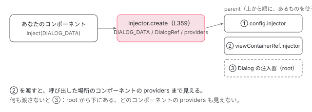

[目次](../README.md) › [CDK の内側](README.md) › 第 12 回 / 全 21 回

# Dialog：Overlay と Portal と FocusTrap を組み合わせる

> Dialog.open が OverlayRef を作り、CdkDialogContainer をそこに attach し、中身を Portal で差し込む流れ。コンテナがフォーカスを閉じ込め、最初の要素にフォーカスし、閉じたら元の要素に戻す行。フォーカスが入ったあと背後の要素に aria-hidden を付ける行（aria-modal は既定で付けない理由）、DialogRef の closed と backdropClick・Esc で閉じる行、注入器（DIALOG\_DATA）の親の決まり方。

angular/components · 読了 約 14 分 · 発展 · [サイトで読む（デモが動きます）](https://angular-deep-dive-cyan.vercel.app/chapter/cdk-dialog)

---

CDK の `Dialog` は、新しい仕組みをほとんど持っていません。[Overlay（第 5 回）](05-cdk.md)で画面の中央に浮かせ、[Portal（第 4 回）](04-cdk-portal.md)で中身を差し込み、[FocusTrap（第 8 回）](08-cdk-focus-trap.md)でフォーカスを閉じ込める。その組み合わせ方がこの章の中身です。`Dialog.open()` の 1 行目から順に、OverlayRef ができ、`CdkDialogContainer` が attach され、あなたのコンポーネントが専用の注入器で作られ、背後の要素に `aria-hidden` が付き、閉じるとフォーカスが元に戻るまでを追います。

読む対象は `src/cdk/dialog/` の `dialog.ts`・`dialog-container.ts`・`dialog-ref.ts`・ `dialog-injectors.ts`・`dialog-config.ts`、比較に `src/material/dialog/dialog.ts` です（components リポジトリ）。

1. [1. 概観](01-cdk-overview.md)
2. [2. Platform と向き](02-cdk-platform-bidi.md)
3. [3. Observer と画面幅](03-cdk-observers-layout.md)
4. [4. Portal](04-cdk-portal.md)
5. [5. Overlay](05-cdk.md)
6. [6. 位置の計算](06-cdk-overlay-position.md)
7. [7. スクロールと Esc](07-cdk-overlay-scroll-dispatch.md)
8. [8. FocusTrap](08-cdk-focus-trap.md)
9. [9. FocusMonitor](09-cdk-focus-monitor.md)
10. [10. ListKeyManager](10-cdk-key-manager.md)
11. [11. LiveAnnouncer](11-cdk-live-announcer.md)
12. **12. Dialog**（この章）
13. [13. Menu](13-cdk-menu.md)
14. [14. DataSource と選択](14-cdk-collections.md)
15. [15. 仮想スクロール](15-virtual-scroll.md)
16. [16. table](16-table.md)
17. [17. tree](17-cdk-tree.md)
18. [18. DragRef](18-drag-drop.md)
19. [19. DropListRef](19-cdk-drop-list.md)
20. [20. ハーネス](20-harness.md)
21. [21. Material のテーマ](21-theming.md)

## 0. 全体の流れ

1. **設定をまとめる**

   既定の `DialogConfig` と渡した設定を混ぜ、id を決める（1 節）。
2. **OverlayRef を作る**

   画面中央・背景あり・スクロールを止める Overlay（2 節）。
3. **DialogRef を作る**

   Esc・背景のクリック・detach を購読して、自分で閉じる準備をする（7 節）。
4. **コンテナを attach**

   `CdkDialogContainer` を ComponentPortal で Overlay の pane に入れる。`role="dialog"` などはこのコンテナの host に付く（3 節）。
5. **中身を attach**

   あなたのコンポーネントを、`DIALOG_DATA` と `DialogRef` を持った注入器で、コンテナの中の `cdkPortalOutlet` に作る（4 節）。
6. **フォーカスを中へ**

   FocusTrap を作り、開く前にフォーカスがあった要素を覚え、描画のあとで最初の要素にフォーカスする（5 節）。
7. **背後を隠す**

   フォーカスが入ったら、コンテナの兄弟に `aria-hidden="true"`（6 節）。
8. **閉じる**

   `overlayRef.dispose()` → コンテナの破棄でフォーカスを戻す → `closed` に結果 → 最後の 1 つなら `aria-hidden` を戻す（7 節）。

## 1. open の前半：設定・Overlay・DialogRef・コンテナ

📄 `components/src/cdk/dialog/dialog.ts` L116–140 （▶ の行: 120, 124–125, 135–138, 140）

```ts
116 │   open<R = unknown, D = unknown, C = unknown>(
117 │     componentOrTemplateRef: ComponentType<C> | TemplateRef<C>,
118 │     config?: DialogConfig<D, DialogRef<R, C>>,
119 │   ): DialogRef<R, C> {
120 ▶     const defaults = (this._defaultOptions || new DialogConfig()) as DialogConfig<
121 │       D,
122 │       DialogRef<R, C>
123 │     >;
124 ▶     config = {...defaults, ...config};
125 ▶     config.id = config.id || this._idGenerator.getId('cdk-dialog-');
126 │ 
127 │     if (
128 │       config.id &&
129 │       this.getDialogById(config.id) &&
130 │       (typeof ngDevMode === 'undefined' || ngDevMode)
131 │     ) {
132 │       throw Error(`Dialog with id "${config.id}" exists already. The dialog id must be unique.`);
133 │     }
134 │ 
135 ▶     const overlayConfig = this._getOverlayConfig(config);
136 ▶     const overlayRef = createOverlayRef(this._injector, overlayConfig);
137 ▶     const dialogRef = new DialogRef(overlayRef, config);
138 ▶     const dialogContainer = this._attachContainer(overlayRef, dialogRef, config);
139 │ 
140 ▶     (dialogRef as {containerInstance: DialogContainer}).containerInstance = dialogContainer;
```

120〜124 行目、`DEFAULT_DIALOG_CONFIG` トークンで provide された既定（無ければ `new DialogConfig()`）に、渡した設定を上から重ねます。125 行目で id を `cdk-dialog-0` のように振ります。135〜138 行目の 4 行が骨組みです：Overlay の設定を作り（135）、`createOverlayRef` で OverlayRef を作り（136）、`DialogRef` で包み（137）、コンテナを attach する（138）。140 行目で、できたコンテナのインスタンスを DialogRef に覚えさせます。

## 2. どんな Overlay を作るか

📄 `components/src/cdk/dialog/dialog.ts` L206–230 （▶ の行: 209–211, 213, 221）

```ts
206 │   private _getOverlayConfig<D, R>(config: DialogConfig<D, R>): OverlayConfig {
207 │     const state = new OverlayConfig({
208 │       positionStrategy:
209 ▶         config.positionStrategy ||
210 ▶         createGlobalPositionStrategy(this._injector).centerHorizontally().centerVertically(),
211 ▶       scrollStrategy: config.scrollStrategy || this._scrollStrategy(),
212 │       panelClass: config.panelClass,
213 ▶       hasBackdrop: config.hasBackdrop,
214 │       direction: config.direction,
215 │       minWidth: config.minWidth,
216 │       minHeight: config.minHeight,
217 │       maxWidth: config.maxWidth,
218 │       maxHeight: config.maxHeight,
219 │       width: config.width,
220 │       height: config.height,
221 ▶       disposeOnNavigation: config.closeOnNavigation,
222 │       disableAnimations: config.disableAnimations,
223 │     });
224 │ 
225 │     if (config.backdropClass) {
226 │       state.backdropClass = config.backdropClass;
227 │     }
228 │ 
229 │     return state;
230 │   }
```

210 行目、位置は `createGlobalPositionStrategy(...).centerHorizontally().centerVertically()`。何も測らず flexbox で中央に置く戦略です（[第 6 回の 9 節](06-cdk-overlay-position.md)）。211 行目、スクロール戦略は `this._scrollStrategy()`、つまり次のトークンの工場です。213 行目の `hasBackdrop` は `DialogConfig` の既定で `true` なので、背景（backdrop）が付きます。221 行目、`closeOnNavigation`（既定 true）は Overlay の `disposeOnNavigation` になり、ブラウザの戻る・進むで閉じます。

📄 `components/src/cdk/dialog/dialog-injectors.ts` L13–29 （▶ の行: 14, 20, 26, 29）

```ts
13 │ /** Injection token for the Dialog's ScrollStrategy. */
14 ▶ export const DIALOG_SCROLL_STRATEGY = new InjectionToken<() => ScrollStrategy>(
15 │   'DialogScrollStrategy',
16 │   {
17 │     providedIn: 'root',
18 │     factory: () => {
19 │       const injector = inject(Injector);
20 ▶       return () => createBlockScrollStrategy(injector);
21 │     },
22 │   },
23 │ );
24 │ 
25 │ /** Injection token for the Dialog's Data. */
26 ▶ export const DIALOG_DATA = new InjectionToken<any>('DialogData');
27 │ 
28 │ /** Injection token that can be used to provide default options for the dialog module. */
29 ▶ export const DEFAULT_DIALOG_CONFIG = new InjectionToken<DialogConfig>('DefaultDialogConfig');
```

20 行目、ダイアログの既定のスクロール戦略は **block**（開いている間、ページはスクロールできない）。中身は[第 7 回](07-cdk-overlay-scroll-dispatch.md)で読んだ `html` を fixed にするやり方です。14 行目のトークンを provide し直せば、アプリ全体のダイアログの既定を変えられます。26 行目が中身にデータを渡す `DIALOG_DATA`、29 行目が既定の設定を変える `DEFAULT_DIALOG_CONFIG` です。

## 3. コンテナを attach する

📄 `components/src/cdk/dialog/dialog.ts` L238–270 （▶ の行: 243, 245–247, 259, 262–265, 267）

```ts
238 │   private _attachContainer<R, D, C>(
239 │     overlay: OverlayRef,
240 │     dialogRef: DialogRef<R, C>,
241 │     config: DialogConfig<D, DialogRef<R, C>>,
242 │   ): DialogContainer {
243 ▶     const userInjector = config.injector || config.viewContainerRef?.injector;
244 │     const providers: StaticProvider[] = [
245 ▶       {provide: DialogConfig, useValue: config},
246 ▶       {provide: DialogRef, useValue: dialogRef},
247 ▶       {provide: OverlayRef, useValue: overlay},
248 │     ];
249 │     let containerType: Type<DialogContainer>;
250 │ 
251 │     if (config.container) {
252 │       if (typeof config.container === 'function') {
253 │         containerType = config.container;
254 │       } else {
255 │         containerType = config.container.type;
256 │         providers.push(...config.container.providers(config));
257 │       }
258 │     } else {
259 ▶       containerType = CdkDialogContainer;
260 │     }
261 │ 
262 ▶     const containerPortal = new ComponentPortal(
263 ▶       containerType,
264 ▶       config.viewContainerRef,
265 ▶       Injector.create({parent: userInjector || this._injector, providers}),
266 │     );
267 ▶     const containerRef = overlay.attach(containerPortal);
268 │ 
269 │     return containerRef.instance;
270 │   }
```

1. **244〜248 行目：コンテナ用の 3 つ**

   コンテナが inject するのは `DialogConfig`（245）、`DialogRef`（246）、`OverlayRef`（247）。
2. **259 行目：既定のコンテナ**

   `config.container` を渡さなければ `CdkDialogContainer`。Angular Material はここに自分のコンテナを渡します（8 節）。
3. **262〜266 行目：ComponentPortal**

   265 行目、注入器の親は 243 行目の `userInjector`（`config.injector` か `viewContainerRef.injector`）、無ければ `Dialog` サービス自身の注入器です。
4. **267 行目：overlay.attach**

   ここから先は第 5 回の `OverlayRef.attach` で、コンテナは `cdk-overlay-pane` の中に作られます。

📄 `components/src/cdk/dialog/dialog-container.ts` L53–72 （▶ の行: 54–55, 64, 66–68）

```ts
53 │ @Component({
54 ▶   selector: 'cdk-dialog-container',
55 ▶   templateUrl: './dialog-container.html',
56 │   styleUrl: 'dialog-container.css',
57 │   encapsulation: ViewEncapsulation.None,
58 │   // Using OnPush for dialogs caused some G3 sync issues. Disabled until we can track them down.
59 │   // tslint:disable-next-line:validate-decorators
60 │   changeDetection: ChangeDetectionStrategy.Eager,
61 │   imports: [CdkPortalOutlet],
62 │   host: {
63 │     'class': 'cdk-dialog-container',
64 ▶     'tabindex': '-1',
65 │     '[attr.id]': '_config.id || null',
66 ▶     '[attr.role]': '_config.role',
67 ▶     '[attr.aria-modal]': '_config.ariaModal',
68 ▶     '[attr.aria-labelledby]': '_config.ariaLabel ? null : _ariaLabelledByQueue[0]',
69 │     '[attr.aria-label]': '_config.ariaLabel',
70 │     '[attr.aria-describedby]': '_config.ariaDescribedBy || null',
71 │   },
72 │ })
```

`CdkDialogContainer` のテンプレート（55 行目の `dialog-container.html`）は `<ng-template cdkPortalOutlet />` の 1 行だけです。74 行目で `BasePortalOutlet` を継承していて、自分自身も「中身を受け取る出口」になっています。ARIA の属性は host に付きます。66 行目 `role`（既定 `dialog`）、67 行目 `aria-modal`（既定 `false`、6 節）、68 行目 `aria-labelledby`。64 行目の `tabindex="-1"` は、中にフォーカスできる要素が無いときにコンテナ自身へフォーカスするためです。

## 4. 中身を差し込む：専用の注入器

📄 `components/src/cdk/dialog/dialog.ts` L286–315 （▶ の行: 286–288, 299, 303–308, 313–314）

```ts
286 ▶     if (componentOrTemplateRef instanceof TemplateRef) {
287 ▶       const injector = this._createInjector(config, dialogRef, dialogContainer, undefined);
288 ▶       let context: any = {$implicit: config.data, dialogRef};
289 │ 
290 │       if (config.templateContext) {
291 │         context = {
292 │           ...context,
293 │           ...(typeof config.templateContext === 'function'
294 │             ? config.templateContext()
295 │             : config.templateContext),
296 │         };
297 │       }
298 │ 
299 ▶       dialogContainer.attachTemplatePortal(
300 │         new TemplatePortal<C>(componentOrTemplateRef, null!, context, injector),
301 │       );
302 │     } else {
303 ▶       const injector = this._createInjector(config, dialogRef, dialogContainer, this._injector);
304 ▶       const contentRef = dialogContainer.attachComponentPortal<C>(
305 ▶         new ComponentPortal(
306 ▶           componentOrTemplateRef,
307 ▶           config.viewContainerRef,
308 ▶           injector,
309 │           null,
310 │           config.bindings,
311 │         ),
312 │       );
313 ▶       (dialogRef as {componentRef: ComponentRef<C>}).componentRef = contentRef;
314 ▶       (dialogRef as {componentInstance: C}).componentInstance = contentRef.instance;
315 │     }
```

286 行目でテンプレートかコンポーネントかを分けます。コンポーネントなら 303 行目で注入器を作り、304〜312 行目でコンテナの `attachComponentPortal` に渡します。313〜314 行目で、作られた `ComponentRef` とインスタンスを DialogRef に覚えさせます（`dialogRef.componentInstance` の正体）。テンプレートなら 288 行目で `$implicit` にデータ、`dialogRef` に DialogRef を入れた context で `TemplatePortal` を作ります。

📄 `components/src/cdk/dialog/dialog.ts` L328–360 （▶ の行: 334, 336–337, 340, 342, 348, 353, 355, 359）

```ts
328 │   private _createInjector<R, D, C>(
329 │     config: DialogConfig<D, DialogRef<R, C>>,
330 │     dialogRef: DialogRef<R, C>,
331 │     dialogContainer: DialogContainer,
332 │     fallbackInjector: Injector | undefined,
333 │   ): Injector {
334 ▶     const userInjector = config.injector || config.viewContainerRef?.injector;
335 │     const providers: StaticProvider[] = [
336 ▶       {provide: DIALOG_DATA, useValue: config.data},
337 ▶       {provide: DialogRef, useValue: dialogRef},
338 │     ];
339 │ 
340 ▶     if (config.providers) {
341 │       if (typeof config.providers === 'function') {
342 ▶         providers.push(...config.providers(dialogRef, config, dialogContainer));
343 │       } else {
344 │         providers.push(...config.providers);
345 │       }
346 │     }
347 │ 
348 ▶     if (
349 │       config.direction &&
350 │       (!userInjector ||
351 │         !userInjector.get<Directionality | null>(Directionality, null, {optional: true}))
352 │     ) {
353 ▶       providers.push({
354 │         provide: Directionality,
355 ▶         useValue: getDirectionality(config.direction),
356 │       });
357 │     }
358 │ 
359 ▶     return Injector.create({parent: userInjector || fallbackInjector, providers});
360 │   }
```

1. **336〜337 行目**

   `DIALOG_DATA` に `config.data`、`DialogRef` に DialogRef。中身のコンポーネントが `inject(DIALOG_DATA)` と `inject(DialogRef)` で受け取れるのはこの 2 行のおかげです。
2. **340〜346 行目**

   `config.providers` を足す。関数なら DialogRef・設定・コンテナを引数に呼びます（Material はこれで `MatDialogRef` を差し込みます）。
3. **348〜357 行目**

   `config.direction` を渡していて、親の注入器に `Directionality` が無ければ、その向きの `Directionality` を作って provide します。
4. **359 行目：親**

   `userInjector || fallbackInjector`。コンポーネントの場合 fallback は 303 行目で渡した `this._injector`（Dialog サービスの注入器）です。



*中身のコンポーネントから inject したとき、探しに行く順番。viewContainerRef を渡したかどうかで、2 段目の親が変わる。*

## 5. フォーカスを中へ入れる

📄 `components/src/cdk/dialog/dialog-container.ts` L143–174 （▶ の行: 143–145, 153, 156, 159, 171–172）

```ts
143 ▶   protected _contentAttached() {
144 ▶     this._initializeFocusTrap();
145 ▶     this._captureInitialFocus();
146 │   }
147 │ 
148 │   /**
149 │    * Can be used by child classes to customize the initial focus
150 │    * capturing behavior (e.g. if it's tied to an animation).
151 │    */
152 │   protected _captureInitialFocus() {
153 ▶     this._trapFocus();
154 │   }
155 │ 
156 ▶   ngOnDestroy() {
157 │     (this._focusTrapped as Subject<void>).complete();
158 │     this._isDestroyed = true;
159 ▶     this._restoreFocus();
160 │   }
161 │ 
162 │   /**
163 │    * Attach a ComponentPortal as content to this dialog container.
164 │    * @param portal Portal to be attached as the dialog content.
165 │    */
166 │   attachComponentPortal<T>(portal: ComponentPortal<T>): ComponentRef<T> {
167 │     if (this._portalOutlet.hasAttached() && (typeof ngDevMode === 'undefined' || ngDevMode)) {
168 │       throwDialogContentAlreadyAttachedError();
169 │     }
170 │ 
171 ▶     const result = this._portalOutlet.attachComponentPortal(portal);
172 ▶     this._contentAttached();
173 │     return result;
174 │   }
```

171 行目でコンテナの中の `CdkPortalOutlet` に中身を作り、172 行目で `_contentAttached()`。そこで 144 行目 `_initializeFocusTrap` と 145 行目 `_captureInitialFocus`（= 153 行目 `_trapFocus`）が順に呼ばれます。156〜160 行目、コンテナが破棄されるとき（ダイアログが閉じたとき）は `_restoreFocus` です（7 節）。

📄 `components/src/cdk/dialog/dialog-container.ts` L358–369 （▶ の行: 360–361, 366）

```ts
358 │   /** Sets up the focus trap. */
359 │   private _initializeFocusTrap() {
360 ▶     if (this._platform.isBrowser) {
361 ▶       this._focusTrap = this._focusTrapFactory.create(this._elementRef.nativeElement);
362 │ 
363 │       // Save the previously focused element. This element will be re-focused
364 │       // when the dialog closes.
365 │       if (this._document) {
366 ▶         this._elementFocusedBeforeDialogWasOpened = _getFocusedElementPierceShadowDom();
367 │       }
368 │     }
369 │   }
```

361 行目、コンテナの要素に FocusTrap を作ります。中身の前後に見えない番兵の要素を置いて Tab を端で折り返す仕組みは [第 8 回](08-cdk-focus-trap.md)で読みます。366 行目、**まだフォーカスを動かす前に**、今フォーカスのある要素（ふつうはダイアログを開いたボタン）を覚えます。これが閉じたときの戻り先です。

📄 `components/src/cdk/dialog/dialog-container.ts` L259–297 （▶ の行: 262, 265, 267, 273–274, 278–279, 282–283, 286–287, 293）

```ts
259 │     // If were to attempt to focus immediately, then the content of the dialog would not yet be
260 │     // ready in instances where change detection has to run first. To deal with this, we simply
261 │     // wait until after the next render.
262 ▶     afterNextRender(
263 │       () => {
264 │         const element = this._elementRef.nativeElement;
265 ▶         switch (this._config.autoFocus) {
266 │           case false:
267 ▶           case 'dialog':
268 │             // Ensure that focus is on the dialog container. It's possible that a different
269 │             // component tried to move focus while the open animation was running. See:
270 │             // https://github.com/angular/components/issues/16215. Note that we only want to do this
271 │             // if the focus isn't inside the dialog already, because it's possible that the consumer
272 │             // turned off `autoFocus` in order to move focus themselves.
273 ▶             if (!this._containsFocus()) {
274 ▶               element.focus(options);
275 │             }
276 │             break;
277 │           case true:
278 ▶           case 'first-tabbable':
279 ▶             const focusedSuccessfully = this._focusTrap?.focusInitialElement(options);
280 │             // If we weren't able to find a focusable element in the dialog, then focus the dialog
281 │             // container instead.
282 ▶             if (!focusedSuccessfully) {
283 ▶               this._focusDialogContainer(options);
284 │             }
285 │             break;
286 ▶           case 'first-heading':
287 ▶             this._focusByCssSelector('h1, h2, h3, h4, h5, h6, [role="heading"]', options);
288 │             break;
289 │           default:
290 │             this._focusByCssSelector(this._config.autoFocus!, options);
291 │             break;
292 │         }
293 ▶         (this._focusTrapped as Subject<void>).next();
294 │       },
295 │       {injector: this._injector},
296 │     );
297 │   }
```

262 行目、フォーカスは `afterNextRender` の中で動かします。中身のコンポーネントがまだ描画されていない時点では、フォーカスする要素が DOM に無いからです。265 行目で `autoFocus`（既定 `'first-tabbable'`）を見て、278〜279 行目、FocusTrap の `focusInitialElement` で `cdkFocusInitial` の付いた要素、無ければ最初に Tab で届く要素へ。見つからなければ 282〜283 行目でコンテナ自身へ。`'dialog'` や `false` ならコンテナ自身（273〜274 行目）、`'first-heading'` なら最初の見出し（286〜287 行目）です。最後に 293 行目で `_focusTrapped` に流します。これを待っているのが次の節です。

## 6. 背後の要素を、読み上げから隠す

📄 `components/src/cdk/dialog/dialog.ts` L142–163 （▶ の行: 143, 146, 148–150, 157–160）

```ts
142 │     // If this is the first dialog that we're opening, hide all the non-overlay content.
143 ▶     if (!this.openDialogs.length) {
144 │       // Resolve this ahead of time, because some internal apps
145 │       // mock it out and depend on it being synchronous.
146 ▶       const overlayContainer = this._overlayContainer.getContainerElement();
147 │ 
148 ▶       if (dialogContainer._focusTrapped) {
149 ▶         dialogContainer._focusTrapped.pipe(take(1)).subscribe(() => {
150 ▶           this._hideNonDialogContentFromAssistiveTechnology(overlayContainer);
151 │         });
152 │       } else {
153 │         this._hideNonDialogContentFromAssistiveTechnology(overlayContainer);
154 │       }
155 │     }
156 │ 
157 ▶     this._attachDialogContent(componentOrTemplateRef, dialogRef, dialogContainer, config);
158 ▶     (this.openDialogs as DialogRef<R, C>[]).push(dialogRef);
159 ▶     dialogRef.closed.subscribe(() => this._removeOpenDialog(dialogRef, true));
160 ▶     this.afterOpened.next(dialogRef);
161 │ 
162 │     return dialogRef;
163 │   }
```

143 行目、**1 つ目のダイアログを開くときだけ**背後を隠します。148〜151 行目、すぐには隠さず、5 節の `_focusTrapped`（フォーカスがダイアログの中に入った）を 1 回待ってから隠します。先に隠すと、フォーカスがまだ外の要素にある間に、その要素が `aria-hidden` の中に入ってしまうからです。157 行目で中身を attach、158 行目で開いている一覧に積み、159 行目で「閉じたら一覧から外す」を購読します。

📄 `components/src/cdk/dialog/dialog.ts` L393–414 （▶ の行: 396–397, 399, 403–407, 409–410）

```ts
393 │   /** Hides all of the content that isn't an overlay from assistive technology. */
394 │   private _hideNonDialogContentFromAssistiveTechnology(overlayContainer: HTMLElement) {
395 │     // Ensure that the overlay container is attached to the DOM.
396 ▶     if (overlayContainer.parentElement) {
397 ▶       const siblings = overlayContainer.parentElement.children;
398 │ 
399 ▶       for (let i = siblings.length - 1; i > -1; i--) {
400 │         const sibling = siblings[i];
401 │ 
402 │         if (
403 ▶           sibling !== overlayContainer &&
404 ▶           sibling.nodeName !== 'SCRIPT' &&
405 ▶           sibling.nodeName !== 'STYLE' &&
406 ▶           !sibling.hasAttribute('aria-live') &&
407 ▶           !sibling.hasAttribute('popover')
408 │         ) {
409 ▶           this._ariaHiddenElements.set(sibling, sibling.getAttribute('aria-hidden'));
410 ▶           sibling.setAttribute('aria-hidden', 'true');
411 │         }
412 │       }
413 │     }
414 │   }
```

396〜397 行目、`cdk-overlay-container` の親（ふつう `body`）の子をすべて見ます。403〜407 行目で除くのは、コンテナ自身・`script`・`style`・`aria-live` を持つ要素 （[LiveAnnouncer](11-cdk-live-announcer.md) の読み上げ領域を隠すと、ダイアログを開いている間の読み上げが止まる）、そして 407 行目の `popover` を持つ要素です。Overlay を popover で開き、場所を「トリガーの隣」にした場合（`withPopoverLocation('inline')`）は、その host がコンテナの外に出るので、それを隠さないための条件です。409 行目で元の `aria-hidden` の値を Map に覚え、410 行目で `true` にします。このサイトなら `<app-root>` が丸ごと `aria-hidden="true"` になります（下のデモで確かめられます）。

📄 `components/src/cdk/dialog/dialog-config.ts` L120–135 （▶ の行: 121–123, 125, 132, 135）

```ts
120 │   /**
121 ▶    * Whether this is a modal dialog. Used to set the `aria-modal` attribute. Off by default,
122 ▶    * because it can interfere with other overlay-based components (e.g. `mat-select`) and because
123 ▶    * it is redundant since the dialog marks all outside content as `aria-hidden` anyway.
124 │    */
125 ▶   ariaModal?: boolean = false;
126 │ 
127 │   /**
128 │    * Where the dialog should focus on open.
129 │    * @breaking-change 14.0.0 Remove boolean option from autoFocus. Use string or
130 │    * AutoFocusTarget instead.
131 │    */
132 ▶   autoFocus?: AutoFocusTarget | string | boolean = 'first-tabbable';
133 │ 
134 │   /** Configures the focus restoration behavior. See `RestoreFocusValue` for more information. */
135 ▶   restoreFocus?: RestoreFocusValue = true;
```

125 行目、CDK の Dialog は **`aria-modal` を既定で付けません**。121〜123 行目のコメントが理由で、(1) `mat-select` のような、ダイアログの中から別の Overlay を開く部品の邪魔になることがある、(2) 外側をすべて `aria-hidden` にしているので重複する、の 2 つです。`ariaModal: true` を渡せば付きます。132 行目が 5 節の `autoFocus`、135 行目が 7 節の `restoreFocus` の既定です。

## 7. 閉じる：Esc・背景・close(結果)

📄 `components/src/cdk/dialog/dialog-ref.ts` L62–95 （▶ の行: 66–68, 72–73, 75, 79–81, 85, 89, 91–92）

```ts
62 │   constructor(
63 │     readonly overlayRef: OverlayRef,
64 │     readonly config: DialogConfig<any, DialogRef<R, C>, DialogContainer>,
65 │   ) {
66 ▶     this.disableClose = config.disableClose;
67 ▶     this.backdropClick = overlayRef.backdropClick();
68 ▶     this.keydownEvents = overlayRef.keydownEvents();
69 │     this.outsidePointerEvents = overlayRef.outsidePointerEvents();
70 │     this.id = config.id!; // By the time the dialog is created we are guaranteed to have an ID.
71 │ 
72 ▶     this.keydownEvents.subscribe(event => {
73 ▶       if (event.keyCode === ESCAPE && !this.disableClose && !hasModifierKey(event)) {
74 │         event.preventDefault();
75 ▶         this.close(undefined, {focusOrigin: 'keyboard'});
76 │       }
77 │     });
78 │ 
79 ▶     this.backdropClick.subscribe(() => {
80 ▶       if (!this.disableClose && this._canClose()) {
81 ▶         this.close(undefined, {focusOrigin: 'mouse'});
82 │       } else {
83 │         // Clicking on the backdrop will move focus out of dialog.
84 │         // Recapture it if closing via the backdrop is disabled.
85 ▶         this.containerInstance._recaptureFocus?.();
86 │       }
87 │     });
88 │ 
89 ▶     this._detachSubscription = overlayRef.detachments().subscribe(() => {
90 │       // Check specifically for `false`, because we want `undefined` to be treated like `true`.
91 ▶       if (config.closeOnOverlayDetachments !== false) {
92 ▶         this.close();
93 │       }
94 │     });
95 │   }
```

1. **72〜77 行目：Esc**

   `overlayRef.keydownEvents()` を購読します。これは[第 7 回](07-cdk-overlay-scroll-dispatch.md)の `OverlayKeyboardDispatcher` が「一番上の Overlay」にだけ流す keydown なので、ダイアログを 2 つ重ねても Esc で閉じるのは上の 1 つです。73 行目、`disableClose` でなく、修飾キー（Shift など）も押していなければ、75 行目で `focusOrigin: 'keyboard'` を付けて閉じます。
2. **79〜87 行目：背景のクリック**

   閉じてよければ 81 行目で `focusOrigin: 'mouse'` で閉じます。`disableClose` のときは、背景を押したことで外に出たフォーカスを 85 行目で中へ戻します。
3. **89〜94 行目：外から detach されたとき**

   ブラウザの戻る（`disposeOnNavigation`）やスクロール戦略で Overlay が外されたら、DialogRef も閉じます。

66 行目、`disableClose` は設定からコピーした**ただのプロパティ**なので、開いたあと `dialogRef.disableClose = true` と書き換えられます。

📄 `components/src/cdk/dialog/dialog-ref.ts` L102–116 （▶ の行: 103, 105, 108–111）

```ts
102 │   close(result?: R, options?: DialogCloseOptions): void {
103 ▶     if (this._canClose(result)) {
104 │       const closedSubject = this.closed as Subject<R | undefined>;
105 ▶       this.containerInstance._closeInteractionType = options?.focusOrigin || 'program';
106 │       // Drop the detach subscription first since it can be triggered by the
107 │       // `dispose` call and override the result of this closing sequence.
108 ▶       this._detachSubscription.unsubscribe();
109 ▶       this.overlayRef.dispose();
110 ▶       closedSubject.next(result);
111 ▶       closedSubject.complete();
112 │       (this as {componentInstance: C}).componentInstance = (
113 │         this as {containerInstance: DialogContainer}
114 │       ).containerInstance = null!;
115 │     }
116 │   }
```

1. **103 行目**

   `closePredicate` を渡していれば、閉じてよいか聞きます。
2. **105 行目**

   どうやって閉じたか（keyboard / mouse / 何も無ければ program）をコンテナに伝えます。フォーカスを戻すときの見た目（[FocusMonitor](09-cdk-focus-monitor.md) の origin）に使います。
3. **108 行目**

   先に detach の購読を外します。次の `dispose` が detach を起こし、89 行目の購読がもう一度 `close()`（結果なし）を呼んでしまうのを防ぐためです。
4. **109 行目：overlayRef.dispose()**

   Overlay ごと壊します。中のコンテナも破棄され、その `ngOnDestroy` で次の `_restoreFocus` が走ります。
5. **110〜111 行目**

   `closed` に結果を流して complete。`dialogRef.closed.subscribe(r => …)` の r がこの値です。

📄 `components/src/cdk/dialog/dialog-container.ts` L300–338 （▶ の行: 301, 307, 318, 325–329, 332）

```ts
300 │   private _restoreFocus() {
301 ▶     const focusConfig = this._config.restoreFocus;
302 │     let focusTargetElement: HTMLElement | null = null;
303 │ 
304 │     if (typeof focusConfig === 'string') {
305 │       focusTargetElement = this._document.querySelector(focusConfig);
306 │     } else if (typeof focusConfig === 'boolean') {
307 ▶       focusTargetElement = focusConfig ? this._elementFocusedBeforeDialogWasOpened : null;
308 │     } else if (focusConfig) {
309 │       focusTargetElement = focusConfig;
310 │     }
311 │ 
312 │     // We need the extra check, because IE can set the `activeElement` to null in some cases.
313 │     if (
314 │       this._config.restoreFocus &&
315 │       focusTargetElement &&
316 │       typeof focusTargetElement.focus === 'function'
317 │     ) {
318 ▶       const activeElement = _getFocusedElementPierceShadowDom();
319 │       const element = this._elementRef.nativeElement;
320 │ 
321 │       // Make sure that focus is still inside the dialog or is on the body (usually because a
322 │       // non-focusable element like the backdrop was clicked) before moving it. It's possible that
323 │       // the consumer moved it themselves before the animation was done, in which case we shouldn't
324 │       // do anything.
325 ▶       if (
326 ▶         !activeElement ||
327 ▶         activeElement === this._document.body ||
328 ▶         activeElement === element ||
329 ▶         element.contains(activeElement)
330 │       ) {
331 │         if (this._focusMonitor) {
332 ▶           this._focusMonitor.focusVia(focusTargetElement, this._closeInteractionType);
333 │           this._closeInteractionType = null;
334 │         } else {
335 │           focusTargetElement.focus();
336 │         }
337 │       }
338 │     }
```

307 行目、`restoreFocus` が `true`（既定）なら、5 節の 366 行目で覚えた要素が戻り先です（文字列ならセレクタ、要素ならその要素）。325〜329 行目、ただし今のフォーカスがダイアログの中か `body` にあるときだけ戻します。閉じる途中で利用者のコードが別の場所へフォーカスを動かしていたら、それを上書きしないためです。332 行目、`focusVia` に 105 行目で決めた origin を渡すので、Esc で閉じたときはキーボードのフォーカスリングが、マウスで閉じたときは無しで戻ります。なお、開いている間に「開く」ボタンを `disabled` にすると、ボタンからフォーカスが外れて `body` に移り、閉じたときに戻す先（disabled のボタン）にもフォーカスできません。このデモの「開く」ボタンを disabled にしていないのはそのためです。

📄 `components/src/cdk/dialog/dialog.ts` L367–391 （▶ の行: 371, 375–378, 380, 384, 387）

```ts
367 │   private _removeOpenDialog<R, C>(dialogRef: DialogRef<R, C>, emitEvent: boolean) {
368 │     const index = this.openDialogs.indexOf(dialogRef);
369 │ 
370 │     if (index > -1) {
371 ▶       (this.openDialogs as DialogRef<R, C>[]).splice(index, 1);
372 │ 
373 │       // If all the dialogs were closed, remove/restore the `aria-hidden`
374 │       // to a the siblings and emit to the `afterAllClosed` stream.
375 ▶       if (!this.openDialogs.length) {
376 ▶         this._ariaHiddenElements.forEach((previousValue, element) => {
377 ▶           if (previousValue) {
378 ▶             element.setAttribute('aria-hidden', previousValue);
379 │           } else {
380 ▶             element.removeAttribute('aria-hidden');
381 │           }
382 │         });
383 │ 
384 ▶         this._ariaHiddenElements.clear();
385 │ 
386 │         if (emitEvent) {
387 ▶           this._getAfterAllClosed().next();
388 │         }
389 │       }
390 │     }
391 │   }
```

`closed` を購読していた `_removeOpenDialog` です。371 行目で一覧から外し、375 行目、**開いているダイアログが 0 になったときだけ**、376〜382 行目で 6 節の Map を使って `aria-hidden` を元の値に戻します （元々付いていなかった要素からは属性を消す）。387 行目で `afterAllClosed` に流します。

> **🧪 DEMO — 本物の Dialog.open**
>
> 「開く」でこの章の .ts に定義したコンポーネントを `Dialog.open` で開きます。開いている間の `body` の子と `aria-hidden`、フォーカスのある要素（`document.activeElement`）を、開いた直後と閉じた直後に読みます。閉じ方は 3 通り（中のボタン・Esc・背景のクリック）。
>
> disableClose をオンにすると、Esc と背景のクリックでは閉じず（dialog-ref.ts 73・80 行目）、中のボタンだけで閉じます。viewContainerRef を渡すと、ダイアログの中から章コンポーネントの providers が見えるようになります（4 節の図の ②）。
>
> ▶ [このデモはサイトで動かせます](https://angular-deep-dive-cyan.vercel.app/chapter/cdk-dialog)

## 8. Angular Material の MatDialog との関係

📄 `components/src/material/dialog/dialog.ts` L141–172 （▶ の行: 143, 145, 149, 151, 155, 158, 163–164, 170）

```ts
141 │     config.scrollStrategy = config.scrollStrategy || this._scrollStrategy();
142 │ 
143 ▶     const cdkRef = this._dialog.open<R, D, T>(componentOrTemplateRef, {
144 │       ...config,
145 ▶       positionStrategy: createGlobalPositionStrategy(this._injector)
146 │         .centerHorizontally()
147 │         .centerVertically(),
148 │       // Disable closing since we need to sync it up to the animation ourselves.
149 ▶       disableClose: true,
150 │       // Closing is tied to our animation so the close predicate has to be implemented separately.
151 ▶       closePredicate: undefined,
152 │       // Disable closing on destroy, because this service cleans up its open dialogs as well.
153 │       // We want to do the cleanup here, rather than the CDK service, because the CDK destroys
154 │       // the dialogs immediately whereas we want it to wait for the animations to finish.
155 ▶       closeOnDestroy: false,
156 │       // Disable closing on detachments so that we can sync up the animation.
157 │       // The Material dialog ref handles this manually.
158 ▶       closeOnOverlayDetachments: false,
159 │       disableAnimations:
160 │         this._animationsDisabled ||
161 │         config.enterAnimationDuration?.toLocaleString() === '0' ||
162 │         config.exitAnimationDuration?.toString() === '0',
163 ▶       container: {
164 ▶         type: this._dialogContainerType,
165 │         providers: () => [
166 │           // Provide our config as the CDK config as well since it has the same interface as the
167 │           // CDK one, but it contains the actual values passed in by the user for things like
168 │           // `disableClose` which we disable for the CDK dialog since we handle it ourselves.
169 │           {provide: this.dialogConfigClass, useValue: config},
170 ▶           {provide: DialogConfig, useValue: config},
171 │         ],
172 │       },
```

`MatDialog.open` は、143 行目で**CDK の `Dialog.open` をそのまま呼んでいます**。違うのは、閉じるアニメーションを自分で制御するために、CDK 側の自動の閉じ方を切っている点です。149 行目 `disableClose: true`（Esc と背景は Material の `MatDialogRef` が受けて、アニメーションのあとで閉じる）、151 行目 `closePredicate: undefined`、155 行目 `closeOnDestroy: false`、158 行目 `closeOnOverlayDetachments: false`。163〜164 行目で `container` に Material 自身のコンテナ（既定は `MatDialogContainer`）を渡し、170 行目で CDK の `DialogConfig` トークンにも Material の設定を provide しています。`MatDialogContainer` は `src/material/dialog/dialog-container.ts` で `extends CdkDialogContainer<MatDialogConfig>` と宣言された、CDK のコンテナの子クラスです。

## ここまでの呼び出し

- 👤 `dialog.open(MyComponent, { data })` — あなたのコード
  - `_getOverlayConfig(config)` — dialog.ts L206 — *中央寄せ・block・backdrop*
  - `createOverlayRef(injector, overlayConfig)` — overlay/overlay.ts — *第 5 回*
  - `new DialogRef(overlayRef, config)` — dialog-ref.ts L62 — *Esc・backdrop・detach を購読*
  - `_attachContainer → overlayRef.attach(ComponentPortal(CdkDialogContainer))` — dialog.ts L238
  - `_attachDialogContent → _createInjector` — dialog.ts L280 / L328 — *DIALOG\_DATA・DialogRef*
    - `container.attachComponentPortal(portal)` — dialog-container.ts L166
      - `_initializeFocusTrap()` — L359 — *FocusTrap を作り、今のフォーカスを覚える*
      - `_trapFocus() → afterNextRender` — L254 — *最初の要素へ → \_focusTrapped.next()*
        - `_hideNonDialogContentFromAssistiveTechnology()` — dialog.ts L394 — *兄弟に aria-hidden="true"*
- `（Esc）dialogRef.close(undefined, { focusOrigin: 'keyboard' })` — dialog-ref.ts L75
  - `overlayRef.dispose() → container.ngOnDestroy → _restoreFocus()` — dialog-container.ts L300
  - `closed.next(result) → _removeOpenDialog` — dialog.ts L367 — *最後の 1 つなら aria-hidden を戻す*

## 聞かれそうな質問

**Q. Material の MatDialog と CDK の Dialog はどういう関係ですか？**

MatDialog は CDK の Dialog の上に載っています。`src/material/dialog/dialog.ts` 143 行目で `this._dialog.open(...)`（CDK の `Dialog`）を呼び、コンテナは `CdkDialogContainer` を継承した `MatDialogContainer`、`MatDialogRef` は CDK の `DialogRef` を包んだものです。Overlay・注入器・FocusTrap・`aria-hidden` の処理は CDK のものがそのまま動き、Material は見た目とアニメーション、それに合わせた閉じ方（149〜158 行目で CDK の自動の閉じ方を切る）を足しています。

**Q. ダイアログの中のコンポーネントの注入器の親は何ですか？**

dialog.ts 359 行目の `Injector.create({ parent: userInjector || fallbackInjector })` です。`userInjector` は 334 行目で `config.injector`、無ければ `config.viewContainerRef?.injector`。どちらも渡さなければ、303 行目で渡した `this._injector`、つまり `Dialog` サービスを作った注入器（ふつう root）です。そのため、何も渡さずに開くと、呼び出したコンポーネントの `providers` は見えません。デモの「viewContainerRef を渡す」で確かめられます。自分の注入器との間には `DIALOG_DATA` と `DialogRef`（336〜337 行目）を持つ 1 段が必ず挟まります。

**Q. aria-modal と aria-hidden の両方を付けるのですか？**

CDK の Dialog は既定では `aria-hidden` だけです。dialog-config.ts 125 行目で `ariaModal` の既定は `false`。121〜123 行目のコメントのとおり、外側をすべて `aria-hidden` にしている（dialog.ts 410 行目）ので重複し、`mat-select` のようにダイアログの中から別の Overlay を開く部品の邪魔になることがあるためです。外側を隠す手段として `aria-modal` ではなく `aria-hidden` を選んでいるのは、`aria-hidden="true"` が要素を読み上げの対象（アクセシビリティツリー）から外すという、より直接的な指定だからです。必要なら `ariaModal: true` で両方付けられます（dialog-container.ts 67 行目）。

**Q. ダイアログの中から 2 つ目のダイアログを開いたら、aria-hidden はどうなりますか？**

dialog.ts 143 行目で、隠すのは**1 つ目を開いたときだけ**です。2 つ目の Overlay の host は同じ `cdk-overlay-container` の中に入るので、`body` の兄弟の扱いは変わりません。戻すのも 375 行目で全部閉じたときだけです。Esc は `OverlayKeyboardDispatcher` が一番上の Overlay にだけ流すので、上の 1 つだけが閉じます（dialog-ref.ts 72 行目）。

**Q. disableClose のとき、背景をクリックするとフォーカスはどうなりますか？**

閉じずに、dialog-ref.ts 85 行目の `_recaptureFocus()` でダイアログの中へ戻します。背景（backdrop）はフォーカスできない要素なので、押すとフォーカスが `body` へ抜けてしまうためです。`_recaptureFocus` は、フォーカスが中に無ければ 5 節の `_trapFocus` をもう一度呼びます。

## 読み終えて

- `Dialog.open` は「中央寄せ・backdrop・block の Overlay」+「CdkDialogContainer を attach」+「中身を専用の注入器で attach」の 3 段。
- 中身の注入器は `DIALOG_DATA` と `DialogRef` を持つ 1 段で、その親は config.injector → viewContainerRef.injector → Dialog の注入器の順。
- フォーカスは、動かす前に元の要素を覚え（L366）、描画のあとで最初の要素へ（L262）、破棄のときに戻す（L300）。
- 背後を隠すのは、フォーカスが中に入ったあと、1 つ目のダイアログのときだけ。`aria-live` と `popover` の兄弟は除く。`aria-modal` は既定で付けない。
- Esc は第 7 回の Dispatcher 経由なので、重なっても一番上だけが閉じる。

---

← 前: [LiveAnnouncer と AriaDescriber：画面読み上げに伝える](11-cdk-live-announcer.md)  
次: [CDK Menu：入れ子のメニューを MenuStack でたどる](13-cdk-menu.md) →
