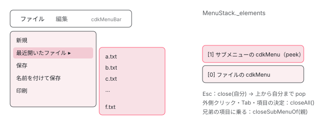

[目次](../README.md) › [CDK の内側](README.md) › 第 13 回 / 全 21 回

# CDK Menu：入れ子のメニューを MenuStack でたどる

> cdkMenuTriggerFor が Overlay でメニューを開き、開いたメニュー自身が MenuStack に自分を積む行。矢印キーで隣のメニューへ、Esc で 1 段閉じる動きが ListKeyManager とスタック（close / closeSubMenuOf / closeAll と emptied）でどう決まるか。サブメニューへマウスを斜めに動かしても閉じない menu aim（TargetMenuAim）が、直近の座標から伸ばした直線とサブメニューの矩形の交差を多数決して 300ms 待つ判定。

angular/components · 読了 約 14 分 · 発展 · [サイトで読む（デモが動きます）](https://angular-deep-dive-cyan.vercel.app/chapter/cdk-menu)

---

「ファイル」を押すとメニューが開き、「最近開いたファイル ▸」に乗るとその右にもう 1 段開く。右矢印で隣のメニューへ移り、Esc で 1 段だけ閉じ、外をクリックすると全部閉じる。CDK Menu はこの動きを、開いているメニューを積んだ 1 本の列 `MenuStack` で決めています。この章では、`cdkMenuTriggerFor` が Overlay でメニューを開く行、メニューが自分をスタックに積む行、キーと外側のクリックがスタックのどこを閉じるか、そしてサブメニューへマウスを斜めに動かしても閉じない `TargetMenuAim` の判定を読みます。

読む対象は `src/cdk/menu/` の `menu-trigger.ts`・`menu-trigger-base.ts`・`menu-stack.ts`・ `menu-base.ts`・`menu.ts`・`menu-bar.ts`・`menu-item.ts`・`menu-aim.ts` です（components リポジトリ）。

1. [1. 概観](01-cdk-overview.md)
2. [2. Platform と向き](02-cdk-platform-bidi.md)
3. [3. Observer と画面幅](03-cdk-observers-layout.md)
4. [4. Portal](04-cdk-portal.md)
5. [5. Overlay](05-cdk.md)
6. [6. 位置の計算](06-cdk-overlay-position.md)
7. [7. スクロールと Esc](07-cdk-overlay-scroll-dispatch.md)
8. [8. FocusTrap](08-cdk-focus-trap.md)
9. [9. FocusMonitor](09-cdk-focus-monitor.md)
10. [10. ListKeyManager](10-cdk-key-manager.md)
11. [11. LiveAnnouncer](11-cdk-live-announcer.md)
12. [12. Dialog](12-cdk-dialog.md)
13. **13. Menu**（この章）
14. [14. DataSource と選択](14-cdk-collections.md)
15. [15. 仮想スクロール](15-virtual-scroll.md)
16. [16. table](16-table.md)
17. [17. tree](17-cdk-tree.md)
18. [18. DragRef](18-drag-drop.md)
19. [19. DropListRef](19-cdk-drop-list.md)
20. [20. ハーネス](20-harness.md)
21. [21. Material のテーマ](21-theming.md)

## 0. 登場する 5 つの指示子とスタック

| 書くもの | role | 役目 |
| --- | --- | --- |
| `cdkMenuBar` | `menubar` | いつも見えている横並びのメニュー。`MenuStack` を新しく作る（1 節） |
| `cdkMenuItem` | `menuitem` | 1 項目。押されたら `cdkMenuItemTriggered` を流して全部閉じる |
| `[cdkMenuTriggerFor]` | （項目なら menuitem） | 項目に重ねて付け、`ng-template` のメニューを Overlay で開く（2 節） |
| `cdkMenu` | `menu` | 縦並びのメニュー。開いたら自分をスタックに積む（4 節） |
| `cdkTargetMenuAim` | — | `cdkMenu` か `cdkMenuBar` に付けて、斜めの移動を見分ける（8 節） |



*メニューバーで「ファイル」→「最近開いたファイル」と開いたときの MenuStack。メニューバー自身は積まれない（インラインのメニュー）。*

## 1. MenuStack はどこで作られるか

📄 `components/src/cdk/menu/menu-bar.ts` L31–50 （▶ の行: 35, 42, 47, 50）

```ts
31 │ @Directive({
32 │   selector: '[cdkMenuBar]',
33 │   exportAs: 'cdkMenuBar',
34 │   host: {
35 ▶     'role': 'menubar',
36 │     'class': 'cdk-menu-bar',
37 │     '(keydown)': '_handleKeyEvent($event)',
38 │   },
39 │   providers: [
40 │     {provide: CdkMenuGroup, useExisting: CdkMenuBar},
41 │     {provide: CDK_MENU, useExisting: CdkMenuBar},
42 ▶     {provide: MENU_STACK, useFactory: () => MenuStack.inline('horizontal')},
43 │   ],
44 │ })
45 │ export class CdkMenuBar extends CdkMenuBase implements AfterContentInit {
46 │   /** The direction items in the menu flow. */
47 ▶   override readonly orientation = 'horizontal';
48 │ 
49 │   /** Whether the menu is displayed inline (i.e. always present vs a conditional popup that the user triggers with a trigger element). */
50 ▶   override readonly isInline = true;
```

42 行目、`cdkMenuBar` は `providers` で**新しい `MenuStack` を必ず 1 つ作ります**（`MenuStack.inline('horizontal')`）。メニューバーの中で開くメニューは、全部この 1 本に積まれます。47 行目で横並び、50 行目で「インライン（いつも見えている）」です。

📄 `components/src/cdk/menu/menu-stack.ts` L27–43 （▶ の行: 31, 33, 37, 42）

```ts
27 │ /** Injection token used for an implementation of MenuStack. */
28 │ export const MENU_STACK = new InjectionToken<MenuStack>('cdk-menu-stack');
29 │ 
30 │ /** Provider that provides the parent menu stack, or a new menu stack if there is no parent one. */
31 ▶ export const PARENT_OR_NEW_MENU_STACK_PROVIDER = {
32 │   provide: MENU_STACK,
33 ▶   useFactory: () => inject(MENU_STACK, {optional: true, skipSelf: true}) || new MenuStack(),
34 │ };
35 │ 
36 │ /** Provider that provides the parent menu stack, or a new inline menu stack if there is no parent one. */
37 ▶ export const PARENT_OR_NEW_INLINE_MENU_STACK_PROVIDER = (
38 │   orientation: 'vertical' | 'horizontal',
39 │ ) => ({
40 │   provide: MENU_STACK,
41 │   useFactory: () =>
42 ▶     inject(MENU_STACK, {optional: true, skipSelf: true}) || MenuStack.inline(orientation),
43 │ });
```

トリガーとメニューは、31〜34 行目の「親のスタックがあればそれ、無ければ新しく」を provide します。33 行目の `skipSelf` で自分より上の注入器を探すので、メニューバーの中のトリガーはメニューバーのスタックを、単独のボタンに付けたトリガー（メニューバーなし）は自分で新しいスタックを持ちます。

## 2. 開く：cdkMenuTriggerFor と Overlay

📄 `components/src/cdk/menu/menu-trigger.ts` L56–79 （▶ の行: 57, 61–62, 65–66, 69, 77）

```ts
56 │ @Directive({
57 ▶   selector: '[cdkMenuTriggerFor]',
58 │   exportAs: 'cdkMenuTriggerFor',
59 │   host: {
60 │     'class': 'cdk-menu-trigger',
61 ▶     '[attr.aria-haspopup]': 'menuTemplateRef ? "menu" : null',
62 ▶     '[attr.aria-expanded]': 'menuTemplateRef == null ? null : isOpen()',
63 │     '(focusin)': '_setHasFocus(true)',
64 │     '(focusout)': '_setHasFocus(false)',
65 ▶     '(keydown)': '_toggleOnKeydown($event)',
66 ▶     '(click)': '_handleClick()',
67 │   },
68 │   inputs: [
69 ▶     {name: 'menuTemplateRef', alias: 'cdkMenuTriggerFor'},
70 │     {name: 'menuPosition', alias: 'cdkMenuPosition'},
71 │     {name: 'menuData', alias: 'cdkMenuTriggerData'},
72 │     {name: 'transformOriginSelector', alias: 'cdkMenuTriggerTransformOriginOn'},
73 │   ],
74 │   outputs: ['opened: cdkMenuOpened', 'closed: cdkMenuClosed'],
75 │   providers: [
76 │     {provide: MENU_TRIGGER, useExisting: CdkMenuTrigger},
77 ▶     PARENT_OR_NEW_MENU_STACK_PROVIDER,
78 │   ],
79 │ })
```

61〜62 行目、トリガーの要素に `aria-haspopup="menu"` と、開いているかどうかの `aria-expanded` を付けます。65〜66 行目で keydown と click を聞き、77 行目が 1 節の「親のスタックか新しいスタック」です。

📄 `components/src/cdk/menu/menu-trigger.ts` L114–139 （▶ の行: 116–117, 119, 122–124, 126, 135）

```ts
114 │   /** Open the attached menu. */
115 │   open() {
116 ▶     if (!this._parentMenu) {
117 ▶       this._menuTracker.update(this);
118 │     }
119 ▶     if (!this.isOpen() && this.menuTemplateRef != null) {
120 │       this.opened.next();
121 │ 
122 ▶       this.overlayRef =
123 ▶         this.overlayRef || createOverlayRef(this._injector, this._getOverlayConfig());
124 ▶       this.overlayRef.attach(this.getMenuContentPortal());
125 │       this._changeDetectorRef.markForCheck();
126 ▶       this._subscribeToOutsideClicks();
127 │     }
128 │   }
129 │ 
130 │   /** Close the opened menu. */
131 │   close() {
132 │     if (this.isOpen()) {
133 │       this.closed.next();
134 │ 
135 ▶       this.overlayRef!.detach();
136 │       this._changeDetectorRef.markForCheck();
137 │     }
138 │     this._closeSiblingTriggers();
139 │   }
```

1. **116〜118 行目：アプリで開いているのは 1 系統だけ**

   親メニューの無いトリガー（メニューバーの項目や単独のボタン）なら、`MenuTracker` がアプリ全体で最後に開いたトリガーを覚えていて、別のトリガーなら前のほうを閉じます。
2. **122〜123 行目：OverlayRef は 1 回だけ作る**

   2 回目以降は同じ OverlayRef を使い回します。
3. **124 行目：attach**

   メニューの `ng-template` を `TemplatePortal` にして Overlay の pane に入れます（3 節）。
4. **126 行目：外側のクリックを聞き始める**

   7 節。
5. **135 行目：閉じるときは detach**

   dispose ではないので、OverlayRef は次に開くときまで残ります。破棄されるのはトリガーの `ngOnDestroy` です。

📄 `components/src/cdk/menu/menu-trigger.ts` L274–305 （▶ の行: 278, 285–288, 300–303）

```ts
274 │   /** Get the configuration object used to create the overlay. */
275 │   private _getOverlayConfig() {
276 │     return new OverlayConfig({
277 │       positionStrategy: this._getOverlayPositionStrategy(),
278 ▶       scrollStrategy: this.menuScrollStrategy(),
279 │       direction: this._directionality || undefined,
280 │     });
281 │   }
282 │ 
283 │   /** Build the position strategy for the overlay which specifies where to place the menu. */
284 │   private _getOverlayPositionStrategy(): FlexibleConnectedPositionStrategy {
285 ▶     const strategy = createFlexibleConnectedPositionStrategy(this._injector, this._elementRef)
286 ▶       .withLockedPosition()
287 ▶       .withFlexibleDimensions(false)
288 ▶       .withPositions(this._getOverlayPositions());
289 │ 
290 │     if (this.transformOriginSelector) {
291 │       strategy.withTransformOriginOn(this.transformOriginSelector);
292 │     }
293 │ 
294 │     return strategy;
295 │   }
296 │ 
297 │   /** Get the preferred positions for the opened menu relative to the menu item. */
298 │   private _getOverlayPositions(): ConnectedPosition[] {
299 │     return (
300 ▶       this.menuPosition ??
301 ▶       (!this._parentMenu || this._parentMenu.orientation === 'horizontal'
302 ▶         ? STANDARD_DROPDOWN_BELOW_POSITIONS
303 ▶         : STANDARD_DROPDOWN_ADJACENT_POSITIONS)
304 │     );
305 │   }
```

位置は[第 6 回](06-cdk-overlay-position.md)の `FlexibleConnectedPositionStrategy` で、トリガーの要素が起点です。286 行目 `withLockedPosition()`：一度決めた向きはスクロールしても変えない。287 行目 `withFlexibleDimensions(false)`：縮めて収めることはせず、はみ出すなら押し戻す（push の既定は有効）。300〜303 行目の候補は、`cdkMenuPosition` を書かなければ、親が無いか横並び（メニューバー）なら `STANDARD_DROPDOWN_BELOW_POSITIONS`、縦のメニューの中なら `STANDARD_DROPDOWN_ADJACENT_POSITIONS` です。

📄 `components/src/cdk/overlay/position/flexible-connected-position-strategy.ts` L1445–1457 （▶ の行: 1446–1447, 1453, 1455）

```ts
1445 │ export const STANDARD_DROPDOWN_BELOW_POSITIONS: ConnectedPosition[] = [
1446 ▶   {originX: 'start', originY: 'bottom', overlayX: 'start', overlayY: 'top'},
1447 ▶   {originX: 'start', originY: 'top', overlayX: 'start', overlayY: 'bottom'},
1448 │   {originX: 'end', originY: 'bottom', overlayX: 'end', overlayY: 'top'},
1449 │   {originX: 'end', originY: 'top', overlayX: 'end', overlayY: 'bottom'},
1450 │ ];
1451 │ 
1452 │ export const STANDARD_DROPDOWN_ADJACENT_POSITIONS: ConnectedPosition[] = [
1453 ▶   {originX: 'end', originY: 'top', overlayX: 'start', overlayY: 'top'},
1454 │   {originX: 'end', originY: 'bottom', overlayX: 'start', overlayY: 'bottom'},
1455 ▶   {originX: 'start', originY: 'top', overlayX: 'end', overlayY: 'top'},
1456 │   {originX: 'start', originY: 'bottom', overlayX: 'end', overlayY: 'bottom'},
1457 │ ];
```

BELOW の 1 番目（1446 行目）は「トリガーの左下にメニューの左上」、だめなら 1447 行目の「トリガーの左上にメニューの左下（上に開く）」。ADJACENT の 1 番目（1453 行目）は「項目の右上にサブメニューの左上（右に開く）」、だめなら 1455 行目の左に開く候補です。

📄 `components/src/cdk/menu/menu-trigger-base.ts` L34–44 （▶ の行: 41）

```ts
34 │ /** Injection token used to configure the behavior of the menu when the page is scrolled. */
35 │ export const MENU_SCROLL_STRATEGY = new InjectionToken<() => ScrollStrategy>(
36 │   'cdk-menu-scroll-strategy',
37 │   {
38 │     providedIn: 'root',
39 │     factory: () => {
40 │       const injector = inject(Injector);
41 ▶       return () => createRepositionScrollStrategy(injector);
42 │     },
43 │   },
44 │ );
```

278 行目の `menuScrollStrategy()` は、このトークンの工場です。41 行目、メニューの既定は **reposition** （[第 7 回](07-cdk-overlay-scroll-dispatch.md)）。スクロールするとメニューはトリガーについていきます。

## 3. 中身の注入器：子のメニューに親のスタックを渡す

📄 `components/src/cdk/menu/menu-trigger-base.ts` L149–165 （▶ の行: 154, 156–160）

```ts
149 │   /**
150 │    * Get the portal to be attached to the overlay which contains the menu. Allows for the menu
151 │    * content to change dynamically and be reflected in the application.
152 │    */
153 │   protected getMenuContentPortal() {
154 ▶     const hasMenuContentChanged = this.menuTemplateRef !== this._menuPortal?.templateRef;
155 │     if (this.menuTemplateRef && (!this._menuPortal || hasMenuContentChanged)) {
156 ▶       this._menuPortal = new TemplatePortal(
157 ▶         this.menuTemplateRef,
158 ▶         this.viewContainerRef,
159 ▶         this.menuData,
160 ▶         this._getChildMenuInjector(),
161 │       );
162 │     }
163 │ 
164 │     return this._menuPortal;
165 │   }
```

📄 `components/src/cdk/menu/menu-trigger-base.ts` L189–201 （▶ の行: 195–196, 198）

```ts
189 │   /** Gets the injector to use when creating a child menu. */
190 │   private _getChildMenuInjector() {
191 │     this._childMenuInjector =
192 │       this._childMenuInjector ||
193 │       Injector.create({
194 │         providers: [
195 ▶           {provide: MENU_TRIGGER, useValue: this},
196 ▶           {provide: MENU_STACK, useValue: this.menuStack},
197 │         ],
198 ▶         parent: this.injector,
199 │       });
200 │     return this._childMenuInjector;
201 │   }
```

156〜161 行目、`TemplatePortal` の 4 つ目の引数が注入器です。その中身が 195〜196 行目で、`MENU_TRIGGER` に自分（トリガー）、`MENU_STACK` に自分のスタックを入れています。メニューの `ng-template` はテンプレートのどこに書いてもよく、たいていメニューバーの*外*に書きます。するとテンプレートの置き場所からたどる注入器にはメニューバーのスタックがありません。この注入器が、Overlay の中に作られたメニューへ「同じスタック」を届けます。

## 4. メニューが自分を積む

📄 `components/src/cdk/menu/menu-base.ts` L109–120 （▶ の行: 110–111, 114, 119）

```ts
109 │   ngAfterContentInit() {
110 ▶     if (!this.isInline) {
111 ▶       this.menuStack.push(this);
112 │     }
113 │     this._setItems();
114 ▶     this._setKeyManager();
115 │     this._handleFocus();
116 │     this._subscribeToMenuStackHasFocus();
117 │     this._subscribeToMenuOpen();
118 │     this._subscribeToMenuStackClosed();
119 ▶     this._setUpPointerTracker();
120 │   }
```

`cdkMenu` は、`ngAfterContentInit`（中の項目がそろったとき）の 110〜111 行目で、インラインでなければ自分を `push` します。つまり**積むのはトリガーではなく、開かれたメニュー自身**です。メニューバー（インライン）は積まれません。114 行目で ListKeyManager を作り（6 節）、119 行目で menu aim の準備をします（8 節）。

## 5. スタックの 3 つの閉じ方

📄 `components/src/cdk/menu/menu-stack.ts` L114–141 （▶ の行: 119, 130, 132–135, 137–138）

```ts
114 │   /**
115 │    * Adds an item to the menu stack.
116 │    * @param menu the MenuStackItem to put on the stack.
117 │    */
118 │   push(menu: MenuStackItem) {
119 ▶     this._elements.push(menu);
120 │   }
121 │ 
122 │   /**
123 │    * Pop items off of the stack up to and including `lastItem` and emit each on the close
124 │    * observable. If the stack is empty or `lastItem` is not on the stack it does nothing.
125 │    * @param lastItem the last item to pop off the stack.
126 │    * @param options Options that configure behavior on close.
127 │    */
128 │   close(lastItem: MenuStackItem, options?: CloseOptions) {
129 │     const {focusNextOnEmpty, focusParentTrigger} = {...options};
130 ▶     if (this._elements.indexOf(lastItem) >= 0) {
131 │       let poppedElement;
132 ▶       do {
133 ▶         poppedElement = this._elements.pop()!;
134 ▶         this._close.next({item: poppedElement, focusParentTrigger});
135 ▶       } while (poppedElement !== lastItem);
136 │ 
137 ▶       if (this.isEmpty()) {
138 ▶         this._empty.next(focusNextOnEmpty);
139 │       }
140 │     }
141 │   }
```

`close(lastItem)` は、130 行目で `lastItem` がスタックにあることを確かめ、132〜135 行目で**上から順に `lastItem` まで** pop し、pop したものを 1 つずつ 134 行目で `closed` に流します。137〜138 行目、空になったら `emptied` に「次にどこへフォーカスするか」（`FocusNext`）を流します。

📄 `components/src/cdk/menu/menu-stack.ts` L143–175 （▶ の行: 152–154, 164, 167, 170, 173）

```ts
143 │   /**
144 │    * Pop items off of the stack up to but excluding `lastItem` and emit each on the close
145 │    * observable. If the stack is empty or `lastItem` is not on the stack it does nothing.
146 │    * @param lastItem the element which should be left on the stack
147 │    * @return whether or not an item was removed from the stack
148 │    */
149 │   closeSubMenuOf(lastItem: MenuStackItem) {
150 │     let removed = false;
151 │     if (this._elements.indexOf(lastItem) >= 0) {
152 ▶       removed = this.peek() !== lastItem;
153 ▶       while (this.peek() !== lastItem) {
154 ▶         this._close.next({item: this._elements.pop()!});
155 │       }
156 │     }
157 │     return removed;
158 │   }
159 │ 
160 │   /**
161 │    * Pop off all MenuStackItems and emit each one on the `close` observable one by one.
162 │    * @param options Options that configure behavior on close.
163 │    */
164 ▶   closeAll(options?: CloseOptions) {
165 │     const {focusNextOnEmpty, focusParentTrigger} = {...options};
166 │     if (!this.isEmpty()) {
167 ▶       while (!this.isEmpty()) {
168 │         const menuStackItem = this._elements.pop();
169 │         if (menuStackItem) {
170 ▶           this._close.next({item: menuStackItem, focusParentTrigger});
171 │         }
172 │       }
173 ▶       this._empty.next(focusNextOnEmpty);
174 │     }
175 │   }
```

`closeSubMenuOf(lastItem)` は 153〜155 行目、`lastItem` の*上にあるものだけ*を pop し、`lastItem` は残します。「同じメニューの別の項目に乗ったら、開いているサブメニューだけ閉じる」に使います（8 節）。`closeAll` は 167〜172 行目で全部 pop し、173 行目で `emptied`。

📄 `components/src/cdk/menu/menu-trigger.ts` L307–319 （▶ の行: 312–315）

```ts
307 │   /**
308 │    * Subscribe to the MenuStack close events if this is a standalone trigger and close out the menu
309 │    * this triggers when requested.
310 │    */
311 │   private _registerCloseHandler() {
312 ▶     if (!this._parentMenu) {
313 ▶       this.menuStack.closed.pipe(takeUntil(this.destroyed)).subscribe(({item}) => {
314 ▶         if (item === this.childMenu) {
315 ▶           this.close();
316 │         }
317 │       });
318 │     }
319 │   }
```

スタックは pop して知らせるだけで、Overlay は閉じません。閉じるのは `closed` を聞いている側です。312〜315 行目、親メニューの無いトリガー（メニューバーの項目など）は、pop されたのが自分の子メニューなら自分を `close()`（= `overlayRef.detach()`）します。サブメニューのトリガーのほうは、親メニュー（`CdkMenuBase`）が `closed` を聞いて、該当する項目のトリガーを閉じます。

## 6. キー：ListKeyManager とスタック

📄 `components/src/cdk/menu/menu-base.ts` L197–210 （▶ の行: 199–202, 206, 208）

```ts
197 │   /** Setup the FocusKeyManager with the correct orientation for the menu. */
198 │   private _setKeyManager() {
199 ▶     this.keyManager = new FocusKeyManager(this.items)
200 ▶       .withWrap()
201 ▶       .withTypeAhead()
202 ▶       .withHomeAndEnd()
203 │       .skipPredicate(() => false);
204 │ 
205 │     if (this.orientation === 'horizontal') {
206 ▶       this.keyManager.withHorizontalOrientation(this.dir?.value || 'ltr');
207 │     } else {
208 ▶       this.keyManager.withVerticalOrientation();
209 │     }
210 │   }
```

メニューの中の上下・Home/End・頭文字は、[第 10 回](10-cdk-key-manager.md)の `FocusKeyManager` に任せます。200 行目 `withWrap()`（端で反対側へ）、201 行目 `withTypeAhead()`（頭文字）、202 行目 `withHomeAndEnd()`。206 行目、メニューバーは横向き（左右で移動）、208 行目、メニューは縦向き（上下で移動）です。残る左右と Esc を、スタックがどう扱うかを見ます。

📄 `components/src/cdk/menu/menu.ts` L72–103 （▶ の行: 84, 87–89, 94, 96, 101）

```ts
 72 │   _handleKeyEvent(event: KeyboardEvent) {
 73 │     const keyManager = this.keyManager;
 74 │     switch (event.keyCode) {
 75 │       case LEFT_ARROW:
 76 │       case RIGHT_ARROW:
 77 │         if (!hasModifierKey(event)) {
 78 │           event.preventDefault();
 79 │           keyManager.setFocusOrigin('keyboard');
 80 │           keyManager.onKeydown(event);
 81 │         }
 82 │         break;
 83 │ 
 84 ▶       case ESCAPE:
 85 │         if (!hasModifierKey(event)) {
 86 │           event.preventDefault();
 87 ▶           this.menuStack.close(this, {
 88 ▶             focusNextOnEmpty: FocusNext.currentItem,
 89 ▶             focusParentTrigger: true,
 90 │           });
 91 │         }
 92 │         break;
 93 │ 
 94 ▶       case TAB:
 95 │         if (!hasModifierKey(event, 'altKey', 'metaKey', 'ctrlKey')) {
 96 ▶           this.menuStack.closeAll({focusParentTrigger: true});
 97 │         }
 98 │         break;
 99 │ 
100 │       default:
101 ▶         keyManager.onKeydown(event);
102 │     }
103 │   }
```

**Esc で 1 段閉じる**のが 84〜91 行目です。87 行目、`menuStack.close(this, …)`：自分と、自分より上（自分が開いたサブメニュー）を pop。89 行目の `focusParentTrigger: true` で、閉じたあと自分を開いた項目（またはトリガー）にフォーカスが戻ります。94〜96 行目、Tab は `closeAll`（全部閉じて、フォーカスはページの次の要素へ）。それ以外は 101 行目で ListKeyManager へ。

📄 `components/src/cdk/menu/menu-trigger.ts` L175–193 （▶ の行: 177, 179–180, 187）

```ts
175 │       case RIGHT_ARROW:
176 │         if (!hasModifierKey(event)) {
177 ▶           if (this._parentMenu && isParentVertical && this._directionality?.value !== 'rtl') {
178 │             event.preventDefault();
179 ▶             this.open();
180 ▶             this.childMenu?.focusFirstItem('keyboard');
181 │           }
182 │         }
183 │         break;
184 │ 
185 │       case LEFT_ARROW:
186 │         if (!hasModifierKey(event)) {
187 ▶           if (this._parentMenu && isParentVertical && this._directionality?.value === 'rtl') {
188 │             event.preventDefault();
189 │             this.open();
190 │             this.childMenu?.focusFirstItem('keyboard');
191 │           }
192 │         }
193 │         break;
```

サブメニューを持つ項目で右矢印を押すと、トリガーの keydown（2 節の 65 行目）の 177〜181 行目で、縦のメニューの中で LTR なら開いて最初の項目にフォーカスします。RTL なら 187 行目、左矢印が「開く」になります。

📄 `components/src/cdk/menu/menu-item.ts` L250–280 （▶ の行: 256, 258, 260–263, 273, 275–276）

```ts
250 │   /**
251 │    * Handles the user pressing the back arrow key.
252 │    * @param event The keyboard event.
253 │    */
254 │   private _backArrowPressed(event: KeyboardEvent) {
255 │     const parentMenu = this._parentMenu!;
256 ▶     if (this._menuStack.hasInlineMenu() || this._menuStack.length() > 1) {
257 │       event.preventDefault();
258 ▶       this._menuStack.close(parentMenu, {
259 │         focusNextOnEmpty:
260 ▶           this._menuStack.inlineMenuOrientation() === 'horizontal'
261 ▶             ? FocusNext.previousItem
262 ▶             : FocusNext.currentItem,
263 ▶         focusParentTrigger: true,
264 │       });
265 │     }
266 │   }
267 │ 
268 │   /**
269 │    * Handles the user pressing the forward arrow key.
270 │    * @param event The keyboard event.
271 │    */
272 │   private _forwardArrowPressed(event: KeyboardEvent) {
273 ▶     if (!this.hasMenu && this._menuStack.inlineMenuOrientation() === 'horizontal') {
274 │       event.preventDefault();
275 ▶       this._menuStack.closeAll({
276 ▶         focusNextOnEmpty: FocusNext.nextItem,
277 │         focusParentTrigger: true,
278 │       });
279 │     }
280 │   }
```

サブメニューを持たない項目の左右は `CdkMenuItem` が処理します（LTR では右が forward、左が back）。

1. **左（back）：256〜264 行目**

   メニューバーの下か、2 段目以上なら、`close(親メニュー)` で今いるメニューを閉じます。サブメニューの中なら 1 段戻るだけ。1 段目のメニューなら空になるので、260〜261 行目、メニューバーの下では `FocusNext.previousItem` が emptied に流れます。
2. **右（forward）：273〜278 行目**

   サブメニューを持たない項目で、メニューバーの下なら `closeAll` して `FocusNext.nextItem`。

📄 `components/src/cdk/menu/menu-bar.ts` L106–133 （▶ の行: 114, 116–117, 120, 122–123）

```ts
106 │   /**
107 │    * Set focus to either the current, previous or next item based on the FocusNext event, then
108 │    * open the previous or next item.
109 │    * @param focusNext The element to focus.
110 │    */
111 │   private _toggleOpenMenu(focusNext: FocusNext | undefined) {
112 │     const keyManager = this.keyManager;
113 │     switch (focusNext) {
114 ▶       case FocusNext.nextItem:
115 │         keyManager.setFocusOrigin('keyboard');
116 ▶         keyManager.setNextItemActive();
117 ▶         keyManager.activeItem?.getMenuTrigger()?.open();
118 │         break;
119 │ 
120 ▶       case FocusNext.previousItem:
121 │         keyManager.setFocusOrigin('keyboard');
122 ▶         keyManager.setPreviousItemActive();
123 ▶         keyManager.activeItem?.getMenuTrigger()?.open();
124 │         break;
125 │ 
126 │       case FocusNext.currentItem:
127 │         if (keyManager.activeItem) {
128 │           keyManager.setFocusOrigin('keyboard');
129 │           keyManager.setActiveItem(keyManager.activeItem);
130 │         }
131 │         break;
132 │     }
133 │   }
```

emptied を聞いているメニューバーが、114〜117 行目で次の項目をアクティブにして**そのメニューを開き**、120〜123 行目で前の項目のメニューを開きます。これが「メニューの中で右矢印を押すと、隣のメニューに移る」の正体です。スタックが空になった通知（emptied）に「次はどこ」を載せて、メニューバーに判断させているのです。

## 7. フォーカスが外へ出たら・外をクリックしたら

📄 `components/src/cdk/menu/menu-stack.ts` L81–92 （▶ の行: 88–91）

```ts
81 │   /** Emits whether any menu in the menu stack has focus. */
82 │   private readonly _hasFocus = new Subject<boolean>();
83 │ 
84 │   /** Observable which emits the MenuStackItem which has been requested to close. */
85 │   readonly closed: Observable<MenuStackCloseEvent> = this._close;
86 │ 
87 │   /** Observable which emits whether any menu in the menu stack has focus. */
88 ▶   readonly hasFocus: Observable<boolean> = this._hasFocus.pipe(
89 ▶     startWith(false),
90 ▶     debounceTime(0),
91 ▶     distinctUntilChanged(),
92 │   );
```

メニューとトリガーは `focusin / focusout` で `setHasFocus(true / false)` を呼びます。項目 A から項目 B へフォーカスが移ると、一瞬「false → true」が続けて来るので、90 行目の `debounceTime(0)` で最後の値だけにし、91 行目で変わったときだけ流します。

📄 `components/src/cdk/menu/menu-trigger.ts` L321–354 （▶ の行: 328, 334–336, 338, 349–350）

```ts
321 │   /**
322 │    * Subscribe to the overlays outside pointer events stream and handle closing out the stack if a
323 │    * click occurs outside the menus.
324 │    */
325 │   private _subscribeToOutsideClicks() {
326 │     if (this.overlayRef) {
327 │       this.overlayRef
328 ▶         .outsidePointerEvents()
329 │         .pipe(takeUntil(this.stopOutsideClicksListener))
330 │         .subscribe(event => {
331 │           const target = _getEventTarget(event) as Element;
332 │           const element = this._elementRef.nativeElement;
333 │ 
334 ▶           if (target !== element && !element.contains(target)) {
335 ▶             if (!this.isElementInsideMenuStack(target)) {
336 ▶               this.menuStack.closeAll();
337 │             } else {
338 ▶               this._closeSiblingTriggers();
339 │             }
340 │           }
341 │         });
342 │     }
343 │   }
344 │ 
345 │   /** Subscribe to the MenuStack hasFocus events. */
346 │   private _subscribeToMenuStackHasFocus() {
347 │     if (!this._parentMenu) {
348 │       this.menuStack.hasFocus.pipe(takeUntil(this.destroyed)).subscribe(hasFocus => {
349 ▶         if (!hasFocus) {
350 ▶           this.menuStack.closeAll();
351 │         }
352 │       });
353 │     }
354 │   }
```

外側のクリックは[第 7 回](07-cdk-overlay-scroll-dispatch.md)の `outsidePointerEvents()` で受けます（328 行目）。334 行目でトリガー自身は除き、335〜336 行目、クリックした要素が同じスタックのどのメニューにも入っていなければ `closeAll`。入っていれば（親メニューの別の所を押した）338 行目で兄弟のサブメニューだけ閉じます。「同じスタックのメニューか」は、メニューとトリガーの host に付いた `data-cdk-menu-stack-id` 属性を親へたどって比べます。349〜350 行目、スタックのどこにもフォーカスが無くなったら（Tab で外へ出た、など）も `closeAll` です。

## 8. menu aim：斜めに動かしても閉じない

縦のメニューで「最近開いたファイル ▸」に乗るとサブメニューが右に開きます。サブメニューの下のほうの項目へマウスを斜めに動かすと、途中で「保存」などの兄弟の項目の上を通ります。兄弟に乗ったときの処理がこれです。

📄 `components/src/cdk/menu/menu-item.ts` L286–308 （▶ の行: 289, 296–297, 299–300, 302）

```ts
286 │   private _setupMouseEnter() {
287 │     if (!this._isStandaloneItem()) {
288 │       const closeOpenSiblings = () =>
289 ▶         this._ngZone.run(() => this._menuStack.closeSubMenuOf(this._parentMenu!));
290 │ 
291 │       this._cleanupMouseEnter = this._ngZone.runOutsideAngular(() =>
292 │         this._renderer.listen(this._elementRef.nativeElement, 'mouseenter', () => {
293 │           // Skip fake `mouseenter` events dispatched by touch devices.
294 │           if (
295 │             this._inputModalityDetector.mostRecentModality !== 'touch' &&
296 ▶             !this._menuStack.isEmpty() &&
297 ▶             !this.hasMenu
298 │           ) {
299 ▶             if (this._menuAim) {
300 ▶               this._menuAim.toggle(closeOpenSiblings);
301 │             } else {
302 ▶               closeOpenSiblings();
303 │             }
304 │           }
305 │         }),
306 │       );
307 │     }
308 │   }
```

289 行目、兄弟の項目に乗ったら `closeSubMenuOf(親メニュー)`：開いているサブメニューを閉じます。menu aim が無ければ 302 行目で**すぐに**閉じるので、斜めに動かすとサブメニューに着く前に消えます。menu aim があれば 300 行目、「閉じてよいか」の判断を `toggle(closeOpenSiblings)` に任せます。

📄 `components/src/cdk/menu/menu-base.ts` L252–263 （▶ の行: 257, 259, 261）

```ts
252 │   /**
253 │    * Set the PointerFocusTracker and ensure that when mouse focus changes the key manager is updated
254 │    * with the latest menu item under mouse focus.
255 │    */
256 │   private _setUpPointerTracker() {
257 ▶     if (this.menuAim) {
258 │       this.ngZone.runOutsideAngular(() => {
259 ▶         this.pointerTracker = new PointerFocusTracker(this._renderer, this.items);
260 │       });
261 ▶       this.menuAim.initialize(this, this.pointerTracker!);
262 │     }
263 │   }
```

menu aim は `cdkTargetMenuAim` を付けたメニューにだけあります（`CdkMenuBase` は `MENU_AIM` を `self: true` で inject します）。259 行目で、項目ごとの mouseenter / mouseout を聞く `PointerFocusTracker` を作り、261 行目で TargetMenuAim に渡します。

📄 `components/src/cdk/menu/menu-aim.ts` L241–270 （▶ の行: 248–252, 268）

```ts
241 │   /** Subscribe to the root menus mouse move events and update the tracked mouse points. */
242 │   private _subscribeToMouseMoves() {
243 │     this._cleanupMousemove?.();
244 │ 
245 │     this._cleanupMousemove = this._ngZone.runOutsideAngular(() => {
246 │       let eventIndex = 0;
247 │ 
248 ▶       return this._renderer.listen(this._menu.nativeElement, 'mousemove', (event: MouseEvent) => {
249 ▶         if (eventIndex % MOUSE_MOVE_SAMPLE_FREQUENCY === 0) {
250 ▶           this._points.push({x: event.clientX, y: event.clientY});
251 ▶           if (this._points.length > NUM_POINTS) {
252 ▶             this._points.shift();
253 │           }
254 │         }
255 │         eventIndex++;
256 │       });
257 │     });
258 │   }
259 │ }
260 │ 
261 │ /**
262 │  * CdkTargetMenuAim is a provider for the TargetMenuAim service. It can be added to an
263 │  * element with either the `cdkMenu` or `cdkMenuBar` directive and child menu items.
264 │  */
265 │ @Directive({
266 │   selector: '[cdkTargetMenuAim]',
267 │   exportAs: 'cdkTargetMenuAim',
268 ▶   providers: [{provide: MENU_AIM, useClass: TargetMenuAim}],
269 │ })
270 │ export class CdkTargetMenuAim {}
```

📄 `components/src/cdk/menu/menu-aim.ts` L47–73 （▶ の行: 48, 51, 57, 67, 72）

```ts
47 │ /** Capture every nth mouse move event. */
48 ▶ const MOUSE_MOVE_SAMPLE_FREQUENCY = 3;
49 │ 
50 │ /** The number of mouse move events to track. */
51 ▶ const NUM_POINTS = 5;
52 │ 
53 │ /**
54 │  * How long to wait before closing a sibling menu if a user stops short of the submenu they were
55 │  * predicted to go into.
56 │  */
57 ▶ const CLOSE_DELAY = 300;
58 │ 
59 │ /** An element which when hovered over may open or close a menu. */
60 │ export interface Toggler {
61 │   /** Gets the open menu, or undefined if no menu is open. */
62 │   getMenu(): Menu | undefined;
63 │ }
64 │ 
65 │ /** Calculate the slope between point a and b. */
66 │ function getSlope(a: Point, b: Point) {
67 ▶   return (b.y - a.y) / (b.x - a.x);
68 │ }
69 │ 
70 │ /** Calculate the y intercept for the given point and slope. */
71 │ function getYIntercept(point: Point, slope: number) {
72 ▶   return point.y - slope * point.x;
73 │ }
```

248 行目、メニューの要素の `mousemove` を聞き、249 行目、48 行目の `MOUSE_MOVE_SAMPLE_FREQUENCY = 3` 回に 1 回だけ座標を記録します。251〜253 行目、記録は 51 行目の `NUM_POINTS = 5` 個まで（古いものから捨てる）。67 行目の傾き（slope）と 72 行目の y 切片で、「2 点を通る直線」を表します。

📄 `components/src/cdk/menu/menu-aim.ts` L153–174 （▶ の行: 156–157, 162–163, 165–167, 169, 171–172）

```ts
153 │   toggle(doToggle: () => void) {
154 │     // If the menu is horizontal the sub-menus open below and there is no risk of premature
155 │     // closing of any sub-menus therefore we automatically resolve the callback.
156 ▶     if (this._menu.orientation === 'horizontal') {
157 ▶       doToggle();
158 │     }
159 │ 
160 │     this._checkConfigured();
161 │ 
162 ▶     const siblingItemIsWaiting = !!this._timeoutId;
163 ▶     const hasPoints = this._points.length > 1;
164 │ 
165 ▶     if (hasPoints && !siblingItemIsWaiting) {
166 ▶       if (this._isMovingToSubmenu()) {
167 ▶         this._startTimeout(doToggle);
168 │       } else {
169 ▶         doToggle();
170 │       }
171 ▶     } else if (!siblingItemIsWaiting) {
172 ▶       doToggle();
173 │     }
174 │   }
```

1. **156〜158 行目**

   横並びのメニュー（メニューバー）では、サブメニューは下に開くので待つ理由がなく、すぐ `doToggle()`。
2. **162〜163 行目**

   もう待っている最中か、座標が 2 個以上あるか。
3. **165〜170 行目**

   座標があって待っていなければ、サブメニューへ向かっているかを判定。向かっていれば「少し待つ」、向かっていなければすぐ閉じる。
4. **171〜173 行目**

   座標がまだ足りなければすぐ閉じる。待っている最中に来た兄弟の toggle は何もしない。

📄 `components/src/cdk/menu/menu-aim.ts` L200–224 （▶ の行: 202, 208, 211, 213–215, 218, 223）

```ts
200 │   /** Whether the user is heading towards the open submenu. */
201 │   private _isMovingToSubmenu() {
202 ▶     const submenuPoints = this._getSubmenuBounds();
203 │     if (!submenuPoints) {
204 │       return false;
205 │     }
206 │ 
207 │     let numMoving = 0;
208 ▶     const currPoint = this._points[this._points.length - 1];
209 │     // start from the second last point and calculate the slope between each point and the last
210 │     // point.
211 ▶     for (let i = this._points.length - 2; i >= 0; i--) {
212 │       const previous = this._points[i];
213 ▶       const slope = getSlope(currPoint, previous);
214 ▶       if (isWithinSubmenu(submenuPoints, slope, getYIntercept(currPoint, slope))) {
215 ▶         numMoving++;
216 │       }
217 │     }
218 ▶     return numMoving >= Math.floor(NUM_POINTS / 2);
219 │   }
220 │ 
221 │   /** Get the bounding DOMRect for the open submenu. */
222 │   private _getSubmenuBounds(): DOMRect | undefined {
223 ▶     return this._pointerTracker?.previousElement?.getMenu()?.nativeElement.getBoundingClientRect();
224 │   }
```

判定の本体です。202 行目、223 行目でサブメニューの矩形を取ります（PointerFocusTracker の `previousElement`＝直前に乗っていた項目のメニュー）。208 行目、一番新しい座標を「今」とし、211〜217 行目、それより古い座標 1 つずつと結んだ直線（213 行目）が、サブメニューの矩形を通るかを数えます。218 行目、`Math.floor(5 / 2) = 2` 本以上が通れば「向かっている」。最大 4 本のうち 2 本の多数決で、手の小さなぶれを吸収しています。

📄 `components/src/cdk/menu/menu-aim.ts` L78–98 （▶ の行: 93–96）

```ts
78 │ /**
79 │  * Whether the given mouse trajectory line defined by the slope and y intercept falls within the
80 │  * submenu as defined by `submenuPoints`
81 │  * @param submenuPoints the submenu DOMRect points.
82 │  * @param m the slope of the trajectory line.
83 │  * @param b the y intercept of the trajectory line.
84 │  * @return true if any point on the line falls within the submenu.
85 │  */
86 │ function isWithinSubmenu(submenuPoints: DOMRect, m: number, b: number) {
87 │   const {left, right, top, bottom} = submenuPoints;
88 │ 
89 │   // Check for intersection with each edge of the submenu (left, right, top, bottom)
90 │   // by fixing one coordinate to that edge's coordinate (either x or y) and checking if the
91 │   // other coordinate is within bounds.
92 │   return (
93 ▶     (m * left + b >= top && m * left + b <= bottom) ||
94 ▶     (m * right + b >= top && m * right + b <= bottom) ||
95 ▶     ((top - b) / m >= left && (top - b) / m <= right) ||
96 ▶     ((bottom - b) / m >= left && (bottom - b) / m <= right)
97 │   );
98 │ }
```

直線 `y = m x + b` が矩形を通るかは、93〜96 行目、矩形の 4 辺のどれかと交わるかで調べます。左辺（x = left）での y が上端と下端の間か、右辺でも同じか、上辺（y = top）での x が左右の間か、下辺でも同じか。よく「マウスの位置とサブメニューの 2 つの角を結んだ三角形」と説明される技法ですが、CDK の実装は三角形ではなく、**過去の座標から伸ばした直線とサブメニューの矩形の交差**です。直線なので、向かう方向がサブメニューの延長線上なら、離れる向きに動いていても当たる場合があります。

📄 `components/src/cdk/menu/menu-aim.ts` L184–198 （▶ の行: 189, 191–192, 194–195）

```ts
184 │   private _startTimeout(doToggle: () => void) {
185 │     // If the users mouse is moving towards a submenu we don't want to immediately resolve.
186 │     // Wait for some period of time before determining if the previous menu should close in
187 │     // cases where the user may have moved towards the submenu but stopped on a sibling menu
188 │     // item intentionally.
189 ▶     const timeoutId = setTimeout(() => {
190 │       // Resolve if the user is currently moused over some element in the root menu
191 ▶       if (this._pointerTracker!.activeElement && timeoutId === this._timeoutId) {
192 ▶         doToggle();
193 │       }
194 ▶       this._timeoutId = null;
195 ▶     }, CLOSE_DELAY) as any as number;
196 │ 
197 │     this._timeoutId = timeoutId;
198 │   }
```

「少し待つ」は 57 行目の `CLOSE_DELAY = 300` ms の setTimeout です（195 行目）。300 ms 後、191 行目、マウスがまだ**このメニューのどれかの項目の上にいる**（`activeElement` がある）なら、兄弟に止まったとみなして閉じます。サブメニューに着いていれば、このメニューの項目からは mouseout しているので `activeElement` は無く、何もしません。サブメニューは開いたままです。

> **🧪 DEMO — 本物の cdkMenuBar / cdkMenu / cdkMenuTriggerFor**
>
> 「ファイル」を開き、「最近開いたファイル ▸」に乗ってサブメニューを出してから、右下の f.txt へマウスを斜めに動かしてください。menu aim がオフだと途中の「保存」に乗った瞬間にサブメニューが閉じ（ログに closed が出る）、オンだと閉じません。キーボード（矢印・Esc・Tab）でも試せます。
>
> ▶ [このデモはサイトで動かせます](https://angular-deep-dive-cyan.vercel.app/chapter/cdk-menu)

> [!NOTE]
> **ポイント**
>
> キーボードで試すと分かること：「ファイル」で Enter → 下矢印で「最近開いたファイル」→ 右矢印でサブメニュー（深さ 2）→ Esc で 1 段閉じる（深さ 1、フォーカスは「最近開いたファイル」に戻る）→ 「保存」で右矢印 → 「ファイル」が閉じて「編集」が開く（6 節の closeAll と emptied(nextItem)）。メニューを開いたまま「編集」にマウスを乗せると、そちらに切り替わります（トリガーの mouseenter はスタックが空でないときだけ開く）。

## ここまでの呼び出し

- 👤 `（click）CdkMenuTrigger._handleClick → toggle → open()` — menu-trigger.ts L211 / L115
  - `createOverlayRef(injector, _getOverlayConfig())` — L123 — *FlexibleConnected（locked・BELOW/ADJACENT）+ reposition*
  - `overlayRef.attach(getMenuContentPortal())` — L124 — *MENU\_TRIGGER / MENU\_STACK を持つ注入器*
    - `CdkMenu.ngAfterContentInit → menuStack.push(this)` — menu-base.ts L111
- `（Esc）CdkMenu._handleKeyEvent → menuStack.close(this, …)` — menu.ts L87
  - `_close.next({ item })` × pop した数 — menu-stack.ts L134
    - `トリガー（または親メニュー）が close() → overlayRef.detach()` — menu-trigger.ts L315 / L135
- `（兄弟の項目に mouseenter）→ menuAim.toggle(closeOpenSiblings)` — menu-item.ts L300
  - `_isMovingToSubmenu()` — menu-aim.ts L201 — *直線 × 矩形を最大 4 本、2 本以上で「向かっている」*
  - `_startTimeout(doToggle)` — L184 — *300ms 後、まだ兄弟の上なら closeSubMenuOf(親)*

## 聞かれそうな質問

**Q. cdkMenu と cdkListbox の違いは何ですか？**

ARIA の役割が違います。`cdkMenu` は host に `role="menu"`（menu.ts の host）、項目は `role="menuitem"` で、「押すと何かが起きるコマンドの一覧」です。押すと `trigger()` がスタックを `closeAll` して閉じます。`cdkListbox`（`src/cdk/listbox/listbox.ts`）は host が `role="listbox"`、項目が `role="option"` で、「値を選ぶ一覧」です。項目の値を `cdkOption` に渡し、選ばれた値を `cdkListboxValue`（変化は `cdkListboxValueChange`）として持ち、`cdkListboxMultiple` で複数選択もできます。listbox.ts は Overlay も MenuStack も使わず、開く・閉じるの概念を持ちません。「押したら実行して閉じる」なら menu、「選んだ状態が残る」なら listbox、と役割で選びます。

**Q. サブメニューへマウスを斜めに動かしても閉じないのはなぜですか？**

メニューに `cdkTargetMenuAim` を付けたときだけです。兄弟の項目の mouseenter（menu-item.ts 292 行目）が、すぐ閉じる代わりに `TargetMenuAim.toggle` を呼び（300 行目）、直近 5 個の座標から引いた直線がサブメニューの矩形を 2 本以上通るなら（menu-aim.ts 211〜218 行目）、閉じるのを 300 ms 待ちます（195 行目）。待ったあとでまだこのメニューの項目の上にいれば閉じ、サブメニューに入っていれば閉じません（191 行目）。付けないと 302 行目で即座に `closeSubMenuOf` が呼ばれます。

**Q. Angular Material の mat-menu は CDK Menu を使っていますか？**

使っていません。components リポジトリの `src/material` を `grep -rln "cdk/menu"` しても 1 件も出てきません。`mat-menu`（`src/material/menu/`）は `@angular/cdk/overlay` を直接使い（menu-trigger-base.ts・menu-module.ts の `OverlayModule`）、親メニューへの参照（`MAT_MENU_PANEL` を inject した `_parentMaterialMenu`、`menu.parentMenu`）を自分で持つ、別の実装です。MenuStack や TargetMenuAim は CDK Menu だけのものです。

**Q. メニューの中で Esc を押すと、なぜ 1 段だけ閉じるのですか？**

menu.ts 87 行目が `menuStack.close(this, …)` で、menu-stack.ts 132〜135 行目は「上から `this` まで」を pop するからです。自分より下（親メニュー）は残ります。Esc を受け取るのは、フォーカスのある項目を含む `cdkMenu` の keydown です（Overlay の keyboard dispatcher ではありません）。89 行目の `focusParentTrigger: true` で、閉じたあとフォーカスは自分を開いた項目に戻ります。

**Q. 単独のボタンに cdkMenuTriggerFor を付けたメニューを 2 つ置いたら？**

それぞれのトリガーが自分で新しい MenuStack を持ちます（menu-stack.ts 33 行目で親が無いため）。ただしアプリ全体で同時に開いているのは 1 系統だけで、menu-trigger.ts 116〜118 行目の `MenuTracker.update` が、別のトリガーを開くときに前のトリガーを閉じます。

## 読み終えて

- `cdkMenuBar` が MenuStack を 1 本作り、トリガーは子メニュー用の注入器でそのスタックを Overlay の中のメニューへ渡す。
- 積むのは開いたメニュー自身（ngAfterContentInit）。閉じ方は close（自分まで）・closeSubMenuOf（上だけ）・closeAll（全部）の 3 つ。
- 上下は FocusKeyManager、Esc と左右はスタックの操作。空になった通知（emptied）に「次はどこ」を載せ、メニューバーが隣のメニューを開く。
- menu aim は、直近の座標から伸ばした直線とサブメニューの矩形の交差を多数決し、向かっていれば 300 ms 待つ。三角形の計算ではない。
- 位置は第 6 回の戦略（locked・押し戻し）、スクロールは第 7 回の reposition、外側のクリックは第 7 回の dispatcher。

---

← 前: [Dialog：Overlay と Portal と FocusTrap を組み合わせる](12-cdk-dialog.md)  
次: [DataSource と SelectionModel：データと選択を部品から切り離す](14-cdk-collections.md) →
