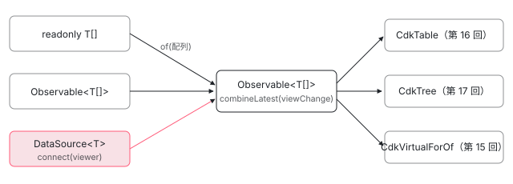

[目次](../README.md) › [CDK の内側](README.md) › 第 14 回 / 全 21 回

# DataSource と SelectionModel：データと選択を部品から切り離す

> DataSource が connect / disconnect で配列を流す Observable を渡す約束と、table・tree・仮想スクロールが配列・Observable・DataSource を 1 本の Observable にそろえて受け取る理由。SelectionModel が Set で選択を持ち、changed で差分（added / removed）を 1 回にまとめて出す行、単一選択で前の値を外す行、compareWith。\_RecycleViewRepeaterStrategy が外した行のビューを 20 個までしまって使い回す行と、\_DisposeViewRepeaterStrategy との違い。

angular/components · 読了 約 13 分 · 中核 · [サイトで読む（デモが動きます）](https://angular-deep-dive-cyan.vercel.app/chapter/cdk-collections)

---

CDK の table・tree・仮想スクロールは、どれも「データの列を受け取って、行のビューを作る」部品です。この章では、その入口の約束である `DataSource`、選択の状態を持つ `SelectionModel`、行のビューを作り直すか使い回すかを決める `_RecycleViewRepeaterStrategy` / `_DisposeViewRepeaterStrategy` を、行番号で順に読みます。

読む対象は components の `src/cdk/collections/` にある `data-source.ts`・`collection-viewer.ts`・`array-data-source.ts`・`selection-model.ts`・`view-repeater.ts`・`recycle-view-repeater-strategy.ts`・`dispose-view-repeater-strategy.ts` と、利用者の例として `src/cdk/table/table.ts` の 2 か所です。

1. [1. 概観](01-cdk-overview.md)
2. [2. Platform と向き](02-cdk-platform-bidi.md)
3. [3. Observer と画面幅](03-cdk-observers-layout.md)
4. [4. Portal](04-cdk-portal.md)
5. [5. Overlay](05-cdk.md)
6. [6. 位置の計算](06-cdk-overlay-position.md)
7. [7. スクロールと Esc](07-cdk-overlay-scroll-dispatch.md)
8. [8. FocusTrap](08-cdk-focus-trap.md)
9. [9. FocusMonitor](09-cdk-focus-monitor.md)
10. [10. ListKeyManager](10-cdk-key-manager.md)
11. [11. LiveAnnouncer](11-cdk-live-announcer.md)
12. [12. Dialog](12-cdk-dialog.md)
13. [13. Menu](13-cdk-menu.md)
14. **14. DataSource と選択**（この章）
15. [15. 仮想スクロール](15-virtual-scroll.md)
16. [16. table](16-table.md)
17. [17. tree](17-cdk-tree.md)
18. [18. DragRef](18-drag-drop.md)
19. [19. DropListRef](19-cdk-drop-list.md)
20. [20. ハーネス](20-harness.md)
21. [21. Material のテーマ](21-theming.md)

> [!TIP]
> **新卒エンジニアへ**
>
> `@angular/cdk/collections` は画面を持たない、データの道具箱です。DOM には一切触りません。ここで読む 3 つは、第 15〜17 回の仮想スクロール・table・tree がそのまま使います。そこでは「どこで呼ばれるか」だけを示すので、中身はこの章で押さえてください。

## 1. DataSource の約束は 2 つのメソッドだけ

📄 `components/src/cdk/collections/data-source.ts` L12–40 （▶ の行: 12, 21, 30, 34, 39）

```ts
12 ▶ export abstract class DataSource<T> {
13 │   /**
14 │    * Connects a collection viewer (such as a data-table) to this data source. Note that
15 │    * the stream provided will be accessed during change detection and should not directly change
16 │    * values that are bound in template views.
17 │    * @param collectionViewer The component that exposes a view over the data provided by this
18 │    *     data source.
19 │    * @returns Observable that emits a new value when the data changes.
20 │    */
21 ▶   abstract connect(collectionViewer: CollectionViewer): Observable<readonly T[]>;
22 │ 
23 │   /**
24 │    * Disconnects a collection viewer (such as a data-table) from this data source. Can be used
25 │    * to perform any clean-up or tear-down operations when a view is being destroyed.
26 │    *
27 │    * @param collectionViewer The component that exposes a view over the data provided by this
28 │    *     data source.
29 │    */
30 ▶   abstract disconnect(collectionViewer: CollectionViewer): void;
31 │ }
32 │ 
33 │ /** Checks whether an object is a data source. */
34 ▶ export function isDataSource(value: any): value is DataSource<any> {
35 │   // Check if the value is a DataSource by observing if it has a connect function. Cannot
36 │   // be checked as an `instanceof DataSource` since people could create their own sources
37 │   // that match the interface, but don't extend DataSource. We also can't use `isObservable`
38 │   // here, because of some internal apps.
39 ▶   return value && typeof value.connect === 'function' && !(value instanceof ConnectableObservable);
40 │ }
```

12 行目、`DataSource` は抽象クラスで、中身は 2 つの抽象メソッドだけです。21 行目の `connect` は、表示する側（テーブルなど）を引数にもらい、**配列を流す `Observable`** を返します。新しい配列を流すたびに表示が変わります。30 行目の `disconnect` は、表示する側が使い終わったときに呼ばれ、購読やタイマーの片付けに使います。

34〜39 行目の `isDataSource` は、`instanceof DataSource` では調べません。35〜38 行目のコメントのとおり、`DataSource` を継承せず形だけ合わせた自作クラスも受け付けるためで、39 行目は「`connect` という関数を持っていて、rxjs の `ConnectableObservable` ではない」ことだけを見ます。

📄 `components/src/cdk/collections/collection-viewer.ts` L11–24 （▶ の行: 12, 18, 23）

```ts
11 │ /** Represents a range of numbers with a specified start and end. */
12 ▶ export type ListRange = {start: number; end: number};
13 │ 
14 │ /**
15 │  * Interface for any component that provides a view of some data collection and wants to provide
16 │  * information regarding the view and any changes made.
17 │  */
18 ▶ export interface CollectionViewer {
19 │   /**
20 │    * A stream that emits whenever the `CollectionViewer` starts looking at a new portion of the
21 │    * data. The `start` index is inclusive, while the `end` is exclusive.
22 │    */
23 ▶   viewChange: Observable<ListRange>;
24 │ }
```

`connect` の引数の型が 18 行目の `CollectionViewer` です。持っているのは 23 行目の `viewChange` だけで、「いま表示している範囲」（12 行目の `ListRange`、`start` から `end` の手前まで）を流します。DataSource はこれを購読すれば、画面に出ている範囲のデータだけをサーバーから取る、といったことができます。

📄 `components/src/cdk/collections/array-data-source.ts` L12–23 （▶ の行: 13, 19, 22）

```ts
12 │ /** DataSource wrapper for a native array. */
13 ▶ export class ArrayDataSource<T> extends DataSource<T> {
14 │   constructor(private _data: readonly T[] | Observable<readonly T[]>) {
15 │     super();
16 │   }
17 │ 
18 │   connect(): Observable<readonly T[]> {
19 ▶     return isObservable(this._data) ? this._data : observableOf(this._data);
20 │   }
21 │ 
22 ▶   disconnect() {}
23 │ }
```

いちばん単純な実装が `ArrayDataSource` です。19 行目、渡されたのが `Observable` ならそのまま、配列なら `of(配列)` で 1 回だけ流します。22 行目の `disconnect` は何もしません。

## 2. 受け取る側：配列・Observable・DataSource を 1 本の流れにそろえる

利用者の例として `CdkTable` を読みます。`dataSource` に新しい値が入ると、まず次の関数が呼ばれます。

📄 `components/src/cdk/table/table.ts` L1202–1225 （▶ の行: 1205–1206, 1210–1212, 1224）

```ts
1202 │   private _switchDataSource(dataSource: CdkTableDataSourceInput<T>) {
1203 │     this._data = [];
1204 │ 
1205 ▶     if (isDataSource(this.dataSource)) {
1206 ▶       this.dataSource.disconnect(this);
1207 │     }
1208 │ 
1209 │     // Stop listening for data from the previous data source.
1210 ▶     if (this._renderChangeSubscription) {
1211 ▶       this._renderChangeSubscription.unsubscribe();
1212 ▶       this._renderChangeSubscription = null;
1213 │     }
1214 │ 
1215 │     if (!dataSource) {
1216 │       if (this._dataDiffer) {
1217 │         this._dataDiffer.diff([]);
1218 │       }
1219 │       if (this._rowOutlet) {
1220 │         this._rowOutlet.viewContainer.clear();
1221 │       }
1222 │     }
1223 │ 
1224 ▶     this._dataSource = dataSource;
1225 │   }
```

1205〜1206 行目、**古い**値が DataSource なら `disconnect(this)` を呼びます。`this` はテーブル自身で、テーブルは `CollectionViewer` を実装しています。1210〜1212 行目で古いデータの購読を外し、1224 行目で新しい値を覚えるだけで、ここではまだ `connect` しません。

📄 `components/src/cdk/table/table.ts` L1228–1256 （▶ の行: 1236–1241, 1248, 1250–1252, 1254）

```ts
1228 │   private _observeRenderChanges() {
1229 │     // If no data source has been set, there is nothing to observe for changes.
1230 │     if (!this.dataSource) {
1231 │       return;
1232 │     }
1233 │ 
1234 │     let dataStream: Observable<readonly T[]> | undefined;
1235 │ 
1236 ▶     if (isDataSource(this.dataSource)) {
1237 ▶       dataStream = this.dataSource.connect(this);
1238 ▶     } else if (isObservable(this.dataSource)) {
1239 ▶       dataStream = this.dataSource;
1240 ▶     } else if (Array.isArray(this.dataSource)) {
1241 ▶       dataStream = observableOf(this.dataSource);
1242 │     }
1243 │ 
1244 │     if (dataStream === undefined && (typeof ngDevMode === 'undefined' || ngDevMode)) {
1245 │       throw getTableUnknownDataSourceError();
1246 │     }
1247 │ 
1248 ▶     this._renderChangeSubscription = combineLatest([dataStream!, this.viewChange])
1249 │       .pipe(takeUntil(this._onDestroy))
1250 ▶       .subscribe(([data, range]) => {
1251 ▶         this._data = data || [];
1252 ▶         this._renderedRange = range;
1253 │         this._dataStream.next(data);
1254 ▶         this.renderRows();
1255 │       });
1256 │   }
```

`connect` は次の描画のとき（[第 16 回](16-table.md)の `_render`）にこの関数から呼ばれます。1236〜1241 行目が入口の 3 通りで、DataSource なら 1237 行目で `connect(this)`、`Observable` ならそのまま、配列なら `of(配列)` にします。以降は 1 本の `Observable` として扱い、1248 行目でテーブルの `viewChange` と `combineLatest` し、どちらかが変わるたびに 1251〜1254 行目でデータと範囲を覚えて `renderRows()` を呼びます。



*受け取る側は 3 通りの入力をすべて「配列を流す Observable」にそろえる。DataSource のときだけ、自分（CollectionViewer）を渡して connect し、外すときに disconnect する。*

`CdkTree` も同じ 3 分岐を持ち、`CdkVirtualForOf` は配列や `Observable` を先に `ArrayDataSource` に包んでから同じように扱います（それぞれの行は第 17 回・第 15 回で引用します）。3 つが同じ型を受け取るので、1 つの DataSource をテーブルにも仮想スクロールにも渡せます。

## 3. SelectionModel：Set と「まだ知らせていない差分」

📄 `components/src/cdk/collections/selection-model.ts` L14–37 （▶ の行: 16, 19, 22, 25, 29–30, 37）

```ts
14 │ export class SelectionModel<T> {
15 │   /** Currently-selected values. */
16 ▶   private _selection = new Set<T>();
17 │ 
18 │   /** Keeps track of the deselected options that haven't been emitted by the change event. */
19 ▶   private _deselectedToEmit: T[] = [];
20 │ 
21 │   /** Keeps track of the selected options that haven't been emitted by the change event. */
22 ▶   private _selectedToEmit: T[] = [];
23 │ 
24 │   /** Cache for the array value of the selected items. */
25 ▶   private _selected: T[] | null = null;
26 │ 
27 │   /** Selected values. */
28 │   get selected(): T[] {
29 ▶     if (!this._selected) {
30 ▶       this._selected = Array.from(this._selection.values());
31 │     }
32 │ 
33 │     return this._selected;
34 │   }
35 │ 
36 │   /** Event emitted when the value has changed. */
37 ▶   readonly changed = new Subject<SelectionChange<T>>();
```

選択の本体は 16 行目の `Set` です。19 行目と 22 行目の 2 つの配列は「次の `changed` で知らせる、外れた値と入った値」の溜め置き場です。28〜34 行目の `selected` は、読まれたときに初めて 30 行目で `Set` を配列にし、25 行目の `_selected` に覚えておきます。37 行目の `changed` が差分を流す `Subject` です。

📄 `components/src/cdk/collections/selection-model.ts` L54–70 （▶ の行: 55–58, 61, 64, 68）

```ts
54 │   constructor(
55 ▶     private _multiple = false,
56 ▶     initiallySelectedValues?: T[],
57 ▶     private _emitChanges = true,
58 ▶     public compareWith?: (o1: T, o2: T) => boolean,
59 │   ) {
60 │     if (initiallySelectedValues && initiallySelectedValues.length) {
61 ▶       if (_multiple) {
62 │         initiallySelectedValues.forEach(value => this._markSelected(value));
63 │       } else {
64 ▶         this._markSelected(initiallySelectedValues[0]);
65 │       }
66 │ 
67 │       // Clear the array in order to avoid firing the change event for preselected values.
68 ▶       this._selectedToEmit.length = 0;
69 │     }
70 │   }
```

コンストラクタの引数は 4 つです。55 行目の `_multiple` は**既定が `false`**（単一選択）、56 行目が最初から選んでおく値、57 行目の `_emitChanges` は差分を溜めるかどうか、58 行目が同じものかを判定する `compareWith` です。単一選択なら 64 行目で最初の 1 つだけを選び、68 行目で溜めた差分を捨てます。最初から選んだ値で `changed` は出ません。

📄 `components/src/cdk/collections/selection-model.ts` L104–128 （▶ の行: 105, 115, 117–118, 127）

```ts
104 │   toggle(value: T): boolean {
105 ▶     return this.isSelected(value) ? this.deselect(value) : this.select(value);
106 │   }
107 │ 
108 │   /**
109 │    * Clears all of the selected values.
110 │    * @param flushEvent Whether to flush the changes in an event.
111 │    *   If false, the changes to the selection will be flushed along with the next event.
112 │    * @return Whether the selection changed as a result of this call
113 │    */
114 │   clear(flushEvent = true): boolean {
115 ▶     this._unmarkAll();
116 │     const changed = this._hasQueuedChanges();
117 ▶     if (flushEvent) {
118 ▶       this._emitChangeEvent();
119 │     }
120 │     return changed;
121 │   }
122 │ 
123 │   /**
124 │    * Determines whether a value is selected.
125 │    */
126 │   isSelected(value: T): boolean {
127 ▶     return this._selection.has(this._getConcreteValue(value));
128 │   }
```

105 行目の `toggle` は、選ばれていれば `deselect`、いなければ `select` を呼ぶだけです。127 行目の `isSelected` は `Set.has` ですが、その前に `_getConcreteValue` を通します（6 節）。115〜118 行目の `clear` は全部外したあと、引数が `true`（既定）なら差分を知らせます。

📄 `components/src/cdk/collections/selection-model.ts` L160–176 （▶ の行: 162–165, 172）

```ts
160 │   /** Selects an array of values. */
161 │   private _select(values: T[]) {
162 ▶     this._verifyValueAssignment(values);
163 ▶     values.forEach(value => this._markSelected(value));
164 ▶     const changed = this._hasQueuedChanges();
165 ▶     this._emitChangeEvent();
166 │     return changed;
167 │   }
168 │ 
169 │   /** Deselects an array of values. */
170 │   private _deselect(values: T[]) {
171 │     this._verifyValueAssignment(values);
172 ▶     values.forEach(value => this._unmarkSelected(value));
173 │     const changed = this._hasQueuedChanges();
174 │     this._emitChangeEvent();
175 │     return changed;
176 │   }
```

📄 `components/src/cdk/collections/selection-model.ts` L192–207 （▶ の行: 195, 197–198, 200–201, 204–205）

```ts
192 │   /** Emits a change event and clears the records of selected and deselected values. */
193 │   private _emitChangeEvent() {
194 │     // Clear the selected values so they can be re-cached.
195 ▶     this._selected = null;
196 │ 
197 ▶     if (this._selectedToEmit.length || this._deselectedToEmit.length) {
198 ▶       this.changed.next({
199 │         source: this,
200 ▶         added: this._selectedToEmit,
201 ▶         removed: this._deselectedToEmit,
202 │       });
203 │ 
204 ▶       this._deselectedToEmit = [];
205 ▶       this._selectedToEmit = [];
206 │     }
207 │   }
```

`select(...values)` も `deselect` も同じ形です。163 行目で値ごとに印を付け（172 行目は外す）、164 行目で「溜まった差分があるか」を戻り値用に取り、165 行目で知らせます。195 行目で `selected` の配列の覚えを捨て、197 行目、差分が 1 つでもあれば 198〜202 行目で `{ source, added, removed }` を 1 回だけ流し、204〜205 行目で溜め置き場を**新しい配列に取り替え**ます。何も変わらなければ `changed` は出ません。`select(a, b, c)` と 3 つ渡しても通知は 1 回です。

## 4. 単一選択で前の値を外す行

📄 `components/src/cdk/collections/selection-model.ts` L209–244 （▶ の行: 211–214, 218, 222, 230–231, 234, 242）

```ts
209 │   /** Selects a value. */
210 │   private _markSelected(value: T) {
211 ▶     value = this._getConcreteValue(value);
212 ▶     if (!this.isSelected(value)) {
213 ▶       if (!this._multiple) {
214 ▶         this._unmarkAll();
215 │       }
216 │ 
217 │       if (!this.isSelected(value)) {
218 ▶         this._selection.add(value);
219 │       }
220 │ 
221 │       if (this._emitChanges) {
222 ▶         this._selectedToEmit.push(value);
223 │       }
224 │     }
225 │   }
226 │ 
227 │   /** Deselects a value. */
228 │   private _unmarkSelected(value: T) {
229 │     value = this._getConcreteValue(value);
230 ▶     if (this.isSelected(value)) {
231 ▶       this._selection.delete(value);
232 │ 
233 │       if (this._emitChanges) {
234 ▶         this._deselectedToEmit.push(value);
235 │       }
236 │     }
237 │   }
238 │ 
239 │   /** Clears out the selected values. */
240 │   private _unmarkAll() {
241 │     if (!this.isEmpty()) {
242 ▶       this._selection.forEach(value => this._unmarkSelected(value));
243 │     }
244 │   }
```

1. **同じものかを確かめる**

   211 行目で `compareWith` による置き換えをしてから、212 行目で「まだ選ばれていない」ときだけ進みます。選ばれていれば何もしないので、差分も溜まりません。
2. **単一選択なら先に全部外す**

   213〜214 行目、`_multiple` が `false` なら `_unmarkAll`。242 行目で今の値を 1 つずつ `_unmarkSelected` に回し、231 行目で `Set` から消し、234 行目で「外れた値」に積みます。
3. **新しい値を入れる**

   218 行目で `Set` に足し、222 行目で「入った値」に積みます。
4. **まとめて 1 回知らせる**

   呼び出し元の `_select` が `_emitChangeEvent` を呼ぶので、`changed` には `added: [新しい値]` と `removed: [前の値]` が**同じ 1 回の通知**で届きます。

📄 `components/src/cdk/collections/selection-model.ts` L246–274 （▶ の行: 251–252, 263–264, 267–269, 272）

```ts
246 │   /**
247 │    * Verifies the value assignment and throws an error if the specified value array is
248 │    * including multiple values while the selection model is not supporting multiple values.
249 │    */
250 │   private _verifyValueAssignment(values: T[]) {
251 ▶     if (values.length > 1 && !this._multiple && (typeof ngDevMode === 'undefined' || ngDevMode)) {
252 ▶       throw getMultipleValuesInSingleSelectionError();
253 │     }
254 │   }
255 │ 
256 │   /** Whether there are queued up change to be emitted. */
257 │   private _hasQueuedChanges() {
258 │     return !!(this._deselectedToEmit.length || this._selectedToEmit.length);
259 │   }
260 │ 
261 │   /** Returns a value that is comparable to inputValue by applying compareWith function, returns the same inputValue otherwise. */
262 │   private _getConcreteValue(inputValue: T, selection?: Set<T>): T {
263 ▶     if (!this.compareWith) {
264 ▶       return inputValue;
265 │     } else {
266 │       selection = selection ?? this._selection;
267 ▶       for (let selectedValue of selection) {
268 ▶         if (this.compareWith!(inputValue, selectedValue)) {
269 ▶           return selectedValue;
270 │         }
271 │       }
272 ▶       return inputValue;
273 │     }
274 │   }
```

単一選択に 2 つ以上を一度に渡すと、251〜252 行目で例外です。ただし条件に `ngDevMode` があるので、**本番ビルドでは投げません**（そのときは 213〜214 行目で前を外し続け、最後の値だけが残ります）。

## 5. 動かして確かめる

> **🧪 DEMO — 本物の SelectionModel**
>
> `new SelectionModel(multiple, [], true, compareWith)` を作り、`changed` を購読して履歴に出します。設定を変えると作り直します。
>
> changed の履歴（新しい順）
>
> ▶ [このデモはサイトで動かせます](https://angular-deep-dive-cyan.vercel.app/chapter/cdk-collections)

multiple を外して 2 つ目を選ぶと、1 回の通知に `added` と `removed` が両方入ります（4 節の手順）。compareWith を外したまま「別オブジェクトを select」すると、同じ id の「ぶどう」が 2 つ並びます。`Set` は参照で比べるからです。compareWith を付けると、ぶどうが選ばれていれば 268〜269 行目で既にある値に置き換わり、212 行目で止まって何も増えません。

## 6. compareWith は「Set に入っている値への置き換え」

もう一度 262〜274 行目を見ます。`compareWith` が無ければ 263〜264 行目で値をそのまま返します。あれば 267〜269 行目で、`Set` の中身を 1 つずつ `compareWith(入力, 選択中の値)` で比べ、一致した**選択中の値のほう**を返します。`isSelected`・`_markSelected`・`_unmarkSelected` はすべてこの置き換えのあとで `Set` を引くので、別のオブジェクトでも「同じもの」として扱えます。そのかわり、1 回の判定で選択中の件数ぶんループします。10,000 件を選んだ状態で 10,000 件を `isSelected` すると、1 億回の比較になります。

## 7. ビューを作る戦略：\_ViewRepeater

ここからは行のビューの話です。CDK の table と仮想スクロールは、データの差分（Angular の `IterableDiffer` が出す `IterableChanges`）を受け取って、`ViewContainerRef` にビューを足し引きします。その「どう足し引きするか」を差し替えられるように、型が決めてあります。`ViewContainerRef` の仕組みそのものは[ViewContainerRef の章](../template/04-view-container.md)で読みます。

📄 `components/src/cdk/collections/view-repeater.ts` L54–64 （▶ の行: 57, 59, 61, 63）

```ts
54 │ /** Indicates how a view was changed by a `_ViewRepeater`. */
55 │ export enum _ViewRepeaterOperation {
56 │   /** The content of an existing view was replaced with another item. */
57 ▶   REPLACED,
58 │   /** A new view was created with `createEmbeddedView`. */
59 ▶   INSERTED,
60 │   /** The position of a view changed, but the content remains the same. */
61 ▶   MOVED,
62 │   /** A view was detached from the view container. */
63 ▶   REMOVED,
64 │ }
```

📄 `components/src/cdk/collections/view-repeater.ts` L89–106 （▶ の行: 96–102, 105）

```ts
 89 │ /**
 90 │  * Describes a strategy for rendering items in a `ViewContainerRef`.
 91 │  *
 92 │  * @template T The type for the embedded view's $implicit property.
 93 │  * @template R The type for the item in each IterableDiffer change record.
 94 │  * @template C The type for the context passed to each embedded view.
 95 │  */
 96 ▶ export interface _ViewRepeater<T, R, C extends _ViewRepeaterItemContext<T>> {
 97 ▶   applyChanges(
 98 ▶     changes: IterableChanges<R>,
 99 ▶     viewContainerRef: ViewContainerRef,
100 ▶     itemContextFactory: _ViewRepeaterItemContextFactory<T, R, C>,
101 ▶     itemValueResolver: _ViewRepeaterItemValueResolver<T, R>,
102 ▶     itemViewChanged?: _ViewRepeaterItemChanged<R, C>,
103 │   ): void;
104 │ 
105 ▶   detach(): void;
106 │ }
```

96〜106 行目の `_ViewRepeater` は `applyChanges` と `detach` の 2 つだけです。`applyChanges` は、差分（98 行目）、入れる先（99 行目）、新しいビューのテンプレートと文脈を作る関数（100 行目）、差分の記録から値を取り出す関数（101 行目）、ビューごとに結果を知らせる関数（102 行目、省略可）を受け取ります。結果は 55〜64 行目の 4 種類で、57 行目の `REPLACED` は「既存のビューの中身を別の値に入れ替えた」、59 行目の `INSERTED` は「`createEmbeddedView` で新しく作った」です。

## 8. \_RecycleViewRepeaterStrategy：捨てずにしまっておく

📄 `components/src/cdk/collections/recycle-view-repeater-strategy.ts` L36–54 （▶ の行: 45, 54）

```ts
36 │ export class _RecycleViewRepeaterStrategy<
37 │   T,
38 │   R,
39 │   C extends _ViewRepeaterItemContext<T>,
40 │ > implements _ViewRepeater<T, R, C> {
41 │   /**
42 │    * The size of the cache used to store unused views.
43 │    * Setting the cache size to `0` will disable caching. Defaults to 20 views.
44 │    */
45 ▶   viewCacheSize: number = 20;
46 │ 
47 │   /**
48 │    * View cache that stores embedded view instances that have been previously stamped out,
49 │    * but don't are not currently rendered. The view repeater will reuse these views rather than
50 │    * creating brand new ones.
51 │    *
52 │    * TODO(michaeljamesparsons) Investigate whether using a linked list would improve performance.
53 │    */
54 ▶   private _viewCache: EmbeddedViewRef<C>[] = [];
```

📄 `components/src/cdk/collections/recycle-view-repeater-strategy.ts` L64–97 （▶ の行: 65, 73, 77, 83–84, 86–87, 90）

```ts
64 │     // Rearrange the views to put them in the right location.
65 ▶     changes.forEachOperation(
66 │       (
67 │         record: IterableChangeRecord<R>,
68 │         adjustedPreviousIndex: number | null,
69 │         currentIndex: number | null,
70 │       ) => {
71 │         let view: EmbeddedViewRef<C> | undefined;
72 │         let operation: _ViewRepeaterOperation;
73 ▶         if (record.previousIndex == null) {
74 │           // Item added.
75 │           const viewArgsFactory = () =>
76 │             itemContextFactory(record, adjustedPreviousIndex, currentIndex);
77 ▶           view = this._insertView(
78 │             viewArgsFactory,
79 │             currentIndex!,
80 │             viewContainerRef,
81 │             itemValueResolver(record),
82 │           );
83 ▶           operation = view ? _ViewRepeaterOperation.INSERTED : _ViewRepeaterOperation.REPLACED;
84 ▶         } else if (currentIndex == null) {
85 │           // Item removed.
86 ▶           this._detachAndCacheView(adjustedPreviousIndex!, viewContainerRef);
87 ▶           operation = _ViewRepeaterOperation.REMOVED;
88 │         } else {
89 │           // Item moved.
90 ▶           view = this._moveView(
91 │             adjustedPreviousIndex!,
92 │             currentIndex!,
93 │             viewContainerRef,
94 │             itemValueResolver(record),
95 │           );
96 │           operation = _ViewRepeaterOperation.MOVED;
97 │         }
```

📄 `components/src/cdk/collections/recycle-view-repeater-strategy.ts` L117–145 （▶ の行: 127–130, 134, 143–144）

```ts
117 │   /**
118 │    * Inserts a view for a new item, either from the cache or by creating a new
119 │    * one. Returns `undefined` if the item was inserted into a cached view.
120 │    */
121 │   private _insertView(
122 │     viewArgsFactory: () => _ViewRepeaterItemInsertArgs<C>,
123 │     currentIndex: number,
124 │     viewContainerRef: ViewContainerRef,
125 │     value: T,
126 │   ): EmbeddedViewRef<C> | undefined {
127 ▶     const cachedView = this._insertViewFromCache(currentIndex!, viewContainerRef);
128 ▶     if (cachedView) {
129 ▶       cachedView.context.$implicit = value;
130 ▶       return undefined;
131 │     }
132 │ 
133 │     const viewArgs = viewArgsFactory();
134 ▶     return viewContainerRef.createEmbeddedView(
135 │       viewArgs.templateRef,
136 │       viewArgs.context,
137 │       viewArgs.index,
138 │     );
139 │   }
140 │ 
141 │   /** Detaches the view at the given index and inserts into the view cache. */
142 │   private _detachAndCacheView(index: number, viewContainerRef: ViewContainerRef) {
143 ▶     const detachedView = viewContainerRef.detach(index) as EmbeddedViewRef<C>;
144 ▶     this._maybeCacheView(detachedView, viewContainerRef);
145 │   }
```

📄 `components/src/cdk/collections/recycle-view-repeater-strategy.ts` L160–192 （▶ の行: 165–166, 168, 177, 187, 189）

```ts
160 │   /**
161 │    * Cache the given detached view. If the cache is full, the view will be
162 │    * destroyed.
163 │    */
164 │   private _maybeCacheView(view: EmbeddedViewRef<C>, viewContainerRef: ViewContainerRef) {
165 ▶     if (this._viewCache.length < this.viewCacheSize) {
166 ▶       this._viewCache.push(view);
167 │     } else {
168 ▶       const index = viewContainerRef.indexOf(view);
169 │ 
170 │       // The host component could remove views from the container outside of
171 │       // the view repeater. It's unlikely this will occur, but just in case,
172 │       // destroy the view on its own, otherwise destroy it through the
173 │       // container to ensure that all the references are removed.
174 │       if (index === -1) {
175 │         view.destroy();
176 │       } else {
177 ▶         viewContainerRef.remove(index);
178 │       }
179 │     }
180 │   }
181 │ 
182 │   /** Inserts a recycled view from the cache at the given index. */
183 │   private _insertViewFromCache(
184 │     index: number,
185 │     viewContainerRef: ViewContainerRef,
186 │   ): EmbeddedViewRef<C> | null {
187 ▶     const cachedView = this._viewCache.pop();
188 │     if (cachedView) {
189 ▶       viewContainerRef.insert(cachedView, index);
190 │     }
191 │     return cachedView || null;
192 │   }
```

1. **差分を 1 件ずつ見る**

   65 行目、`forEachOperation` で「追加・削除・移動」を順に受け取ります。
2. **削除なら、壊さずに外してしまう**

   84〜87 行目で `_detachAndCacheView`。143 行目の `viewContainerRef.detach(index)` は DOM から外すだけでビューを壊しません。165〜166 行目、しまってある数が 45 行目の `viewCacheSize`（既定 20）未満なら 54 行目の `_viewCache` に積み、満杯なら 177 行目で普通に消します。
3. **追加なら、まずしまってあるビューを探す**

   73〜77 行目から `_insertView`。127 行目、187 行目で `_viewCache.pop()` し、189 行目でその位置に `insert` します。見つかれば 129 行目で **`context.$implicit` だけを新しい値に書き換え**、130 行目で `undefined` を返します。
4. **しまってあるビューが無ければ作る**

   134 行目で `createEmbeddedView`。83 行目、作ったビューが返れば `INSERTED`、`undefined`（使い回した）なら `REPLACED` として知らせます。
5. **移動なら動かして値を入れ直す**

   90 行目の `_moveView` は `move` したあと `$implicit` を書き換えます。

使い回すビューは、DOM の要素も、テンプレートの中の指示子やコンポーネントのインスタンスも、前の値を描いていたものそのものです。変わるのは 129 行目の `$implicit` だけです。`detach()` は、部品が壊されるときに `_viewCache` の残りを `destroy` します。

## 9. \_DisposeViewRepeaterStrategy：毎回作って毎回壊す

📄 `components/src/cdk/collections/dispose-view-repeater-strategy.ts` L45–81 （▶ の行: 53, 55, 60, 62, 65–66, 81）

```ts
45 │     changes.forEachOperation(
46 │       (
47 │         record: IterableChangeRecord<R>,
48 │         adjustedPreviousIndex: number | null,
49 │         currentIndex: number | null,
50 │       ) => {
51 │         let view: EmbeddedViewRef<C> | undefined;
52 │         let operation: _ViewRepeaterOperation;
53 ▶         if (record.previousIndex == null) {
54 │           const insertContext = itemContextFactory(record, adjustedPreviousIndex, currentIndex);
55 ▶           view = viewContainerRef.createEmbeddedView(
56 │             insertContext.templateRef,
57 │             insertContext.context,
58 │             insertContext.index,
59 │           );
60 ▶           operation = _ViewRepeaterOperation.INSERTED;
61 │         } else if (currentIndex == null) {
62 ▶           viewContainerRef.remove(adjustedPreviousIndex!);
63 │           operation = _ViewRepeaterOperation.REMOVED;
64 │         } else {
65 ▶           view = viewContainerRef.get(adjustedPreviousIndex!) as EmbeddedViewRef<C>;
66 ▶           viewContainerRef.move(view!, currentIndex);
67 │           operation = _ViewRepeaterOperation.MOVED;
68 │         }
69 │ 
70 │         if (itemViewChanged) {
71 │           itemViewChanged({
72 │             context: view?.context,
73 │             operation,
74 │             record,
75 │           });
76 │         }
77 │       },
78 │     );
79 │   }
80 │ 
81 ▶   detach() {}
```

同じ `applyChanges` ですが、追加は 55 行目で必ず `createEmbeddedView`、削除は 62 行目の `remove` で**ビューを壊します**。移動（65〜66 行目）は Recycle と同じです。しまっておくものが無いので、81 行目の `detach` は空です。

どの部品がどちらを使うかは、次のとおりです（components を `grep` した結果）。

| 部品 | 戦略 | 決めている行 |
| --- | --- | --- |
| `CdkVirtualForOf` | 常に Recycle | virtual-for-of.ts 89 行目のフィールド初期化（[第 15 回](15-virtual-scroll.md)で引用） |
| `CdkTable` | `recycleRows` を付けたか、仮想スクロールの中なら Recycle。それ以外は Dispose | table.ts 672〜675 行目の `ngAfterContentInit`（[第 16 回](16-table.md)で引用） |
| `MatTable` | `CdkTable` を継承。`mat-table[recycleRows]` の指示子で同じ切り替え | material/table/table.ts |
| `CdkTree` | どちらも使わず、自分で `forEachOperation` して作る・消す | tree.ts の `renderNodeChanges`（[第 17 回](17-cdk-tree.md)で引用） |

> [!NOTE]
> **ポイント**
>
> 古い記事に出てくる `_VIEW_REPEATER_STRATEGY` という注入トークンは、22.2.0-next.5 の components には**もうありません**（`grep` で 0 件）。今の `CdkTable` は、上の表の行で `new` して `_viewRepeater` に入れます。

## 10. DataSource の connect / disconnect を数える

> **🧪 DEMO — 自作の DataSource を本物の cdk-table に渡す**
>
> `connect()` で `BehaviorSubject` を返し、`connect` と `disconnect` が呼ばれた回数を数える DataSource です。呼ぶのは `CdkTable` です。
>
> ▶ [このデモはサイトで動かせます](https://angular-deep-dive-cyan.vercel.app/chapter/cdk-collections)

「1 行足す」は `BehaviorSubject.next` で新しい配列を流すだけで、`connect` は増えません。2 節 1248 行目の購読が受けて描き直します。「差し替える」と、2 節 1205〜1206 行目で古いソースの `disconnect`、続く描画で 1237 行目の新しいソースの `connect` が 1 回ずつ増えます。「テーブルを外す」と、テーブルの `ngOnDestroy` が `disconnect` を呼びます。

## 11. 全体の流れ

- 👤 `[dataSource]="ds"` — 利用者のテンプレート — *入力が変わる*
  - `CdkTable._switchDataSource()` — table.ts 1202 — *古い DataSource を disconnect*
  - `CdkTable._observeRenderChanges()` — table.ts 1228 — *次の描画で*
    - `ds.connect(this)` — table.ts 1237 — *this は CollectionViewer*
    - `combineLatest([data, viewChange])` — table.ts 1248 — *流れるたびに renderRows*
      - `_viewRepeater.applyChanges()` — recycle / dispose — *差分ごとに作る・使い回す・壊す*
- 👤 `selection.toggle(x)` — 利用者のコード — *選択は別の道具*
  - `SelectionModel._select()` — selection-model.ts 161 — *\_markSelected で差分を溜める*
    - `_emitChangeEvent()` — selection-model.ts 193 — *changed.next({ added, removed })*

## 聞かれそうな質問

**Q. テーブルに配列をそのまま渡すのと、DataSource を渡すのは何が違う？**

配列は 2 節 1240〜1241 行目で `of(配列)` になり、**1 回しか流れません**。同じ配列に `push` しても表示は変わらず、新しい配列を代入する（入力が変わって `_switchDataSource` が走る）か、`renderRows()` を自分で呼ぶ必要があります。DataSource なら、新しい配列を流すタイミングを自分で決められ、1 節 30 行目の `disconnect` で後片付けの場所も持てます。`connect` の引数の `viewChange`（1 節 23 行目）で見えている範囲も分かるので、ページ単位の読み込みにも使えます。

**Q. SelectionModel にオブジェクトを入れたとき、「同じもの」はどう判定される？**

既定では 16 行目の `Set` の参照比較です。API から取り直した、中身が同じ別のオブジェクトは別物として扱われ、`isSelected` は `false`、`select` すると 2 つ目が入ります。`compareWith`（58 行目）を渡すと、262〜274 行目で既に入っている値に置き換えてから `Set` を引くので、id などで同じものと扱えます。そのかわり 1 回の判定ごとに選択中の件数ぶん比べます。

**Q. 単一選択で別の値を選ぶと、changed は 2 回出る？**

1 回です。213〜214 行目で前の値を外した分は `_deselectedToEmit` に、新しい値は `_selectedToEmit` に溜まり、198〜202 行目でまとめて 1 回 `{ added: [新], removed: [旧] }` を流します。

**Q. recycleRows を付けたら、入力欄に打った文字が別の行に出てきた。なぜ？**

8 節のとおり、Recycle はしまってあったビューを 189 行目で差し込み、129 行目で `$implicit` だけを書き換えます。DOM の `<input>` の値、コンポーネントの中のフィールド、開閉の状態など、`$implicit` から計算していない状態は前の行のまま残ります。行の状態はデータの側（行のオブジェクトや、id をキーにした `Map`）に持ち、テンプレートはそこから描くようにします。状態を持つ部品を行に置くなら Dispose（`recycleRows` を付けない）にします。

**Q. Recycle にしておけば常に速い？**

いいえ。使い回せるのは削除で外したビューだけで、しまっておけるのは 45 行目の 20 個までです（仮想スクロールでは `templateCacheSize` で変えられます、第 15 回）。行の数がほとんど変わらない表では差は出ません。速くなるのは「消えた行の分だけすぐ新しい行が入る」場面、つまりスクロールやページ送りです。

## 読み終えて

- `DataSource` は `connect(viewer)` で配列の `Observable` を返し、`disconnect(viewer)` で片付ける。判定は `instanceof` ではなく `connect` 関数の有無。
- table・tree・仮想スクロールは、配列・`Observable`・DataSource を 1 本の `Observable` にそろえてから描く。配列は 1 回しか流れない。
- `SelectionModel` は `Set` で選択を持ち、変化を溜めて `changed` で `added` / `removed` を 1 回にまとめて出す。単一選択は「先に全部外す」。
- `compareWith` は「Set に入っている値への置き換え」で、判定ごとに選択中の件数ぶんループする。
- `_RecycleViewRepeaterStrategy` は外したビューを 20 個までしまい、次の追加で `$implicit` だけを替えて使い回す。`_DisposeViewRepeaterStrategy` は毎回作って壊す。

---

← 前: [CDK Menu：入れ子のメニューを MenuStack でたどる](13-cdk-menu.md)  
次: [仮想スクロール：1 万件を数十件で見せる](15-virtual-scroll.md) →
