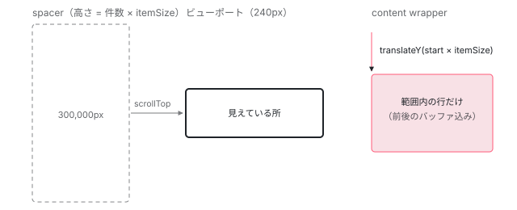

[目次](../README.md) › [CDK の内側](README.md) › 第 15 回 / 全 21 回

# 仮想スクロール：1 万件を数十件で見せる

> CdkVirtualScrollViewport が scroll を受けて表示範囲を計算し、CdkVirtualForOf が範囲内の行だけを描く流れ。FixedSizeVirtualScrollStrategy が minBufferPx と maxBufferPx で再描画の回数を抑える計算、全体の高さを出す spacer、内側の要素を transform で動かす行、ビューの使い回し。

angular/components · 読了 約 13 分 · 中核 · [サイトで読む（デモが動きます）](https://angular-deep-dive-cyan.vercel.app/chapter/virtual-scroll)

---

1 万行のリストを全部 DOM に置くと、描画もスクロールも重くなります。CDK の仮想スクロールは、**見えている範囲とその前後だけ**を DOM に置き、残りは高さだけで済ませます。この章では、スクロールを受けて表示範囲を計算し、その範囲の行だけを描き、内側の要素を `transform` で見える位置まで動かすまでを、関数の順に読みます。

読む対象は components の `src/cdk/scrolling/` にある `virtual-scroll-viewport.ts` と `.html`、`fixed-size-virtual-scroll.ts`、`virtual-scroll-strategy.ts`、`virtual-for-of.ts` です。

1. [1. 概観](01-cdk-overview.md)
2. [2. Platform と向き](02-cdk-platform-bidi.md)
3. [3. Observer と画面幅](03-cdk-observers-layout.md)
4. [4. Portal](04-cdk-portal.md)
5. [5. Overlay](05-cdk.md)
6. [6. 位置の計算](06-cdk-overlay-position.md)
7. [7. スクロールと Esc](07-cdk-overlay-scroll-dispatch.md)
8. [8. FocusTrap](08-cdk-focus-trap.md)
9. [9. FocusMonitor](09-cdk-focus-monitor.md)
10. [10. ListKeyManager](10-cdk-key-manager.md)
11. [11. LiveAnnouncer](11-cdk-live-announcer.md)
12. [12. Dialog](12-cdk-dialog.md)
13. [13. Menu](13-cdk-menu.md)
14. [14. DataSource と選択](14-cdk-collections.md)
15. **15. 仮想スクロール**（この章）
16. [16. table](16-table.md)
17. [17. tree](17-cdk-tree.md)
18. [18. DragRef](18-drag-drop.md)
19. [19. DropListRef](19-cdk-drop-list.md)
20. [20. ハーネス](20-harness.md)
21. [21. Material のテーマ](21-theming.md)

登場するのは 3 つの部品です。利用者のテンプレートでは次のように書きます。

- `<cdk-virtual-scroll-viewport itemSize="30">` … スクロールする箱（`CdkVirtualScrollViewport`）。`itemSize` 属性で `CdkFixedSizeVirtualScroll` 指示子も付く。
- `*cdkVirtualFor="let item of items"` … 範囲内の行だけを作る繰り返し（`CdkVirtualForOf`）。
- 表示範囲を決める「戦略」（`VirtualScrollStrategy`）。行の高さが一定なら `FixedSizeVirtualScrollStrategy`。

## 1. DOM は 2 つの div だけ

📄 `components/src/cdk/scrolling/virtual-scroll-viewport.html` L1–13 （▶ の行: 5–6, 12–13）

```html
 1 │ <!--
 2 │   Wrap the rendered content in an element that will be used to offset it based on the scroll
 3 │   position.
 4 │ -->
 5 ▶ <div #contentWrapper class="cdk-virtual-scroll-content-wrapper">
 6 ▶   <ng-content></ng-content>
 7 │ </div>
 8 │ <!--
 9 │   Spacer used to force the scrolling container to the correct size for the *total* number of items
10 │   so that the scrollbar captures the size of the entire data set.
11 │ -->
12 ▶ <div class="cdk-virtual-scroll-spacer"
13 ▶      [style.width]="_totalContentWidth()" [style.height]="_totalContentHeight()"></div>
```

5〜6 行目の `contentWrapper` に、`*cdkVirtualFor` が作った行が投影されます。ここに入るのは数十行だけです。12〜13 行目の spacer は中身の無い div で、幅か高さに「全件ぶんの大きさ」を持ちます。スクロールバーの長さはこの div が決めています。



*spacer が全件ぶんの高さを持ち、スクロールバーを作る。content wrapper は数十行だけを持ち、translateY で今見えている位置まで下げてある。*

## 2. 戦略は DI で受け取る

📄 `components/src/cdk/scrolling/fixed-size-virtual-scroll.ts` L192–212 （▶ の行: 194, 196–198, 212）

```ts
192 │ /** A virtual scroll strategy that supports fixed-size items. */
193 │ @Directive({
194 ▶   selector: 'cdk-virtual-scroll-viewport[itemSize]',
195 │   providers: [
196 ▶     {
197 ▶       provide: VIRTUAL_SCROLL_STRATEGY,
198 ▶       useFactory: _fixedSizeVirtualScrollStrategyFactory,
199 │       deps: [forwardRef(() => CdkFixedSizeVirtualScroll)],
200 │     },
201 │   ],
202 │ })
203 │ export class CdkFixedSizeVirtualScroll implements OnChanges {
204 │   /** The size of the items in the list (in pixels). */
205 │   @Input()
206 │   get itemSize(): number {
207 │     return this._itemSize;
208 │   }
209 │   set itemSize(value: NumberInput) {
210 │     this._itemSize = coerceNumberProperty(value);
211 │   }
212 ▶   _itemSize = 20;
```

📄 `components/src/cdk/scrolling/fixed-size-virtual-scroll.ts` L239–248 （▶ の行: 240, 246–247）

```ts
239 │   /** The scroll strategy used by this directive. */
240 ▶   _scrollStrategy = new FixedSizeVirtualScrollStrategy(
241 │     this.itemSize,
242 │     this.minBufferPx,
243 │     this.maxBufferPx,
244 │   );
245 │ 
246 ▶   ngOnChanges() {
247 ▶     this._scrollStrategy.updateItemAndBufferSize(this.itemSize, this.minBufferPx, this.maxBufferPx);
248 │   }
```

194 行目、`itemSize` 属性の付いたビューポートに、この指示子が付きます。196〜198 行目で `VIRTUAL_SCROLL_STRATEGY` というトークンに、240 行目で作った `FixedSizeVirtualScrollStrategy` を出します（ファクトリーは指示子の `_scrollStrategy` を返すだけです）。212 行目、`itemSize` の既定は 20px です。入力が変わるたびに 246〜247 行目で戦略に新しい値を渡します。

📄 `components/src/cdk/scrolling/virtual-scroll-strategy.ts` L18–42 （▶ の行: 19, 27, 33, 36, 39, 42）

```ts
18 │ /** A strategy that dictates which items should be rendered in the viewport. */
19 ▶ export interface VirtualScrollStrategy {
20 │   /** Emits when the index of the first element visible in the viewport changes. */
21 │   scrolledIndexChange: Observable<number>;
22 │ 
23 │   /**
24 │    * Attaches this scroll strategy to a viewport.
25 │    * @param viewport The viewport to attach this strategy to.
26 │    */
27 ▶   attach(viewport: CdkVirtualScrollViewport): void;
28 │ 
29 │   /** Detaches this scroll strategy from the currently attached viewport. */
30 │   detach(): void;
31 │ 
32 │   /** Called when the viewport is scrolled (debounced using requestAnimationFrame). */
33 ▶   onContentScrolled(): void;
34 │ 
35 │   /** Called when the length of the data changes. */
36 ▶   onDataLengthChanged(): void;
37 │ 
38 │   /** Called when the range of items rendered in the DOM has changed. */
39 ▶   onContentRendered(): void;
40 │ 
41 │   /** Called when the offset of the rendered items changed. */
42 ▶   onRenderedOffsetChanged(): void;
```

戦略の型は 19 行目の `VirtualScrollStrategy` です。ビューポートは「スクロールされた」（33 行目）、「件数が変わった」（36 行目）、「描き終わった」（39 行目）、「内側の位置が変わった」（42 行目）を知らせるだけで、範囲の計算は全部戦略に任せます。行の高さが一定でないリストには、この型を実装した自分の戦略を同じトークンで出せば差し替えられます。

## 3. ビューポートの準備：コンストラクタと ngOnInit

📄 `components/src/cdk/scrolling/virtual-scroll-viewport.ts` L201–230 （▶ の行: 205–206, 209–210, 213, 216, 219, 221–222, 227）

```ts
201 │   constructor() {
202 │     super();
203 │     const viewportRuler = inject(ViewportRuler);
204 │ 
205 ▶     if (!this._scrollStrategy && (typeof ngDevMode === 'undefined' || ngDevMode)) {
206 ▶       throw Error('Error: cdk-virtual-scroll-viewport requires the "itemSize" property to be set.');
207 │     }
208 │ 
209 ▶     this._viewportChanges = viewportRuler.change().subscribe(() => {
210 ▶       this.checkViewportSize();
211 │     });
212 │ 
213 ▶     if (!this.scrollable) {
214 │       // No scrollable is provided, so the virtual-scroll-viewport needs to become a scrollable
215 │       this.elementRef.nativeElement.classList.add('cdk-virtual-scrollable');
216 ▶       this.scrollable = this;
217 │     }
218 │ 
219 ▶     const ref = effect(
220 │       () => {
221 ▶         if (this._changeDetectionNeeded()) {
222 ▶           this._doChangeDetection();
223 │         }
224 │       },
225 │       // Using ApplicationRef injector is important here because we want this to be a root
226 │       // effect that runs before change detection of any application views (since we're depending on markForCheck marking parents dirty)
227 ▶       {injector: inject(ApplicationRef).injector},
228 │     );
229 │     inject(DestroyRef).onDestroy(() => void ref.destroy());
230 │   }
```

205〜206 行目、戦略が注入されなければ「itemSize を付けて」という例外です。209〜210 行目で、ウィンドウの大きさが変わったら測り直します。213〜216 行目、外側にスクロールする要素（`cdkVirtualScrollingElement` など）が無ければ、ビューポート自身がスクロールする箱になります。219〜228 行目が v22 の書き方の要です。`_changeDetectionNeeded` という signal を読む `effect` を作り、`true` になったら `_doChangeDetection`（7 節）を呼びます。227 行目で `ApplicationRef` のインジェクターを渡しているので、これはコンポーネントに属さない**ルートの effect** です。ルートの effect は `ApplicationRef.tick()` の中でビューの検査より先に走ります（[effect の章](../cd/09-cd-effects.md)）。

📄 `components/src/cdk/scrolling/virtual-scroll-viewport.ts` L232–269 （▶ の行: 234–235, 245–248, 251, 254, 258, 264, 266）

```ts
232 │   override ngOnInit() {
233 │     // Scrolling depends on the element dimensions which we can't get during SSR.
234 ▶     if (!this._platform.isBrowser) {
235 ▶       return;
236 │     }
237 │ 
238 │     if (this.scrollable === this) {
239 │       super.ngOnInit();
240 │     }
241 │     // It's still too early to measure the viewport at this point. Deferring with a promise allows
242 │     // the Viewport to be rendered with the correct size before we measure. We run this outside the
243 │     // zone to avoid causing more change detection cycles. We handle the change detection loop
244 │     // ourselves instead.
245 ▶     this.ngZone.runOutsideAngular(() =>
246 ▶       Promise.resolve().then(() => {
247 ▶         this._measureViewportSize();
248 ▶         this._scrollStrategy.attach(this);
249 │ 
250 │         this.scrollable
251 ▶           .elementScrolled()
252 │           .pipe(
253 │             // Start off with a fake scroll event so we properly detect our initial position.
254 ▶             startWith(null),
255 │             // Collect multiple events into one until the next animation frame. This way if
256 │             // there are multiple scroll events in the same frame we only need to recheck
257 │             // our layout once.
258 ▶             auditTime(0, SCROLL_SCHEDULER),
259 │             // Usually `elementScrolled` is completed when the scrollable is destroyed, but
260 │             // that may not be the case if a `CdkVirtualScrollableElement` is used so we have
261 │             // to unsubscribe here just in case.
262 │             takeUntil(this._destroyed),
263 │           )
264 ▶           .subscribe(() => this._scrollStrategy.onContentScrolled());
265 │ 
266 ▶         this._markChangeDetectionNeeded();
267 │       }),
268 │     );
269 │   }
```

1. **サーバーでは何もしない**

   234〜235 行目、大きさを測れないので、SSR・プリレンダーでは行を 1 つも作りません。
2. **1 マイクロタスク待ってから測る**

   246 行目の `Promise.resolve().then` で、ビューポートが正しい大きさで描かれるのを待ち、247 行目で高さを測ります。
3. **戦略をつなぐ**

   248 行目の `attach` で、戦略が最初の範囲を計算します（5 節）。
4. **scroll を 1 フレームに 1 回にまとめる**

   251 行目でスクロールの通知を購読し、254 行目で最初に 1 回ぶん偽のイベントを流し、258 行目の `auditTime(0, SCROLL_SCHEDULER)` で同じフレームの scroll を 1 回にまとめます。`SCROLL_SCHEDULER` は `requestAnimationFrame` があれば `animationFrameScheduler`、無ければ `asapScheduler` です。264 行目で戦略の `onContentScrolled` を呼びます。

> [!NOTE]
> **ポイント**
>
> 245 行目の `ngZone.runOutsideAngular` は zone.js があるアプリのための書き方です。このサイトのような zoneless のアプリでは `NgZone` が `NoopNgZone` なので、渡した関数をそのまま呼ぶだけです（[zoneless の既定の章](../zoneless/01-zoneless-default.md)）。scroll のリスナーは `CdkScrollable` が `Renderer2.listen` で直接付けたもので、テンプレートの `(scroll)` ではありません。そのため**scroll が起きただけでは変更検知は走りません**。走らせるのは 7 節の signal です。

## 4. データの件数を知る：attach

📄 `components/src/cdk/scrolling/virtual-scroll-viewport.ts` L285–305 （▶ の行: 286, 296–300, 302）

```ts
285 │   /** Attaches a `CdkVirtualScrollRepeater` to this viewport. */
286 ▶   attach(forOf: CdkVirtualScrollRepeater<any>) {
287 │     if (this._forOf && (typeof ngDevMode === 'undefined' || ngDevMode)) {
288 │       throw Error('CdkVirtualScrollViewport is already attached.');
289 │     }
290 │ 
291 │     // Subscribe to the data stream of the CdkVirtualForOf to keep track of when the data length
292 │     // changes. Run outside the zone to avoid triggering change detection, since we're managing the
293 │     // change detection loop ourselves.
294 │     this.ngZone.runOutsideAngular(() => {
295 │       this._forOf = forOf;
296 ▶       this._forOf.dataStream.pipe(takeUntil(this._detachedSubject)).subscribe(data => {
297 ▶         const newLength = data.length;
298 ▶         if (newLength !== this._dataLength) {
299 ▶           this._dataLength = newLength;
300 ▶           this._scrollStrategy.onDataLengthChanged();
301 │         }
302 ▶         this._doChangeDetection();
303 │       });
304 │     });
305 │   }
```

286 行目の `attach` は `CdkVirtualForOf` のコンストラクタから呼ばれます（8 節）。296 行目でその `dataStream` を購読し、298〜300 行目、件数が変わったときだけ戦略に知らせます。302 行目は件数が同じでも中身が変わったときのために、描き直しを走らせます。

📄 `components/src/cdk/scrolling/fixed-size-virtual-scroll.ts` L100–118 （▶ の行: 105, 107, 117）

```ts
100 │   /**
101 │    * Scroll to the offset for the given index.
102 │    * @param index The index of the element to scroll to.
103 │    * @param behavior The ScrollBehavior to use when scrolling.
104 │    */
105 ▶   scrollToIndex(index: number, behavior: ScrollBehavior): void {
106 │     if (this._viewport) {
107 ▶       this._viewport.scrollToOffset(index * this._itemSize, behavior);
108 │     }
109 │   }
110 │ 
111 │   /** Update the viewport's total content size. */
112 │   private _updateTotalContentSize() {
113 │     if (!this._viewport) {
114 │       return;
115 │     }
116 │ 
117 ▶     this._viewport.setTotalContentSize(this._viewport.getDataLength() * this._itemSize);
118 │   }
```

固定サイズの戦略では、全体の大きさは 117 行目の「件数 × `itemSize`」だけです。行を測りません。105〜107 行目の `scrollToIndex` も「番号 × `itemSize`」の位置へスクロールするだけです。

## 5. 表示範囲の計算：minBufferPx と maxBufferPx

📄 `components/src/cdk/scrolling/fixed-size-virtual-scroll.ts` L120–152 （▶ の行: 126–130, 132, 135）

```ts
120 │   /** Update the viewport's rendered range. */
121 │   private _updateRenderedRange() {
122 │     if (!this._viewport) {
123 │       return;
124 │     }
125 │ 
126 ▶     const renderedRange = this._viewport.getRenderedRange();
127 ▶     const newRange = {start: renderedRange.start, end: renderedRange.end};
128 ▶     const viewportSize = this._viewport.getViewportSize();
129 ▶     const dataLength = this._viewport.getDataLength();
130 ▶     let scrollOffset = this._viewport.measureScrollOffset();
131 │     // Prevent NaN as result when dividing by zero.
132 ▶     let firstVisibleIndex = this._itemSize > 0 ? scrollOffset / this._itemSize : 0;
133 │ 
134 │     // If user scrolls to the bottom of the list and data changes to a smaller list
135 ▶     if (newRange.end > dataLength) {
136 │       // We have to recalculate the first visible index based on new data length and viewport size.
137 │       const maxVisibleItems = Math.ceil(viewportSize / this._itemSize);
138 │       const newVisibleIndex = Math.max(
139 │         0,
140 │         Math.min(firstVisibleIndex, dataLength - maxVisibleItems),
141 │       );
142 │ 
143 │       // If first visible index changed we must update scroll offset to handle start/end buffers
144 │       // Current range must also be adjusted to cover the new position (bottom of new list).
145 │       if (firstVisibleIndex != newVisibleIndex) {
146 │         firstVisibleIndex = newVisibleIndex;
147 │         scrollOffset = newVisibleIndex * this._itemSize;
148 │         newRange.start = Math.floor(firstVisibleIndex);
149 │       }
150 │ 
151 │       newRange.end = Math.max(0, Math.min(dataLength, newRange.start + maxVisibleItems));
152 │     }
```

126〜127 行目、**新しい範囲は「今の範囲」のコピーから始まります**。128〜130 行目でビューポートの高さ・件数・スクロール位置を取り、132 行目で「一番上に見えている行の番号」（小数）を出します。135〜152 行目は、下までスクロールしたあとにデータが減ったときの補正です。

📄 `components/src/cdk/scrolling/fixed-size-virtual-scroll.ts` L154–179 （▶ の行: 154–158, 163–165, 167–168, 176–178）

```ts
154 ▶     const startBuffer = scrollOffset - newRange.start * this._itemSize;
155 ▶     if (startBuffer < this._minBufferPx && newRange.start != 0) {
156 ▶       const expandStart = Math.ceil((this._maxBufferPx - startBuffer) / this._itemSize);
157 ▶       newRange.start = Math.max(0, newRange.start - expandStart);
158 ▶       newRange.end = Math.min(
159 │         dataLength,
160 │         Math.ceil(firstVisibleIndex + (viewportSize + this._minBufferPx) / this._itemSize),
161 │       );
162 │     } else {
163 ▶       const endBuffer = newRange.end * this._itemSize - (scrollOffset + viewportSize);
164 ▶       if (endBuffer < this._minBufferPx && newRange.end != dataLength) {
165 ▶         const expandEnd = Math.ceil((this._maxBufferPx - endBuffer) / this._itemSize);
166 │         if (expandEnd > 0) {
167 ▶           newRange.end = Math.min(dataLength, newRange.end + expandEnd);
168 ▶           newRange.start = Math.max(
169 │             0,
170 │             Math.floor(firstVisibleIndex - this._minBufferPx / this._itemSize),
171 │           );
172 │         }
173 │       }
174 │     }
175 │ 
176 ▶     this._viewport.setRenderedRange(newRange);
177 ▶     this._viewport.setRenderedContentOffset(Math.round(this._itemSize * newRange.start));
178 ▶     this._scrolledIndexChange.next(Math.floor(firstVisibleIndex));
179 │   }
```

1. **上のバッファを測る**

   154 行目、範囲の先頭から見えている所の上端までが、上に余分に描いてある量（px）です。
2. **上が足りなければ上に広げる**

   155 行目、それが `minBufferPx` 未満なら、156〜157 行目で `maxBufferPx` まで届く行数ぶん先頭を戻し、158〜161 行目で末尾を「見えている所 + `minBufferPx`」まで詰めます。
3. **そうでなければ下のバッファを測る**

   163 行目、見えている所の下端から範囲の末尾までが下の余分です。164 行目、`minBufferPx` 未満なら、165〜167 行目で `maxBufferPx` まで届くよう末尾を伸ばし、168〜171 行目で先頭を「見えている所 − `minBufferPx`」まで詰めます。
4. **どちらも足りていれば何もしない**

   範囲は 126〜127 行目のコピーのままです。つまり **バッファが `minBufferPx` を割るまでは範囲が変わらず、行を作り直しません**。割ったら `maxBufferPx` まで一気に足すので、次の数回のスクロールはまた何もしません。
5. **ビューポートに渡す**

   176 行目で範囲、177 行目で内側の位置（先頭 × `itemSize`）、178 行目で一番上の行番号を渡します。

itemSize 30・ビューポート 240px・min 100・max 200 で、上から順にスクロールしたときの計算です。

| scrollTop | 判定 | 新しい範囲 |
| --- | --- | --- |
| 0（attach） | 先頭は 0 なので下を測る。下の余分 = 0 − 240 = −240 &lt; 100。伸ばす行数 = ⌈(200 + 240) / 30⌉ = 15 | 0〜15（描き直し） |
| 50 | 下の余分 = 450 − 290 = 160 ≥ 100 | 0〜15（そのまま） |
| 120 | 下の余分 = 450 − 360 = 90 &lt; 100。⌈110 / 30⌉ = 4 行伸ばす。先頭 = ⌊4 − 3.33⌋ = 0 | 0〜19（描き直し） |
| 200 | 上の余分 = 200 ≥ 100、下の余分 = 570 − 440 = 130 ≥ 100 | 0〜19（そのまま） |
| 260 | 下の余分 = 570 − 500 = 70 &lt; 100。5 行伸ばす。先頭 = ⌊8.67 − 3.33⌋ = 5 | 5〜24（描き直し） |
| 300 | 上の余分 = 300 − 150 = 150、下の余分 = 720 − 540 = 180 | 5〜24（そのまま） |

## 6. 範囲と位置を受け取る

📄 `components/src/cdk/scrolling/virtual-scroll-viewport.ts` L337–358 （▶ の行: 342, 344–345, 351–353, 355–356）

```ts
337 │   /**
338 │    * Sets the total size of all content (in pixels), including content that is not currently
339 │    * rendered.
340 │    */
341 │   setTotalContentSize(size: number) {
342 ▶     if (this._totalContentSize !== size) {
343 │       this._totalContentSize = size;
344 ▶       this._calculateSpacerSize();
345 ▶       this._markChangeDetectionNeeded();
346 │     }
347 │   }
348 │ 
349 │   /** Sets the currently rendered range of indices. */
350 │   setRenderedRange(range: ListRange) {
351 ▶     if (!rangesEqual(this._renderedRange, range)) {
352 ▶       if (this.appendOnly) {
353 ▶         range = {start: 0, end: Math.max(this._renderedRange.end, range.end)};
354 │       }
355 ▶       this._renderedRangeSubject.next((this._renderedRange = range));
356 ▶       this._markChangeDetectionNeeded(() => this._scrollStrategy.onContentRendered());
357 │     }
358 │   }
```

351 行目、範囲が同じなら何もしません（5 節の「そのまま」はここで止まります）。違えば 355 行目で `renderedRangeStream` に流し、356 行目で描き直しを予約します。352〜353 行目の `appendOnly` では、先頭を常に 0 にして一度描いた行を消しません。342〜345 行目、全体の大きさが変わったら spacer の値を計算し直して描き直しを予約します。

📄 `components/src/cdk/scrolling/virtual-scroll-viewport.ts` L371–404 （▶ の行: 377, 379–381, 390, 393–394）

```ts
371 │   setRenderedContentOffset(offset: number, to: 'to-start' | 'to-end' = 'to-start') {
372 │     // In appendOnly, we always start from the top
373 │     offset = this.appendOnly && to === 'to-start' ? 0 : offset;
374 │ 
375 │     // For a horizontal viewport in a right-to-left language we need to translate along the x-axis
376 │     // in the negative direction.
377 ▶     const isRtl = this.dir && this.dir.value == 'rtl';
378 │     const isHorizontal = this.orientation == 'horizontal';
379 ▶     const axis = isHorizontal ? 'X' : 'Y';
380 ▶     const axisDirection = isHorizontal && isRtl ? -1 : 1;
381 ▶     let transform = `translate${axis}(${Number(axisDirection * offset)}px)`;
382 │     this._renderedContentOffset = offset;
383 │     if (to === 'to-end') {
384 │       transform += ` translate${axis}(-100%)`;
385 │       // The viewport should rewrite this as a `to-start` offset on the next render cycle. Otherwise
386 │       // elements will appear to expand in the wrong direction (e.g. `mat-expansion-panel` would
387 │       // expand upward).
388 │       this._renderedContentOffsetNeedsRewrite = true;
389 │     }
390 ▶     if (this._renderedContentTransform != transform) {
391 │       // We know this value is safe because we parse `offset` with `Number()` before passing it
392 │       // into the string.
393 ▶       this._renderedContentTransform = transform;
394 ▶       this._markChangeDetectionNeeded(() => {
395 │         if (this._renderedContentOffsetNeedsRewrite) {
396 │           this._renderedContentOffset -= this.measureRenderedContentSize();
397 │           this._renderedContentOffsetNeedsRewrite = false;
398 │           this.setRenderedContentOffset(this._renderedContentOffset);
399 │         } else {
400 │           this._scrollStrategy.onRenderedOffsetChanged();
401 │         }
402 │       });
403 │     }
404 │   }
```

381 行目で `translateY(○○px)` という文字列を作ります。横向きなら 379 行目で `X`、右から左の言語なら 377〜380 行目で負の向きにします。390 行目、前と同じ文字列なら何もしません。違えば 393 行目で覚えて、394 行目で描き直しを予約します。**ここではまだ DOM に書きません**。

📄 `components/src/cdk/scrolling/virtual-scroll-viewport.ts` L560–569 （▶ の行: 563–564）

```ts
560 │ 
561 │   /** Calculates the `style.width` and `style.height` for the spacer element. */
562 │   private _calculateSpacerSize() {
563 ▶     this._totalContentHeight.set(
564 ▶       this.orientation === 'horizontal' ? '' : `${this._totalContentSize}px`,
565 │     );
566 │     this._totalContentWidth.set(
567 │       this.orientation === 'horizontal' ? `${this._totalContentSize}px` : '',
568 │     );
569 │   }
```

spacer の高さは 563〜564 行目で signal に入り、1 節 12〜13 行目のバインディングが読みます。

## 7. 描き直しの予約と実行（v22 の書き方）

📄 `components/src/cdk/scrolling/virtual-scroll-viewport.ts` L510–526 （▶ の行: 512–513, 516–517, 520–522）

```ts
510 │   /** Queue up change detection to run. */
511 │   private _markChangeDetectionNeeded(runAfter?: Function) {
512 ▶     if (runAfter) {
513 ▶       this._runAfterChangeDetection.push(runAfter);
514 │     }
515 │ 
516 ▶     if (untracked(this._changeDetectionNeeded)) {
517 ▶       return;
518 │     }
519 │     this.ngZone.runOutsideAngular(() => {
520 ▶       Promise.resolve().then(() => {
521 ▶         this.ngZone.run(() => {
522 ▶           this._changeDetectionNeeded.set(true);
523 │         });
524 │       });
525 │     });
526 │   }
```

📄 `components/src/cdk/scrolling/virtual-scroll-viewport.ts` L528–559 （▶ の行: 538, 544–545, 547, 549, 552–553）

```ts
528 │   /** Run change detection. */
529 │   private _doChangeDetection() {
530 │     if (this._isDestroyed) {
531 │       return;
532 │     }
533 │ 
534 │     this.ngZone.run(() => {
535 │       // Apply changes to Angular bindings. Note: We must call `markForCheck` to run change detection
536 │       // from the root, since the repeated items are content projected in. Calling `detectChanges`
537 │       // instead does not properly check the projected content.
538 ▶       this._changeDetectorRef.markForCheck();
539 │ 
540 │       // Apply the content transform. The transform can't be set via an Angular binding because
541 │       // bypassSecurityTrustStyle is banned in Google. However the value is safe, it's composed of
542 │       // string literals, a variable that can only be 'X' or 'Y', and user input that is run through
543 │       // the `Number` function first to coerce it to a numeric value.
544 ▶       this._contentWrapper.nativeElement.style.transform = this._renderedContentTransform!;
545 ▶       this._renderedContentOffsetSubject.next(this.getOffsetToRenderedContentStart());
546 │ 
547 ▶       afterNextRender(
548 │         () => {
549 ▶           this._changeDetectionNeeded.set(false);
550 │           const runAfterChangeDetection = this._runAfterChangeDetection;
551 │           this._runAfterChangeDetection = [];
552 ▶           for (const fn of runAfterChangeDetection) {
553 ▶             fn();
554 │           }
555 │         },
556 │         {injector: this._injector},
557 │       );
558 │     });
559 │   }
```

1. **あとで呼ぶ関数を積む**

   512〜513 行目。6 節の `onContentRendered` などがここに入ります。
2. **予約は 1 回だけ**

   516〜517 行目、`_changeDetectionNeeded` が既に `true` なら戻ります。範囲と位置が同じフレームで変わっても、予約は 1 つにまとまります。`untracked` は「この読み取りで依存を作らない」という signal の関数です。
3. **マイクロタスクで signal を立てる**

   520〜522 行目、`Promise` のあとで `_changeDetectionNeeded.set(true)`。signal が変わったので 3 節のルートの effect が汚れ、Angular のスケジューラが `tick` を予約します。
4. **tick の最初に effect が走る**

   3 節 221〜222 行目から `_doChangeDetection`。538 行目の `markForCheck` でビューポートとその祖先を検査の対象にします。行はビューポートに投影された中身で、宣言しているのは親のテンプレートなので、親から検査させる必要があります（コメント 535〜537 行目）。
5. **transform は DOM に直接書く**

   544 行目で `style.transform` に 6 節の文字列を代入します。コメント 540〜543 行目のとおり、バインディングにすると `bypassSecurityTrustStyle` が要り、Google の中では禁止されているからです。値は `Number()` を通した数字だけなので安全です。545 行目で `renderedContentOffset` に流します。
6. **描き終わったら後片付け**

   547 行目の `afterNextRender` で、549 行目で signal を戻し、552〜553 行目で積んであった関数を呼びます。

## 8. CdkVirtualForOf：範囲の行だけを作る

📄 `components/src/cdk/scrolling/virtual-for-of.ts` L83–113 （▶ の行: 84, 89–90, 93, 105–106, 110）

```ts
 83 │ export class CdkVirtualForOf<T>
 84 ▶   implements CdkVirtualScrollRepeater<T>, CollectionViewer, DoCheck, OnDestroy
 85 │ {
 86 │   private _viewContainerRef = inject(ViewContainerRef);
 87 │   private _template = inject<TemplateRef<CdkVirtualForOfContext<T>>>(TemplateRef);
 88 │   private _differs = inject(IterableDiffers);
 89 ▶   private _viewRepeater = new _RecycleViewRepeaterStrategy<T, T, CdkVirtualForOfContext<T>>();
 90 ▶   private _viewport = inject(CDK_VIRTUAL_SCROLL_VIEWPORT, {skipSelf: true});
 91 │ 
 92 │   /** Emits when the rendered view of the data changes. */
 93 ▶   readonly viewChange = new Subject<ListRange>();
 94 │ 
 95 │   /** Subject that emits when a new DataSource instance is given. */
 96 │   private readonly _dataSourceChanges = new Subject<DataSource<T>>();
 97 │ 
 98 │   /** The DataSource to display. */
 99 │   @Input()
100 │   get cdkVirtualForOf(): DataSource<T> | Observable<T[]> | NgIterable<T> | null | undefined {
101 │     return this._cdkVirtualForOf;
102 │   }
103 │   set cdkVirtualForOf(value: DataSource<T> | Observable<T[]> | NgIterable<T> | null | undefined) {
104 │     this._cdkVirtualForOf = value;
105 ▶     if (isDataSource(value)) {
106 ▶       this._dataSourceChanges.next(value);
107 │     } else {
108 │       // If value is an an NgIterable, convert it to an array.
109 │       this._dataSourceChanges.next(
110 ▶         new ArrayDataSource<T>(isObservable(value) ? value : Array.from(value || [])),
111 │       );
112 │     }
113 │   }
```

84 行目、`CdkVirtualForOf` は `CollectionViewer` です。89 行目、ビューの作り方は**常に**`_RecycleViewRepeaterStrategy`（中身は[第 14 回](14-cdk-collections.md)）。90 行目で親のビューポートを注入します。105〜110 行目、渡されたのが DataSource ならそのまま、配列や `Observable` なら `ArrayDataSource` に包みます。93 行目の `viewChange` は、DataSource の `connect` に渡る「今描いている範囲」です。

📄 `components/src/cdk/scrolling/virtual-for-of.ts` L142–152 （▶ の行: 147–148, 150–151）

```ts
142 │   /**
143 │    * The size of the cache used to store templates that are not being used for re-use later.
144 │    * Setting the cache size to `0` will disable caching. Defaults to 20 templates.
145 │    */
146 │   @Input()
147 ▶   get cdkVirtualForTemplateCacheSize(): number {
148 ▶     return this._viewRepeater.viewCacheSize;
149 │   }
150 ▶   set cdkVirtualForTemplateCacheSize(size: NumberInput) {
151 ▶     this._viewRepeater.viewCacheSize = coerceNumberProperty(size);
152 │   }
```

`cdkVirtualForTemplateCacheSize` は、Recycle 戦略の `viewCacheSize`（既定 20）をそのまま読み書きします。`0` にすると使い回しをやめ、外した行を毎回壊します。

📄 `components/src/cdk/scrolling/virtual-for-of.ts` L185–200 （▶ の行: 188–190, 192–195, 197, 199）

```ts
185 │   constructor() {
186 │     const ngZone = inject(NgZone);
187 │ 
188 ▶     this.dataStream.subscribe(data => {
189 ▶       this._data = data;
190 ▶       this._onRenderedDataChange();
191 │     });
192 ▶     this._viewport.renderedRangeStream.pipe(takeUntil(this._destroyed)).subscribe(range => {
193 ▶       this._renderedRange = range;
194 ▶       if (this.viewChange.observers.length) {
195 ▶         ngZone.run(() => this.viewChange.next(this._renderedRange));
196 │       }
197 ▶       this._onRenderedDataChange();
198 │     });
199 ▶     this._viewport.attach(this);
200 │   }
```

188〜190 行目でデータを、192〜193 行目で 6 節 355 行目の範囲を受け取ります。どちらも 197 行目の `_onRenderedDataChange` に進みます。194〜195 行目、`viewChange` を購読している DataSource があるときだけ範囲を流します。199 行目で 4 節の `attach` を呼び、ビューポートにデータの件数を知らせる道をつなぎます。

📄 `components/src/cdk/scrolling/virtual-for-of.ts` L282–309 （▶ の行: 287–288, 291, 295, 304, 308）

```ts
282 │   /** React to scroll state changes in the viewport. */
283 │   private _onRenderedDataChange() {
284 │     if (!this._renderedRange) {
285 │       return;
286 │     }
287 ▶     this._renderedItems = this._data.slice(this._renderedRange.start, this._renderedRange.end);
288 ▶     if (!this._differ) {
289 │       // Use a wrapper function for the `trackBy` so any new values are
290 │       // picked up automatically without having to recreate the differ.
291 ▶       this._differ = this._differs.find(this._renderedItems).create((index, item) => {
292 │         return this.cdkVirtualForTrackBy ? this.cdkVirtualForTrackBy(index, item) : item;
293 │       });
294 │     }
295 ▶     this._needsUpdate = true;
296 │   }
297 │ 
298 │   /** Swap out one `DataSource` for another. */
299 │   private _changeDataSource(
300 │     oldDs: DataSource<T> | null,
301 │     newDs: DataSource<T> | null,
302 │   ): Observable<readonly T[]> {
303 │     if (oldDs) {
304 ▶       oldDs.disconnect(this);
305 │     }
306 │ 
307 │     this._needsUpdate = true;
308 ▶     return newDs ? newDs.connect(this) : observableOf();
309 │   }
```

287 行目、全データから **範囲の分だけを `slice`** します。差分を取る相手はこの数十件だけです。288〜291 行目で `IterableDiffer` を 1 回だけ作り、295 行目で「次の `ngDoCheck` で描き直す」印を付けます。DOM はまだ触りません。304 行目と 308 行目は DataSource を差し替えたときの `disconnect` / `connect` です。

📄 `components/src/cdk/scrolling/virtual-for-of.ts` L255–268 （▶ の行: 256, 260, 262, 264, 266）

```ts
255 │   ngDoCheck() {
256 ▶     if (this._differ && this._needsUpdate) {
257 │       // TODO(mmalerba): We should differentiate needs update due to scrolling and a new portion of
258 │       // this list being rendered (can use simpler algorithm) vs needs update due to data actually
259 │       // changing (need to do this diff).
260 ▶       const changes = this._differ.diff(this._renderedItems);
261 │       if (!changes) {
262 ▶         this._updateContext();
263 │       } else {
264 ▶         this._applyChanges(changes);
265 │       }
266 ▶       this._needsUpdate = false;
267 │     }
268 │   }
```

📄 `components/src/cdk/scrolling/virtual-for-of.ts` L324–354 （▶ の行: 326, 333–334, 338, 342, 348, 350–351）

```ts
324 │   /** Apply changes to the DOM. */
325 │   private _applyChanges(changes: IterableChanges<T>) {
326 ▶     this._viewRepeater.applyChanges(
327 │       changes,
328 │       this._viewContainerRef,
329 │       (
330 │         record: IterableChangeRecord<T>,
331 │         _adjustedPreviousIndex: number | null,
332 │         currentIndex: number | null,
333 ▶       ) => this._getEmbeddedViewArgs(record, currentIndex!),
334 ▶       record => record.item,
335 │     );
336 │ 
337 │     // Update $implicit for any items that had an identity change.
338 ▶     changes.forEachIdentityChange((record: IterableChangeRecord<T>) => {
339 │       const view = this._viewContainerRef.get(record.currentIndex!) as EmbeddedViewRef<
340 │         CdkVirtualForOfContext<T>
341 │       >;
342 ▶       view.context.$implicit = record.item;
343 │     });
344 │ 
345 │     // Update the context variables on all items.
346 │     const count = this._data.length;
347 │     let i = this._viewContainerRef.length;
348 ▶     while (i--) {
349 │       const view = this._viewContainerRef.get(i) as EmbeddedViewRef<CdkVirtualForOfContext<T>>;
350 ▶       view.context.index = this._renderedRange.start + i;
351 ▶       view.context.count = count;
352 │       this._updateComputedContextProperties(view.context);
353 │     }
354 │   }
```

7 節の `markForCheck` で親のビューが検査されると、`CdkVirtualForOf` の `ngDoCheck` が走ります。256 行目で印を見て、260 行目で前回の数十件と比べ、264 行目で差分を当てます。326 行目で Recycle 戦略に渡すので、範囲から外れた行は消されずにしまわれ、新しく範囲に入った行にはしまってあったビューが使われます（第 14 回 8 節）。348〜351 行目、どの行のビューも `index` は「範囲の先頭 + 何番目か」に直します。テンプレートの `let i = index` は全データの中の番号です。

## 9. 動かして確かめる

> **🧪 DEMO — 本物の cdk-virtual-scroll-viewport に 10,000 行**
>
> スライダーは `itemSize`・`minBufferPx`・`maxBufferPx` 入力です（行の高さも `itemSize` にそろえます）。表示する値は、`renderedRangeStream` と `renderedContentOffset` が流れたあと、描画が終わってから DOM を読んだものです。
>
> ▶ [このデモはサイトで動かせます](https://angular-deep-dive-cyan.vercel.app/chapter/virtual-scroll)

ゆっくりスクロールすると、「一番上の行」は 1 行ずつ増えるのに、「範囲が変わった回数」は数行に 1 回しか増えません。5 節 4 番目の手順です。`minBufferPx` を 0 にすると毎フレーム近く範囲が変わり、`maxBufferPx` を大きくすると DOM の行が増えるかわりに回数が減ります。transform は常に「範囲の先頭 × `itemSize`」です。

## 10. 全体の流れ

- 👤 `scroll` — ブラウザ — *CdkScrollable のリスナー → elementScrolled*
  - `auditTime(0, animationFrameScheduler)` — virtual-scroll-viewport.ts 258 — *1 フレームに 1 回*
  - `FixedSizeVirtualScrollStrategy.onContentScrolled()` — virtual-scroll-viewport.ts 264
    - `_updateRenderedRange()` — fixed-size-virtual-scroll.ts 121 — *バッファが min を割ったときだけ範囲を変える*
      - `viewport.setRenderedRange()` — virtual-scroll-viewport.ts 350 — *renderedRangeStream.next*
        - `CdkVirtualForOf._onRenderedDataChange()` — virtual-for-of.ts 283 — *slice して \_needsUpdate*
      - `viewport.setRenderedContentOffset()` — virtual-scroll-viewport.ts 371 — *translateY の文字列を作るだけ*
      - `_markChangeDetectionNeeded()` — virtual-scroll-viewport.ts 511 — *Promise → signal.set(true)*
- `ApplicationRef.tick()` — angular core — *ルートの effect を先に流す*
  - `_doChangeDetection()` — virtual-scroll-viewport.ts 529 — *markForCheck・style.transform を書く*
  - `CdkVirtualForOf.ngDoCheck()` — virtual-for-of.ts 255 — *差分 → \_RecycleViewRepeaterStrategy*
  - `afterNextRender` — virtual-scroll-viewport.ts 547 — *signal を戻し、積んだ関数を呼ぶ*

## 聞かれそうな質問

**Q. 行ごとに高さが違うリストでも使える？**

`itemSize`（固定サイズの戦略）では正しく動きません。全体の高さは 4 節 117 行目の「件数 × `itemSize`」、内側の位置は 5 節 177 行目の「先頭 × `itemSize`」で、実際の行の高さを一度も測らないからです。行が想定より高いと重なり、低いと隙間が空き、スクロールバーの長さもずれます。行を測りながら推定する `autosize`（`AutoSizeVirtualScrollStrategy`）は `@angular/cdk-experimental/scrolling` にあり、実験版の扱いです。高さが「種類ごとに決まっている」程度なら、2 節 19 行目の `VirtualScrollStrategy` を実装して、196〜198 行目と同じく `VIRTUAL_SCROLL_STRATEGY` で出す自作の戦略が確実です。

**Q. 速くスクロールすると一瞬白くなるのはなぜ？**

ブラウザはスクロールした位置をすぐに描きますが、CDK が範囲を直すのはそのあとです。3 節 258 行目で次のアニメーションフレームまで待ち、範囲を計算し、7 節 520 行目のマイクロタスクのあとの `tick` で行を作り、544 行目で transform を書きます。その間に、5 節で描いておいたバッファ（多くても `maxBufferPx`）を越えて動くと、spacer しか無い場所が見えて白くなります。`minBufferPx` / `maxBufferPx` を大きくすると白くなりにくくなりますが、DOM の行と 1 回の描き直しが増えます。行のテンプレートを軽くするのも効きます。

**Q. Ctrl+F（ページ内検索）で、見えていない行が探せない。**

ブラウザのページ内検索は DOM にある文字しか探せず、DOM にあるのは 8 節 287 行目で切り出した範囲の行だけだからです（デモの「DOM にある行」）。スクリーンリーダーも同じです。仮想スクロールを使うなら、検索は自前の入力欄でデータを絞り込むか、見つけた番号へ `scrollToIndex`（4 節 105〜107 行目）で飛ぶ形にします。6 節 352〜353 行目の `appendOnly` は一度描いた行を残すだけで、まだ描いていない行は探せません。全件を探せることが必要なら、仮想スクロールを使わないページ送りのほうが向いています。

**Q. スクロールのたびにアプリ全体の変更検知が走る？**

scroll のイベントだけでは走りません（3 節の注）。走るのは範囲か位置が変わったときで、6 節 351 行目と 390 行目で「同じなら何もしない」と止め、7 節 516 行目で同じフレームの予約を 1 回にまとめます。走ったときは 538 行目の `markForCheck` で祖先を汚すので、OnPush でも祖先のコンポーネントは検査されます。

## 読み終えて

- DOM は content wrapper と spacer の 2 つ。spacer が全件ぶんの高さを持ち、content wrapper は範囲の行だけを持って `translateY(先頭 × itemSize)` で下がる。
- 範囲は戦略が計算する。固定サイズの戦略は今の範囲から始め、バッファが `minBufferPx` を割ったときだけ `maxBufferPx` まで一気に広げる。だから数行に 1 回しか描き直さない。
- scroll は `auditTime` で 1 フレーム 1 回。描き直しは Promise → signal → ルートの effect → `markForCheck` と `style.transform` の直接代入 → `afterNextRender` の順。
- `CdkVirtualForOf` は範囲を `slice` して差分を取り、常に `_RecycleViewRepeaterStrategy` で行のビューを使い回す。
- 行の高さは測らない。高さが違う行・ページ内検索には向かないことを、行番号で説明できる。

---

← 前: [DataSource と SelectionModel：データと選択を部品から切り離す](14-cdk-collections.md)  
次: [cdk-table：列の定義から行とセルを組み立てる](16-table.md) →
