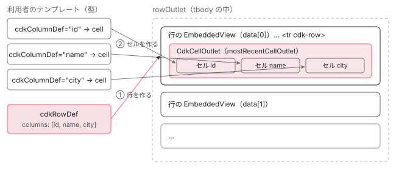

[目次](../README.md) › [CDK の内側](README.md) › 第 16 回 / 全 21 回

# cdk-table：列の定義から行とセルを組み立てる

> CdkTable が cdkColumnDef・cdkHeaderRowDef・cdkRowDef を集め、データの差分（IterableDiffer）に合わせて行を足し引きし、各行に列ごとのセルを差し込む流れ。CdkCellOutlet.mostRecentCellOutlet という静的プロパティで行とセルを受け渡す理由、sticky の行と列を StickyStyler が置く行、trackBy。

angular/components · 読了 約 14 分 · 発展 · [サイトで読む（デモが動きます）](https://angular-deep-dive-cyan.vercel.app/chapter/table)

---

`cdk-table` には、行のテンプレートとセルのテンプレートを別々に書きます。テーブルはそれを組み合わせて、データ 1 件ごとに「行のビュー」を作り、その中に「列ごとのセルのビュー」を差し込みます。この章では、列と行の定義の集め方、データの差分で行を足し引きする `renderRows`、行とセルを受け渡す静的プロパティ `CdkCellOutlet.mostRecentCellOutlet`、sticky の行と列を置く `StickyStyler` を、行番号で順に読みます。

読む対象は components の `src/cdk/table/` にある `table.ts`・`row.ts`・`cell.ts`・`sticky-styler.ts` です。データの受け取り方（`DataSource` の `connect`）は[第 14 回](14-cdk-collections.md)で読んだので、ここでは差分から先を追います。

1. [1. 概観](01-cdk-overview.md)
2. [2. Platform と向き](02-cdk-platform-bidi.md)
3. [3. Observer と画面幅](03-cdk-observers-layout.md)
4. [4. Portal](04-cdk-portal.md)
5. [5. Overlay](05-cdk.md)
6. [6. 位置の計算](06-cdk-overlay-position.md)
7. [7. スクロールと Esc](07-cdk-overlay-scroll-dispatch.md)
8. [8. FocusTrap](08-cdk-focus-trap.md)
9. [9. FocusMonitor](09-cdk-focus-monitor.md)
10. [10. ListKeyManager](10-cdk-key-manager.md)
11. [11. LiveAnnouncer](11-cdk-live-announcer.md)
12. [12. Dialog](12-cdk-dialog.md)
13. [13. Menu](13-cdk-menu.md)
14. [14. DataSource と選択](14-cdk-collections.md)
15. [15. 仮想スクロール](15-virtual-scroll.md)
16. **16. table**（この章）
17. [17. tree](17-cdk-tree.md)
18. [18. DragRef](18-drag-drop.md)
19. [19. DropListRef](19-cdk-drop-list.md)
20. [20. ハーネス](20-harness.md)
21. [21. Material のテーマ](21-theming.md)

利用者が書くテンプレートはおおよそ次の形です（このページのデモもこの形です）。

- `<ng-container cdkColumnDef="name">` の中に `<th cdk-header-cell *cdkHeaderCellDef>` と `<td cdk-cell *cdkCellDef="let row">` … 列 1 本ぶんのセルの型。
- `<tr cdk-header-row *cdkHeaderRowDef="columns">` と `<tr cdk-row *cdkRowDef="let row; columns: columns">` … 行の型と、並べる列の名前の配列。

`*` が付いているので、どれも `<ng-template>`、つまり**まだ描かれていない型**です。テーブルはこれを集めて、自分で `createEmbeddedView` します。



*列の定義と行の定義はどちらもテンプレート。テーブルはデータ 1 件ごとに行のビューを作り、その中の CdkCellOutlet に、列の名前の順にセルのビューを作る。*

## 1. 列の定義：CdkColumnDef

📄 `components/src/cdk/table/cell.ts` L62–93 （▶ の行: 66, 73, 78, 83, 88–90）

```ts
62 │ /**
63 │  * Column definition for the CDK table.
64 │  * Defines a set of cells available for a table column.
65 │  */
66 ▶ @Directive({selector: '[cdkColumnDef]'})
67 │ export class CdkColumnDef implements CanStick {
68 │   _table? = inject(CDK_TABLE, {optional: true});
69 │ 
70 │   private _hasStickyChanged = false;
71 │ 
72 │   /** Unique name for this column. */
73 ▶   @Input('cdkColumnDef')
74 │   get name(): string {
75 │     return this._name;
76 │   }
77 │   set name(name: string) {
78 ▶     this._setNameInput(name);
79 │   }
80 │   protected _name!: string;
81 │ 
82 │   /** Whether the cell is sticky. */
83 ▶   @Input({transform: booleanAttribute})
84 │   get sticky(): boolean {
85 │     return this._sticky;
86 │   }
87 │   set sticky(value: boolean) {
88 ▶     if (value !== this._sticky) {
89 ▶       this._sticky = value;
90 ▶       this._hasStickyChanged = true;
91 │     }
92 │   }
93 │   private _sticky = false;
```

📄 `components/src/cdk/table/cell.ts` L112–126 （▶ の行: 113, 116, 119, 126）

```ts
112 │   /** @docs-private */
113 ▶   @ContentChild(CdkCellDef) cell!: CdkCellDef;
114 │ 
115 │   /** @docs-private */
116 ▶   @ContentChild(CdkHeaderCellDef) headerCell!: CdkHeaderCellDef;
117 │ 
118 │   /** @docs-private */
119 ▶   @ContentChild(CdkFooterCellDef) footerCell!: CdkFooterCellDef;
120 │ 
121 │   /**
122 │    * Transformed version of the column name that can be used as part of a CSS classname. Excludes
123 │    * all non-alphanumeric characters and the special characters '-' and '_'. Any characters that
124 │    * do not match are replaced by the '-' character.
125 │    */
126 ▶   cssClassFriendlyName!: string;
```

66 行目、`cdkColumnDef` は指示子です。73 行目の入力が列の名前で、78 行目で `_setNameInput` に回ります。113〜119 行目、自分の中にある `cdkCellDef`・`cdkHeaderCellDef`・`cdkFooterCellDef` を `@ContentChild` で 1 つずつ持ちます。列の定義は「名前と、3 種類のセルの型」の組です。83〜92 行目の `sticky` は、値が変わったときだけ 90 行目で「変わった」印を立てます（7 節）。

📄 `components/src/cdk/table/cell.ts` L146–179 （▶ の行: 154, 166–169, 176–177）

```ts
146 │   /**
147 │    * Overridable method that sets the css classes that will be added to every cell in this
148 │    * column.
149 │    * In the future, columnCssClassName will change from type string[] to string and this
150 │    * will set a single string value.
151 │    * @docs-private
152 │    */
153 │   protected _updateColumnCssClassName() {
154 ▶     this._columnCssClassName = [`cdk-column-${this.cssClassFriendlyName}`];
155 │   }
156 │ 
157 │   /**
158 │    * This has been extracted to a util because of TS 4 and VE.
159 │    * View Engine doesn't support property rename inheritance.
160 │    * TS 4.0 doesn't allow properties to override accessors or vice-versa.
161 │    * @docs-private
162 │    */
163 │   protected _setNameInput(value: string) {
164 │     // If the directive is set without a name (updated programmatically), then this setter will
165 │     // trigger with an empty string and should not overwrite the programmatically set value.
166 ▶     if (value) {
167 ▶       this._name = value;
168 ▶       this.cssClassFriendlyName = value.replace(/[^a-z0-9_-]/gi, '-');
169 ▶       this._updateColumnCssClassName();
170 │     }
171 │   }
172 │ }
173 │ 
174 │ /** Base class for the cells. Adds a CSS classname that identifies the column it renders in. */
175 │ export class BaseCdkCell {
176 ▶   constructor(columnDef: CdkColumnDef, elementRef: ElementRef) {
177 ▶     elementRef.nativeElement.classList.add(...columnDef._columnCssClassName);
178 │   }
179 │ }
```

168 行目、列の名前のうち英数字・`-`・`_` 以外を `-` に置き換えたものが `cssClassFriendlyName` です。154 行目でそこから `cdk-column-名前` というクラス名を作り、176〜177 行目、セルの指示子（`CdkCell` など）がこの基底クラスのコンストラクタで自分の要素に付けます。列の名前が `"user name"` なら、クラスは `cdk-column-user-name` です。

## 2. 行の定義：BaseRowDef と CdkRowDef

📄 `components/src/cdk/table/row.ts` L40–79 （▶ の行: 42, 46, 54, 56–57, 65–66, 71–72, 74–75, 77）

```ts
40 │ @Directive()
41 │ export abstract class BaseRowDef implements OnChanges {
42 ▶   template = inject<TemplateRef<any>>(TemplateRef);
43 │   protected _differs = inject(IterableDiffers);
44 │ 
45 │   /** The columns to be displayed on this row. */
46 ▶   columns!: Iterable<string>;
47 │ 
48 │   /** Differ used to check if any changes were made to the columns. */
49 │   protected _columnsDiffer!: IterableDiffer<any>;
50 │ 
51 │   ngOnChanges(changes: SimpleChanges<this>): void {
52 │     // Create a new columns differ if one does not yet exist. Initialize it based on initial value
53 │     // of the columns property or an empty array if none is provided.
54 ▶     if (!this._columnsDiffer) {
55 │       const columns = (changes['columns'] && changes['columns'].currentValue) || [];
56 ▶       this._columnsDiffer = this._differs.find(columns).create();
57 ▶       this._columnsDiffer.diff(columns);
58 │     }
59 │   }
60 │ 
61 │   /**
62 │    * Returns the difference between the current columns and the columns from the last diff, or null
63 │    * if there is no difference.
64 │    */
65 ▶   getColumnsDiff(): IterableChanges<any> | null {
66 ▶     return this._columnsDiffer.diff(this.columns);
67 │   }
68 │ 
69 │   /** Gets this row def's relevant cell template from the provided column def. */
70 │   extractCellTemplate(column: CdkColumnDef): TemplateRef<any> {
71 ▶     if (this instanceof CdkHeaderRowDef) {
72 ▶       return column.headerCell.template;
73 │     }
74 ▶     if (this instanceof CdkFooterRowDef) {
75 ▶       return column.footerCell.template;
76 │     } else {
77 ▶       return column.cell.template;
78 │     }
79 │   }
```

42 行目、行の定義は自分が付いた `<ng-template>` を持つだけです。46 行目の `columns` が「この行に並べる列の名前」。54〜57 行目で最初の 1 回だけ列の名前の `IterableDiffer` を作り、65〜66 行目の `getColumnsDiff` で前回との差を返します（列の並びが変わったかを知るため）。70〜79 行目、行の定義の種類によって、列の定義から取り出すセルの型を選びます。ヘッダー行なら `headerCell`（72 行目）、フッター行なら `footerCell`（75 行目）、データ行なら `cell`（77 行目）です。

📄 `components/src/cdk/table/row.ts` L177–197 （▶ の行: 178, 180–181, 196）

```ts
177 │ @Directive({
178 ▶   selector: '[cdkRowDef]',
179 │   inputs: [
180 ▶     {name: 'columns', alias: 'cdkRowDefColumns'},
181 ▶     {name: 'when', alias: 'cdkRowDefWhen'},
182 │   ],
183 │ })
184 │ export class CdkRowDef<T> extends BaseRowDef {
185 │   _table? = inject(CDK_TABLE, {optional: true});
186 │ 
187 │   // TODO(andrewseguin): Add an input for providing a switch function to determine
188 │   //   if this template should be used.
189 │ 
190 │   /**
191 │    * Function that should return true if this row template should be used for the provided index
192 │    * and row data. If left undefined, this row will be considered the default row template to use
193 │    * when no other when functions return true for the data.
194 │    * For every row, there must be at least one when function that passes or an undefined to default.
195 │    */
196 ▶   when!: (index: number, rowData: T) => boolean;
197 │ }
```

データ行の定義は 178 行目の `[cdkRowDef]`。180〜181 行目、マイクロ構文の `columns: …` と `when: …` が入力になります。196 行目の `when` を書くと、行ごとに使う定義を変えられます（詳細行など）。

## 3. テーブル自身のテンプレートと出口

📄 `components/src/cdk/table/table.ts` L227–259 （▶ の行: 228, 238–239, 242–244, 246–247, 250, 254–255）

```ts
227 │ @Component({
228 ▶   selector: 'cdk-table, table[cdk-table]',
229 │   exportAs: 'cdkTable',
230 │   template: `
231 │     <ng-content select="caption"/>
232 │     <ng-content select="colgroup, col"/>
233 │ 
234 │     <!--
235 │       Unprojected content throws a hydration error so we need this to capture it.
236 │       It gets removed on the client so it doesn't affect the layout.
237 │     -->
238 ▶     @if (_isServer) {
239 ▶       <ng-content/>
240 │     }
241 │ 
242 ▶     @if (_isNativeHtmlTable) {
243 ▶       <thead role="rowgroup">
244 ▶         <ng-container headerRowOutlet/>
245 │       </thead>
246 ▶       <tbody role="rowgroup">
247 ▶         <ng-container rowOutlet/>
248 │         <ng-container noDataRowOutlet/>
249 │       </tbody>
250 ▶       <tfoot role="rowgroup">
251 │         <ng-container footerRowOutlet/>
252 │       </tfoot>
253 │     } @else {
254 ▶       <ng-container headerRowOutlet/>
255 ▶       <ng-container rowOutlet/>
256 │       <ng-container noDataRowOutlet/>
257 │       <ng-container footerRowOutlet/>
258 │     }
259 │   `,
```

228 行目、セレクタは `cdk-table` 要素と `table[cdk-table]` 属性の 2 つです。242〜252 行目、ネイティブの `<table>` に付いたときだけ、テーブル自身が `<thead>`・`<tbody>`・`<tfoot>` を作り、その中に出口（`headerRowOutlet`・`rowOutlet` など）を置きます。`cdk-table` 要素なら 254〜257 行目のように出口を並べるだけです。238〜240 行目は SSR のときだけ投影されない中身を受け止める場所で、クライアントでは消えます（コメント 235〜236 行目、ハイドレーションのエラーを避けるため）。

📄 `components/src/cdk/table/table.ts` L642–658 （▶ の行: 645–646, 650, 655–656）

```ts
642 │   constructor() {
643 │     const role = inject(new HostAttributeToken('role'), {optional: true});
644 │ 
645 ▶     if (!role) {
646 ▶       this._elementRef.nativeElement.setAttribute('role', 'table');
647 │     }
648 │ 
649 │     this._isServer = !this._platform.isBrowser;
650 ▶     this._isNativeHtmlTable = this._elementRef.nativeElement.nodeName === 'TABLE';
651 │ 
652 │     // Set up the trackBy function so that it uses the `RenderRow` as its identity by default. If
653 │     // the user has provided a custom trackBy, return the result of that function as evaluated
654 │     // with the values of the `RenderRow`'s data and index.
655 ▶     this._dataDiffer = this._differs.find([]).create((_i: number, dataRow: RenderRow<T>) => {
656 ▶       return this.trackBy ? this.trackBy(dataRow.dataIndex, dataRow.data) : dataRow;
657 │     });
658 │   }
```

650 行目、ネイティブの table かどうかは要素の `nodeName` で決めます。645〜646 行目、`role` 属性が無ければ `table` を付けます。655〜656 行目の `_dataDiffer` が行の差分を出す `IterableDiffer` で、「同じ行か」の判定は `trackBy` があればその戻り値、無ければ `RenderRow` オブジェクトそのものです（5 節）。

📄 `components/src/cdk/table/table.ts` L116–132 （▶ の行: 121, 124, 128–130）

```ts
116 │ /**
117 │  * Provides a handle for the table to grab the view container's ng-container to insert data rows.
118 │  * @docs-private
119 │  */
120 │ @Directive({
121 ▶   selector: '[rowOutlet]',
122 │ })
123 │ export class DataRowOutlet implements RowOutlet {
124 ▶   viewContainer = inject(ViewContainerRef);
125 │   elementRef = inject(ElementRef);
126 │ 
127 │   constructor() {
128 ▶     const table = inject<CdkTable<unknown>>(CDK_TABLE);
129 ▶     table._rowOutlet = this;
130 ▶     table._outletAssigned();
131 │   }
132 │ }
```

📄 `components/src/cdk/table/table.ts` L967–993 （▶ の行: 974–975, 978, 980, 984–985, 992）

```ts
967 │   _outletAssigned(): void {
968 │     // Trigger the first render once all outlets have been assigned. We do it this way, as
969 │     // opposed to waiting for the next `ngAfterContentChecked`, because we don't know when
970 │     // the next change detection will happen.
971 │     // Also we can't use queries to resolve the outlets, because they're wrapped in a
972 │     // conditional, so we have to rely on them being assigned via DI.
973 │     if (
974 ▶       !this._hasAllOutlets &&
975 ▶       this._rowOutlet &&
976 │       this._headerRowOutlet &&
977 │       this._footerRowOutlet &&
978 ▶       this._noDataRowOutlet
979 │     ) {
980 ▶       this._hasAllOutlets = true;
981 │ 
982 │       // In some setups this may fire before `ngAfterContentInit`
983 │       // so we need a check here. See #28538.
984 ▶       if (this._canRender()) {
985 ▶         this._render();
986 │       }
987 │     }
988 │   }
989 │ 
990 │   /** Whether the table has all the information to start rendering. */
991 │   private _canRender(): boolean {
992 ▶     return this._hasAllOutlets && this._hasInitialized;
993 │   }
```

出口は `@ViewChild` で探されません。121 行目の `[rowOutlet]` 指示子が 124 行目で自分の `ViewContainerRef` を持ち、128〜130 行目でテーブルを注入して**自分から登録**します。コメント 968〜972 行目のとおり、出口は `@if` の中にあってクエリで素直に取れないからです。974〜978 行目、4 つの出口がそろった時点で、984〜985 行目、初期化も済んでいれば（992 行目）その場で最初の描画をします。

📄 `components/src/cdk/table/table.ts` L671–689 （▶ の行: 672–675, 681, 686–687）

```ts
671 │   ngAfterContentInit() {
672 ▶     this._viewRepeater =
673 ▶       this.recycleRows || this._virtualScrollEnabled()
674 ▶         ? new _RecycleViewRepeaterStrategy()
675 ▶         : new _DisposeViewRepeaterStrategy();
676 │ 
677 │     if (this._virtualScrollEnabled()) {
678 │       this._setupVirtualScrolling(this._virtualScrollViewport!);
679 │     }
680 │ 
681 ▶     this._hasInitialized = true;
682 │   }
683 │ 
684 │   ngAfterContentChecked() {
685 │     // Only start re-rendering in `ngAfterContentChecked` after the first render.
686 ▶     if (this._canRender()) {
687 ▶       this._render();
688 │     }
689 │   }
```

1. **ngAfterContentInit**

   672〜675 行目で行のビューの作り方を決めます。`recycleRows` か仮想スクロールの中なら `_RecycleViewRepeaterStrategy`、それ以外は `_DisposeViewRepeaterStrategy`（違いは[第 14 回](14-cdk-collections.md) 8〜9 節）。681 行目で初期化済みにします。
2. **ngAfterContentChecked（1 回目）**

   686 行目、出口がまだ無いので描きません。出口はテーブル自身のテンプレートの `@if` の中にあり、テーブルのビューが検査されるときに作られるからです。
3. **出口が自分から登録する**

   4 つ目の出口のコンストラクタが `_outletAssigned` を呼び、そこで 1 回目の `_render` が走ります。
4. **ngAfterContentChecked（2 回目以降）**

   変更検知のたびに 687 行目の `_render` を呼び、列や行の定義の変化を見ます。

📄 `components/src/cdk/table/table.ts` L1011–1041 （▶ の行: 1012, 1019–1020, 1025–1026, 1032–1033, 1040）

```ts
1011 │     // Render updates if the list of columns have been changed for the header, row, or footer defs.
1012 ▶     const columnsChanged = this._renderUpdatedColumns();
1013 │     const rowDefsChanged = columnsChanged || this._headerRowDefChanged || this._footerRowDefChanged;
1014 │     // Ensure sticky column styles are reset if set to `true` elsewhere.
1015 │     this._stickyColumnStylesNeedReset = this._stickyColumnStylesNeedReset || rowDefsChanged;
1016 │     this._forceRecalculateCellWidths = rowDefsChanged;
1017 │ 
1018 │     // If the header row definition has been changed, trigger a render to the header row.
1019 ▶     if (this._headerRowDefChanged) {
1020 ▶       this._forceRenderHeaderRows();
1021 │       this._headerRowDefChanged = false;
1022 │     }
1023 │ 
1024 │     // If the footer row definition has been changed, trigger a render to the footer row.
1025 ▶     if (this._footerRowDefChanged) {
1026 ▶       this._forceRenderFooterRows();
1027 │       this._footerRowDefChanged = false;
1028 │     }
1029 │ 
1030 │     // If there is a data source and row definitions, connect to the data source unless a
1031 │     // connection has already been made.
1032 ▶     if (this.dataSource && this._rowDefs.length > 0 && !this._renderChangeSubscription) {
1033 ▶       this._observeRenderChanges();
1034 │     } else if (this._stickyColumnStylesNeedReset) {
1035 │       // In the above case, _observeRenderChanges will result in updateStickyColumnStyles being
1036 │       // called when it row data arrives. Otherwise, we need to call it proactively.
1037 │       this.updateStickyColumnStyles();
1038 │     }
1039 │ 
1040 ▶     this._checkStickyStates();
1041 │   }
```

`_render` の前半（引用の前）で、`_cacheColumnDefs` が `@ContentChildren` で集めた列の定義を名前で引ける `Map` にし、`_cacheRowDefs` が行の定義の一覧を作ります。同じ名前の列が 2 つあると、ここで例外です。1012 行目の `_renderUpdatedColumns` は、2 節 65 行目の差分で列の並びが変わった行の定義を探し、変わっていればその種類の行を全部作り直します。1019〜1028 行目、ヘッダー行とフッター行はデータに関係ないので、ここで作ります。1032〜1033 行目、データ行の定義があり、まだ購読していなければ、第 14 回で読んだ `_observeRenderChanges` でデータの購読を始めます。データが流れるたびに `renderRows()` です。

## 4. renderRows：差分で行を足し引きする

📄 `components/src/cdk/table/table.ts` L731–770 （▶ の行: 732–734, 739, 741, 748–749, 751–752, 758, 762, 764, 770）

```ts
731 │   renderRows() {
732 ▶     this._renderRows = this._getAllRenderRows();
733 ▶     const changes = this._dataDiffer.diff(this._renderRows);
734 ▶     if (!changes) {
735 │       this._updateNoDataRow();
736 │       this.contentChanged.next();
737 │       return;
738 │     }
739 ▶     const viewContainer = this._rowOutlet.viewContainer;
740 │ 
741 ▶     this._viewRepeater.applyChanges(
742 │       changes,
743 │       viewContainer,
744 │       (
745 │         record: IterableChangeRecord<RenderRow<T>>,
746 │         _adjustedPreviousIndex: number | null,
747 │         currentIndex: number | null,
748 ▶       ) => this._getEmbeddedViewArgs(record.item, currentIndex!),
749 ▶       record => record.item.data,
750 │       (change: _ViewRepeaterItemChange<RenderRow<T>, RowContext<T>>) => {
751 ▶         if (change.operation === _ViewRepeaterOperation.INSERTED && change.context) {
752 ▶           this._renderCellTemplateForItem(change.record.item.rowDef, change.context);
753 │         }
754 │       },
755 │     );
756 │ 
757 │     // Update the meta context of a row's context data (index, count, first, last, ...)
758 ▶     this._updateRowIndexContext();
759 │ 
760 │     // Update rows that did not get added/removed/moved but may have had their identity changed,
761 │     // e.g. if trackBy matched data on some property but the actual data reference changed.
762 ▶     changes.forEachIdentityChange((record: IterableChangeRecord<RenderRow<T>>) => {
763 │       const rowView = <RowViewRef<T>>viewContainer.get(record.currentIndex!);
764 ▶       rowView.context.$implicit = record.item.data;
765 │     });
766 │ 
767 │     this._updateNoDataRow();
768 │ 
769 │     this.contentChanged.next();
770 ▶     this.updateStickyColumnStyles();
```

1. **描く行の一覧を作る**

   732 行目、データと行の定義から `RenderRow`（データ・行の定義・番号の組）の配列を作ります（5 節）。
2. **前回と比べる**

   733 行目で差分を取り、734 行目、何も変わっていなければ「データなし」の行だけ確かめて終わります。
3. **戦略に当てる**

   741 行目、差分を `_viewRepeater.applyChanges` に渡します。新しい行のテンプレートと文脈は 748 行目の `_getEmbeddedViewArgs`、値は 749 行目の `record.item.data` です。
4. **新しく作った行にだけセルを入れる**

   751〜752 行目、結果が `INSERTED`（`createEmbeddedView` で作った）ならセルを差し込みます（6 節）。使い回した行（`REPLACED`）や動かした行はセルを持ったままなので、何もしません。
5. **番号を振り直す**

   758 行目で、全部の行の文脈の `index`・`first`・`last`・`even`・`odd` を今の並びで書き直します。
6. **「同じ行だが中身のオブジェクトが替わった」**

   762〜764 行目、`trackBy` では同じでも参照が違う行は、行を作り直さず `$implicit` だけを差し替えます。
7. **sticky の列を直す**

   770 行目（7 節）。

## 5. RenderRow のキャッシュと trackBy

📄 `components/src/cdk/table/table.ts` L1054–1086 （▶ の行: 1055, 1059–1060, 1064, 1066, 1075, 1079, 1081）

```ts
1054 │     const renderRows: RenderRow<T>[] = [];
1055 ▶     const end = Math.min(this._data.length, this._renderedRange.end);
1056 │ 
1057 │     // Store the cache and create a new one. Any re-used RenderRow objects will be moved into the
1058 │     // new cache while unused ones can be picked up by garbage collection.
1059 ▶     const prevCachedRenderRows = this._cachedRenderRowsMap;
1060 ▶     this._cachedRenderRowsMap = new Map();
1061 │ 
1062 │     // For each data object, get the list of rows that should be rendered, represented by the
1063 │     // respective `RenderRow` object which is the pair of `data` and `CdkRowDef`.
1064 ▶     for (let i = this._renderedRange.start; i < end; i++) {
1065 │       const data = this._data[i];
1066 ▶       const renderRowsForData = this._getRenderRowsForData(data, i, prevCachedRenderRows.get(data));
1067 │ 
1068 │       if (!this._cachedRenderRowsMap.has(data)) {
1069 │         this._cachedRenderRowsMap.set(data, new WeakMap());
1070 │       }
1071 │ 
1072 │       for (let j = 0; j < renderRowsForData.length; j++) {
1073 │         let renderRow = renderRowsForData[j];
1074 │ 
1075 ▶         const cache = this._cachedRenderRowsMap.get(renderRow.data)!;
1076 │         if (cache.has(renderRow.rowDef)) {
1077 │           cache.get(renderRow.rowDef)!.push(renderRow);
1078 │         } else {
1079 ▶           cache.set(renderRow.rowDef, [renderRow]);
1080 │         }
1081 ▶         renderRows.push(renderRow);
1082 │       }
1083 │     }
1084 │ 
1085 │     return renderRows;
1086 │   }
```

📄 `components/src/cdk/table/table.ts` L1093–1110 （▶ の行: 1098, 1101–1104, 1107）

```ts
1093 │   private _getRenderRowsForData(
1094 │     data: T,
1095 │     dataIndex: number,
1096 │     cache?: WeakMap<CdkRowDef<T>, RenderRow<T>[]>,
1097 │   ): RenderRow<T>[] {
1098 ▶     const rowDefs = this._getRowDefs(data, dataIndex);
1099 │ 
1100 │     return rowDefs.map(rowDef => {
1101 ▶       const cachedRenderRows = cache && cache.has(rowDef) ? cache.get(rowDef)! : [];
1102 ▶       if (cachedRenderRows.length) {
1103 ▶         const dataRow = cachedRenderRows.shift()!;
1104 ▶         dataRow.dataIndex = dataIndex;
1105 │         return dataRow;
1106 │       } else {
1107 ▶         return {data, rowDef, dataIndex};
1108 │       }
1109 │     });
1110 │   }
```

1055 行目、描くのは表示範囲（第 14 回の `viewChange`、仮想スクロールの中でなければ全件）までです。1059〜1060 行目で前回のキャッシュを取っておき、新しい空の `Map` に替えます。キャッシュは「データのオブジェクト → 行の定義 → `RenderRow`」の 2 段の表です。1066 行目、データ 1 件ごとに**前回の同じデータのオブジェクト**の表を渡し、1101〜1105 行目、同じ行の定義の `RenderRow` があれば**それをそのまま使い**（番号だけ直す）、無ければ 1107 行目で新しく作ります。

これで、`trackBy` を書かなくても、同じデータのオブジェクトは前回と同じ `RenderRow` になり、3 節 656 行目の既定の判定（`RenderRow` そのもの）で「同じ行」と見なされます。並べ替えは移動になり、行は作り直されません。逆に、API から取り直して**中身が同じでも別のオブジェクト**になると、1102 行目でキャッシュに当たらず全部新しい `RenderRow` になり、全行が消されて作り直されます。`trackBy` で id を返せば、656 行目の判定が id になり、4 節 762〜764 行目の `$implicit` の差し替えだけで済みます。

## 6. 行とセルの受け渡し：CdkCellOutlet.mostRecentCellOutlet

📄 `components/src/cdk/table/table.ts` L1346–1384 （▶ の行: 1351, 1353, 1371–1372, 1377–1379, 1383）

```ts
1346 │   private _getEmbeddedViewArgs(
1347 │     renderRow: RenderRow<T>,
1348 │     index: number,
1349 │   ): _ViewRepeaterItemInsertArgs<RowContext<T>> {
1350 │     const rowDef = renderRow.rowDef;
1351 ▶     const context: RowContext<T> = {$implicit: renderRow.data};
1352 │     return {
1353 ▶       templateRef: rowDef.template,
1354 │       context,
1355 │       index,
1356 │     };
1357 │   }
1358 │ 
1359 │   /**
1360 │    * Creates a new row template in the outlet and fills it with the set of cell templates.
1361 │    * Optionally takes a context to provide to the row and cells, as well as an optional index
1362 │    * of where to place the new row template in the outlet.
1363 │    */
1364 │   private _renderRow(
1365 │     outlet: RowOutlet,
1366 │     rowDef: BaseRowDef,
1367 │     index: number,
1368 │     context: RowContext<T> = {},
1369 │   ): EmbeddedViewRef<RowContext<T>> {
1370 │     // TODO(andrewseguin): enforce that one outlet was instantiated from createEmbeddedView
1371 ▶     const view = outlet.viewContainer.createEmbeddedView(rowDef.template, context, index);
1372 ▶     this._renderCellTemplateForItem(rowDef, context);
1373 │     return view;
1374 │   }
1375 │ 
1376 │   private _renderCellTemplateForItem(rowDef: BaseRowDef, context: RowContext<T>) {
1377 ▶     for (let cellTemplate of this._getCellTemplates(rowDef)) {
1378 ▶       if (CdkCellOutlet.mostRecentCellOutlet) {
1379 ▶         CdkCellOutlet.mostRecentCellOutlet._viewContainer.createEmbeddedView(cellTemplate, context);
1380 │       }
1381 │     }
1382 │ 
1383 ▶     this._changeDetectorRef.markForCheck();
1384 │   }
```

📄 `components/src/cdk/table/row.ts` L325–338 （▶ の行: 326–327, 330, 332, 334, 336）

```ts
325 │ @Component({
326 ▶   selector: 'cdk-row, tr[cdk-row]',
327 ▶   template: CDK_ROW_TEMPLATE,
328 │   host: {
329 │     'class': 'cdk-row',
330 ▶     'role': 'row',
331 │   },
332 ▶   // See note on CdkTable for explanation on why this uses the default change detection strategy.
333 │   // tslint:disable-next-line:validate-decorators
334 ▶   changeDetection: ChangeDetectionStrategy.Eager,
335 │   encapsulation: ViewEncapsulation.None,
336 ▶   imports: [CdkCellOutlet],
337 │ })
338 │ export class CdkRow {}
```

📄 `components/src/cdk/table/row.ts` L258–290 （▶ の行: 262, 277, 279–280, 286–287）

```ts
258 │ @Directive({
259 │   selector: '[cdkCellOutlet]',
260 │ })
261 │ export class CdkCellOutlet implements OnDestroy {
262 ▶   _viewContainer = inject(ViewContainerRef);
263 │ 
264 │   /** The ordered list of cells to render within this outlet's view container */
265 │   cells!: CdkCellDef[];
266 │ 
267 │   /** The data context to be provided to each cell */
268 │   context: any;
269 │ 
270 │   /**
271 │    * Static property containing the latest constructed instance of this class.
272 │    * Used by the CDK table when each CdkHeaderRow and CdkRow component is created using
273 │    * createEmbeddedView. After one of these components are created, this property will provide
274 │    * a handle to provide that component's cells and context. After init, the CdkCellOutlet will
275 │    * construct the cells with the provided context.
276 │    */
277 ▶   static mostRecentCellOutlet: CdkCellOutlet | null = null;
278 │ 
279 ▶   constructor() {
280 ▶     CdkCellOutlet.mostRecentCellOutlet = this;
281 │   }
282 │ 
283 │   ngOnDestroy() {
284 │     // If this was the last outlet being rendered in the view, remove the reference
285 │     // from the static property after it has been destroyed to avoid leaking memory.
286 ▶     if (CdkCellOutlet.mostRecentCellOutlet === this) {
287 ▶       CdkCellOutlet.mostRecentCellOutlet = null;
288 │     }
289 │   }
290 │ }
```

1. **行のビューを作る**

   戦略が 1353 行目の行の定義のテンプレート（`<tr cdk-row>`）で `createEmbeddedView` します。ヘッダー行とフッター行は 1371 行目で直接作ります。
2. **その中で行のコンポーネントができる**

   326 行目の `CdkRow` コンポーネントのテンプレートは 327 行目の `CDK_ROW_TEMPLATE`、中身は `<ng-container cdkCellOutlet>` 1 つだけです。`createEmbeddedView` は作成の段階を同期で終えるので、戻る前に `CdkCellOutlet` のコンストラクタが走ります。
3. **出口が静的プロパティに自分を置く**

   280 行目、`CdkCellOutlet.mostRecentCellOutlet = this`。277 行目の静的プロパティは「最後に作られた出口」です。
4. **テーブルがその出口にセルを作る**

   1377〜1379 行目、`createEmbeddedView` が戻った直後に静的プロパティを読めば、それは今作った行の出口です。列の名前の順にセルの型（1410 行目以降、次の引用）を取り、出口の `ViewContainerRef`（262 行目）にセルのビューを作ります。
5. **文脈は行とセルで共有**

   セルに渡す `context` は、1351 行目で行のために作ったオブジェクトそのものです。4 節 758 行目の番号の振り直しや 764 行目の `$implicit` の差し替えは、同じオブジェクトを書き換えるので、セルにもそのまま届きます。
6. **漏れないように消す**

   286〜287 行目、出口が壊されるとき、自分がまだ静的プロパティにいれば `null` に戻します。

📄 `components/src/cdk/table/table.ts` L1410–1435 （▶ の行: 1415–1416, 1418–1419, 1422, 1432–1434）

```ts
1410 │   /** Gets the column definitions for the provided row def. */
1411 │   private _getCellTemplates(rowDef: BaseRowDef): TemplateRef<any>[] {
1412 │     if (!rowDef || !rowDef.columns) {
1413 │       return [];
1414 │     }
1415 ▶     return Array.from(rowDef.columns, columnId => {
1416 ▶       const column = this._columnDefsByName.get(columnId);
1417 │ 
1418 ▶       if (!column) {
1419 ▶         throw getTableUnknownColumnError(columnId);
1420 │       }
1421 │ 
1422 ▶       return rowDef.extractCellTemplate(column);
1423 │     });
1424 │   }
1425 │ 
1426 │   /**
1427 │    * Forces a re-render of the data rows. Should be called in cases where there has been an input
1428 │    * change that affects the evaluation of which rows should be rendered, e.g. toggling
1429 │    * `multiTemplateDataRows` or adding/removing row definitions.
1430 │    */
1431 │   private _forceRenderDataRows() {
1432 ▶     this._dataDiffer.diff([]);
1433 ▶     this._rowOutlet.viewContainer.clear();
1434 ▶     this.renderRows();
1435 │   }
```

1415〜1422 行目、行の定義の `columns` の名前を 1 つずつ列の定義に引き、2 節 70〜79 行目でセルの型を取り出します。名前に対応する列が無ければ 1419 行目で例外です。1431〜1435 行目の `_forceRenderDataRows` は、差分を空に戻し（1432 行目）、出口を空にして（1433 行目）、全部描き直します（1434 行目）。列の並びが変わったときはこれが呼ばれます。

> [!NOTE]
> **ポイント**
>
> 6 節 334 行目のとおり、`CdkRow` の `changeDetection` は `ChangeDetectionStrategy.Eager` です。`CdkTable` も同じです。v22 で `Default` は `Eager` という名前になり、`Default` は非推奨の別名です。332 行目のコメントが指す `CdkTable` 側の説明によれば、テーブルのビューに入るのは別の場所で宣言されたテンプレートばかりで、それらは宣言した側のビューと一緒に検査されるため、OnPush にしても意味がありません。

## 7. sticky の行と列：StickyStyler

📄 `components/src/cdk/table/table.ts` L829–848 （▶ の行: 830, 835, 838, 842–844）

```ts
829 │   updateStickyHeaderRowStyles(): void {
830 ▶     const headerRows = this._getRenderedRows(this._headerRowOutlet);
831 │ 
832 │     // Hide the thead element if there are no header rows. This is necessary to satisfy
833 │     // overzealous a11y checkers that fail because the `rowgroup` element does not contain
834 │     // required child `row`.
835 ▶     if (this._isNativeHtmlTable) {
836 │       const thead = closestTableSection(this._headerRowOutlet, 'thead');
837 │       if (thead) {
838 ▶         thead.style.display = headerRows.length ? '' : 'none';
839 │       }
840 │     }
841 │ 
842 ▶     const stickyStates = this._headerRowDefs.map(def => def.sticky);
843 ▶     this._stickyStyler.clearStickyPositioning(headerRows, ['top']);
844 ▶     this._stickyStyler.stickRows(headerRows, stickyStates, 'top');
845 │ 
846 │     // Reset the dirty state of the sticky input change since it has been used.
847 │     this._headerRowDefs.forEach(def => def.resetStickyChanged());
848 │   }
```

ヘッダー行の sticky は、830 行目で描いたヘッダー行の要素を集め、842 行目で行の定義ごとの `sticky` を並べ、843 行目で前の `top` を消してから 844 行目で `stickRows(…, 'top')` します。`stickRows` は上の行から順に高さを足しながら `top` を決めるので、sticky のヘッダー行が 2 本あれば 2 本目は 1 本目の高さの位置に止まります。835〜838 行目、ネイティブの table でヘッダー行が無ければ `<thead>` を隠します。

📄 `components/src/cdk/table/table.ts` L1287–1303 （▶ の行: 1288–1289, 1295–1297, 1301）

```ts
1287 │   private _addStickyColumnStyles(rows: HTMLElement[], rowDef: BaseRowDef) {
1288 ▶     const columnDefs = Array.from(rowDef?.columns || []).map(columnName => {
1289 ▶       const columnDef = this._columnDefsByName.get(columnName);
1290 │       if (!columnDef) {
1291 │         throw getTableUnknownColumnError(columnName);
1292 │       }
1293 │       return columnDef;
1294 │     });
1295 ▶     const stickyStartStates = columnDefs.map(columnDef => columnDef.sticky);
1296 ▶     const stickyEndStates = columnDefs.map(columnDef => columnDef.stickyEnd);
1297 ▶     this._stickyStyler.updateStickyColumns(
1298 │       rows,
1299 │       stickyStartStates,
1300 │       stickyEndStates,
1301 ▶       !this.fixedLayout || this._forceRecalculateCellWidths,
1302 │     );
1303 │   }
```

列の sticky は行ごとです。1288〜1289 行目、行の `columns` の順に列の定義を引き、1295〜1296 行目で「何番目のセルが左（`sticky`）／右（`stickyEnd`）に止まるか」の配列にします。1301 行目、`fixedLayout` でなければ、毎回セルの幅を測り直させます（中身で幅が変わるため）。

📄 `components/src/cdk/table/sticky-styler.ts` L149–188 （▶ の行: 149–151, 153, 168, 170–171, 173, 176, 180–181, 184–185）

```ts
149 ▶     const isRtl = this.direction === 'rtl';
150 ▶     const start = isRtl ? 'right' : 'left';
151 ▶     const end = isRtl ? 'left' : 'right';
152 │ 
153 ▶     const lastStickyStart = stickyStartStates.lastIndexOf(true);
154 │     const firstStickyEnd = stickyEndStates.indexOf(true);
155 │ 
156 │     let cellWidths: number[];
157 │     let startPositions: number[];
158 │     let endPositions: number[];
159 │ 
160 │     if (replay) {
161 │       this._updateStickyColumnReplayQueue({
162 │         rows: [...rows],
163 │         stickyStartStates: [...stickyStartStates],
164 │         stickyEndStates: [...stickyEndStates],
165 │       });
166 │     }
167 │ 
168 ▶     afterNextRender(
169 │       {
170 ▶         earlyRead: () => {
171 ▶           cellWidths = this._getCellWidths(firstRow, recalculateCellWidths);
172 │ 
173 ▶           startPositions = this._getStickyStartColumnPositions(cellWidths, stickyStartStates);
174 │           endPositions = this._getStickyEndColumnPositions(cellWidths, stickyEndStates);
175 │         },
176 ▶         write: () => {
177 │           for (const row of rows) {
178 │             for (let i = 0; i < numCells; i++) {
179 │               const cell = row.children[i] as HTMLElement;
180 ▶               if (stickyStartStates[i]) {
181 ▶                 this._addStickyStyle(cell, start, startPositions[i], i === lastStickyStart);
182 │               }
183 │ 
184 ▶               if (stickyEndStates[i]) {
185 ▶                 this._addStickyStyle(cell, end, endPositions[i], i === firstStickyEnd);
186 │               }
187 │             }
188 │           }
```

📄 `components/src/cdk/table/sticky-styler.ts` L456–468 （▶ の行: 461–463）

```ts
456 │   _getStickyStartColumnPositions(widths: number[], stickyStates: boolean[]): number[] {
457 │     const positions: number[] = [];
458 │     let nextPosition = 0;
459 │ 
460 │     for (let i = 0; i < widths.length; i++) {
461 ▶       if (stickyStates[i]) {
462 ▶         positions[i] = nextPosition;
463 ▶         nextPosition += widths[i];
464 │       }
465 │     }
466 │ 
467 │     return positions;
468 │   }
```

1. **向きを決める**

   149〜151 行目、右から左の言語なら「始まり」は `right` です。
2. **読むのと書くのを分ける**

   168 行目の `afterNextRender` に `earlyRead`（170 行目）と `write`（176 行目）を渡します。全部の表の「測る」を先に済ませてから「書く」をまとめて行い、測る・書くを交互に繰り返してレイアウトを何度も計算させない（レイアウトスラッシング）ためです。
3. **最初の行のセルの幅を測る**

   171 行目、測るのは最初の行だけです。表の列の幅はそろっているからです。
4. **左からの位置を足し算する**

   173 行目から 461〜463 行目へ。sticky のセルに、それより左にある sticky のセルの幅の合計を `left` として割り当てます。sticky でない列の幅は足しません。
5. **全部の行のセルに書く**

   180〜181 行目、sticky の位置のセルに `_addStickyStyle`。153 行目で求めた「最後の sticky の列」には境目のクラスも付けます。184〜185 行目は右側（`stickyEnd`）です。

📄 `components/src/cdk/table/sticky-styler.ts` L385–400 （▶ の行: 391, 393, 395–398）

```ts
385 │   _addStickyStyle(
386 │     element: HTMLElement,
387 │     dir: StickyDirection,
388 │     dirValue: number,
389 │     isBorderElement: boolean,
390 │   ) {
391 ▶     element.classList.add(this._stickCellCss);
392 │     if (isBorderElement) {
393 ▶       element.classList.add(this._borderCellCss[dir]);
394 │     }
395 ▶     element.style[dir] = `${dirValue}px`;
396 ▶     element.style.zIndex = this._getCalculatedZIndex(element);
397 ▶     if (this._needsPositionStickyOnElement) {
398 ▶       element.style.cssText += 'position: -webkit-sticky; position: sticky; ';
399 │     }
400 │   }
```

📄 `components/src/cdk/table/sticky-styler.ts` L413–432 （▶ の行: 415–418, 425–427）

```ts
413 │   _getCalculatedZIndex(element: HTMLElement): string {
414 │     const zIndexIncrements = {
415 ▶       top: 100,
416 ▶       bottom: 10,
417 ▶       left: 1,
418 ▶       right: 1,
419 │     };
420 │ 
421 │     let zIndex = 0;
422 │     // Use `Iterable` instead of `Array` because TypeScript, as of 3.6.3,
423 │     // loses the array generic type in the `for of`. But we *also* have to use `Array` because
424 │     // typescript won't iterate over an `Iterable` unless you compile with `--downlevelIteration`
425 ▶     for (const dir of STICKY_DIRECTIONS as Iterable<StickyDirection> & StickyDirection[]) {
426 ▶       if (element.style[dir]) {
427 ▶         zIndex += zIndexIncrements[dir];
428 │       }
429 │     }
430 │ 
431 │     return zIndex ? `${zIndex}` : '';
432 │   }
```

395 行目で `style.left = '○○px'`（向きの名前がそのまま CSS のプロパティ名です）、397〜398 行目で `position: sticky` を書きます。396 行目の `z-index` は 413〜432 行目で、止まっている向きごとの値を足して作ります。`top` 100・`bottom` 10・`left`/`right` 1 なので、「ヘッダー行（上）でかつ sticky の列（左）」のセルは 101 で一番手前、ヘッダーのほかのセルは 100、データ行の sticky の列は 1 です。横にも縦にもスクロールしたとき、左上の角のセルが一番上に重なります。

## 8. 動かして確かめる

> **🧪 DEMO — 本物の table\[cdk-table\]（20 行・sticky のヘッダーと列）**
>
> `<tr cdk-row>` に目印の指示子を付け、そのコンストラクタが走った回数（＝行のビューが新しく作られた回数）を数えます。`id` 列は `sticky`、`score` 列は `stickyEnd`、ヘッダー行は `sticky: true` です。箱を縦横にスクロールしてみてください。
>
> ▶ [このデモはサイトで動かせます](https://angular-deep-dive-cyan.vercel.app/chapter/table)

| 操作 | trackBy なし | trackBy: id | 理由 |
| --- | --- | --- | --- |
| 1 行足す | 1 | 1 | 差分は追加 1 件（4 節 741 行目 → 戦略の `createEmbeddedView`） |
| 先頭を消す | 0 | 0 | 削除だけ。Dispose なので行は壊れる |
| 並べ替える | 0 | 0 | 同じオブジェクトなので 5 節 1101〜1105 行目で同じ `RenderRow` になり、移動だけ |
| 同じ中身の新しいオブジェクト | 全行 | 0 | なしなら 1107 行目で全部新しい `RenderRow`。id なら同じ行と見なし 762〜764 行目で差し替え |
| memo 列を外す・戻す | 全行 | 全行 | 列の並びが変わると 6 節 1431〜1435 行目で全部描き直す |

## 9. 全体の流れ

- `CdkTable.ngAfterContentInit()` — table.ts 671 — *Recycle か Dispose を決める*
- `FooterRowOutlet` などのコンストラクタ — table.ts 127〜131 と同じ形 — *出口が自分から登録*
  - `_outletAssigned()` → `_render()` — table.ts 967 / 996 — *列と行の定義を集め、ヘッダー行を作り、データを購読*
    - `_observeRenderChanges()` — 第 14 回 — *データが流れるたびに*
      - `renderRows()` — table.ts 731 — *\_getAllRenderRows → \_dataDiffer.diff*
        - `_viewRepeater.applyChanges()` — collections — *行の createEmbeddedView*
          - `new CdkCellOutlet()` — row.ts 279 — *mostRecentCellOutlet = this*
        - `_renderCellTemplateForItem()` — table.ts 1376 — *出口にセルの createEmbeddedView*
        - `updateStickyColumnStyles()` — table.ts 770
          - `StickyStyler.updateStickyColumns()` — sticky-styler.ts 127 — *afterNextRender の earlyRead で測り write で書く*

## 聞かれそうな質問

**Q. mat-table と cdk-table の関係は？**

Angular Material の `MatTable`（`src/material/table/table.ts`）は `CdkTable` を `extends` したコンポーネントで、この章の処理はすべてそのまま動きます。違うのは、見た目のクラス名とテンプレート、sticky のクラス名（`stickyCssClass` を `mat-mdc-table-sticky` に上書き）、`needsPositionStickyOnElement` を `false` にして 7 節 397〜398 行目の `position: sticky` を要素に書かず CSS に任せる点です。`providers` で `CdkTable` と `CDK_TABLE` を自分に向けるので、3 節 128 行目の出口の登録も `MatTable` に届きます。

**Q. なぜセルの出口を静的プロパティで渡すの？**

行の要素（`<tr cdk-row>`）は利用者のテンプレートに書かれ、`CdkRow` のインスタンスも出口もそのビューの中で作られます。テーブルの手元にあるのは `createEmbeddedView` が返す `EmbeddedViewRef` だけで、そこから中の指示子のインスタンスを取る公開 API がありません。一方、`createEmbeddedView` は作成の段階を同期で済ませるので、「戻った直後に、最後に作られた出口を読む」と必ず今の行の出口です（6 節 280 行目と 1378〜1379 行目）。JavaScript は 1 本のスレッドで動くので、その間に別の行の出口が割り込むことはありません。木（第 17 回）も同じ形の `CdkTreeNode.mostRecentTreeNode` を使います。

**Q. 列を動的に増やしたり並べ替えたりするには？**

`cdkHeaderRowDef` と `cdkRowDef` の `columns` に渡す配列を変えます。2 節 65〜66 行目の差分で変化が分かり、3 節 1012 行目の `_renderUpdatedColumns` から 6 節 1431〜1435 行目で、その種類の行が全部作り直されます（デモの「memo 列」）。列の定義（`cdkColumnDef`）そのものは `@for` で並べてもよく、`@ContentChildren` が拾います。テンプレートの外で作った定義は `table.addColumnDef()` で足せます。全行の作り直しになるので、列を頻繁に切り替える画面では行数を抑えます。

**Q. データを取り直すたびに表がちらつく・入力中の値が消える。**

取り直したデータは別のオブジェクトなので、`trackBy` が無いと 5 節 1107 行目で全部新しい `RenderRow` になり、全行が壊されて作り直されます（デモの「新しいオブジェクト」）。`[trackBy]` で id を返せば同じ行と見なされ、4 節 762〜764 行目で `$implicit` だけが替わります。`trackBy` の第 1 引数は 3 節 656 行目のとおり `dataIndex`（データの中の番号）です。

**Q. sticky の列の位置がずれる・重なる。**

7 節 171 行目でセルの幅を測るのは描画のあと（`afterNextRender` の `earlyRead`）で、測った幅は覚えておき、変化はセルに付けた `ResizeObserver` で拾って書き直します。`fixedLayout` でない表は、中身で列の幅が変わるたびにこの測り直しが起きます（1301 行目）。列の幅を CSS で決め、`fixedLayout` を付けると安定します。

## 読み終えて

- 列の定義は「名前と 3 種類のセルの型」、行の定義は「行の型と列の名前の配列」。どちらもテンプレートで、テーブルが自分で `createEmbeddedView` する。
- 出口は `@if` の中にあるので、出口の指示子が自分からテーブルに登録し、4 つそろった時点で最初の描画をする。
- `renderRows` は `RenderRow` の配列を作って差分を取り、戦略で行を足し引きし、新しく作った行にだけセルを入れる。同じデータのオブジェクトは同じ `RenderRow` になる。
- 行の中の出口は `CdkCellOutlet.mostRecentCellOutlet` で受け渡す。`createEmbeddedView` が同期で出口を作るから成り立つ。文脈は行とセルで共有。
- sticky は `afterNextRender` の earlyRead で幅を測り、write で `left` / `top` と `position: sticky` を書く。`z-index` は top 100・bottom 10・left/right 1 の足し算。

---

← 前: [仮想スクロール：1 万件を数十件で見せる](15-virtual-scroll.md)  
次: [CdkTree：入れ子のデータを平らに並べて描く](17-cdk-tree.md) →
