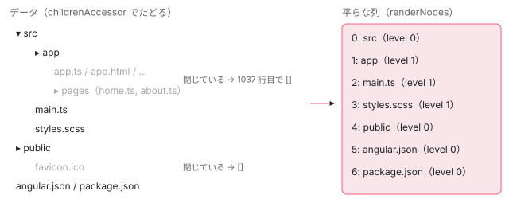

[目次](../README.md) › [CDK の内側](README.md) › 第 17 回 / 全 21 回

# CdkTree：入れ子のデータを平らに並べて描く

> CdkTree が childrenAccessor か levelAccessor でデータをたどり、展開されているノードだけを平らな列にして描く行（閉じた枝の中も毎回たどる）。展開の状態を持つ仕組み（非推奨の TreeControl と、木の中の SelectionModel）、cdkTreeNodePadding が深さから字下げを出す行、cdkTreeNodeOutlet による入れ子の描画、TreeKeyManager による矢印キーでの開閉。

angular/components · 読了 約 13 分 · 発展 · [サイトで読む（デモが動きます）](https://angular-deep-dive-cyan.vercel.app/chapter/cdk-tree)

---

フォルダのような入れ子のデータを、`CdkTree` は「展開されているノードだけを上から順に並べた平らな配列」にしてから描きます。この章では、`childrenAccessor` / `levelAccessor` でデータをたどる行、展開の状態を持つ `SelectionModel`、差分でノードを足し引きする `renderNodeChanges`、深さから字下げを出す `cdkTreeNodePadding`、入れ子で描く `cdkTreeNodeOutlet`、矢印キーで開閉する道筋を順に読みます。

読む対象は components の `src/cdk/tree/` にある `tree.ts`（`CdkTree` と `CdkTreeNode`）・`padding.ts`・`nested-node.ts`・`outlet.ts`・`toggle.ts`・`control/tree-control.ts` です。

1. [1. 概観](01-cdk-overview.md)
2. [2. Platform と向き](02-cdk-platform-bidi.md)
3. [3. Observer と画面幅](03-cdk-observers-layout.md)
4. [4. Portal](04-cdk-portal.md)
5. [5. Overlay](05-cdk.md)
6. [6. 位置の計算](06-cdk-overlay-position.md)
7. [7. スクロールと Esc](07-cdk-overlay-scroll-dispatch.md)
8. [8. FocusTrap](08-cdk-focus-trap.md)
9. [9. FocusMonitor](09-cdk-focus-monitor.md)
10. [10. ListKeyManager](10-cdk-key-manager.md)
11. [11. LiveAnnouncer](11-cdk-live-announcer.md)
12. [12. Dialog](12-cdk-dialog.md)
13. [13. Menu](13-cdk-menu.md)
14. [14. DataSource と選択](14-cdk-collections.md)
15. [15. 仮想スクロール](15-virtual-scroll.md)
16. [16. table](16-table.md)
17. **17. tree**（この章）
18. [18. DragRef](18-drag-drop.md)
19. [19. DropListRef](19-cdk-drop-list.md)
20. [20. ハーネス](20-harness.md)
21. [21. Material のテーマ](21-theming.md)

このページのデモは、次の形で書いています（平らな描画）。

- `<cdk-tree [dataSource]="roots" [childrenAccessor]="childrenOf" [expansionKey]="keyOf">` … ルートのノードの配列と、子をたどる関数と、展開の状態のキー。
- `<cdk-tree-node *cdkTreeNodeDef="let node" cdkTreeNodePadding [isExpandable]="…">` … ノード 1 つぶんの型。中に `cdkTreeNodeToggle` のボタン。

## 1. CdkTree の入口：どちらか 1 つの「たどり方」

📄 `components/src/cdk/tree/tree.ts` L101–117 （▶ の行: 104, 107–108, 115）

```ts
101 │ @Component({
102 │   selector: 'cdk-tree',
103 │   exportAs: 'cdkTree',
104 ▶   template: `<ng-container cdkTreeNodeOutlet></ng-container>`,
105 │   host: {
106 │     'class': 'cdk-tree',
107 ▶     'role': 'tree',
108 ▶     '(keydown)': '_sendKeydownToKeyManager($event)',
109 │   },
110 │   encapsulation: ViewEncapsulation.None,
111 │   // The "OnPush" status for the `CdkTree` component is effectively a noop, so we are removing it.
112 │   // The view for `CdkTree` consists entirely of templates declared in other views. As they are
113 │   // declared elsewhere, they are checked when their declaration points are checked.
114 │   // tslint:disable-next-line:validate-decorators
115 ▶   changeDetection: ChangeDetectionStrategy.Eager,
116 │   imports: [CdkTreeNodeOutlet],
117 │ })
```

104 行目、木のテンプレートは出口 1 つだけです。平らな描画では、すべてのノードがこの 1 つの `ViewContainerRef` に並びます。107 行目で `role="tree"`、108 行目で `keydown` を受けます（7 節）。115 行目は第 16 回の table と同じく `Eager` です。

📄 `components/src/cdk/tree/tree.ts` L176–213 （▶ の行: 180, 182, 184, 189–190, 192, 200, 208, 213）

```ts
176 │ 
177 │   /**
178 │    * The tree controller
179 │    *
180 ▶    * @deprecated Use one of `levelAccessor` or `childrenAccessor` instead. To be removed in a
181 │    * future version.
182 ▶    * @breaking-change 21.0.0
183 │    */
184 ▶   @Input() treeControl?: TreeControl<T, K>;
185 │ 
186 │   /**
187 │    * Given a data node, determines what tree level the node is at.
188 │    *
189 ▶    * One of levelAccessor or childrenAccessor must be specified, not both.
190 ▶    * This is enforced at run-time.
191 │    */
192 ▶   @Input() levelAccessor?: (dataNode: T) => number;
193 │ 
194 │   /**
195 │    * Given a data node, determines what the children of that node are.
196 │    *
197 │    * One of levelAccessor or childrenAccessor must be specified, not both.
198 │    * This is enforced at run-time.
199 │    */
200 ▶   @Input() childrenAccessor?: (dataNode: T) => T[] | Observable<T[]>;
201 │ 
202 │   /**
203 │    * Tracking function that will be used to check the differences in data changes. Used similarly
204 │    * to `ngFor` `trackBy` function. Optimize node operations by identifying a node based on its data
205 │    * relative to the function to know if a node should be added/removed/moved.
206 │    * Accepts a function that takes two parameters, `index` and `item`.
207 │    */
208 ▶   @Input() trackBy!: TrackByFunction<T>;
209 │ 
210 │   /**
211 │    * Given a data node, determines the key by which we determine whether or not this node is expanded.
212 │    */
213 ▶   @Input() expansionKey?: (dataNode: T) => K;
```

データのたどり方は 3 通りあり、**どれか 1 つだけ**を渡します（189〜190 行目。`ngOnInit` で数を数え、0 個でも 2 個以上でも開発モードで例外）。192 行目の `levelAccessor` は「このノードは何段目か」を返す関数で、データが既に平らな配列のときに使います。200 行目の `childrenAccessor` は「このノードの子」を返す関数で、入れ子のデータに使います。184 行目の `treeControl` は古い方式で、180〜182 行目のとおり非推奨です（8 節）。213 行目の `expansionKey` は「展開しているか」を覚えるときのキーで、省略するとノードのオブジェクトそのものがキーになります。

📄 `components/src/cdk/tree/tree.ts` L270–305 （▶ の行: 271, 275–276, 290–291, 303–304）

```ts
270 │   ngAfterContentInit() {
271 ▶     this._initializeKeyManager();
272 │   }
273 │ 
274 │   ngAfterContentChecked() {
275 ▶     this._updateDefaultNodeDefinition();
276 ▶     this._subscribeToDataChanges();
277 │   }
278 │ 
279 │   ngOnDestroy() {
280 │     this._nodeOutlet.viewContainer.clear();
281 │ 
282 │     this._nodes.complete();
283 │     this._keyManagerNodes.complete();
284 │     this._nodeType.complete();
285 │     this._flattenedNodes.complete();
286 │     this.viewChange.complete();
287 │     this._onDestroy.next();
288 │     this._onDestroy.complete();
289 │ 
290 ▶     if (this._dataSource && typeof (this._dataSource as DataSource<T>).disconnect === 'function') {
291 ▶       (this.dataSource as DataSource<T>).disconnect(this);
292 │     }
293 │ 
294 │     this._dataSubscription?.unsubscribe();
295 │     this._dataSubscription = undefined;
296 │ 
297 │     // In certain tests, the tree might be destroyed before this is initialized
298 │     // in `ngAfterContentInit`.
299 │     this._keyManager?.destroy();
300 │   }
301 │ 
302 │   ngOnInit() {
303 ▶     this._checkTreeControlUsage();
304 ▶     this._initializeDataDiffer();
305 │   }
```

303 行目で上の「1 つだけ」を確かめ、304 行目でノードの差分を出す `IterableDiffer` を作ります（`trackBy` が無ければ `expansionKey` の値で同じノードかを判定します）。271 行目でキーボードの係（`TreeKeyManager`）を作り、変更検知のたびに 275〜276 行目で「既定のノードの型」を決めてデータの購読を始めます（購読は 1 回だけ）。290〜291 行目、壊されるときに DataSource なら `disconnect` します。

## 2. 展開の状態は SelectionModel

📄 `components/src/cdk/tree/tree.ts` L363–399 （▶ の行: 364–365, 368, 379–381, 383–384, 394）

```ts
363 │   _getExpansionModel() {
364 ▶     if (!this.treeControl) {
365 ▶       this._expansionModel ??= new SelectionModel<K>(true);
366 │       return this._expansionModel;
367 │     }
368 ▶     return this.treeControl.expansionModel;
369 │   }
370 │ 
371 │   /** Set up a subscription for the data provided by the data source. */
372 │   private _subscribeToDataChanges() {
373 │     if (this._dataSubscription) {
374 │       return;
375 │     }
376 │ 
377 │     let dataStream: Observable<readonly T[]> | undefined;
378 │ 
379 ▶     if (isDataSource(this._dataSource)) {
380 ▶       dataStream = this._dataSource.connect(this);
381 ▶     } else if (isObservable(this._dataSource)) {
382 │       dataStream = this._dataSource;
383 ▶     } else if (Array.isArray(this._dataSource)) {
384 ▶       dataStream = observableOf(this._dataSource);
385 │     }
386 │ 
387 │     if (!dataStream) {
388 │       if (typeof ngDevMode === 'undefined' || ngDevMode) {
389 │         throw getTreeNoValidDataSourceError();
390 │       }
391 │       return;
392 │     }
393 │ 
394 ▶     this._dataSubscription = this._getRenderData(dataStream)
395 │       .pipe(takeUntil(this._onDestroy))
396 │       .subscribe(renderingData => {
397 │         this._renderDataChanges(renderingData);
398 │       });
399 │   }
```

364〜365 行目、`treeControl` が無ければ、展開の状態は**複数選択の `SelectionModel`**（[第 14 回](14-cdk-collections.md)）で持ちます。中身は `expansionKey` の値の `Set` です。「展開する」は `select(キー)`、「閉じる」は `deselect(キー)` です（5 節）。379〜385 行目は第 14 回で読んだ table と同じ 3 分岐で、DataSource なら `connect(this)`、配列なら `of(配列)`。394 行目で次の関数に渡します。

📄 `components/src/cdk/tree/tree.ts` L402–441 （▶ の行: 404–406, 409–410, 416–418, 423, 431–432, 438–440）

```ts
402 │   private _getRenderData(dataStream: Observable<readonly T[]>): Observable<RenderingData<T>> {
403 │     const expansionModel = this._getExpansionModel();
404 ▶     return combineLatest([
405 ▶       dataStream,
406 ▶       this._nodeType,
407 │       // We don't use the expansion data directly, however we add it here to essentially
408 │       // trigger data rendering when expansion changes occur.
409 ▶       expansionModel.changed.pipe(
410 ▶         startWith(null),
411 │         tap(expansionChanges => {
412 │           this._emitExpansionChanges(expansionChanges);
413 │         }),
414 │       ),
415 │     ]).pipe(
416 ▶       switchMap(([data, nodeType]) => {
417 ▶         if (nodeType === null) {
418 ▶           return observableOf({renderNodes: data, flattenedNodes: null, nodeType} as const);
419 │         }
420 │ 
421 │         // If we're here, then we know what our node type is, and therefore can
422 │         // perform our usual rendering pipeline, which necessitates converting the data
423 ▶         return this._computeRenderingData(data, nodeType).pipe(
424 │           map(convertedData => ({...convertedData, nodeType}) as const),
425 │         );
426 │       }),
427 │     );
428 │   }
429 │ 
430 │   private _renderDataChanges(data: RenderingData<T>) {
431 ▶     if (data.nodeType === null) {
432 ▶       this.renderNodeChanges(data.renderNodes);
433 │       return;
434 │     }
435 │ 
436 │     // If we're here, then we know what our node type is, and therefore can
437 │     // perform our usual rendering pipeline.
438 ▶     this._updateCachedData(data.flattenedNodes);
439 ▶     this.renderNodeChanges(data.renderNodes);
440 ▶     this._updateKeyManagerItems(data.flattenedNodes);
441 │   }
```

1. **3 つのどれかが変わったら計算し直す**

   404〜414 行目の `combineLatest` は、データ（405 行目）・ノードの種類（406 行目、平らか入れ子か）・展開の変化（409 行目）を合わせます。410 行目の `startWith(null)` で、展開がまだ一度も変わっていなくても流れます。**展開・折りたたみのたびに、ここから全部やり直し**です。
2. **最初の 1 回はノードの種類が分からない**

   416〜418 行目、種類が `null` なら、データ（ルートのノード）をそのまま描きます（431〜432 行目）。描かれた最初の `CdkTreeNode` が `ngOnInit` で「自分は平ら（`flat`）」と知らせると（6 節 1403 行目）、406 行目の値が変わり、もう一度流れます。
3. **描くノードの列を計算する**

   423 行目の `_computeRenderingData`（3 節）。
4. **描く**

   438 行目で平らな列を覚え、439 行目でノードを描き（4 節）、440 行目でキーボードの係に「上から順のノード」を渡します（7 節）。

## 3. 入れ子のデータを平らな列にする

📄 `components/src/cdk/tree/tree.ts` L1062–1100 （▶ の行: 1066, 1069, 1071–1072, 1074, 1078, 1082, 1084–1085, 1091, 1096）

```ts
1062 │     // The only situations where we have to convert children types is when
1063 │     // they're mismatched; i.e. if the tree is using a childrenAccessor and the
1064 │     // nodes are flat, or if the tree is using a levelAccessor and the nodes are
1065 │     // nested.
1066 ▶     if (this.childrenAccessor && nodeType === 'flat') {
1067 │       // clear previously generated data so we don't keep end up retaining data overtime causing
1068 │       // memory leaks.
1069 ▶       this._clearPreviousCache();
1070 │       // This flattens children into a single array.
1071 ▶       this._ariaSets.set(null, [...nodes]);
1072 ▶       return this._flattenNestedNodesWithExpansion(nodes).pipe(
1073 │         map(flattenedNodes => ({
1074 ▶           renderNodes: flattenedNodes,
1075 │           flattenedNodes,
1076 │         })),
1077 │       );
1078 ▶     } else if (this.levelAccessor && nodeType === 'nested') {
1079 │       // In the nested case, we only look for root nodes. The CdkNestedNode
1080 │       // itself will handle rendering each individual node's children.
1081 │       const levelAccessor = this.levelAccessor;
1082 ▶       return observableOf(nodes.filter(node => levelAccessor(node) === 0)).pipe(
1083 │         map(rootNodes => ({
1084 ▶           renderNodes: rootNodes,
1085 ▶           flattenedNodes: nodes,
1086 │         })),
1087 │         tap(({flattenedNodes}) => {
1088 │           this._calculateParents(flattenedNodes);
1089 │         }),
1090 │       );
1091 ▶     } else if (nodeType === 'flat') {
1092 │       // In the case of a TreeControl, we know that the node type matches up
1093 │       // with the TreeControl, and so no conversions are necessary. Otherwise,
1094 │       // we've already confirmed that the data model matches up with the
1095 │       // desired node type here.
1096 ▶       return observableOf({renderNodes: nodes, flattenedNodes: nodes}).pipe(
1097 │         tap(({flattenedNodes}) => {
1098 │           this._calculateParents(flattenedNodes);
1099 │         }),
1100 │       );
```

分かれ道は「たどり方」と「ノードの種類」の組み合わせです。1066 行目、`childrenAccessor` で平らに描くとき（このページのデモ）は、1072 行目で平らにし、1074 行目で**その列をそのまま描く列にします**。1078 行目、`levelAccessor` で入れ子に描くときは、1082 行目で段が 0 のルートだけを描き、子は入れ子のノードに任せます。1091〜1096 行目、`levelAccessor` で平らに描くときは、**渡された配列を全部そのまま描きます**。折りたたんだノードの子を隠すのは利用者の仕事です。

📄 `components/src/cdk/tree/tree.ts` L1011–1047 （▶ の行: 1012, 1017, 1019, 1021, 1023, 1025, 1028–1029, 1036–1037, 1043–1044）

```ts
1011 │     return observableOf(...nodes).pipe(
1012 ▶       concatMap(node => {
1013 │         const parentKey = this._getExpansionKey(node);
1014 │         if (!this._parents.has(parentKey)) {
1015 │           this._parents.set(parentKey, null);
1016 │         }
1017 ▶         this._levels.set(parentKey, level);
1018 │ 
1019 ▶         const children = coerceObservable(childrenAccessor(node));
1020 │         return concat(
1021 ▶           observableOf([node]),
1022 │           children.pipe(
1023 ▶             take(1),
1024 │             tap(childNodes => {
1025 ▶               this._ariaSets.set(parentKey, [...(childNodes ?? [])]);
1026 │               for (const child of childNodes ?? []) {
1027 │                 const childKey = this._getExpansionKey(child);
1028 ▶                 this._parents.set(childKey, node);
1029 ▶                 this._levels.set(childKey, level + 1);
1030 │               }
1031 │             }),
1032 │             switchMap(childNodes => {
1033 │               if (!childNodes) {
1034 │                 return observableOf([]);
1035 │               }
1036 ▶               return this._flattenNestedNodesWithExpansion(childNodes, level + 1).pipe(
1037 ▶                 map(nestedNodes => (this.isExpanded(node) ? nestedNodes : [])),
1038 │               );
1039 │             }),
1040 │           ),
1041 │         );
1042 │       }),
1043 ▶       reduce((results, children) => {
1044 ▶         results.push(...children);
1045 │         return results;
1046 │       }, [] as T[]),
1047 │     );
```

1. **ノードを 1 つずつ順番に**

   1012 行目の `concatMap` で、兄弟を上から順に処理します（順番を崩さない）。1017 行目で段の数を覚えます。
2. **まず自分を出す**

   1021 行目、自分を 1 つだけの配列で流します。
3. **子を 1 回だけ取る**

   1019 行目で `childrenAccessor` を呼び、1023 行目で 1 回ぶんだけ受け取ります。1025 行目で兄弟の一覧（`aria-setsize` 用）、1028〜1029 行目で子の親と段の数を覚えます。
4. **子を同じ関数でたどる**

   1036 行目で再帰します。そのあと 1037 行目で、自分が展開されていれば子の列を、されていなければ空の配列を返します。
5. **全部つなぐ**

   1043〜1044 行目の `reduce` で、流れてきた配列を 1 本にします。結果は「展開されているノードだけを上から順に並べた列」です。



*src だけを開いた状態。左の入れ子のデータを上から順にたどり（灰色の枝も中までたどる）、展開されているノードの子だけを右の平らな列に入れる。右の列が 1 つの出口に並び、段の数が字下げになる。*

> [!WARNING]
> **ハマりどころ**
>
> 1036 行目の再帰は、1037 行目で「展開されているか」を見る**前**に走ります。つまり、閉じているフォルダの中も毎回いちばん奥までたどります。親・段の数・兄弟の一覧（1025〜1029 行目）を全ノードぶん作るためです。2 節のとおりこれは展開・折りたたみのたびに走るので、ノードが多い木では 1 回の開閉ごとに全ノードぶんの `childrenAccessor` 呼び出しと `Map` の書き込みが起きます。

## 4. ノードを足し引きする：renderNodeChanges と insertNode

📄 `components/src/cdk/tree/tree.ts` L513–547 （▶ の行: 519, 528, 538–541, 543–544）

```ts
513 │   renderNodeChanges(
514 │     data: readonly T[],
515 │     dataDiffer: IterableDiffer<T> = this._dataDiffer,
516 │     viewContainer: ViewContainerRef = this._nodeOutlet.viewContainer,
517 │     parentData?: T,
518 │   ) {
519 ▶     const changes = dataDiffer.diff(data);
520 │ 
521 │     // Some tree consumers expect change detection to propagate to nodes
522 │     // even when the array itself hasn't changed; we explicitly detect changes
523 │     // anyways in order for nodes to update their data.
524 │     //
525 │     // However, if change detection is called while the component's view is
526 │     // still initing, then the order of child views initing will be incorrect;
527 │     // to prevent this, we only exit early if the view hasn't initialized yet.
528 ▶     if (!changes && !this._viewInit) {
529 │       return;
530 │     }
531 │ 
532 │     changes?.forEachOperation(
533 │       (
534 │         item: IterableChangeRecord<T>,
535 │         adjustedPreviousIndex: number | null,
536 │         currentIndex: number | null,
537 │       ) => {
538 ▶         if (item.previousIndex == null) {
539 ▶           this.insertNode(data[currentIndex!], currentIndex!, viewContainer, parentData);
540 ▶         } else if (currentIndex == null) {
541 ▶           viewContainer.remove(adjustedPreviousIndex!);
542 │         } else {
543 ▶           const view = viewContainer.get(adjustedPreviousIndex!);
544 ▶           viewContainer.move(view!, currentIndex);
545 │         }
546 │       },
547 │     );
```

📄 `components/src/cdk/tree/tree.ts` L549–567 （▶ の行: 551, 555, 563–564, 566）

```ts
549 │     // If the data itself changes, but keeps the same trackBy, we need to update the templates'
550 │     // context to reflect the new object.
551 ▶     changes?.forEachIdentityChange((record: IterableChangeRecord<T>) => {
552 │       const newData = record.item;
553 │       if (record.currentIndex != undefined) {
554 │         const view = viewContainer.get(record.currentIndex);
555 ▶         (view as EmbeddedViewRef<any>).context.$implicit = newData;
556 │       }
557 │     });
558 │ 
559 │     // Note: we only `detectChanges` from a top-level call, otherwise we risk overflowing
560 │     // the call stack since this method is called recursively (see #29733.)
561 │     // TODO: change to `this._changeDetectorRef.markForCheck()`,
562 │     // or just switch this component to use signals.
563 ▶     if (parentData) {
564 ▶       this._changeDetectorRef.markForCheck();
565 │     } else {
566 ▶       this._changeDetectorRef.detectChanges();
567 │     }
```

519 行目、平らな列を前回と比べます。538〜539 行目、増えたノードは `insertNode`、540〜541 行目、減ったノードは `remove`（壊す）、543〜544 行目、動いたノードは `move` です。第 14 回の `_RecycleViewRepeaterStrategy` も `_DisposeViewRepeaterStrategy` も使わず、自分で書いています。閉じたフォルダの子は毎回壊され、開くと作り直されます。551〜555 行目、キーは同じでもオブジェクトが替わったノードは `$implicit` だけを差し替えます。566 行目、いちばん外側の呼び出しでは `detectChanges` でその場で描き、入れ子のノードから呼ばれたとき（引数 `parentData` あり）は 564 行目の `markForCheck` だけにします（再帰で呼び出しが深くなりすぎるのを避けるため、コメント 559〜562 行目）。

📄 `components/src/cdk/tree/tree.ts` L595–627 （▶ の行: 598, 602–603, 605, 608–611, 613, 615, 619, 624–625）

```ts
595 │   insertNode(nodeData: T, index: number, viewContainer?: ViewContainerRef, parentData?: T) {
596 │     const levelAccessor = this._getLevelAccessor();
597 │ 
598 ▶     const node = this._getNodeDef(nodeData, index);
599 │     const key = this._getExpansionKey(nodeData);
600 │ 
601 │     // Node context that will be provided to created embedded view
602 ▶     const context = new CdkTreeNodeOutletContext<T>(nodeData);
603 ▶     context.index = index;
604 │ 
605 ▶     parentData ??= this._parents.get(key) ?? undefined;
606 │     // If the tree is flat tree, then use the `getLevel` function in flat tree control
607 │     // Otherwise, use the level of parent node.
608 ▶     if (levelAccessor) {
609 ▶       context.level = levelAccessor(nodeData);
610 ▶     } else if (parentData !== undefined && this._levels.has(this._getExpansionKey(parentData))) {
611 ▶       context.level = this._levels.get(this._getExpansionKey(parentData))! + 1;
612 │     } else {
613 ▶       context.level = 0;
614 │     }
615 ▶     this._levels.set(key, context.level);
616 │ 
617 │     // Use default tree nodeOutlet, or nested node's nodeOutlet
618 │     const container = viewContainer ? viewContainer : this._nodeOutlet.viewContainer;
619 ▶     container.createEmbeddedView(node.template, context, index);
620 │ 
621 │     // Set the data to just created `CdkTreeNode`.
622 │     // The `CdkTreeNode` created from `createEmbeddedView` will be saved in static variable
623 │     //     `mostRecentTreeNode`. We get it from static variable and pass the node data to it.
624 ▶     if (CdkTreeNode.mostRecentTreeNode) {
625 ▶       CdkTreeNode.mostRecentTreeNode.data = nodeData;
626 │     }
627 │   }
```

1. **型を選ぶ**

   598 行目、`cdkTreeNodeDef` が複数あれば `when` で選びます。
2. **文脈を作る**

   602〜603 行目、`$implicit` にノードのデータ、`index` に位置。
3. **段の数を決める**

   608〜609 行目、`levelAccessor` があればその値。無ければ 605 行目で親を探し、610〜611 行目で「親の段 + 1」、親が無ければ 613 行目で 0。615 行目で覚えます。
4. **ビューを作る**

   619 行目で `createEmbeddedView`。中の `CdkTreeNode` のコンストラクタが 6 節 1389 行目で静的プロパティ `mostRecentTreeNode` に自分を置くので、624〜625 行目で今作ったノードにデータを渡せます。第 16 回の `CdkCellOutlet.mostRecentCellOutlet` と同じ手口です。

## 5. 開く・閉じる

📄 `components/src/cdk/tree/tree.ts` L629–660 （▶ の行: 631–633, 641–642, 650–651, 659–660）

```ts
629 │   /** Whether the data node is expanded or collapsed. Returns true if it's expanded. */
630 │   isExpanded(dataNode: T): boolean {
631 ▶     return !!(
632 ▶       this.treeControl?.isExpanded(dataNode) ||
633 ▶       this._expansionModel?.isSelected(this._getExpansionKey(dataNode))
634 │     );
635 │   }
636 │ 
637 │   /** If the data node is currently expanded, collapse it. Otherwise, expand it. */
638 │   toggle(dataNode: T): void {
639 │     if (this.treeControl) {
640 │       this.treeControl.toggle(dataNode);
641 ▶     } else if (this._expansionModel) {
642 ▶       this._expansionModel.toggle(this._getExpansionKey(dataNode));
643 │     }
644 │   }
645 │ 
646 │   /** Expand the data node. If it is already expanded, does nothing. */
647 │   expand(dataNode: T): void {
648 │     if (this.treeControl) {
649 │       this.treeControl.expand(dataNode);
650 ▶     } else if (this._expansionModel) {
651 ▶       this._expansionModel.select(this._getExpansionKey(dataNode));
652 │     }
653 │   }
654 │ 
655 │   /** Collapse the data node. If it is already collapsed, does nothing. */
656 │   collapse(dataNode: T): void {
657 │     if (this.treeControl) {
658 │       this.treeControl.collapse(dataNode);
659 ▶     } else if (this._expansionModel) {
660 ▶       this._expansionModel.deselect(this._getExpansionKey(dataNode));
```

631〜633 行目、「展開しているか」は `treeControl` か、2 節の `SelectionModel` に `expansionKey` の値があるかです。642 行目の `toggle`、651 行目の `expand`、660 行目の `collapse` は、どれも `SelectionModel` の `toggle` / `select` / `deselect` を呼ぶだけです。`SelectionModel` が `changed` を出すと、2 節 409 行目の `combineLatest` が流れ、3 節で列を計算し直し、4 節で差分を描きます。

📄 `components/src/cdk/tree/toggle.ts` L16–45 （▶ の行: 19–22, 38, 40–42, 44）

```ts
16 │ @Directive({
17 │   selector: '[cdkTreeNodeToggle]',
18 │   host: {
19 ▶     '(click)': '_toggle($event)',
20 ▶     '(keydown.Enter)': '_toggle($event); $event.preventDefault();',
21 ▶     '(keydown.Space)': '_toggle($event); $event.preventDefault();',
22 ▶     'tabindex': '-1',
23 │   },
24 │ })
25 │ export class CdkTreeNodeToggle<T, K = T> {
26 │   protected _tree = inject<CdkTree<T, K>>(CdkTree);
27 │   protected _treeNode = inject<CdkTreeNode<T, K>>(CdkTreeNode);
28 │ 
29 │   /** Whether expand/collapse the node recursively. */
30 │   @Input({alias: 'cdkTreeNodeToggleRecursive', transform: booleanAttribute})
31 │   recursive: boolean = false;
32 │ 
33 │   // Toggle the expanded or collapsed state of this node.
34 │   //
35 │   // Focus this node with expanding or collapsing it. This ensures that the active node will always
36 │   // be visible when expanding and collapsing.
37 │   _toggle(event: Event): void {
38 ▶     event.stopPropagation();
39 │ 
40 ▶     this.recursive
41 ▶       ? this._tree.toggleDescendants(this._treeNode.data)
42 ▶       : this._tree.toggle(this._treeNode.data);
43 │ 
44 ▶     this._tree._keyManager.focusItem(this._treeNode);
45 │   }
```

`cdkTreeNodeToggle` を付けた要素は、19〜21 行目でクリック・Enter・Space を受け、38 行目で親のノードにイベントを渡さず、42 行目で 5 節の `toggle` を呼びます（`cdkTreeNodeToggleRecursive` なら 41 行目で子孫ごと）。44 行目でそのノードにフォーカスを移します。22 行目で自分は Tab で止まらないようにしています。

## 6. CdkTreeNode：aria 属性と字下げ

📄 `components/src/cdk/tree/tree.ts` L1183–1202 （▶ の行: 1188–1195, 1198, 1201–1202）

```ts
1183 │ @Directive({
1184 │   selector: 'cdk-tree-node',
1185 │   exportAs: 'cdkTreeNode',
1186 │   host: {
1187 │     'class': 'cdk-tree-node',
1188 ▶     '[attr.aria-expanded]': '_getAriaExpanded()',
1189 ▶     '[attr.aria-level]': 'level + 1',
1190 ▶     '[attr.aria-posinset]': '_getPositionInSet()',
1191 ▶     '[attr.aria-setsize]': '_getSetSize()',
1192 ▶     '[tabindex]': '_tabindex',
1193 ▶     'role': 'treeitem',
1194 ▶     '(click)': '_setActiveItem()',
1195 ▶     '(focus)': '_focusItem()',
1196 │   },
1197 │ })
1198 ▶ export class CdkTreeNode<T, K = T> implements OnDestroy, OnInit, TreeKeyManagerItem {
1199 │   _elementRef = inject<ElementRef<HTMLElement>>(ElementRef);
1200 │   protected _tree = inject<CdkTree<T, K>>(CdkTree);
1201 ▶   protected _tabindex: number | null = -1;
1202 ▶   protected readonly _type: 'flat' | 'nested' = 'flat';
```

📄 `components/src/cdk/tree/tree.ts` L1335–1366 （▶ の行: 1339, 1344, 1353, 1362–1363, 1365）

```ts
1335 │   get level(): number {
1336 │     // If the tree has a levelAccessor, use it to get the level. Otherwise read the
1337 │     // aria-level off the parent node and use it as the level for this node (note aria-level is
1338 │     // 1-indexed, while this property is 0-indexed, so we don't need to increment).
1339 ▶     return this._tree._getLevel(this._data) ?? this._parentNodeAriaLevel;
1340 │   }
1341 │ 
1342 │   /** Determines if the tree node is expandable. */
1343 │   _isExpandable(): boolean {
1344 ▶     if (this._tree.treeControl) {
1345 │       if (this.isLeafNode) {
1346 │         return false;
1347 │       }
1348 │ 
1349 │       // For compatibility with trees created using TreeControl before we added
1350 │       // CdkTreeNode#isExpandable.
1351 │       return true;
1352 │     }
1353 ▶     return this._inputIsExpandable;
1354 │   }
1355 │ 
1356 │   /**
1357 │    * Determines the value for `aria-expanded`.
1358 │    *
1359 │    * For non-expandable nodes, this is `null`.
1360 │    */
1361 │   _getAriaExpanded(): string | null {
1362 ▶     if (!this._isExpandable()) {
1363 ▶       return null;
1364 │     }
1365 ▶     return String(this.isExpanded);
1366 │   }
```

1193 行目でノードは `role="treeitem"`。1189 行目の `aria-level` は 0 始まりの段の数に 1 を足したもので、1339 行目で 4 節 615 行目に覚えた値を読みます。1190〜1191 行目の `aria-posinset` / `aria-setsize` は、3 節 1025 行目で覚えた兄弟の一覧から出します。スクリーンリーダーが「3 項目中 2 番目、レベル 2」と読めるのはこの値です。1188 行目の `aria-expanded` は 1361〜1365 行目で、展開できないノードなら `null`（属性を付けない）、できるなら `"true"` / `"false"` です。新しい API では「展開できるか」はノードの `[isExpandable]` 入力そのもの（1353 行目）なので、子を持つノードには必ず付けます。1192 行目の `tabindex` は 1201 行目の `-1` から始まり、キーボードの係が選んだ 1 つだけが `0` になります。1198 行目、ノードは `TreeKeyManagerItem` を実装しています（7 節）。

📄 `components/src/cdk/tree/tree.ts` L1386–1405 （▶ の行: 1389, 1393, 1395–1396, 1402–1404）

```ts
1386 │   private _changeDetectorRef = inject(ChangeDetectorRef);
1387 │ 
1388 │   constructor() {
1389 ▶     CdkTreeNode.mostRecentTreeNode = this as CdkTreeNode<T, K>;
1390 │   }
1391 │ 
1392 │   ngOnInit(): void {
1393 ▶     this._parentNodeAriaLevel = getParentNodeAriaLevel(this._elementRef.nativeElement);
1394 │     this._tree
1395 ▶       ._getExpansionModel()
1396 ▶       .changed.pipe(
1397 │         map(() => this.isExpanded),
1398 │         distinctUntilChanged(),
1399 │         takeUntil(this._destroyed),
1400 │       )
1401 │       .pipe(takeUntil(this._destroyed))
1402 ▶       .subscribe(() => this._changeDetectorRef.markForCheck());
1403 ▶     this._tree._setNodeTypeIfUnset(this._type);
1404 ▶     this._tree._registerNode(this);
1405 │   }
```

1389 行目が 4 節で使った静的プロパティです。1395〜1402 行目、展開の `changed` を購読して、自分の展開が変わったら `markForCheck` します（トグルの ▸ / ▾ が変わるのはこのため）。1403 行目で 2 節の「ノードの種類」を知らせ、1404 行目で木の名簿に自分を登録します（キーボードの係が使う）。

📄 `components/src/cdk/tree/padding.ts` L63–96 （▶ の行: 64, 70, 80–82, 90, 92）

```ts
63 │   constructor() {
64 ▶     this._setPadding();
65 │     this._dir?.change.pipe(takeUntil(this._destroyed)).subscribe(() => this._setPadding(true));
66 │ 
67 │     // In Ivy the indentation binding might be set before the tree node's data has been added,
68 │     // which means that we'll miss the first render. We have to subscribe to changes in the
69 │     // data to ensure that everything is up to date.
70 ▶     this._treeNode._dataChanges.subscribe(() => this._setPadding());
71 │   }
72 │ 
73 │   ngOnDestroy() {
74 │     this._destroyed.next();
75 │     this._destroyed.complete();
76 │   }
77 │ 
78 │   /** The padding indent value for the tree node. Returns a string with px numbers if not null. */
79 │   _paddingIndent(): string | null {
80 ▶     const nodeLevel = (this._treeNode.data && this._tree._getLevel(this._treeNode.data)) ?? null;
81 ▶     const level = this._level == null ? nodeLevel : this._level;
82 ▶     return typeof level === 'number' ? `${level * this._indent}${this.indentUnits}` : null;
83 │   }
84 │ 
85 │   _setPadding(forceChange = false) {
86 │     const padding = this._paddingIndent();
87 │ 
88 │     if (padding !== this._currentPadding || forceChange) {
89 │       const element = this._element.nativeElement;
90 ▶       const paddingProp = this._dir && this._dir.value === 'rtl' ? 'paddingRight' : 'paddingLeft';
91 │       const resetProp = paddingProp === 'paddingLeft' ? 'paddingRight' : 'paddingLeft';
92 ▶       element.style[paddingProp] = padding || '';
93 │       element.style[resetProp] = '';
94 │       this._currentPadding = padding;
95 │     }
96 │   }
```

`cdkTreeNodePadding` の字下げは 82 行目の「段の数 × `indent`」（既定 40px、`cdkTreeNodePaddingIndent` で変更）です。段の数は 80 行目で木が覚えた値、81 行目で入力に値があればそちらを使います。90〜92 行目、右から左の言語なら `padding-right`、そうでなければ `padding-left` を、要素の `style` に直接書きます。70 行目、ノードにデータが渡されたとき（4 節 625 行目）に計算し直します。コンストラクタ（64 行目）の時点ではまだデータが無いからです。

## 7. 矢印キーで開閉する道筋

📄 `components/src/cdk/tree/tree.ts` L459–480 （▶ の行: 460, 462–463, 473–476, 479）

```ts
459 │   private _initializeKeyManager() {
460 ▶     const items = combineLatest([this._keyManagerNodes, this._nodes]).pipe(
461 │       map(([keyManagerNodes, renderNodes]) =>
462 ▶         keyManagerNodes.reduce<CdkTreeNode<T, K>[]>((items, data) => {
463 ▶           const node = renderNodes.get(this._getExpansionKey(data));
464 │           if (node) {
465 │             items.push(node);
466 │           }
467 │           return items;
468 │         }, []),
469 │       ),
470 │     );
471 │ 
472 │     const keyManagerOptions: TreeKeyManagerOptions<CdkTreeNode<T, K>> = {
473 ▶       trackBy: node => this._getExpansionKey(node.data),
474 ▶       skipPredicate: node => !!node.isDisabled,
475 ▶       typeAheadDebounceInterval: true,
476 ▶       horizontalOrientation: this._dir.value,
477 │     };
478 │ 
479 ▶     this._keyManager = this._keyManagerFactory(items, keyManagerOptions);
480 │   }
```

460〜468 行目、キーボードの係が扱う項目は「2 節 440 行目で渡された平らな列」の順に、6 節 1404 行目の名簿から引いた `CdkTreeNode` です。上下の矢印はこの順に動きます。476 行目で文字の向きを渡すので、右から左の言語では左右の矢印の意味が入れ替わります。474 行目、`isDisabled` のノードは飛ばします。479 行目のファクトリーは `TREE_KEY_MANAGER` トークンから注入したもので、既定は `TreeKeyManager` を作ります。`TreeKeyManager` そのものの中身は[第 10 回](10-cdk-key-manager.md)で読みます。

📄 `components/src/cdk/tree/tree.ts` L887–901 （▶ の行: 890–891, 893, 895–896）

```ts
887 │   protected _sendKeydownToKeyManager(event: KeyboardEvent): void {
888 │     // Only handle events directly on the tree or directly on one of the nodes, otherwise
889 │     // we risk interfering with events in the projected content (see #29828).
890 ▶     if (event.target === this._elementRef.nativeElement) {
891 ▶       this._keyManager.onKeydown(event);
892 │     } else {
893 ▶       const nodes = this._nodes.getValue();
894 │       for (const [, node] of nodes) {
895 ▶         if (event.target === node._elementRef.nativeElement) {
896 ▶           this._keyManager.onKeydown(event);
897 │           break;
898 │         }
899 │       }
900 │     }
901 │   }
```

📄 `components/src/cdk/tree/tree.ts` L1453–1486 （▶ の行: 1454–1455, 1461–1462, 1476, 1484）

```ts
1453 │   collapse(): void {
1454 ▶     if (this.isExpandable) {
1455 ▶       this._tree.collapse(this._data);
1456 │     }
1457 │   }
1458 │ 
1459 │   /** Expands this data node. Implemented for TreeKeyManagerItem. */
1460 │   expand(): void {
1461 ▶     if (this.isExpandable) {
1462 ▶       this._tree.expand(this._data);
1463 │     }
1464 │   }
1465 │ 
1466 │   /** Makes the node focusable. Implemented for TreeKeyManagerItem. */
1467 │   makeFocusable(): void {
1468 │     this._tabindex = 0;
1469 │     this._changeDetectorRef.markForCheck();
1470 │   }
1471 │ 
1472 │   _focusItem() {
1473 │     if (this.isDisabled) {
1474 │       return;
1475 │     }
1476 ▶     this._tree._keyManager.focusItem(this);
1477 │   }
1478 │ 
1479 │   _setActiveItem() {
1480 │     if (this.isDisabled) {
1481 │       return;
1482 │     }
1483 │     this._shouldFocus = false;
1484 ▶     this._tree._keyManager.focusItem(this);
1485 │     this._shouldFocus = true;
1486 │   }
```

1. **キーを受ける**

   1 節 108 行目の `(keydown)` から 887 行目へ。890〜896 行目、イベントの `target` が木そのものかノードの要素のときだけ係に渡します。ノードの中の入力欄などで打ったキーは横取りしません。
2. **係が「開く」と決める**

   `TreeKeyManager` は →（右から左なら ←）で、今の項目が閉じていれば項目の `expand()` を、開いていれば最初の子へフォーカスを移します。← はその逆で、開いていれば `collapse()`、閉じていれば親へ移ります。
3. **ノードが木に頼む**

   1461〜1462 行目、ノードの `expand()` は展開できるときだけ 5 節の `tree.expand(data)` を呼びます。閉じるのは 1454〜1455 行目。
4. **あとは 5 節と同じ**

   `SelectionModel.select` → `changed` → 計算し直し → 差分を描く。
5. **クリックとフォーカス**

   ノードをクリックすると 1484 行目、フォーカスで 1476 行目から係の `focusItem` を呼び、係の「今の項目」をそろえます。

## 8. 入れ子で描く：cdk-nested-tree-node と cdkTreeNodeOutlet

📄 `components/src/cdk/tree/nested-node.ts` L61–90 （▶ の行: 62, 64, 66–67, 79, 84–85）

```ts
61 │   ngAfterContentInit() {
62 ▶     this._dataDiffer = this._differs.find([]).create(this._tree.trackBy);
63 │     this._tree
64 ▶       ._getDirectChildren(this.data)
65 │       .pipe(takeUntil(this._destroyed))
66 ▶       .subscribe(result => this.updateChildrenNodes(result));
67 ▶     this.nodeOutlet.changes
68 │       .pipe(takeUntil(this._destroyed))
69 │       .subscribe(() => this.updateChildrenNodes());
70 │   }
71 │ 
72 │   override ngOnDestroy() {
73 │     this._clear();
74 │     super.ngOnDestroy();
75 │   }
76 │ 
77 │   /** Add children dataNodes to the NodeOutlet */
78 │   protected updateChildrenNodes(children?: T[]): void {
79 ▶     const outlet = this._getNodeOutlet();
80 │     if (children) {
81 │       this._children = children;
82 │     }
83 │     if (outlet && this._children) {
84 ▶       const viewContainer = outlet.viewContainer;
85 ▶       this._tree.renderNodeChanges(this._children, this._dataDiffer, viewContainer, this._data);
86 │     } else {
87 │       // Reset the data differ if there's no children nodes displayed
88 │       this._dataDiffer.diff([]);
89 │     }
90 │   }
```

📄 `components/src/cdk/tree/outlet.ts` L15–27 （▶ の行: 24–26）

```ts
15 │ export const CDK_TREE_NODE_OUTLET_NODE = new InjectionToken<{}>('CDK_TREE_NODE_OUTLET_NODE');
16 │ 
17 │ /**
18 │  * Outlet for nested CdkNode. Put `[cdkTreeNodeOutlet]` on a tag to place children dataNodes
19 │  * inside the outlet.
20 │  */
21 │ @Directive({
22 │   selector: '[cdkTreeNodeOutlet]',
23 │ })
24 ▶ export class CdkTreeNodeOutlet {
25 ▶   viewContainer = inject(ViewContainerRef);
26 ▶   _node? = inject(CDK_TREE_NODE_OUTLET_NODE, {optional: true});
27 │ }
```

入れ子の描画では、ノードの型に `<cdk-nested-tree-node>` を使い、その中に `<ng-container cdkTreeNodeOutlet>` を置きます。62 行目、入れ子のノードは**自分専用の差分**を持ち、64 行目で自分の子を購読し、85 行目で 4 節と同じ `renderNodeChanges` を、自分の出口の `ViewContainerRef`（outlet.ts 25 行目）に向けて呼びます。79 行目の `_getNodeOutlet` は、26 行目で注入した「どのノードの出口か」を見て、孫の出口を取り違えないようにします。DOM は木の形のまま入れ子になります。

📄 `components/src/cdk/tree/tree.ts` L744–780 （▶ の行: 753, 762, 765–766, 768–769, 775–777）

```ts
744 │   _getDirectChildren(dataNode: T): Observable<T[]> {
745 │     const levelAccessor = this._getLevelAccessor();
746 │     const expansionModel = this._expansionModel ?? this.treeControl?.expansionModel;
747 │     if (!expansionModel) {
748 │       return observableOf([]);
749 │     }
750 │ 
751 │     const key = this._getExpansionKey(dataNode);
752 │ 
753 ▶     const isExpanded = expansionModel.changed.pipe(
754 │       switchMap(changes => {
755 │         if (changes.added.includes(key)) {
756 │           return observableOf(true);
757 │         } else if (changes.removed.includes(key)) {
758 │           return observableOf(false);
759 │         }
760 │         return EMPTY;
761 │       }),
762 ▶       startWith(this.isExpanded(dataNode)),
763 │     );
764 │ 
765 ▶     if (levelAccessor) {
766 ▶       return combineLatest([isExpanded, this._flattenedNodes]).pipe(
767 │         map(([expanded, flattenedNodes]) => {
768 ▶           if (!expanded) {
769 ▶             return [];
770 │           }
771 │           return this._findChildrenByLevel(levelAccessor, flattenedNodes, dataNode, 1);
772 │         }),
773 │       );
774 │     }
775 ▶     const childrenAccessor = this._getChildrenAccessor();
776 ▶     if (childrenAccessor) {
777 ▶       return coerceObservable(childrenAccessor(dataNode) ?? []);
778 │     }
779 │     throw getTreeControlMissingError();
780 │   }
```

64 行目の子の取り方がこれです。765〜772 行目、`levelAccessor` なら「展開されていなければ空」です。ところが 775〜777 行目、`childrenAccessor` なら**展開に関係なく子を全部返します**。入れ子 + `childrenAccessor` では閉じたノードの子も DOM に作られるので、出口を `@if (tree.isExpanded(node))` で囲むか CSS で隠すのは利用者の仕事です。

## 9. 動かして確かめる

> **🧪 DEMO — 本物の cdk-tree（childrenAccessor・平らな描画・cdkTreeNodePadding）**
>
> ▸ をクリックするか、ノードをクリックしてから ↑↓→← キーで動かしてください。→ で開く、もう一度 → で最初の子へ、← で閉じる、閉じていれば親へ。表示は、展開の `SelectionModel` の `changed` を購読し、描画のあとで `role="treeitem"` の要素を数えたものです。
>
> ▶ [このデモはサイトで動かせます](https://angular-deep-dive-cyan.vercel.app/chapter/cdk-tree)

閉じた `src` の中の 9 ノードは DOM にありません（4 節 540〜541 行目で壊されています）。開くと 3 節の列に入り、4 節 538〜539 行目で作られます。右端の `level` は 4 節 615 行目で覚えた段の数で、字下げはその 22 倍です。`expandAll()` を押すと、展開できないファイルのキーまで `SelectionModel` に入ります。登録済みのノードとその子孫のキーを区別せず全部 `select` するからです（`isExpanded` が `true` でも、`[isExpandable]` が `false` なので `aria-expanded` は付きません）。

## 10. 全体の流れ

- 👤 `→ キー / ▸ クリック` — 利用者
  - `CdkTree._sendKeydownToKeyManager()` / `CdkTreeNodeToggle._toggle()` — tree.ts 887 / toggle.ts 37
    - `CdkTreeNode.expand()` → `CdkTree.expand()` — tree.ts 1460 / 647
      - `SelectionModel.select(key)` — collections — *changed を出す（第 14 回）*
        - `combineLatest([data, nodeType, changed])` — tree.ts 404 — *全部やり直し*
          - `_computeRenderingData()` → `_flattenNestedNodesWithExpansion()` — tree.ts 1072 / 1036 — *閉じた枝の中もたどる*
          - `_renderDataChanges()` — tree.ts 430
            - `renderNodeChanges()` — tree.ts 513 — *差分 → insertNode / remove / move → detectChanges*
              - `insertNode()` → `createEmbeddedView` — tree.ts 595 — *mostRecentTreeNode.data = node*
                - `CdkTreeNodePadding._setPadding()` — padding.ts 85 — *level × indent を style に*

## 聞かれそうな質問

**Q. TreeControl（FlatTreeControl / NestedTreeControl）はもう使わない？**

新しく書くなら使いません。`TreeControl` の型にも `[treeControl]` 入力にも `@deprecated` が付いています（`tree-control.ts` 16〜17 行目、1 節 180〜183 行目）。`@breaking-change 21.0.0` とありますが、22.2.0-next.5 でもまだ消えておらず、動きます。置き換え先は `levelAccessor` か `childrenAccessor` で、展開の状態は木の中の `SelectionModel`（2 節 364〜365 行目）が持ちます。開閉は `tree.expand()` などの木のメソッド（5 節）、「展開できるか」はノードの `[isExpandable]`（6 節 1353 行目）です。

📄 `components/src/cdk/tree/control/tree-control.ts` L11–24 （▶ の行: 16–17, 24）

```ts
11 │ /**
12 │  * Tree control interface. User can implement TreeControl to expand/collapse dataNodes in the tree.
13 │  * The CDKTree will use this TreeControl to expand/collapse a node.
14 │  * User can also use it outside the `<cdk-tree>` to control the expansion status of the tree.
15 │  *
16 ▶  * @deprecated Use one of levelAccessor or childrenAccessor instead. To be removed in a future version.
17 ▶  * @breaking-change 21.0.0
18 │  */
19 │ export interface TreeControl<T, K = T> {
20 │   /** The saved tree nodes data for `expandAll` action. */
21 │   dataNodes: T[];
22 │ 
23 │   /** The expansion model */
24 ▶   expansionModel: SelectionModel<K>;
```

**Q. 平らな描画と入れ子の描画は何が違う？仮想スクロールと組み合わせられる？**

平らな描画では、全ノードが 1 節 104 行目の 1 つの出口に、3 節で作った列の順に兄弟として並び、深さは字下げ（6 節）だけで表します。入れ子の描画では、ノードごとの出口に子が入り、DOM も木の形になります（8 節）。`CdkVirtualForOf`（[第 15 回](15-virtual-scroll.md)）は 1 つの `ViewContainerRef` に平らな配列の一部だけを描く仕組みなので、入れ子の DOM とは組み合わせられません。`CdkTree` 自身は表示範囲で絞る処理を持たず、3 節の列を全部描きます。大きな木を仮想スクロールしたいときは、展開済みのノードの平らな配列を自分で作り、`*cdkVirtualFor` で描くことになります。

**Q. ノードが数千ある木で、開閉が遅い。**

原因は 2 か所です。1 つ目は 3 節の注意のとおり、`childrenAccessor` では開閉のたびに 1036 行目の再帰が**閉じた枝の中まで全部**たどることです。2 つ目は、いちばん外側の `renderNodeChanges` が 566 行目で `detectChanges` を呼び、木のビューを毎回その場で検査することです。データが毎回作り直される（API の取り直しなど）なら、`trackBy` か `expansionKey` で同じノードと分かるようにしないと、4 節 540〜541 行目と 538〜539 行目で全ノードが作り直されます。データを既に平らな配列で持てるなら `levelAccessor` にすると、3 節 1091〜1096 行目のとおり平らにする再帰は無くなります（そのかわり渡した配列は全部描かれるので、閉じた枝は自分で配列から外します）。

**Q. expansionKey は何のため？**

展開の状態は `SelectionModel` の `Set` にキーで入ります（2 節）。省略するとキーはノードのオブジェクトなので、データを取り直してオブジェクトが替わると、`Set` の参照比較で「展開していない」になり、開いていたフォルダが全部閉じます（第 14 回 6 節と同じ問題）。`expansionKey` で id やパスを返せば、取り直しても開いたままです。`trackBy` を書かなければ差分の判定にも同じキーが使われます。

## 読み終えて

- `CdkTree` は `childrenAccessor` か `levelAccessor` のどちらか 1 つでデータをたどる。`treeControl` は非推奨。
- 展開の状態は木の中の複数選択の `SelectionModel`。開閉のたびに `combineLatest` が流れ、平らな列を最初から作り直す。`childrenAccessor` では閉じた枝の中もたどる。
- 列の差分で `insertNode` / `remove` / `move` し、閉じた枝のノードは壊される。ノードへのデータの受け渡しは `mostRecentTreeNode`。
- `CdkTreeNode` は `role="treeitem"` と `aria-level`・`aria-posinset`・`aria-setsize`・`aria-expanded` を持ち、`cdkTreeNodePadding` は段の数 × indent を `padding-left` に書く。
- 矢印キーは `TreeKeyManager` が受け、ノードの `expand()` / `collapse()` を経て、クリックと同じ `SelectionModel` の操作になる。

---

← 前: [cdk-table：列の定義から行とセルを組み立てる](16-table.md)  
次: [DragRef：ドラッグを滑らかに見せる計算](18-drag-drop.md) →
