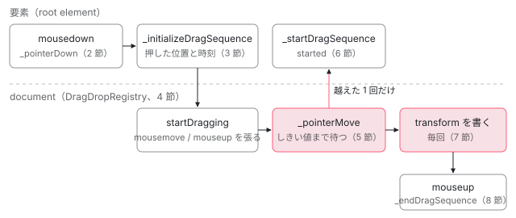

[目次](../README.md) › [CDK の内側](README.md) › 第 18 回 / 全 21 回

# DragRef：ドラッグを滑らかに見せる計算

> pointerdown から、縦横の移動量の和がしきい値（dragStartThreshold）を超えて初めてドラッグを始める行、document へのリスナーを DragDropRegistry が押している間だけ張る行、リストの中では placeholder と popover のプレビューを作る行、位置を制限して transform だけで動かす行、dragStartDelay とタッチの扱い、離したあとに CSS の transition で元の位置へ戻る流れ。

angular/components · 読了 約 13 分 · 中核 · [サイトで読む（デモが動きます）](https://angular-deep-dive-cyan.vercel.app/chapter/drag-drop)

---

`cdkDrag` を付けた要素は、押しただけでは動きません。指やマウスが数ピクセル動いて初めて「ドラッグが始まった」とみなし、そこからは `left` / `top` ではなく `transform` だけを書き換えて要素を動かします。この章では、`pointerdown` から始まって、しきい値の判定、`document` へのリスナー、位置の制限、`transform` の合成、離したあとに元の位置へ戻るアニメーションまでを、`DragRef` の行で順に追います。

読む対象は `src/cdk/drag-drop/` の `drag-ref.ts`・`drag-drop-registry.ts`・`preview-ref.ts`・`dom/styling.ts`・`directives/drag.ts` です。並べ替え（どの位置に入るか）は `DropListRef` の仕事なので[次の回](19-cdk-drop-list.md)で読みます。

1. [1. 概観](01-cdk-overview.md)
2. [2. Platform と向き](02-cdk-platform-bidi.md)
3. [3. Observer と画面幅](03-cdk-observers-layout.md)
4. [4. Portal](04-cdk-portal.md)
5. [5. Overlay](05-cdk.md)
6. [6. 位置の計算](06-cdk-overlay-position.md)
7. [7. スクロールと Esc](07-cdk-overlay-scroll-dispatch.md)
8. [8. FocusTrap](08-cdk-focus-trap.md)
9. [9. FocusMonitor](09-cdk-focus-monitor.md)
10. [10. ListKeyManager](10-cdk-key-manager.md)
11. [11. LiveAnnouncer](11-cdk-live-announcer.md)
12. [12. Dialog](12-cdk-dialog.md)
13. [13. Menu](13-cdk-menu.md)
14. [14. DataSource と選択](14-cdk-collections.md)
15. [15. 仮想スクロール](15-virtual-scroll.md)
16. [16. table](16-table.md)
17. [17. tree](17-cdk-tree.md)
18. **18. DragRef**（この章）
19. [19. DropListRef](19-cdk-drop-list.md)
20. [20. ハーネス](20-harness.md)
21. [21. Material のテーマ](21-theming.md)

> [!TIP]
> **新卒エンジニアへ**
>
> `cdkDrag`（クラス名 `CdkDrag`）は Angular のディレクティブですが、ドラッグの計算はほとんど持っていません。中身は `DragRef` という**Angular に依存しない普通のクラス**で、ディレクティブは input を `DragRef` のプロパティに写し、`DragRef` の `Subject` を output に流すだけです。この章で読むのはほぼ全部 `DragRef` です。

## 0. 全体の流れ



*要素に付くのは mousedown / touchstart だけ。押した瞬間に DragDropRegistry が document へリスナーを張り、しきい値を越えた pointermove で初めてドラッグが始まる。*

1. **要素で押される**

   `DragRef` が要素に付けた `mousedown` / `touchstart` のリスナーが受ける（2 節）。
2. **準備だけする**

   押した位置・時刻・要素の `DOMRect` を覚え、`DragDropRegistry` の `pointerMove` / `pointerUp` を購読する（3 節）。
3. **document にリスナーを張る**

   `DragDropRegistry.startDragging` が `document` に `mousemove`・`mouseup`・`scroll`・`selectstart` を張る（4 節）。
4. **しきい値を越えたら始める**

   押した位置から縦横の移動量の和が `dragStartThreshold`（既定 5px）以上になった `pointermove` で `_startDragSequence`。`dragStartDelay` がまだなら取りやめ（5 節）。
5. **リストの中なら placeholder とプレビュー**

   元の要素を隠して placeholder に置き換え、指に付いて動くプレビューを作る（6 節）。リストの外（自由ドラッグ）なら要素そのものを動かす。
6. **動かす**

   軸の固定と境界で位置を制限し、`translate3d(x, y, 0)` を `style.transform` に書く（7 節）。
7. **離す**

   リスナーを外し、リストの中ならプレビューを placeholder の位置へアニメーションさせてから片付ける（8 節）。

## 1. CdkDrag が DragRef を作る

📄 `components/src/cdk/drag-drop/directives/drag.ts` L219–231 （▶ の行: 221, 223–225, 230）

```ts
219 │   constructor() {
220 │     const dropContainer = this.dropContainer;
221 ▶     const config = inject<DragDropConfig>(CDK_DRAG_CONFIG, {optional: true});
222 │ 
223 ▶     this._dragRef = createDragRef(this._injector, this.element, {
224 ▶       dragStartThreshold:
225 ▶         config && config.dragStartThreshold != null ? config.dragStartThreshold : 5,
226 │       pointerDirectionChangeThreshold:
227 │         config && config.pointerDirectionChangeThreshold != null
228 │           ? config.pointerDirectionChangeThreshold
229 │           : 5,
230 ▶       zIndex: config?.zIndex,
231 │     });
```

221 行目で `CDK_DRAG_CONFIG` を任意で inject し、223 行目で `createDragRef` に渡します。224〜225 行目、`dragStartThreshold` は設定が無ければ **5** です。この値は `cdkDrag` の input には無く、constructor で 1 回だけ読まれます。変えたいときは `CDK_DRAG_CONFIG` を provide します（下のデモはそうしています）。

📄 `components/src/cdk/drag-drop/directives/drag.ts` L423–457 （▶ の行: 424–425, 445, 447–450, 454）

```ts
423 │   private _syncInputs(ref: DragRef<CdkDrag<T>>) {
424 ▶     ref.beforeStarted.subscribe(() => {
425 ▶       if (!ref.isDragging()) {
426 │         const dir = this._dir;
427 │         const dragStartDelay = this.dragStartDelay;
428 │         const placeholder = this._placeholderTemplate
429 │           ? {
430 │               template: this._placeholderTemplate.templateRef,
431 │               context: this._placeholderTemplate.data,
432 │               viewContainer: this._viewContainerRef,
433 │             }
434 │           : null;
435 │         const preview = this._previewTemplate
436 │           ? {
437 │               template: this._previewTemplate.templateRef,
438 │               context: this._previewTemplate.data,
439 │               matchSize: this._previewTemplate.matchSize,
440 │               viewContainer: this._viewContainerRef,
441 │             }
442 │           : null;
443 │ 
444 │         ref.disabled = this.disabled;
445 ▶         ref.lockAxis = this.lockAxis;
446 │         ref.scale = this.scale;
447 ▶         ref.dragStartDelay =
448 ▶           typeof dragStartDelay === 'object' && dragStartDelay
449 ▶             ? dragStartDelay
450 ▶             : coerceNumberProperty(dragStartDelay);
451 │         ref.constrainPosition = this.constrainPosition;
452 │         ref.previewClass = this.previewClass;
453 │         ref
454 ▶           .withBoundaryElement(this._getBoundaryElement())
455 │           .withPlaceholderTemplate(placeholder)
456 │           .withPreviewTemplate(preview)
457 │           .withPreviewContainer(this.previewContainer || 'global');
```

input の方は 424 行目、`beforeStarted`（押されるたびに 2 節の 733 行目で流れる）を購読して、その時点の値を写します。445 行目で `cdkDragLockAxis`、447〜450 行目で `cdkDragStartDelay`（数値か `{touch, mouse}`）、454 行目で `cdkDragBoundary` を要素に解決して渡します。つまり input を変えても、次に押されたときから効きます。ドラッグの途中では変わりません（425 行目）。

## 2. 要素に付けるリスナーは 3 つ

📄 `components/src/cdk/drag-drop/drag-ref.ts` L495–515 （▶ の行: 501–504）

```ts
495 │   withRootElement(rootElement: ElementRef<HTMLElement> | HTMLElement): this {
496 │     const element = coerceElement(rootElement);
497 │ 
498 │     if (element !== this._rootElement) {
499 │       this._removeRootElementListeners();
500 │       const renderer = this._renderer;
501 ▶       this._rootElementCleanups = this._ngZone.runOutsideAngular(() => [
502 ▶         renderer.listen(element, 'mousedown', this._pointerDown, activeEventListenerOptions),
503 ▶         renderer.listen(element, 'touchstart', this._pointerDown, passiveEventListenerOptions),
504 ▶         renderer.listen(element, 'dragstart', this._nativeDragStart, activeEventListenerOptions),
505 │       ]);
506 │       this._initialTransform = undefined;
507 │       this._rootElement = element;
508 │     }
509 │ 
510 │     if (typeof SVGElement !== 'undefined' && this._rootElement instanceof SVGElement) {
511 │       this._ownerSVGElement = this._rootElement.ownerSVGElement;
512 │     }
513 │ 
514 │     return this;
515 │   }
```

要素に付けるのは 502〜504 行目の 3 つだけです。`mousedown` は `passive: false`（3 節の 997 行目で `preventDefault` するため）、`touchstart` は `passive: true` です。`touchstart` を止めてしまうとタッチ端末でページのスクロールやクリックが効かなくなるので、ここでは止めません。`dragstart` はブラウザ自身の HTML ドラッグ＆ドロップ（画像を引っ張ると出る半透明の像）を抑えるためです。

501 行目の `runOutsideAngular` は zone.js があるときに「このリスナーでは変化検知を起こさない」ための包みです。このサイトのように zone.js が無いアプリでは `NgZone` は `NoopNgZone` で、`runOutsideAngular(fn)` も `run(fn)` もただ `fn()` を呼びます（[zoneless の既定の章](../zoneless/01-zoneless-default.md)）。リスナーを `Renderer2.listen` で直接付けているので、テンプレートの `(event)` と違ってビューを dirty にもしません。

📄 `components/src/cdk/drag-drop/drag-ref.ts` L732–745 （▶ の行: 733, 736, 739–740, 743）

```ts
732 │   private _pointerDown = (event: MouseEvent | TouchEvent) => {
733 ▶     this.beforeStarted.next();
734 │ 
735 │     // Delegate the event based on whether it started from a handle or the element itself.
736 ▶     if (this._handles.length) {
737 │       const targetHandle = this._getTargetHandle(event);
738 │ 
739 ▶       if (targetHandle && !this._disabledHandles.has(targetHandle) && !this.disabled) {
740 ▶         this._initializeDragSequence(targetHandle, event);
741 │       }
742 │     } else if (!this.disabled) {
743 ▶       this._initializeDragSequence(this._rootElement, event);
744 │     }
745 │   };
```

733 行目で `beforeStarted` を流し（1 節の input の写し）、736〜740 行目、`cdkDragHandle` があるときは押された所が有効なハンドルの中かを確かめます。ハンドルが無ければ 743 行目で要素そのものを基準に準備へ進みます。

## 3. 押しただけでは始めない：\_initializeDragSequence

📄 `components/src/cdk/drag-drop/drag-ref.ts` L977–1003 （▶ の行: 979, 982–986, 996–997, 1001–1002）

```ts
 977 │     const isDragging = this.isDragging();
 978 │     const isTouchSequence = isTouchEvent(event);
 979 ▶     const isAuxiliaryMouseButton = !isTouchSequence && (event as MouseEvent).button !== 0;
 980 │     const rootElement = this._rootElement;
 981 │     const target = _getEventTarget(event);
 982 ▶     const isSyntheticEvent =
 983 ▶       !isTouchSequence &&
 984 ▶       this._lastTouchEventTime &&
 985 ▶       this._lastTouchEventTime + MOUSE_EVENT_IGNORE_TIME > Date.now();
 986 ▶     const isFakeEvent = isTouchSequence
 987 │       ? isFakeTouchstartFromScreenReader(event as TouchEvent)
 988 │       : isFakeMousedownFromScreenReader(event as MouseEvent);
 989 │ 
 990 │     // If the event started from an element with the native HTML drag&drop, it'll interfere
 991 │     // with our own dragging (e.g. `img` tags do it by default). Prevent the default action
 992 │     // to stop it from happening. Note that preventing on `dragstart` also seems to work, but
 993 │     // it's flaky and it fails if the user drags it away quickly. Also note that we only want
 994 │     // to do this for `mousedown` since doing the same for `touchstart` will stop any `click`
 995 │     // events from firing on touch devices.
 996 ▶     if (target && (target as HTMLElement).draggable && event.type === 'mousedown') {
 997 ▶       event.preventDefault();
 998 │     }
 999 │ 
1000 │     // Abort if the user is already dragging or is using a mouse button other than the primary one.
1001 ▶     if (isDragging || isAuxiliaryMouseButton || isSyntheticEvent || isFakeEvent) {
1002 ▶       return;
1003 │     }
```

1001 行目で、次のどれかなら何もしません。もうドラッグ中、979 行目の左ボタン以外（`button !== 0`）、982〜985 行目の「タッチの直後 800ms 以内に来たマウスイベント」（タッチ端末はタッチのあとに偽のマウスイベントも送るので、二重に始めないため）、986〜988 行目のスクリーンリーダーが送る偽の `mousedown` / `touchstart`。996〜998 行目、押した所が `draggable` な要素（`` など）ならブラウザのドラッグを止めます。

📄 `components/src/cdk/drag-drop/drag-ref.ts` L1014–1047 （▶ の行: 1015, 1020–1023, 1028, 1035, 1040–1042, 1045–1046）

```ts
1014 │     this._hasMoved = false;
1015 ▶     this._hasStartedDragging.set(this._hasMoved);
1016 │ 
1017 │     // Avoid multiple subscriptions and memory leaks when multi touch
1018 │     // (isDragging check above isn't enough because of possible temporal and/or dimensional delays)
1019 │     this._removeListeners();
1020 ▶     this._initialDomRect = this._rootElement.getBoundingClientRect();
1021 ▶     this._pointerMoveSubscription = this._dragDropRegistry.pointerMove.subscribe(this._pointerMove);
1022 ▶     this._pointerUpSubscription = this._dragDropRegistry.pointerUp.subscribe(this._pointerUp);
1023 ▶     this._scrollSubscription = this._dragDropRegistry
1024 │       .scrolled(this._getShadowRoot())
1025 │       .subscribe(scrollEvent => this._updateOnScroll(scrollEvent));
1026 │ 
1027 │     if (this._boundaryElement) {
1028 ▶       this._boundaryRect = getMutableClientRect(this._boundaryElement);
1029 │     }
1030 │ 
1031 │     // If we have a custom preview we can't know ahead of time how large it'll be so we position
1032 │     // it next to the cursor. The exception is when the consumer has opted into making the preview
1033 │     // the same size as the root element, in which case we do know the size.
1034 │     const previewTemplate = this._previewTemplate;
1035 ▶     this._pickupPositionInElement =
1036 │       previewTemplate && previewTemplate.template && !previewTemplate.matchSize
1037 │         ? {x: 0, y: 0}
1038 │         : this._getPointerPositionInElement(this._initialDomRect, referenceElement, event);
1039 │     const pointerPosition =
1040 ▶       (this._pickupPositionOnPage =
1041 ▶       this._lastKnownPointerPosition =
1042 ▶         this._getPointerPositionOnPage(event));
1043 │     this._pointerDirectionDelta = {x: 0, y: 0};
1044 │     this._pointerPositionAtLastDirectionChange = {x: pointerPosition.x, y: pointerPosition.y};
1045 ▶     this._dragStartTime = Date.now();
1046 ▶     this._dragDropRegistry.startDragging(this, event);
1047 │   }
```

1. **1015 行目**

   `_hasStartedDragging`（signal）を `false` に。まだ「押しただけ」の状態。
2. **1020 行目**

   要素の `getBoundingClientRect()` を 1 回だけ測って `_initialDomRect` に保存。動かしている間は測り直さない。
3. **1021〜1025 行目**

   `DragDropRegistry` の `pointerMove`・`pointerUp`・`scrolled()` を購読する。`DragRef` 自身は `document` にリスナーを付けない。
4. **1027〜1029 行目**

   `cdkDragBoundary` があれば、その要素の矩形も今のうちに測る。
5. **1035〜1042 行目**

   要素の中のどこを掴んだか（`_pickupPositionInElement`）と、ページ上のどこを押したか（`_pickupPositionOnPage`）を保存。
6. **1045 行目**

   押した時刻を `_dragStartTime` に。5 節の `dragStartDelay` の判定に使う。
7. **1046 行目**

   `registry.startDragging(this, event)`。ここで `document` にリスナーが張られる（次の節）。

## 4. document へのリスナーは DragDropRegistry が 1 か所で張る

📄 `components/src/cdk/drag-drop/drag-drop-registry.ts` L152–187 （▶ の行: 154, 158–159, 161–165, 171, 177, 182–183, 186）

```ts
152 │   startDragging(drag: DragRef, event: TouchEvent | MouseEvent) {
153 │     // Do not process the same drag twice to avoid memory leaks and redundant listeners
154 ▶     if (this._activeDragInstances().indexOf(drag) > -1) {
155 │       return;
156 │     }
157 │ 
158 ▶     this._styleLoader.load(_ResetsLoader);
159 ▶     this._activeDragInstances.update(instances => [...instances, drag]);
160 │ 
161 ▶     if (this._activeDragInstances().length === 1) {
162 ▶       // We explicitly bind __active__ listeners here, because newer browsers will default to
163 ▶       // passive ones for `mousemove` and `touchmove`. The events need to be active, because we
164 ▶       // use `preventDefault` to prevent the page from scrolling while the user is dragging.
165 ▶       const isTouchEvent = event.type.startsWith('touch');
166 │       const endEventHandler = (e: Event) => this.pointerUp.next(e as TouchEvent | MouseEvent);
167 │ 
168 │       const toBind: [name: string, handler: (event: Event) => void, options: ListenerOptions][] = [
169 │         // Use capturing so that we pick up scroll changes in any scrollable nodes that aren't
170 │         // the document. See https://github.com/angular/components/issues/17144.
171 ▶         ['scroll', (e: Event) => this._scroll.next(e), capturingEventOptions],
172 │ 
173 │         // Preventing the default action on `mousemove` isn't enough to disable text selection
174 │         // on Safari so we need to prevent the selection event as well. Alternatively this can
175 │         // be done by setting `user-select: none` on the `body`, however it has causes a style
176 │         // recalculation which can be expensive on pages with a lot of elements.
177 ▶         ['selectstart', this._preventDefaultWhileDragging, activeCapturingEventOptions],
178 │       ];
179 │ 
180 │       if (isTouchEvent) {
181 │         toBind.push(
182 ▶           ['touchend', endEventHandler, capturingEventOptions],
183 ▶           ['touchcancel', endEventHandler, capturingEventOptions],
184 │         );
185 │       } else {
186 ▶         toBind.push(['mouseup', endEventHandler, capturingEventOptions]);
187 │       }
```

📄 `components/src/cdk/drag-drop/drag-drop-registry.ts` L189–205 （▶ の行: 191–195, 199–201）

```ts
189 │       // We don't have to bind a move event for touch drag sequences, because
190 │       // we already have a persistent global one bound from `registerDragItem`.
191 ▶       if (!isTouchEvent) {
192 ▶         toBind.push([
193 ▶           'mousemove',
194 ▶           (e: Event) => this.pointerMove.next(e as MouseEvent),
195 ▶           activeCapturingEventOptions,
196 │         ]);
197 │       }
198 │ 
199 ▶       this._ngZone.runOutsideAngular(() => {
200 ▶         this._globalListeners = toBind.map(([name, handler, options]) =>
201 ▶           this._renderer.listen(this._document, name, handler, options),
202 │         );
203 │       });
204 │     }
205 │   }
```

`DragDropRegistry` はアプリに 1 つのサービスです。159 行目で「今ドラッグ中の `DragRef`」の配列に足し、161 行目、**それが 1 つ目のときだけ** 200〜201 行目で `document` にリスナーを張ります。ページに `cdkDrag` が 100 個あっても、張るのは押されている間の 1 組だけです。外すのは `stopDragging` で配列が空になったときです。

張るものは 171 行目の `scroll`（`capture: true` にして、どの要素のスクロールも拾う）、177 行目の `selectstart`（ドラッグ中に文字が選択されるのを止める）、マウスなら 186 行目の `mouseup` と 192〜196 行目の `mousemove`、タッチなら 182〜183 行目の `touchend` / `touchcancel` です。受けたイベントは 194 行目のように `pointerMove` の `Subject` に流すだけで、計算は購読している `DragRef`（3 節の 1021 行目）がします。162〜164 行目のコメントのとおり、`mousemove` を `passive: false` で張るのは、ドラッグ中に `preventDefault` してページのスクロールを止めるためです。158 行目は `.cdk-drag-preview` などの初期化用 CSS を、最初のドラッグのときに 1 回だけ読み込む行です。

タッチの `touchmove` だけは扱いが違います。

📄 `components/src/cdk/drag-drop/drag-drop-registry.ts` L110–130 （▶ の行: 114–115, 117, 122–126）

```ts
110 │   /** Adds a drag item instance to the registry. */
111 │   registerDragItem(drag: DragRef) {
112 │     this._dragInstances.add(drag);
113 │ 
114 ▶     // The `touchmove` event gets bound once, ahead of time, because WebKit
115 ▶     // won't preventDefault on a dynamically-added `touchmove` listener.
116 │     // See https://bugs.webkit.org/show_bug.cgi?id=184250.
117 ▶     if (this._dragInstances.size === 1) {
118 │       this._ngZone.runOutsideAngular(() => {
119 │         // The event handler has to be explicitly active,
120 │         // because newer browsers make it passive by default.
121 │         this._cleanupDocumentTouchmove?.();
122 ▶         this._cleanupDocumentTouchmove = this._renderer.listen(
123 ▶           this._document,
124 ▶           'touchmove',
125 ▶           this._persistentTouchmoveListener,
126 ▶           activeCapturingEventOptions,
127 │         );
128 │       });
129 │     }
130 │   }
```

📄 `components/src/cdk/drag-drop/drag-drop-registry.ts` L302–324 （▶ の行: 306–308, 313–314, 318–319, 322）

```ts
302 │   /**
303 │    * Event listener that will prevent the default browser action while the user is dragging.
304 │    * @param event Event whose default action should be prevented.
305 │    */
306 ▶   private _preventDefaultWhileDragging = (event: Event) => {
307 ▶     if (this._activeDragInstances().length > 0) {
308 ▶       event.preventDefault();
309 │     }
310 │   };
311 │ 
312 │   /** Event listener for `touchmove` that is bound even if no dragging is happening. */
313 ▶   private _persistentTouchmoveListener = (event: TouchEvent) => {
314 ▶     if (this._activeDragInstances().length > 0) {
315 │       // Note that we only want to prevent the default action after dragging has actually started.
316 │       // Usually this is the same time at which the item is added to the `_activeDragInstances`,
317 │       // but it could be pushed back if the user has set up a drag delay or threshold.
318 ▶       if (this._activeDragInstances().some(this._draggingPredicate)) {
319 ▶         event.preventDefault();
320 │       }
321 │ 
322 ▶       this.pointerMove.next(event);
323 │     }
324 │   };
```

📄 `components/src/cdk/drag-drop/drag-ref.ts` L577–580 （▶ の行: 579）

```ts
577 │   /** Checks whether the element is currently being dragged. */
578 │   isDragging(): boolean {
579 ▶     return this._hasStartedDragging() && this._dragDropRegistry.isDragging(this);
580 │   }
```

114〜116 行目のコメントのとおり、WebKit（Safari）は**あとから足した `touchmove` リスナーでは `preventDefault` が効かない**ので、117 行目、最初の `DragRef` が登録された時点（ドラッグの前）で `touchmove` を `passive: false` で張り、そのまま張りっぱなしにします。中身の 314 行目は、誰も押していなければ何もしません。318 行目、`preventDefault`（スクロールを止める）のは、押されている `DragRef` のどれかが `isDragging()` のときだけです。579 行目の `isDragging()` は「しきい値を越えて始まった（`_hasStartedDragging`）」かつ「registry に載っている」です。だから指を置いただけ、あるいは 5 節の delay を待っている間はページは普通にスクロールし、ドラッグが始まった瞬間からスクロールが止まります。

## 5. しきい値（dragStartThreshold）と dragStartDelay

📄 `components/src/cdk/drag-drop/drag-ref.ts` L748–784 （▶ の行: 751–754, 760–761, 764–766, 772, 775–776, 778–779, 783）

```ts
748 │   private _pointerMove = (event: MouseEvent | TouchEvent) => {
749 │     const pointerPosition = this._getPointerPositionOnPage(event);
750 │ 
751 ▶     if (!this._hasStartedDragging()) {
752 ▶       const distanceX = Math.abs(pointerPosition.x - this._pickupPositionOnPage.x);
753 ▶       const distanceY = Math.abs(pointerPosition.y - this._pickupPositionOnPage.y);
754 ▶       const isOverThreshold = distanceX + distanceY >= this._config.dragStartThreshold;
755 │ 
756 │       // Only start dragging after the user has moved more than the minimum distance in either
757 │       // direction. Note that this is preferable over doing something like `skip(minimumDistance)`
758 │       // in the `pointerMove` subscription, because we're not guaranteed to have one move event
759 │       // per pixel of movement (e.g. if the user moves their pointer quickly).
760 ▶       if (isOverThreshold) {
761 ▶         const isDelayElapsed = Date.now() >= this._dragStartTime + this._getDragStartDelay(event);
762 │         const container = this._dropContainer;
763 │ 
764 ▶         if (!isDelayElapsed) {
765 ▶           this._endDragSequence(event);
766 ▶           return;
767 │         }
768 │ 
769 │         // Prevent other drag sequences from starting while something in the container is still
770 │         // being dragged. This can happen while we're waiting for the drop animation to finish
771 │         // and can cause errors, because some elements might still be moving around.
772 ▶         if (!container || (!container.isDragging() && !container.isReceiving())) {
773 │           // Prevent the default action as soon as the dragging sequence is considered as
774 │           // "started" since waiting for the next event can allow the device to begin scrolling.
775 ▶           if (event.cancelable) {
776 ▶             event.preventDefault();
777 │           }
778 ▶           this._hasStartedDragging.set(true);
779 ▶           this._ngZone.run(() => this._startDragSequence(event));
780 │         }
781 │       }
782 │ 
783 ▶       return;
784 │     }
```

1. **751 行目：まだ始まっていない間だけの分岐**

   始まっていれば 786 行目以降（7 節）へ。
2. **752〜754 行目：距離を測る**

   押した位置（3 節の 1040 行目）からの縦と横の**絶対値の和**が `dragStartThreshold` 以上か。直線距離ではなく足し算です。756〜759 行目のコメントのとおり、`pointermove` は 1px ごとに来るとは限らないので、回数ではなく距離で判定します。
3. **761 行目：delay は過ぎたか**

   押した時刻 + `_getDragStartDelay(event)` を今と比べる。
4. **764〜766 行目：過ぎていなければ取りやめ**

   delay の前にしきい値を越えて動いたら、`_endDragSequence` でこの回の押下を捨てます。待ちながら少しずつ動かしても、越えた時点で終わりです。
5. **772 行目：同じリストで別の要素が戻る途中なら始めない**

   8 節のアニメーションの最中に次を掴むと、動いている要素の位置を測り違えるため。
6. **775〜779 行目：始める**

   このイベントで `preventDefault`（タッチならここからスクロールが止まる）、778 行目で signal を `true`、779 行目で `_startDragSequence(event)`。`cdkDragStarted` の `event` はこの `pointermove` です。
7. **783 行目：この回は動かさない**

   始めた回も含めて、まだ `transform` は書きません。

📄 `components/src/cdk/drag-drop/drag-ref.ts` L1505–1515 （▶ の行: 1508–1511, 1514）

```ts
1505 │   private _getDragStartDelay(event: MouseEvent | TouchEvent): number {
1506 │     const value = this.dragStartDelay;
1507 │ 
1508 ▶     if (typeof value === 'number') {
1509 ▶       return value;
1510 ▶     } else if (isTouchEvent(event)) {
1511 ▶       return value.touch;
1512 │     }
1513 │ 
1514 ▶     return value ? value.mouse : 0;
1515 │   }
```

`cdkDragStartDelay` が数値なら 1509 行目でそのまま、`{touch: 300, mouse: 0}` のようなオブジェクトなら 1510〜1511 行目でタッチかどうかで選びます。タッチ端末では「長押ししてからドラッグ」にしないと、指でページをスクロールしようとしただけでドラッグが始まってしまいます。そこで touch だけに delay を付けると、素早く動かした指は 764〜766 行目で取りやめになり、4 節の 318 行目で `preventDefault` もされないので、ページは普通にスクロールします。

## 6. 始まった瞬間：placeholder とプレビュー（リストの中のとき）

`_startDragSequence` は、要素が `cdkDropList` の中にあるかどうかで大きく分かれます。リストの中のときの処理です。

📄 `components/src/cdk/drag-drop/drag-ref.ts` L912–943 （▶ の行: 915–916, 918, 923, 927, 931, 943）

```ts
912 │     if (dropContainer) {
913 │       const element = this._rootElement;
914 │       const parent = element.parentNode as HTMLElement;
915 ▶       const placeholder = (this._placeholder = this._createPlaceholderElement());
916 ▶       const marker = (this._marker =
917 │         this._marker ||
918 ▶         this._document.createComment(
919 │           typeof ngDevMode === 'undefined' || ngDevMode ? 'cdk-drag-marker' : '',
920 │         ));
921 │ 
922 │       // Insert a marker node so that we can restore the element's position in the DOM.
923 ▶       parent.insertBefore(marker, element);
924 │ 
925 │       // There's no risk of transforms stacking when inside a drop container so
926 │       // we can keep the initial transform up to date any time dragging starts.
927 ▶       this._initialTransform = element.style.transform || '';
928 │ 
929 │       // Create the preview after the initial transform has
930 │       // been cached, because it can be affected by the transform.
931 ▶       this._preview = new PreviewRef(
932 │         this._document,
933 │         this._rootElement,
934 │         this._direction,
935 │         this._initialDomRect!,
936 │         this._previewTemplate || null,
937 │         this.previewClass || null,
938 │         this._pickupPositionOnPage,
939 │         this._initialTransform,
940 │         this._config.zIndex || 1000,
941 │         this._renderer,
942 │       );
943 ▶       this._preview.attach(this._getPreviewInsertionPoint(parent, shadowRoot));
```

📄 `components/src/cdk/drag-drop/drag-ref.ts` L945–957 （▶ の行: 948–951, 953, 955）

```ts
945 │       // We move the element out at the end of the body and we make it hidden, because keeping it in
946 │       // place will throw off the consumer's `:last-child` selectors. We can't remove the element
947 │       // from the DOM completely, because iOS will stop firing all subsequent events in the chain.
948 ▶       toggleVisibility(element, false, dragImportantProperties);
949 ▶       this._document.body.appendChild(parent.replaceChild(placeholder, element));
950 ▶       this.started.next({source: this, event}); // Emit before notifying the container.
951 ▶       dropContainer.start();
952 │       this._initialContainer = dropContainer;
953 ▶       this._initialIndex = dropContainer.getItemIndex(this);
954 │     } else {
955 ▶       this.started.next({source: this, event});
956 │       this._initialContainer = this._initialIndex = undefined!;
957 │     }
```

1. **915 行目：placeholder を作る**

   リストの中で「ここに入る」を示す要素。
2. **916〜923 行目：目印のコメントを挟む**

   元の要素の直前に `<!--cdk-drag-marker-->` を入れ、終わったら 8 節でここへ戻す。
3. **931〜943 行目：プレビューを作って差し込む**

   `PreviewRef` が指に付いて動く要素を作る。差し込み先は既定で `body`（`cdkDragPreviewContainer` の既定 `'global'`）。
4. **948〜949 行目：元の要素を隠して body の末尾へ**

   元の位置は placeholder に置き換え、元の要素は透明にして `body` の末尾へ。945〜947 行目のコメントのとおり、DOM から外すと iOS が以降のタッチイベントを送らなくなるので、外さずに移す。
5. **950〜953 行目：started を流し、リストに知らせる**

   `dropContainer.start()` から先は[DropListRef の章](19-cdk-drop-list.md)。953 行目で元の index を覚える。
6. **955 行目：リストの外なら started だけ**

   自由ドラッグでは placeholder もプレビューも作らず、要素そのものを動かす。

📄 `components/src/cdk/drag-drop/drag-ref.ts` L1222–1243 （▶ の行: 1227–1228, 1235, 1240–1241）

```ts
1222 │   private _createPlaceholderElement(): HTMLElement {
1223 │     const placeholderConfig = this._placeholderTemplate;
1224 │     const placeholderTemplate = placeholderConfig ? placeholderConfig.template : null;
1225 │     let placeholder: HTMLElement;
1226 │ 
1227 ▶     if (placeholderTemplate) {
1228 ▶       this._placeholderRef = placeholderConfig!.viewContainer.createEmbeddedView(
1229 │         placeholderTemplate,
1230 │         placeholderConfig!.context,
1231 │       );
1232 │       this._placeholderRef.detectChanges();
1233 │       placeholder = getRootNode(this._placeholderRef, this._document);
1234 │     } else {
1235 ▶       placeholder = deepCloneNode(this._rootElement);
1236 │     }
1237 │ 
1238 │     // Stop pointer events on the preview so the user can't
1239 │     // interact with it while the preview is animating.
1240 ▶     placeholder.style.pointerEvents = 'none';
1241 ▶     placeholder.classList.add(PLACEHOLDER_CLASS);
1242 │     return placeholder;
1243 │   }
```

`*cdkDragPlaceholder` のテンプレートがあれば 1228 行目でそれを描き、無ければ 1235 行目で元の要素を丸ごと複製します。1240〜1241 行目で `pointer-events: none` と `cdk-drag-placeholder` クラス。見た目を変えたいときはこのクラスに CSS を当てます。

📄 `components/src/cdk/drag-drop/preview-ref.ts` L124–156 （▶ の行: 125–126, 138, 145–148, 155）

```ts
124 │     } else {
125 ▶       preview = deepCloneNode(this._rootElement);
126 ▶       matchElementSize(preview, this._initialDomRect!);
127 │ 
128 │       if (this._initialTransform) {
129 │         preview.style.transform = this._initialTransform;
130 │       }
131 │     }
132 │ 
133 │     extendStyles(
134 │       preview.style,
135 │       {
136 │         // It's important that we disable the pointer events on the preview, because
137 │         // it can throw off the `document.elementFromPoint` calls in the `CdkDropList`.
138 ▶         'pointer-events': 'none',
139 │         // If the preview has a margin, it can throw off our positioning so we reset it. The reset
140 │         // value for `margin-right` needs to be `auto` when opened as a popover, because our
141 │         // positioning is always top/left based, but native popover seems to position itself
142 │         // to the top/right if `<html>` or `<body>` have `dir="rtl"` (see #29604). Setting it
143 │         // to `auto` pushed it to the top/left corner in RTL and is a noop in LTR.
144 │         'margin': supportsPopover(preview) ? '0 auto 0 0' : '0',
145 ▶         'position': 'fixed',
146 ▶         'top': '0',
147 ▶         'left': '0',
148 ▶         'z-index': this._zIndex + '',
149 │       },
150 │       importantProperties,
151 │     );
152 │ 
153 │     toggleNativeDragInteractions(preview, false);
154 │     preview.classList.add('cdk-drag-preview');
155 ▶     preview.setAttribute('popover', 'manual');
156 │     preview.setAttribute('dir', this._direction);
```

📄 `components/src/cdk/drag-drop/preview-ref.ts` L62–71 （▶ の行: 64, 68–69）

```ts
62 │   attach(parent: HTMLElement): void {
63 │     this._preview = this._createPreview();
64 ▶     parent.appendChild(this._preview);
65 │ 
66 │     // The null check is necessary for browsers that don't support the popover API.
67 │     // Note that we use a string access for compatibility with Closure.
68 ▶     if (supportsPopover(this._preview)) {
69 ▶       this._preview['showPopover']();
70 │     }
71 │   }
```

プレビューも既定では元の要素の複製（125 行目）で、126 行目の `matchElementSize` で幅・高さと最初の位置を合わせます（位置も `transform` で入れる。7 節）。145〜148 行目で `position: fixed; top: 0; left: 0` にして z-index を付けます。動かすのは `transform` だけなので、`top` と `left` は 0 のままです。138 行目の `pointer-events: none` は、プレビューがポインターの真下にあっても、下にあるリストを `elementFromPoint` で探せるようにするためです（コメントのとおり）。

155 行目で `popover="manual"` を付け、64 行目で差し込んだあと 68〜69 行目で `showPopover()` を呼びます。popover はブラウザの **top layer**（どんな `z-index` や `overflow: hidden` よりも上に描かれる層）に載るので、親が切り抜いていてもプレビューは隠れません。Overlay が popover を使うのと同じ理由です（[Overlay の章](05-cdk.md)）。

## 7. 動かす：位置の制限と transform

📄 `components/src/cdk/drag-drop/drag-ref.ts` L786–824 （▶ の行: 789–790, 793–794, 798–799, 803, 805–807, 813–814）

```ts
786 │     // We prevent the default action down here so that we know that dragging has started. This is
787 │     // important for touch devices where doing this too early can unnecessarily block scrolling,
788 │     // if there's a dragging delay.
789 ▶     if (event.cancelable) {
790 ▶       event.preventDefault();
791 │     }
792 │ 
793 ▶     const constrainedPointerPosition = this._getConstrainedPointerPosition(pointerPosition);
794 ▶     this._hasMoved = true;
795 │     this._lastKnownPointerPosition = pointerPosition;
796 │     this._updatePointerDirectionDelta(constrainedPointerPosition);
797 │ 
798 ▶     if (this._dropContainer) {
799 ▶       this._updateActiveDropContainer(constrainedPointerPosition, pointerPosition);
800 │     } else {
801 │       // If there's a position constraint function, we want the element's top/left to be at the
802 │       // specific position on the page. Use the initial position as a reference if that's the case.
803 ▶       const offset = this.constrainPosition ? this._initialDomRect! : this._pickupPositionOnPage;
804 │       const activeTransform = this._activeTransform;
805 ▶       activeTransform.x = constrainedPointerPosition.x - offset.x + this._passiveTransform.x;
806 ▶       activeTransform.y = constrainedPointerPosition.y - offset.y + this._passiveTransform.y;
807 ▶       this._applyRootElementTransform(activeTransform.x, activeTransform.y);
808 │     }
809 │ 
810 │     // Since this event gets fired for every pixel while dragging, we only
811 │     // want to fire it if the consumer opted into it. Also we have to
812 │     // re-enter the zone because we run all of the events on the outside.
813 ▶     if (this._moveEvents.observers.length) {
814 ▶       this._ngZone.run(() => {
815 │         this._moveEvents.next({
816 │           source: this,
817 │           pointerPosition: constrainedPointerPosition,
818 │           event,
819 │           distance: this._getDragDistance(constrainedPointerPosition),
820 │           delta: this._pointerDirectionDelta,
821 │         });
822 │       });
823 │     }
824 │   };
```

始まったあとの `pointermove` は毎回ここに来ます。789〜791 行目で `preventDefault`（スクロールと文字選択を止める）、793 行目で位置を制限し、798〜799 行目、リストの中ならプレビューを動かしつつ並べ替えを `DropListRef` に頼みます（[次の回](19-cdk-drop-list.md)）。リストの外なら 805〜806 行目、「今のポインター − 押した位置 + 前回までに動いた分（`_passiveTransform`）」を `_activeTransform` にして、807 行目で要素に書きます。813〜814 行目、`cdkDragMoved` を購読している人がいるときだけ `moved` を流します。1px ごとに来るイベントなので、誰も聞いていなければ作りもしません。

📄 `components/src/cdk/drag-drop/drag-ref.ts` L1301–1336 （▶ の行: 1303–1304, 1307–1309, 1311–1313, 1317, 1325–1329, 1331–1332）

```ts
1301 │   private _getConstrainedPointerPosition(point: Point): Point {
1302 │     const dropContainerLock = this._dropContainer ? this._dropContainer.lockAxis : null;
1303 ▶     let {x, y} = this.constrainPosition
1304 ▶       ? this.constrainPosition(point, this, this._initialDomRect!, this._pickupPositionInElement)
1305 │       : point;
1306 │ 
1307 ▶     if (this.lockAxis === 'x' || dropContainerLock === 'x') {
1308 ▶       y =
1309 ▶         this._pickupPositionOnPage.y -
1310 │         (this.constrainPosition ? this._pickupPositionInElement.y : 0);
1311 ▶     } else if (this.lockAxis === 'y' || dropContainerLock === 'y') {
1312 ▶       x =
1313 ▶         this._pickupPositionOnPage.x -
1314 │         (this.constrainPosition ? this._pickupPositionInElement.x : 0);
1315 │     }
1316 │ 
1317 ▶     if (this._boundaryRect) {
1318 │       // If not using a custom constrain we need to account for the pickup position in the element
1319 │       // otherwise we do not need to do this, as it has already been accounted for
1320 │       const {x: pickupX, y: pickupY} = !this.constrainPosition
1321 │         ? this._pickupPositionInElement
1322 │         : {x: 0, y: 0};
1323 │ 
1324 │       const boundaryRect = this._boundaryRect;
1325 ▶       const {width: previewWidth, height: previewHeight} = this._getPreviewRect();
1326 ▶       const minY = boundaryRect.top + pickupY;
1327 ▶       const maxY = boundaryRect.bottom - (previewHeight - pickupY);
1328 ▶       const minX = boundaryRect.left + pickupX;
1329 ▶       const maxX = boundaryRect.right - (previewWidth - pickupX);
1330 │ 
1331 ▶       x = clamp(x, minX, maxX);
1332 ▶       y = clamp(y, minY, maxY);
1333 │     }
1334 │ 
1335 │     return {x, y};
1336 │   }
```

1. **1303〜1305 行目：自前の制限関数**

   `cdkDragConstrainPosition` を渡していれば、まずそれで位置を決める。
2. **1307〜1314 行目：軸の固定**

   `lockAxis` が `'x'` なら y を押した位置の y に戻す（横にしか動かない）。`'y'` なら x を戻す。
3. **1317〜1332 行目：境界**

   3 節で測った境界の矩形から、掴んだ位置と要素の大きさを引いた範囲に `clamp` する。要素が境界からはみ出さない。

📄 `components/src/cdk/drag-drop/drag-ref.ts` L1390–1407 （▶ の行: 1391–1392, 1398–1400, 1406）

```ts
1390 │   private _applyRootElementTransform(x: number, y: number) {
1391 ▶     const scale = 1 / this.scale;
1392 ▶     const transform = getTransform(x * scale, y * scale);
1393 │     const styles = this._rootElement.style;
1394 │ 
1395 │     // Cache the previous transform amount only after the first drag sequence, because
1396 │     // we don't want our own transforms to stack on top of each other.
1397 │     // Should be excluded none because none + translate3d(x, y, x) is invalid css
1398 ▶     if (this._initialTransform == null) {
1399 ▶       this._initialTransform =
1400 ▶         styles.transform && styles.transform != 'none' ? styles.transform : '';
1401 │     }
1402 │ 
1403 │     // Preserve the previous `transform` value, if there was one. Note that we apply our own
1404 │     // transform before the user's, because things like rotation can affect which direction
1405 │     // the element will be translated towards.
1406 ▶     styles.transform = combineTransforms(transform, this._initialTransform);
1407 │   }
```

📄 `components/src/cdk/drag-drop/dom/styling.ts` L88–118 （▶ の行: 93–94, 106, 117）

```ts
 88 │ /**
 89 │  * Combines a transform string with an optional other transform
 90 │  * that exited before the base transform was applied.
 91 │  */
 92 │ export function combineTransforms(transform: string, initialTransform?: string): string {
 93 ▶   return initialTransform && initialTransform != 'none'
 94 ▶     ? transform + ' ' + initialTransform
 95 │     : transform;
 96 │ }
 97 │ 
 98 │ /**
 99 │  * Matches the target element's size to the source's size.
100 │  * @param target Element that needs to be resized.
101 │  * @param sourceRect Dimensions of the source element.
102 │  */
103 │ export function matchElementSize(target: HTMLElement, sourceRect: DOMRect): void {
104 │   target.style.width = `${sourceRect.width}px`;
105 │   target.style.height = `${sourceRect.height}px`;
106 ▶   target.style.transform = getTransform(sourceRect.left, sourceRect.top);
107 │ }
108 │ 
109 │ /**
110 │  * Gets a 3d `transform` that can be applied to an element.
111 │  * @param x Desired position of the element along the X axis.
112 │  * @param y Desired position of the element along the Y axis.
113 │  */
114 │ export function getTransform(x: number, y: number): string {
115 │   // Round the transforms since some browsers will
116 │   // blur the elements for sub-pixel transforms.
117 ▶   return `translate3d(${Math.round(x)}px, ${Math.round(y)}px, 0)`;
118 │ }
```

1392 行目で `translate3d(x, y, 0)` を作り、1406 行目で `style.transform` に書きます。1398〜1401 行目、最初のドラッグのときに要素がもともと持っていた `transform`（例えば `rotate(10deg)`）を覚え、1406 行目と styling.ts 93〜94 行目で「自分の translate + 元の transform」の順に並べます。自分の値を先に置くのは、1403〜1405 行目のコメントのとおり、回転が先だと移動の向きまで回ってしまうからです。117 行目で値を丸めるのは、小数ピクセルの `transform` で要素がぼやけるのを防ぐためです。1391 行目の `scale` は、親が `scale()` で拡大縮小されているときに移動量を割り戻すための `cdkDragScale` です。

📄 `components/src/cdk/drag-drop/dom/styling.ts` L44–62 （▶ の行: 54–55, 57）

```ts
44 │ /**
45 │  * Toggles whether the native drag interactions should be enabled for an element.
46 │  * @param element Element on which to toggle the drag interactions.
47 │  * @param enable Whether the drag interactions should be enabled.
48 │  * @docs-private
49 │  */
50 │ export function toggleNativeDragInteractions(element: HTMLElement, enable: boolean) {
51 │   const userSelect = enable ? '' : 'none';
52 │ 
53 │   extendStyles(element.style, {
54 ▶     'touch-action': enable ? '' : 'none',
55 ▶     '-webkit-user-drag': enable ? '' : 'none',
56 │     '-webkit-tap-highlight-color': enable ? '' : 'transparent',
57 ▶     'user-select': userSelect,
58 │     '-ms-user-select': userSelect,
59 │     '-webkit-user-select': userSelect,
60 │     '-moz-user-select': userSelect,
61 │   });
62 │ }
```

ドラッグ中は要素に `touch-action: none`（54 行目）と `user-select: none`（57 行目）を入れ、終わったら空文字に戻して元の CSS に任せます。

> **🧪 DEMO — 本物の cdkDrag**
>
> 下の箱には `@angular/cdk/drag-drop` の `CdkDrag` をそのまま付けています（リストの外なので自由ドラッグ）。しきい値は `CDK_DRAG_CONFIG` で渡しているので、変えると箱が作り直されます。
>
> しきい値 40px にしてゆっくり動かすと、「始まったときの |dx|+|dy|」が 40 以上になります（754 行目）。delay 600ms で押してすぐ動かすと、押した回数だけ増えて started は増えません（764〜766 行目）。軸 x で動かすと transform の y が変わらず（1307〜1310 行目）、境界ありなら枠の端で止まります（1331〜1332 行目）。2 回目のドラッグは前回の位置から続きます（805〜806 行目の `_passiveTransform`）。
>
> ▶ [このデモはサイトで動かせます](https://angular-deep-dive-cyan.vercel.app/chapter/drag-drop)

## 8. 離す：\_endDragSequence と戻るアニメーション

📄 `components/src/cdk/drag-drop/drag-ref.ts` L835–866 （▶ の行: 840, 844–845, 853–854, 857, 859, 861–863）

```ts
835 │   private _endDragSequence(event: MouseEvent | TouchEvent) {
836 │     // Note that here we use `isDragging` from the service, rather than from `this`.
837 │     // The difference is that the one from the service reflects whether a dragging sequence
838 │     // has been initiated, whereas the one on `this` includes whether the user has passed
839 │     // the minimum dragging threshold.
840 ▶     if (!this._dragDropRegistry.isDragging(this)) {
841 │       return;
842 │     }
843 │ 
844 ▶     this._removeListeners();
845 ▶     this._dragDropRegistry.stopDragging(this);
846 │     this._toggleNativeDragInteractions();
847 │ 
848 │     if (this._handles) {
849 │       (this._rootElement.style as DragCSSStyleDeclaration).webkitTapHighlightColor =
850 │         this._rootElementTapHighlight;
851 │     }
852 │ 
853 ▶     if (!this._hasStartedDragging()) {
854 ▶       return;
855 │     }
856 │ 
857 ▶     this.released.next({source: this, event});
858 │ 
859 ▶     if (this._dropContainer) {
860 │       // Stop scrolling immediately, instead of waiting for the animation to finish.
861 ▶       this._dropContainer._stopScrolling();
862 ▶       this._animatePreviewToPlaceholder().then(() => {
863 ▶         this._cleanupDragArtifacts(event);
864 │         this._cleanupCachedDimensions();
865 │         this._dragDropRegistry.stopDragging(this);
866 │       });
```

📄 `components/src/cdk/drag-drop/drag-ref.ts` L867–885 （▶ の行: 871, 873, 875）

```ts
867 │     } else {
868 │       // Convert the active transform into a passive one. This means that next time
869 │       // the user starts dragging the item, its position will be calculated relatively
870 │       // to the new passive transform.
871 ▶       this._passiveTransform.x = this._activeTransform.x;
872 │       const pointerPosition = this._getPointerPositionOnPage(event);
873 ▶       this._passiveTransform.y = this._activeTransform.y;
874 │       this._ngZone.run(() => {
875 ▶         this.ended.next({
876 │           source: this,
877 │           distance: this._getDragDistance(pointerPosition),
878 │           dropPoint: pointerPosition,
879 │           event,
880 │         });
881 │       });
882 │       this._cleanupCachedDimensions();
883 │       this._dragDropRegistry.stopDragging(this);
884 │     }
885 │   }
```

1. **844〜845 行目：リスナーを外す**

   registry の購読をやめ、`stopDragging`。最後の 1 つなら registry が `document` のリスナーも外す。
2. **853〜855 行目：始まっていなければここまで**

   しきい値を越えずに離した（ただのクリック）なら、`released` も `ended` も流さない。デモで「押した回数」だけが増えるのはこの場合。
3. **859〜866 行目：リストの中なら、戻るアニメーションのあとで片付け**

   861 行目で自動スクロールを止め、862 行目のアニメーションが終わってから 863 行目で片付け（drop はその中で流れる）。
4. **871〜873 行目：リストの外なら、今の位置を「次の出発点」に**

   `_activeTransform` を `_passiveTransform` に写すので、要素は置いた場所に残り、次のドラッグはそこから続く。875 行目で `ended`。

📄 `components/src/cdk/drag-drop/drag-ref.ts` L1173–1196 （▶ の行: 1175, 1179, 1182, 1185, 1191, 1193–1194）

```ts
1173 │   private _animatePreviewToPlaceholder(): Promise<void> {
1174 │     // If the user hasn't moved yet, the transitionend event won't fire.
1175 ▶     if (!this._hasMoved) {
1176 │       return Promise.resolve();
1177 │     }
1178 │ 
1179 ▶     const placeholderRect = this._placeholder.getBoundingClientRect();
1180 │ 
1181 │     // Apply the class that adds a transition to the preview.
1182 ▶     this._preview!.addClass('cdk-drag-animating');
1183 │ 
1184 │     // Move the preview to the placeholder position.
1185 ▶     this._applyPreviewTransform(placeholderRect.left, placeholderRect.top);
1186 │ 
1187 │     // If the element doesn't have a `transition`, the `transitionend` event won't fire. Since
1188 │     // we need to trigger a style recalculation in order for the `cdk-drag-animating` class to
1189 │     // apply its style, we take advantage of the available info to figure out whether we need to
1190 │     // bind the event in the first place.
1191 ▶     const duration = this._preview!.getTransitionDuration();
1192 │ 
1193 ▶     if (duration === 0) {
1194 ▶       return Promise.resolve();
1195 │     }
1196 │ 
```

📄 `components/src/cdk/drag-drop/drag-ref.ts` L1197–1219 （▶ の行: 1199, 1203–1204, 1215–1216）

```ts
1197 │     return this._ngZone.runOutsideAngular(() => {
1198 │       return new Promise(resolve => {
1199 ▶         const handler = (event: TransitionEvent) => {
1200 │           if (
1201 │             !event ||
1202 │             (this._preview &&
1203 ▶               _getEventTarget(event) === this._preview.element &&
1204 ▶               event.propertyName === 'transform')
1205 │           ) {
1206 │             cleanupListener();
1207 │             resolve();
1208 │             clearTimeout(timeout);
1209 │           }
1210 │         };
1211 │ 
1212 │         // If a transition is short enough, the browser might not fire the `transitionend` event.
1213 │         // Since we know how long it's supposed to take, add a timeout with a 50% buffer that'll
1214 │         // fire if the transition hasn't completed when it was supposed to.
1215 ▶         const timeout = setTimeout(handler as Function, duration * 1.5);
1216 ▶         const cleanupListener = this._preview!.addEventListener('transitionend', handler);
1217 │       });
1218 │     });
1219 │   }
```

戻るアニメーションは CDK が動かしているのではなく、**CSS の `transition` に任せています**。1179 行目で placeholder の位置を測り、1182 行目でプレビューに `cdk-drag-animating` クラスを付け、1185 行目でプレビューの `transform` を placeholder の位置に書き換えるだけです。利用者が `.cdk-drag-animating { transition: transform 250ms }` のような CSS を書いていれば、ブラウザがそこまで滑らかに動かします。1191〜1194 行目、`transition` が無い（長さ 0）なら待たずに終わります。あれば 1199〜1209 行目で、プレビュー自身の `transform` の `transitionend` を待ちます。1215 行目は、短すぎる `transition` で `transitionend` が来ないことがあるので、長さの 1.5 倍で打ち切る保険です。

📄 `components/src/cdk/drag-drop/drag-ref.ts` L1050–1065 （▶ の行: 1055–1056, 1058–1059）

```ts
1050 │   private _cleanupDragArtifacts(event: MouseEvent | TouchEvent) {
1051 │     // Restore the element's visibility and insert it at its old position in the DOM.
1052 │     // It's important that we maintain the position, because moving the element around in the DOM
1053 │     // can throw off `NgFor` which does smart diffing and re-creates elements only when necessary,
1054 │     // while moving the existing elements in all other cases.
1055 ▶     toggleVisibility(this._rootElement, true, dragImportantProperties);
1056 ▶     this._marker.parentNode!.replaceChild(this._rootElement, this._marker);
1057 │ 
1058 ▶     this._destroyPreview();
1059 ▶     this._destroyPlaceholder();
1060 │     this._initialDomRect =
1061 │       this._boundaryRect =
1062 │       this._previewRect =
1063 │       this._initialTransform =
1064 │         undefined;
1065 │ 
```

アニメーションが終わると、1055 行目で元の要素を見えるように戻し、1056 行目で 6 節の目印のコメントと入れ替えて元の位置に戻します。1052〜1054 行目のコメントのとおり、DOM の並びを勝手に変えたままにすると `@for` の差分計算が狂うので、DOM は必ず元に戻し、並び替えは利用者が配列で行います（[次の回](19-cdk-drop-list.md)）。1058〜1059 行目でプレビューと placeholder を消します。

## 9. ドラッグ中にスクロールしたら

📄 `components/src/cdk/drag-drop/drag-ref.ts` L1518–1545 （▶ の行: 1519, 1521, 1531, 1534–1535, 1539–1542）

```ts
1518 │   private _updateOnScroll(event: Event) {
1519 ▶     const scrollDifference = this._parentPositions.handleScroll(event);
1520 │ 
1521 ▶     if (scrollDifference) {
1522 │       const target = _getEventTarget<HTMLElement | Document>(event)!;
1523 │ 
1524 │       // DOMRect dimensions are based on the scroll position of the page and its parent
1525 │       // node so we have to update the cached boundary DOMRect if the user has scrolled.
1526 │       if (
1527 │         this._boundaryRect &&
1528 │         target !== this._boundaryElement &&
1529 │         target.contains(this._boundaryElement)
1530 │       ) {
1531 ▶         adjustDomRect(this._boundaryRect, scrollDifference.top, scrollDifference.left);
1532 │       }
1533 │ 
1534 ▶       this._pickupPositionOnPage.x += scrollDifference.left;
1535 ▶       this._pickupPositionOnPage.y += scrollDifference.top;
1536 │ 
1537 │       // If we're in free drag mode, we have to update the active transform, because
1538 │       // it isn't relative to the viewport like the preview inside a drop list.
1539 ▶       if (!this._dropContainer) {
1540 ▶         this._activeTransform.x -= scrollDifference.left;
1541 ▶         this._activeTransform.y -= scrollDifference.top;
1542 ▶         this._applyRootElementTransform(this._activeTransform.x, this._activeTransform.y);
1543 │       }
1544 │     }
1545 │   }
```

4 節 171 行目の `scroll`（capture）が来ると、3 節で購読した `scrolled()` からここに来ます。1519 行目でスクロールの量を求め、1534〜1535 行目で「押した位置」を同じだけずらします。ページ座標で覚えているので、ずらさないと次の `pointermove` で要素が跳ぶからです。1539〜1542 行目、自由ドラッグでは要素自体もページと一緒に動いているので、`_activeTransform` から引いて付け直します（ポインターを動かさなくても要素がポインターに付いたまま）。1531 行目は境界の矩形も同じだけずらす行です。リストの端で自動的にスクロールする方は `DropListRef` の仕事です（[次の回](19-cdk-drop-list.md)）。

## 呼び出しの連なり

- 👤 `<div cdkDrag>` — テンプレート
  - `createDragRef(injector, element, { dragStartThreshold: 5 })` — directives/drag.ts L223
    - `withRootElement → listen('mousedown' | 'touchstart' | 'dragstart')` — drag-ref.ts L502-504
- `mousedown` — ブラウザ
  - `_pointerDown → _initializeDragSequence` — drag-ref.ts L732, L970 — *位置と時刻を覚える*
    - `DragDropRegistry.startDragging` — drag-drop-registry.ts L152 — *document に mousemove / mouseup*
- `mousemove（document）→ pointerMove.next` — drag-drop-registry.ts L194
  - `_pointerMove：|dx|+|dy| ≥ 5 ?` — drag-ref.ts L754
    - `_startDragSequence → started` — drag-ref.ts L779, L955 — *リストの中なら placeholder とプレビュー*
  - `_getConstrainedPointerPosition → _applyRootElementTransform` — drag-ref.ts L793, L807 — *translate3d を書く*
- `mouseup（document）→ pointerUp.next` — drag-drop-registry.ts L166
  - `_endDragSequence` — drag-ref.ts L835 — *自由ドラッグなら passive に写して ended*
    - `_animatePreviewToPlaceholder → _cleanupDragArtifacts` — drag-ref.ts L862-863 — *リストの中のとき*

## 聞かれそうな質問

**Q. なぜ left / top ではなく transform で動かすのですか？**

`left` / `top` を変えると、要素を `position` 付きにして周りのレイアウトを計算し直す必要があります。`transform` は描く位置だけをずらし、要素が占める場所（周りの並び）を変えません。`DragRef` はそれを使って、要素のもとの `transform` を残したまま自分の `translate3d` を前に足し（7 節 1398〜1406 行目）、終わったら値を `_passiveTransform` に持ち越すだけで済ませています（8 節 871〜873 行目）。プレビューも `top: 0; left: 0` に固定して `transform` だけで動かします（6 節 145〜147 行目）。値は小数でぼやけないよう丸めます（styling.ts 117 行目）。

**Q. なぜ要素ではなく document にリスナーを付けるのですか？**

速く動かすとポインターは要素の外に出ます。要素の `mousemove` は要素の上にいる間しか来ないので、追いかけるには `document` で受けるしかありません。ただし張るのは押している間だけで、しかも `DragDropRegistry` が 1 組だけ張ります（4 節 161 行目、200〜201 行目）。`passive: false` なのは `preventDefault` でスクロールを止めるためです（162〜164 行目）。例外はタッチの `touchmove` で、WebKit の制約のため最初の `cdkDrag` ができた時点から張りっぱなしです（114〜127 行目）。中身は誰も押していなければ何もしません（314 行目）。

**Q. ドラッグしながらスクロールするとどうなりますか？**

ホイールなどでスクロールすると、registry が `capture` で受けた `scroll`（4 節 171 行目）から 9 節の `_updateOnScroll` が呼ばれ、押した位置をスクロール量だけずらします（1534〜1535 行目）。自由ドラッグなら要素の `transform` も直すので、要素はポインターに付いたままです（1539〜1542 行目）。タッチでは、ドラッグが始まったあとは `touchmove` を `preventDefault` するので指ではスクロールしません（4 節 318 行目）。リストの端で自動でスクロールさせるのは [DropListRef](19-cdk-drop-list.md) です。

**Q. クリックしただけでドラッグ扱いになりませんか？**

なりません。しきい値（既定 5px）を越えるまでは `_hasStartedDragging` が `false` のままで（5 節 754 行目）、その状態で離すと 8 節 853〜855 行目で `released` も `ended` も流さずに終わります。ボタンなどの `click` も止めません（`mousedown` では `draggable` な要素のときしか `preventDefault` しない、3 節 996〜998 行目）。

**Q. スマホでリストをスクロールしようとするとドラッグが始まってしまいます。**

`[cdkDragStartDelay]="{touch: 300, mouse: 0}"` のように touch だけに delay を付けます（5 節 1510〜1511 行目）。押してすぐ動かした指は 764〜766 行目で取りやめになり、ドラッグとみなされないので `touchmove` も止められず（4 節 318 行目）、ページは普通にスクロールします。300ms 指を止めてから動かしたときだけドラッグになります。

## 読み終えて

- `CdkDrag` は薄い包みで、本体は Angular に依存しない `DragRef`。input は押されるたびに `beforeStarted` で写され、`dragStartThreshold` は `CDK_DRAG_CONFIG` で渡す。
- 要素に付くのは `mousedown` / `touchstart` / `dragstart` だけ。`document` へのリスナーは `DragDropRegistry` が押している間だけ 1 組張る（`touchmove` だけは常設）。
- ドラッグは「縦横の移動量の和 ≥ しきい値」の `pointermove` で始まる。delay の前に越えたらその押下は捨てる。
- 位置は `lockAxis` と境界で制限し、`translate3d` を元の `transform` の前に足して書く。リストの中では元の要素を隠し、placeholder と popover のプレビューを使う。
- 離したあとの「戻る」動きは CSS の `transition` 任せで、CDK は `transitionend` を待ってから DOM を元に戻す。

---

← 前: [CdkTree：入れ子のデータを平らに並べて描く](17-cdk-tree.md)  
次: [DropListRef：並べ替えの位置と、リストをまたぐ移動](19-cdk-drop-list.md) →
