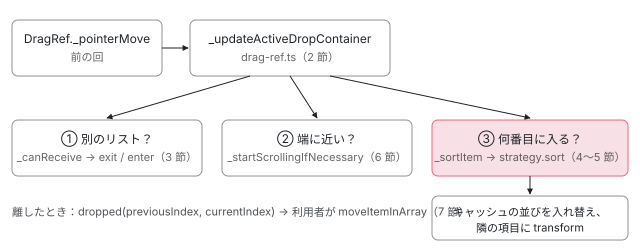

[目次](../README.md) › [CDK の内側](README.md) › 第 19 回 / 全 21 回

# DropListRef：並べ替えの位置と、リストをまたぐ移動

> ドラッグ中の要素がどの位置に入るかを、DropListRef が各項目の ClientRect と比べて決める行。SingleAxisSortStrategy と MixedSortStrategy（折り返すリスト）の違い、cdkDropListConnectedTo で別のリストに入るときの判定、端に近づくと自動でスクロールする行、moveItemInArray と transferArrayItem。

angular/components · 読了 約 14 分 · 発展 · [サイトで読む（デモが動きます）](https://angular-deep-dive-cyan.vercel.app/chapter/cdk-drop-list)

---

`cdkDropList` の中で項目を引っ張ると、隣の項目がよけて「ここに入る」場所が空きます。この章では、ドラッグ中の位置から入る位置を決める `DropListRef` と並べ替え戦略（`SingleAxisSortStrategy` / `MixedSortStrategy`）の行、`cdkDropListConnectedTo` でつないだ別のリストに入るときの判定、端に近づくと自動でスクロールする行、そして離したときに利用者の配列を動かす `moveItemInArray` / `transferArrayItem` を読みます。

読む対象は `src/cdk/drag-drop/` の `drop-list-ref.ts`・`sorting/single-axis-sort-strategy.ts`・`sorting/mixed-sort-strategy.ts`・`drag-utils.ts`・`directives/drop-list.ts`、それと `drag-ref.ts` のうちリストとやり取りする数か所です。ポインターの受け取りと `transform` は[前の回](18-drag-drop.md)で読みました。

1. [1. 概観](01-cdk-overview.md)
2. [2. Platform と向き](02-cdk-platform-bidi.md)
3. [3. Observer と画面幅](03-cdk-observers-layout.md)
4. [4. Portal](04-cdk-portal.md)
5. [5. Overlay](05-cdk.md)
6. [6. 位置の計算](06-cdk-overlay-position.md)
7. [7. スクロールと Esc](07-cdk-overlay-scroll-dispatch.md)
8. [8. FocusTrap](08-cdk-focus-trap.md)
9. [9. FocusMonitor](09-cdk-focus-monitor.md)
10. [10. ListKeyManager](10-cdk-key-manager.md)
11. [11. LiveAnnouncer](11-cdk-live-announcer.md)
12. [12. Dialog](12-cdk-dialog.md)
13. [13. Menu](13-cdk-menu.md)
14. [14. DataSource と選択](14-cdk-collections.md)
15. [15. 仮想スクロール](15-virtual-scroll.md)
16. [16. table](16-table.md)
17. [17. tree](17-cdk-tree.md)
18. [18. DragRef](18-drag-drop.md)
19. **19. DropListRef**（この章）
20. [20. ハーネス](20-harness.md)
21. [21. Material のテーマ](21-theming.md)

> [!NOTE]
> **ポイント**
>
> 先に結論です。**ドラッグ中、CDK はあなたの配列を 1 回も触りません。** 動くのは CDK の中のキャッシュ（各項目の `ClientRect` の配列）と、項目に書く `transform` だけです。離したときに `cdkDropListDropped` で「何番目から何番目へ」を受け取り、配列を動かすのは利用者のコードです。

## 0. 全体の流れ



*pointermove のたびに DragRef が 3 つを順に頼む：別のリストに入ったか → 端なら自動スクロール → 並べ替え。並べ替えはキャッシュした矩形と transform だけで行い、DOM と配列は離すまで変えない。*

## 1. ドラッグが始まると：つながりを解決し、項目の矩形を測る

📄 `components/src/cdk/drag-drop/directives/drop-list.ts` L302–336 （▶ の行: 302–305, 307–308, 317–323, 327–331）

```ts
302 ▶     ref.beforeStarted.subscribe(() => {
303 ▶       const siblings = coerceArray(this.connectedTo).map(drop => {
304 ▶         if (typeof drop === 'string') {
305 ▶           const correspondingDropList = CdkDropList._dropLists.find(list => list.id === drop);
306 │ 
307 ▶           if (!correspondingDropList && (typeof ngDevMode === 'undefined' || ngDevMode)) {
308 ▶             console.warn(`CdkDropList could not find connected drop list with id "${drop}"`);
309 │           }
310 │ 
311 │           return correspondingDropList!;
312 │         }
313 │ 
314 │         return drop;
315 │       });
316 │ 
317 ▶       if (this._group) {
318 ▶         this._group._items.forEach(drop => {
319 ▶           if (siblings.indexOf(drop) === -1) {
320 ▶             siblings.push(drop);
321 ▶           }
322 ▶         });
323 ▶       }
324 │ 
325 │       // Note that we resolve the scrollable parents here so that we delay the resolution
326 │       // as long as possible, ensuring that the element is in its final place in the DOM.
327 ▶       if (!this._scrollableParentsResolved) {
328 ▶         const scrollableParents = this._scrollDispatcher
329 ▶           .getAncestorScrollContainers(this.element)
330 ▶           .map(scrollable => scrollable.getElementRef().nativeElement);
331 ▶         this._dropListRef.withScrollableParents(scrollableParents);
332 │ 
333 │         // Only do this once since it involves traversing the DOM and the parents
334 │         // shouldn't be able to change without the drop list being destroyed.
335 │         this._scrollableParentsResolved = true;
336 │       }
```

📄 `components/src/cdk/drag-drop/directives/drop-list.ts` L350–359 （▶ の行: 352, 354, 357–358）

```ts
350 │       ref.disabled = this.disabled;
351 │       ref.lockAxis = this.lockAxis;
352 ▶       ref.sortingDisabled = this.sortingDisabled;
353 │       ref.autoScrollDisabled = this.autoScrollDisabled;
354 ▶       ref.autoScrollStep = coerceNumberProperty(this.autoScrollStep, 2);
355 │       ref.hasAnchor = this.hasAnchor;
356 │       ref
357 ▶         .connectedTo(siblings.filter(drop => drop && drop !== this).map(list => list._dropListRef))
358 ▶         .withOrientation(this.orientation);
359 │     });
```

`CdkDropList` ディレクティブも `CdkDrag` と同じく、ドラッグが始まる直前（302 行目の `beforeStarted`）に input を `DropListRef` へ写します。303〜305 行目、`cdkDropListConnectedTo` に文字列を渡したときは、その時点で存在する `CdkDropList` から `id` が同じものを探します。見つからなければ 307〜308 行目で警告だけ出して無視します。357 行目で自分を除いた相手の `DropListRef` を `connectedTo` に、358 行目で `cdkDropListOrientation` を `withOrientation` に渡します。327〜331 行目は、リストを含むスクロールできる祖先（`cdkScrollable` を付けた要素など）を 1 回だけ集める行で、6 節の自動スクロールに使います。

📄 `components/src/cdk/drag-drop/drop-list-ref.ts` L376–388 （▶ の行: 377–378, 380, 382–383）

```ts
376 │   withOrientation(orientation: DropListOrientation): this {
377 ▶     if (orientation === 'mixed') {
378 ▶       this._sortStrategy = new MixedSortStrategy(this._document, this._dragDropRegistry);
379 │     } else {
380 ▶       const strategy = new SingleAxisSortStrategy(this._dragDropRegistry);
381 │       strategy.direction = this._direction;
382 ▶       strategy.orientation = orientation;
383 ▶       this._sortStrategy = strategy;
384 │     }
385 │     this._sortStrategy.withElementContainer(this._container);
386 │     this._sortStrategy.withSortPredicate((index, item) => this.sortPredicate(index, item, this));
387 │     return this;
388 │   }
```

向きで並べ替え戦略が決まります。`'mixed'` なら 378 行目で `MixedSortStrategy`、`'vertical'` / `'horizontal'` なら 380〜383 行目で `SingleAxisSortStrategy` に向きを渡します。違いは 5 節で見ます。

📄 `components/src/cdk/drag-drop/drop-list-ref.ts` L594–632 （▶ の行: 596–597, 614, 617–620, 627, 631）

```ts
594 │   private _draggingStarted() {
595 │     const styles = this._container.style as DragCSSStyleDeclaration;
596 ▶     this.beforeStarted.next();
597 ▶     this._isDragging = true;
598 │ 
599 │     if (
600 │       (typeof ngDevMode === 'undefined' || ngDevMode) &&
601 │       // Prevent the check from running on apps not using an alternate container. Ideally we
602 │       // would always run it, but introducing it at this stage would be a breaking change.
603 │       this._container !== coerceElement(this.element)
604 │     ) {
605 │       for (const drag of this._draggables) {
606 │         if (!drag.isDragging() && drag.getVisibleElement().parentNode !== this._container) {
607 │           throw new Error(
608 │             'Invalid DOM structure for drop list. All items must be placed directly inside of the element container.',
609 │           );
610 │         }
611 │       }
612 │     }
613 │ 
614 ▶     // We need to disable scroll snapping while the user is dragging, because it breaks automatic
615 │     // scrolling. The browser seems to round the value based on the snapping points which means
616 │     // that we can't increment/decrement the scroll position.
617 ▶     this._initialScrollSnap = styles.msScrollSnapType || styles.scrollSnapType || '';
618 ▶     styles.scrollSnapType = styles.msScrollSnapType = 'none';
619 ▶     this._sortStrategy.start(this._draggables);
620 ▶     this._cacheParentPositions();
621 │     this._viewportScrollSubscription.unsubscribe();
622 │     this._listenToScrollEvents();
623 │   }
624 │ 
625 │   /** Caches the positions of the configured scrollable parents. */
626 │   private _cacheParentPositions() {
627 ▶     this._parentPositions.cache(this._scrollableElements);
628 │ 
629 │     // The list element is always in the `scrollableElements`
630 │     // so we can take advantage of the cached `DOMRect`.
631 ▶     this._domRect = this._parentPositions.positions.get(this._container)!.clientRect!;
632 │   }
```

📄 `components/src/cdk/drag-drop/drop-list-ref.ts` L394–401 （▶ の行: 399–400）

```ts
394 │   withScrollableParents(elements: HTMLElement[]): this {
395 │     const element = this._container;
396 │ 
397 │     // We always allow the current element to be scrollable
398 │     // so we need to ensure that it's in the array.
399 ▶     this._scrollableElements =
400 ▶       elements.indexOf(element) === -1 ? [element, ...elements] : elements.slice();
401 │     return this;
```

📄 `components/src/cdk/drag-drop/sorting/single-axis-sort-strategy.ts` L302–320 （▶ の行: 305, 307, 311–312, 315–318）

```ts
302 │   private _cacheItemPositions() {
303 │     const isHorizontal = this.orientation === 'horizontal';
304 │ 
305 ▶     this._itemPositions = this._activeDraggables
306 │       .map(drag => {
307 ▶         const elementToMeasure = drag.getVisibleElement();
308 │         return {
309 │           drag,
310 │           offset: 0,
311 ▶           initialTransform: elementToMeasure.style.transform || '',
312 ▶           clientRect: getMutableClientRect(elementToMeasure),
313 │         };
314 │       })
315 ▶       .sort((a, b) => {
316 ▶         return isHorizontal
317 ▶           ? a.clientRect.left - b.clientRect.left
318 ▶           : a.clientRect.top - b.clientRect.top;
319 │       });
320 │   }
```

1. **596〜597 行目**

   `beforeStarted` を流し（上の 302 行目が動く）、ドラッグ中の印を立てる。
2. **617〜618 行目**

   リストの `scroll-snap-type` を一時的に `none` に。スナップが効いていると自動スクロールで 1px ずつ動かせないため（614〜616 行目のコメント）。
3. **619 行目 → single-axis 305〜319 行目**

   並べ替え戦略の `start`。項目ごとに 312 行目で `getBoundingClientRect()` を**この 1 回だけ**測り、311 行目で元の `transform` も覚え、315〜318 行目で上（横なら左）から順に並べてキャッシュ `_itemPositions` にする。
4. **620 行目 → 627〜631 行目**

   スクロールできる要素の位置も覚え、リスト自身の矩形を `_domRect` に。399〜400 行目のとおり、リスト自身は必ずスクロールできる要素に入っている。

ここで測った矩形を、ドラッグの間ずっと使います。`pointermove` のたびに `getBoundingClientRect()` を呼ぶと、ブラウザにレイアウトの計算をさせることになるからです。途中で項目が動いたら、測り直さずにキャッシュの数字を足し引きして合わせます（5 節の 150 行目）。

## 2. pointermove のたびに DragRef が頼むこと

[前の回](18-drag-drop.md)の 7 節で、リストの中の項目は `_updateActiveDropContainer` に進みました。その中身です。

📄 `components/src/cdk/drag-drop/drag-ref.ts` L1107–1121 （▶ の行: 1109, 1115–1118, 1120）

```ts
1107 │   private _updateActiveDropContainer({x, y}: Point, {x: rawX, y: rawY}: Point) {
1108 │     // Drop container that draggable has been moved into.
1109 ▶     let newContainer = this._initialContainer._getSiblingContainerFromPosition(this, x, y);
1110 │ 
1111 │     // If we couldn't find a new container to move the item into, and the item has left its
1112 │     // initial container, check whether the it's over the initial container. This handles the
1113 │     // case where two containers are connected one way and the user tries to undo dragging an
1114 │     // item into a new container.
1115 ▶     if (
1116 ▶       !newContainer &&
1117 ▶       this._dropContainer !== this._initialContainer &&
1118 ▶       this._initialContainer._isOverContainer(x, y)
1119 │     ) {
1120 ▶       newContainer = this._initialContainer;
1121 │     }
```

📄 `components/src/cdk/drag-drop/drag-ref.ts` L1123–1151 （▶ の行: 1123, 1125, 1130–1131, 1134–1135, 1145）

```ts
1123 ▶     if (newContainer && newContainer !== this._dropContainer) {
1124 │       this._ngZone.run(() => {
1125 ▶         const exitIndex = this._dropContainer!.getItemIndex(this);
1126 │         const nextItemElement =
1127 │           this._dropContainer!.getItemAtIndex(exitIndex + 1)?.getVisibleElement() || null;
1128 │ 
1129 │         // Notify the old container that the item has left.
1130 ▶         this.exited.next({item: this, container: this._dropContainer!});
1131 ▶         this._dropContainer!.exit(this);
1132 │         this._conditionallyInsertAnchor(newContainer, this._dropContainer!, nextItemElement);
1133 │         // Notify the new container that the item has entered.
1134 ▶         this._dropContainer = newContainer!;
1135 ▶         this._dropContainer.enter(
1136 │           this,
1137 │           x,
1138 │           y,
1139 │           // If we're re-entering the initial container and sorting is disabled,
1140 │           // put item the into its starting index to begin with.
1141 │           newContainer === this._initialContainer && newContainer.sortingDisabled
1142 │             ? this._initialIndex
1143 │             : undefined,
1144 │         );
1145 ▶         this.entered.next({
1146 │           item: this,
1147 │           container: newContainer!,
1148 │           currentIndex: newContainer!.getItemIndex(this),
1149 │         });
1150 │       });
1151 │     }
```

📄 `components/src/cdk/drag-drop/drag-ref.ts` L1153–1167 （▶ の行: 1155–1156, 1161–1163）

```ts
1153 │     // Dragging may have been interrupted as a result of the events above.
1154 │     if (this.isDragging()) {
1155 ▶       this._dropContainer!._startScrollingIfNecessary(rawX, rawY);
1156 ▶       this._dropContainer!._sortItem(this, x, y, this._pointerDirectionDelta);
1157 │ 
1158 │       if (this.constrainPosition) {
1159 │         this._applyPreviewTransform(x, y);
1160 │       } else {
1161 ▶         this._applyPreviewTransform(
1162 ▶           x - this._pickupPositionInElement.x,
1163 ▶           y - this._pickupPositionInElement.y,
1164 │         );
1165 │       }
1166 │     }
1167 │   }
```

1. **1109 行目：つながった先に入ったか**

   **最初にいたリスト**の兄弟（`connectedTo`）から、今のポインターを受け入れるものを探す（3 節）。
2. **1115〜1120 行目：元のリストに戻ったか**

   どこにも入れず、今は別のリストにいて、ポインターが元のリストの上なら、元のリストを入り先にする。一方向にしかつないでいないときでも元に戻せるように。
3. **1123〜1145 行目：入れ替わり**

   今のリストに `exit`（1131 行目）を、新しいリストに `enter`（1135 行目）を伝え、`exited` / `entered` を流す。
4. **1155 行目：自動スクロール**

   今いるリストに、ポインターの位置で端に近いかを判定させる（6 節）。
5. **1156 行目：並べ替え**

   今いるリストに、何番目に入るかを判定させる（4 節）。
6. **1161〜1164 行目：プレビューを動かす**

   指に付いて動くプレビューの `transform` を書く。元の要素は前の回の 6 節で隠してある。

## 3. 別のリストに入る判定：\_canReceive

📄 `components/src/cdk/drag-drop/drop-list-ref.ts` L676–689 （▶ の行: 677, 688）

```ts
676 │   _isOverContainer(x: number, y: number): boolean {
677 ▶     return this._domRect != null && isInsideClientRect(this._domRect, x, y);
678 │   }
679 │ 
680 │   /**
681 │    * Figures out whether an item should be moved into a sibling
682 │    * drop container, based on its current position.
683 │    * @param item Drag item that is being moved.
684 │    * @param x Position of the item along the X axis.
685 │    * @param y Position of the item along the Y axis.
686 │    */
687 │   _getSiblingContainerFromPosition(item: DragRef, x: number, y: number): DropListRef | undefined {
688 ▶     return this._siblings.find(sibling => sibling._canReceive(item, x, y));
689 │   }
```

📄 `components/src/cdk/drag-drop/drop-list-ref.ts` L697–721 （▶ の行: 699–701, 706, 714, 720）

```ts
697 │   _canReceive(item: DragRef, x: number, y: number): boolean {
698 │     if (
699 ▶       !this._domRect ||
700 ▶       !isInsideClientRect(this._domRect, x, y) ||
701 ▶       !this.enterPredicate(item, this)
702 │     ) {
703 │       return false;
704 │     }
705 │ 
706 ▶     const elementFromPoint = this._getShadowRoot().elementFromPoint(x, y) as HTMLElement | null;
707 │ 
708 │     // If there's no element at the pointer position, then
709 │     // the client rect is probably scrolled out of the view.
710 │     if (!elementFromPoint) {
711 │       return false;
712 │     }
713 │ 
714 ▶     // The `DOMRect`, that we're using to find the container over which the user is
715 │     // hovering, doesn't give us any information on whether the element has been scrolled
716 │     // out of the view or whether it's overlapping with other containers. This means that
717 │     // we could end up transferring the item into a container that's invisible or is positioned
718 │     // below another one. We use the result from `elementFromPoint` to get the top-most element
719 │     // at the pointer position and to find whether it's one of the intersecting drop containers.
720 ▶     return elementFromPoint === this._container || this._container.contains(elementFromPoint);
721 │   }
```

688 行目で兄弟を順に見て、最初に受け入れたリストを返します。受け入れる条件は 3 つです。699〜700 行目、1 節で測ったそのリストの矩形の中にポインターがある。701 行目、`cdkDropListEnterPredicate` が `true` を返す。そして 706 行目、`elementFromPoint` でポインターの真下にある一番手前の要素を取り、720 行目でそれがリスト自身かその中身である。714〜719 行目のコメントのとおり、矩形だけでは「スクロールで見えなくなっている」「別の要素の下に隠れている」を区別できないので、ブラウザに実際に一番上にある要素を聞きます。前の回で見たプレビューの `pointer-events: none` は、ここでプレビュー自身が返ってこないようにするためです。

📄 `components/src/cdk/drag-drop/drop-list-ref.ts` L265–283 （▶ の行: 266, 270–271, 274, 278, 282）

```ts
265 │   enter(item: DragRef, pointerX: number, pointerY: number, index?: number): void {
266 ▶     this._draggingStarted();
267 │ 
268 │     // If sorting is disabled, we want the item to return to its starting
269 │     // position if the user is returning it to its initial container.
270 ▶     if (index == null && this.sortingDisabled) {
271 ▶       index = this._draggables.indexOf(item);
272 │     }
273 │ 
274 ▶     this._sortStrategy.enter(item, pointerX, pointerY, index);
275 │ 
276 │     // Note that this usually happens inside `_draggingStarted` as well, but the dimensions
277 │     // can change when the sort strategy moves the item around inside `enter`.
278 ▶     this._cacheParentPositions();
279 │ 
280 │     // Notify siblings at the end so that the item has been inserted into the `activeDraggables`.
281 │     this._notifyReceivingSiblings();
282 ▶     this.entered.next({item, container: this, currentIndex: this.getItemIndex(item)});
283 │   }
```

📄 `components/src/cdk/drag-drop/sorting/single-axis-sort-strategy.ts` L182–225 （▶ の行: 182–183, 186, 189, 210–213, 215–216, 220, 225）

```ts
182 ▶     const newIndex =
183 ▶       index == null || index < 0
184 │         ? // We use the coordinates of where the item entered the drop
185 │           // zone to figure out at which index it should be inserted.
186 ▶           this._getItemIndexFromPointerPosition(item, pointerX, pointerY)
187 │         : index;
188 │ 
189 ▶     let newPositionReference: DragRef | undefined = activeDraggables[newIndex];
190 │ 
191 │     // If the item at the new position is the same as the item that is being dragged,
192 │     // it means that we're trying to restore the item to its initial position. In this
193 │     // case we should use the next item from the list as the reference.
194 │     if (newPositionReference === item) {
195 │       newPositionReference = activeDraggables[newIndex + 1];
196 │     }
197 │ 
198 │     // If we didn't find a new position reference, it means that either the item didn't start off
199 │     // in this container, or that the item requested to be inserted at the end of the list.
200 │     if (
201 │       !newPositionReference &&
202 │       (newIndex == null || newIndex === -1 || newIndex < activeDraggables.length - 1) &&
203 │       this._shouldEnterAsFirstChild(pointerX, pointerY)
204 │     ) {
205 │       newPositionReference = activeDraggables[0];
206 │     }
207 │ 
208 │     // Don't use items that are being dragged as a reference, because
209 │     // their element has been moved down to the bottom of the body.
210 ▶     if (newPositionReference && !this._dragDropRegistry.isDragging(newPositionReference)) {
211 ▶       const element = newPositionReference.getRootElement();
212 ▶       element.parentElement!.insertBefore(placeholder, element);
213 ▶       activeDraggables.splice(newIndex, 0, item);
214 │     } else {
215 ▶       this._element.appendChild(placeholder);
216 ▶       activeDraggables.push(item);
217 │     }
218 │ 
219 │     // The transform needs to be cleared so it doesn't throw off the measurements.
220 ▶     placeholder.style.transform = '';
221 │ 
222 │     // Note that usually `start` is called together with `enter` when an item goes into a new
223 │     // container. This will cache item positions, but we need to refresh them since the amount
224 │     // of items has changed.
225 ▶     this._cacheItemPositions();
```

入ったリストは 266 行目で自分もドラッグ中の準備（1 節）をし、274 行目で戦略の `enter` を呼びます。戦略は 186 行目、入った位置から何番目に入るかを 4 節と同じ関数で求め、210〜213 行目で**その項目の前に placeholder を DOM ごと差し込みます**。リストをまたぐときだけは、placeholder を本当に別の親へ動かします（並べ替えのように `transform` だけでは、別のリストの中に場所を空けられないため）。220 行目で placeholder の `transform` を消し、225 行目で項目の数が変わったので矩形を測り直します。

## 4. 何番目に入るか：\_sortItem と \_getItemIndexFromPointerPosition

📄 `components/src/cdk/drag-drop/drop-list-ref.ts` L489–514 （▶ の行: 497–499, 504, 506–507）

```ts
489 │   _sortItem(
490 │     item: DragRef,
491 │     pointerX: number,
492 │     pointerY: number,
493 │     pointerDelta: {x: number; y: number},
494 │   ): void {
495 │     // Don't sort the item if sorting is disabled or it's out of range.
496 │     if (
497 ▶       this.sortingDisabled ||
498 ▶       !this._domRect ||
499 ▶       !isPointerNearDomRect(this._domRect, DROP_PROXIMITY_THRESHOLD, pointerX, pointerY)
500 │     ) {
501 │       return;
502 │     }
503 │ 
504 ▶     const result = this._sortStrategy.sort(item, pointerX, pointerY, pointerDelta);
505 │ 
506 ▶     if (result) {
507 ▶       this.sorted.next({
508 │         previousIndex: result.previousIndex,
509 │         currentIndex: result.currentIndex,
510 │         container: this,
511 │         item,
512 │       });
513 │     }
514 │   }
```

📄 `components/src/cdk/drag-drop/dom/dom-rect.ts` L89–105 （▶ の行: 96–97, 100–103）

```ts
 89 │ export function isPointerNearDomRect(
 90 │   rect: DOMRect,
 91 │   threshold: number,
 92 │   pointerX: number,
 93 │   pointerY: number,
 94 │ ): boolean {
 95 │   const {top, right, bottom, left, width, height} = rect;
 96 ▶   const xThreshold = width * threshold;
 97 ▶   const yThreshold = height * threshold;
 98 │ 
 99 │   return (
100 ▶     pointerY > top - yThreshold &&
101 ▶     pointerY < bottom + yThreshold &&
102 ▶     pointerX > left - xThreshold &&
103 ▶     pointerX < right + xThreshold
104 │   );
105 │ }
```

497〜499 行目、`cdkDropListSortingDisabled` なら並べ替えません。またポインターがリストの矩形の近くになければ並べ替えません。「近く」は dom-rect.ts 96〜97 行目、リストの幅・高さの 5%（`DROP_PROXIMITY_THRESHOLD = 0.05`）だけ外側まで広げた範囲です。504 行目で戦略に任せ、入れ替わりがあれば 507 行目で `sorted`（`cdkDropListSorted`）を流します。

📄 `components/src/cdk/drag-drop/sorting/single-axis-sort-strategy.ts` L419–455 （▶ の行: 426, 428, 438–441, 443, 447, 450–451, 454）

```ts
419 │   private _getItemIndexFromPointerPosition(
420 │     item: DragRef,
421 │     pointerX: number,
422 │     pointerY: number,
423 │     delta?: {x: number; y: number},
424 │   ): number {
425 │     const isHorizontal = this.orientation === 'horizontal';
426 ▶     const index = this._itemPositions.findIndex(({drag, clientRect}) => {
427 │       // Skip the item itself.
428 ▶       if (drag === item) {
429 │         return false;
430 │       }
431 │ 
432 │       if (delta) {
433 │         const direction = isHorizontal ? delta.x : delta.y;
434 │ 
435 │         // If the user is still hovering over the same item as last time, their cursor hasn't left
436 │         // the item after we made the swap, and they didn't change the direction in which they're
437 │         // dragging, we don't consider it a direction swap.
438 ▶         if (
439 ▶           drag === this._previousSwap.drag &&
440 ▶           this._previousSwap.overlaps &&
441 ▶           direction === this._previousSwap.delta
442 │         ) {
443 ▶           return false;
444 │         }
445 │       }
446 │ 
447 ▶       return isHorizontal
448 │         ? // Round these down since most browsers report client rects with
449 │           // sub-pixel precision, whereas the pointer coordinates are rounded to pixels.
450 ▶           pointerX >= Math.floor(clientRect.left) && pointerX < Math.floor(clientRect.right)
451 ▶         : pointerY >= Math.floor(clientRect.top) && pointerY < Math.floor(clientRect.bottom);
452 │     });
453 │ 
454 ▶     return index === -1 || !this._sortPredicate(index, item) ? -1 : index;
455 │   }
```

1. **426 行目：キャッシュを上から順に見る**

   1 節で測った `_itemPositions` を使う。DOM は測らない。
2. **428 行目：自分は飛ばす**

   動かしている項目そのもの（placeholder の位置）とは比べない。
3. **447〜451 行目：ポインターがどの項目の矩形に入っているか**

   縦のリストなら y だけ、横なら x だけを見る。矩形の端は `Math.floor` で切り下げる（ポインターの座標は整数なので）。
4. **438〜444 行目：同じ項目と入れ替え続けない**

   直前に入れ替えた項目の上にまだポインターがあり、動かす向きも同じなら、その項目は対象にしない。入れ替えた直後は隣の項目がポインターの下に来るので、これが無いと 1px ごとに行ったり来たりする。
5. **454 行目：sortPredicate**

   `cdkDropListSortPredicate` がその位置を拒めば -1（入れ替えない）。

## 5. 並べ替え方：SingleAxisSortStrategy と MixedSortStrategy

### SingleAxisSortStrategy：transform で「よける」

📄 `components/src/cdk/drag-drop/sorting/single-axis-sort-strategy.ts` L88–114 （▶ の行: 90, 92, 97, 101, 104, 107, 111, 114）

```ts
 88 │   sort(item: DragRef, pointerX: number, pointerY: number, pointerDelta: {x: number; y: number}) {
 89 │     const siblings = this._itemPositions;
 90 ▶     const newIndex = this._getItemIndexFromPointerPosition(item, pointerX, pointerY, pointerDelta);
 91 │ 
 92 ▶     if (newIndex === -1 && siblings.length > 0) {
 93 │       return null;
 94 │     }
 95 │ 
 96 │     const isHorizontal = this.orientation === 'horizontal';
 97 ▶     const currentIndex = siblings.findIndex(currentItem => currentItem.drag === item);
 98 │     const siblingAtNewPosition = siblings[newIndex];
 99 │     const currentPosition = siblings[currentIndex].clientRect;
100 │     const newPosition = siblingAtNewPosition.clientRect;
101 ▶     const delta = currentIndex > newIndex ? 1 : -1;
102 │ 
103 │     // How many pixels the item's placeholder should be offset.
104 ▶     const itemOffset = this._getItemOffsetPx(currentPosition, newPosition, delta);
105 │ 
106 │     // How many pixels all the other items should be offset.
107 ▶     const siblingOffset = this._getSiblingOffsetPx(currentIndex, siblings, delta);
108 │ 
109 │     // Save the previous order of the items before moving the item to its new index.
110 │     // We use this to check whether an item has been moved as a result of the sorting.
111 ▶     const oldOrder = siblings.slice();
112 │ 
113 │     // Shuffle the array in place.
114 ▶     moveItemInArray(siblings, currentIndex, newIndex);
```

📄 `components/src/cdk/drag-drop/sorting/single-axis-sort-strategy.ts` L116–159 （▶ の行: 118, 122, 124–126, 129, 131, 133, 146–148, 150, 155–157, 159）

```ts
116 │     siblings.forEach((sibling, index) => {
117 │       // Don't do anything if the position hasn't changed.
118 ▶       if (oldOrder[index] === sibling) {
119 │         return;
120 │       }
121 │ 
122 ▶       const isDraggedItem = sibling.drag === item;
123 │       const offset = isDraggedItem ? itemOffset : siblingOffset;
124 ▶       const elementToOffset = isDraggedItem
125 ▶         ? item.getPlaceholderElement()
126 ▶         : sibling.drag.getRootElement();
127 │ 
128 │       // Update the offset to reflect the new position.
129 ▶       sibling.offset += offset;
130 │ 
131 ▶       const transformAmount = Math.round(sibling.offset * (1 / sibling.drag.scale));
132 │ 
133 ▶       // Since we're moving the items with a `transform`, we need to adjust their cached
134 │       // client rects to reflect their new position, as well as swap their positions in the cache.
135 │       // Note that we shouldn't use `getBoundingClientRect` here to update the cache, because the
136 │       // elements may be mid-animation which will give us a wrong result.
137 │       if (isHorizontal) {
138 │         // Round the transforms since some browsers will
139 │         // blur the elements, for sub-pixel transforms.
140 │         elementToOffset.style.transform = combineTransforms(
141 │           `translate3d(${transformAmount}px, 0, 0)`,
142 │           sibling.initialTransform,
143 │         );
144 │         adjustDomRect(sibling.clientRect, 0, offset);
145 │       } else {
146 ▶         elementToOffset.style.transform = combineTransforms(
147 ▶           `translate3d(0, ${transformAmount}px, 0)`,
148 ▶           sibling.initialTransform,
149 │         );
150 ▶         adjustDomRect(sibling.clientRect, offset, 0);
151 │       }
152 │     });
153 │ 
154 │     // Note that it's important that we do this after the client rects have been adjusted.
155 ▶     this._previousSwap.overlaps = isInsideClientRect(newPosition, pointerX, pointerY);
156 ▶     this._previousSwap.drag = siblingAtNewPosition.drag;
157 ▶     this._previousSwap.delta = isHorizontal ? pointerDelta.x : pointerDelta.y;
158 │ 
159 ▶     return {previousIndex: currentIndex, currentIndex: newIndex};
```

1. **90 行目：入る位置**

   4 節の関数。-1 なら何もしない（92 行目）。
2. **101〜107 行目：ずらす量を計算**

   動かす項目（placeholder）は入り先までの距離（104 行目）、間にある項目は placeholder の高さ（横なら幅）ぶん反対へ（107 行目）。高さの違いや margin の差も、この 2 つの関数（`_getItemOffsetPx` / `_getSiblingOffsetPx`）の中で足す。
3. **114 行目：キャッシュの並びを入れ替える**

   `moveItemInArray` を呼ぶが、相手は CDK の `_itemPositions`。利用者の配列ではない。
4. **118 行目：位置が変わらない項目は飛ばす**

   111 行目で取っておいた前の並びと比べ、同じ場所の項目には触らない。
5. **122〜126 行目：動かす要素を選ぶ**

   ドラッグ中の項目なら placeholder、ほかの項目ならその要素自身。
6. **129〜150 行目：transform を書き、キャッシュを足し引き**

   累計のずれ（129 行目）を `translate3d(0, ずれpx, 0)` にして書き、150 行目の `adjustDomRect` でキャッシュの矩形も同じだけずらす。133〜136 行目のコメントのとおり、アニメーション中の要素を測ると途中の位置が返るので測り直さない。
7. **155〜157 行目：直前の入れ替えを覚える**

   4 節の 438〜444 行目で使う。

DOM の順番は 1 つも変わらず、隣の項目が `transform` でよけて見えるだけです。だから利用者が `.cdk-drop-list-dragging .item { transition: transform 250ms }` を書けば、よける動きも滑らかになります。ただし「位置は上から順に並ぶ」という前提で、y だけ（横なら x だけ）で判定しているので、折り返す（2 行以上になる）リストでは使えません。

### MixedSortStrategy：DOM を本当に入れ替える

📄 `components/src/cdk/drag-drop/sorting/mixed-sort-strategy.ts` L258–274 （▶ の行: 263–265, 268–270）

```ts
258 │   private _getItemIndexFromPointerPosition(
259 │     item: DragRef,
260 │     pointerX: number,
261 │     pointerY: number,
262 │   ): number {
263 ▶     const elementAtPoint = this._getRootNode().elementFromPoint(
264 ▶       Math.floor(pointerX),
265 ▶       Math.floor(pointerY),
266 │     );
267 │     const index = elementAtPoint
268 ▶       ? this._activeItems.findIndex(item => {
269 ▶           const root = item.getRootElement();
270 ▶           return elementAtPoint === root || root.contains(elementAtPoint);
271 │         })
272 │       : -1;
273 │     return index === -1 || !this._sortPredicate(index, item) ? -1 : index;
274 │   }
```

📄 `components/src/cdk/drag-drop/sorting/mixed-sort-strategy.ts` L89–118 （▶ の行: 89, 92, 99–103, 112–113, 115, 118）

```ts
 89 ▶     const newIndex = this._getItemIndexFromPointerPosition(item, pointerX, pointerY);
 90 │     const previousSwap = this._previousSwap;
 91 │ 
 92 ▶     if (newIndex === -1 || this._activeItems[newIndex] === item) {
 93 │       return null;
 94 │     }
 95 │ 
 96 │     const toSwapWith = this._activeItems[newIndex];
 97 │ 
 98 │     // Prevent too many swaps over the same item.
 99 ▶     if (
100 ▶       previousSwap.drag === toSwapWith &&
101 ▶       previousSwap.overlaps &&
102 ▶       previousSwap.deltaX === pointerDelta.x &&
103 ▶       previousSwap.deltaY === pointerDelta.y
104 │     ) {
105 │       return null;
106 │     }
107 │ 
108 │     const previousIndex = this.getItemIndex(item);
109 │     const current = item.getPlaceholderElement();
110 │     const overlapElement = toSwapWith.getRootElement();
111 │ 
112 ▶     if (newIndex > previousIndex) {
113 ▶       overlapElement.after(current);
114 │     } else {
115 ▶       overlapElement.before(current);
116 │     }
117 │ 
118 ▶     moveItemInArray(this._activeItems, previousIndex, newIndex);
```

`cdkDropListOrientation="mixed"` では、入る位置を矩形のキャッシュで計算せず、263 行目の `elementFromPoint` で「ポインターの真下の項目」を直接聞きます。折り返すリストでは、隣の項目をよけさせると行の終わりから次の行の頭へ移る動きになり、`transform` の足し引きでは表せないからです。そこで 112〜116 行目、placeholder を相手の要素の後ろ（`after`）か前（`before`）に**DOM ごと移します**。ブラウザが折り返しを計算し直すので、位置は正しくなります（代わりに、よける動きにアニメーションは付きません）。99〜106 行目は 4 節と同じ「同じ項目と入れ替え続けない」判定です。

📄 `components/src/cdk/drag-drop/sorting/mixed-sort-strategy.ts` L186–206 （▶ の行: 190–191, 197–199, 201, 203）

```ts
186 │   reset(): void {
187 │     const root = this._element;
188 │     const previousSwap = this._previousSwap;
189 │ 
190 ▶     // Moving elements around in the DOM can break things like the `@for` loop, because it
191 ▶     // uses comment nodes to know where to insert elements. To avoid such issues, we restore
192 │     // the DOM nodes in the list to their original order when the list is reset.
193 │     // Note that this could be simpler if we just saved all the nodes, cleared the root
194 │     // and then appended them in the original order. We don't do it, because it can break
195 │     // down depending on when the snapshot was taken. E.g. we may end up snapshotting the
196 │     // placeholder element which is removed after dragging.
197 ▶     for (let i = this._relatedNodes.length - 1; i > -1; i--) {
198 ▶       const [node, nextSibling] = this._relatedNodes[i];
199 ▶       if (node.parentNode === root && node.nextSibling !== nextSibling) {
200 │         if (nextSibling === null) {
201 ▶           root.appendChild(node);
202 │         } else if (nextSibling.parentNode === root) {
203 ▶           root.insertBefore(node, nextSibling);
204 │         }
205 │       }
206 │     }
```

DOM を動かしたままにすると、`@for` が自分で置いた要素の位置を見失います（190〜192 行目のコメント）。そこで終わったら 197〜205 行目で、`start` のときに覚えた「各ノードとその次のノード」の組を使って元の順番に戻します。並びを変えるのは、あとで `@for` が配列の変化を見てからです。

> **🧪 DEMO — 本物の cdkDropList を 2 つ**
>
> A と B は `cdkDropListConnectedTo` で互いにつないであります（id の文字列で指定）。並べ替え中に来た `cdkDropListSorted` の回数と、離したときの `cdkDropListDropped` を表示します。B は高さを抑えてあるので、上下の端に近づけると自動でスクロールします（6 節）。
>
> 引っ張っている間 sorted の回数は増えますが、配列 A / B は離すまで同じです（5 節 114 行目が並べ替えるのは CDK のキャッシュ）。リストの外で離すと `isPointerOverContainer=false` の行が赤枠で出ます。その場合でも index は「最後に placeholder があった場所」です（7 節）。mixed にすると折り返したリストで DOM ごと入れ替わり、離すと一度元の DOM 順に戻ってから配列の順で描き直されます。
>
> ▶ [このデモはサイトで動かせます](https://angular-deep-dive-cyan.vercel.app/chapter/cdk-drop-list)

## 6. 端に近づくと自動でスクロールする

📄 `components/src/cdk/drag-drop/drop-list-ref.ts` L522–553 （▶ の行: 523, 532, 535, 539–540, 548–549）

```ts
522 │   _startScrollingIfNecessary(pointerX: number, pointerY: number) {
523 ▶     if (this.autoScrollDisabled) {
524 │       return;
525 │     }
526 │ 
527 │     let scrollNode: HTMLElement | Window | undefined;
528 │     let verticalScrollDirection = AutoScrollVerticalDirection.NONE;
529 │     let horizontalScrollDirection = AutoScrollHorizontalDirection.NONE;
530 │ 
531 │     // Check whether we should start scrolling any of the parent containers.
532 ▶     this._parentPositions.positions.forEach((position, element) => {
533 │       // We have special handling for the `document` below. Also this would be
534 │       // nicer with a  for...of loop, but it requires changing a compiler flag.
535 ▶       if (element === this._document || !position.clientRect || scrollNode) {
536 │         return;
537 │       }
538 │ 
539 ▶       if (isPointerNearDomRect(position.clientRect, DROP_PROXIMITY_THRESHOLD, pointerX, pointerY)) {
540 ▶         [verticalScrollDirection, horizontalScrollDirection] = getElementScrollDirections(
541 │           element as HTMLElement,
542 │           position.clientRect,
543 │           this._direction,
544 │           pointerX,
545 │           pointerY,
546 │         );
547 │ 
548 ▶         if (verticalScrollDirection || horizontalScrollDirection) {
549 ▶           scrollNode = element as HTMLElement;
550 │         }
551 │       }
552 │     });
553 │ 
```

📄 `components/src/cdk/drag-drop/drop-list-ref.ts` L554–586 （▶ の行: 555–556, 565–567, 571–574, 581, 583）

```ts
554 │     // Otherwise check if we can start scrolling the viewport.
555 ▶     if (!verticalScrollDirection && !horizontalScrollDirection) {
556 ▶       const {width, height} = this._viewportRuler.getViewportSize();
557 │       const domRect = {
558 │         width,
559 │         height,
560 │         top: 0,
561 │         right: width,
562 │         bottom: height,
563 │         left: 0,
564 │       } as DOMRect;
565 ▶       verticalScrollDirection = getVerticalScrollDirection(domRect, pointerY);
566 ▶       horizontalScrollDirection = getHorizontalScrollDirection(domRect, pointerX);
567 ▶       scrollNode = window;
568 │     }
569 │ 
570 │     if (
571 ▶       scrollNode &&
572 ▶       (verticalScrollDirection !== this._verticalScrollDirection ||
573 ▶         horizontalScrollDirection !== this._horizontalScrollDirection ||
574 ▶         scrollNode !== this._scrollNode)
575 │     ) {
576 │       this._verticalScrollDirection = verticalScrollDirection;
577 │       this._horizontalScrollDirection = horizontalScrollDirection;
578 │       this._scrollNode = scrollNode;
579 │ 
580 │       if ((verticalScrollDirection || horizontalScrollDirection) && scrollNode) {
581 ▶         this._ngZone.runOutsideAngular(this._startScrollInterval);
582 │       } else {
583 ▶         this._stopScrolling();
584 │       }
585 │     }
586 │   }
```

📄 `components/src/cdk/drag-drop/drop-list-ref.ts` L810–821 （▶ の行: 812, 814–817）

```ts
810 │ function getVerticalScrollDirection(clientRect: DOMRect, pointerY: number) {
811 │   const {top, bottom, height} = clientRect;
812 ▶   const yThreshold = height * SCROLL_PROXIMITY_THRESHOLD;
813 │ 
814 ▶   if (pointerY >= top - yThreshold && pointerY <= top + yThreshold) {
815 ▶     return AutoScrollVerticalDirection.UP;
816 ▶   } else if (pointerY >= bottom - yThreshold && pointerY <= bottom + yThreshold) {
817 ▶     return AutoScrollVerticalDirection.DOWN;
818 │   }
819 │ 
820 │   return AutoScrollVerticalDirection.NONE;
821 │ }
```

1. **532〜552 行目：スクロールできる祖先から先に見る**

   1 節で集めた要素（リスト自身を含む）のうち、ポインターが近くにあるものについて、どちらの端に近いかを調べる。見つかったら最初の 1 つで決まり（548〜549 行目）。
2. **812〜817 行目：端とは高さの 5%**

   上端の上下 5% の帯にいれば上へ、下端の帯なら下へ（`SCROLL_PROXIMITY_THRESHOLD = 0.05`）。
3. **555〜568 行目：どれでもなければ画面**

   ビューポートの大きさで同じ判定をして、`window` を動かす。
4. **570〜585 行目：向きが変わったときだけ切り替え**

   前回と向き・対象が同じなら何もしない。新しく動かすなら 581 行目でタイマーを始め、止まるなら 583 行目で止める。

📄 `components/src/cdk/drag-drop/drop-list-ref.ts` L647–669 （▶ の行: 651–652, 655, 658, 660）

```ts
647 │   /** Starts the interval that'll auto-scroll the element. */
648 │   private _startScrollInterval = () => {
649 │     this._stopScrolling();
650 │ 
651 ▶     interval(0, animationFrameScheduler)
652 ▶       .pipe(takeUntil(this._stopScrollTimers))
653 │       .subscribe(() => {
654 │         const node = this._scrollNode;
655 ▶         const scrollStep = this.autoScrollStep;
656 │ 
657 │         if (this._verticalScrollDirection === AutoScrollVerticalDirection.UP) {
658 ▶           node.scrollBy(0, -scrollStep);
659 │         } else if (this._verticalScrollDirection === AutoScrollVerticalDirection.DOWN) {
660 ▶           node.scrollBy(0, scrollStep);
661 │         }
662 │ 
663 │         if (this._horizontalScrollDirection === AutoScrollHorizontalDirection.LEFT) {
664 │           node.scrollBy(-scrollStep, 0);
665 │         } else if (this._horizontalScrollDirection === AutoScrollHorizontalDirection.RIGHT) {
666 │           node.scrollBy(scrollStep, 0);
667 │         }
668 │       });
669 │   };
```

651 行目、`interval(0, animationFrameScheduler)` で**毎フレーム**`scrollBy` を呼び、`autoScrollStep`（既定 2px、1 節の drop-list.ts 354 行目で入る）ずつ動かします。スクロールすると[前の回](18-drag-drop.md)の 9 節のとおり位置が補正され、ポインターを動かさなくても並べ替えが続きます。リストを離れたり離したりすると `_stopScrolling` で止まります。

## 7. 離したとき：dropped と、配列を動かす関数

📄 `components/src/cdk/drag-drop/drag-ref.ts` L1066–1101 （▶ の行: 1068–1069, 1072–1075, 1078, 1080–1083, 1089, 1099）

```ts
1066 │     // Re-enter the NgZone since we bound `document` events on the outside.
1067 │     this._ngZone.run(() => {
1068 ▶       const container = this._dropContainer!;
1069 ▶       const currentIndex = container.getItemIndex(this);
1070 │       const pointerPosition = this._getPointerPositionOnPage(event);
1071 │       const distance = this._getDragDistance(pointerPosition);
1072 ▶       const isPointerOverContainer = container._isOverContainer(
1073 ▶         pointerPosition.x,
1074 ▶         pointerPosition.y,
1075 ▶       );
1076 │ 
1077 │       this.ended.next({source: this, distance, dropPoint: pointerPosition, event});
1078 ▶       this.dropped.next({
1079 │         item: this,
1080 ▶         currentIndex,
1081 ▶         previousIndex: this._initialIndex,
1082 ▶         container: container,
1083 ▶         previousContainer: this._initialContainer,
1084 │         isPointerOverContainer,
1085 │         distance,
1086 │         dropPoint: pointerPosition,
1087 │         event,
1088 │       });
1089 ▶       container.drop(
1090 │         this,
1091 │         currentIndex,
1092 │         this._initialIndex,
1093 │         this._initialContainer,
1094 │         isPointerOverContainer,
1095 │         distance,
1096 │         pointerPosition,
1097 │         event,
1098 │       );
1099 ▶       this._dropContainer = this._initialContainer;
1100 │     });
1101 │   }
```

これは前の回の 8 節で、戻るアニメーションが終わったあとに呼ばれる片付けの後半です。1068 行目の `container` は「最後に入ったリスト」です。リストの外で離しても、別のリストに入らない限りここは変わりません（2 節 1123 行目の条件）。1069 行目の `currentIndex` はそのリストでの placeholder の位置、1072〜1075 行目の `isPointerOverContainer` は離した点がそのリストの矩形の中か、です。1081 行目の `previousIndex` と 1083 行目の `previousContainer` は、前の回の 6 節 953 行目で覚えた始まりの位置です。

📄 `components/src/cdk/drag-drop/directives/drop-list.ts` L394–410 （▶ の行: 395, 398–401, 409）

```ts
394 │     ref.dropped.subscribe(dropEvent => {
395 ▶       this.dropped.emit({
396 │         previousIndex: dropEvent.previousIndex,
397 │         currentIndex: dropEvent.currentIndex,
398 ▶         previousContainer: dropEvent.previousContainer.data,
399 ▶         container: dropEvent.container.data,
400 ▶         item: dropEvent.item.data,
401 ▶         isPointerOverContainer: dropEvent.isPointerOverContainer,
402 │         distance: dropEvent.distance,
403 │         dropPoint: dropEvent.dropPoint,
404 │         event: dropEvent.event,
405 │       });
406 │ 
407 │       // Mark for check since all of these events run outside of change
408 │       // detection and we're not guaranteed for something else to have triggered it.
409 ▶       this._changeDetectorRef.markForCheck();
410 │     });
```

ディレクティブは 398〜400 行目で `DropListRef` を `CdkDropList` に、`DragRef` を `CdkDrag` に置き換えて `cdkDropListDropped` を出します。`event.container.data` が `[cdkDropListData]` に渡した配列です。409 行目の `markForCheck` は、このイベントが変化検知の外で来ることがあるための行です。

📄 `components/src/cdk/drag-drop/drag-utils.ts` L9–31 （▶ の行: 16–17, 19, 23–24, 26–27, 30）

```ts
 9 │ /**
10 │  * Moves an item one index in an array to another.
11 │  * @param array Array in which to move the item.
12 │  * @param fromIndex Starting index of the item.
13 │  * @param toIndex Index to which the item should be moved.
14 │  */
15 │ export function moveItemInArray<T = any>(array: T[], fromIndex: number, toIndex: number): void {
16 ▶   const from = clamp(fromIndex, array.length - 1);
17 ▶   const to = clamp(toIndex, array.length - 1);
18 │ 
19 ▶   if (from === to) {
20 │     return;
21 │   }
22 │ 
23 ▶   const target = array[from];
24 ▶   const delta = to < from ? -1 : 1;
25 │ 
26 ▶   for (let i = from; i !== to; i += delta) {
27 ▶     array[i] = array[i + delta];
28 │   }
29 │ 
30 ▶   array[to] = target;
31 │ }
```

📄 `components/src/cdk/drag-drop/drag-utils.ts` L33–52 （▶ の行: 46–47, 50）

```ts
33 │ /**
34 │  * Moves an item from one array to another.
35 │  * @param currentArray Array from which to transfer the item.
36 │  * @param targetArray Array into which to put the item.
37 │  * @param currentIndex Index of the item in its current array.
38 │  * @param targetIndex Index at which to insert the item.
39 │  */
40 │ export function transferArrayItem<T = any>(
41 │   currentArray: T[],
42 │   targetArray: T[],
43 │   currentIndex: number,
44 │   targetIndex: number,
45 │ ): void {
46 ▶   const from = clamp(currentIndex, currentArray.length - 1);
47 ▶   const to = clamp(targetIndex, targetArray.length);
48 │ 
49 │   if (currentArray.length) {
50 ▶     targetArray.splice(to, 0, currentArray.splice(from, 1)[0]);
51 │   }
52 │ }
```

`moveItemInArray` は**渡した配列をその場で書き換えます**（新しい配列は返さない）。16〜17 行目で index を範囲に収め、26〜30 行目で間の要素を 1 つずつずらして目的の位置に入れます。`transferArrayItem` は 50 行目、元の配列から `splice` で抜いて先の配列に `splice` で入れます。47 行目、入れ先の index は配列の長さまで許すので末尾に足せます。signal で配列を持っているなら、デモのようにコピーしてから呼び、`set` し直します（同じ配列を書き換えただけでは signal は変化を知らせません）。

## 呼び出しの連なり

- `_startDragSequence → dropContainer.start()` — drag-ref.ts L951 — *前の回 6 節*
  - `_draggingStarted → beforeStarted → connectedTo / withOrientation` — drop-list-ref.ts L596, directives/drop-list.ts L357-358
  - `_sortStrategy.start → _cacheItemPositions` — drop-list-ref.ts L619, single-axis L302 — *矩形を 1 回だけ測る*
- `DragRef._pointerMove → _updateActiveDropContainer` — drag-ref.ts L799, L1107
  - `_getSiblingContainerFromPosition → _canReceive` — drop-list-ref.ts L688, L697 — *入ったら exit / enter*
  - `_startScrollingIfNecessary` — drop-list-ref.ts L522 — *端の 5% なら毎フレーム scrollBy*
  - `_sortItem → strategy.sort` — drop-list-ref.ts L504
    - `_getItemIndexFromPointerPosition → moveItemInArray(_itemPositions) → transform` — single-axis L90, L114, L146 — *mixed なら elementFromPoint と after / before*
- `_endDragSequence → _cleanupDragArtifacts` — drag-ref.ts L862-863
  - `container.drop → dropped → cdkDropListDropped` — drag-ref.ts L1089, directives/drop-list.ts L395
    - 👤 `moveItemInArray(data, previousIndex, currentIndex)` — あなたのハンドラー — *ここで初めて配列が変わる*

## 聞かれそうな質問

**Q. 並べ替えの途中で、配列はいつ変わりますか？**

離すまで変わりません。ドラッグ中に CDK が入れ替えるのは `_itemPositions`（5 節 114 行目）という自分のキャッシュで、画面上は隣の項目に `transform` を書くだけです（146 行目）。`cdkDropListSorted`（4 節 507 行目）はその途中経過の通知です。配列を変えるのは `cdkDropListDropped` を受けた利用者のコードで、CDK は `previousIndex` と `currentIndex` を渡すだけです（7 節 1080〜1081 行目）。何も書かなければ、離した項目は元の位置に戻って見えます（前の回 8 節で DOM を元に戻すため）。

**Q. リストの外で離したらどうなりますか？**

`cdkDropListDropped` は出ます。`container` は最後に入ったリスト（7 節 1068 行目）、`currentIndex` は placeholder が最後にあった位置です。リストから 5% 以上離れると並べ替えは止まる（4 節 499 行目）ので、placeholder は外に出る直前の位置に残っています。区別したいときは `isPointerOverContainer`（1072〜1075 行目）を見ます。`false` なら何もしない、あるいは項目を消す、といった判断は利用者のハンドラーで行います。

**Q. cdkDropListConnectedTo は片方だけに書けばいいですか？**

書いた側から相手へしか入れません。入る判定は「**最初にいたリスト**の兄弟」を探す（2 節 1109 行目）ので、A に `connectedTo: B` だけなら A から B へは入れますが、B から始めたドラッグは A に入れません。ただし A から B へ移ったあと A に戻すことはできます（1115〜1120 行目）。両方向にしたいなら両方に書くか、`cdkDropListGroup` で囲みます（1 節の drop-list.ts 317〜323 行目は group の中のリストを兄弟に足す行）。

**Q. 仮想スクロール（cdk-virtual-scroll-viewport）と一緒に使えますか？**

drag-drop のソースには仮想スクロールを特別扱いする行がありません。`DropListRef` が知っているのは、今 DOM にあって `cdkDrag` が登録した項目だけです（1 節の single-axis-sort-strategy.ts 305〜307 行目は `_activeDraggables` の要素だけを測る）。そのため `currentIndex` は「描かれている項目の中で何番目か」で、データ全体の index ではありません。描画範囲の先頭の index を足して直す必要があります。また自動スクロールで描画範囲が変わると項目が作り直され、下の行で同期されます。

📄 `components/src/cdk/drag-drop/directives/drop-list.ts` L232–259 （▶ の行: 239–241, 245, 255–257）

```ts
232 │ 
233 │   /** Registers an items with the drop list. */
234 │   addItem(item: CdkDrag): void {
235 │     this._unsortedItems.add(item);
236 │     item._dragRef._withDropContainer(this._dropListRef);
237 │ 
238 │     // Only sync the items while dragging since this method is
239 ▶     // called when items are being initialized one-by-one.
240 ▶     if (this._dropListRef.isDragging()) {
241 ▶       this._syncItemsWithRef(this.getSortedItems().map(item => item._dragRef));
242 │     }
243 │   }
244 │ 
245 ▶   /** Removes an item from the drop list. */
246 │   removeItem(item: CdkDrag): void {
247 │     this._unsortedItems.delete(item);
248 │ 
249 │     // This method might be called on destroy so we always want to sync with the ref.
250 │     // Note that we reuse the last set of synced items, rather than re-sorting the whole
251 │     // list, because it can slow down re-renders of large lists (see #30737).
252 │     if (this._latestSortedRefs) {
253 │       const index = this._latestSortedRefs.indexOf(item._dragRef);
254 │ 
255 ▶       if (index > -1) {
256 ▶         this._latestSortedRefs.splice(index, 1);
257 ▶         this._syncItemsWithRef(this._latestSortedRefs);
258 │       }
259 │     }
```

📄 `components/src/cdk/drag-drop/drop-list-ref.ts` L333–351 （▶ の行: 338–339, 343–344, 346）

```ts
333 │   withItems(items: DragRef[]): this {
334 │     const previousItems = this._draggables;
335 │     this._draggables = items;
336 │     items.forEach(item => item._withDropContainer(this));
337 │ 
338 ▶     if (this.isDragging()) {
339 ▶       const draggedItems = previousItems.filter(item => item.isDragging());
340 │ 
341 │       // If all of the items being dragged were removed
342 │       // from the list, abort the current drag sequence.
343 ▶       if (draggedItems.every(item => items.indexOf(item) === -1)) {
344 ▶         this._reset();
345 │       } else {
346 ▶         this._sortStrategy.withItems(this._draggables);
347 │       }
348 │     }
349 │ 
350 │     return this;
351 │   }
```

ドラッグ中に項目が増減すると 240〜241 行目・255〜257 行目で `withItems` が呼ばれ、343〜344 行目、**ドラッグ中の項目が一覧から消えたらドラッグそのものを打ち切ります**。仮想スクロールが掴んでいる項目のビューを画面外に出して破棄すると、ここで止まります。組み合わせるなら、ドラッグ中は描画範囲を固定する・index を変換する、といった処理を利用者側で書くことになります。仮想スクロールの描画範囲の仕組みは[第 15 回](15-virtual-scroll.md)です。

**Q. 折り返すリスト（flex-wrap のカード一覧）で並べ替えがおかしくなります。**

既定の `vertical` は y 座標だけで位置を決める（4 節 451 行目）ので、2 行以上に折り返すと判定が合いません。`cdkDropListOrientation="mixed"` にすると `MixedSortStrategy` になり（1 節の 377〜378 行目）、ポインターの真下の項目を `elementFromPoint` で取って DOM ごと入れ替えます（5 節 263 行目、112〜116 行目）。

## 読み終えて

- ドラッグが始まると、`DropListRef` は項目の矩形を 1 回だけ測ってキャッシュし、以後は測り直さずに数字を足し引きする。
- pointermove のたびに「別のリストに入ったか（矩形 + `elementFromPoint`）→ 端なら自動スクロール → 何番目か」を順に判定する。
- `vertical` / `horizontal` は隣の項目を `transform` でよけさせ、`mixed` は placeholder を DOM ごと移して、終わったら DOM 順を元に戻す。リストをまたぐときは placeholder を相手の DOM に入れる。
- 自動スクロールは端の 5% の帯で、毎フレーム `scrollBy`（既定 2px）。
- 配列は離すまで変わらない。`cdkDropListDropped` の index を使って、利用者が `moveItemInArray` / `transferArrayItem` で動かす。

---

← 前: [DragRef：ドラッグを滑らかに見せる計算](18-drag-drop.md)  
次: [コンポーネントハーネス：テストが DOM の構造に縛られない仕組み](20-harness.md) →
