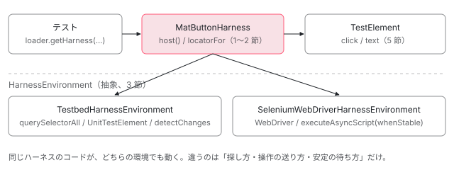

[目次](../README.md) › [CDK の内側](README.md) › 第 20 回 / 全 21 回

# コンポーネントハーネス：テストが DOM の構造に縛られない仕組み

> ComponentHarness が locatorFor で子の要素やハーネスを探し、TestElement の click や getText を通して操作する設計。HarnessEnvironment の抽象メソッドを TestbedHarnessEnvironment が実装する行、操作のたびに変化検知と whenStable を待つ行、parallel() で読み取りをまとめる仕組み。

angular/components · 読了 約 13 分 · 中核 · [サイトで読む（デモが動きます）](https://angular-deep-dive-cyan.vercel.app/chapter/harness)

---

テストで `fixture.nativeElement.querySelector('.mat-mdc-button')` と書くと、部品の内側の DOM の形がテストに焼き付きます。コンポーネントハーネスは、その「DOM の探し方と触り方」を部品ごとのクラス（`MatButtonHarness` など）に閉じ込め、テストからは `button.click()` や `button.getText()` だけを呼ぶ仕組みです。この章では、`ComponentHarness` が `locatorFor` で子を探す流れ、`HarnessEnvironment` の抽象メソッドを `TestbedHarnessEnvironment` が実装する行、操作や読み取りのたびに変化検知と `whenStable` を待つ行、`parallel()` がそれを 1 回にまとめる仕組みを読みます。

読む対象は `src/cdk/testing/` の `component-harness.ts`・`harness-environment.ts`・`change-detection.ts`、`testing/testbed/` の `testbed-harness-environment.ts`・`unit-test-element.ts`、Angular 本体の `core/testing/src/fixture.ts`、例として `material/button/testing/button-harness.ts` です。

1. [1. 概観](01-cdk-overview.md)
2. [2. Platform と向き](02-cdk-platform-bidi.md)
3. [3. Observer と画面幅](03-cdk-observers-layout.md)
4. [4. Portal](04-cdk-portal.md)
5. [5. Overlay](05-cdk.md)
6. [6. 位置の計算](06-cdk-overlay-position.md)
7. [7. スクロールと Esc](07-cdk-overlay-scroll-dispatch.md)
8. [8. FocusTrap](08-cdk-focus-trap.md)
9. [9. FocusMonitor](09-cdk-focus-monitor.md)
10. [10. ListKeyManager](10-cdk-key-manager.md)
11. [11. LiveAnnouncer](11-cdk-live-announcer.md)
12. [12. Dialog](12-cdk-dialog.md)
13. [13. Menu](13-cdk-menu.md)
14. [14. DataSource と選択](14-cdk-collections.md)
15. [15. 仮想スクロール](15-virtual-scroll.md)
16. [16. table](16-table.md)
17. [17. tree](17-cdk-tree.md)
18. [18. DragRef](18-drag-drop.md)
19. [19. DropListRef](19-cdk-drop-list.md)
20. **20. ハーネス**（この章）
21. [21. Material のテーマ](21-theming.md)

> [!TIP]
> **新卒エンジニアへ**
>
> 登場人物は 3 層です。**ハーネス**（`ComponentHarness` の子クラス。部品ごとに 1 つ）、**TestElement**（1 つの要素に対する click や text などの操作）、**HarnessEnvironment**（要素の探し方・`TestElement` の作り方・安定の待ち方を決める土台）です。ハーネスは `TestElement` と `HarnessEnvironment` の**インターフェースだけ**を使うので、同じハーネスが TestBed の単体テストでも Selenium の E2E テストでも動きます。

## 0. 全体の流れ



*テストはハーネスのメソッドだけを呼ぶ。ハーネスは locatorFor で要素を探して TestElement を受け取り、TestElement の操作のたびに環境の forceStabilize（TestBed なら detectChanges + whenStable）が走る。*

## 1. ComponentHarness：持っているのは locatorFactory だけ

📄 `components/src/cdk/testing/component-harness.ts` L324–339 （▶ の行: 325, 328–329, 337–338）

```ts
324 │ export abstract class ComponentHarness {
325 ▶   constructor(protected readonly locatorFactory: LocatorFactory) {}
326 │ 
327 │   /** Gets a `Promise` for the `TestElement` representing the host element of the component. */
328 ▶   async host(): Promise<TestElement> {
329 ▶     return this.locatorFactory.rootElement;
330 │   }
331 │ 
332 │   /**
333 │    * Gets a `LocatorFactory` for the document root element. This factory can be used to create
334 │    * locators for elements that a component creates outside of its own root element. (e.g. by
335 │    * appending to document.body).
336 │    */
337 ▶   protected documentRootLocatorFactory(): LocatorFactory {
338 ▶     return this.locatorFactory.documentRootLocatorFactory();
339 │   }
```

📄 `components/src/cdk/testing/component-harness.ts` L371–375 （▶ の行: 374）

```ts
371 │   protected locatorFor<T extends (HarnessQuery<any> | string)[]>(
372 │     ...queries: T
373 │   ): () => Promise<LocatorFnResult<T>> {
374 ▶     return this.locatorFactory.locatorFor(...queries);
375 │   }
```

`ComponentHarness` の状態は 325 行目の `locatorFactory` 1 つだけです。329 行目の `host()` は自分の根の要素（`TestElement`）を返し、`locatorFor` などは 374 行目のように `locatorFactory` にそのまま任せます。その `locatorFactory` の正体が `HarnessEnvironment` です（3 節）。337〜338 行目の `documentRootLocatorFactory` は、`body` 直下に出る Overlay の中身（[Overlay の章](05-cdk.md)）のように、自分の要素の外にあるものを探すための入口です。

### 実物：MatButtonHarness

📄 `components/src/material/button/testing/button-harness.ts` L23–50 （▶ の行: 24, 30–32, 43, 47–49）

```ts
23 │ /** Harness for interacting with a mat-button in tests. */
24 ▶ export class MatButtonHarness extends ContentContainerComponentHarness {
25 │   // Note: `.mat-mdc-button-base` should be enough for all buttons, however some apps are using
26 │   // the harness without actually having an applied button. Keep the attributes for backwards
27 │   // compatibility.
28 │ 
29 │   /** Selector for the harness. */
30 ▶   static hostSelector = `.mat-mdc-button-base, [matButton], [mat-button], [matIconButton],
31 ▶     [matFab], [matMiniFab], [mat-raised-button], [mat-flat-button], [mat-icon-button],
32 ▶     [mat-stroked-button], [mat-fab], [mat-mini-fab]`;
33 │ 
34 │   /**
35 │    * Gets a `HarnessPredicate` that can be used to search for a button with specific attributes.
36 │    * @param options Options for narrowing the search:
37 │    *   - `selector` finds a button whose host element matches the given selector.
38 │    *   - `text` finds a button with specific text content.
39 │    *   - `variant` finds buttons matching a specific variant.
40 │    *   - `appearance` finds buttons matching a specific appearance.
41 │    * @return a `HarnessPredicate` configured with the given options.
42 │    */
43 ▶   static with<T extends MatButtonHarness>(
44 │     this: ComponentHarnessConstructor<T>,
45 │     options: ButtonHarnessFilters = {},
46 │   ): HarnessPredicate<T> {
47 ▶     return new HarnessPredicate(this, options)
48 ▶       .addOption('text', options.text, (harness, text) =>
49 ▶         HarnessPredicate.stringMatches(harness.getText(), text),
50 │       )
```

📄 `components/src/material/button/testing/button-harness.ts` L81–97 （▶ の行: 82, 96）

```ts
81 │   async click(...args: [] | ['center'] | [number, number]): Promise<void> {
82 ▶     return (await this.host()).click(...(args as []));
83 │   }
84 │ 
85 │   /** Gets a boolean promise indicating if the button is disabled. */
86 │   async isDisabled(): Promise<boolean> {
87 │     const host = await this.host();
88 │     return (
89 │       booleanAttribute(await host.getAttribute('disabled')) ||
90 │       (await host.hasClass('mat-mdc-button-disabled'))
91 │     );
92 │   }
93 │ 
94 │   /** Gets a promise for the button's label text. */
95 │   async getText(): Promise<string> {
96 ▶     return (await this.host()).text();
97 │   }
```

ハーネスの書き方はこれで全部です。30〜32 行目の `hostSelector` が「この部品の根の要素はどれか」、43〜50 行目の `with()` が「どの条件で絞るか」を表す `HarnessPredicate`（4 節）を返します。操作は 82 行目・96 行目のように `host()` の `TestElement` に任せるだけです。テストは `.mat-mdc-button-base` という class 名を知らなくてよく、Material がテンプレートを変えたらこのファイルが直されます。24 行目の `ContentContainerComponentHarness` は、ボタンの中に入れた別の部品のハーネスも探せるようにする子クラスです。

## 2. locatorFor：探す関数を返す

📄 `components/src/cdk/testing/harness-environment.ts` L96–104 （▶ の行: 99–102）

```ts
 96 │   locatorFor<T extends (HarnessQuery<any> | string)[]>(
 97 │     ...queries: T
 98 │   ): () => Promise<LocatorFnResult<T>> {
 99 ▶     return () =>
100 ▶       _assertResultFound(
101 ▶         this._getAllHarnessesAndTestElements(queries),
102 ▶         _getDescriptionForLocatorForQueries(queries),
103 │       );
104 │   }
```

📄 `components/src/cdk/testing/harness-environment.ts` L136–140 （▶ の行: 139）

```ts
136 │   locatorForOptional<T extends (HarnessQuery<any> | string)[]>(
137 │     ...queries: T
138 │   ): () => Promise<LocatorFnResult<T> | null> {
139 ▶     return async () => (await this._getAllHarnessesAndTestElements(queries))[0] || null;
140 │   }
```

📄 `components/src/cdk/testing/harness-environment.ts` L235–249 （▶ の行: 236, 248）

```ts
235 │   getHarness<T extends ComponentHarness>(query: HarnessQuery<T>): Promise<T> {
236 ▶     return this.locatorFor(query)();
237 │   }
238 │ 
239 │   /**
240 │    * Searches for an instance of the component corresponding to the given harness type under the
241 │    * `HarnessEnvironment`'s root element, and returns a `ComponentHarness` for that instance. If
242 │    * multiple matching components are found, a harness for the first one is returned. If no matching
243 │    * component is found, null is returned.
244 │    * @param query A query for a harness to create
245 │    * @return An instance of the given harness type (or null if not found).
246 │    */
247 │   getHarnessOrNull<T extends ComponentHarness>(query: HarnessQuery<T>): Promise<T | null> {
248 ▶     return this.locatorForOptional(query)();
249 │   }
```

99 行目、`locatorFor` は探した結果ではなく**探す関数**を返します。ハーネスのフィールドに `private _label = this.locatorFor('.label')` と書いておき、使うたびに `await this._label()` で探し直すためです。DOM は変化検知のたびに作り直されることがあるので、要素を持ち続けず、毎回探します。100〜102 行目、見つからなければ例外（どの条件で探したかの説明付き）、139 行目の `locatorForOptional` は 1 つ目か `null` です。テストが使う `loader.getHarness(q)` も、236 行目のとおり `locatorFor(q)()` の言い換えです。

📄 `components/src/cdk/testing/harness-environment.ts` L373–412 （▶ の行: 380, 384–385, 392–393, 395, 397–398, 404–405, 408）

```ts
373 │   private async _getAllHarnessesAndTestElements<T extends (HarnessQuery<any> | string)[]>(
374 │     queries: T,
375 │   ): Promise<LocatorFnResult<T>[]> {
376 │     if (!queries.length) {
377 │       throw Error('CDK Component harness query must contain at least one element.');
378 │     }
379 │ 
380 ▶     const {allQueries, harnessQueries, elementQueries, harnessTypes} = _parseQueries(queries);
381 │ 
382 │     // Combine all of the queries into one large comma-delimited selector and use it to get all raw
383 │     // elements matching any of the individual queries.
384 ▶     const rawElements = await this.getAllRawElements(
385 ▶       [...elementQueries, ...harnessQueries.map(predicate => predicate.getSelector())].join(','),
386 │     );
387 │ 
388 │     // If every query is searching for the same harness subclass, we know every result corresponds
389 │     // to an instance of that subclass. Likewise, if every query is for a `TestElement`, we know
390 │     // every result corresponds to a `TestElement`. Otherwise we need to verify which result was
391 │     // found by which selector so it can be matched to the appropriate instance.
392 ▶     const skipSelectorCheck =
393 ▶       (elementQueries.length === 0 && harnessTypes.size === 1) || harnessQueries.length === 0;
394 │ 
395 ▶     const perElementMatches = await parallel(() =>
396 │       rawElements.map(async rawElement => {
397 ▶         const testElement = this.createTestElement(rawElement);
398 ▶         const allResultsForElement = await parallel(
399 │           // For each query, get `null` if it doesn't match, or a `TestElement` or
400 │           // `ComponentHarness` as appropriate if it does match. This gives us everything that
401 │           // matches the current raw element, but it may contain duplicate entries (e.g.
402 │           // multiple `TestElement` or multiple `ComponentHarness` of the same type).
403 │           () =>
404 ▶             allQueries.map(query =>
405 ▶               this._getQueryResultForElement(query, rawElement, testElement, skipSelectorCheck),
406 │             ),
407 │         );
408 ▶         return _removeDuplicateQueryResults(allResultsForElement);
409 │       }),
410 │     );
411 │     return ([] as any).concat(...perElementMatches);
412 │   }
```

📄 `components/src/cdk/testing/harness-environment.ts` L420–434 （▶ の行: 426–427, 429–431）

```ts
420 │   private async _getQueryResultForElement<T extends ComponentHarness>(
421 │     query: string | HarnessPredicate<T>,
422 │     rawElement: E,
423 │     testElement: TestElement,
424 │     skipSelectorCheck: boolean = false,
425 │   ): Promise<T | TestElement | null> {
426 ▶     if (typeof query === 'string') {
427 ▶       return skipSelectorCheck || (await testElement.matchesSelector(query)) ? testElement : null;
428 │     }
429 ▶     if (skipSelectorCheck || (await testElement.matchesSelector(query.getSelector()))) {
430 ▶       const harness = this.createComponentHarness(query.harnessType, rawElement);
431 ▶       return (await query.evaluate(harness)) ? harness : null;
432 │     }
433 │     return null;
434 │   }
```

1. **380 行目：問い合わせを分ける**

   文字列（CSS セレクタ → `TestElement`）と、ハーネスのクラスか `HarnessPredicate`（→ ハーネス）に分ける。クラスだけ渡されたら条件なしの `HarnessPredicate` に包む。
2. **384〜386 行目：1 回の検索にまとめる**

   全部のセレクタ（ハーネスなら `hostSelector`）を `,` でつないで `getAllRawElements` を 1 回だけ呼ぶ。結果は DOM の順。
3. **397 行目：見つかった要素ごとに TestElement を作る**

   作り方は環境が決める（3 節の `createTestElement`）。
4. **429〜431 行目：ハーネスなら作ってから条件を評価**

   要素がセレクタに合えば `new harnessType(環境)` を作り、`HarnessPredicate.evaluate`（4 節）が `true` のものだけ残す。392〜393 行目、問い合わせが 1 種類だけならセレクタの照合は省く。
5. **395・398 行目：parallel でまとめて**

   要素ごと・問い合わせごとの評価を `parallel`（6 節）で並べ、変化検知を前後の 1 回ずつにする。

## 3. HarnessEnvironment の抽象メソッドと、TestBed の実装

📄 `components/src/cdk/testing/harness-environment.ts` L346–367 （▶ の行: 346, 353, 356, 359, 362, 367）

```ts
346 ▶   abstract forceStabilize(): Promise<void>;
347 │ 
348 │   /**
349 │    * Waits for all scheduled or running async tasks to complete. This allows harness
350 │    * authors to wait for async tasks outside of the Angular zone.
351 │    * This is an abstrct method that must be implemented by subclasses.
352 │    */
353 ▶   abstract waitForTasksOutsideAngular(): Promise<void>;
354 │ 
355 │   /** Gets the root element for the document. */
356 ▶   protected abstract getDocumentRoot(): E;
357 │ 
358 │   /** Creates a `TestElement` from a raw element. */
359 ▶   protected abstract createTestElement(element: E): TestElement;
360 │ 
361 │   /** Creates a `HarnessEnvironment` rooted at the given raw element. */
362 ▶   protected abstract createEnvironment(element: E): HarnessEnvironment<E>;
363 │ 
364 │   /**
365 │    * Gets a list of all elements matching the given selector under this environment's root element.
366 │    */
367 ▶   protected abstract getAllRawElements(selector: string): Promise<E[]>;
```

環境ごとに違うのはこの 6 つだけです。安定を待つ（346 行目）、Angular の外の非同期を待つ（353 行目）、文書の根（356 行目）、生の要素から `TestElement` を作る（359 行目）、子の環境を作る（362 行目）、セレクタで生の要素を集める（367 行目）。1〜2 節の処理はすべてこの 6 つの上に書かれています。TestBed 用の実装です。

📄 `components/src/cdk/testing/testbed/testbed-harness-environment.ts` L212–233 （▶ の行: 214, 219, 224, 231–232）

```ts
212 │   /** Gets the root element for the document. */
213 │   protected getDocumentRoot(): Element {
214 ▶     return document.body;
215 │   }
216 │ 
217 │   /** Creates a `TestElement` from a raw element. */
218 │   protected createTestElement(element: Element): TestElement {
219 ▶     return new UnitTestElement(element, this._stabilizeCallback);
220 │   }
221 │ 
222 │   /** Creates a `HarnessLoader` rooted at the given raw element. */
223 │   protected createEnvironment(element: Element): HarnessEnvironment<Element> {
224 ▶     return new TestbedHarnessEnvironment(element, this._fixture, this._options);
225 │   }
226 │ 
227 │   /**
228 │    * Gets a list of all elements matching the given selector under this environment's root element.
229 │    */
230 │   protected async getAllRawElements(selector: string): Promise<Element[]> {
231 ▶     await this.forceStabilize();
232 ▶     return Array.from(this._options.queryFn(selector, this.rawRootElement));
233 │   }
```

📄 `components/src/cdk/testing/testbed/testbed-harness-environment.ts` L106–130 （▶ の行: 113–114, 116–117）

```ts
106 │   protected constructor(
107 │     rawRootElement: Element,
108 │     private _fixture: Fixture,
109 │     options?: TestbedHarnessEnvironmentOptions,
110 │   ) {
111 │     super(rawRootElement);
112 │     this._options = {...defaultEnvironmentOptions, ...options};
113 ▶     if (TaskStateZoneInterceptor.isInProxyZone()) {
114 ▶       this._taskState = TaskStateZoneInterceptor.setup();
115 │     }
116 ▶     this._stabilizeCallback = () => this.forceStabilize();
117 ▶     installAutoChangeDetectionStatusHandler(_fixture);
118 │ 
119 │     const onDestroy = () => {
120 │       uninstallAutoChangeDetectionStatusHandler(_fixture);
121 │       this._destroyed = true;
122 │     };
123 │ 
124 │     if (_fixture instanceof ComponentFixture) {
125 │       _fixture.componentRef.onDestroy(onDestroy);
126 │     } else {
127 │       // TODO(crisbeto): use host ref in directive fixture once it's available.
128 │       TestBed.inject(DestroyRef).onDestroy(onDestroy);
129 │     }
130 │   }
```

231 行目、**要素を探す前にまず安定させ**、232 行目で `querySelectorAll` します。219 行目で作る `UnitTestElement` には、116 行目の「安定させる関数」（`forceStabilize`）を渡します。TestBed の環境は `fixture` を持っていて（`TestbedHarnessEnvironment.loader(fixture)`）、それで変化検知を回します。113〜115 行目は zone.js のテスト用 zone（ProxyZone）の中にいるときだけ、タスクの状態を見張る仕組みを用意する行です。zone.js が無ければ `_taskState` は作られません（7 節の質問）。

## 4. HarnessPredicate：条件をためて、まとめて評価する

📄 `components/src/cdk/testing/component-harness.ts` L603–622 （▶ の行: 609, 612, 616–619）

```ts
603 │ export class HarnessPredicate<T extends ComponentHarness> {
604 │   private _predicates: AsyncPredicate<T>[] = [];
605 │   private _descriptions: string[] = [];
606 │   private _ancestor: string;
607 │ 
608 │   constructor(
609 ▶     public harnessType: ComponentHarnessConstructor<T>,
610 │     options: BaseHarnessFilters,
611 │   ) {
612 ▶     this._ancestor = options.ancestor || '';
613 │     if (this._ancestor) {
614 │       this._descriptions.push(`has ancestor matching selector "${this._ancestor}"`);
615 │     }
616 ▶     const selector = options.selector;
617 ▶     if (selector !== undefined) {
618 ▶       this.add(`host matches selector "${selector}"`, async item => {
619 ▶         return (await item.host()).matchesSelector(selector);
620 │       });
621 │     }
622 │   }
```

📄 `components/src/cdk/testing/component-harness.ts` L652–671 （▶ の行: 653–654, 667–668）

```ts
652 │   add(description: string, predicate: AsyncPredicate<T>) {
653 ▶     this._descriptions.push(description);
654 ▶     this._predicates.push(predicate);
655 │     return this;
656 │   }
657 │ 
658 │   /**
659 │    * Adds a predicate function that depends on an option value to be run against candidate
660 │    * harnesses. If the option value is undefined, the predicate will be ignored.
661 │    * @param name The name of the option (may be used in error messages).
662 │    * @param option The option value.
663 │    * @param predicate The predicate function to run if the option value is not undefined.
664 │    * @return this (for method chaining).
665 │    */
666 │   addOption<O>(name: string, option: O | undefined, predicate: AsyncOptionPredicate<T, O>) {
667 ▶     if (option !== undefined) {
668 ▶       this.add(`${name} = ${_valueAsString(option)}`, item => predicate(item, option));
669 │     }
670 │     return this;
671 │   }
```

📄 `components/src/cdk/testing/component-harness.ts` L678–695 （▶ の行: 682, 693–694）

```ts
678 │   async filter(harnesses: T[]): Promise<T[]> {
679 │     if (harnesses.length === 0) {
680 │       return [];
681 │     }
682 ▶     const results = await parallel(() => harnesses.map(h => this.evaluate(h)));
683 │     return harnesses.filter((_, i) => results[i]);
684 │   }
685 │ 
686 │   /**
687 │    * Evaluates whether the given harness satisfies this predicate.
688 │    * @param harness The harness to check
689 │    * @return A promise that resolves to true if the harness satisfies this predicate,
690 │    *   and resolves to false otherwise.
691 │    */
692 │   async evaluate(harness: T): Promise<boolean> {
693 ▶     const results = await parallel(() => this._predicates.map(p => p(harness)));
694 ▶     return results.reduce((combined, current) => combined && current, true);
695 │   }
```

`HarnessPredicate` は「ハーネスを受け取って `Promise<boolean>` を返す関数」の配列です。616〜620 行目、`selector` を渡せば「根の要素がそのセレクタに合うか」が 1 つ目の条件になります（612 行目の `ancestor` は探すときのセレクタの方に組み込む）。667〜668 行目の `addOption` は値が `undefined` なら**条件を足さない**ので、`MatButtonHarness.with({text: 'OK'})` のように渡した項目だけが効きます。693〜694 行目、評価は全部の条件を `parallel` で並べて AND。682 行目の `filter` も同じく `parallel` です。

## 5. TestElement.click が送るイベント

📄 `components/src/cdk/testing/testbed/unit-test-element.ts` L104–117 （▶ の行: 107, 115–116）

```ts
104 │   async click(
105 │     ...args: [ModifierKeys?] | ['center', ModifierKeys?] | [number, number, ModifierKeys?]
106 │   ): Promise<void> {
107 ▶     const isDisabled = (this.element as Partial<{disabled?: boolean}>).disabled === true;
108 │ 
109 │     // If the element is `disabled` and has a `disabled` property, we emit the mouse event
110 │     // sequence but not dispatch the `click` event. This is necessary to keep the behavior
111 │     // consistent with an actual user interaction. The click event is not necessarily
112 │     // automatically prevented by the browser. There is mismatch between Firefox and Chromium:
113 │     // https://bugzilla.mozilla.org/show_bug.cgi?id=329509.
114 │     // https://bugs.chromium.org/p/chromium/issues/detail?id=1115661.
115 ▶     await this._dispatchMouseEventSequence(isDisabled ? null : 'click', args, 0);
116 ▶     await this._stabilize();
117 │   }
```

📄 `components/src/cdk/testing/testbed/unit-test-element.ts` L355–384 （▶ の行: 355–356, 363, 365, 373–374, 376）

```ts
355 ▶     this._dispatchPointerEventIfSupported(
356 ▶       'pointerdown',
357 │       clientX,
358 │       clientY,
359 │       offsetX,
360 │       offsetY,
361 │       button,
362 │     );
363 ▶     dispatchMouseEvent(
364 │       this.element,
365 ▶       'mousedown',
366 │       clientX,
367 │       clientY,
368 │       offsetX,
369 │       offsetY,
370 │       button,
371 │       modifiers,
372 │     );
373 ▶     this._dispatchPointerEventIfSupported('pointerup', clientX, clientY, offsetX, offsetY, button);
374 ▶     dispatchMouseEvent(
375 │       this.element,
376 ▶       'mouseup',
377 │       clientX,
378 │       clientY,
379 │       offsetX,
380 │       offsetY,
381 │       button,
382 │       modifiers,
383 │     );
384 │ 
```

📄 `components/src/cdk/testing/testbed/unit-test-element.ts` L385–404 （▶ の行: 386–387, 389, 403）

```ts
385 │     // If a primary event name is specified, emit it after the mouse event sequence.
386 ▶     if (primaryEventName !== null) {
387 ▶       dispatchMouseEvent(
388 │         this.element,
389 ▶         primaryEventName,
390 │         clientX,
391 │         clientY,
392 │         offsetX,
393 │         offsetY,
394 │         button,
395 │         modifiers,
396 │       );
397 │     }
398 │ 
399 │     // This call to _stabilize should not be needed since the callers will already do that them-
400 │     // selves. Nevertheless it breaks some tests in g3 without it. It needs to be investigated
401 │     // why removing breaks those tests.
402 │     // See: https://github.com/angular/components/pull/20758/files#r520886256.
403 ▶     await this._stabilize();
404 │   }
```

📄 `components/src/cdk/testing/testbed/fake-events/event-objects.ts` L18–51 （▶ の行: 20–21, 34–37, 39, 50）

```ts
18 │ export function createMouseEvent(
19 │   type: string,
20 ▶   clientX = 0,
21 ▶   clientY = 0,
22 │   offsetX = 0,
23 │   offsetY = 0,
24 │   button = 0,
25 │   modifiers: ModifierKeys = {},
26 │ ) {
27 │   // Note: We cannot determine the position of the mouse event based on the screen
28 │   // because the dimensions and position of the browser window are not available
29 │   // To provide reasonable `screenX` and `screenY` coordinates, we simply use the
30 │   // client coordinates as if the browser is opened in fullscreen.
31 │   const screenX = clientX;
32 │   const screenY = clientY;
33 │ 
34 ▶   const event = new MouseEvent(type, {
35 ▶     bubbles: true,
36 ▶     cancelable: true,
37 ▶     composed: true, // Required for shadow DOM events.
38 │     view: getEventView(),
39 ▶     detail: 1,
40 │     relatedTarget: null,
41 │     screenX,
42 │     screenY,
43 │     clientX,
44 │     clientY,
45 │     ctrlKey: modifiers.control,
46 │     altKey: modifiers.alt,
47 │     shiftKey: modifiers.shift,
48 │     metaKey: modifiers.meta,
49 │     button: button,
50 ▶     buttons: 1,
51 │   });
```

`UnitTestElement.click()` が送るのは `pointerdown`（355 行目）→ `mousedown`（363 行目）→ `pointerup`（373 行目）→ `mouseup`（374 行目）→ `click`（387 行目）の 5 つで、すべて同じ要素に `dispatchEvent` します。**`focus` は送りません**。本物のマウスなら `mousedown` でボタンにフォーカスが移りますが、合成したイベントではブラウザはフォーカスを動かさないので、フォーカスが要るなら `focus()` を別に呼びます。107・115 行目、`disabled` なボタンでは `click` だけを送りません（ブラウザによって合成の `click` が止まったり止まらなかったりするため、とコメントにあります）。座標を渡さなければ `clientX` / `clientY` は 0 のままです（event-objects.ts 20〜21 行目の引数の既定値）。34〜37 行目で `bubbles`・`cancelable`・`composed` を立てた本物の `MouseEvent` を作るので、親の要素や Shadow DOM の外のリスナーにも届きます。最後に 403 行目と 116 行目で安定させます。

📄 `components/src/cdk/testing/testbed/unit-test-element.ts` L184–221 （▶ の行: 185, 189, 207, 213, 219）

```ts
184 │   async text(options?: TextOptions): Promise<string> {
185 ▶     await this._stabilize();
186 │     if (options?.exclude) {
187 │       return _getTextWithExcludedElements(this.element, options.exclude);
188 │     }
189 ▶     return (this.element.textContent || '').trim();
190 │   }
191 │ 
192 │   /**
193 │    * Sets the value of a `contenteditable` element.
194 │    * @param value Value to be set on the element.
195 │    */
196 │   async setContenteditableValue(value: string): Promise<void> {
197 │     const contenteditableAttr = await this.getAttribute('contenteditable');
198 │ 
199 │     if (
200 │       contenteditableAttr !== '' &&
201 │       contenteditableAttr !== 'true' &&
202 │       contenteditableAttr !== 'plaintext-only'
203 │     ) {
204 │       throw new Error('setContenteditableValue can only be called on a `contenteditable` element.');
205 │     }
206 │ 
207 ▶     await this._stabilize();
208 │     this.element.textContent = value;
209 │   }
210 │ 
211 │   /** Gets the value for the given attribute from the element. */
212 │   async getAttribute(name: string): Promise<string | null> {
213 ▶     await this._stabilize();
214 │     return this.element.getAttribute(name);
215 │   }
216 │ 
217 │   /** Checks whether the element has the given class. */
218 │   async hasClass(name: string): Promise<boolean> {
219 ▶     await this._stabilize();
220 │     return this.element.classList.contains(name);
221 │   }
```

読み取りは逆で、185 行目・213 行目・219 行目のように**読む前に**安定させます。テストが `expect(await button.getText()).toBe('保存')` と書くだけで、直前の変更が描画に反映されてから読まれます。189 行目、`text()` は `textContent` の前後の空白を落としたものです。

> **🧪 DEMO — このページで動かすハーネス（環境と TestElement は自作の再現）**
>
> `ComponentHarness`・`HarnessEnvironment`・`HarnessPredicate`・`parallel` は `@angular/cdk/testing` の本物です。本物の `UnitTestElement` は `@angular/core/testing` を読み込むので使わず、上の 355〜397 行目と同じ順・同じ初期値でイベントを送る `PageTestElement` と、3 節の 6 つを実装した `PageHarnessEnvironment` を章の中に書いています。安定化は `fixture` の代わりに `ApplicationRef.whenStable()` を待ち、回数を数えます。
>
> 「対象」を自分のマウスで押した場合と比べてください。赤枠は `isTrusted: true`（本物の操作）です。
>
> 1 つずつ await すると、読み取り 8 回のそれぞれの前で安定化します（8 回）。`parallel` にすると、6 節の前後 1 回ずつの 2 回になります。
>
> ▶ [このデモはサイトで動かせます](https://angular-deep-dive-cyan.vercel.app/chapter/harness)

## 6. 操作のたびの安定化と、parallel でのまとめ

📄 `components/src/cdk/testing/testbed/testbed-harness-environment.ts` L172–185 （▶ の行: 178, 183）

```ts
172 │   /**
173 │    * Flushes change detection and async tasks captured in the Angular zone.
174 │    * In most cases it should not be necessary to call this manually. However, there may be some edge
175 │    * cases where it is needed to fully flush animation events.
176 │    */
177 │   async forceStabilize(): Promise<void> {
178 ▶     if (!disableAutoChangeDetection) {
179 │       if (this._destroyed) {
180 │         throw Error('Harness is attempting to use a fixture that has already been destroyed.');
181 │       }
182 │ 
183 ▶       await detectChanges(this._fixture);
184 │     }
185 │   }
```

📄 `components/src/cdk/testing/testbed/testbed-harness-environment.ts` L74–90 （▶ の行: 83–86, 88）

```ts
74 │ /** Whether we are currently in the fake async zone. */
75 │ function isInFakeAsyncZone() {
76 │   return typeof Zone !== 'undefined' && Zone!.current.get('FakeAsyncTestZoneSpec') != null;
77 │ }
78 │ 
79 │ /**
80 │  * Triggers change detection for a specific fixture.
81 │  * @param fixture The fixture to trigger change detection for.
82 │  */
83 ▶ async function detectChanges(fixture: Fixture) {
84 ▶   fixture.detectChanges();
85 ▶   if (isInFakeAsyncZone()) {
86 ▶     flush();
87 │   } else {
88 ▶     await fixture.whenStable();
89 │   }
90 │ }
```

5 節の `_stabilize` の中身です。183 行目から 84 行目の `fixture.detectChanges()`、85〜86 行目、`fakeAsync` の中なら `flush()`（溜まったタイマーを全部進める）、そうでなければ 88 行目の `fixture.whenStable()` を待ちます。つまりハーネスの操作 1 回ごとに「変化検知 → 非同期の完了待ち」が入ります。テストに `fixture.detectChanges()` を書かなくてよいのはこのためです。178 行目のフラグが立っている間はこれを飛ばします。そのフラグを立てるのが `parallel` です。

📄 `components/src/cdk/testing/change-detection.ts` L186–195 （▶ の行: 193–194）

```ts
186 │ /**
187 │  * Resolves the given list of async values in parallel (i.e. via Promise.all) while batching change
188 │  * detection over the entire operation such that change detection occurs exactly once before
189 │  * resolving the values and once after.
190 │  * @param values A getter for the async values to resolve in parallel with batched change detection.
191 │  * @return The resolved values.
192 │  */
193 ▶ export async function parallel<T>(values: () => Iterable<T | PromiseLike<T>>): Promise<T[]> {
194 ▶   return batchChangeDetection(() => Promise.all(values()), true);
195 │ }
```

📄 `components/src/cdk/testing/change-detection.ts` L62–99 （▶ の行: 71–72, 80–84, 91, 93–96）

```ts
62 │ /**
63 │  * Batches together triggering of change detection over the duration of the given function.
64 │  * @param fn The function to call with batched change detection.
65 │  * @param triggerBeforeAndAfter Optionally trigger change detection once before and after the batch
66 │  *   operation. If false, change detection will not be triggered.
67 │  * @return The result of the given function.
68 │  */
69 │ async function batchChangeDetection<T>(fn: () => Promise<T>, triggerBeforeAndAfter: boolean) {
70 │   // If change detection batching is already in progress, just run the function.
71 ▶   if (autoChangeDetectionSubject.getValue().isDisabled) {
72 ▶     return await fn();
73 │   }
74 │ 
75 │   // If nothing is handling change detection batching, install the default handler.
76 │   if (!autoChangeDetectionSubscription) {
77 │     handleAutoChangeDetectionStatus(defaultAutoChangeDetectionHandler);
78 │   }
79 │ 
80 ▶   if (triggerBeforeAndAfter) {
81 ▶     await new Promise(resolve =>
82 ▶       autoChangeDetectionSubject.next({
83 ▶         isDisabled: true,
84 ▶         onDetectChangesNow: resolve as () => void,
85 │       }),
86 │     );
87 │     // The function passed in may throw (e.g. if the user wants to make an expectation of an error
88 │     // being thrown. If this happens, we need to make sure we still re-enable change detection, so
89 │     // we wrap it in a `finally` block.
90 │     try {
91 ▶       return await fn();
92 │     } finally {
93 ▶       await new Promise(resolve =>
94 ▶         autoChangeDetectionSubject.next({
95 ▶           isDisabled: false,
96 ▶           onDetectChangesNow: resolve as () => void,
97 │         }),
98 │       );
99 │     }
```

📄 `components/src/cdk/testing/testbed/testbed-harness-environment.ts` L39–61 （▶ の行: 53–56）

```ts
39 │ /** Whether auto change detection is currently disabled. */
40 │ let disableAutoChangeDetection = false;
41 │ 
42 │ /**
43 │  * The set of non-destroyed fixtures currently being used by `TestbedHarnessEnvironment` instances.
44 │  */
45 │ const activeFixtures = new Set<Fixture>();
46 │ 
47 │ /**
48 │  * Installs a handler for change detection batching status changes for a specific fixture.
49 │  * @param fixture The fixture to handle change detection batching for.
50 │  */
51 │ function installAutoChangeDetectionStatusHandler(fixture: Fixture) {
52 │   if (!activeFixtures.size) {
53 ▶     handleAutoChangeDetectionStatus(({isDisabled, onDetectChangesNow}) => {
54 ▶       disableAutoChangeDetection = isDisabled;
55 ▶       if (onDetectChangesNow) {
56 ▶         Promise.all(Array.from(activeFixtures).map(detectChanges)).then(onDetectChangesNow);
57 │       }
58 │     });
59 │   }
60 │   activeFixtures.add(fixture);
61 │ }
```

1. **194 行目**

   `parallel(fn)` は `Promise.all(fn())` を `batchChangeDetection(…, true)` で包むだけ。
2. **80〜86 行目：前に 1 回**

   「無効にする、ただし今すぐ 1 回回して」という状態（`isDisabled: true` と `onDetectChangesNow`）を流す。TestBed の環境は 53〜56 行目で受けて、フラグを立て、使っている全 fixture を `detectChanges` してから `onDetectChangesNow` を呼ぶ。
3. **91 行目：中身を走らせる**

   この間の `text()` などの `_stabilize` は、178 行目でフラグを見て何もしない。
4. **93〜98 行目：後に 1 回**

   「有効に戻す、そのとき 1 回回して」を流す。例外が出ても `finally` で必ず戻す。
5. **71〜73 行目：入れ子は素通し**

   すでに無効の最中なら、ただ `fn()` を呼ぶ。2 節の 395・398 行目のように `parallel` の中で `parallel` を呼んでも、回るのは一番外の前後だけ。

> [!WARNING]
> **ハマりどころ**
>
> `parallel` の中では読み取りの前に変化検知が回らないので、**中で「操作してから読む」をしてはいけません**。操作の結果がまだ描かれていない値を読みます。`parallel` は「今の画面から複数の値をまとめて読む」ためのものです。前後で回すだけでいい一連の操作には `manualChangeDetection`（`batchChangeDetection(fn, false)`）があります。

## 7. zoneless の fixture で何を待っているか

📄 `angular/packages/core/testing/src/fixture.ts` L132–160 （▶ の行: 140, 142–143, 150, 153–154）

```ts
132 │   detectChanges(checkNoChanges = true): void {
133 │     const originalCheckNoChanges = (this.changeDetectorRef as InternalViewRef<unknown>)
134 │       .checkNoChanges;
135 │     try {
136 │       if (!checkNoChanges) {
137 │         (this.changeDetectorRef as InternalViewRef<unknown>).checkNoChanges = () => {};
138 │       }
139 │ 
140 ▶       if (this.zonelessEnabled) {
141 │         try {
142 ▶           this._testAppRef.includeAllTestViews = true;
143 ▶           this._appRef.tick();
144 │         } finally {
145 │           this._testAppRef.includeAllTestViews = false;
146 │         }
147 │       } else {
148 │         // Run the change detection inside the NgZone so that any async tasks as part of the change
149 │         // detection are captured by the zone and can be waited for in isStable.
150 ▶         this._ngZone.run(() => {
151 │           // Flush root effects before `detectChanges()`, to emulate the sequencing of `tick()`.
152 │           this.rootEffectScheduler.flush();
153 ▶           this.changeDetectorRef.detectChanges();
154 ▶           this.checkNoChanges();
155 │         });
156 │       }
157 │     } finally {
158 │       (this.changeDetectorRef as InternalViewRef<unknown>).checkNoChanges = originalCheckNoChanges;
159 │     }
160 │   }
```

📄 `angular/packages/core/testing/src/fixture.ts` L204–230 （▶ の行: 208–209, 218–220, 225, 227）

```ts
204 │   /**
205 │    * Return whether the fixture is currently stable or has async tasks that have not been completed
206 │    * yet.
207 │    */
208 ▶   isStable(): boolean {
209 ▶     return !this.pendingTasks.hasPendingTasks;
210 │   }
211 │ 
212 │   /**
213 │    * Get a promise that resolves when the fixture is stable.
214 │    *
215 │    * This can be used to resume testing after events have triggered asynchronous activity or
216 │    * asynchronous change detection.
217 │    */
218 ▶   whenStable(): Promise<any> {
219 ▶     if (this.isStable()) {
220 ▶       return Promise.resolve(false);
221 │     }
222 │ 
223 │     return new Promise((resolve, reject) => {
224 │       this.appErrorHandler.whenStableRejectFunctions.add(reject);
225 ▶       this._appRef.whenStable().then(() => {
226 │         this.appErrorHandler.whenStableRejectFunctions.delete(reject);
227 ▶         resolve(true);
228 │       });
229 │     });
230 │   }
```

6 節の 84 行目と 88 行目が呼ぶ Angular 本体の `ComponentFixture` です。zoneless のときは 140〜143 行目、`detectChanges()` は `ApplicationRef.tick()` を回します（[tick の章](../zoneless/05-zoneless-tick.md)）。209 行目、安定とは `PendingTasks` が空のことで、`whenStable()` は 225 行目で `ApplicationRef.whenStable()` を待ちます。zoneless では、変化検知の予約・`HttpClient` の通信・`PendingTasks` に登録した処理が「未完了のタスク」になるので（[PendingTasks の章](../zoneless/09-zoneless-pending-tasks.md)）、ハーネスはそれらの完了を待てます。

📄 `components/src/cdk/testing/testbed/testbed-harness-environment.ts` L194–210 （▶ の行: 201–202, 209）

```ts
194 │   async waitForTasksOutsideAngular(): Promise<void> {
195 │     // If we run in the fake async zone, we run "flush" to run any scheduled tasks. This
196 │     // ensures that the harnesses behave inside of the FakeAsyncTestZone similar to the
197 │     // "AsyncTestZone" and the root zone (i.e. neither fakeAsync or async). Note that we
198 │     // cannot just rely on the task state observable to become stable because the state will
199 │     // never change. This is because the task queue will be only drained if the fake async
200 │     // zone is being flushed.
201 ▶     if (isInFakeAsyncZone()) {
202 ▶       flush();
203 │     }
204 │ 
205 │     // Wait until the task queue has been drained and the zone is stable. Note that
206 │     // we cannot rely on "fixture.whenStable" since it does not catch tasks scheduled
207 │     // outside of the Angular zone. For test harnesses, we want to ensure that the
208 │     // app is fully stabilized and therefore need to use our own zone interceptor.
209 ▶     await this._taskState?.pipe(takeWhile(state => !state.stable)).toPromise();
210 │   }
```

もう一方の `waitForTasksOutsideAngular` は zone.js 頼みです。209 行目の `_taskState` は 3 節 113〜115 行目で ProxyZone の中のときだけ作られるので、zone.js が無いテストでは `?.` で何も待たずに終わります。`setTimeout` を `PendingTasks` に登録せずに使う部品は、zoneless のテストではハーネスに待ってもらえません。

## 呼び出しの連なり

- 👤 `const loader = TestbedHarnessEnvironment.loader(fixture)` — テスト
- 👤 `const btn = await loader.getHarness(MatButtonHarness.with({text: '保存'}))` — テスト
  - `locatorFor(query)() → _getAllHarnessesAndTestElements` — harness-environment.ts L236, L373
    - `getAllRawElements(hostSelector)` — testbed-harness-environment.ts L230 — *forceStabilize → querySelectorAll*
    - `new MatButtonHarness(createEnvironment(el)) → predicate.evaluate` — harness-environment.ts L430-431 — *getText で絞る*
- 👤 `await btn.click()` — テスト
  - `(await this.host()).click()` — button-harness.ts L82
    - `UnitTestElement._dispatchMouseEventSequence` — unit-test-element.ts L355-397 — *pointerdown → mousedown → pointerup → mouseup → click*
    - `_stabilize → forceStabilize → detectChanges(fixture)` — testbed-harness-environment.ts L183, L83
      - `fixture.detectChanges() → appRef.tick() / fixture.whenStable()` — fixture.ts L143, L225 — *zoneless のとき*

## 聞かれそうな質問

**Q. page object パターンと何が違いますか？**

考え方は同じ「画面の構造をテストから隠すクラス」です。違いは 2 つです。1 つは、ハーネスが DOM に直接触らず `TestElement` と `HarnessEnvironment` のインターフェースだけを使うことです（3 節 346〜367 行目）。そのため同じ `MatButtonHarness` が、TestBed でも、下の Selenium 用の環境でも動きます。もう 1 つは、操作・読み取りのたびに環境が安定を待つ（5〜6 節）ので、ハーネスを書く人もテストを書く人も「いつ描画が終わったか」を気にしなくてよいことです。さらに部品の作者（Material なら Material チーム）がハーネスを一緒に配るので、内部の DOM が変わってもテストを直さずに済みます。

📄 `components/src/cdk/testing/selenium-webdriver/selenium-web-driver-harness-environment.ts` L114–150 （▶ の行: 115, 130–131, 148–149）

```ts
114 │   async forceStabilize(): Promise<void> {
115 ▶     await this.rawRootElement().getDriver().executeAsyncScript(whenStable);
116 │   }
117 │ 
118 │   /** @docs-private */
119 │   async waitForTasksOutsideAngular(): Promise<void> {
120 │     // TODO: figure out how we can do this for the webdriver environment.
121 │     //  https://github.com/angular/components/issues/17412
122 │   }
123 │ 
124 │   /** Gets the root element for the document. */
125 │   protected getDocumentRoot(): () => webdriver.WebElement {
126 │     return () => this.rawRootElement().getDriver().findElement(webdriver.By.css('body'));
127 │   }
128 │ 
129 │   /** Creates a `TestElement` from a raw element. */
130 ▶   protected createTestElement(element: () => webdriver.WebElement): TestElement {
131 ▶     return new SeleniumWebDriverElement(element, this._stabilizeCallback);
132 │   }
133 │ 
134 │   /** Creates a `HarnessLoader` rooted at the given raw element. */
135 │   protected createEnvironment(
136 │     element: () => webdriver.WebElement,
137 │   ): HarnessEnvironment<() => webdriver.WebElement> {
138 │     return new SeleniumWebDriverHarnessEnvironment(element, this._options);
139 │   }
140 │ 
141 │   // Note: This seems to be working, though we may need to re-evaluate if we encounter issues with
142 │   // stale element references. `() => Promise<webdriver.WebElement[]>` seems like a more correct
143 │   // return type, though supporting it would require changes to the public harness API.
144 │   /**
145 │    * Gets a list of all elements matching the given selector under this environment's root element.
146 │    */
147 │   protected async getAllRawElements(selector: string): Promise<(() => webdriver.WebElement)[]> {
148 ▶     const els = await this._options.queryFn(selector, this.rawRootElement);
149 ▶     return els.map((x: webdriver.WebElement) => () => x);
150 │   }
```

Selenium の環境では、安定の待ち方が 115 行目の「ブラウザの中で `whenStable` を実行する」に、要素の作り方が 131 行目の `SeleniumWebDriverElement` に、探し方が 148 行目の WebDriver の検索に変わるだけです。

**Q. zoneless のアプリでもハーネスは待ってくれますか？**

待ちます。`forceStabilize` は `fixture.detectChanges()` と `fixture.whenStable()` を呼ぶだけで（6 節 84・88 行目）、zoneless の `ComponentFixture` はそれを `ApplicationRef.tick()` と `ApplicationRef.whenStable()`（`PendingTasks` が空になるまで）で実装しています（7 節 140〜143 行目、209 行目、225 行目）。待てないのは `PendingTasks` にも載らない処理（素の `setTimeout` など）で、zone.js が無いと `waitForTasksOutsideAngular` も何もしません（7 節 209 行目）。

**Q. harness.click() のあとでボタンにフォーカスが無いのはなぜですか？**

`UnitTestElement.click()` は `pointerdown`・`mousedown`・`pointerup`・`mouseup`・`click` を `dispatchEvent` するだけで、`focus()` を呼ばないからです（5 節 355〜397 行目）。合成したイベントではブラウザはフォーカスを移しません。デモの「対象」ボタンで、ハーネスの click には `focus` が出ず、自分のマウスで押すと出る（macOS の Safari ではボタンはクリックでフォーカスされない）ことを確かめられます。フォーカスが要るテストでは `await (await harness.host()).focus()` を先に呼びます。

**Q. Material のハーネスはどう書かれていますか？**

`MatButtonHarness` なら、`hostSelector`（1 節 30〜32 行目）と、`with()` で `addOption` を並べた `HarnessPredicate`（43〜50 行目）と、`host()` の `TestElement` に任せるメソッド（82 行目・96 行目）でできています。自分の部品のハーネスも同じ形で書けます。デモの `DemoButtonHarness` はこれを縮めたものです。

## 読み終えて

- ハーネスが持つのは `locatorFactory`（= `HarnessEnvironment`）だけ。`locatorFor` は探す関数を返し、使うたびに探し直す。
- 問い合わせは 1 本のセレクタにまとめて 1 回探し、ハーネスなら作ってから `HarnessPredicate` で絞る。
- 環境ごとに違うのは 6 つの抽象メソッドだけ。TestBed の実装は探す前・読む前・操作の後に `fixture.detectChanges()` + `whenStable()`。
- `click()` が送るのは pointerdown → mousedown → pointerup → mouseup → click。focus は送らない。
- `parallel()` は安定化を前後 1 回ずつにまとめる。中で「操作してから読む」はしない。zoneless の fixture は `tick()` と `PendingTasks` で待つ。

---

← 前: [DropListRef：並べ替えの位置と、リストをまたぐ移動](19-cdk-drop-list.md)  
次: [Material のテーマ：値の代わりに CSS 変数の名前を返す](21-theming.md) →
