[目次](../README.md) › [CDK の内側](README.md) › 第 21 回 / 全 21 回

# Material のテーマ：値の代わりに CSS 変数の名前を返す

> Angular Material の M3 テーマが、デザイントークン（--mat-sys-\* と部品ごとの変数）を CSS 変数として 1 回だけ出す仕組み。トークンの関数が引数の有無で「値を出す」と「変数名を返す」を切り替える行、部品の scss が var() で読む行、overrides の mixin。CDK の上に見た目を載せる層として。

angular/components · 読了 約 12 分 · 発展 · [サイトで読む（デモが動きます）](https://angular-deep-dive-cyan.vercel.app/chapter/theming)

---

CDK の部品は見た目を持ちません。Overlay も Drag & Drop も、色や角の丸みは何も決めず、位置と振る舞いだけを受け持ちます。Angular Material はその上に見た目を載せる層で、M3（Material 3）のテーマでは**色も文字もすべて CSS 変数**として渡します。この章では、トークンの関数が「引数が無ければ変数名、テーマを渡せば値」を返す仕組み、部品の scss がそれを `var()` にする行、`mat.theme()` が `--mat-sys-*` を 1 回だけ出す行、部品ごとに上書きする `overrides` の mixin を読みます。

読む対象は `src/material/` の `_index.scss`・`core/tokens/`（`_system.scss`・`_token-utils.scss`・`m3/_theme.scss`）と、部品の例としてツールチップの `tooltip/_m3-tooltip.scss`・`tooltip.scss`・`_tooltip-theme.scss` です。

1. [1. 概観](01-cdk-overview.md)
2. [2. Platform と向き](02-cdk-platform-bidi.md)
3. [3. Observer と画面幅](03-cdk-observers-layout.md)
4. [4. Portal](04-cdk-portal.md)
5. [5. Overlay](05-cdk.md)
6. [6. 位置の計算](06-cdk-overlay-position.md)
7. [7. スクロールと Esc](07-cdk-overlay-scroll-dispatch.md)
8. [8. FocusTrap](08-cdk-focus-trap.md)
9. [9. FocusMonitor](09-cdk-focus-monitor.md)
10. [10. ListKeyManager](10-cdk-key-manager.md)
11. [11. LiveAnnouncer](11-cdk-live-announcer.md)
12. [12. Dialog](12-cdk-dialog.md)
13. [13. Menu](13-cdk-menu.md)
14. [14. DataSource と選択](14-cdk-collections.md)
15. [15. 仮想スクロール](15-virtual-scroll.md)
16. [16. table](16-table.md)
17. [17. tree](17-cdk-tree.md)
18. [18. DragRef](18-drag-drop.md)
19. [19. DropListRef](19-cdk-drop-list.md)
20. [20. ハーネス](20-harness.md)
21. **21. Material のテーマ**（この章）

> [!TIP]
> **新卒エンジニアへ**
>
> **デザイントークン**は「主色」「角の丸み（小）」のような、見た目の決まりに付けた名前です。Material の M3 では 2 段あります。アプリ全体の **システムトークン**（`--mat-sys-primary`・`--mat-sys-inverse-surface` など）と、部品ごとの **部品トークン**（`--mat-tooltip-container-color` など）です。部品の CSS は「部品トークンがあればそれ、無ければシステムトークン」を読みます。

## 0. 全体の流れ



*部品の CSS は Material を配る前に 1 回だけ Sass でコンパイルされ、変数名だけを持つ。アプリの styles.scss は mat.theme() でシステムトークンの値を html に 1 回出す。部品トークンは上書きしたいときだけ出す。*

## 1. @use '@angular/material' as mat の中身

📄 `components/src/material/package.json` L20–23 （▶ の行: 21–22）

```json
20 │   "exports": {
21 ▶     ".": {
22 ▶       "sass": "./_index.scss"
23 │     },
```

📄 `components/src/material/_index.scss` L21–24 （▶ の行: 21, 23–24）

```scss
21 ▶ @forward './core/tokens/system' show system-level-colors,
22 │     system-level-typography, system-level-elevation, system-level-shape,
23 ▶     system-level-motion, system-level-state, theme, theme-overrides, m2-theme;
24 ▶ @forward './core/tokens/classes' show system-classes;
```

📄 `components/src/material/_index.scss` L141–142 （▶ の行: 141–142）

```scss
141 ▶ @forward './tooltip/tooltip-theme' as tooltip-* show tooltip-theme, tooltip-color,
142 ▶   tooltip-typography, tooltip-density, tooltip-base, tooltip-overrides;
```

`@use '@angular/material'` は、package.json の 21〜22 行目の `exports` で `_index.scss` を読みます。`_index.scss` は `@forward` を並べただけのファイルです。23 行目で `core/tokens/_system.scss` の `theme` と `theme-overrides` を、141〜142 行目でツールチップの mixin を `tooltip-*` の名前で公開します。`mat.tooltip-overrides` の実体は `_tooltip-theme.scss` の `overrides` です（5 節）。

## 2. 値の代わりに変数名を返すテーマ

📄 `components/src/material/tooltip/_m3-tooltip.scss` L1–26 （▶ の行: 6–7, 14–15）

```scss
 1 │ @use '../core/tokens/m3-utils';
 2 │ @use 'sass:map';
 3 │ @use '../core/tokens/m3';
 4 │ 
 5 │ /// Generates the tokens for MDC plain-tooltip
 6 ▶ @function get-tokens($theme: m3.$sys-theme) {
 7 ▶   $system: m3-utils.get-system($theme);
 8 │ 
 9 │   @return (
10 │     base: (
11 │       tooltip-container-shape: map.get($system, corner-extra-small),
12 │     ),
13 │     color: (
14 ▶       tooltip-container-color: map.get($system, inverse-surface),
15 ▶       tooltip-supporting-text-color: map.get($system, inverse-on-surface),
16 │     ),
17 │     typography: (
18 │       tooltip-supporting-text-font: map.get($system, body-small-font),
19 │       tooltip-supporting-text-line-height: map.get($system, body-small-line-height),
20 │       tooltip-supporting-text-size: map.get($system, body-small-size),
21 │       tooltip-supporting-text-tracking: map.get($system, body-small-tracking),
22 │       tooltip-supporting-text-weight: map.get($system, body-small-weight)
23 │     ),
24 │     density: (),
25 │   );
26 │ }
```

📄 `components/src/material/core/tokens/_m3-utils.scss` L15–18 （▶ の行: 17）

```scss
15 │ // Gets the theme's system values as a flat map.
16 │ @function get-system($theme) {
17 ▶   @return map.get($theme, _mat-system);
18 │ }
```

部品ごとの `get-tokens` は「この部品のトークン名 → システムのどの値か」の表です。14 行目、ツールチップの背景 `tooltip-container-color` はシステムの `inverse-surface` です。6 行目に注目してください。**引数 `$theme` の既定値が `m3.$sys-theme`** です。7 行目の `get-system` は 17 行目のとおりテーマの `_mat-system` を取り出すだけなので、引数を渡さずに呼ぶと `m3.$sys-theme` の `_mat-system` が使われます。その中身です。

📄 `components/src/material/core/tokens/m3/_theme.scss` L8–35 （▶ の行: 11, 13–14, 20, 32–33, 35）

```scss
 8 │ // Return a new map where the values are the same as the provided map's
 9 │ // keys, prefixed with "--mat-sys-". For example:
10 │ // (key1: '', key2: '') --> (key1: --mat-sys-key1, key2: --mat-sys-key2)
11 ▶ @function _create-system-app-vars-map($map) {
12 │   $new-map: ();
13 ▶   @each $key, $value in $map {
14 ▶     $new-map: map.set($new-map, $key, --mat-sys-#{$key});
15 │   }
16 │   @return $new-map;
17 │ }
18 │ 
19 │ $_sys-maps: (
20 ▶   md-sys-color.md-sys-color-values-light(),
21 │   md-sys-typescale.md-sys-typescale-values(),
22 │   md-sys-elevation.md-sys-elevation-values(),
23 │   md-sys-state.md-sys-state-values(),
24 │   md-sys-shape.md-sys-shape-values(),
25 │   (
26 │     neutral10: '', // Form field native select option text color
27 │     neutral-variant20: '', // Sidenav scrim (container background shadow when opened),
28 │   ),
29 │ );
30 │ 
31 │ $_system: (density-scale: 0);
32 ▶ @each $sys-map in $_sys-maps {
33 ▶   $_system: map.merge($_system, _create-system-app-vars-map($sys-map));
34 │ }
35 ▶ $sys-theme: (_mat-system: $_system);
```

1. **20 行目：値の表を、パレット無しで呼ぶ**

   `md-sys-color-values-light()` に色のパレットを渡していないので、値はどれも空です。使うのはキー（`primary`・`inverse-surface` …）だけ。
2. **11〜17 行目：キーを変数名にする**

   14 行目、各キーの値を `--mat-sys-#{$key}` という**文字列**に置き換える。`inverse-surface: --mat-sys-inverse-surface`。
3. **32〜35 行目：「偽のテーマ」を作る**

   色・文字・影・状態・形の全部のキーについて同じことをして、`(_mat-system: …)` というテーマの形の map にする。

つまり `m3-tooltip.get-tokens()` と引数なしで呼ぶと、14 行目は `tooltip-container-color: --mat-sys-inverse-surface` を返します。一方、値の入ったテーマ（6 節の `define-theme`）を渡すと、同じ 14 行目が `#313033` のような色の値を返します。**同じ関数が、引数の有無で「変数名の表」と「値の表」を切り替える**。部品の作者は 1 つの表を書くだけで、両方の使い方に対応できます。

## 3. 部品の scss が var() で読む行

📄 `components/src/material/tooltip/tooltip.scss` L1–6 （▶ の行: 4）

```scss
1 │ @use './m3-tooltip';
2 │ @use '../core/tokens/token-utils';
3 │ 
4 ▶ $fallbacks: m3-tooltip.get-tokens();
5 │ 
6 │ .mat-mdc-tooltip {
```

📄 `components/src/material/tooltip/tooltip.scss` L62–73 （▶ の行: 66–68）

```scss
62 │   // TODO(crisbeto): these styles aren't necessary, but they were present in
63 │   // MDC and removing them is likely to cause screenshot differences.
64 │   will-change: transform, opacity;
65 │ 
66 ▶   background-color: token-utils.slot(tooltip-container-color, $fallbacks);
67 ▶   color: token-utils.slot(tooltip-supporting-text-color, $fallbacks);
68 ▶   border-radius: token-utils.slot(tooltip-container-shape, $fallbacks);
69 │   font-family: token-utils.slot(tooltip-supporting-text-font, $fallbacks);
70 │   font-size: token-utils.slot(tooltip-supporting-text-size, $fallbacks);
71 │   font-weight: token-utils.slot(tooltip-supporting-text-weight, $fallbacks);
72 │   line-height: token-utils.slot(tooltip-supporting-text-line-height, $fallbacks);
73 │   letter-spacing: token-utils.slot(tooltip-supporting-text-tracking, $fallbacks);
```

📄 `components/src/material/core/tokens/_token-utils.scss` L47–70 （▶ の行: 50, 54–56, 59–60, 64–66, 69）

```scss
47 │ // Returns the token slot value.
48 │ // Accepts an optional fallback parameter to include in the CSS variable.
49 │ // If $fallback is `true`, then use the tokens map to get the fallback.
50 ▶ @function slot($token, $fallbacks, $fallback: null) {
51 │   // Fallbacks are a map of base, color, typography, and density tokens. To simplify
52 │   // lookup, flatten these token groups into a single map.
53 │   $fallbacks-flattened: ();
54 ▶   @each $tokens in map.values($fallbacks) {
55 ▶     @each $token, $value in $tokens {
56 ▶       $fallbacks-flattened: map.set($fallbacks-flattened, $token, $value);
57 │     }
58 │   }
59 ▶   @if not map.has-key($fallbacks-flattened, $token) {
60 ▶     @error 'Token #{$token} does not exist. Configured tokens are:' +
61 │         #{map.keys($fallbacks-flattened)};
62 │   }
63 │ 
64 ▶   $sys-fallback: map.get($fallbacks-flattened, $token);
65 ▶   @if (sass-utils.is-css-var-name($sys-fallback)) {
66 ▶     $sys-fallback: _create-var($sys-fallback, $fallback);
67 │   }
68 │ 
69 ▶   @return _create-var(--mat-#{$token}, $sys-fallback);
70 │ }
```

📄 `components/src/material/core/tokens/_token-utils.scss` L6–13 （▶ の行: 8–9, 11）

```scss
 6 │ // Creates a CSS variable, including the fallback if provided.
 7 │ @function _create-var($name, $fallback: null) {
 8 ▶   @if ($fallback) {
 9 ▶     @return var($name, $fallback);
10 │   } @else {
11 ▶     @return var($name);
12 │   }
13 │ }
```

📄 `components/src/material/core/style/_sass-utils.scss` L53–57 （▶ の行: 56）

```scss
53 │ // Returns whether the $value is a CSS variable name based on whether it's a string prefixed
54 │ // by "--".
55 │ @function is-css-var-name($value) {
56 ▶   @return meta.type-of($value) == string and string.index($value, '--') == 1;
57 │ }
```

tooltip.scss 66 行目 `background-color: token-utils.slot(tooltip-container-color, $fallbacks)` がどう展開されるかを、1 ステップずつ追います。

1. **tooltip.scss 4 行目**

   `$fallbacks` は `m3-tooltip.get-tokens()`（引数なし）＝ 2 節の「変数名の表」。
2. **\_token-utils.scss 54〜58 行目**

   base / color / typography / density の 4 グループを 1 つの map に平らにする。
3. **59〜62 行目**

   表に無いトークン名なら Sass のコンパイルエラー。綴りの間違いはビルドで見つかる。
4. **64 行目**

   `$sys-fallback` = `--mat-sys-inverse-surface`（文字列）。
5. **65〜66 行目**

   sass-utils.scss 56 行目で「`--` で始まる文字列」なので、`var(--mat-sys-inverse-surface)` にする（createVar 11 行目）。
6. **69 行目**

   部品トークンの名前 `--mat-tooltip-container-color` を作り、その代わりの値として上を渡す。結果は `var(--mat-tooltip-container-color, var(--mat-sys-inverse-surface))`。

これが Material を配る前のビルドで**1 回だけ**行われ、ツールチップのコンポーネントの `styles` にはこの `var()` の式だけが入ります。色の値はどこにもありません。ブラウザは描くときに、要素から親へたどって `--mat-tooltip-container-color` を探し、無ければ `--mat-sys-inverse-surface` を探します。

## 4. mat.theme() が出すもの

📄 `components/src/material/core/tokens/_system.scss` L86–105 （▶ の行: 86–87, 98, 103–104）

```scss
 86 ▶       $primary: map.get($color, primary) or palettes.$violet-palette;
 87 ▶       $tertiary: map.get($color, tertiary) or $primary;
 88 │       $color-config: (
 89 │         definition.$internals: (
 90 │           palettes: (
 91 │             primary: map.remove($primary, neutral, neutral-variant, secondary),
 92 │             secondary: map.get($primary, secondary),
 93 │             tertiary: map.remove($tertiary, neutral, neutral-variant, secondary, error),
 94 │             neutral: map.get($primary, neutral),
 95 │             neutral-variant: map.get($primary, neutral-variant),
 96 │             error: map.get($primary, error),
 97 │           ),
 98 ▶           theme-type: map.get($color, theme-type),
 99 │         )
100 │       );
101 │     }
102 │ 
103 ▶     @include system-level-colors($color-config, $overrides, definition.$system-fallback-prefix);
104 ▶     @include system-level-elevation($color-config, $overrides, definition.$system-fallback-prefix);
105 │   }
```

📄 `components/src/material/core/tokens/_system.scss` L213–235 （▶ の行: 223, 230–232）

```scss
213 │ @mixin system-level-colors($theme, $overrides: (), $prefix: null) {
214 │   $palettes: map.get($theme, definition.$internals, palettes);
215 │   $type: map.get($theme, definition.$internals, theme-type);
216 │ 
217 │   @if (not $prefix) {
218 │     $prefix: map.get($theme, definition.$internals,
219 │         color-system-variables-prefix) or definition.$system-level-prefix;
220 │   }
221 │ 
222 │ 
223 ▶   $sys-colors: _generate-sys-colors($palettes, $type);
224 │ 
225 │   // Manually insert a subset of palette values that are used directly by components
226 │   // instead of system variables.
227 │   $sys-colors: map.set($sys-colors, neutral-variant20, map.get($palettes, neutral-variant, 20));
228 │   $sys-colors: map.set($sys-colors, neutral10, map.get($palettes, neutral, 10));
229 │ 
230 ▶   @include sass-utils.current-selector-or-root {
231 ▶     @each $name, $value in $sys-colors {
232 ▶       @include _output-token($prefix, $name, map.get($overrides, $name) or $value);
233 │     }
234 │   }
235 │ }
```

📄 `components/src/material/core/tokens/_system.scss` L392–395 （▶ の行: 394）

```scss
392 │ @mixin _output-token($prefix, $name, $value) {
393 │   // The strings silence some Sass compiler warnings.
394 ▶   --#{'' + $prefix}-#{'' + $name}: #{$value};
395 │ }
```

📄 `components/src/material/core/style/_sass-utils.scss` L18–27 （▶ の行: 19–20, 23）

```scss
18 │ @mixin current-selector-or-root($root: html) {
19 ▶   @if & {
20 ▶     @content;
21 │   }
22 │   @else {
23 ▶     #{$root} {
24 │       @content;
25 │     }
26 │   }
27 │ }
```

利用者が `html { @include mat.theme((color: mat.$azure-palette, typography: Roboto, density: 0)) }` と書いたときの流れです。86〜87 行目、`primary` が無ければ violet、`tertiary` が無ければ primary と同じパレットを使い、103 行目の `system-level-colors` へ進みます。223 行目でパレットからシステムの色を全部作り、230〜233 行目で 1 つずつ 394 行目の `--mat-sys-<名前>: <値>;` を出します。出す場所は sass-utils.scss 19〜20 行目、`@include` したセレクタの中（ここでは `html`）。セレクタの外で呼べば 23 行目で `html` を作ります。

📄 `components/src/material/core/tokens/_system.scss` L237–259 （▶ の行: 239–240, 243–244, 248–253）

```scss
237 │ @function _generate-sys-colors($palettes, $type) {
238 │   $light-sys-colors: m3.md-sys-color-values-light($palettes);
239 ▶   @if ($type == light) {
240 ▶     @return $light-sys-colors;
241 │   }
242 │ 
243 ▶   $dark-sys-colors: m3.md-sys-color-values-dark($palettes);
244 ▶   @if ($type == dark) {
245 │     @return $dark-sys-colors;
246 │   }
247 │ 
248 ▶   @if ($type == color-scheme) {
249 ▶     $light-dark-sys-colors: ();
250 ▶     @each $name, $light-value in $light-sys-colors {
251 ▶       $dark-value: map.get($dark-sys-colors, $name);
252 ▶       $light-dark-sys-colors:
253 ▶           map.set($light-dark-sys-colors, $name, light-dark($light-value, $dark-value));
254 │     }
255 │     @return $light-dark-sys-colors;
256 │   }
257 │ 
258 │   @error 'Unknown theme-type provided: #{$type}';
259 │ }
```

暗いテーマも同じ宣言の中に入ります。98 行目の `theme-type` は、利用者が指定しなければ `color-scheme` になります（この mixin の先頭で補う）。そのとき 248〜255 行目、明るい値と暗い値を CSS の `light-dark(明, 暗)` にまとめて 1 つの変数に入れます。どちらが使われるかは、要素の `color-scheme`（`light` / `dark`）でブラウザが決めます。つまり**ダークモードの切り替えは `color-scheme` を変えるだけ**で、テーマの CSS をもう 1 組出す必要がありません。

📄 `components/src/material/core/tokens/_system.scss` L140–163 （▶ の行: 149–152, 155, 161–162）

```scss
140 │   $density: map.get($config, density);
141 │   $density-config: null;
142 │   @if ($density) {
143 │     $scale: 0;
144 │     @if (meta.type-of($density) == map) {
145 │       $scale: map.get($density, scale);
146 │     } @else {
147 │       $scale: $density;
148 │     }
149 ▶     @if ($scale != 0) {
150 ▶       // Emit component-level density tokens if the scale is lower than 0. The density tokens
151 ▶       // do not fallback to any system-level values and must be defined if the scale is different.
152 ▶       $density-tokens: get-density-tokens($scale);
153 │       @each $tokens in $density-tokens {
154 │         @each $token-name, $token-value in $tokens {
155 ▶           @include _output-token('mat', $token-name, $token-value);
156 │         }
157 │       }
158 │     }
159 │   }
160 │ 
161 ▶   @include system-level-shape($overrides: $overrides, $prefix: definition.$system-fallback-prefix);
162 ▶   @include system-level-state($overrides: $overrides, $prefix: definition.$system-fallback-prefix);
163 │ }
```

部品トークンを出すのは 149 行目、密度（`density`）が 0 以外のときだけです。150〜151 行目のコメントのとおり、密度の部品トークンにはシステムの代わりの値が無いからです。色・文字・形・状態はすべてシステムトークンだけで、`mat.theme()` の出力は部品の数に比例しません。

> **🧪 DEMO — var() の解決を見る（自作の再現）**
>
> このサイトに `@angular/material` は入っていません。下の黒い小箱は、tooltip.scss 66〜68 行目をコンパイルした形 `var(--mat-tooltip-container-color, var(--mat-sys-inverse-surface))` を、この章の CSS に手で書いたものです。ボタンで、枠の要素に `mat.theme()` が出す宣言（4 節）と `overrides` が出す宣言（5 節）を inline style で置きます。色は例の値です。
>
> ボタンを押すと、getComputedStyle の結果をここに出します。
>
> 「何も置かない」では両方の変数が未定義なので `var()` が解決できず、背景は透明（`rgba(0, 0, 0, 0)`）になります。Material の部品を使っていてテーマを `@include` し忘れたときと同じ状態です。document の `--mat-sys-primary` が「未定義」なのは、このサイトが Material を使っていないからです。sys を置くと `light-dark()` が color-scheme で切り替わり、overrides を足すと部品トークンが優先されます。小箱の CSS は一度も変わっていません。
>
> ▶ [このデモはサイトで動かせます](https://angular-deep-dive-cyan.vercel.app/chapter/theming)

## 5. 部品ごとに上書きする：overrides の mixin

📄 `components/src/material/tooltip/_tooltip-theme.scss` L44–56 （▶ の行: 48–49, 54–55）

```scss
44 │ /// Defines the tokens that will be available in the `overrides` mixin and for docs extraction.
45 │ @function _define-overrides() {
46 │   @return (
47 │     (
48 ▶       namespace: tooltip,
49 ▶       tokens: token-utils.get-overrides(m3-tooltip.get-tokens(), tooltip)
50 │     ),
51 │   );
52 │ }
53 │ 
54 ▶ @mixin overrides($tokens: ()) {
55 ▶     @include token-utils.batch-create-token-values($tokens, _define-overrides());
56 │ }
```

📄 `components/src/material/core/tokens/_token-utils.scss` L15–45 （▶ の行: 18–19, 24–25, 41–42）

```scss
15 │ // Returns a list of overrides for the given M3 get-tokens mixin and prefix. Each token has its
16 │ // prefix removed since the overrides API expects its absence. The returned map includes "all" for
17 │ // all override tokens, and also the subsets with keys base, color, typography, and density.
18 ▶ @function get-overrides($tokens, $prefix) {
19 ▶   $base: remove-token-prefixes(map.get($tokens, base), $prefix);
20 │   $color: remove-token-prefixes(map.get($tokens, color), $prefix);
21 │   $typography: remove-token-prefixes(map.get($tokens, typography), $prefix);
22 │   $density: remove-token-prefixes(map.get($tokens, density), $prefix);
23 │   $all: ();
24 ▶   @each $map in ($base, $color, $typography, $density) {
25 ▶     $all: map.merge($all, $map);
26 │   }
27 │ 
28 │   @return (
29 │     all: $all,
30 │     base: $base,
31 │     color: $color,
32 │     typography: $typography,
33 │     density: $density,
34 │   );
35 │ }
36 │ 
37 │ // Removes a prefix from each component token in the provided map of prefixed tokens.
38 │ @function remove-token-prefixes($prefixed-tokens: (), $prefix) {
39 │   $tokens: ();
40 │   @each $prefixed-token, $value in $prefixed-tokens {
41 ▶     $token: string.slice($prefixed-token, string.length($prefix) + 2);
42 ▶     $tokens: map.set($tokens, $token, $value);
43 │   }
44 │   @return $tokens;
45 │ }
```

📄 `components/src/material/core/tokens/_token-utils.scss` L83–119 （▶ の行: 86, 100–101, 103, 107–108, 112–115）

```scss
 83 │ /// Emits new token values for the given token overrides.
 84 │ /// Verifies that the overrides passed in are valid tokens.
 85 │ /// New token values are emitted under the current selector or root.
 86 ▶ @mixin batch-create-token-values($overrides: (), $namespace-configs) {
 87 │   @include sass-utils.current-selector-or-root() {
 88 │     $prefixed-name-data: ();
 89 │     $all-names: ();
 90 │ 
 91 │     @each $config in $namespace-configs {
 92 │       $namespace: map.get($config, namespace);
 93 │       $tokens: map.get(map.get($config, tokens), all);
 94 │       $prefix: '';
 95 │ 
 96 │       @if (map.has-key($config, prefix)) {
 97 │         $prefix: map.get($config, prefix);
 98 │       }
 99 │ 
100 ▶       @each $name, $value in $tokens {
101 ▶         $prefixed-name: $prefix + $name;
102 │         $all-names: list.append($all-names, $prefixed-name, $separator: comma);
103 ▶         $prefixed-name-data: map.set($prefixed-name-data, $prefixed-name, ($namespace, $name));
104 │       }
105 │     }
106 │ 
107 ▶     @each $name, $value in $overrides {
108 ▶       @if map.has-key($prefixed-name-data, $name) {
109 │         $data: map.get($prefixed-name-data, $name);
110 │         $namespace: list.nth($data, 1);
111 │         $name: list.nth($data, 2);
112 ▶         $prefixed-name: $namespace + '-' + $name;
113 ▶         @include values(($prefixed-name: $value));
114 ▶       } @else {
115 ▶         @error #{'Invalid token name `'}#{$name}#{'`. '}#{'Valid tokens are: '}#{$all-names};
116 │       }
117 │     }
118 │   }
119 │ }
```

📄 `components/src/material/core/tokens/_token-utils.scss` L72–81 （▶ の行: 74, 76–77）

```scss
72 │ // Outputs a map of token values as CSS variable definitions.
73 │ @mixin values($tokens) {
74 ▶   @include sass-utils.current-selector-or-root() {
75 │     @each $key, $value in $tokens {
76 ▶       @if $value != null {
77 ▶         --mat-#{$key}: #{$value};
78 │       }
79 │     }
80 │   }
81 │ }
```

`.my-card { @include mat.tooltip-overrides((container-color: #c3002f)); }` の流れです。

1. **\_tooltip-theme.scss 49 行目**

   使える名前の一覧は、またしても `m3-tooltip.get-tokens()`（引数なし）から作る。値は使わず名前だけ。
2. **\_token-utils.scss 41〜42 行目**

   `tooltip-container-color` から接頭辞 `tooltip-` を取って `container-color` にする。利用者が書く名前はこちら。
3. **100〜104 行目**

   「短い名前 → (namespace, 元の名前)」の表を作る。
4. **107〜113 行目**

   渡された名前が表にあれば、`tooltip-container-color: #c3002f` として 74〜80 行目の `values` で `--mat-tooltip-container-color: #c3002f;` を出す。
5. **114〜116 行目**

   表に無い名前なら、使える名前を全部並べたエラーでビルドを止める。

出力は `.my-card { --mat-tooltip-container-color: #c3002f; }` の 1 行だけです。CSS 変数は親から子へ受け継がれるので、`.my-card` の中のツールチップだけが 3 節の `var()` の 1 つ目で赤を読みます。ツールチップの中身は `body` 直下の Overlay（[第 5 回](05-cdk.md)）に出るので、実際には `matTooltipClass` などでパネルに付けたクラスや `html` に書きます。

## 6. 古い書き方（define-theme + 部品ごとの theme mixin）との違い

📄 `components/src/material/tooltip/_tooltip-theme.scss` L8–24 （▶ の行: 17–20, 23）

```scss
 8 │ @mixin base($theme) {
 9 │   $tokens: map.get(m2-tooltip.get-tokens($theme), base);
10 │   @if inspection.get-theme-version($theme) == 1 {
11 │     $tokens: map.get(m3-tooltip.get-tokens($theme), base);
12 │   }
13 │ 
14 │   @include token-utils.values($tokens);
15 │ }
16 │ 
17 ▶ @mixin color($theme) {
18 ▶   $tokens: map.get(m2-tooltip.get-tokens($theme), color);
19 ▶   @if inspection.get-theme-version($theme) == 1 {
20 ▶     $tokens: map.get(m3-tooltip.get-tokens($theme), color);
21 │   }
22 │ 
23 ▶   @include token-utils.values($tokens);
24 │ }
```

📄 `components/src/material/core/theming/_definition.scss` L93–102 （▶ の行: 96–97, 101）

```scss
 93 │   $system: (
 94 │     density-scale: $density-scale,
 95 │   );
 96 ▶   @each $sys-map in $system-maps {
 97 ▶     $system: map.merge($system, $sys-map);
 98 │   }
 99 │ 
100 │   @return (
101 ▶     _mat-system: $system,
102 │     $internals: (
```

`mat.define-theme(…)` で作ったテーマは、101 行目の `_mat-system` に 96〜97 行目で集めた**本物の値**を入れます。それを `mat.tooltip-color($theme)` に渡すと、19〜20 行目で 2 節と同じ `m3-tooltip.get-tokens($theme)` が呼ばれ、今度は値の表が返り、23 行目で `--mat-tooltip-container-color: #313033;` のような部品トークンが出ます。`mat.all-component-themes($theme)` はこれを全部の部品について行うので、出力は部品の数だけ増え、ダークテーマ用にもう一度 `@include` すれば同じ量がもう 1 組出ます。`mat.theme()` ではシステムトークンだけを出し、部品の CSS が `var()` で読むので、その重複がありません。

## 呼び出しの連なり

- `tooltip.scss をコンパイル（Material を配る前）` — ライブラリのビルド
  - `$fallbacks: m3-tooltip.get-tokens()` — tooltip.scss L4 — *引数なし → m3.$sys-theme*
    - `map.get($system, inverse-surface) → --mat-sys-inverse-surface` — \_m3-tooltip.scss L14, m3/\_theme.scss L14
  - `token-utils.slot(tooltip-container-color, $fallbacks)` — tooltip.scss L66
    - `var(--mat-tooltip-container-color, var(--mat-sys-inverse-surface))` — \_token-utils.scss L65-69
- 👤 `html { @include mat.theme((color: …)) }` — あなたの styles.scss
  - `system-level-colors → _generate-sys-colors` — \_system.scss L103, L223 — *light-dark(明, 暗)*
    - `--mat-sys-inverse-surface: light-dark(…);` — \_system.scss L394
- 👤 `@include mat.tooltip-overrides((container-color: …))` — 必要なときだけ
  - `batch-create-token-values → values` — \_token-utils.scss L86, L113 — *--mat-tooltip-container-color: …;*
- `ブラウザが var() を解決して描く` — 実行時

## 聞かれそうな質問

**Q. CSS 変数にして何が良くなったのですか？**

2 つです。1 つは**出力が 1 回で済む**こと。部品の CSS は変数名だけを持ってライブラリのビルドで 1 回作られ（3 節）、アプリが出すのはシステムトークンの宣言 1 組だけです（4 節 230〜233 行目）。古い書き方では部品ごとに値を出していました（6 節 23 行目）。もう 1 つは**テーマの切り替えが CSS だけで済む**こと。ダークモードは `light-dark()`（248〜255 行目）と `color-scheme` で、ある範囲だけ色を変えるなら、その要素で変数を上書きするだけです。Sass のコンパイルもやり直しも要りません。

**Q. `@use '@angular/material' as mat` の中身は何ですか？**

package.json の `exports` が指す `_index.scss` で、`@forward` を並べただけのファイルです（1 節）。`mat.theme` は `core/tokens/_system.scss` の `theme`（23 行目）、`mat.tooltip-overrides` は `tooltip/_tooltip-theme.scss` の `overrides` を `tooltip-` 付きで公開したもの（141〜142 行目）です。CSS を出すのは `@include` したときだけで、`@use` しただけでは何も出ません。

**Q. CDK の部品（Overlay や cdkMenu）に Material の見た目を付けるには？**

CDK の部品は見た目を持たないので、自分の CSS で `var(--mat-sys-*)` を読みます。`mat.theme()` を `html` に入れておけば、`body` 直下の Overlay の中でも変数は受け継がれます。よく使う組み合わせは Material がクラスにしてあり、`@include mat.system-classes()` で使えます（1 節 24 行目）。

📄 `components/src/material/core/tokens/_classes.scss` L3–17 （▶ の行: 15–16）

```scss
 3 │ // Utility classes that can be used to style elements with the most commonly used system tokens in
 4 │ // Material Design. Includes color, typography, elevation, state, and shape.
 5 │ @mixin system-classes() {
 6 │ 
 7 │   // ***********************************************************************************************
 8 │   // Background - Applies background colors defined by Material Design.
 9 │   // See https://m3.material.io/styles/color/roles for detailed guidance.
10 │   // ***********************************************************************************************
11 │ 
12 │   // Styles an element with a primary color background. Use for key components across the UI, such
13 │   // as buttons that have greater importance on the page. In Angular Material, this is used for the
14 │   // selected date in a datepicker, the handle of a slider, and the background of a checkbox.
15 ▶   .mat-bg-primary {
16 ▶     background-color: var(--mat-sys-primary);
17 │   }
```

15〜16 行目のように、中身は `var(--mat-sys-primary)` を読むだけのクラスです。CDK の部品の要素に `class="mat-bg-primary"` などを付ければ、テーマの色に追従します。

**Q. 部品の内側の色を 1 か所だけ変えたいとき、::ng-deep で上書きしてはいけませんか？**

部品の内側の class 名（`.mat-mdc-tooltip-surface` など）は Material の実装で、版が変わると変わります。`overrides` の mixin は部品トークンの名前で上書きし（5 節）、名前は `get-tokens()` の表で検査されるので（114〜116 行目）、名前が変わればビルドが止まって気づけます。上書きは 1 行の CSS 変数で、部品の CSS は 3 節の `var()` の 1 つ目でそれを読みます。

## 読み終えて

- CDK は見た目を持たず、Material は CSS 変数で見た目を載せる。トークンはシステム（`--mat-sys-*`）と部品（`--mat-tooltip-*` など）の 2 段。
- 部品の `get-tokens($theme: m3.$sys-theme)` は、引数なしなら変数名の表、値の入ったテーマなら値の表を返す。
- 部品の scss は `slot()` で `var(--mat-部品トークン, var(--mat-sys-…))` を作り、ライブラリのビルドで 1 回だけコンパイルされる。
- `mat.theme()` はシステムトークンだけを `light-dark()` 付きで 1 組出す。部品トークンは密度を変えたときと `overrides` を使ったときだけ。
- `overrides` は名前を `get-tokens()` の表で検査し、`--mat-部品-…` を 1 行出すだけ。

---

← 前: [コンポーネントハーネス：テストが DOM の構造に縛られない仕組み](20-harness.md)  
次: [貢献の全体像：issue から CHANGELOG まで](../contrib/01-contrib-overview.md) →
