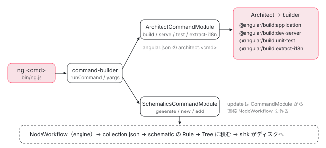
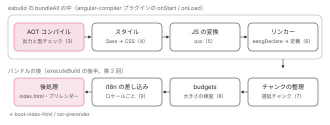

[目次](../README.md) › [CLI とビルド](README.md) › 第 1 回 / 全 16 回

# CLI とビルドの概観：ng コマンド・architect・builder・schematics

> ng のコマンドが「builder を呼ぶもの」（build / serve / test / extract-i18n、architect 経由）と「schematics を走らせるもの」（generate / new / add。update は独自に NodeWorkflow を作る）に分かれる全体図。@angular/build の application builder の段（コンパイル → スタイル → 最適化 → チャンク → budgets → 後処理）と、どの回がどこを扱うかの地図。登場するパッケージ（@angular/cli・@angular/build・@angular-devkit/architect・@angular-devkit/schematics・@schematics/angular）の表。

angular/angular-cli · 読了 約 12 分 · 基礎 · [サイトで読む（デモが動きます）](https://angular-deep-dive-cyan.vercel.app/chapter/cli-overview)

---

`ng build` と `ng generate` は同じ `ng` コマンドですが、動かしている土台が違います。この章では、ng のコマンドが「builder を呼ぶもの」と「schematics を走らせるもの」に分かれる場所をソースで確かめ、application builder の中の段（コンパイル → スタイル → 変換 → チャンク → budgets → 後処理）と、この CLI シリーズのどの回がどこを扱うかの地図を作ります。

読む対象は angular-cli リポジトリの `packages/angular/cli/src/commands/command-config.ts`・`commands/build/cli.ts`・`command-builder/schematics-command-module.ts`、`packages/angular/build/builders.json`、`packages/angular_devkit/build_angular/builders.json`、`packages/schematics/angular/utility/workspace-models.ts` です。

1. **1. 概観**（この章）
2. [2. ng build の段取り](02-build.md)
3. [3. AotCompilation](03-cli-angular-compilation.md)
4. [4. コンポーネントのスタイル](04-cli-component-styles.md)
5. [5. oxc の変換](05-cli-javascript-transformer.md)
6. [6. リンカー](06-cli-linker.md)
7. [7. 遅延チャンク](07-cli-code-splitting.md)
8. [8. budgets](08-cli-budgets.md)
9. [9. i18n](09-cli-i18n.md)
10. [10. 再ビルドとキャッシュ](10-cli-cache-watch.md)
11. [11. HMR](11-cli-hmr.md)
12. [12. unit-test と Vitest](12-cli-unit-test.md)
13. [13. Tree と sink](13-schematics.md)
14. [14. Rule の組み立て](14-schematics-rules.md)
15. [15. ng generate component](15-schematics-component.md)
16. [16. ng add と ng update](16-cli-add-update.md)

> [!TIP]
> **新卒エンジニアへ**
>
> `ng` を打ってから `angular.json` の builder が動き出すまで（`bin/ng.js` → `runCommand` → yargs → Architect）は、起動の全手順シリーズの [ng コマンドの起動](../boot/01-boot-ng-command.md)と[architect が builder を探す](../boot/02-boot-architect.md)で 1 行ずつ読みました。この章はその先の「地図」です。同じ所はもう一度読みません。

## 1. コマンドの一覧と、遅延 import

📄 `angular-cli/packages/angular/cli/src/commands/command-config.ts` L11–35 （▶ の行: 14, 21, 25, 27–29, 34）

```ts
11 │ export type CommandNames =
12 │   | 'add'
13 │   | 'analytics'
14 ▶   | 'build'
15 │   | 'cache'
16 │   | 'completion'
17 │   | 'config'
18 │   | 'deploy'
19 │   | 'e2e'
20 │   | 'extract-i18n'
21 ▶   | 'generate'
22 │   | 'lint'
23 │   | 'make-this-awesome'
24 │   | 'mcp'
25 ▶   | 'new'
26 │   | 'run'
27 ▶   | 'serve'
28 ▶   | 'test'
29 ▶   | 'update'
30 │   | 'version';
31 │ 
32 │ export interface CommandConfig {
33 │   aliases?: string[];
34 ▶   factory: () => Promise<{ default: CommandModuleConstructor }>;
35 │ }
```

11〜30 行目が `ng` のサブコマンドの名前の全部です（19 個）。34 行目、それぞれのコマンドは `factory`（クラスを返す動的 `import()`）として登録されます。`ng build` を打ったときに `generate` のコードは読み込まれません。どのファイルを import するかは同じファイルの `RootCommands` に書かれていて、文字列がクラスになる行は[起動の章の 6 節](../boot/01-boot-ng-command.md)で読みました。

大事なのは import された先のクラスが**何を継承しているか**です。そこで 2 つに分かれます。

## 2. builder を呼ぶコマンド：ArchitectCommandModule

📄 `angular-cli/packages/angular/cli/src/commands/build/cli.ts` L9–24 （▶ の行: 10, 15, 18–19）

```ts
 9 │ import { join } from 'node:path';
10 ▶ import { ArchitectCommandModule } from '../../command-builder/architect-command-module';
11 │ import { CommandModuleImplementation } from '../../command-builder/command-module';
12 │ import { RootCommands } from '../command-config';
13 │ 
14 │ export default class BuildCommandModule
15 ▶   extends ArchitectCommandModule
16 │   implements CommandModuleImplementation
17 │ {
18 ▶   multiTarget = false;
19 ▶   command = 'build [project]';
20 │   aliases = RootCommands['build'].aliases;
21 │   describe =
22 │     'Compiles an Angular application or library into an output directory named dist/ at the given output path.';
23 │   longDescriptionPath = join(__dirname, 'long-description.md');
24 │ }
```

`ng build` のクラスの中身はこれだけです。15 行目で `ArchitectCommandModule` を継承し、自分では何もビルドしません。19 行目の `'build [project]'` が yargs に渡すコマンドの書式、18 行目の `multiTarget = false` は「プロジェクトを 1 つに決める」という指定です。実際の処理は親クラスが、コマンド名 `build` をそのままターゲット名にして `angular.json` の `architect.build.builder` を探し、Architect に実行させます（[boot-architect](../boot/02-boot-architect.md)）。

`commands/*/cli.ts` を全部開いて `extends` を見ると、次のように分かれます。

| コマンド | 継承しているクラス | 走るもの |
| --- | --- | --- |
| `build``serve``test``extract-i18n``e2e``lint``deploy` | `ArchitectCommandModule` | `angular.json` の同名ターゲットの builder |
| `run` | `ArchitectBaseCommandModule` | `project:target` で指定した任意の builder |
| `generate``new``add` | `SchematicsCommandModule` | collection の schematic |
| `update` | `CommandModule`（直接） | 自分で `new NodeWorkflow(...)` を作り、パッケージの migration の schematic を走らせる（[第 16 回](16-cli-add-update.md)） |
| `version``config``cache``analytics``completion``mcp` ほか | `CommandModule` | コマンド自身の処理（builder も schematic も使わない） |

## 3. schematics を走らせるコマンド：SchematicsCommandModule

📄 `angular-cli/packages/angular/cli/src/command-builder/schematics-command-module.ts` L332–348 （▶ の行: 332, 334–336, 340, 346）

```ts
332 ▶   protected async runSchematic(options: {
333 │     executionOptions: SchematicsExecutionOptions;
334 ▶     schematicOptions: OtherOptions;
335 ▶     collectionName: string;
336 ▶     schematicName: string;
337 │   }): Promise<number> {
338 │     const { logger } = this.context;
339 │     const { schematicOptions, executionOptions, collectionName, schematicName } = options;
340 ▶     const workflow = await this.getOrCreateWorkflowForExecution(collectionName, executionOptions);
341 │ 
342 │     if (!schematicName) {
343 │       throw new Error('schematicName cannot be undefined.');
344 │     }
345 │ 
346 ▶     const { unsubscribe, files } = subscribeToWorkflow(workflow, logger);
347 │ 
348 │     try {
```

`ng generate` / `ng new` / `ng add` は最後にこの `runSchematic` に来ます。引数は 334〜336 行目、`schematicOptions`（コマンドラインのオプション）・`collectionName`（例: `@schematics/angular`）・`schematicName`（例: `component`）です。340 行目で `NodeWorkflow`（`@angular-devkit/schematics/tools` の、ディスクを相手にする実行環境）を作り、346 行目で「どのファイルを作った・変えた」のログを受け取る購読を始めます。このすぐ後で `workflow.execute({ collection, schematic, options })` を呼んで実行します（その行は[第 15 回](15-schematics-component.md)で引用します）。

builder 側と違い、ここには `angular.json` のターゲットも Architect も出てきません。schematic は「仮想のファイルツリー（`Tree`）に変更を積み、最後にまとめてディスクへ書く」仕組みで、その中身は[第 13 回](13-schematics.md)から読みます。



*ng のコマンドは、継承しているクラスで 2 本に分かれる。上は angular.json の builder、下は collection の schematic。*

## 4. builder の一覧：@angular/build と @angular-devkit/build-angular

📄 `angular-cli/packages/angular/build/builders.json` L13–33 （▶ の行: 13–14, 18, 23, 28–29, 31）

```json
13 ▶     "extract-i18n": {
14 ▶       "implementation": "./src/builders/extract-i18n/index",
15 │       "schema": "./src/builders/extract-i18n/schema.json",
16 │       "description": "Extract i18n messages from an application."
17 │     },
18 ▶     "karma": {
19 │       "implementation": "./src/builders/karma",
20 │       "schema": "./src/builders/karma/schema.json",
21 │       "description": "Run Karma unit tests."
22 │     },
23 ▶     "ng-packagr": {
24 │       "implementation": "./src/builders/ng-packagr/index",
25 │       "schema": "./src/builders/ng-packagr/schema.json",
26 │       "description": "Build a library with ng-packagr."
27 │     },
28 ▶     "unit-test": {
29 ▶       "implementation": "./src/builders/unit-test",
30 │       "schema": "./src/builders/unit-test/schema.json",
31 ▶       "description": "[EXPERIMENTAL] Run application unit tests."
32 │     }
33 │   }
```

`@angular/build` の `builders.json` の後半です。前半の `application` と `dev-server` の項は[boot-architect の 5 節](../boot/02-boot-architect.md)で読みました。13 行目 `extract-i18n`（翻訳用メッセージの抽出、[第 9 回](09-cli-i18n.md)）、18 行目 `karma`、23 行目 `ng-packagr`（ライブラリのビルド）、28〜31 行目 `unit-test`（説明はまだ `[EXPERIMENTAL]`。Vitest で動かす、[第 12 回](12-cli-unit-test.md)）。このサイトの `angular.json` は `build` が `@angular/build:application`、`serve` が `@angular/build:dev-server`、`test` が `@angular/build:unit-test` です。

📄 `angular-cli/packages/angular_devkit/build_angular/builders.json` L1–19 （▶ の行: 4, 10–11, 15）

```json
 1 │ {
 2 │   "$schema": "../architect/src/builders-schema.json",
 3 │   "builders": {
 4 ▶     "application": "@angular/build:application",
 5 │     "app-shell": {
 6 │       "implementation": "./src/builders/app-shell",
 7 │       "schema": "./src/builders/app-shell/schema.json",
 8 │       "description": "Build a server application and a browser application, then render the index.html and use it for the browser output."
 9 │     },
10 ▶     "browser": {
11 ▶       "implementation": "./src/builders/browser",
12 │       "schema": "./src/builders/browser/schema.json",
13 │       "description": "Build a browser application."
14 │     },
15 ▶     "browser-esbuild": {
16 │       "implementation": "./src/builders/browser-esbuild",
17 │       "schema": "./src/builders/browser-esbuild/schema.json",
18 │       "description": "Build a browser application."
19 │     },
```

もう 1 つの builder パッケージ `@angular-devkit/build-angular` です。4 行目、`application` は実装を持たず、`"@angular/build:application"` という**別名**（文字列）です。Architect は文字列の項を見ると、その名前の builder を探し直します。10〜11 行目の `browser` は自前の実装（`src/builders/browser`）を持ち、こちらが webpack を使う古い builder です。

## 5. application builder の中の段と、この シリーズの地図

`ng build` が呼ぶ `@angular/build:application` の中は、`buildApplicationInternal` → `runEsBuildBuildAction` → `executeBuild` の順に入ります（入口は[boot-application-build](../boot/04-boot-application-build.md)）。`executeBuild` の中で処理は次の段に並びます。各段の数字が、その段を詳しく読む回です。



*executeBuild の段。上段は esbuild のバンドル中に起きること、下段はバンドルが終わってからの段。（）内が扱う回。*

1. **AOT コンパイル（第 3 回）**

   esbuild が最初のファイルを読む前に、Angular コンパイラ（`NgtscProgram`）がプロジェクト全体を解析して JS を出し、型チェックは別に回します。
2. **スタイル（第 4 回）**

   コンパイラが `styleUrl` や `styles` を見つけるたびに、CLI 側の esbuild で Sass などを CSS にして返します。
3. **JS の変換（第 5 回）とリンカー（第 6 回）**

   esbuild が読む `.js`（`node_modules` の `@angular/*` など）を oxc で変換します。ライブラリに残る部分コンパイルの宣言（`ɵɵngDeclareComponent`）はリンカーが完全な定義に直します。
4. **チャンクの整理（第 7 回）と budgets（第 8 回）**

   esbuild の出力のうち遅延チャンクが一定数以上あればまとめ直し、出来上がったファイルの大きさを `angular.json` の `budgets` と比べます。
5. **i18n（第 9 回）と後処理**

   翻訳を差し込むならロケールごとに、そうでなければ 1 回だけ、index.html の生成・プリレンダー・service worker を行います（[boot-index-html](../boot/05-boot-index-html.md)・[ssr-prerender](../platform/06-ssr-prerender.md)）。
6. **書き出し（第 2 回）**

   ここまでメモリ上にあったファイルを `dist/` に書き、表（`Initial chunk files` ...）を出します。

第 10〜12 回は、同じ段を**何度も**回す使い方です。`ng serve` や `--watch` の再ビルド（[第 10 回](10-cli-cache-watch.md)）、テンプレートだけを差し替える HMR（[第 11 回](11-cli-hmr.md)）、テスト用にビルドして Vitest に渡す `unit-test`（[第 12 回](12-cli-unit-test.md)）。第 13〜16 回は 3 節の schematics 側です。

## 6. 登場するパッケージ

| npm パッケージ | repo 内のパス | 役割 | 主な回 |
| --- | --- | --- | --- |
| `@angular/cli` | `packages/angular/cli` | `ng` 本体。コマンドの登録（`command-builder/`）と各コマンド（`commands/`） | 1・16 |
| `@angular-devkit/architect` | `packages/angular_devkit/architect` | builder の名前を実装に解決し、ジョブとして実行する | boot-architect |
| `@angular/build` | `packages/angular/build` | application / dev-server / unit-test / extract-i18n などの builder。esbuild・Vite・oxc を使う | 2〜12 |
| `@angular-devkit/build-angular` | `packages/angular_devkit/build_angular` | webpack 系の古い builder（browser / server / app-shell ...）と、`application` の別名 | 1 |
| `@angular-devkit/core` | `packages/angular_devkit/core` | 共通の部品（`json` の schema 検証、`workspace` の読み書き、`virtual-fs`、`logger`） | — |
| `@angular-devkit/schematics` | `packages/angular_devkit/schematics` | schematics の仕組み（`tree`・`rules`・`engine`・`sink`・`workflow`） | 13・14 |
| `@schematics/angular` | `packages/schematics/angular` | `ng generate component` などの schematic と、`ng update` の migration | 15・16 |
| `@angular/ssr` | `packages/angular/ssr` | サーバー描画の実行時（`AngularAppEngine` など）。プリレンダーもこれを呼ぶ | ssr シリーズ |

`@angular/cli` の `package.json` は `@angular-devkit/architect`・`core`・`schematics`・`@schematics/angular` に依存しますが、`@angular/build` には依存しません（`ng update` で一緒に上げる `packageGroup` に名前が並ぶだけです）。builder はプロジェクトの `devDependencies` に入っている `@angular/build` から、`angular.json` の名前で読まれます。

> **🧪 DEMO — このページを配っているビルドの出力**
>
> ボタンを押すと、このページの HTML（`location.pathname`）と、プリレンダー前の `index.csr.html` を fetch して、`<script type="module">`・`modulepreload`・`stylesheet` を並べます。最後に `performance` の記録から、ページを開いてから実際に読んだ JS のうち HTML に書かれていなかったものを数えます。
>
> ▶ [このデモはサイトで動かせます](https://angular-deep-dive-cyan.vercel.app/chapter/cli-overview)

## 聞かれそうな質問

**Q. `@angular-devkit/build-angular` と `@angular/build` は何が違いますか？**

📄 `angular-cli/packages/schematics/angular/utility/workspace-models.ts` L20–39 （▶ の行: 21, 24, 30, 35, 38）

```ts
20 │ export enum Builders {
21 ▶   Application = '@angular-devkit/build-angular:application',
22 │   AppShell = '@angular-devkit/build-angular:app-shell',
23 │   Server = '@angular-devkit/build-angular:server',
24 ▶   Browser = '@angular-devkit/build-angular:browser',
25 │   SsrDevServer = '@angular-devkit/build-angular:ssr-dev-server',
26 │   Prerender = '@angular-devkit/build-angular:prerender',
27 │   BrowserEsbuild = '@angular-devkit/build-angular:browser-esbuild',
28 │   Karma = '@angular-devkit/build-angular:karma',
29 │   BuildKarma = '@angular/build:karma',
30 ▶   BuildUnitTest = '@angular/build:unit-test',
31 │   TsLint = '@angular-devkit/build-angular:tslint',
32 │   NgPackagr = '@angular-devkit/build-angular:ng-packagr',
33 │   BuildNgPackagr = '@angular/build:ng-packagr',
34 │   DevServer = '@angular-devkit/build-angular:dev-server',
35 ▶   BuildDevServer = '@angular/build:dev-server',
36 │   ExtractI18n = '@angular-devkit/build-angular:extract-i18n',
37 │   BuildExtractI18n = '@angular/build:extract-i18n',
38 ▶   BuildApplication = '@angular/build:application',
39 │ }
```

`@schematics/angular` が `angular.json` に書く builder 名の一覧です。21・24 行目が `@angular-devkit/build-angular`（古い）、30・35・38 行目が `@angular/build`（新しい）。`ng new` の application schematic は 38 行目の `BuildApplication` を書きます（[zoneless-default](../zoneless/01-zoneless-default.md) で引用した行）。前の 4 節の 4 行目のとおり `@angular-devkit/build-angular:application` と書いても中身は `@angular/build` の同じ builder です。違いが出るのは `browser`・`server`・`app-shell`・`prerender` など webpack 時代の builder で、これらは `@angular-devkit/build-angular` にしかありません。

**Q. webpack はもう使わないのですか？**

`@angular/build` の `package.json` の依存には webpack がなく、esbuild・Vite・rolldown・oxc-parser が並びます。4 節で見た `@angular/build` の builder（13〜33 行目と前半の `application`・`dev-server`）はどれも webpack を使いません。webpack が動くのは、`angular.json` に `@angular-devkit/build-angular:browser` などを書いた古いプロジェクトだけです（このパッケージの `package.json` は webpack 5 に依存しています）。

**Q. `ng generate` と `ng build` が同じ `ng` で動くのはなぜですか？**

どちらも `command-config.ts` の 34 行目の `factory` で遅延 import される「yargs のコマンドのクラス」だからです。`ng` は打たれた名前のクラスだけを読み込み、その `run` を呼びます。違いはクラスの親で、`build` は 15 行目の `ArchitectCommandModule`（`angular.json` のターゲット → builder）、`generate` は `SchematicsCommandModule`（340 行目の `NodeWorkflow` で schematic を実行）です。両方が共通で使うのは `@angular-devkit/core` の workspace（`angular.json` の読み込み）とロガーくらいです。

**Q. `ng test` は何を動かしますか？**

`test` も `ArchitectCommandModule` なので、`angular.json` の `test` ターゲットの builder です。このサイトでは 28〜31 行目の `@angular/build:unit-test` で、アプリと同じ application builder の仕組みでテストをビルドし、Vitest に渡します（[第 12 回](12-cli-unit-test.md)）。`karma` と書いてあれば 18〜21 行目の Karma の builder が動きます。

## 読み終えて

- `ng` のコマンドは 19 個。それぞれのクラスは遅延 import され、親クラスで「builder を呼ぶもの」と「schematic を走らせるもの」に分かれる。
- `ng build` のクラスは `ArchitectCommandModule` を継承するだけで、ビルドするのは `angular.json` に書かれた `@angular/build:application`。
- `ng generate`・`new`・`add` は `runSchematic` で `NodeWorkflow` を作り、collection の schematic を実行する。`update` は自分で `NodeWorkflow` を作る。
- `@angular-devkit/build-angular:application` は `@angular/build:application` の別名。webpack が動くのは `browser` などの古い builder だけ。
- application builder の段は「コンパイル → スタイル → 変換 → リンカー」がバンドル中、「チャンク → budgets → i18n → 後処理 → 書き出し」がバンドル後。次の回から 1 段ずつ読む。

---

← 前: [インクリメンタルハイドレーション：@defer の hydrate トリガーで必要な所だけ](../platform/15-incremental-hydration.md)  
次: [ng build の段取り：executeBuild と後処理が並べる段](02-build.md) →
