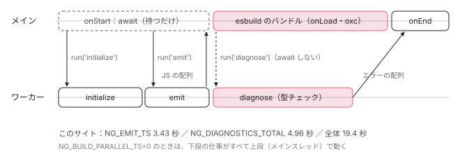

[目次](../README.md) › [CLI とビルド](README.md) › 第 3 回 / 全 16 回

# AotCompilation と並列ワーカー：1 つのプログラムで出力と型チェックを分ける

> compiler-plugin が AngularCompilation（AOT / JIT / 並列）を選ぶ行、ParallelCompilation がワーカー 1 本で AotCompilation を動かし、emit は待ち、diagnose は待たずにバンドルと並行させて onEnd で合流する仕組み（Atomics は Web Worker の同期要求だけ）。AotCompilation.initialize が NgtscProgram を作り、emitAffectedFiles で変わったファイルだけを出す行。angular-host はテンプレートを読むだけで、スタイルだけを esbuild 側に回すこと。

angular/angular-cli · 読了 約 14 分 · 発展 · [サイトで読む（デモが動きます）](https://angular-deep-dive-cyan.vercel.app/chapter/cli-angular-compilation)

---

`ng build` の中で Angular コンパイラはどこで動いているのか。答えは「既定では Node.js のワーカースレッドの中」です。この章では、CLI がコンパイラの種類（AOT / JIT / 並列）を選ぶ行、`ParallelCompilation` がワーカーに仕事を頼む行、ワーカーの中の `AotCompilation` が **JS を出す作業（emit）と型チェック（diagnose）を別々に**行い、型チェックだけを esbuild のバンドルと同時に進める仕組みを、1 行ずつ追います。

読む対象は angular-cli リポジトリの `packages/angular/build/src/tools/angular/compilation/` の `factory.ts`・`angular-compilation.ts`・`typescript-compilation.ts`・`parallel-compilation.ts`・`parallel-worker.ts`・`aot-compilation.ts`・`compiler-options.ts`・`diagnostics.ts`・`jit-compilation.ts`、`tools/angular/angular-host.ts`、`tools/esbuild/angular/compiler-plugin.ts`、`utils/environment-options.ts` です。

1. [1. 概観](01-cli-overview.md)
2. [2. ng build の段取り](02-build.md)
3. **3. AotCompilation**（この章）
4. [4. コンポーネントのスタイル](04-cli-component-styles.md)
5. [5. oxc の変換](05-cli-javascript-transformer.md)
6. [6. リンカー](06-cli-linker.md)
7. [7. 遅延チャンク](07-cli-code-splitting.md)
8. [8. budgets](08-cli-budgets.md)
9. [9. i18n](09-cli-i18n.md)
10. [10. 再ビルドとキャッシュ](10-cli-cache-watch.md)
11. [11. HMR](11-cli-hmr.md)
12. [12. unit-test と Vitest](12-cli-unit-test.md)
13. [13. Tree と sink](13-schematics.md)
14. [14. Rule の組み立て](14-schematics-rules.md)
15. [15. ng generate component](15-schematics-component.md)
16. [16. ng add と ng update](16-cli-add-update.md)

> [!TIP]
> **新卒エンジニアへ**
>
> angular-compiler プラグインの `onStart` が「esbuild が最初のファイルを読む前に全部コンパイルする」こと、`NgtscProgram` を作って `analyzeAsync` で解析すること、`emitAffectedFiles` の前半（Angular の変換器を足して TypeScript に emit させる所）は、[boot-application-build の 4 節](../boot/04-boot-application-build.md)で読みました。この章はその「どのスレッドで」「emit と型チェックをどう分けて」を読みます。

## 0. 全体の流れ

1. **選ぶ**

   `createAngularCompilation` が、既定では `ParallelCompilation` を返す（1 節）。
2. **ワーカーを 1 本立てる**

   `ParallelCompilation` は `parallel-worker.ts` を読むワーカーを 1 本だけ持つ。ワーカーの中で本物の `AotCompilation` が動く（2〜3 節）。
3. **initialize**

   ワーカーで `NgtscProgram` と TypeScript の BuilderProgram を作り、解析し、「影響を受けたファイル」を求める（4 節）。
4. **emit を待つ**

   プラグインの `onStart` が `emitAffectedFiles` を待ち、ファイルごとの JS をキャッシュに入れる（5 節）。
5. **diagnose は待たない**

   `diagnoseFiles` を呼ぶが `await` せず、`onStart` を終える。esbuild はバンドルを始め、ワーカーは同時に型チェックを進める（6 節）。
6. **onEnd で合流**

   バンドルが終わった `onEnd` で型チェックの結果を待ち、エラーがあればビルドのエラーにする（7 節）。

## 1. createAngularCompilation：3 つのうちどれを作るか

📄 `angular-cli/packages/angular/build/src/tools/angular/compilation/factory.ts` L23–49 （▶ の行: 26, 28, 32, 34–35, 37, 41, 45）

```ts
23 │ export async function createAngularCompilation(
24 │   mode: boolean | AngularCompilationMode,
25 │   browserOnlyBuild: boolean,
26 ▶   parallel: boolean = useParallelTs,
27 │ ): Promise<AngularCompilation> {
28 ▶   if (mode === 'transform') {
29 │     throw new Error('Transform compilation mode is not supported.');
30 │   }
31 │ 
32 ▶   const isJit = mode === true || mode === 'jit';
33 │ 
34 ▶   if (parallel) {
35 ▶     const { ParallelCompilation } = await import('./parallel-compilation');
36 │ 
37 ▶     return new ParallelCompilation(isJit, browserOnlyBuild);
38 │   }
39 │ 
40 │   if (isJit) {
41 ▶     const { JitCompilation } = await import('./jit-compilation');
42 │ 
43 │     return new JitCompilation(browserOnlyBuild);
44 │   } else {
45 ▶     const { AotCompilation } = await import('./aot-compilation');
46 │ 
47 │     return new AotCompilation(browserOnlyBuild);
48 │   }
49 │ }
```

`executeBuild` は `createAngularCompilation(!!options.jit, !options.serverEntryPoint)` と呼びます（[第 2 回](02-build.md)の 1 節）。32 行目、`aot: false` なら JIT。26 行目、3 つ目の引数 `parallel` の既定値は `useParallelTs` で、34〜37 行目、**並列なら AOT でも JIT でも `ParallelCompilation`** を返します。並列でないときだけ、41 行目の `JitCompilation` か 45 行目の `AotCompilation` をこのスレッドで直接作ります。どれも動的 import なので、使わない実装は読み込まれません。28 行目の `'transform'` は型にあるだけで、まだ使えません。

📄 `angular-cli/packages/angular/build/src/utils/environment-options.ts` L134–157 （▶ の行: 137, 142, 152）

```ts
134 │ /**
135 │  * When `NG_BUILD_PARALLEL_TS` is set to `0` or `false`, parallel TypeScript compilation is disabled.
136 │  */
137 ▶ export const useParallelTs = parseTristate(process.env['NG_BUILD_PARALLEL_TS']) !== false;
138 │ 
139 │ /**
140 │  * When `NG_BUILD_DEBUG_PERF` is enabled, performance debugging information is printed.
141 │  */
142 ▶ export const debugPerformance = parseTristate(process.env['NG_BUILD_DEBUG_PERF']) === true;
143 │ 
144 │ /**
145 │  * When `NG_BUILD_WATCH_ROOT` is enabled, the build will watch the root directory for changes.
146 │  */
147 │ export const shouldWatchRoot = parseTristate(process.env['NG_BUILD_WATCH_ROOT']) === true;
148 │ 
149 │ /**
150 │  * When `NG_BUILD_TYPE_CHECK` is set to `0` or `false`, type checking is disabled.
151 │  */
152 ▶ export const useTypeChecking = parseTristate(process.env['NG_BUILD_TYPE_CHECK']) !== false;
153 │ 
154 │ /**
155 │  * When `NG_BUILD_LOGS_JSON` is enabled, build logs will be output in JSON format.
156 │  */
157 │ export const useJSONBuildLogs = parseTristate(process.env['NG_BUILD_LOGS_JSON']) === true;
```

137 行目、`useParallelTs` は環境変数 `NG_BUILD_PARALLEL_TS` が `0` か `false` のときだけ偽です。つまり既定は並列。152 行目の `NG_BUILD_TYPE_CHECK` は型チェックそのものを減らすスイッチで、6 節で使われます。

## 2. 3 つの実装が共有する形：AngularCompilation

📄 `angular-cli/packages/angular/build/src/tools/angular/compilation/angular-compilation.ts` L42–72 （▶ の行: 42, 45–47, 51, 57, 63, 69, 71）

```ts
42 ▶ export enum DiagnosticModes {
43 │   None = 0,
44 │   Option = 1 << 0,
45 ▶   Syntactic = 1 << 1,
46 ▶   Semantic = 1 << 2,
47 ▶   All = Option | Syntactic | Semantic,
48 │ }
49 │ 
50 │ export abstract class AngularCompilation {
51 ▶   abstract initialize(
52 │     tsconfig: string,
53 │     hostOptions: AngularHostOptions,
54 │     compilerOptionOverrides?: CompilerOptionOverrides,
55 │   ): Promise<AngularCompilationResult>;
56 │ 
57 ▶   emitAffectedFiles(): Iterable<EmitFileResult> | Promise<Iterable<EmitFileResult>> {
58 │     return [];
59 │   }
60 │ 
61 │   transformFile?(filename: string, content: string): Promise<FileTransformResult | null>;
62 │ 
63 ▶   async diagnoseFiles(
64 │     modes?: DiagnosticModes,
65 │   ): Promise<{ errors?: PartialMessage[]; warnings?: PartialMessage[] }> {
66 │     return {};
67 │   }
68 │ 
69 ▶   update?(files: Set<string>): Promise<void>;
70 │ 
71 ▶   close?(): Promise<void>;
72 │ }
```

プラグインから見えるのはこの抽象クラスだけです。51 行目 `initialize`（プログラムを作って解析）、57 行目 `emitAffectedFiles`（JS を出す）、63 行目 `diagnoseFiles`（診断を集める）、69 行目 `update`（変わったファイルを知らせる、watch 用）、71 行目 `close`。emit と diagnose が**別のメソッド**であることが、この章の要です。42〜47 行目の `DiagnosticModes` はビットの組み合わせで、`Option`（設定の診断）・`Syntactic`（構文）・`Semantic`（型）を選んで頼めます。

📄 `angular-cli/packages/angular/build/src/tools/angular/compilation/typescript-compilation.ts` L25–61 （▶ の行: 28–29, 38, 44, 47, 49–50, 59）

```ts
25 │ export abstract class TypeScriptCompilation extends AngularCompilation {
26 │   static #angularCompilerCliModule?: typeof ng;
27 │ 
28 ▶   static async loadCompilerCli(): Promise<typeof ng> {
29 ▶     TypeScriptCompilation.#angularCompilerCliModule ??= await import('@angular/compiler-cli');
30 │ 
31 │     return TypeScriptCompilation.#angularCompilerCliModule;
32 │   }
33 │ 
34 │   protected async loadConfiguration(
35 │     tsconfig: string,
36 │     compilerOptionOverrides?: CompilerOptionOverrides,
37 │   ): Promise<TransformedConfiguration> {
38 ▶     const { readConfiguration } = await TypeScriptCompilation.loadCompilerCli();
39 │ 
40 │     const {
41 │       options: originalCompilerOptions,
42 │       rootNames,
43 │       errors,
44 ▶     } = profileSync('NG_READ_CONFIG', () =>
45 │       readConfiguration(tsconfig, {
46 │         // Angular specific configuration defaults and overrides to ensure a functioning compilation.
47 ▶         suppressOutputPathCheck: true,
48 │         outDir: undefined,
49 ▶         sourceMap: false,
50 ▶         declaration: false,
51 │         declarationMap: false,
52 │         allowEmptyCodegenFiles: false,
53 │         annotationsAs: 'decorators',
54 │         enableResourceInlining: false,
55 │         supportTestBed: false,
56 │         supportJitMode: false,
57 │         // Disable removing of comments as TS is quite aggressive with these and can
58 │         // remove important annotations, such as /* @__PURE__ */ and comments like /* vite-ignore */.
59 ▶         removeComments: false,
60 │       }),
61 │     );
```

AOT と JIT の共通の親 `TypeScriptCompilation` です。28〜32 行目の `loadCompilerCli` が `@angular/compiler-cli` を 1 回だけ動的 import して static のフィールドに覚えます（`NgtscProgram` もここから取り出す）。38〜45 行目で `readConfiguration` に `tsconfig.app.json` を読ませ、47〜59 行目で上書きを渡します。49〜50 行目、ソースマップも `.d.ts` も TypeScript には出させません（ソースマップは後でインラインにする）。59 行目、`/* @__PURE__ */` などの注釈を消さないように、コメントは残します。

## 3. ParallelCompilation：ワーカー 1 本に頼む

📄 `angular-cli/packages/angular/build/src/tools/angular/compilation/parallel-compilation.ts` L31–49 （▶ の行: 31, 44–47）

```ts
31 ▶ export class ParallelCompilation extends AngularCompilation {
32 │   readonly #worker: WorkerPool;
33 │   #webWorkerChannel?: MessageChannel;
34 │ 
35 │   constructor(
36 │     private readonly jit: boolean,
37 │     private readonly browserOnlyBuild: boolean,
38 │   ) {
39 │     super();
40 │ 
41 │     // TODO: Convert to import.meta usage during ESM transition
42 │     const localRequire = createRequire(__filename);
43 │ 
44 ▶     this.#worker = new WorkerPool({
45 ▶       maxThreads: 1,
46 ▶       idleTimeout: Infinity,
47 ▶       filename: localRequire.resolve('./parallel-worker'),
48 │     });
49 │   }
```

44〜48 行目、`WorkerPool`（Piscina というワーカースレッドのプールを CLI 向けにした子クラス）を作ります。45 行目 `maxThreads: 1`、**ワーカーは 1 本だけ**です。46 行目 `idleTimeout: Infinity` で、watch の間も止めません（プログラムの状態をワーカーの中に持ち続けるため）。「並列」とは、型チェックを何本にも分けることではなく、**コンパイラの仕事をメインスレッドから外し、esbuild の作業と同時に進める**ことです。クラスの上のコメントは、もう 1 つの利点として、ワーカーは別のメモリ領域を持つので大きなアプリでもメインのプロセスのメモリ設定を変えずに済む、と書いています。

📄 `angular-cli/packages/angular/build/src/tools/angular/compilation/parallel-compilation.ts` L56–66 （▶ の行: 56, 58, 61–63）

```ts
56 ▶     const stylesheetChannel = new MessageChannel();
57 │     // The request identifier is required because Angular can issue multiple concurrent requests
58 ▶     stylesheetChannel.port1.on(
59 │       'message',
60 │       ({ requestId, data, containingFile, stylesheetFile, order, className }) => {
61 ▶         hostOptions
62 ▶           .transformStylesheet(data, containingFile, stylesheetFile, order, className)
63 ▶           .then((value) => stylesheetChannel.port1.postMessage({ requestId, value }))
64 │           .catch((error) => stylesheetChannel.port1.postMessage({ requestId, error }));
65 │       },
66 │     );
```

📄 `angular-cli/packages/angular/build/src/tools/angular/compilation/parallel-compilation.ts` L70–105 （▶ の行: 72, 74, 77, 82–83, 90, 97–99, 102–103）

```ts
 70 │     // The web worker processing is a synchronous operation and uses shared memory combined with
 71 │     // the Atomics API to block execution here until a response is received.
 72 ▶     const webWorkerChannel = new MessageChannel();
 73 │     this.#webWorkerChannel = webWorkerChannel;
 74 ▶     const webWorkerSignal = new Int32Array(new SharedArrayBuffer(4));
 75 │     webWorkerChannel.port1.on('message', ({ workerFile, containingFile }) => {
 76 │       try {
 77 ▶         const workerCodeFile = hostOptions.processWebWorker(workerFile, containingFile);
 78 │         webWorkerChannel.port1.postMessage({ workerCodeFile });
 79 │       } catch (error) {
 80 │         webWorkerChannel.port1.postMessage({ error });
 81 │       } finally {
 82 ▶         Atomics.store(webWorkerSignal, 0, 1);
 83 ▶         Atomics.notify(webWorkerSignal, 0);
 84 │       }
 85 │     });
 86 │ 
 87 │     let success = false;
 88 │     try {
 89 │       // Execute the initialize function in the worker thread
 90 ▶       const result = await this.#worker.run(
 91 │         {
 92 │           fileReplacements: hostOptions.fileReplacements,
 93 │           tsconfig,
 94 │           jit: this.jit,
 95 │           browserOnlyBuild: this.browserOnlyBuild,
 96 │           compilerOptionOverrides,
 97 ▶           stylesheetPort: stylesheetChannel.port2,
 98 ▶           webWorkerPort: webWorkerChannel.port2,
 99 ▶           webWorkerSignal,
100 │         },
101 │         {
102 ▶           name: 'initialize',
103 ▶           transferList: [stylesheetChannel.port2, webWorkerChannel.port2],
104 │         },
105 │       );
```

1. **56〜66 行目：スタイルの通り道**

   コンパイラはワーカーの中ですが、Sass などを CSS にするスタイルの束ね役（`hostOptions.transformStylesheet`）はメインスレッドの esbuild 側にあります。`MessageChannel` を作り、56 行目の片側をメインに残し、ワーカーから「このスタイルを変換して」と来たら 62 行目で変換し、63 行目で同じ `requestId` を付けて返します。中身は[第 4 回](04-cli-component-styles.md)。
2. **72〜85 行目：Web Worker の通り道（ここだけ Atomics）**

   アプリの中の `new Worker(new URL('./x.worker', import.meta.url))` を見つけたとき、コンパイラは変換の途中で**同期的に**「そのワーカーのファイルをバンドルした名前」を必要とします。74 行目で 4 バイトの `SharedArrayBuffer` を作り、77 行目でメイン側がバンドルして返したら、82〜83 行目の `Atomics.store` / `Atomics.notify` で「返事を置いた」と知らせます。
3. **90〜105 行目：`initialize` をワーカーで実行**

   90 行目の `this.#worker.run(引数, { name: 'initialize' })` は、ワーカーのファイルが export する `initialize` 関数を呼びます。97〜99 行目でポートと共有バッファを渡し、103 行目の `transferList` でポートの持ち主をワーカーに移します。戻り値は Promise で、メインスレッドは**ふつうに await するだけ**です（ここは Atomics ではない）。

📄 `angular-cli/packages/angular/build/src/tools/angular/compilation/parallel-compilation.ts` L118–140 （▶ の行: 121–123, 131, 139）

```ts
118 │   override async diagnoseFiles(
119 │     modes = DiagnosticModes.All,
120 │   ): Promise<{ errors?: PartialMessage[]; warnings?: PartialMessage[] }> {
121 ▶     const { timings, ...result } = await this.#worker.run(modes, { name: 'diagnose' });
122 ▶     if (timings) {
123 ▶       mergeCumulativeDurations(timings);
124 │     }
125 │ 
126 │     return result;
127 │   }
128 │ 
129 │   override async emitAffectedFiles(): Promise<Iterable<EmitFileResult>> {
130 │     try {
131 ▶       return await this.#worker.run(undefined, { name: 'emit' });
132 │     } finally {
133 │       this.#webWorkerChannel?.port1.close();
134 │       this.#webWorkerChannel = undefined;
135 │     }
136 │   }
137 │ 
138 │   override update(files: Set<string>): Promise<void> {
139 ▶     return this.#worker.run(files, { name: 'update' });
140 │   }
```

残りのメソッドも全部、ワーカーの同名の関数を呼ぶだけです。121 行目 `'diagnose'`、131 行目 `'emit'`、139 行目 `'update'`。122〜123 行目、ワーカーで測った時間（`NG_BUILD_DEBUG_PERF` のとき）をメインの表に足します。ワーカーは 1 本なので、Piscina は頼まれた順に 1 つずつ実行します。

## 4. ワーカーの中：本物の AotCompilation

📄 `angular-cli/packages/angular/build/src/tools/angular/compilation/parallel-worker.ts` L40–53 （▶ の行: 40, 44, 50–52）

```ts
40 ▶ export async function initialize(request: InitRequest): Promise<AngularCompilationResult> {
41 │   activeWebWorkerPort?.close();
42 │   activeWebWorkerPort = request.webWorkerPort;
43 │ 
44 ▶   const currentModifiedFiles = new Set(modifiedFiles);
45 │   modifiedFiles.clear();
46 │ 
47 │   let success = false;
48 │   try {
49 │     await initializeHash();
50 ▶     compilation ??= request.jit
51 ▶       ? new JitCompilation(request.browserOnlyBuild)
52 ▶       : new AotCompilation(request.browserOnlyBuild);
53 │ 
```

50〜52 行目、ワーカーのモジュールの変数 `compilation` に、**初回だけ**`JitCompilation` か `AotCompilation` を作ります（`??=`）。ワーカーは止まらないので、2 回目の `initialize`（再ビルド）では前回のプログラムを持ったままの同じインスタンスが使われ、差分だけのコンパイルになります（[第 10 回](10-cli-cache-watch.md)）。

📄 `angular-cli/packages/angular/build/src/tools/angular/compilation/parallel-worker.ts` L99–111 （▶ の行: 100–101, 103–104）

```ts
 99 │         processWebWorker(workerFile, containingFile) {
100 ▶           Atomics.store(request.webWorkerSignal, 0, 0);
101 ▶           request.webWorkerPort.postMessage({ workerFile, containingFile });
102 │ 
103 ▶           Atomics.wait(request.webWorkerSignal, 0, 0);
104 ▶           const result = receiveMessageOnPort(request.webWorkerPort)?.message;
105 │ 
106 │           if (result?.error) {
107 │             throw result.error;
108 │           }
109 │ 
110 │           return result?.workerCodeFile ?? workerFile;
111 │         },
```

3 節の Web Worker の通り道のワーカー側です。100 行目で印を 0 にし、101 行目でメインに頼み、103 行目の `Atomics.wait` で**このスレッドを止めて**印が 1 になるのを待ちます。104 行目、`receiveMessageOnPort` でイベントループを回さずに返事を取り出します。コンパイラの変換器は同期の関数なので、Promise では待てないためです。

📄 `angular-cli/packages/angular/build/src/tools/angular/compilation/aot-compilation.ts` L72–96 （▶ の行: 73, 78, 80–82, 93–94）

```ts
72 │     // Load the compiler configuration and transform as needed
73 ▶     const {
74 │       compilerOptions,
75 │       rootNames,
76 │       errors: configurationDiagnostics,
77 │       warnings,
78 ▶     } = await this.loadConfiguration(tsconfig, compilerOptionOverrides);
79 │ 
80 ▶     const useTypeScriptTranspilation =
81 ▶       (compilerOptions['_useTypeScriptTranspilation'] as boolean | undefined) ??
82 ▶       !compilerOptions.isolatedModules;
83 │ 
84 │     if (compilerOptions.externalRuntimeStyles) {
85 │       hostOptions.externalStylesheets ??= new Map();
86 │     }
87 │ 
88 │     // Reuse the package.json cache from the previous compilation
89 │     const packageJsonCache = this.#state?.compilerHost
90 │       .getModuleResolutionCache?.()
91 │       ?.getPackageJsonInfoCache();
92 │ 
93 ▶     const useHmr =
94 ▶       compilerOptions['_enableHmr'] &&
95 │       hostOptions.modifiedFiles &&
96 │       hostOptions.modifiedFiles.size <= HMR_MODIFIED_FILE_LIMIT;
```

📄 `angular-cli/packages/angular/build/src/tools/angular/compilation/compiler-options.ts` L112–131 （▶ の行: 115, 118, 124, 129–130）

```ts
112 │   return {
113 │     compilerOptions: {
114 │       ...compilerOptions,
115 ▶       noEmitOnError: false,
116 │       composite: false,
117 │       inlineSources: !!overrides?.sourcemap,
118 ▶       inlineSourceMap: !!overrides?.sourcemap,
119 │       sourceMap: undefined,
120 │       mapRoot: undefined,
121 │       sourceRoot: undefined,
122 │       preserveSymlinks: overrides?.preserveSymlinks,
123 │       externalRuntimeStyles: overrides?.externalRuntimeStyles,
124 ▶       _enableHmr: !!overrides?.enableHmr,
125 │       // TypeScript transpilation is forced if:
126 │       // - isolatedModules is disabled (TS needs full module types to emit JS).
127 │       // - Karma code coverage is active (the coverage instrumentation transformer is Babel-based
128 │       //   and cannot parse raw TypeScript code; Vitest handles coverage instrumentation downstream).
129 ▶       _useTypeScriptTranspilation:
130 ▶         !compilerOptions.isolatedModules || !!overrides?.instrumentForCoverage,
131 │       supportTestBed: !!overrides?.includeTestMetadata,
```

`AotCompilation.initialize` の前半です（`NgtscProgram` を作る所から先は boot-application-build で引用済み）。78 行目の `loadConfiguration` が 2 節の `readConfiguration` と、`compiler-options.ts` の上書きです。129〜130 行目、`isolatedModules` が `false` なら `_useTypeScriptTranspilation` が真になり、TypeScript が TS → JS の変換までします。このサイトの `tsconfig.json` は `isolatedModules: true` なので偽です。80〜82 行目でそれを受け取り、5 節の emit の道が変わります。115 行目、`noEmitOnError: false`（型エラーがあっても emit は止めない）にも注意してください。

📄 `angular-cli/packages/angular/build/src/tools/angular/compilation/aot-compilation.ts` L193–206 （▶ の行: 193–194, 200–203, 205）

```ts
193 ▶     // The affected files walk runs a full semantic type-check as a side effect
194 ▶     // (via `getSemanticDiagnosticsOfNextAffectedFile`). Its result is only consumed to
195 │     // scope Angular template diagnostics and to force re-emit of TS-affected files in the
196 │     // slow TypeScript emit path. When type-checking is disabled, template/semantic
197 │     // diagnostics are already suppressed at the consumption layer (see the compiler-plugin
198 │     // `diagnoseFiles` mask), and in the isolatedModules fast path emit is per-file, so the
199 │     // set is never read. Skip the walk in that case to avoid a discarded semantic pass.
200 ▶     const affectedFiles =
201 ▶       useTypeChecking || useTypeScriptTranspilation
202 ▶         ? profileSync('NG_FIND_AFFECTED', () =>
203 ▶             findAffectedFiles(typeScriptProgram, angularCompiler, usingBuildInfo),
204 │           )
205 ▶         : new Set<ts.SourceFile>();
206 │ 
```

📄 `angular-cli/packages/angular/build/src/tools/angular/compilation/aot-compilation.ts` L230–239 （▶ の行: 234–235, 238）

```ts
230 │     this.#state = new AngularCompilationState(
231 │       angularProgram,
232 │       host,
233 │       typeScriptProgram,
234 ▶       affectedFiles,
235 ▶       affectedFiles.size === 1 ? OptimizeFor.SingleFile : OptimizeFor.WholeProgram,
236 │       createWorkerTransformer(hostOptions.processWebWorker.bind(hostOptions)),
237 │       useTypeScriptTranspilation,
238 ▶       this.#state?.diagnosticCache,
239 │     );
```

解析のあと、200〜205 行目で「前回から影響を受けたファイル」（`affectedFiles`）を求めます。193〜194 行目のコメントのとおり、この走査は TypeScript の型チェックを副作用として行います。235 行目、影響を受けたファイルが 1 つだけならテンプレートの型チェックを `SingleFile` 向けに、それ以外は `WholeProgram` 向けにします。238 行目、前回のテンプレート診断のキャッシュ（`diagnosticCache`）を引き継ぎます。ここまでが 1 回の `initialize` です。

## 5. emit：JS を出す（プラグインは待つ）

プラグインの `onStart` は `initialize` のあと `await compilation.emitAffectedFiles()` し、出てきた「ファイル名 → JS」を `typeScriptFileCache` に入れます（boot-application-build の 4 節）。このサイトのように `_useTypeScriptTranspilation` が偽のときは、`emitAffectedFiles` の後半が仕事をします。

📄 `angular-cli/packages/angular/build/src/tools/angular/compilation/aot-compilation.ts` L395–431 （▶ の行: 396–397, 405–407, 412, 418, 421–422）

```ts
395 │     // Angular may have files that must be emitted but TypeScript does not consider affected
396 ▶     for (const sourceFile of typeScriptProgram.getSourceFiles()) {
397 ▶       if (emittedFiles.has(sourceFile) || angularCompiler.ignoreForEmit.has(sourceFile)) {
398 │         continue;
399 │       }
400 │ 
401 │       if (sourceFile.isDeclarationFile) {
402 │         continue;
403 │       }
404 │ 
405 ▶       if (
406 ▶         angularCompiler.incrementalCompilation.safeToSkipEmit(sourceFile) &&
407 ▶         !affectedFiles.has(sourceFile)
408 │       ) {
409 │         continue;
410 │       }
411 │ 
412 ▶       if (useTypeScriptTranspilation) {
413 │         typeScriptProgram.emit(sourceFile, writeFileCallback, undefined, undefined, transformers);
414 │         continue;
415 │       }
416 │ 
417 │       // When not using TypeScript transpilation, directly apply only Angular specific transformations
418 ▶       const transformResult = ts.transform(
419 │         sourceFile,
420 │         [
421 ▶           ...(transformers.before ?? []),
422 ▶           ...(transformers.after ?? []),
423 │         ] as ts.TransformerFactory<ts.SourceFile>[],
424 │         compilerOptions,
425 │       );
426 │ 
427 │       assert(
428 │         transformResult.transformed.length === 1,
429 │         'TypeScript transforms should not produce multiple outputs for ' + sourceFile.fileName,
430 │       );
431 │ 
```

1. **396〜410 行目：出す必要のあるファイルだけ**

   全ソースファイルを回し、397 行目で出力済み・対象外を、401 行目で `.d.ts` を飛ばします。405〜409 行目、Angular の差分コンパイルが「前回の出力をそのまま使える」と言い（`safeToSkipEmit`）、4 節の `affectedFiles` にも入っていなければ出しません。
2. **412〜415 行目：TypeScript に変換させる道**

   `isolatedModules: false` のプロジェクトはこちらで、TypeScript が型を消して JS にします。
3. **418〜425 行目：Angular の変換だけを当てる道**

   `ts.transform` に Angular の変換器（`@Component` を `static ɵcmp = …` に書き換えるもの）だけを渡します。出てくるのは**型注釈が残った TypeScript** で、型を消すのは esbuild です （onLoad で loader を `'ts'` にする所は boot-application-build の 5 節）。TypeScript の emit より軽いので、`isolatedModules` を有効にするとこの道になります。

## 6. diagnose：型チェックを頼むが、待たない

📄 `angular-cli/packages/angular/build/src/tools/esbuild/angular/compiler-plugin.ts` L405–421 （▶ の行: 406–409）

```ts
405 │ 
406 ▶           const diagnosticModes = useTypeChecking
407 ▶             ? DiagnosticModes.All
408 ▶             : DiagnosticModes.All & ~DiagnosticModes.Semantic;
409 ▶           diagnosticsPromise = compilation.diagnoseFiles(diagnosticModes).catch((error) => ({
410 │             errors: [
411 │               {
412 │                 text: 'Angular compilation diagnostics failed.',
413 │                 notes: [
414 │                   {
415 │                     text: error instanceof Error ? (error.stack ?? error.message) : String(error),
416 │                   },
417 │                 ],
418 │               },
419 │             ],
420 │           }));
421 │         }
```

`onStart` の中、emit を待ち終えた直後です。406〜408 行目、`NG_BUILD_TYPE_CHECK=0` なら `Semantic`（型の診断）のビットを外します。409 行目、`diagnoseFiles` の Promise を `diagnosticsPromise` に**入れるだけで await しません**。`onStart` はこのあとすぐ return し、esbuild は `main.ts` から import をたどり始めます。

📄 `angular-cli/packages/angular/build/src/tools/angular/compilation/parallel-worker.ts` L143–170 （▶ の行: 150–151, 163, 165）

```ts
143 │ export async function diagnose(modes: DiagnosticModes): Promise<{
144 │   errors?: PartialMessage[];
145 │   warnings?: PartialMessage[];
146 │   timings?: Record<string, number[]>;
147 │ }> {
148 │   assert(compilation);
149 │ 
150 ▶   const diagnostics = await compilation.diagnoseFiles(modes);
151 ▶   const timings = getAndClearCumulativeDurations();
152 │ 
153 │   return {
154 │     ...diagnostics,
155 │     timings,
156 │   };
157 │ }
158 │ 
159 │ export async function emit() {
160 │   assert(compilation);
161 │ 
162 │   try {
163 ▶     const files = await compilation.emitAffectedFiles();
164 │ 
165 ▶     return [...files];
166 │   } finally {
167 │     activeWebWorkerPort?.close();
168 │     activeWebWorkerPort = undefined;
169 │   }
170 │ }
```

📄 `angular-cli/packages/angular/build/src/tools/angular/compilation/typescript-compilation.ts` L94–117 （▶ の行: 97, 103–104, 107–109, 111）

```ts
 94 │   override async diagnoseFiles(
 95 │     modes = DiagnosticModes.All,
 96 │   ): Promise<{ errors?: PartialMessage[]; warnings?: PartialMessage[] }> {
 97 ▶     if (modes === DiagnosticModes.None) {
 98 │       return {};
 99 │     }
100 │ 
101 │     const result: { errors?: PartialMessage[]; warnings?: PartialMessage[] } = {};
102 │ 
103 ▶     await profileAsync('NG_DIAGNOSTICS_TOTAL', async () => {
104 ▶       const diagnostics = await this.collectDiagnostics(modes);
105 │ 
106 │       for (const diagnostic of diagnostics) {
107 ▶         const message = convertTypeScriptDiagnostic(ts, diagnostic);
108 ▶         if (diagnostic.category === ts.DiagnosticCategory.Error) {
109 ▶           (result.errors ??= []).push(message);
110 │         } else {
111 ▶           (result.warnings ??= []).push(message);
112 │         }
113 │       }
114 │     });
115 │ 
116 │     return result;
117 │   }
```

ワーカーでは 150 行目が `diagnoseFiles` を呼びます。その中身が `TypeScriptCompilation` の 94〜117 行目で、104 行目で各実装の `collectDiagnostics` から診断を 1 つずつ受け取り、107 行目で esbuild のメッセージの形に変え、108〜111 行目でエラーと警告に分けます。ワーカーからメインへ返るのはこの**直列化できる配列だけ**です（TypeScript の `Diagnostic` オブジェクトは渡さない）。emit も同じで、163〜165 行目でファイルの一覧を配列にしてから返します。

📄 `angular-cli/packages/angular/build/src/tools/angular/compilation/aot-compilation.ts` L294–321 （▶ の行: 294, 296, 301, 307–308, 310, 313, 316, 318）

```ts
294 ▶       yield* profileSync(
295 │         'NG_DIAGNOSTICS_SEMANTIC',
296 ▶         () => typeScriptProgram.getSemanticDiagnostics(sourceFile),
297 │         true,
298 │       );
299 │ 
300 │       // Declaration files cannot have template diagnostics
301 ▶       if (sourceFile.isDeclarationFile) {
302 │         continue;
303 │       }
304 │ 
305 │       // Only request Angular template diagnostics for affected files to avoid
306 │       // overhead of template diagnostics for unchanged files.
307 ▶       if (affectedFiles.has(sourceFile)) {
308 ▶         const angularDiagnostics = profileSync(
309 │           'NG_DIAGNOSTICS_TEMPLATE',
310 ▶           () => angularCompiler.getDiagnosticsForFile(sourceFile, templateDiagnosticsOptimization),
311 │           true,
312 │         );
313 ▶         diagnosticCache.set(sourceFile, angularDiagnostics);
314 │         yield* angularDiagnostics;
315 │       } else {
316 ▶         const angularDiagnostics = diagnosticCache.get(sourceFile);
317 │         if (angularDiagnostics) {
318 ▶           yield* angularDiagnostics;
319 │         }
320 │       }
321 │     }
```

AOT の `collectDiagnostics` の中心です。294〜298 行目で TypeScript の型の診断（4 節の走査で計算済みのものはキャッシュから出る）。307 行目、テンプレートの型チェック（`getDiagnosticsForFile`、テンプレートの中の式が型として正しいか）は**影響を受けたファイルだけ**行い、313 行目で結果を覚えます。影響を受けていないファイルは 316〜318 行目で前回の結果をそのまま出します。このサイトの本番ビルド（キャッシュあり）のログでは、型の診断 `NG_DIAGNOSTICS_SEMANTIC` が 879 ファイルで 0.42 秒、テンプレートの型チェック `NG_DIAGNOSTICS_TEMPLATE` が 491 ファイルで 4.54 秒でした。

📄 `angular-cli/packages/angular/build/src/tools/angular/compilation/diagnostics.ts` L72–92 （▶ の行: 76, 83–85）

```ts
72 │ export function convertTypeScriptDiagnostic(
73 │   typescript: typeof ts,
74 │   diagnostic: ts.Diagnostic,
75 │ ): PartialMessage {
76 ▶   let codePrefix = 'TS';
77 │   let code = `${diagnostic.code}`;
78 │ 
79 │   // Custom ngtsc diagnostics are prefixed with -99 which isn't a valid TypeScript diagnostic code.
80 │   // Strip it and mark the diagnostic as coming from Angular. Note that we can't rely on
81 │   // `diagnostic.source`, because it isn't always produced. This is identical to:
82 │   // https://github.com/angular/angular/blob/main/packages/compiler-cli/src/ngtsc/diagnostics/src/util.ts
83 ▶   if (code.startsWith('-99')) {
84 ▶     codePrefix = 'NG';
85 ▶     code = code.slice(3);
86 │   }
87 │ 
88 │   const message: PartialMessage = convertTypeScriptDiagnosticInfo(
89 │     typescript,
90 │     diagnostic,
91 │     `${codePrefix}${code}: `,
92 │   );
```

エラーの頭の `TS2322:` や `NG8002:` はここで付きます。76 行目で既定は `TS`、83〜85 行目、Angular のコンパイラの診断はコードが `-99` で始まるので、それを取って `NG` にします。

## 7. onEnd：バンドルの終わりで合流する

📄 `angular-cli/packages/angular/build/src/tools/esbuild/angular/compiler-plugin.ts` L644–658 （▶ の行: 644, 646, 648, 652–653, 656）

```ts
644 ▶         logCumulativeDurations();
645 │ 
646 ▶         if (diagnosticsPromise) {
647 │           try {
648 ▶             const diagnostics = await diagnosticsPromise;
649 │             const errors = diagnostics.errors?.length ? diagnostics.errors : undefined;
650 │             const warnings = diagnostics.warnings?.length ? diagnostics.warnings : undefined;
651 │ 
652 ▶             if (errors || warnings) {
653 ▶               return { errors, warnings };
654 │             }
655 │           } finally {
656 ▶             diagnosticsPromise = undefined;
657 │           }
658 │         }
```

esbuild がバンドルを終えると `onEnd` が呼ばれます。646〜648 行目、ここで初めて `diagnosticsPromise` を await します。型チェックが先に終わっていれば待ち時間はありません。652〜653 行目、エラーか警告があれば esbuild の結果に足します。これが `executeBuild` の `bundlingResult.errors` になり、エラーなら後ろの段を全部飛ばします（[第 2 回](02-build.md)の 2 節）。644 行目は `NG_BUILD_DEBUG_PERF` のときの溜めた時間の表です。



*メインスレッドとワーカーの時間の流れ。emit はメインが待つが、diagnose はバンドルと重なって進み、onEnd で合流する。*

## 8. テンプレートとスタイルの読み込み：angular-host

📄 `angular-cli/packages/angular/build/src/tools/angular/angular-host.ts` L162–186 （▶ の行: 170, 177–178, 182, 184–185）

```ts
162 │ export function createAngularCompilerHost(
163 │   typescript: typeof ts,
164 │   compilerOptions: AngularCompilerOptions,
165 │   hostOptions: AngularHostOptions,
166 │   packageJsonCache: ts.PackageJsonInfoCache | undefined,
167 │   sourceFileCache?: Map<string, ts.SourceFile>,
168 │ ): AngularCompilerHost {
169 │   // Create TypeScript compiler host
170 ▶   const host: AngularCompilerHost = typescript.createIncrementalCompilerHost(compilerOptions);
171 │   // Set the parsing mode to the same as TS 5.3+ default for tsc. This provides a parse
172 │   // performance improvement by skipping non-type related JSDoc parsing.
173 │   host.jsDocParsingMode = typescript.JSDocParsingMode.ParseForTypeErrors;
174 │ 
175 │   // The AOT compiler currently requires this hook to allow for a transformResource hook.
176 │   // Once the AOT compiler allows only a transformResource hook, this can be reevaluated.
177 ▶   host.readResource = async function (filename) {
178 ▶     return this.readFile(filename) ?? '';
179 │   };
180 │ 
181 │   // Add an AOT compiler resource transform hook
182 ▶   host.transformResource = async function (data, context) {
183 │     // Only style resources are transformed currently
184 ▶     if (context.type !== 'style') {
185 ▶       return null;
186 │     }
```

コンパイラはファイルを直接読まず、「ホスト」（ファイルを読む関数の集まり）に頼みます。170 行目、土台は TypeScript の差分コンパイル用ホストです。177〜179 行目、`templateUrl` の HTML もスタイルのファイルも、`readResource` はただ `readFile` で読むだけです。182〜186 行目、読んだあとの変換 `transformResource` は**スタイルだけ**が対象で、テンプレートは 185 行目で `null`（変換しない）を返します。スタイルはこの後 `hostOptions.transformStylesheet` を呼び、ワーカーなら 3 節のチャンネルを通ってメインの esbuild 側で CSS になります。その先は[第 4 回](04-cli-component-styles.md)です。

> **🧪 DEMO — この章のチャンクに AOT の結果を探す**
>
> このページを開くのに読んだ JS（`performance` の resource）を fetch し、この章のセレクタ `app-chapter-cli-angular-compilation` を含むチャンクを探して、AOT が書き足した印を数えます。本番ビルドでは `@angular/core` から import した関数の名前は短く変えられるので、`ɵɵdefineComponent` という文字は残りません。プロパティ名の `ɵcmp` と `ɵfac` は残ります。本文や引用にも同じ単語が文字列として入っているので、代入や呼び出しの「コードとしての形」だけを正規表現で数えます。
>
> ▶ [このデモはサイトで動かせます](https://angular-deep-dive-cyan.vercel.app/chapter/cli-angular-compilation)

## 呼び出しの連なり

- `executeBuild → createAngularCompilation(jit, browserOnly)` — compilation/factory.ts L23
  - `new ParallelCompilation(isJit, browserOnlyBuild)` — parallel-compilation.ts L35 — *WorkerPool maxThreads 1*
- `onStart → compilation.initialize(tsconfig, hostOptions)` — compiler-plugin.ts
  - `worker.run(..., { name: 'initialize' })` — parallel-compilation.ts L90
    - `initialize → compilation ??= new AotCompilation(...)` — parallel-worker.ts L50
      - `AotCompilation.initialize → NgtscProgram / analyzeAsync / findAffectedFiles` — aot-compilation.ts L64, L200
- `await compilation.emitAffectedFiles()` — compiler-plugin.ts — *待つ*
  - `worker.run(undefined, { name: 'emit' }) → emitAffectedFiles` — parallel-worker.ts L163 / aot-compilation.ts L324
- `diagnosticsPromise = compilation.diagnoseFiles(modes)` — compiler-plugin.ts L409 — *待たない*
  - `worker.run(modes, { name: 'diagnose' }) → collectDiagnostics` — parallel-compilation.ts L121 / aot-compilation.ts L251
- `esbuild のバンドル（onLoad が typeScriptFileCache から返す）` — compiler-plugin.ts
- `onEnd → await diagnosticsPromise` — compiler-plugin.ts L648 — *合流*

## 聞かれそうな質問

**Q. JIT はもう使わないのですか？（`aot: false` のとき）**

📄 `angular-cli/packages/angular/build/src/tools/angular/compilation/jit-compilation.ts` L98–118 （▶ の行: 103, 107, 113–115）

```ts
 98 │   protected override *collectDiagnostics(modes: DiagnosticModes): Iterable<ts.Diagnostic> {
 99 │     assert(this.#state, 'Compilation must be initialized prior to collecting diagnostics.');
100 │     const { typeScriptProgram } = this.#state;
101 │ 
102 │     // Collect program level diagnostics
103 ▶     if (modes & DiagnosticModes.Option) {
104 │       yield* typeScriptProgram.getConfigFileParsingDiagnostics();
105 │       yield* typeScriptProgram.getOptionsDiagnostics();
106 │     }
107 ▶     if (modes & DiagnosticModes.Syntactic) {
108 │       yield* typeScriptProgram.getGlobalDiagnostics();
109 │       yield* profileSync('NG_DIAGNOSTICS_SYNTACTIC', () =>
110 │         typeScriptProgram.getSyntacticDiagnostics(),
111 │       );
112 │     }
113 ▶     if (modes & DiagnosticModes.Semantic) {
114 ▶       yield* profileSync('NG_DIAGNOSTICS_SEMANTIC', () =>
115 ▶         typeScriptProgram.getSemanticDiagnostics(),
116 │       );
117 │     }
118 │   }
```

使えます。`aot: false` なら 1 節の 32 行目で JIT になり、並列なら同じ `ParallelCompilation` のワーカーの中で `JitCompilation` が動きます。JIT はテンプレートをコンパイルせず、ブラウザで `@angular/compiler` がコンパイルします。そのため診断は 103〜116 行目の TypeScript のものだけで、**テンプレートの型チェックがありません**（6 節の AOT の 307〜313 行目に当たる処理が無い）。`ng new` の既定は AOT で、application builder の schema の既定も `aot: true` です。

**Q. 型エラーがあっても `ng serve` が動き続けるのはなぜですか？**

動き続けるのは開発サーバーのプロセスとファイルの監視で、新しいコードは配られません。型エラーは 7 節の 652〜653 行目で esbuild のエラーになり、`executeBuild` はエラーで返り、builder の結果は `Failure` になってファイルを含みません（[第 2 回](02-build.md)の 7 節）。開発サーバーは Failure を受け取るとブラウザにエラーの表示を送り、メモリに持っている前回のファイルを配り続けます。なお emit は 4 節の 115 行目 `noEmitOnError: false` で型エラーでも止まらないので、型チェックが終わる前から esbuild はバンドルを進めています。エラーかどうかが決まるのは `onEnd` です。

**Q. ワーカーを使わない設定はありますか？**

`NG_BUILD_PARALLEL_TS=0`（1 節の 137 行目）です。すると 26 行目の `parallel` が偽になり、45 行目の `AotCompilation` がメインスレッドで作られます。このとき 6 節の 409 行目は同じく await しませんが、`diagnoseFiles` の中の型チェックは同期の処理なので、メインスレッドが空くまで esbuild のプラグインの JS（`onLoad` など）は待たされます。つまりバンドルと型チェックが重ならなくなります。型チェックの量を減らしたいだけなら `NG_BUILD_TYPE_CHECK=0`（152 行目）で、6 節の 406〜408 行目のとおり `Semantic` だけを外します（構文の診断は残る）。

**Q. 「ワーカーの数」を増やせば型チェックは速くなりますか？**

なりません。3 節の 45 行目のとおりコンパイラのワーカーは 1 本で固定です。`NG_BUILD_MAX_WORKERS` が効くのは、JS の変換（[第 5 回](05-cli-javascript-transformer.md)）やプリレンダー（[ssr-prerender](../platform/06-ssr-prerender.md)）などの Piscina のプールです。型チェックを速くする手は、6 節の「影響を受けたファイルだけテンプレートを検査する」仕組みを活かすこと、つまり `.angular/cache` の永続キャッシュを消さないことです。

**Q. NG8002 のようなエラー番号はどこで決まりますか？**

6 節の `diagnostics.ts` の 83〜85 行目です。Angular のコンパイラは自分の診断のコードを `-99` から始まる数にしていて（`-998002` など）、CLI が `-99` を取って `NG` を付けます。それ以外は 76 行目のとおり TypeScript のコードに `TS` を付けたものです。

## 読み終えて

- `createAngularCompilation` は既定で `ParallelCompilation` を返す。中身の `AotCompilation`（または `JitCompilation`）はワーカー 1 本の中で動く。
- メインとワーカーのやりとりは Piscina の `run`（Promise）。Atomics を使うのは、コンパイラが同期的に Web Worker のバンドル結果を必要とする所だけ。
- `onStart` は emit を待ってから型チェックを頼み、待たずに戻る。型チェックはバンドルと同時に進み、`onEnd` で合流してエラーになる。
- テンプレートの型チェックは影響を受けたファイルだけ。残りは前回の結果のキャッシュを出す。
- `isolatedModules: true` なら emit は Angular の変換だけで、型を消すのは esbuild。テンプレートはホストが読むだけ、スタイルだけがメインの esbuild に回される。

---

← 前: [ng build の段取り：executeBuild と後処理が並べる段](02-build.md)  
次: [コンポーネントのスタイル：Sass と CSS を esbuild で別に束ねる](04-cli-component-styles.md) →
