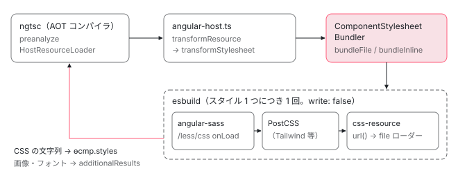

[目次](../README.md) › [CLI とビルド](README.md) › 第 4 回 / 全 16 回

# コンポーネントのスタイル：Sass と CSS を esbuild で別に束ねる

> コンパイラが styleUrl や styles を見つけると angular-host の transformResource が呼ばれ、ComponentStylesheetBundler が 1 つのスタイルを独立した esbuild の束として処理する行。stylesheet-plugin-factory が Sass / Less / CSS の言語ごとの読み込みと PostCSS（Tailwind）を差し込む行、css-resource-plugin が url() の画像やフォントを出力に足す行、キャッシュの鍵。

angular/angular-cli · 読了 約 13 分 · 中核 · [サイトで読む（デモが動きます）](https://angular-deep-dive-cyan.vercel.app/chapter/cli-component-styles)

---

`styleUrl: './chapter.scss'` と書いたコンポーネントのスタイルは、アプリ本体の JavaScript とは**別の esbuild の実行**で 1 つずつ CSS の文字列になり、その文字列がコンパイラに返されて `ɵcmp.styles` に入ります。この章では、コンパイラが styles を見つけた瞬間から、`ComponentStylesheetBundler` が Sass・PostCSS（Tailwind）・`url()` を処理して CSS の文字列を返すまでを、関数の順に追います。

読む対象は angular-cli の `tools/esbuild/angular/component-stylesheets.ts`・`compiler-plugin.ts`、`tools/esbuild/stylesheets/` の `bundle-options.ts`・`stylesheet-plugin-factory.ts`・`sass-language.ts`・`css-resource-plugin.ts`・`stylesheet-cache-key.ts`、Angular 本体の `compiler-cli/src/ngtsc/resource/src/loader.ts` と、実行時の `platform-browser/src/dom/shared_styles_host.ts` です。

1. [1. 概観](01-cli-overview.md)
2. [2. ng build の段取り](02-build.md)
3. [3. AotCompilation](03-cli-angular-compilation.md)
4. **4. コンポーネントのスタイル**（この章）
5. [5. oxc の変換](05-cli-javascript-transformer.md)
6. [6. リンカー](06-cli-linker.md)
7. [7. 遅延チャンク](07-cli-code-splitting.md)
8. [8. budgets](08-cli-budgets.md)
9. [9. i18n](09-cli-i18n.md)
10. [10. 再ビルドとキャッシュ](10-cli-cache-watch.md)
11. [11. HMR](11-cli-hmr.md)
12. [12. unit-test と Vitest](12-cli-unit-test.md)
13. [13. Tree と sink](13-schematics.md)
14. [14. Rule の組み立て](14-schematics-rules.md)
15. [15. ng generate component](15-schematics-component.md)
16. [16. ng add と ng update](16-cli-add-update.md)

## 0. 全体の流れ

1. **コンパイラが styles を見つける**

   AOT コンパイラ（ngtsc）の前処理 `preanalyze` が、`styleUrl` のファイルと `styles` の文字列を集め、`HostResourceLoader` に渡す（1 節）。
2. **ホストの transformResource**

   CLI が用意したコンパイラホストの `transformResource` が呼ばれ、`compiler-plugin.ts` の `transformStylesheet` へ進む（2 節）。
3. **ComponentStylesheetBundler**

   ファイルなら `bundleFile`、文字列なら `bundleInline`。どちらも 1 つのスタイルにつき 1 つの `BundlerContext`（esbuild の実行単位）を作る（3〜4 節）。
4. **esbuild の中：言語プラグイン → PostCSS**

   Sass / Less / CSS のプラグインが `onLoad` で中身を CSS にし、必要なら PostCSS（Tailwind）を通す（5〜6 節）。
5. **esbuild の中：url() の解決**

   `css-resource-plugin` が画像やフォントを `file` ローダーで出力に足す（7 節）。
6. **CSS の文字列を返す**

   `extractResult` が出力から CSS の文字列を取り出し、コンパイラに返す（3 節）。
7. **コンパイラと実行時**

   コンパイラがその文字列を `_ngcontent-%COMP%` 付きに書き換えて `ɵcmp.styles` に入れ、実行時に `%COMP%` がコンポーネントの ID になる（8 節）。



*1 つのスタイルごとに別の esbuild を実行し、結果の CSS 文字列だけをコンパイラに戻す。画像やフォントは追加の出力ファイルとしてアプリの出力に混ぜる。*

## 1. コンパイラが styles を集める

AOT コンパイラは、デコレーターを解析する前に `preanalyze` という非同期の段階を持っています。ここだけが `await` してよい場所で、テンプレートとスタイルを先に読み込みます（`preanalyze` の入口は[コンパイラの入口の章](../compiler/02-compiler-entry.md)）。

📄 `angular/packages/compiler-cli/src/ngtsc/annotations/component/src/handler.ts` L384–397 （▶ の行: 386–388, 390）

```ts
384 │     const resolveStyleUrl = (styleUrl: string): Promise<void> | undefined => {
385 │       try {
386 ▶         const resourceUrl = this.resourceLoader.resolve(styleUrl, containingFile);
387 ▶         return this.resourceLoader.preload(resourceUrl, {
388 ▶           type: 'style',
389 │           containingFile,
390 ▶           className: node.name.text,
391 │         });
392 │       } catch {
393 │         // Don't worry about failures to preload. We can handle this problem during analysis by
394 │         // producing a diagnostic.
395 │         return undefined;
396 │       }
397 │     };
```

📄 `angular/packages/compiler-cli/src/ngtsc/annotations/component/src/handler.ts` L434–451 （▶ の行: 439, 443, 446–447）

```ts
434 │     return templateAndTemplateStyleResources.then(async (templateInfo) => {
435 │       // Extract inline styles, process, and cache for use in synchronous analyze phase
436 │       let styles: string[] | null = null;
437 │       // Order plus className allows inline styles to be identified per component by a preprocessor
438 │       let orderOffset = 0;
439 ▶       const rawStyles = parseDirectiveStyles(component, this.evaluator, this.compilationMode);
440 │       if (rawStyles?.length) {
441 │         styles = await Promise.all(
442 │           rawStyles.map((style) =>
443 ▶             this.resourceLoader.preprocessInline(style, {
444 │               type: 'style',
445 │               containingFile,
446 ▶               order: orderOffset++,
447 ▶               className: node.name.text,
448 │             }),
449 │           ),
450 │         );
451 │       }
```

`styleUrl` は 386 行目でパスに解決され、387 行目の `preload` に `type: 'style'` と 390 行目のクラス名を付けて渡されます。`styles: [...]` に書いた文字列は 439 行目で取り出され、1 つずつ 443 行目の `preprocessInline` に渡ります。446 行目の `order` は「そのコンポーネントの何番目のスタイルか」で、あとで同じファイル内のスタイルを見分けるのに使われます。

📄 `angular/packages/compiler-cli/src/ngtsc/resource/src/loader.ts` L82–120 （▶ の行: 88–89, 94, 96, 100, 104–105, 110, 115）

```ts
 82 │   preload(resolvedUrl: string, context: ResourceLoaderContext): Promise<void> | undefined {
 83 │     if (!this.adapter.readResource) {
 84 │       throw new Error(
 85 │         'HostResourceLoader: the CompilerHost provided does not support pre-loading resources.',
 86 │       );
 87 │     }
 88 ▶     if (this.cache.has(resolvedUrl)) {
 89 ▶       return undefined;
 90 │     } else if (this.fetching.has(resolvedUrl)) {
 91 │       return this.fetching.get(resolvedUrl);
 92 │     }
 93 │ 
 94 ▶     let result = this.adapter.readResource(resolvedUrl);
 95 │ 
 96 ▶     if (this.adapter.transformResource && context.type === 'style') {
 97 │       const resourceContext: ResourceHostContext = {
 98 │         type: 'style',
 99 │         containingFile: context.containingFile,
100 ▶         resourceFile: resolvedUrl,
101 │         className: context.className,
102 │       };
103 │       result = Promise.resolve(result).then(async (str) => {
104 ▶         const transformResult = await this.adapter.transformResource!(str, resourceContext);
105 ▶         return transformResult === null ? str : transformResult.content;
106 │       });
107 │     }
108 │ 
109 │     if (typeof result === 'string') {
110 ▶       this.cache.set(resolvedUrl, result);
111 │       return undefined;
112 │     } else {
113 │       const fetchCompletion = result.then((str) => {
114 │         this.fetching.delete(resolvedUrl);
115 ▶         this.cache.set(resolvedUrl, str);
116 │       });
117 │       this.fetching.set(resolvedUrl, fetchCompletion);
118 │       return fetchCompletion;
119 │     }
120 │   }
```

📄 `angular/packages/compiler-cli/src/ngtsc/resource/src/loader.ts` L130–147 （▶ の行: 131, 135, 138–139）

```ts
130 │   async preprocessInline(data: string, context: ResourceLoaderContext): Promise<string> {
131 ▶     if (!this.adapter.transformResource || context.type !== 'style') {
132 │       return data;
133 │     }
134 │ 
135 ▶     const transformResult = await this.adapter.transformResource(data, {
136 │       type: 'style',
137 │       containingFile: context.containingFile,
138 ▶       resourceFile: null,
139 ▶       order: context.order,
140 │       className: context.className,
141 │     });
142 │     if (transformResult === null) {
143 │       return data;
144 │     }
145 │ 
146 │     return transformResult.content;
147 │   }
```

1. **88〜89 行目：同じファイルは 1 回だけ**

   `cache` は「解決済みのパス → 中身」の表です。このサイトでは 200 を超える章コンポーネントが同じ `./chapter.scss` を `styleUrl` にしていますが、2 つ目からはここで `undefined` を返し、Sass のコンパイルまで進みません。
2. **94 行目：まず生の中身を読む**

   `readResource` は CLI のホストが `readFile` で実装しています。この時点では `.scss` のソースそのものです。
3. **96〜106 行目：ホストに変換を頼む**

   ホストに `transformResource` があり、かつスタイルなら、104 行目で呼びます。100 行目の `resourceFile` にファイルのパスが入ります。105 行目、ホストが `null` を返したら生の中身をそのまま使います。
4. **110・115 行目：変換後の CSS を覚える**

   以後の同期的な解析（`analyze`）は、この表から CSS を取り出すだけです。
5. **130〜147 行目：インラインのスタイル**

   文字列のスタイルは表に入れず、毎回 135 行目でホストに渡します。138 行目、`resourceFile` は `null`。代わりに 139 行目の `order` が付きます。

## 2. ホストから compiler-plugin へ

CLI がコンパイラに渡すホストは `createAngularCompilerHost` が作ります（[第 3 回](03-cli-angular-compilation.md)）。`transformResource` はスタイル以外には `null` を返し、スタイルだけを次へ流します。

📄 `angular-cli/packages/angular/build/src/tools/angular/angular-host.ts` L188–207 （▶ の行: 194–195, 198, 201, 206）

```ts
188 │     assert(
189 │       !context.resourceFile || !hostOptions.externalStylesheets?.has(context.resourceFile),
190 │       'External runtime stylesheets should not be transformed: ' + context.resourceFile,
191 │     );
192 │ 
193 │     // No transformation required if the resource is empty
194 ▶     if (data.trim().length === 0) {
195 ▶       return { content: '' };
196 │     }
197 │ 
198 ▶     const result = await hostOptions.transformStylesheet(
199 │       data,
200 │       context.containingFile,
201 ▶       context.resourceFile ?? undefined,
202 │       context.order,
203 │       context.className,
204 │     );
205 │ 
206 ▶     return typeof result === 'string' ? { content: result } : null;
207 │   };
```

194 行目、空白だけのスタイルは esbuild を起動せずに空文字にします。198 行目の `hostOptions.transformStylesheet` は、esbuild のプラグイン `compiler-plugin.ts` が `onStart` のたびに作る関数です。201 行目、インラインなら `resourceFile` が `null` なので `undefined` にして渡します。206 行目、返り値が文字列なら `{ content }` に包んで、1 節の 104 行目に戻ります。

📄 `angular-cli/packages/angular/build/src/tools/esbuild/angular/compiler-plugin.ts` L205–234 （▶ の行: 208, 213–214, 216, 220, 225–226, 233）

```ts
205 │         const hostOptions: AngularHostOptions = {
206 │           fileReplacements: pluginOptions.fileReplacements,
207 │           modifiedFiles,
208 ▶           async transformStylesheet(data, containingFile, stylesheetFile, order, className) {
209 │             let stylesheetResult;
210 │             let resultSource = stylesheetFile ?? containingFile;
211 │ 
212 │             // Stylesheet file only exists for external stylesheets
213 ▶             if (stylesheetFile) {
214 ▶               stylesheetResult = await stylesheetBundler.bundleFile(stylesheetFile);
215 │             } else {
216 ▶               stylesheetResult = await stylesheetBundler.bundleInline(
217 │                 data,
218 │                 containingFile,
219 │                 // Inline stylesheets from a template style element are always CSS; Otherwise, use default.
220 ▶                 containingFile.endsWith('.html') ? 'css' : undefined,
221 │                 // When external runtime styles are enabled, an identifier for the style that does not change
222 │                 // based on the content is required to avoid emitted JS code changes. Any JS code changes will
223 │                 // invalid the output and force a full page reload for HMR cases. The containing file and order
224 │                 // of the style within the containing file is used.
225 ▶                 pluginOptions.externalRuntimeStyles
226 ▶                   ? calculateHash(`${containingFile}${order ?? 0}${className ?? ''}`)
227 │                   : undefined,
228 │               );
229 │               // Adjust result source for inline styles.
230 │               // There may be multiple inline styles with the same containing file and to ensure that the results
231 │               // do not overwrite each other the result source identifier needs to be unique for each. The class
232 │               // name and order fields can be used for this. The structure is arbitrary as long as it is unique.
233 ▶               resultSource += `?class=${className}&order=${order}`;
234 │             }
```

📄 `angular-cli/packages/angular/build/src/tools/esbuild/angular/compiler-plugin.ts` L236–266 （▶ の行: 237, 248, 251, 253–255, 258–259, 266）

```ts
236 │             (result.warnings ??= []).push(...stylesheetResult.warnings);
237 ▶             if (stylesheetResult.errors) {
238 │               (result.errors ??= []).push(...stylesheetResult.errors);
239 │ 
240 │               const { referencedFiles } = stylesheetResult;
241 │               if (referencedFiles) {
242 │                 referencedFileTracker.add(containingFile, referencedFiles);
243 │                 if (stylesheetFile) {
244 │                   referencedFileTracker.add(stylesheetFile, referencedFiles);
245 │                 }
246 │               }
247 │ 
248 ▶               return '';
249 │             }
250 │ 
251 ▶             const { contents, outputFiles, metafile, referencedFiles } = stylesheetResult;
252 │ 
253 ▶             additionalResults.set(resultSource, {
254 ▶               outputFiles,
255 ▶               metafile,
256 │             });
257 │ 
258 ▶             if (referencedFiles) {
259 ▶               referencedFileTracker.add(containingFile, referencedFiles);
260 │               if (stylesheetFile) {
261 │                 // Angular AOT compiler needs modified direct resource files to correctly invalidate its analysis
262 │                 referencedFileTracker.add(stylesheetFile, referencedFiles);
263 │               }
264 │             }
265 │ 
266 ▶             return contents;
```

1. **213〜214 行目：ファイルなら bundleFile**

   `stylesheetFile` があるのは `styleUrl` のときだけです。
2. **216〜228 行目：文字列なら bundleInline**

   220 行目、テンプレートの `.html` に書いた `<style>` は常に CSS として扱います。それ以外は `inlineStyleLanguage`（このサイトは `"scss"`）が既定です。225〜227 行目は、開発サーバーで CSS を JS の外に出すとき（[第 11 回](11-cli-hmr.md)）に、中身ではなく「ファイル名＋順番＋クラス名」から ID を作る分岐です。中身から作ると、CSS を直すたびに JS が変わって全体の再読み込みになるからです。
3. **237〜248 行目：エラーなら空文字**

   Sass の構文エラーなどは `result.errors` に足してビルドのエラーとして表示し、コンパイラには空文字を返します。
4. **253〜256 行目：副産物を取っておく**

   `outputFiles`（`url()` で参照した画像やフォント、ソースマップ）と `metafile`（入力と出力の対応表）を `additionalResults` に入れます。これらはアプリ本体の esbuild が終わったあとに、出力ファイルと metafile に混ぜられます。
5. **258〜263 行目：依存ファイルを登録**

   Sass が `@use` したパーシャルの一覧を、コンポーネントの `.ts` と `.scss` に結び付けます。パーシャルを直したときに、どのコンポーネントを作り直すかを知るためです（[第 10 回](10-cli-cache-watch.md)）。
6. **266 行目：CSS の文字列を返す**

   これがコンパイラの手に渡る値です。

## 3. ComponentStylesheetBundler：1 つのスタイルを 1 つの esbuild で

`stylesheetBundler` はビルドの最初に 1 回だけ作られます。`angular.json` の値がここで詰められます。

📄 `angular-cli/packages/angular/build/src/builders/application/setup-bundling.ts` L196–228 （▶ の行: 200, 205–206, 211, 214, 221–222, 226–227）

```ts
196 │     tailwindConfiguration,
197 │     postcssConfiguration,
198 │     publicPath,
199 │   } = options;
200 ▶   const incremental = !!options.watch;
201 │ 
202 │   return new ComponentStylesheetBundler(
203 │     {
204 │       workspaceRoot,
205 ▶       inlineFonts: !!optimizationOptions.fonts.inline,
206 ▶       optimization: !!optimizationOptions.styles.minify,
207 │       sourcemap:
208 │         // Hidden component stylesheet sourcemaps are inaccessible which is effectively
209 │         // the same as being disabled. Disabling has the advantage of avoiding the overhead
210 │         // of sourcemap processing.
211 ▶         sourcemapOptions.styles && !sourcemapOptions.hidden ? 'linked' : false,
212 │       sourcesContent: sourcemapOptions.sourcesContent,
213 │       outputNames,
214 ▶       includePaths: stylePreprocessorOptions?.includePaths,
215 │       // string[] | undefined' is not assignable to type '(Version | DeprecationOrId)[] | undefined'.
216 │       // eslint-disable-next-line @typescript-eslint/no-explicit-any
217 │       sass: stylePreprocessorOptions?.sass as any,
218 │       externalDependencies,
219 │       target,
220 │       preserveSymlinks,
221 ▶       tailwindConfiguration,
222 ▶       postcssConfiguration,
223 │       cacheOptions,
224 │       publicPath,
225 │     },
226 ▶     inlineStyleLanguage,
227 ▶     incremental,
228 │   );
```

206 行目、本番構成では CSS を minify します。211 行目、コンポーネントのスタイルのソースマップは外部ファイル（`linked`）か無しの 2 択です。226 行目の `inlineStyleLanguage` が、`styles` の文字列を何語として読むかの既定です。200・227 行目の `incremental` は `--watch`（`ng serve` を含む）のときだけ真です。

📄 `angular-cli/packages/angular/build/src/tools/esbuild/angular/component-stylesheets.ts` L59–98 （▶ の行: 61–62, 64, 66, 77, 82–83, 87, 89, 93）

```ts
59 │     entry = path.normalize(entry);
60 │ 
61 ▶     const bundlerContext = await this.#fileContexts.getOrCreate(entry, () => {
62 ▶       return new BundlerContext(
63 │         this.options.workspaceRoot,
64 ▶         this.incremental,
65 │         (loadCache) => {
66 ▶           const buildOptions = createStylesheetBundleOptions(this.options, loadCache);
67 │           if (externalId) {
68 │             assert(
69 │               typeof externalId === 'string',
70 │               'Initial external component stylesheets must have a string identifier',
71 │             );
72 │ 
73 │             buildOptions.entryPoints = { [externalId]: entry };
74 │             buildOptions.entryNames = '[name]';
75 │             delete buildOptions.publicPath;
76 │           } else {
77 ▶             buildOptions.entryPoints = [entry];
78 │           }
79 │ 
80 │           // Angular encapsulation does not support nesting
81 │           // See: https://github.com/angular/angular/issues/58996
82 ▶           buildOptions.supported ??= {};
83 ▶           buildOptions.supported['nesting'] = false;
84 │ 
85 │           return buildOptions;
86 │         },
87 ▶         /* useContext */ false,
88 │         /* initialFilter */ undefined,
89 ▶         this.#loadCache,
90 │       );
91 │     });
92 │ 
93 ▶     return this.extractResult(
94 │       await bundlerContext.bundle(),
95 │       bundlerContext.watchFiles,
96 │       !!externalId,
97 │       !!direct,
98 │     );
```

1. **61 行目：ファイルのパスごとに BundlerContext を 1 つ**

   `#fileContexts` は「パス → BundlerContext」の表です。同じパスで呼ばれたら既存の BundlerContext を返します。
2. **66 行目：esbuild の設定を作る**

   中身は 5 節の `createStylesheetBundleOptions`。77 行目、入口（`entryPoints`）はそのスタイルのファイル 1 つだけです。
3. **82〜83 行目：CSS の入れ子を展開させる**

   `supported.nesting = false` は「出力先は CSS の入れ子（`&` を使うネスト）を理解しない」と esbuild に伝え、入れ子を平らな規則に展開させる指定です。81 行目のコメントのとおり、コンパイラのカプセル化（[ShadowCss](../compiler/18-compiler-shadow-css.md)）が入れ子に対応していないためです。
4. **87・89 行目：コンテキストは使わず、読み込みの結果は共有**

   87 行目 `useContext: false` で、esbuild の増分ビルド用コンテキストを作らず毎回 `build()` します。89 行目の `#loadCache` は全スタイルで共有する `onLoad` の結果の表で、同じ `.scss` の Sass のコンパイル結果を使い回します（表の仕組みは[第 10 回](10-cli-cache-watch.md)）。
5. **93〜98 行目：結果から CSS を取り出す**

   下の `extractResult` です。

📄 `angular-cli/packages/angular/build/src/tools/esbuild/angular/component-stylesheets.ts` L109–141 （▶ の行: 112, 119–121, 123, 125–126, 133, 140）

```ts
109 │   async bundleInline(
110 │     data: string,
111 │     filename: string,
112 ▶     language = this.defaultInlineLanguage,
113 │     externalId?: string,
114 │   ): Promise<ComponentStylesheetResult> {
115 │     filename = path.normalize(filename);
116 │ 
117 │     // Use a hash of the inline stylesheet content to ensure a consistent identifier. External stylesheets will resolve
118 │     // to the actual stylesheet file path.
119 ▶     const hasher = createContentHash();
120 ▶     hasher.update(data);
121 ▶     hasher.update(externalId ?? '');
122 │     const id = hasher.digest();
123 ▶     const entry = [language, id, filename].join(';');
124 │ 
125 ▶     const bundlerContext = await this.#inlineContexts.getOrCreate(entry, () => {
126 ▶       const namespace = 'angular:styles/component';
127 │ 
128 │       return new BundlerContext(
129 │         this.options.workspaceRoot,
130 │         this.incremental,
131 │         (loadCache) => {
132 │           const buildOptions = createStylesheetBundleOptions(this.options, loadCache, {
133 ▶             [entry]: data,
134 │           });
135 │           if (externalId) {
136 │             buildOptions.entryPoints = { [externalId]: `${namespace};${entry}` };
137 │             buildOptions.entryNames = '[name]';
138 │             delete buildOptions.publicPath;
139 │           } else {
140 ▶             buildOptions.entryPoints = [`${namespace};${entry}`];
141 │           }
```

📄 `angular-cli/packages/angular/build/src/tools/esbuild/angular/component-stylesheets.ts` L143–170 （▶ の行: 151, 157–158, 161, 163–165）

```ts
143 │           // Angular encapsulation does not support nesting
144 │           // See: https://github.com/angular/angular/issues/58996
145 │           buildOptions.supported ??= {};
146 │           buildOptions.supported['nesting'] = false;
147 │ 
148 │           buildOptions.plugins.push({
149 │             name: 'angular-component-styles',
150 │             setup(build) {
151 ▶               build.onResolve({ filter: /^angular:styles\/component;/ }, (args) => {
152 │                 if (args.kind !== 'entry-point') {
153 │                   return null;
154 │                 }
155 │ 
156 │                 return {
157 ▶                   path: entry,
158 ▶                   namespace,
159 │                 };
160 │               });
161 ▶               build.onLoad({ filter: /^css;/, namespace }, () => {
162 │                 return {
163 ▶                   contents: data,
164 ▶                   loader: 'css',
165 ▶                   resolveDir: path.dirname(filename),
166 │                 };
167 │               });
168 │             },
169 │           });
170 │ 
```

インラインのスタイルにはファイルが無いので、仮想のファイルを作ります。119〜123 行目、中身のハッシュから `scss;<ハッシュ>;/…/foo.component.ts` のような名前（`entry`）を作り、133 行目でその名前と中身の対応を設定に渡します。140 行目、esbuild の入口は `angular:styles/component;…` という**名前空間付き**の文字列です。151〜159 行目の `onResolve` がそれを名前空間 `angular:styles/component` のパス `entry` に解決し、5 節の言語プラグインがその名前空間で `onLoad` します。161〜167 行目は CSS のときの受け皿で、165 行目の `resolveDir` を `.ts` のフォルダにするので、インラインのスタイルの中の相対パス（`@use './x'` や `url(./a.png)`）は `.ts` からの相対になります。

📄 `angular-cli/packages/angular/build/src/tools/esbuild/angular/component-stylesheets.ts` L263–291 （▶ の行: 266, 270, 280–282, 288, 290）

```ts
263 │     for (const outputFile of result.outputFiles) {
264 │       const filename = path.basename(outputFile.path);
265 │ 
266 ▶       if (outputFile.type === BuildOutputFileType.Media || filename.endsWith('.css.map')) {
267 │         // The output files could also contain resources (images/fonts/etc.) that were referenced and the map files.
268 │ 
269 │         // Clone the output file to avoid amending the original path which would causes problems during rebuild.
270 ▶         const clonedOutputFile = outputFile.clone();
271 │ 
272 │         // Needed for Bazel as otherwise the files will not be written in the correct place,
273 │         // this is because esbuild will resolve the output file from the outdir which is currently set to `workspaceRoot` twice,
274 │         // once in the stylesheet and the other in the application code bundler.
275 │         // Ex: `../../../../../app.component.css.map`.
276 │         if (!direct) {
277 │           clonedOutputFile.path = path.join(this.options.workspaceRoot, outputFile.path);
278 │         }
279 │ 
280 ▶         outputFiles.push(clonedOutputFile);
281 ▶       } else if (filename.endsWith('.css')) {
282 ▶         if (external) {
283 │           const clonedOutputFile = outputFile.clone();
284 │           if (!direct) {
285 │             clonedOutputFile.path = path.join(this.options.workspaceRoot, outputFile.path);
286 │           }
287 │           outputFiles.push(clonedOutputFile);
288 ▶           contents = path.posix.join(this.options.publicPath ?? '', filename);
289 │         } else {
290 ▶           contents = outputFile.text;
291 │         }
```

📄 `angular-cli/packages/angular/build/src/tools/esbuild/angular/component-stylesheets.ts` L299–310 （▶ の行: 304）

```ts
299 │     // Clone metafile to prevent mutation of the cached result by downstream plugins
300 │     const metafile = {
301 │       inputs: { ...result.metafile.inputs },
302 │       outputs: Object.fromEntries(
303 │         Object.entries(result.metafile.outputs).map(([key, output]) => {
304 ▶           const cloned = { ...output, ['ng-component']: true };
305 │           delete cloned.entryPoint;
306 │ 
307 │           return [key, cloned];
308 │         }),
309 │       ),
310 │     };
```

esbuild は `write: false` で動くので、出力はメモリ上のファイルの配列です。266〜280 行目、画像・フォント（`Media`）とソースマップは別のファイルとして残します。290 行目、`.css` の出力は**ファイルにせず中身の文字列**を `contents` にします。これがコンパイラに返る CSS です（282〜288 行目は開発サーバーで CSS を外に出すときで、文字列の代わりに URL を返します）。304 行目、metafile の出力に `ng-component: true` の印を付けます。`anyComponentStyle` の budget はこの印でコンポーネントのスタイルを見分けます（[第 8 回](08-cli-budgets.md)）。

📄 `angular-cli/packages/angular/build/src/tools/esbuild/angular/component-stylesheets.ts` L193–229 （▶ の行: 194, 209–210, 215, 219–222, 224）

```ts
193 │   invalidate(files: Iterable<string> | ReadonlySet<string>): string[] | undefined {
194 ▶     if (!this.incremental) {
195 │       return;
196 │     }
197 │ 
198 │     const normalizedFiles = new Set<string>();
199 │     for (const file of files) {
200 │       const normalized = path.normalize(file);
201 │       normalizedFiles.add(normalized);
202 │       if (!path.isAbsolute(normalized)) {
203 │         normalizedFiles.add(path.normalize(path.join(this.options.workspaceRoot, normalized)));
204 │       }
205 │     }
206 │ 
207 │     let entries: string[] | undefined;
208 │ 
209 ▶     for (const [entry, bundler] of this.#fileContexts.entries()) {
210 ▶       if (bundler.invalidate(normalizedFiles)) {
211 │         entries ??= [];
212 │         entries.push(entry);
213 │       }
214 │     }
215 ▶     for (const [entry, bundler] of this.#inlineContexts.entries()) {
216 │       // Entry is format: [language, id, filename].join(';')
217 │       const firstSemi = entry.indexOf(';');
218 │       const secondSemi = firstSemi !== -1 ? entry.indexOf(';', firstSemi + 1) : -1;
219 ▶       const filename = secondSemi !== -1 ? entry.slice(secondSemi + 1) : '';
220 ▶       if (filename && normalizedFiles.has(path.normalize(filename))) {
221 ▶         this.#inlineContexts.delete(entry);
222 ▶         void bundler.dispose();
223 │       } else {
224 ▶         bundler.invalidate(normalizedFiles);
225 │       }
226 │     }
227 │ 
228 │     return entries;
229 │   }
```

再ビルドのとき、変わったファイルの一覧で呼ばれます。194 行目、`ng build`（watch なし）では何もしません。209〜213 行目、ファイルのスタイルは BundlerContext を残したまま「この入力が変わった」と伝えるだけです。215〜225 行目、インラインのスタイルは中身のハッシュが名前に入っているので使い回せません。名前の 3 つ目（元の `.ts`）が変わっていたら、221〜222 行目で BundlerContext ごと捨てます。

## 4. esbuild の設定：createStylesheetBundleOptions

📄 `angular-cli/packages/angular/build/src/tools/esbuild/stylesheets/bundle-options.ts` L39–70 （▶ の行: 45–46, 49, 53–55, 62–65, 68–69）

```ts
39 │ export function createStylesheetBundleOptions(
40 │   options: BundleStylesheetOptions,
41 │   cache?: LoadResultCache,
42 │   inlineComponentData?: Record<string, string>,
43 │ ): BuildOptions & { plugins: NonNullable<BuildOptions['plugins']> } {
44 │   // Ensure preprocessor include paths are absolute based on the workspace root
45 ▶   const includePaths = options.includePaths?.map((includePath) =>
46 ▶     path.resolve(options.workspaceRoot, includePath),
47 │   );
48 │ 
49 ▶   const pluginFactory = new StylesheetPluginFactory(
50 │     {
51 │       sourcemap: !!options.sourcemap,
52 │       includePaths,
53 ▶       inlineComponentData,
54 ▶       tailwindConfiguration: options.tailwindConfiguration,
55 ▶       postcssConfiguration: options.postcssConfiguration,
56 │       sass: options.sass,
57 │     },
58 │     cache,
59 │   );
60 │ 
61 │   const plugins: Plugin[] = [
62 ▶     pluginFactory.create(SassStylesheetLanguage),
63 ▶     pluginFactory.create(LessStylesheetLanguage),
64 ▶     pluginFactory.create(CssStylesheetLanguage),
65 ▶     createCssResourcePlugin(cache),
66 │   ];
67 │ 
68 ▶   if (options.inlineFonts) {
69 ▶     plugins.unshift(createCssInlineFontsPlugin({ cache, cacheOptions: options.cacheOptions }));
70 │   }
```

📄 `angular-cli/packages/angular/build/src/tools/esbuild/stylesheets/bundle-options.ts` L72–95 （▶ の行: 74, 78, 83, 85, 89–90, 93）

```ts
72 │   return {
73 │     absWorkingDir: options.workspaceRoot,
74 ▶     bundle: true,
75 │     entryNames: options.outputNames.bundles,
76 │     assetNames: options.outputNames.media,
77 │     logLevel: 'silent',
78 ▶     minify: options.optimization,
79 │     metafile: true,
80 │     sourcemap: options.sourcemap,
81 │     sourcesContent: options.sourcesContent,
82 │     outdir: options.workspaceRoot,
83 ▶     write: false,
84 │     platform: 'browser',
85 ▶     target: options.target,
86 │     preserveSymlinks: options.preserveSymlinks,
87 │     external: options.externalDependencies,
88 │     publicPath: options.publicPath,
89 ▶     conditions: ['style', 'sass', 'less', options.optimization ? 'production' : 'development'],
90 ▶     mainFields: ['style', 'sass'],
91 │     // Unlike JS, CSS does not have implicit file extensions in the general case.
92 │     // Preprocessor specific behavior is handled in each stylesheet language plugin.
93 ▶     resolveExtensions: [],
94 │     plugins,
95 │   };
```

62〜65 行目、プラグインは Sass・Less・CSS の 3 つの言語プラグインと、`url()` のプラグインの順です。68〜69 行目、本番でフォントのインライン化が有効なら、Google Fonts などの `@import` を中身に置き換えるプラグインを先頭に足します。53 行目の `inlineComponentData` が、3 節で作ったインラインのスタイルの中身です。

74 行目 `bundle: true` なので、CSS の `@import` は esbuild が 1 つにまとめます。83 行目 `write: false` でディスクには書きません。85 行目の `target` はブラウザの対応表（browserslist）から作った値で、ベンダープレフィックスや新しい構文の書き換えに使われます。89〜90 行目、`package.json` の `style`・`sass` の条件と欄を見るので、`@import '@angular/material/prebuilt-themes/…'` のような npm パッケージの CSS を解決できます。93 行目、拡張子の補完はしません（Sass のパーシャルの補完は Sass 自身がする）。

## 5. 言語ごとの onLoad：stylesheet-plugin-factory

📄 `angular-cli/packages/angular/build/src/tools/esbuild/stylesheets/stylesheet-plugin-factory.ts` L120–133 （▶ の行: 124–127, 132）

```ts
120 │   create(language: Readonly<StylesheetLanguage>): Plugin {
121 │     const { cache, options, setupPostcss } = this;
122 │ 
123 │     // Return a noop plugin if no load actions are required
124 ▶     if (!language.process && !options.postcssConfiguration && !options.tailwindConfiguration) {
125 ▶       return {
126 ▶         name: 'angular-' + language.name,
127 ▶         setup() {},
128 │       };
129 │     }
130 │ 
131 │     return {
132 ▶       name: 'angular-' + language.name,
133 │       async setup(build) {
```

124 行目、言語に `process` が無く、PostCSS も Tailwind も無ければ、何もしないプラグインを返します。CSS の言語（`css-language.ts`）は `process` を持たないので、PostCSS を使わないプロジェクトでは `.css` は esbuild がそのまま読みます。

📄 `angular-cli/packages/angular/build/src/tools/esbuild/stylesheets/stylesheet-plugin-factory.ts` L159–198 （▶ の行: 160–162, 168, 170, 184–186, 192）

```ts
159 │         build.onLoad(
160 ▶           { filter: language.componentFilter, namespace: 'angular:styles/component' },
161 ▶           createCachedLoad(cache, (args) => {
162 ▶             const data = options.inlineComponentData?.[args.path];
163 │             assert(
164 │               typeof data === 'string',
165 │               `component style name should always be found [${args.path}]`,
166 │             );
167 │ 
168 ▶             const [format, , filename] = args.path.split(';', 3);
169 │ 
170 ▶             return processStylesheet(
171 │               language,
172 │               data,
173 │               filename,
174 │               format,
175 │               options,
176 │               build,
177 │               postcssProcessor,
178 │             );
179 │           }),
180 │         );
181 │ 
182 │         // Add a load callback to support files from disk
183 │         build.onLoad(
184 ▶           { filter: language.fileFilter, namespace: 'file' },
185 ▶           createCachedLoad(cache, async (args) => {
186 ▶             const data = await readFile(args.path, 'utf-8');
187 │ 
188 │             return processStylesheet(
189 │               language,
190 │               data,
191 │               args.path,
192 ▶               extname(args.path).toLowerCase().slice(1),
193 │               options,
194 │               build,
195 │               postcssProcessor,
196 │             );
197 │           }),
198 │         );
```

📄 `angular-cli/packages/angular/build/src/tools/esbuild/stylesheets/sass-language.ts` L47–70 （▶ の行: 49–50, 52, 59–61）

```ts
47 │ export const SassStylesheetLanguage = Object.freeze<StylesheetLanguage>({
48 │   name: 'sass',
49 ▶   componentFilter: /^s[ac]ss;/,
50 ▶   fileFilter: /\.s[ac]ss$/,
51 │   process(data, file, format, options, build) {
52 ▶     const syntax = format === 'sass' ? 'indented' : 'scss';
53 │     const resolveUrl = async (url: string, options: CanonicalizeContext) => {
54 │       let resolveDir = build.initialOptions.absWorkingDir;
55 │       if (options.containingUrl) {
56 │         resolveDir = dirname(fileURLToPath(options.containingUrl));
57 │       }
58 │ 
59 ▶       const path = url.startsWith('pkg:') ? url.slice(4) : url;
60 ▶       const result = await build.resolve(path, {
61 ▶         kind: 'import-rule',
62 │         resolveDir,
63 │       });
64 │ 
65 │       return result;
66 │     };
67 │ 
68 │     return compileString(data, file, syntax, options, resolveUrl);
69 │   },
70 │ });
```

1. **160 行目：インラインのスタイルの受け口**

   名前空間 `angular:styles/component` で、`componentFilter` に合う名前だけを受けます。Sass は 49 行目の `/^s[ac]ss;/`、つまり 3 節の名前の先頭の言語名で振り分けます。
2. **162・168 行目：中身とファイル名を取り出す**

   中身は `inlineComponentData` から引き、名前を `;` で割って言語（`format`）と元の `.ts` のパスを得ます。
3. **184〜192 行目：ディスクのファイルの受け口**

   名前空間 `file` で `fileFilter`（Sass は 50 行目の `/\.s[ac]ss$/`）に合うものを 186 行目で読みます。192 行目、拡張子が言語名になります（`.sass` なら 52 行目でインデント構文）。
4. **161・185 行目：結果を表に入れる**

   `createCachedLoad` は「名前空間:パス → onLoad の結果」の表を引いてから本体を呼びます。3 節 89 行目の共有の表がこれです。

Sass の `process` は 53〜66 行目で「Sass が `@use` の先を探すための関数」を作ります。60 行目、探すのは **esbuild 自身の解決**（`build.resolve`）なので、`@use '@angular/material'` のような npm パッケージも `package.json` の欄を見て解決されます。59 行目、`pkg:` の付いた書き方も同じ扱いです。

📄 `angular-cli/packages/angular/build/src/tools/esbuild/stylesheets/sass-language.ts` L119–143 （▶ の行: 120–121, 124, 130–131, 133, 138–139）

```ts
119 │   try {
120 ▶     const { css, sourceMap, loadedUrls } = await sassService.compileStringAsync(data, {
121 ▶       url: pathToFileURL(filePath),
122 │       style: 'expanded',
123 │       syntax,
124 ▶       loadPaths: options.includePaths,
125 │       sourceMap: options.sourcemap,
126 │       sourceMapIncludeSources: options.sourcemap,
127 │       silenceDeprecations,
128 │       fatalDeprecations,
129 │       futureDeprecations,
130 ▶       quietDeps: true,
131 ▶       importers: [
132 │         {
133 ▶           findFileUrl: (url, options) => {
134 │             const cacheKey = url.startsWith('pkg:')
135 │               ? url
136 │               : `${options.containingUrl?.href ?? ''}:${url}`;
137 │ 
138 ▶             return currentResolutionCache.getOrCreate(cacheKey, async () => {
139 ▶               const result = await resolveUrl(url, options);
140 │               if (result.path) {
141 │                 return pathToFileURL(result.path);
142 │               }
143 │ 
```

📄 `angular-cli/packages/angular/build/src/tools/esbuild/stylesheets/sass-language.ts` L197–204 （▶ の行: 200–202）

```ts
197 │     });
198 │ 
199 │     return {
200 ▶       loader: 'css',
201 ▶       contents: sourceMap ? `${css}\n${sourceMapToUrlComment(sourceMap)}` : css,
202 ▶       watchFiles: loadedUrls.map((url) => fileURLToPath(url)),
203 │       warnings,
204 │     };
```

120 行目、Sass は `sass-embedded`（Dart で書かれた Sass を別プロセスで常駐させ、標準入出力で話す実装）で文字列ごとコンパイルします。124 行目の `loadPaths` が `angular.json` の `stylePreprocessorOptions.includePaths`、130 行目 `quietDeps` で依存パッケージの非推奨の警告を黙らせます。131〜139 行目の importer（Sass に「この URL はどのファイルか」を答える役）は、上の `resolveUrl` を呼び、結果を 138 行目の表で覚えます。200〜202 行目、結果は CSS として esbuild に返し、Sass が読んだ全ファイル（`loadedUrls`）を `watchFiles` にします。2 節 258 行目の依存の登録はこの一覧から来ます。

## 6. PostCSS と Tailwind を差し込む条件

📄 `angular-cli/packages/angular/build/src/builders/application/options.ts` L277–283 （▶ の行: 279, 281–283）

```ts
277 │   // A configuration file can exist in the project or workspace root
278 │   const searchDirectories = await generateSearchDirectories([projectRoot, workspaceRoot]);
279 ▶   const postcssConfiguration = await loadPostcssConfiguration(searchDirectories);
280 │   // Skip tailwind configuration if postcss is customized
281 ▶   const tailwindConfiguration = postcssConfiguration
282 ▶     ? undefined
283 ▶     : await getTailwindConfig(searchDirectories, workspaceRoot, context);
```

📄 `angular-cli/packages/angular/build/src/utils/postcss-configuration.ts` L20–26 （▶ の行: 20–22, 25）

```ts
20 ▶ const postcssConfigurationFiles: string[] = ['postcss.config.json', '.postcssrc.json'];
21 ▶ const tailwindConfigFiles: string[] = [
22 ▶   'tailwind.config.js',
23 │   'tailwind.config.cjs',
24 │   'tailwind.config.mjs',
25 ▶   'tailwind.config.ts',
26 │ ];
```

設定ファイルの**有無**で決まります。プロジェクトのフォルダとワークスペースのルートで、20 行目の `postcss.config.json` / `.postcssrc.json` を探し、あれば 279 行目でそれを使います。無いときだけ 21〜26 行目の `tailwind.config.*` を探します（281〜283 行目）。どちらも無ければ、5 節 124 行目の何もしないプラグインになります。

📄 `angular-cli/packages/angular/build/src/tools/esbuild/stylesheets/stylesheet-plugin-factory.ts` L217–256 （▶ の行: 218, 224, 227–228, 235, 238, 242, 249–250）

```ts
217 │     const { options } = this;
218 ▶     if (options.postcssConfiguration) {
219 │       const { config, configPath } = options.postcssConfiguration;
220 │       const postCssInstanceKey = JSON.stringify(config);
221 │       let postcssProcessor = postcssProcessors.get(postCssInstanceKey)?.deref();
222 │ 
223 │       if (!postcssProcessor) {
224 ▶         postcss ??= (await import('postcss')).default;
225 │         postcssProcessor = postcss();
226 │ 
227 ▶         const postCssPluginRequire = createRequire(dirname(configPath) + '/');
228 ▶         for (const [pluginName, pluginOptions] of config.plugins) {
229 │           const pluginMod = postCssPluginRequire(pluginName);
230 │           const plugin = pluginMod.__esModule ? pluginMod['default'] : pluginMod;
231 │           if (typeof plugin !== 'function' || plugin.postcss !== true) {
232 │             throw new Error(`Attempted to load invalid Postcss plugin: "${pluginName}"`);
233 │           }
234 │ 
235 ▶           postcssProcessor.use(plugin(pluginOptions));
236 │         }
237 │ 
238 ▶         postcssProcessors.set(postCssInstanceKey, new WeakRef(postcssProcessor));
239 │       }
240 │ 
241 │       return postcssProcessor;
242 ▶     } else if (options.tailwindConfiguration) {
243 │       const { package: tailwindPackage, file: config } = options.tailwindConfiguration;
244 │       const postCssInstanceKey = tailwindPackage + ':' + config;
245 │       let postcssProcessor = postcssProcessors.get(postCssInstanceKey)?.deref();
246 │ 
247 │       if (!postcssProcessor) {
248 │         postcss ??= (await import('postcss')).default;
249 ▶         const tailwind = await import(tailwindPackage);
250 ▶         postcssProcessor = postcss().use(tailwind.default({ config }));
251 │         postcssProcessors.set(postCssInstanceKey, new WeakRef(postcssProcessor));
252 │       }
253 │ 
254 │       return postcssProcessor;
255 │     }
256 │   }
```

218〜241 行目、PostCSS の設定ファイルがあれば、228 行目で `plugins` を順に `require` して 235 行目で `use` します。227 行目、プラグインは設定ファイルの場所から探します。242〜254 行目、Tailwind の設定ファイルだけなら、250 行目で `tailwindcss` パッケージ 1 つだけの PostCSS を作ります。238・251 行目、作った PostCSS は `WeakRef` で覚え、同じ設定の別のスタイルで使い回します。

📄 `angular-cli/packages/angular/build/src/tools/esbuild/stylesheets/stylesheet-plugin-factory.ts` L268–296 （▶ の行: 271–272, 274–276, 282, 287–288）

```ts
268 │   let result: OnLoadResult;
269 │ 
270 │   // Process the input data if the language requires preprocessing
271 ▶   if (language.process) {
272 ▶     result = await language.process(data, filename, format, options, build);
273 │   } else {
274 ▶     result = {
275 ▶       contents: data,
276 ▶       loader: 'css',
277 │       watchFiles: [filename],
278 │     };
279 │   }
280 │ 
281 │   // Return early if there are no contents to further process or there are errors
282 ▶   if (!result.contents || result.errors?.length) {
283 │     return result;
284 │   }
285 │ 
286 │   // Only use postcss if Tailwind processing is required or custom postcss is present.
287 ▶   if (postcssProcessor && (options.postcssConfiguration || hasTailwindKeywords(result.contents))) {
288 ▶     const postcssResult = await compileString(
289 │       typeof result.contents === 'string'
290 │         ? result.contents
291 │         : Buffer.from(result.contents).toString('utf-8'),
292 │       filename,
293 │       postcssProcessor,
294 │       options,
295 │     );
296 │ 
```

📄 `angular-cli/packages/angular/build/src/tools/esbuild/stylesheets/stylesheet-plugin-factory.ts` L81–94 （▶ の行: 86–89）

```ts
81 │ /**
82 │  * An array of keywords that indicate Tailwind CSS processing is required for a stylesheet.
83 │  *
84 │  * Based on https://tailwindcss.com/docs/functions-and-directives
85 │  */
86 ▶ const TAILWIND_KEYWORDS = [
87 ▶   '@tailwind',
88 ▶   '@layer',
89 ▶   '@apply',
90 │   '@config',
91 │   'theme(',
92 │   'screen(',
93 │   '@screen', // Undocumented in version 3, see: https://github.com/tailwindlabs/tailwindcss/discussions/7516.
94 │ ];
```

📄 `angular-cli/packages/angular/build/src/tools/esbuild/stylesheets/stylesheet-plugin-factory.ts` L325–335 （▶ の行: 328）

```ts
325 │ function hasTailwindKeywords(contents: string | Uint8Array): boolean {
326 │   // TODO: use better search algorithm for keywords
327 │   if (typeof contents === 'string') {
328 ▶     return TAILWIND_KEYWORDS.some((keyword) => contents.includes(keyword));
329 │   }
330 │ 
331 │   // Contents is a Uint8Array
332 │   const data = contents instanceof Buffer ? contents : Buffer.from(contents);
333 │ 
334 │   return TAILWIND_KEYWORDS.some((keyword) => data.includes(keyword));
335 │ }
```

1. **271〜279 行目：まず言語の処理**

   Sass なら 272 行目で上の `compileString`。CSS なら中身をそのまま CSS として扱います。
2. **287 行目：PostCSS を通すかどうか**

   PostCSS の設定ファイルがあれば**全スタイル**を通します。Tailwind の設定ファイルだけのときは、Sass の結果の文字列に 86〜94 行目の語（`@tailwind`・`@apply` など）が 1 つでも含まれる（328 行目）スタイルだけを通します。Tailwind を使わないコンポーネントで PostCSS の時間を払わないための近道です。

## 7. url() の解決：css-resource-plugin

📄 `angular-cli/packages/angular/build/src/tools/esbuild/stylesheets/css-resource-plugin.ts` L34–68 （▶ の行: 39, 43, 53–56, 62, 67）

```ts
34 │       build.onResolve({ filter: /.*/ }, async (args) => {
35 │         const { importer, path, kind, resolveDir, namespace, pluginData = {} } = args;
36 │ 
37 │         // Only attempt to resolve url tokens which only exist inside CSS.
38 │         // Also, skip this plugin if already attempting to resolve the url-token.
39 ▶         if (kind !== 'url-token' || pluginData[CSS_RESOURCE_RESOLUTION]) {
40 │           return null;
41 │         }
42 │ 
43 ▶         let [containingDir, resourceUrl] = path.split('||file:', 2);
44 │         if (resourceUrl === undefined) {
45 │           // This can happen due to early exit checks in rebasing-importer
46 │           // logic such as when the url is an external URL.
47 │           resourceUrl = containingDir;
48 │           containingDir = '';
49 │         }
50 │ 
51 │         // If root-relative, absolute or protocol relative url, mark as external to leave the
52 │         // path/URL in place.
53 ▶         if (/^((?:\w+:)?\/\/|data:|chrome:|#|\/)/.test(resourceUrl)) {
54 ▶           return {
55 ▶             path: resourceUrl,
56 ▶             external: true,
57 │           };
58 │         }
59 │ 
60 │         pluginData[CSS_RESOURCE_RESOLUTION] = true;
61 │ 
62 ▶         const result = await build.resolve(resourceUrl, {
63 │           importer,
64 │           kind,
65 │           namespace,
66 │           pluginData,
67 ▶           resolveDir: join(resolveDir, containingDir),
68 │         });
```

📄 `angular-cli/packages/angular/build/src/tools/esbuild/stylesheets/css-resource-plugin.ts` L99–126 （▶ の行: 101, 110–111, 116, 121–122）

```ts
 99 │         // Return results that are not files since these are most likely specific to another plugin
100 │         // and cannot be loaded by this plugin.
101 ▶         if (result.namespace !== 'file') {
102 │           return result;
103 │         }
104 │ 
105 │         // All file results are considered CSS resources and will be loaded via the file loader
106 │         return {
107 │           ...result,
108 │           // Use a relative path to prevent fully resolved paths in the metafile (JSON stats file).
109 │           // This is only necessary for custom namespaces. esbuild will handle the file namespace.
110 ▶           path: relative(build.initialOptions.absWorkingDir ?? '', result.path),
111 ▶           namespace: CSS_RESOURCE_NAMESPACE,
112 │         };
113 │       });
114 │ 
115 │       build.onLoad(
116 ▶         { filter: /./, namespace: CSS_RESOURCE_NAMESPACE },
117 │         createCachedLoad(cache, async (args) => {
118 │           const resourcePath = join(build.initialOptions.absWorkingDir ?? '', args.path);
119 │ 
120 │           return {
121 ▶             contents: await readFile(resourcePath),
122 ▶             loader: 'file',
123 │             watchFiles: [resourcePath],
124 │           };
125 │         }),
126 │       );
```

1. **39 行目：url() だけを相手にする**

   esbuild は CSS の `url(...)` を `kind: 'url-token'` の import として解決しに来ます。それ以外の import は素通しします。
2. **43 行目：Sass が書き換えた url() を戻す**

   Sass のパーシャルの中の `url(./a.png)` は、パーシャルからの相対です。`sass-service.ts` の importer（rebasing importer）は、それを「`パーシャルのフォルダ||file:a.png`」という形に書き換えておきます。43 行目でそれを割り、67 行目で正しいフォルダから解決します。
3. **53〜57 行目：外の URL はそのまま**

   `https://`・`//`・`data:`・`#`・`/` で始まるものは `external` にして、CSS に書いたまま残します。`/assets/x.png` のようなルート相対はビルドで検査されません。
4. **110〜122 行目：見つかったファイルは file ローダーで**

   解決できたファイルは独自の名前空間に移し、121 行目 `loader: 'file'` で読ませます。esbuild の `file` ローダーはファイルを出力にコピーし（名前は `outputHashing` が `all` なら `media/[name]-[hash]`）、CSS の中の `url()` をその出力のパスに書き換えます。このコピーが 3 節 266 行目の `Media` の出力ファイルです。

## 8. 返った CSS の行き先：ɵcmp.styles と実行時

コンパイラは返った CSS を、カプセル化が `Emulated`（既定）なら `ShadowCss` で書き換え、セレクターに `[_ngcontent-%COMP%]`、`:host` に `[_nghost-%COMP%]` を付けた文字列を `ɵcmp` の `styles` 配列に入れます。`%COMP%` は**ビルド時には決まっていない**穴で、実行時にレンダラーがコンポーネントの ID（`ng-c1234567` のような値）に置き換えます。この書き換えの規則は[ShadowCss の章](../compiler/18-compiler-shadow-css.md)で読みました。

実行時に、その文字列を `<style>` 要素にして `<head>` に入れるのが `SharedStylesHost` です。このサイトのようにプリレンダーした HTML には、サーバーで描いたときの `<style>` がすでに入っています。

📄 `angular/packages/platform-browser/src/dom/shared_styles_host.ts` L239–252 （▶ の行: 246–247）

```ts
239 │   private addElement<T extends HTMLElement>(host: Node, element: T): T {
240 │     // Add a nonce if present
241 │     if (this.nonce) {
242 │       element.setAttribute('nonce', this.nonce);
243 │     }
244 │ 
245 │     // Add application identifier when on the server to support client-side reuse
246 ▶     if (typeof ngServerMode !== 'undefined' && ngServerMode) {
247 ▶       element.setAttribute(APP_ID_ATTRIBUTE_NAME, this.appId);
248 │     }
249 │ 
250 │     // Insert the element into the DOM with the host node as parent
251 │     return host.appendChild(element);
252 │   }
```

📄 `angular/packages/platform-browser/src/dom/shared_styles_host.ts` L65–89 （▶ の行: 71–72, 78, 86–87）

```ts
65 │ function addServerStyles(
66 │   doc: Document,
67 │   appId: string,
68 │   inline: Map<string, UsageRecord<HTMLStyleElement>>,
69 │   external: Map<string, UsageRecord<HTMLLinkElement>>,
70 │ ): boolean {
71 ▶   const elements = doc.head?.querySelectorAll<HTMLStyleElement | HTMLLinkElement>(
72 ▶     `style[${APP_ID_ATTRIBUTE_NAME}="${appId}"],link[${APP_ID_ATTRIBUTE_NAME}="${appId}"]`,
73 │   );
74 │ 
75 │   if (!elements || elements.length === 0) return false;
76 │ 
77 │   for (const styleElement of elements) {
78 ▶     styleElement.removeAttribute(APP_ID_ATTRIBUTE_NAME);
79 │     if (styleElement instanceof HTMLLinkElement) {
80 │       // Only use filename from href
81 │       // The href is build time generated with a unique value to prevent duplicates.
82 │       external.set(styleElement.href.slice(styleElement.href.lastIndexOf('/') + 1), {
83 │         usage: 0,
84 │         elements: [styleElement],
85 │       });
86 ▶     } else if (styleElement.textContent) {
87 ▶       inline.set(styleElement.textContent, {usage: 0, elements: [styleElement]});
88 │     }
89 │   }
```

📄 `angular/packages/platform-browser/src/dom/shared_styles_host.ts` L164–181 （▶ の行: 165, 168, 174, 177, 179）

```ts
164 │     // Attempt to get any current usage of the value
165 ▶     const record = usages.get(value);
166 │ 
167 │     // If existing, just increment the usage count
168 ▶     if (record) {
169 │       if ((typeof ngDevMode === 'undefined' || ngDevMode) && record.usage === 0) {
170 │         // A usage count of zero indicates a preexisting server generated style.
171 │         // This attribute is solely used for debugging purposes of SSR style reuse.
172 │         record.elements.forEach((element) => element.setAttribute('ng-style-reused', ''));
173 │       }
174 ▶       record.usage++;
175 │     } else {
176 │       // Otherwise, create an entry to track the elements and add element for each host
177 ▶       usages.set(value, {
178 │         usage: 1,
179 ▶         elements: [...this.hosts].map((host) => this.addElement(host, creator(value, this.doc))),
180 │       });
181 │     }
```

1. **246〜247 行目：サーバーでは印を付ける**

   サーバー（プリレンダーを含む）で作る `<style>` には `ng-app-id="ng"` が付きます。
2. **71〜87 行目：ブラウザは印の付いた style を拾う**

   ブラウザで `SharedStylesHost` が作られるとき、その印の要素を集め、78 行目で印を外し、87 行目で「CSS の中身 → 要素」の表に入れます。
3. **165〜174 行目：同じ中身なら作らない**

   コンポーネントを描くときに同じ CSS の文字列が来たら、174 行目で使用数を増やすだけで、`<style>` を作り直しません。中身の文字列が鍵なので、ビルドで作った CSS とサーバーで入れた CSS が 1 文字でも違うと二重になります。

> **🧪 DEMO — このページの &lt;style&gt; を数える**
>
> ボタンを押すと、`document.head` の `<style>` を 1 つずつ見て、中の `_ngcontent-…` の ID、`{…}` の規則の数、その ID の `_nghost-…` 属性を持つ要素のタグ名を表示します。`ng-app-id` が残っていないこと（78 行目で外れた）も確かめます。
>
> ▶ [このデモはサイトで動かせます](https://angular-deep-dive-cyan.vercel.app/chapter/cli-component-styles)

## 呼び出しの連なり

- `ComponentDecoratorHandler.preanalyze()` — ngtsc annotations/component/src/handler.ts L363
  - `HostResourceLoader.preload() / preprocessInline()` — ngtsc resource/src/loader.ts L82, L130
    - `host.transformResource(data, context)` — tools/angular/angular-host.ts L182
      - `hostOptions.transformStylesheet(...)` — tools/esbuild/angular/compiler-plugin.ts L208
        - `stylesheetBundler.bundleFile() / bundleInline()` — angular/component-stylesheets.ts L54, L109
          - `createStylesheetBundleOptions()` — stylesheets/bundle-options.ts L39
          - `BundlerContext.bundle() → esbuild build()` — tools/esbuild/bundler-context.ts
            - `onLoad → processStylesheet → Sass compileString → PostCSS` — stylesheet-plugin-factory.ts L259 / sass-language.ts L86
            - `onResolve(url-token) → loader: 'file'` — stylesheets/css-resource-plugin.ts L34
          - `extractResult() → contents` — component-stylesheets.ts L249
  - `compileStyles(..., _ngcontent-%COMP%, _nghost-%COMP%) → ɵcmp.styles` — compiler render3/view/compiler.ts — *ShadowCss の章*
- 👤 `SharedStylesHost.addStyles() → <style>` — platform-browser dom/shared\_styles\_host.ts L139 — *実行時*

## 聞かれそうな質問

**Q. anyComponentStyle の budget は、どこで大きさを数えていますか？**

3 節 304 行目で、コンポーネントのスタイルの出力に `ng-component: true` の印が付きます。budget の計算はこの印の付いた出力を 1 つずつ見て、それぞれの大きさを閾値と比べます（[第 8 回](08-cli-budgets.md)）。数えるのは 290 行目で文字列にした CSS、つまり Sass のコンパイルと minify が終わったあとの大きさです。`%COMP%` の付いたカプセル化の前の値なので、実行時の &lt;style&gt; の文字数とは少し違います。

**Q. グローバルの styles.scss とは何が違いますか？**

📄 `angular-cli/packages/angular/build/src/tools/esbuild/global-styles.ts` L35–56 （▶ の行: 35, 41, 51, 54）

```ts
35 ▶   const namespace = 'angular:styles/global';
36 │   const entryPoints: Record<string, string> = {};
37 │   let found = false;
38 │   for (const style of globalStyles) {
39 │     if (style.initial === initial) {
40 │       found = true;
41 ▶       entryPoints[style.name] = `${namespace};${style.name}`;
42 │     }
43 │   }
44 │ 
45 │   // Skip if there are no entry points for the style loading type
46 │   if (found === false) {
47 │     return;
48 │   }
49 │ 
50 │   return (loadCache) => {
51 ▶     const buildOptions = createStylesheetBundleOptions(
52 │       {
53 │         workspaceRoot,
54 ▶         optimization: !!optimizationOptions.styles.minify,
55 │         inlineFonts: !!optimizationOptions.fonts.inline,
56 │         sourcemap: !!sourcemapOptions.styles && (sourcemapOptions.hidden ? 'external' : true),
```

51 行目のとおり、esbuild の設定は同じ `createStylesheetBundleOptions` で作るので、Sass・PostCSS・`url()` の処理は同じです。違いは出口です。グローバルのスタイルは 41 行目で `angular.json` の `styles` の各項目を入口にし、`styles-<ハッシュ>.css` というファイルとして出力されて `index.html` の `<link>` になります。コンパイラを通らないのでカプセル化されません。コンポーネントのスタイルは、ファイルにならず JS の中の文字列になり、そのコンポーネントを含むチャンクと一緒に読まれます。

**Q. Sass の @use が多いとビルドが遅いのはなぜですか？**

5 節 120 行目の `compileStringAsync` は**スタイルのファイルごと**に 1 回呼ばれ、その 1 回の中で、`@use` したパーシャルを 131〜139 行目の importer 経由で探して読み込みます。CLI の表（3 節 89 行目、5 節 161・185 行目）が鍵にしているのは「名前空間:`a.component.scss`」で、覚えるのはそのファイルを Sass にかけた**結果の CSS** です。パーシャル単体の結果は表に入りません。つまり 3 つのコンポーネントの `.scss` がそれぞれ同じ `_theme.scss` を `@use` していれば、Sass の呼び出しは 3 回あり、そのたびに `_theme.scss` が読まれます。CLI 側で省けるのは、138 行目のパスの解決と、同じ `.scss` を複数のコンポーネントが `styleUrl` にしたときの 2 回目以降（1 節 88 行目）です。重いテーマのパーシャルは、グローバルの `styles.scss` で 1 回だけ `@use` して CSS 変数を出力し、コンポーネントからはその変数だけを参照すると、Sass の呼び出しごとの読み込みが減ります。

**Q. キャッシュの鍵には、何が入っていますか？**

📄 `angular-cli/packages/angular/build/src/tools/esbuild/stylesheets/stylesheet-cache-key.ts` L38–68 （▶ の行: 38, 44–45, 47, 55, 61, 64–65）

```ts
38 ▶ export function calculateGlobalStylesheetConfigHash(
39 │   options: BundleStylesheetOptions,
40 │   packageVersion: string = '',
41 │ ): string {
42 │   return calculateHash(
43 │     JSON.stringify({
44 ▶       optimization: options.optimization,
45 ▶       sourcemap: options.sourcemap,
46 │       sourcesContent: options.sourcesContent,
47 ▶       includePaths: options.includePaths,
48 │       sassOptions: options.sass
49 │         ? {
50 │             futureDeprecations: options.sass.futureDeprecations,
51 │             fatalDeprecations: options.sass.fatalDeprecations,
52 │             silenceDeprecations: options.sass.silenceDeprecations,
53 │           }
54 │         : undefined,
55 ▶       target: options.target,
56 │       publicPath: options.publicPath,
57 │       outputNames: options.outputNames,
58 │       inlineFonts: options.inlineFonts,
59 │       preserveSymlinks: options.preserveSymlinks,
60 │       externalDependencies: options.externalDependencies,
61 ▶       postcssConfig: options.postcssConfiguration?.configPath
62 │         ? options.postcssConfiguration.configPath
63 │         : '',
64 ▶       tailwindConfig: options.tailwindConfiguration?.file ? options.tailwindConfiguration.file : '',
65 ▶       packageVersion,
66 │     }),
67 │   );
68 │ }
```

`stylesheet-cache-key.ts` は、ディスクに残すスタイルのキャッシュの**共通の接頭辞**を作る関数で、minify・ソースマップ・`includePaths`・`target`・PostCSS と Tailwind の設定ファイルのパス・`@angular/build` のバージョン（65 行目）をまとめてハッシュにします。どれかが変われば全部のスタイルのキャッシュが無効になります。ただしこの版（22.2.0-next.6）では、`calculateGlobalStylesheetConfigHash` を呼んでいる所はまだありません（リポジトリ全体を検索して定義と spec だけ）。いま実際に効いているのは、ビルド中のメモリ上の表（1 節 88 行目、3 節 89 行目）と、watch 中の BundlerContext の再利用（3 節 61 行目）です。

**Q. Tailwind v4 を入れたのに効きません。**

6 節の 21〜26 行目のとおり、CLI が自動で Tailwind を差し込むのは `tailwind.config.js` などの**設定ファイルがあるとき**だけです。v4 の標準の構成には設定ファイルが無いので、この道は通りません。v4 は `.postcssrc.json` に `{"plugins": {"@tailwindcss/postcss": {}}}` を書きます。すると 279 行目で PostCSS の設定として読まれ、287 行目で全スタイルに PostCSS がかかります。

## 読み終えて

- コンパイラは styles を `transformResource` でホストに渡し、CLI は 1 つのスタイルごとに別の esbuild を走らせて、CSS の**文字列**を返す。
- インラインのスタイルは「言語;ハッシュ;元のファイル」という仮想のパスになり、名前空間 `angular:styles/component` で読まれる。
- Sass は sass-embedded で、`@use` の解決は esbuild の解決を借りる。PostCSS は設定ファイルの有無で決まり、Tailwind は語を含むスタイルだけに通る。
- `url()` の画像やフォントは `file` ローダーで出力にコピーされ、CSS の中のパスが書き換わる。
- CSS は `_ngcontent-%COMP%` 付きで `ɵcmp.styles` に入り、実行時に ID が埋まって `<style>` になる。プリレンダーした &lt;style&gt; は中身が同じなら使い回される。

---

← 前: [AotCompilation と並列ワーカー：1 つのプログラムで出力と型チェックを分ける](03-cli-angular-compilation.md)  
次: [JavaScriptTransformer：oxc で純粋の印を付け、メタデータを消す](05-cli-javascript-transformer.md) →
