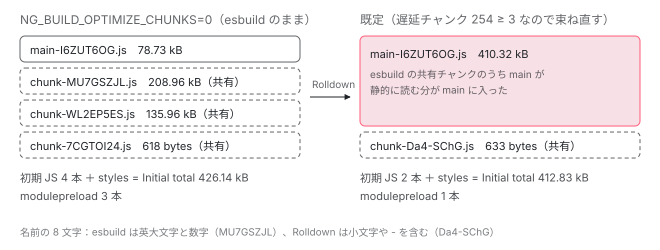

[目次](../README.md) › [CLI とビルド](README.md) › 第 7 回 / 全 16 回

# 遅延チャンク：loadComponent が別ファイルになり、chunk-optimizer がまとめ直す

> esbuild の splitting で import() ごとにチャンクができる仕組み、lazy-routes-transformer が loadComponent / loadChildren の import() にルートの情報を残す行、遅延チャンクが閾値より多いと chunk-optimizer が Rolldown（既定。NG\_BUILD\_CHUNKS\_ROLLDOWN=0 で Rollup）で main から辿れるチャンクを束ね直す行（NG\_BUILD\_OPTIMIZE\_CHUNKS）。初期ファイルと遅延ファイルの分け方、modulepreload のヒント。

angular/angular-cli · 読了 約 14 分 · 発展 · [サイトで読む（デモが動きます）](https://angular-deep-dive-cyan.vercel.app/chapter/cli-code-splitting)

---

ルートに `loadComponent: () => import('./x')` と書くと、`x` は別の JS ファイル（チャンク）になり、そのページを開くまで読み込まれません。この章では、esbuild にチャンクを分けさせる設定の行、`lazy-routes-transformer` が `import()` の横にルートの情報を残す行、遅延チャンクが 3 つ以上あるときに `chunk-optimizer` が **Rolldown** で全体を束ね直す行、そして「初期ファイル」と「遅延ファイル」が分かれて `modulepreload` になるまでを追います。

読む対象は angular-cli リポジトリの `packages/angular/build/src/` の `tools/esbuild/application-code-bundle.ts`・`builders/application/options.ts`・`tools/angular/transformers/lazy-routes-transformer.ts`・`builders/application/execute-build.ts`・`builders/application/chunk-optimizer.ts`・`utils/environment-options.ts` です。

1. [1. 概観](01-cli-overview.md)
2. [2. ng build の段取り](02-build.md)
3. [3. AotCompilation](03-cli-angular-compilation.md)
4. [4. コンポーネントのスタイル](04-cli-component-styles.md)
5. [5. oxc の変換](05-cli-javascript-transformer.md)
6. [6. リンカー](06-cli-linker.md)
7. **7. 遅延チャンク**（この章）
8. [8. budgets](08-cli-budgets.md)
9. [9. i18n](09-cli-i18n.md)
10. [10. 再ビルドとキャッシュ](10-cli-cache-watch.md)
11. [11. HMR](11-cli-hmr.md)
12. [12. unit-test と Vitest](12-cli-unit-test.md)
13. [13. Tree と sink](13-schematics.md)
14. [14. Rule の組み立て](14-schematics-rules.md)
15. [15. ng generate component](15-schematics-component.md)
16. [16. ng add と ng update](16-cli-add-update.md)

## 0. 全体の流れ

1. **import() を書く**

   ルートの `loadComponent: () => import('./pages/x')`。TypeScript の段階で `lazy-routes-transformer` が、このオブジェクトに `ɵentryName` を足す式を書き加える（2 節）。
2. **esbuild が import() ごとにチャンクを作る**

   `splitting: true` なので、`import()` の先は別のファイルになる。2 つ以上のチャンクが共有するコードは、さらに別の共有チャンクに出される（1 節）。
3. **初期ファイルを決める**

   `BundlerContext` が、`main` などの入口と、そこから静的 `import` で辿れるファイルを「初期」とし、残りを「遅延」とする（3 節、[application builder の章](../boot/04-boot-application-build.md)）。
4. **遅延チャンクが閾値以上なら、束ね直す**

   本番ビルド（スクリプト最適化あり）で遅延チャンクが 3 つ以上あれば、`optimizeChunks` が `main` を入口に Rolldown でもう一度バンドルする（4〜6 節）。
5. **初期ファイルを modulepreload に**

   入口でない初期ファイルは `index.html` に `<link rel="modulepreload">` として書かれる（7 節、[index.html の章](../boot/05-boot-index-html.md)）。

## 1. esbuild にチャンクを分けさせる設定

📄 `angular-cli/packages/angular/build/src/tools/esbuild/application-code-bundle.ts` L630–638 （▶ の行: 632–633, 638）

```ts
630 │   return {
631 │     absWorkingDir: workspaceRoot,
632 ▶     format: 'esm',
633 ▶     bundle: true,
634 │     packages,
635 │     assetNames: outputNames.media,
636 │     conditions,
637 │     resolveExtensions: ['.ts', '.tsx', '.mjs', '.js', '.cjs'],
638 ▶     metafile: true,
```
*getEsBuildCommonOptions の戻り値の前半。ブラウザ用もサーバー用も、ここを土台にする。*

間の行（ライセンスのコメントと minify の設定）は[第 5 回](05-cli-javascript-transformer.md)で読みました。その続きです。

📄 `angular-cli/packages/angular/build/src/tools/esbuild/application-code-bundle.ts` L649–656 （▶ の行: 653–654）

```ts
649 │     outdir: workspaceRoot,
650 │     outExtension: outExtension ? { '.js': `.${outExtension}` } : undefined,
651 │     sourcemap: sourcemapOptions.scripts && (sourcemapOptions.hidden ? 'external' : true),
652 │     sourcesContent: sourcemapOptions.sourcesContent,
653 ▶     splitting: true,
654 ▶     chunkNames: options.namedChunks ? '[name]-[hash]' : 'chunk-[hash]',
655 │     tsconfig,
656 │     external: externalDependencies ? [...externalDependencies] : undefined,
```

632 行目 `format: 'esm'` と 653 行目 `splitting: true` の 2 つがそろうと、esbuild は `import()`（動的 import）の先を別ファイルにします。esbuild の splitting は ESM 出力でしか使えないので、この 2 行は対です。さらに esbuild は、2 つ以上の出力から使われるモジュールを、どちらにも重複させずに**共有チャンク**へ出します。共有チャンクには名前の元になる入口が無いので、ビルドの表の Names 列は `-` になります。

654 行目、チャンクの名前は `namedChunks` が偽（既定）なら `chunk-[hash]` です。**ハッシュは `outputHashing` に関係なく必ず付きます**。638 行目の `metafile: true` は、どの出力ファイルがどの入力からできたか・何を import しているかの表（metafile）を esbuild に作らせる指定で、この章のあとの処理はすべてこの表を読みます。

📄 `angular-cli/packages/angular/build/src/builders/application/options.ts` L342–352 （▶ の行: 344–346）

```ts
342 │   const outputNames = {
343 │     bundles:
344 ▶       options.outputHashing === OutputHashing.All || options.outputHashing === OutputHashing.Bundles
345 ▶         ? '[name]-[hash]'
346 ▶         : '[name]',
347 │     media:
348 │       outputOptions.media +
349 │       (options.outputHashing === OutputHashing.All || options.outputHashing === OutputHashing.Media
350 │         ? '/[name]-[hash]'
351 │         : '/[name]'),
352 │   };
```
*入口（main・polyfills・styles）の名前。outputHashing が効くのはこちら。*

344〜346 行目、`main` や `styles` のような入口の名前は、`outputHashing` が `all` か `bundles` のときだけ `[name]-[hash]` になります。この値は入口の `entryNames` に渡されます（[application builder の章](../boot/04-boot-application-build.md)の `createBrowserCodeBundleOptions`）。つまり `outputHashing: "none"` にしても、`main.js` はハッシュ無しになりますが、`chunk-*.js` にはハッシュが残ります。

> [!TIP]
> **新卒エンジニアへ**
>
> ハッシュは中身から計算した短い文字列です。中身が変わると名前が変わるので、ブラウザや CDN に「この名前のファイルは永久にキャッシュしてよい」と言えます。このサイトの `angular.json` の production 設定は `"outputHashing": "all"` です。

## 2. lazy-routes-transformer：import() の横に ɵentryName を残す

esbuild にとって `import('./pages/x')` はただの動的 import です。どのルートがどのチャンクを読むかは、出力からは分かりません。そこで Angular CLI は、TypeScript を JavaScript に変換する段階（`AotCompilation` の emit の `before` 変換。[application builder の章](../boot/04-boot-application-build.md)）で、ルートのオブジェクトに印を付けます。

📄 `angular-cli/packages/angular/build/src/tools/angular/transformers/lazy-routes-transformer.ts` L119–151 （▶ の行: 119, 126, 133, 138, 151）

```ts
119 ▶       const importExpression = ts.isPropertyAccessExpression(expression)
120 │         ? expression.expression // Navigate to the underlying expression for 'then'
121 │         : callExpression;
122 │ 
123 │       // Ensure the underlying expression is an import call
124 │       if (
125 │         !ts.isCallExpression(importExpression) ||
126 ▶         importExpression.expression.kind !== ts.SyntaxKind.ImportKeyword
127 │       ) {
128 │         return ts.visitEachChild(node, visitor, context);
129 │       }
130 │ 
131 │       // Check if the argument to the import call is a string literal
132 │       const callExpressionArgument = importExpression.arguments[0];
133 ▶       if (!ts.isStringLiteralLike(callExpressionArgument)) {
134 │         // Not a string literal, so skip it.
135 │         return ts.visitEachChild(node, visitor, context);
136 │       }
137 │ 
138 ▶       const resolvedPath = ts.resolveModuleName(
139 │         callExpressionArgument.text,
140 │         node.getSourceFile().fileName,
141 │         compilerOptions,
142 │         compilerHost,
143 │         moduleResolutionCache,
144 │       )?.resolvedModule?.resolvedFileName;
145 │ 
146 │       if (!resolvedPath) {
147 │         // Could not resolve the module, so skip it.
148 │         return ts.visitEachChild(node, visitor, context);
149 │       }
150 │ 
151 ▶       const resolvedRelativePath = relative(basePath, resolvedPath);
```
*loadComponent / loadChildren の関数の中から import('…') を見つけ、ファイルの場所に直す。*

この visitor は、`loadComponent` か `loadChildren` の値がアロー関数か function 式であるオブジェクトリテラルだけを対象にします（この引用より前の行で確かめ済み）。119 行目、`import('./x').then(m => m.X)` の形なら `.then` の手前の式へ降ります。126 行目で本当に `import` の呼び出しか、133 行目で引数が文字列リテラルかを確かめます。`import(変数)` のように文字列でないと対象外です。138 行目、TypeScript のモジュール解決で実際のファイル（例: `src/app/pages/home.ts`）を求め、151 行目でプロジェクトの基準パスからの相対パスにします。

📄 `angular-cli/packages/angular/build/src/tools/angular/transformers/lazy-routes-transformer.ts` L153–192 （▶ の行: 155, 160, 165, 170–171, 181, 186）

```ts
153 │       // Create the new property
154 │       // Example: `...(typeof ngServerMode !== "undefined" && ngServerMode ? { ɵentryName: "src/home.ts" }: {})`
155 ▶       const newProperty = factory.createSpreadAssignment(
156 │         factory.createParenthesizedExpression(
157 │           factory.createConditionalExpression(
158 │             factory.createBinaryExpression(
159 │               factory.createBinaryExpression(
160 ▶                 factory.createTypeOfExpression(factory.createIdentifier('ngServerMode')),
161 │                 factory.createToken(ts.SyntaxKind.ExclamationEqualsEqualsToken),
162 │                 factory.createStringLiteral('undefined'),
163 │               ),
164 │               factory.createToken(ts.SyntaxKind.AmpersandAmpersandToken),
165 ▶               factory.createIdentifier('ngServerMode'),
166 │             ),
167 │             factory.createToken(ts.SyntaxKind.QuestionToken),
168 │             factory.createObjectLiteralExpression([
169 │               factory.createPropertyAssignment(
170 ▶                 factory.createIdentifier('ɵentryName'),
171 ▶                 factory.createStringLiteral(resolvedRelativePath),
172 │               ),
173 │             ]),
174 │             factory.createToken(ts.SyntaxKind.ColonToken),
175 │             factory.createObjectLiteralExpression([]),
176 │           ),
177 │         ),
178 │       );
179 │ 
180 │       // Add the new property to the object literal.
181 ▶       return factory.updateObjectLiteralExpression(node, [...node.properties, newProperty]);
182 │     };
183 │ 
184 │     return (sourceFile) => {
185 │       const text = sourceFile.text;
186 ▶       if (!text.includes('loadC')) {
187 │         // Fast check for 'loadComponent' and 'loadChildren'.
188 │         return sourceFile;
189 │       }
190 │ 
191 │       return ts.visitEachChild(sourceFile, visitor, context);
192 │     };
```
*...(typeof ngServerMode !== 'undefined' && ngServerMode ? { ɵentryName: '…' } : {}) を末尾に足す。*

155〜178 行目が組み立てる式は、コメントの例（154 行目）のとおり `...(typeof ngServerMode !== "undefined" && ngServerMode ? { ɵentryName: "src/home.ts" } : {})` です。181 行目でルートのオブジェクトの最後のプロパティとして足します。186 行目は、ファイルに `loadC` という文字列が無ければ木を辿らずに返す近道です。

条件が `ngServerMode`（160・165 行目）なのが要点です。ブラウザ用のビルドでは `ngServerMode` が `false` に置き換えられ（[platformServer の章](../platform/03-ssr-platform-server.md)）、minify で `{}` の側だけが残ります。このサイトの本番の `main-*.js` を検索しても `entryName` は 1 件も出てきません。サーバー用のビルドにだけ残った `ɵentryName` は、プリレンダーやサーバー描画のときに「このルートを描くならこのチャンクを preload」という対応づけに使われます（[サーバールートの章](../platform/05-ssr-server-routes.md)、[AngularAppEngine の章](../platform/04-ssr-app-engine.md)）。

## 3. 初期ファイルと遅延ファイル

esbuild の結果を受け取った `BundlerContext` は、metafile を読んで `initialFiles` を作ります。手順は[application builder の章](../boot/04-boot-application-build.md)と[ブラウザが読む章](../boot/06-boot-browser-load.md)で引用したので、ここでは結論だけにします。

1. **入口を初期にする**

   metafile の `entryPoint` を持つ出力のうち、esbuild に渡した `entryPoints`（`main`・`polyfills`・`styles`）に名前があるものだけが初期。`import()` の先も `entryPoint` を持つが、`entryPoints` に無いので初期にならない。
2. **静的 import を辿る**

   初期ファイルが `import-statement`（静的 `import`）で読むファイルも初期にし、深さ `depth` を 1 足す。`dynamic-import` は辿らない。
3. **残りは遅延**

   `initialFiles` に入らなかった `.js` が遅延チャンク。次の節の「遅延チャンクの数」はこれを数える。

## 4. 束ね直すかどうかの判定

📄 `angular-cli/packages/angular/build/src/builders/application/execute-build.ts` L209–238 （▶ の行: 211, 215–216, 221–223, 236）

```ts
209 │     // Optimize chunks if enabled and threshold is met.
210 │     // This pass uses Rollup/Rolldown to further optimize chunks generated by esbuild.
211 ▶     if (options.optimizationOptions.scripts) {
212 │       // Count lazy chunks (files not needed for initial load).
213 │       // Advanced chunk optimization is most beneficial when there are multiple lazy chunks.
214 │       const { metafiles, initialFiles } = bundlingResult;
215 ▶       const lazyChunksCount = Object.keys(metafiles.browser.outputs || {}).filter(
216 ▶         (path) => path.endsWith('.js') && !initialFiles.has(path),
217 │       ).length;
218 │ 
219 │       // Only run if the number of lazy chunks meets the configured threshold.
220 │       // This avoids overhead for small projects with few chunks.
221 ▶       if (lazyChunksCount >= optimizeChunksThreshold) {
222 ▶         const { optimizeChunks } = await import('./chunk-optimizer');
223 ▶         const optimizationResult = await profileAsync('OPTIMIZE_CHUNKS', () =>
224 │           optimizeChunks(
225 │             bundlingResult,
226 │             options.sourcemapOptions.scripts ? !options.sourcemapOptions.hidden || 'hidden' : false,
227 │           ),
228 │         );
229 │ 
230 │         if (optimizationResult.errors) {
231 │           executionResult.addErrors(optimizationResult.errors);
232 │ 
233 │           return executionResult;
234 │         }
235 │ 
236 ▶         bundlingResult = optimizationResult;
237 │       }
238 │     }
```
*executeBuild の中。esbuild の結果がそろい、エラーが無かったあと。*

211 行目、スクリプトの最適化（`optimization`）が有効なときだけです。`ng serve` の既定の development 設定では最適化が無いので、この節は丸ごと飛ばされます。215〜216 行目で、ブラウザ用 metafile の出力のうち `.js` で `initialFiles` に無いもの、つまり遅延チャンクを数えます。221 行目でそれが `optimizeChunksThreshold` 以上なら、222 行目で `chunk-optimizer` を動的 import します（使わないビルドではモジュールごと読まない）。223 行目の `profileAsync('OPTIMIZE_CHUNKS', …)` は、`NG_BUILD_DEBUG_PERF` を付けたときに所要時間を出す計測です。236 行目で、以降の手順（budgets・index.html・プリレンダー）はすべて束ね直した結果を使います。

📄 `angular-cli/packages/angular/build/src/utils/environment-options.ts` L159–184 （▶ の行: 170, 172–173, 175–176, 178–179, 183）

```ts
159 │ /**
160 │  * When `NG_BUILD_OPTIMIZE_CHUNKS` is enabled, the build will optimize chunks.
161 │  */
162 │ /**
163 │  * The threshold of lazy chunks required to enable the chunk optimization pass.
164 │  * Can be configured via the `NG_BUILD_OPTIMIZE_CHUNKS` environment variable.
165 │  * - `false` or `0` disables the feature.
166 │  * - `true` or `1` forces the feature on (threshold 0).
167 │  * - A number sets the specific threshold.
168 │  * - Default is 3.
169 │  */
170 ▶ const optimizeChunksEnv = process.env['NG_BUILD_OPTIMIZE_CHUNKS'];
171 │ export const optimizeChunksThreshold = (() => {
172 ▶   if (optimizeChunksEnv === undefined) {
173 ▶     return 3;
174 │   }
175 ▶   if (optimizeChunksEnv === 'false' || optimizeChunksEnv === '0') {
176 ▶     return Infinity;
177 │   }
178 ▶   if (optimizeChunksEnv === 'true' || optimizeChunksEnv === '1') {
179 ▶     return 0;
180 │   }
181 │   const num = Number.parseInt(optimizeChunksEnv, 10);
182 │ 
183 ▶   return Number.isNaN(num) || num < 0 ? 3 : num;
184 │ })();
```

| `NG_BUILD_OPTIMIZE_CHUNKS` | 閾値 | 行 | 意味 |
| --- | --- | --- | --- |
| （未設定） | 3 | 172〜173 | 遅延チャンクが 3 つ以上なら束ね直す（既定） |
| `false` / `0` | `Infinity` | 175〜176 | 221 行目の比較が必ず偽。束ね直さない |
| `true` / `1` | 0 | 178〜179 | 遅延チャンクが 0 でも束ね直す |
| 数（例 `10`） | その数 | 181〜183 | 負の数や数でない値は 3 に戻る |

> [!WARNING]
> **ハマりどころ**
>
> `"1"` は「1 個以上」ではなく「常に有効（0）」と読まれます（178 行目が数として読む 181 行目より先）。閾値を 1 にしたいという指定はできません。

## 5. optimizeChunks：main を入口に Rolldown でもう一度バンドルする

📄 `angular-cli/packages/angular/build/src/builders/application/chunk-optimizer.ts` L222–259 （▶ の行: 229, 231–234, 236, 242, 253–255, 257）

```ts
222 │   // Failed builds cannot be optimized
223 │   if (original.errors) {
224 │     return original;
225 │   }
226 │ 
227 │   // Find the main browser entrypoint
228 │   let mainFile;
229 ▶   for (const [file, record] of original.initialFiles) {
230 │     if (
231 ▶       record.name === 'main' &&
232 ▶       record.entrypoint &&
233 ▶       !record.serverFile &&
234 ▶       record.type === 'script'
235 │     ) {
236 ▶       mainFile = file;
237 │       break;
238 │     }
239 │   }
240 │ 
241 │   // No action required if no browser main entrypoint or metafile for stats
242 ▶   if (!mainFile || !original.metafiles.browser) {
243 │     return original;
244 │   }
245 │ 
246 │   const chunks: Record<string, BuildOutputFile> = {};
247 │   const maps: Record<string, BuildOutputFile> = {};
248 │   for (const originalFile of original.outputFiles) {
249 │     if (originalFile.type !== BuildOutputFileType.Browser) {
250 │       continue;
251 │     }
252 │ 
253 ▶     if (originalFile.path.endsWith('.js')) {
254 ▶       chunks[originalFile.path] = originalFile;
255 ▶     } else if (originalFile.path.endsWith('.js.map')) {
256 │       // Create mapping of JS file to sourcemap content
257 ▶       maps[originalFile.path.slice(0, -4)] = originalFile;
258 │     }
259 │   }
```

229〜238 行目で `initialFiles` から `main` を探します。名前が `main` で、入口で、サーバー用でなく、スクリプトのもの。見つからなければ 242 行目で何もせずに返します。248〜259 行目で、ブラウザ用の `.js` をすべて `chunks` に、ソースマップを `maps` に入れます。ここにあるのは esbuild が**もう書き出したつもりの、minify 済みのファイル**です。

📄 `angular-cli/packages/angular/build/src/builders/application/chunk-optimizer.ts` L261–296 （▶ の行: 268, 271, 273–274, 278, 280, 286, 289）

```ts
261 │   const usedChunks = new Set<string>();
262 │ 
263 │   let bundle;
264 │   let optimizedOutput: (OutputChunk | OutputAsset)[];
265 │   try {
266 │     const plugins = [
267 │       {
268 ▶         name: 'angular-bundle',
269 │         resolveId(source: string) {
270 │           // Remove leading `./` if present
271 ▶           const file = source[0] === '.' && source[1] === '/' ? source.slice(2) : source;
272 │ 
273 ▶           if (chunks[file]) {
274 ▶             return file;
275 │           }
276 │ 
277 │           // All other identifiers are considered external to maintain behavior
278 ▶           return { id: source, external: true };
279 │         },
280 ▶         load(id: string) {
281 │           assert(
282 │             chunks[id],
283 │             `Angular chunk content should always be present in chunk optimizer [${id}].`,
284 │           );
285 │ 
286 ▶           usedChunks.add(id);
287 │ 
288 │           const result = {
289 ▶             code: chunks[id].text,
290 │             map: maps[id]?.text,
291 │           };
292 │ 
293 │           return result;
294 │         },
295 │       },
296 │     ];
```
*Rolldown（と Rollup）に、ディスクではなく esbuild の出力を読ませるプラグイン。*

束ね直しの入力は TypeScript のソースではなく、esbuild の出力ファイルそのものです。269 行目の `resolveId` は `import './chunk-ABCD1234.js'` の `./` を落とし（271 行目）、esbuild の出力にあるファイルなら 274 行目でそのまま ID にします。それ以外（外部パッケージ指定など）は 278 行目で外部扱い。280 行目の `load` は、その ID の中身を 289 行目で `chunks[id].text` から返し、286 行目で「使った」と記録します。

📄 `angular-cli/packages/angular/build/src/utils/environment-options.ts` L105–109 （▶ の行: 109）

```ts
105 │ /**
106 │  * Allows using Rolldown for chunk optimization instead of Rollup.
107 │  * This is useful for debugging and testing scenarios.
108 │  */
109 ▶ export const useRolldownChunks = parseTristate(process.env['NG_BUILD_CHUNKS_ROLLDOWN']) ?? true;
```

📄 `angular-cli/packages/angular/build/src/builders/application/chunk-optimizer.ts` L298–334 （▶ の行: 298, 300–301, 306, 308–309, 315, 318, 322, 328）

```ts
298 ▶     if (useRolldownChunks) {
299 │       const { rolldown } = await import('rolldown');
300 ▶       bundle = await rolldown({
301 ▶         input: mainFile,
302 │         plugins,
303 │       });
304 │ 
305 │       const result = await bundle.generate({
306 ▶         minify: { mangle: false, compress: false },
307 │         sourcemap,
308 ▶         chunkFileNames: (chunkInfo) =>
309 ▶           `${chunkInfo.name.replace(/-[a-zA-Z0-9_-]{8}$/, '')}-[hash].js`,
310 │       });
311 │       optimizedOutput = result.output;
312 │     } else {
313 │       let rollup;
314 │       try {
315 ▶         rollup = (await import('rollup')).rollup;
316 │       } catch {
317 │         throw new Error(
318 ▶           `Rollup is required when 'NG_BUILD_CHUNKS_ROLLDOWN' is set to false. ` +
319 │             `Please install 'rollup' manually (e.g. 'npm install rollup --save-dev') to use this fallback.`,
320 │         );
321 │       }
322 ▶       bundle = await rollup({
323 │         input: mainFile,
324 │         plugins: plugins as Plugin[],
325 │       });
326 │ 
327 │       const result = await bundle.generate({
328 ▶         compact: true,
329 │         sourcemap,
330 │         chunkFileNames: (chunkInfo) =>
331 │           `${chunkInfo.name.replace(/-[a-zA-Z0-9_-]{8}$/, '')}-[hash].js`,
332 │       });
333 │       optimizedOutput = result.output;
334 │     }
```

109 行目、`NG_BUILD_CHUNKS_ROLLDOWN` が未設定なら `true` です。だから既定では 298〜311 行目の **Rolldown** が使われます。Rollup は 312 行目からの代わりの道で、315 行目の import に失敗すると 318 行目のエラーになります（`@angular/build` の `package.json` では `rolldown` が dependencies、`rollup` は省略可能な peerDependencies なので、Rollup は自分で入れる）。

1. **301 行目：入口は main だけ**

   `main` から静的 import と `import()` で辿れるチャンクが対象。`import()` の境目は Rolldown でもチャンクの境目として残る。
2. **Rolldown がチャンクを決め直す**

   esbuild の出力ファイル 1 つ 1 つを「モジュール」として扱い、どれとどれを同じファイルに入れるかを Rolldown 自身の規則で決め直す。esbuild が細かく切った共有チャンクは、ここでまとまりうる。
3. **306 行目：minify はほぼしない**

   中身は esbuild がもう minify 済みなので、名前の短縮（mangle）も圧縮（compress）も切る。
4. **308〜309 行目：名前の付け直し**

   元の名前の末尾の `-` と 8 文字（esbuild のハッシュ）を落とし、`-[hash].js` を付け直す。`chunk-WL2EP5ES` なら `chunk` に戻り、Rolldown の新しいハッシュが付く。

## 6. 結果を esbuild の形に戻す

このあとの budgets・統計の表・`index.html` の生成は、esbuild の metafile と `initialFiles` を前提に書かれています。そこで、Rolldown の出力をその形に戻します。

📄 `angular-cli/packages/angular/build/src/builders/application/chunk-optimizer.ts` L346–368 （▶ の行: 347, 349–350, 354, 361, 364, 366–367）

```ts
346 │   // Update metafile
347 ▶   const newMetafile = bundleOutputToEsbuildMetafile(optimizedOutput, original.metafiles.browser);
348 │   // Add back the outputs that were not part of the optimization
349 ▶   for (const [path, output] of Object.entries(original.metafiles.browser.outputs)) {
350 ▶     if (usedChunks.has(path)) {
351 │       continue;
352 │     }
353 │ 
354 ▶     newMetafile.outputs[path] = output;
355 │     for (const inputPath of Object.keys(output.inputs)) {
356 │       if (!newMetafile.inputs[inputPath]) {
357 │         newMetafile.inputs[inputPath] = original.metafiles.browser.inputs[inputPath];
358 │       }
359 │     }
360 │   }
361 ▶   original.metafiles.browser = newMetafile;
362 │ 
363 │   // Remove used chunks and associated sourcemaps from the original result
364 ▶   original.outputFiles = original.outputFiles.filter(
365 │     (file) =>
366 ▶       !usedChunks.has(file.path) &&
367 ▶       !(file.path.endsWith('.map') && usedChunks.has(file.path.slice(0, -4))),
368 │   );
```

📄 `angular-cli/packages/angular/build/src/builders/application/chunk-optimizer.ts` L370–391 （▶ の行: 377, 379–380）

```ts
370 │   // Add new optimized chunks
371 │   const importsPerFile: Record<string, string[]> = {};
372 │   for (const optimizedFile of optimizedOutput) {
373 │     if (optimizedFile.type !== 'chunk') {
374 │       continue;
375 │     }
376 │ 
377 ▶     importsPerFile[optimizedFile.fileName] = optimizedFile.imports;
378 │ 
379 ▶     original.outputFiles.push(
380 ▶       createOutputFile(optimizedFile.fileName, optimizedFile.code, BuildOutputFileType.Browser),
381 │     );
382 │     if (optimizedFile.map && optimizedFile.sourcemapFileName) {
383 │       original.outputFiles.push(
384 │         createOutputFile(
385 │           optimizedFile.sourcemapFileName,
386 │           optimizedFile.map.toString(),
387 │           BuildOutputFileType.Browser,
388 │         ),
389 │       );
390 │     }
391 │   }
```

347 行目で Rolldown の出力から新しい metafile を作り、349〜360 行目で束ね直しに使われなかった出力（`main` から辿れなかったもの）を元のまま戻します。361 行目で差し替え。364〜368 行目で、使ったチャンクとそのソースマップを出力ファイルの一覧から消し、379〜381 行目で Rolldown のチャンクを足します。377 行目の `imports` は次の初期ファイルの計算に使います。

📄 `angular-cli/packages/angular/build/src/builders/application/chunk-optimizer.ts` L140–162 （▶ の行: 140–142, 146, 149–150, 161）

```ts
140 ▶     const imports = [
141 ▶       ...chunk.imports.map((path) => ({ path, kind: 'import-statement' as const })),
142 ▶       ...(chunk.dynamicImports?.map((path) => ({ path, kind: 'dynamic-import' as const })) ?? []),
143 │     ];
144 │ 
145 │     let entryPoint: string | undefined;
146 ▶     if (chunk.facadeModuleId) {
147 │       const posixFacadeModuleId = toPosixPath(chunk.facadeModuleId);
148 │       for (const [outputPath, output] of Object.entries(originalMetafile.outputs)) {
149 ▶         if (posixFacadeModuleId.endsWith(outputPath)) {
150 ▶           entryPoint = output.entryPoint;
151 │           break;
152 │         }
153 │       }
154 │     }
155 │ 
156 │     newMetafile.outputs[chunk.fileName] = {
157 │       bytes: Buffer.byteLength(chunk.code, 'utf8'),
158 │       inputs: newOutputInputs,
159 │       imports,
160 │       exports: chunk.exports ?? [],
161 ▶       entryPoint,
162 │     };
```
*bundleOutputToEsbuildMetafile の中。Rolldown のチャンクに、元の entryPoint を付け直す。*

146〜153 行目、Rolldown のチャンクの元になった esbuild の出力（`facadeModuleId`）を探し、その `entryPoint`（例: `src/app/pages/chapters/compiler.ts`）を受け継ぎます。ビルドの最後の表で、束ね直したあとでも Names 列に `compiler` のような名前が出るのはこの行のおかげです（名前の取り出しは[第 8 回](08-cli-budgets.md)）。

📄 `angular-cli/packages/angular/build/src/builders/application/chunk-optimizer.ts` L393–428 （▶ の行: 397, 399, 404, 412, 416, 423, 425）

```ts
393 │   // Update initial files to reflect optimized chunks
394 │   const entriesToAnalyze: [string, InitialFileRecord][] = [];
395 │   for (const usedFile of usedChunks) {
396 │     // Leave the main file since its information did not change
397 ▶     if (usedFile === mainFile) {
398 │       // eslint-disable-next-line @typescript-eslint/no-non-null-assertion
399 ▶       entriesToAnalyze.push([mainFile, original.initialFiles.get(mainFile)!]);
400 │       continue;
401 │     }
402 │ 
403 │     // Remove all other used chunks
404 ▶     original.initialFiles.delete(usedFile);
405 │   }
406 │ 
407 │   // Analyze for transitive initial files
408 │   let currentEntry;
409 │   while ((currentEntry = entriesToAnalyze.pop())) {
410 │     const [entryPath, entryRecord] = currentEntry;
411 │ 
412 ▶     for (const importPath of importsPerFile[entryPath]) {
413 │       const existingRecord = original.initialFiles.get(importPath);
414 │       if (existingRecord) {
415 │         // Store the smallest value depth
416 ▶         if (existingRecord.depth > entryRecord.depth + 1) {
417 │           existingRecord.depth = entryRecord.depth + 1;
418 │         }
419 │ 
420 │         continue;
421 │       }
422 │ 
423 ▶       const record = createInitialFileRecord(entryRecord.depth + 1);
424 │ 
425 ▶       original.initialFiles.set(importPath, record);
426 │       entriesToAnalyze.push([importPath, record]);
427 │     }
428 │   }
```

393〜405 行目、`main` の記録だけ残し、束ね直しに使った他のファイルは `initialFiles` から消します（もう存在しないファイル名なので）。408〜428 行目は 3 節と同じ「静的 import を辿る」処理を、Rolldown の `imports`（静的 import だけが入る）でやり直します。`main` が静的に読むチャンクが新しい初期ファイルになり、416 行目でいちばん浅い `depth` を残します。



*このサイトの本番ビルドを、束ね直しあり（既定）と NG\_BUILD\_OPTIMIZE\_CHUNKS=0 で比べた初期ファイル。どちらも遅延チャンクは 254 本。*

図は、このサイトを `npx ng build` したときと、`NG_BUILD_OPTIMIZE_CHUNKS=0 npx ng build` したときのログ（Initial chunk files の表）です。遅延チャンクはどちらも 254 本で、`loadComponent` の 1 章 1 チャンクという分け方は変わりません。変わったのは初期ファイルで、esbuild が切り出した共有チャンク 3 本のうち 2 本が `main` に入り、初期 JS が 4 本から 2 本に減りました。出力したすべての `.js` の合計は、束ね直し無しの約 18.28 MB に対して約 15.96 MB でした（ファイルの大きさを足した値。どのチャンクで減ったかの内訳はこの章では追っていません）。

## 7. 初期ファイルを modulepreload にする

最後に `index.html` を作るとき、`initialFiles` のうち入口でないスクリプトが `<link rel="modulepreload">` になります。`depth` の浅い順に最大 10 個です（[index.html の章](../boot/05-boot-index-html.md)、[ブラウザが読む章](../boot/06-boot-browser-load.md)）。`modulepreload` は「このモジュールをいまのうちに取って解析しておいて」というヒントで、`main` の静的 import に気づく前に取りに行けます。

このサイトでは、ビルドが書いた `index.csr.html` の preload は 6 節の結果どおり `chunk-Da4-SChG.js` の 1 本だけです。一方、プリレンダーした各ページの HTML には、`main` の後ろにそのページのチャンクの preload が足されています。これは 2 節の `ɵentryName` をもとに、プリレンダー（サーバー描画）の時点で足されたものです（[サーバールートの章](../platform/05-ssr-server-routes.md)）。

> **🧪 DEMO — このページを開くのに読んだ JS を、初期 / ルートの preload / あとから import() に分ける**
>
> `/index.csr.html`（ビルドが書いたままの HTML）と、このページの HTML（プリレンダー済み）を取り直して比べ、`performance.getEntriesByType('resource')` にある JS を分類します。本番ビルド（`outputMode: "static"`）で動かしたときの見方です。ほかの章から `routerLink` で移ってきた場合、この章のチャンクは preload ではなく `import()` で読まれていますが、表では「このページの HTML が preload に挙げている」ものとして「ルートの preload」に入ります。
>
> ▶ [このデモはサイトで動かせます](https://angular-deep-dive-cyan.vercel.app/chapter/cli-code-splitting)

## 呼び出しの流れ

- 👤 `loadComponent: () => import('./pages/x')` — src/app/app.routes.ts — *あなたのコード*
- `lazyRoutesTransformer → ...(ngServerMode ? { ɵentryName } : {})` — lazy-routes-transformer.ts L155-181
- `esbuild({ format: 'esm', splitting: true, chunkNames: 'chunk-[hash]' })` — application-code-bundle.ts L632, L653-654
  - `BundlerContext: initialFiles（入口 ＋ 静的 import）` — bundler-context.ts — *3 節*
- `lazyChunksCount >= optimizeChunksThreshold（既定 3）` — execute-build.ts L215-221
  - `optimizeChunks(bundlingResult, sourcemap)` — chunk-optimizer.ts L218
    - `rolldown({ input: mainFile, plugins }).generate(…)` — chunk-optimizer.ts L300-310
    - `bundleOutputToEsbuildMetafile → initialFiles を辿り直す` — chunk-optimizer.ts L347, L408-428
- `generateIndexHtml → <link rel="modulepreload">` — index-html-generator.ts — *index.html の章*

## 聞かれそうな質問

**Q. チャンクの名前にハッシュが付くのはなぜ？outputHashing を none にしたら消える？**

チャンクは 654 行目で `chunk-[hash]` と決め打ちなので、`outputHashing` に関係なく必ずハッシュが付きます。`outputHashing` が効くのは 344〜346 行目の入口（`main` など）と画像などのメディアだけです。束ね直したチャンクは 308〜309 行目で Rolldown のハッシュに付け直されます。ハッシュが中身で変わるので、配信側は長期キャッシュを設定できます。

**Q. @defer のブロックも別チャンクになりますか？**

なります。コンパイラが `@defer` の依存を `import()` を返す関数として出力するので（[@defer の依存の章](../standalone/11-standalone-defer-deps.md)）、esbuild からは `loadComponent` と同じ動的 import に見え、653 行目の splitting で別ファイルになります。

**Q. チャンクが多すぎると何が困るのですか？だから optimizer？**

esbuild は共有されるコードを細かい共有チャンクに切り出すので、ファイルの数とファイル同士の import が増えます。初期表示で必要な共有チャンクが多いと、ブラウザは `main` を読んでから次のファイルに気づく、という往復が増えます（modulepreload は最大 10 個まで）。このサイトでは束ね直しで初期 JS が 4 本から 2 本、modulepreload が 3 本から 1 本になりました（6 節の図）。判定は 221 行目、束ね直しの範囲は 301 行目の `main` から辿れるチャンクです。

**Q. Rollup で束ね直すのですか？Rolldown ですか？**

既定は Rolldown です。109 行目の `useRolldownChunks` が未設定で `true` になり、298〜311 行目が走ります。`NG_BUILD_CHUNKS_ROLLDOWN=0` にすると 312〜334 行目の Rollup になりますが、Rollup を自分で入れていないと 318 行目のエラーになります。このサイトの出力名 `chunk-Da4-SChG.js` に小文字や `-` が混ざっているのは、esbuild ではなく Rolldown が名前を付けた印です（esbuild のままだと `chunk-MU7GSZJL.js` のように英大文字と数字）。

**Q. 束ね直しを止めたい・必ず走らせたいときは？**

環境変数 `NG_BUILD_OPTIMIZE_CHUNKS` です。`0` / `false` で閾値が `Infinity`（175〜176 行目）になり止まります。`1` / `true` で閾値 0（178〜179 行目）になり、遅延チャンクが無くても走ります。どちらにしても 211 行目のとおり、スクリプトの最適化が無いビルド（development 設定や `ng serve` の既定）では走りません。

## 読み終えて

- `format: 'esm'` と `splitting: true`（632・653 行目）で、esbuild は `import()` ごとにチャンクを作り、共有コードを共有チャンクに出す。チャンク名は常に `chunk-[hash]`。
- `lazy-routes-transformer` は `loadComponent` / `loadChildren` の横に `ngServerMode` のときだけ有効な `ɵentryName` を足す。ブラウザ用では消え、サーバー側の preload の対応づけに使われる。
- 本番ビルドで遅延チャンクが 3 つ以上なら、`optimizeChunks` が `main` を入口に Rolldown で esbuild の出力を束ね直し、metafile と `initialFiles` を作り直す。
- 初期ファイルは「入口 ＋ 静的 import で辿れるもの」。入口でない初期スクリプトが `modulepreload` になる。
- このサイトでは束ね直しで初期 JS が 4 本 → 2 本。遅延チャンク 254 本はそのまま。

---

← 前: [リンカー：部分コンパイルのライブラリを、アプリのビルドで仕上げる](06-cli-linker.md)  
次: [budgets と出力の表：Initial total が警告になるまで](08-cli-budgets.md) →
