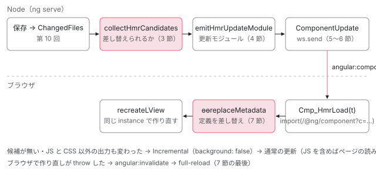

[目次](../README.md) › [CLI とビルド](README.md) › 第 11 回 / 全 16 回

# コンポーネントの HMR：画面を保ったままテンプレートとスタイルを差し替える

> テンプレートやスタイルだけが変わったとき、collectHmrCandidates が差し替え可能なコンポーネントを選ぶ行、dev-server が Vite の WebSocket で angular:component-update を送る行、ブラウザで ɵɵreplaceMetadata（core/src/render3/hmr.ts）が新しい定義を取り込み、既存の LView を作り直す行。HMR にならずに全体を読み直す場合（変更が 32 ファイルを超えたときなど）。

angular/angular-cli · 読了 約 13 分 · 発展 · [サイトで読む（デモが動きます）](https://angular-deep-dive-cyan.vercel.app/chapter/cli-hmr)

---

`ng serve` 中にコンポーネントのテンプレートを保存すると、ページを読み直さずに、そのコンポーネントの表示だけが変わります。この章では、保存したファイルから「差し替えられるコンポーネント」を選ぶ判定、差し替え用のモジュールを作る所、dev-server が WebSocket で送る所、ブラウザで `ɵɵreplaceMetadata` が既存の `LView` を作り直す所を順に読みます。差し替えられずにページ全体を読み直す場合も、その行で確かめます。

読む対象は angular-cli の `tools/angular/compilation/hmr-candidates.ts`・`aot-compilation.ts`・`builders/application/build-action.ts`・`builders/dev-server/vite/index.ts`・`tools/vite/middlewares/component-middleware.ts`、Angular 本体の `compiler/src/render3/r3_hmr_compiler.ts`・`compiler-cli/src/ngtsc/core/src/compiler.ts`・`core/src/render3/hmr.ts` です。

1. [1. 概観](01-cli-overview.md)
2. [2. ng build の段取り](02-build.md)
3. [3. AotCompilation](03-cli-angular-compilation.md)
4. [4. コンポーネントのスタイル](04-cli-component-styles.md)
5. [5. oxc の変換](05-cli-javascript-transformer.md)
6. [6. リンカー](06-cli-linker.md)
7. [7. 遅延チャンク](07-cli-code-splitting.md)
8. [8. budgets](08-cli-budgets.md)
9. [9. i18n](09-cli-i18n.md)
10. [10. 再ビルドとキャッシュ](10-cli-cache-watch.md)
11. **11. HMR**（この章）
12. [12. unit-test と Vitest](12-cli-unit-test.md)
13. [13. Tree と sink](13-schematics.md)
14. [14. Rule の組み立て](14-schematics-rules.md)
15. [15. ng generate component](15-schematics-component.md)
16. [16. ng add と ng update](16-cli-add-update.md)

> [!TIP]
> **新卒エンジニアへ**
>
> HMR（Hot Module Replacement）は「動いているページに、変わったモジュールだけを差し込む」仕組みです。Angular の HMR が差し込むのはモジュール全体ではなく、**コンポーネントの定義（`ɵcmp`）だけ**です。クラスのロジックが変わったときは差し込まず、ページを読み直します。本番のビルド（このサイトの配信物）には HMR のコードが入らないので、この章のデモは判定の表です。

## 0. 全体の流れ



*Node 側（ng serve のプロセス）で差し替え用のモジュールを作り、ブラウザ側は通知を受けてそれを import する。どちらかで断られたら全体を読み直す。*

1. **起動時に HMR を有効にするか決める**

   dev-server が `templateUpdates` を有効にし、コンパイラに `_enableHmr` を渡す（1 節）。
2. **コンポーネントに「待ち受け」のコードが入る**

   コンパイラが各コンポーネントの後ろに、通知を待って更新モジュールを import するコードを足す（2 節）。
3. **保存 → 判定**

   `collectHmrCandidates` が、変わったのがテンプレートとスタイルだけかを、前回の構文木と文字で比べて調べる（3 節）。
4. **更新モジュールを作る**

   候補ごとに `emitHmrUpdateModule` が「`ɵcmp` を作り直す関数」を ES モジュールの文字列にして `templateUpdates` に入れる（4 節）。
5. **送るか、読み直すか**

   `emitOutputResults` が、JS 以外の出力が変わっていなければ `ComponentUpdate` を出す（5 節）。
6. **WebSocket で知らせる**

   dev-server が `angular:component-update` を送り、ブラウザは `/@ng/component?c=…` を import する（6 節）。
7. **ブラウザで作り直す**

   `ɵɵreplaceMetadata` が定義を差し替え、そのコンポーネントの `LView` を同じインスタンスのまま作り直す（7 節）。

## 1. HMR が有効になる条件

📄 `angular-cli/packages/angular/build/src/builders/dev-server/options.ts` L126–137 （▶ の行: 136–137）

```ts
126 │   return {
127 │     buildTarget,
128 │     host: host ?? 'localhost',
129 │     port,
130 │     strictPort: port !== 0,
131 │     poll,
132 │     open,
133 │     verbose,
134 │     define,
135 │     watch,
136 ▶     liveReload: !!liveReload,
137 ▶     hmr: hmr ?? !!liveReload,
```

📄 `angular-cli/packages/angular/build/src/builders/dev-server/vite/index.ts` L160–171 （▶ の行: 161–163, 165）

```ts
160 │   if (
161 ▶     serverOptions.hmr &&
162 ▶     (browserOptions.outputHashing === OutputHashing.All ||
163 ▶       browserOptions.outputHashing === OutputHashing.Bundles)
164 │   ) {
165 ▶     serverOptions.hmr = false;
166 │ 
167 │     context.logger.warn(
168 │       `Hot Module Replacement (HMR) is disabled because the 'outputHashing' option is set to '${browserOptions.outputHashing}'. ` +
169 │         'HMR is incompatible with this setting.',
170 │     );
171 │   }
```

137 行目、`hmr` を書かなければ `liveReload`（既定 `true`）と同じ値、つまり**既定で有効**です。161〜165 行目、`outputHashing` が `all` か `bundles` なら切ります。ファイル名にハッシュが付くと、差し替えのたびに名前が変わって追えないからです。この引用のすぐあとで `aot`・`liveReload`・`hmr` がそろったときだけ `templateUpdates` を有効にします。この行は [standalone-used-only の章](../standalone/04-standalone-used-only.md)で引用しています。環境変数 `NG_HMR_TEMPLATES=0` でテンプレートの HMR だけを切れます。

`templateUpdates` が有効なら、Angular のプラグインが `enableHmr` を立て、`compiler-options.ts` でコンパイラのオプション `_enableHmr` になります（その引用は[第 3 回](03-cli-angular-compilation.md)）。コンパイラ側はこれを見て、2 節のコードを出すかどうかと、次の 1 点を変えます。

> [!WARNING]
> **ハマりどころ**
>
> HMR が有効なとき、コンポーネントのハンドラーは `canDeferDeps = !enableHmr` とし、`@defer` の中の依存を**遅延チャンクに分けません**。更新モジュールは `import` を持てず依存を引数で受け取るので、遅延にして import を消すと参照を失うからです。その行は [@defer の依存の章](../standalone/11-standalone-defer-deps.md)で引用しています。`ng serve` で `@defer` の遅延チャンクが見えないのはこのためで、本番ビルドでは分かれます。

## 2. コンパイラが埋め込む「待ち受け」のコード

`_enableHmr` のとき、コンパイラはコンポーネントごとに `compileHmrInitializer` の出力をクラスの後ろに足します。出力の AST を組み立てる関数を 3 つに分けて読みます。

📄 `angular/packages/compiler/src/render3/r3_hmr_compiler.ts` L124–159 （▶ の行: 127–129, 135, 138, 147, 154, 156）

```ts
124 │   // Cmp_HmrLoad(Date.now());
125 │   // Initial call to kick off the loading in order to avoid edge cases with components
126 │   // coming from lazy chunks that change before the chunk has loaded.
127 ▶   const initialCall = o
128 ▶     .variable(importCallbackName)
129 ▶     .callFn([o.variable('Date').prop('now').callFn([])]);
130 │ 
131 │   // import.meta.hot
132 │   const hotRead = o.variable('import').prop('meta').prop('hot');
133 │ 
134 │   // import.meta.hot.on('angular:component-update', () => ...);
135 ▶   const hotListener = hotRead
136 │     .clone()
137 │     .prop('on')
138 ▶     .callFn([o.literal('angular:component-update'), updateCallback]);
139 │ 
140 │   return o
141 │     .arrowFn(
142 │       [],
143 │       [
144 │         // const id = <id>;
145 │         new o.DeclareVarStmt(
146 │           idName,
147 ▶           o.literal(encodeURIComponent(`${meta.filePath}@${meta.className}`)),
148 │           null,
149 │           o.StmtModifier.Final,
150 │         ),
151 │         // function Cmp_HmrLoad() {...}.
152 │         importCallback,
153 │         // ngDevMode && Cmp_HmrLoad(Date.now());
154 ▶         devOnlyGuardedExpression(initialCall).toStmt(),
155 │         // ngDevMode && import.meta.hot && import.meta.hot.on(...)
156 ▶         devOnlyGuardedExpression(hotRead.and(hotListener)).toStmt(),
157 │       ],
158 │     )
159 │     .callFn([]);
```

📄 `angular/packages/compiler/src/render3/r3_hmr_compiler.ts` L98–122 （▶ の行: 98, 105–107, 115, 120–121）

```ts
 98 ▶   const importCallback = new o.DeclareFunctionStmt(
 99 │     importCallbackName,
100 │     [new o.FnParam(timestampName, o.DYNAMIC_TYPE)],
101 │     [
102 │       // The vite-ignore special comment is required to prevent Vite from generating a superfluous
103 │       // warning for each usage within the development code. If Vite provides a method to
104 │       // programmatically avoid this warning in the future, this added comment can be removed here.
105 ▶       new o.DynamicImportExpr(url, null, '@vite-ignore')
106 ▶         .prop('then')
107 ▶         .callFn([replaceCallback])
108 │         .toStmt(),
109 │     ],
110 │     null,
111 │     o.StmtModifier.Final,
112 │   );
113 │ 
114 │   // (d) => d.id === id && Cmp_HmrLoad(d.timestamp)
115 ▶   const updateCallback = o.arrowFn(
116 │     [new o.FnParam(dataName, o.DYNAMIC_TYPE)],
117 │     o
118 │       .variable(dataName)
119 │       .prop('id')
120 ▶       .identical(o.variable(idName))
121 ▶       .and(o.variable(importCallbackName).callFn([o.variable(dataName).prop('timestamp')])),
122 │   );
```

📄 `angular/packages/compiler/src/render3/r3_hmr_compiler.ts` L66–97 （▶ の行: 69–70, 72–77, 81, 84, 87–88）

```ts
66 │   const defaultRead = o.variable(moduleName).prop('default');
67 │ 
68 │   // ɵɵreplaceMetadata(Comp, m.default, [...namespaces], [...locals], import.meta, id);
69 ▶   const replaceCall = o
70 ▶     .importExpr(R3.replaceMetadata)
71 │     .callFn([
72 ▶       meta.type,
73 ▶       defaultRead,
74 ▶       o.literalArr(namespaces),
75 ▶       o.literalArr(meta.localDependencies.map((l) => l.runtimeRepresentation)),
76 ▶       o.variable('import').prop('meta'),
77 ▶       o.variable(idName),
78 │     ]);
79 │ 
80 │   // (m) => m.default && ɵɵreplaceMetadata(...)
81 ▶   const replaceCallback = o.arrowFn(
82 │     [new o.FnParam(moduleName, o.DYNAMIC_TYPE)],
83 │     defaultRead.and(replaceCall),
84 ▶   );
85 │ 
86 │   // getReplaceMetadataURL(id, timestamp, import.meta.url)
87 ▶   const url = o
88 ▶     .importExpr(R3.getReplaceMetadataURL)
89 │     .callFn([
90 │       o.variable(idName),
91 │       o.variable(timestampName),
92 │       o.variable('import').prop('meta').prop('url'),
93 │     ]);
94 │ 
95 │   // function Cmp_HmrLoad(t) {
96 │   //   import(/* @vite-ignore */ url).then((m) => m.default && replaceMetadata(...));
97 │   // }
```

出来上がるコードを、コメントにある形に直すとこうなります（`AppComponent` の場合）。

- `(() => {` — 140〜159 行目 — *すぐ呼ぶ関数*
  - `const id = "src%2Fapp%2Fapp.ts%40AppComponent";` — 145〜150 行目 — *ファイルとクラス名*
  - `function AppComponent_HmrLoad(t) { import(getReplaceMetadataURL(id, t, import.meta.url)).then(m => m.default && ɵɵreplaceMetadata(AppComponent, m.default, [i0], [...], import.meta, id)); }` — 98〜112 行目
  - `ngDevMode && AppComponent_HmrLoad(Date.now());` — 154 行目 — *起動時に 1 回*
  - `ngDevMode && import.meta.hot && import.meta.hot.on("angular:component-update", d => d.id === id && AppComponent_HmrLoad(d.timestamp));` — 156 行目 — *通知を待つ*
- `})();`

135〜138 行目で Vite の `import.meta.hot` に `angular:component-update` の受け手を登録し、120 行目で自分の `id` 宛ての通知だけに反応します。154 行目は通知を待たずに起動時に 1 回 import します。コメント（125〜126 行目）のとおり、遅延チャンクのコンポーネントが、チャンクを読む前に変わっていた場合に追いつくためです。更新が無ければサーバーは空の本文を返し（6 節 41 行目）、81 行目の `m.default &&` で何もしません。呼び出しは `ngDevMode` で守られています。そもそも本番ビルドでは `_enableHmr` が立たないので、このコードは出力されません。

## 3. 保存したら：差し替えられるかの判定

保存から `AotCompilation.initialize` が呼ばれるまでは[第 10 回](10-cli-cache-watch.md)です。`initialize` の中で HMR の判定をするのは、変わったファイルが少ないときだけです。

📄 `angular-cli/packages/angular/build/src/tools/angular/compilation/aot-compilation.ts` L33–38 （▶ の行: 38）

```ts
33 │ /**
34 │  * The modified files count limit for performing component HMR analysis.
35 │  * Performing content analysis for a large amount of files can result in longer rebuild times
36 │  * than a full rebuild would entail.
37 │  */
38 ▶ const HMR_MODIFIED_FILE_LIMIT = 32;
```

📄 `angular-cli/packages/angular/build/src/tools/angular/compilation/aot-compilation.ts` L93–121 （▶ の行: 93–96, 101, 112–113, 115–116）

```ts
 93 ▶     const useHmr =
 94 ▶       compilerOptions['_enableHmr'] &&
 95 ▶       hostOptions.modifiedFiles &&
 96 ▶       hostOptions.modifiedFiles.size <= HMR_MODIFIED_FILE_LIMIT;
 97 │ 
 98 │     let staleSourceFiles;
 99 │     let clearPackageJsonCache = false;
100 │     if (hostOptions.modifiedFiles) {
101 ▶       this.invalidateFiles(hostOptions.modifiedFiles);
102 │ 
103 │       for (const modifiedFile of hostOptions.modifiedFiles) {
104 │         if (this.#state) {
105 │           // Clear package.json cache if a node modules file was modified
106 │           if (!clearPackageJsonCache && modifiedFile.includes('node_modules')) {
107 │             clearPackageJsonCache = true;
108 │             packageJsonCache?.clear();
109 │           }
110 │ 
111 │           // Collect stale source files for HMR analysis of inline component resources
112 ▶           if (useHmr) {
113 ▶             const sourceFile = this.#state.typeScriptProgram.getSourceFile(modifiedFile);
114 │             if (sourceFile) {
115 ▶               staleSourceFiles ??= new Map<string, ts.SourceFile>();
116 ▶               staleSourceFiles.set(modifiedFile, sourceFile);
117 │             }
118 │           }
119 │         }
120 │       }
121 │     }
```

93〜96 行目。`_enableHmr` があり、2 回目以降のビルドで、変わったファイルが 32 個以下のときだけ判定します（38 行目。多いと判定のほうが遅くなる）。113〜116 行目が大事です。新しい program を作る**前**に、前回の program から変わったファイルの構文木（`staleSourceFiles`）を取っておきます。これが比べる相手です。

📄 `angular-cli/packages/angular/build/src/tools/angular/compilation/hmr-candidates.ts` L25–46 （▶ の行: 32, 34–37, 41–44）

```ts
25 │ export function collectHmrCandidates(
26 │   modifiedFiles: Set<string>,
27 │   { compiler }: ng.NgtscProgram,
28 │   staleSourceFiles: Map<string, ts.SourceFile> | undefined,
29 │ ): Set<ts.ClassDeclaration> {
30 │   const candidates = new Set<ts.ClassDeclaration>();
31 │ 
32 ▶   for (const file of modifiedFiles) {
33 │     // If the file is a template for component(s), add component classes as candidates
34 ▶     const templateFileNodes = compiler.getComponentsWithTemplateFile(file);
35 ▶     if (templateFileNodes.size) {
36 ▶       templateFileNodes.forEach((node) => candidates.add(node as ts.ClassDeclaration));
37 ▶       continue;
38 │     }
39 │ 
40 │     // If the file is a style for component(s), add component classes as candidates
41 ▶     const styleFileNodes = compiler.getComponentsWithStyleFile(file);
42 ▶     if (styleFileNodes.size) {
43 ▶       styleFileNodes.forEach((node) => candidates.add(node as ts.ClassDeclaration));
44 ▶       continue;
45 │     }
46 │ 
```

📄 `angular-cli/packages/angular/build/src/tools/angular/compilation/hmr-candidates.ts` L47–74 （▶ の行: 47–48, 50–51, 54, 62–64, 68–69）

```ts
47 ▶     const staleSource = staleSourceFiles?.get(file);
48 ▶     if (staleSource === undefined) {
49 │       // Unknown file requires a rebuild so clear out the candidates and stop collecting
50 ▶       candidates.clear();
51 ▶       break;
52 │     }
53 │ 
54 ▶     const updatedSource = compiler.getCurrentProgram().getSourceFile(file);
55 │     if (updatedSource === undefined) {
56 │       // No longer existing program file requires a rebuild so clear out the candidates and stop collecting
57 │       candidates.clear();
58 │       break;
59 │     }
60 │ 
61 │     // Analyze the stale and updated file for changes
62 ▶     const fileCandidates = analyzeFileUpdates(staleSource, updatedSource, compiler);
63 ▶     if (fileCandidates) {
64 ▶       fileCandidates.forEach((node) => candidates.add(node));
65 │     } else {
66 │       // Unsupported HMR changes present
67 │       // Only template and style literal changes are allowed.
68 ▶       candidates.clear();
69 ▶       break;
70 │     }
71 │   }
72 │ 
73 │   return candidates;
74 │ }
```

1. **テンプレートのファイルなら候補**

   34〜37 行目。コンパイラが覚えている「この `.html` を `templateUrl` に持つコンポーネント」を候補に入れます。
2. **スタイルのファイルなら候補**

   41〜44 行目。`styleUrl` / `styleUrls` に直接書いたファイルだけです。
3. **前回の構文木が無いファイルなら全部やめる**

   48〜51 行目。新しいファイルや、Sass の `@use` 先のような「コンパイラが知らないファイル」が 1 つでもあれば、候補を全部捨てます。
4. **.ts なら中身を比べる**

   62 行目の `analyzeFileUpdates`。`null`（対応外の変更あり）なら 68〜69 行目で全部やめます。

📄 `angular-cli/packages/angular/build/src/tools/angular/compilation/hmr-candidates.ts` L89–135 （▶ の行: 90–91, 100, 106, 109, 114, 124–125, 133–134）

```ts
 89 │ ): ts.ClassDeclaration[] | null {
 90 ▶   if (stale.statements.length !== updated.statements.length) {
 91 ▶     return null;
 92 │   }
 93 │ 
 94 │   const candidates: ts.ClassDeclaration[] = [];
 95 │ 
 96 │   for (let i = 0; i < updated.statements.length; ++i) {
 97 │     const updatedNode = updated.statements[i];
 98 │     const staleNode = stale.statements[i];
 99 │ 
100 ▶     if (ts.isClassDeclaration(updatedNode)) {
101 │       if (!ts.isClassDeclaration(staleNode)) {
102 │         return null;
103 │       }
104 │ 
105 │       // Check class declaration differences (name/heritage/modifiers)
106 ▶       if (updatedNode.name?.text !== staleNode.name?.text) {
107 │         return null;
108 │       }
109 ▶       if (!equalRangeText(updatedNode.heritageClauses, updated, staleNode.heritageClauses, stale)) {
110 │         return null;
111 │       }
112 │       const updatedModifiers = ts.getModifiers(updatedNode);
113 │       const staleModifiers = ts.getModifiers(staleNode);
114 ▶       if (
115 │         updatedModifiers?.length !== staleModifiers?.length ||
116 │         !updatedModifiers?.every((updatedModifier) =>
117 │           staleModifiers?.some((staleModifier) => updatedModifier.kind === staleModifier.kind),
118 │         )
119 │       ) {
120 │         return null;
121 │       }
122 │ 
123 │       // Check for component class nodes
124 ▶       const meta = compiler.getMeta(updatedNode);
125 ▶       if (meta?.decorator && (meta as { isComponent?: boolean }).isComponent === true) {
126 │         const updatedDecorators = ts.getDecorators(updatedNode);
127 │         const staleDecorators = ts.getDecorators(staleNode);
128 │         if (!staleDecorators || staleDecorators.length !== updatedDecorators?.length) {
129 │           return null;
130 │         }
131 │ 
132 │         // TODO: Check other decorators instead of assuming all multi-decorator components are unsupported
133 ▶         if (staleDecorators.length > 1) {
134 ▶           return null;
135 │         }
```

📄 `angular-cli/packages/angular/build/src/tools/angular/compilation/hmr-candidates.ts` L178–211 （▶ の行: 179, 185, 190, 192, 196–197, 205, 207）

```ts
178 │         // Compare component meta decorator object literals
179 ▶         const analysis = analyzeMetaUpdates(
180 │           staleDecoratorExpression,
181 │           stale,
182 │           updatedDecoratorExpression,
183 │           updated,
184 │         );
185 ▶         if (analysis === MetaUpdateAnalysis.Unsupported) {
186 │           return null;
187 │         }
188 │ 
189 │         // Compare text of the member nodes to determine if any changes have occurred
190 ▶         if (!equalRangeText(updatedNode.members, updated, staleNode.members, stale)) {
191 │           // A change to a member outside a component's metadata is unsupported
192 ▶           return null;
193 │         }
194 │ 
195 │         // If all previous class checks passed, this class is supported for HMR updates
196 ▶         if (analysis === MetaUpdateAnalysis.Supported) {
197 ▶           candidates.push(updatedNode);
198 │         }
199 │         continue;
200 │       }
201 │     }
202 │ 
203 │     // Compare text of the statement nodes to determine if any changes have occurred
204 │     // TODO: Consider expanding this to check semantic updates for each node kind
205 ▶     if (!equalRangeText(updatedNode, updated, staleNode, stale)) {
206 │       // A change to a statement outside a component's metadata is unsupported
207 ▶       return null;
208 │     }
209 │   }
210 │ 
211 │   return candidates;
```

比べ方は「文の並びを 1 つずつ、元の文字列で比べる」です。90 行目で文の数が違えば対応外。クラスなら 106〜121 行目で名前・`extends`/`implements`・修飾子が同じかを見て、124〜125 行目でコンポーネントなら `@Component({…})` の中身を 179 行目の `analyzeMetaUpdates` に回します。190 行目、クラスの本体（メソッドやフィールド）の文字列が 1 文字でも違えば対応外です。クラス以外の文も 205 行目で同じように比べます。比較（`equalRangeText`）は構文の意味ではなく文字そのものなので、メソッドの中にコメントを 1 行足しただけでも対応外になります。

📄 `angular-cli/packages/angular/build/src/tools/angular/compilation/hmr-candidates.ts` L217–229 （▶ の行: 217–222）

```ts
217 ▶ const SUPPORTED_FIELD_NAMES = new Set([
218 ▶   'template',
219 ▶   'templateUrl',
220 ▶   'styles',
221 ▶   'styleUrl',
222 ▶   'stylesUrl',
223 │ ]);
224 │ 
225 │ enum MetaUpdateAnalysis {
226 │   Supported,
227 │   Unsupported,
228 │   None,
229 │ }
```

📄 `angular-cli/packages/angular/build/src/tools/angular/compilation/hmr-candidates.ts` L272–307 （▶ の行: 280, 283–285, 287, 295–296, 300, 305, 307）

```ts
272 │   let i = 0;
273 │   for (const property of updatedObject.properties) {
274 │     if (!ts.isPropertyAssignment(property) || ts.isComputedPropertyName(property.name)) {
275 │       // Unsupported object literal property
276 │       return MetaUpdateAnalysis.Unsupported;
277 │     }
278 │ 
279 │     const name = property.name.text;
280 ▶     if (SUPPORTED_FIELD_NAMES.has(name)) {
281 │       const staleInitializer = supportedFields.get(name);
282 │       // If the supported field was added or has its content changed, there has been a supported update
283 ▶       if (
284 ▶         !staleInitializer ||
285 ▶         !equalRangeText(property.initializer, updatedSource, staleInitializer, staleSource)
286 │       ) {
287 ▶         hasSupportedUpdate = true;
288 │       }
289 │       // Remove the field entry to allow tracking removed fields
290 │       supportedFields.delete(name);
291 │       continue;
292 │     }
293 │ 
294 │     // Compare in order
295 ▶     if (!equalRangeText(property.initializer, updatedSource, unsupportedFields[i++], staleSource)) {
296 ▶       return MetaUpdateAnalysis.Unsupported;
297 │     }
298 │   }
299 │ 
300 ▶   if (i !== unsupportedFields.length) {
301 │     return MetaUpdateAnalysis.Unsupported;
302 │   }
303 │ 
304 │   // Any remaining supported field indicates a field removal. This is also considered a supported update.
305 ▶   hasSupportedUpdate ||= supportedFields.size > 0;
306 │ 
307 ▶   return hasSupportedUpdate ? MetaUpdateAnalysis.Supported : MetaUpdateAnalysis.None;
```

`@Component` の中で変わってよいのは 217〜223 行目の 5 つだけです。280〜287 行目、この 5 つが変わったら「対応した更新あり」。それ以外（`selector`・`imports`・`changeDetection`・`host`・`providers` など）は 295〜296 行目で前回と同じ順・同じ文字列でなければ `Unsupported` です。307 行目、何も変わっていなければ `None`（候補に入れないが、やめもしない）。

> **🧪 DEMO — 変更の種類と判定**
>
> 判定は TypeScript の構文木を使うのでブラウザでは動かしません。上の引用の行を変更の種類ごとに引いた表です。
>
> hmr-candidates.ts 34〜37 行目：テンプレートのファイルを持つコンポーネントを候補に入れて次のファイルへ。
>
> ▶ [このデモはサイトで動かせます](https://angular-deep-dive-cyan.vercel.app/chapter/cli-hmr)

## 4. 更新モジュールを作る

📄 `angular-cli/packages/angular/build/src/tools/angular/compilation/aot-compilation.ts` L157–191 （▶ の行: 158–159, 165, 178–179, 181, 183, 185–186, 188–189）

```ts
157 │     let templateUpdates;
158 ▶     if (useHmr && hostOptions.modifiedFiles && this.#state) {
159 ▶       const componentNodes = collectHmrCandidates(
160 │         hostOptions.modifiedFiles,
161 │         angularProgram,
162 │         staleSourceFiles,
163 │       );
164 │ 
165 ▶       for (const node of componentNodes) {
166 │         if (!ts.isClassDeclaration(node)) {
167 │           continue;
168 │         }
169 │         const componentFilename = node.getSourceFile().fileName;
170 │         let relativePath = relative(
171 │           compilerOptions.rootDir ?? host.getCurrentDirectory(),
172 │           componentFilename,
173 │         );
174 │         if (relativePath.startsWith('..')) {
175 │           relativePath = componentFilename;
176 │         }
177 │         relativePath = relativePath.replaceAll('\\', '/');
178 ▶         const updateId = encodeURIComponent(
179 ▶           `${host.getCanonicalFileName(relativePath)}@${node.name?.text}`,
180 │         );
181 ▶         const updateText = angularCompiler.emitHmrUpdateModule(node);
182 │         // If compiler cannot generate an update for the component, prevent template updates.
183 ▶         if (updateText === null) {
184 │           // Build is needed if a template cannot be updated
185 ▶           templateUpdates = undefined;
186 ▶           break;
187 │         }
188 ▶         templateUpdates ??= new Map<string, string>();
189 ▶         templateUpdates.set(updateId, updateText);
190 │       }
191 │     }
```

158 行目、2 回目以降のビルドでだけ判定し、159 行目で候補を受け取ります。178〜180 行目の `updateId` は「ルートからの相対パス`@`クラス名」を URL エンコードしたもので、2 節 147 行目の `id` と同じ作り方です。181 行目でコンパイラに更新モジュールを作らせ、183〜186 行目、1 つでも作れなければ `templateUpdates` ごと捨てて通常の再ビルドにします。

📄 `angular/packages/compiler-cli/src/ngtsc/core/src/compiler.ts` L992–1022 （▶ の行: 999, 1007, 1009, 1016–1017）

```ts
 992 │   emitHmrUpdateModule(node: DeclarationNode): string | null {
 993 │     const {traitCompiler, reflector} = this.ensureAnalyzed();
 994 │ 
 995 │     if (!reflector.isClass(node)) {
 996 │       return null;
 997 │     }
 998 │ 
 999 ▶     const callback = traitCompiler.compileHmrUpdateCallback(node);
1000 │ 
1001 │     if (callback === null) {
1002 │       return null;
1003 │     }
1004 │ 
1005 │     const sourceFile = node.getSourceFile();
1006 │     const printer = ts.createPrinter();
1007 ▶     const nodeText = printer.printNode(ts.EmitHint.Unspecified, callback, sourceFile);
1008 │ 
1009 ▶     return ts.transpileModule(nodeText, {
1010 │       compilerOptions: {
1011 │         ...this.options,
1012 │ 
1013 │         // Some module types can produce additional code (see #60795) whereas we need the
1014 │         // HMR update module to use a native `export`. Override the `target` and `module`
1015 │         // to ensure that it looks as expected.
1016 ▶         module: ts.ModuleKind.ES2022,
1017 ▶         target: ts.ScriptTarget.ES2022,
1018 │       } as ts.CompilerOptions,
1019 │       fileName: sourceFile.fileName,
1020 │       reportDiagnostics: false,
1021 │     }).outputText;
1022 │   }
```

📄 `angular/packages/compiler/src/render3/r3_hmr_compiler.ts` L174–212 （▶ の行: 175, 178–179, 183, 187, 194, 198, 207）

```ts
174 │   const namespaces = 'ɵɵnamespaces';
175 ▶   const params = [meta.className, namespaces].map((name) => new o.FnParam(name, o.DYNAMIC_TYPE));
176 │   const body: o.Statement[] = [];
177 │ 
178 ▶   for (const local of meta.localDependencies) {
179 ▶     params.push(new o.FnParam(local.name, o.DYNAMIC_TYPE));
180 │   }
181 │ 
182 │   // Declare variables that read out the individual namespaces.
183 ▶   for (let i = 0; i < meta.namespaceDependencies.length; i++) {
184 │     body.push(
185 │       new o.DeclareVarStmt(
186 │         meta.namespaceDependencies[i].assignedName,
187 ▶         o.variable(namespaces).key(o.literal(i)),
188 │         o.DYNAMIC_TYPE,
189 │         o.StmtModifier.Final,
190 │       ),
191 │     );
192 │   }
193 │ 
194 ▶   body.push(...constantStatements);
195 │ 
196 │   for (const field of definitions) {
197 │     if (field.initializer !== null) {
198 ▶       body.push(o.variable(meta.className).prop(field.name).set(field.initializer).toStmt());
199 │ 
200 │       for (const stmt of field.statements) {
201 │         body.push(stmt);
202 │       }
203 │     }
204 │   }
205 │ 
206 │   return new o.DeclareFunctionStmt(
207 ▶     `${meta.className}_UpdateMetadata`,
208 │     params,
209 │     body,
210 │     null,
211 │     o.StmtModifier.Final,
212 │   );
```

更新モジュールの中身は `AppComponent_UpdateMetadata` という関数 1 つです（207 行目。`getHmrUpdateDeclaration` が `export default` を付けます）。175 行目、第 1 引数がクラス、第 2 引数が `ɵɵnamespaces`（`@angular/core` などの名前空間の配列）、178〜179 行目でファイル内のローカルな値（同じファイルで import したコンポーネントなど）を引数に足します。187 行目で配列から `i0` などを取り出し、198 行目で `AppComponent.ɵcmp = …` を代入します。このモジュールは `import` を持ちません。依存は全部引数で受け取ります。1009〜1021 行目で ES2022 の JS 文字列にします。

📄 `angular-cli/packages/angular/build/src/tools/esbuild/angular/compiler-plugin.ts` L346–352 （▶ の行: 347, 349–350）

```ts
346 │           externalStylesheets = initializationResult.externalStylesheets;
347 ▶           if (initializationResult.templateUpdates) {
348 │             // Propagate any template updates
349 ▶             initializationResult.templateUpdates.forEach((value, key) =>
350 ▶               pluginOptions.templateUpdates?.set(key, value),
351 │             );
352 │           }
```

Angular のプラグインは、`initialize` の結果の `templateUpdates` を 349〜350 行目でビルド全体の Map に移します。

## 5. 送るか、ページ全体を読み直すか

再ビルドの出力を dev-server に渡す `emitOutputResults`（[第 10 回](10-cli-cache-watch.md)の 3 節）が分かれ道です。

📄 `angular-cli/packages/angular/build/src/builders/application/build-action.ts` L309–322 （▶ の行: 311, 320）

```ts
309 │   // Template updates only exist if no other JS changes have occurred.
310 │   // A full page reload may be required based on the following incremental output change analysis.
311 ▶   const hasTemplateUpdates = !!templateUpdates?.size;
312 │ 
313 │   // Use an incremental result if previous output information is available
314 │   const { previousAssetsInfo, previousOutputInfo } = rebuildState;
315 │ 
316 │   const incrementalResult: IncrementalResult = {
317 │     kind: ResultKind.Incremental,
318 │     warnings: warnings as ResultMessage[],
319 │     // Initially attempt to use a background update of files to support component updates.
320 ▶     background: hasTemplateUpdates,
321 │     added: [],
322 │     removed: [],
```

📄 `angular-cli/packages/angular/build/src/builders/application/build-action.ts` L343–366 （▶ の行: 346, 348, 352–355）

```ts
343 │     if (previousHash === undefined) {
344 │       needFile = true;
345 │       incrementalResult.added.push(file.path);
346 ▶     } else if (previousHash !== file.hash) {
347 │       needFile = true;
348 ▶       incrementalResult.modified.push(file.path);
349 │     }
350 │ 
351 │     if (needFile) {
352 ▶       if (file.path.endsWith('.css')) {
353 ▶         hasCssUpdates = true;
354 ▶       } else if (!canBackgroundUpdate(file)) {
355 ▶         incrementalResult.background = false;
356 │       }
357 │ 
358 │       incrementalResult.files.push({
359 │         path: file.path,
360 │         type: file.type,
361 │         contents: file.contents,
362 │         origin: 'memory',
363 │         hash: file.hash,
364 │       });
365 │     }
366 │   }
```

📄 `angular-cli/packages/angular/build/src/builders/application/build-action.ts` L485–495 （▶ の行: 488, 494）

```ts
485 │ function canBackgroundUpdate(file: BuildOutputFile): boolean {
486 │   // Files in the output root are not served and do not affect the
487 │   // application available with the development server.
488 ▶   if (file.type === BuildOutputFileType.Root) {
489 │     return true;
490 │   }
491 │ 
492 │   // Updates to non-JS files must signal an update with the dev server
493 │   // except the service worker configuration which is special cased.
494 ▶   return /(?:\.m?js|\.map)$/.test(file.path) || file.path === 'ngsw.json';
495 │ }
```

320 行目、更新モジュールがあれば、まず `background: true`（ブラウザには知らせず、dev-server のメモリ上のファイルだけ差し替える）と仮に決めます。352〜356 行目、ハッシュが変わった出力のうち、JS と source map（494 行目）以外が 1 つでもあれば `background` を降ろします。降りた `Incremental` を受けた dev-server は、ブラウザに更新を送ります。変わったのが CSS だけなら Vite の `css-update`（`dev-server/vite/hmr.ts` の `handleUpdate`）、JS を含めばページ全体の読み直し（`full-reload`）です。更新モジュールが無いとき（3 節で対応外だったとき）は 311 行目が偽なので、最初から `background: false` です。

📄 `angular-cli/packages/angular/build/src/builders/application/build-action.ts` L393–414 （▶ の行: 398–399, 414）

```ts
393 │   // Do not remove stale files yet if there are template updates.
394 │   // Component chunk files may still be referenced in running browser code.
395 │   // Module evaluation time component updates will update any of these files.
396 │   // This typically occurs when a lazy component is changed that has not yet
397 │   // been accessed at runtime.
398 ▶   if (hasTemplateUpdates && incrementalResult.background) {
399 ▶     removedOutputFiles.clear();
400 │   }
401 │ 
402 │   // Include the removed output and asset files
403 │   incrementalResult.removed.push(
404 │     ...Array.from(removedOutputFiles.values(), ({ type, path }) => ({
405 │       path,
406 │       type,
407 │     })),
408 │     ...Array.from(removedAssetFiles.values(), (path) => ({
409 │       path,
410 │       type: BuildOutputFileType.Browser,
411 │     })),
412 │   );
413 │ 
414 ▶   yield incrementalResult;
```

📄 `angular-cli/packages/angular/build/src/builders/application/build-action.ts` L416–442 （▶ の行: 418, 420, 429, 432–437, 441）

```ts
416 │   // If there are template updates and the incremental update was background only, a component
417 │   // update is possible.
418 ▶   if (hasTemplateUpdates && incrementalResult.background) {
419 │     // Template changes may be accompanied by stylesheet changes and these should also be updated hot when possible.
420 ▶     if (hasCssUpdates) {
421 │       const styleResult: IncrementalResult = {
422 │         kind: ResultKind.Incremental,
423 │         added: incrementalResult.added.filter(isCssFilePath),
424 │         removed: incrementalResult.removed.filter(({ path }) => isCssFilePath(path)),
425 │         modified: incrementalResult.modified.filter(isCssFilePath),
426 │         files: incrementalResult.files.filter((file) => isCssFilePath(file.path)),
427 │       };
428 │ 
429 ▶       yield styleResult;
430 │     }
431 │ 
432 ▶     const updateResult: ComponentUpdateResult = {
433 ▶       kind: ResultKind.ComponentUpdate,
434 ▶       updates: Array.from(templateUpdates, ([id, content]) => ({
435 ▶         type: 'template',
436 ▶         id,
437 ▶         content,
438 │       })),
439 │     };
440 │ 
441 ▶     yield updateResult;
442 │   }
```

398〜400 行目、HMR のときは消えた出力ファイルを消しません。ブラウザで動いているコードが、古いチャンクをまだ参照しているかもしれないからです。414 行目でまず `Incremental`（background）を出し、418 行目以降でスタイルの差分（420〜430 行目）と、`ComponentUpdate`（432〜441 行目）を続けて出します。

## 6. dev-server が WebSocket で知らせる

📄 `angular-cli/packages/angular/build/src/builders/dev-server/vite/index.ts` L282–287 （▶ の行: 286）

```ts
282 │       case ResultKind.Incremental:
283 │         assert(server, 'Builder must provide an initial full build before incremental results.');
284 │ 
285 │         // Background updates should only update server files/options
286 ▶         needClientUpdate = !result.background;
287 │ 
```

📄 `angular-cli/packages/angular/build/src/builders/dev-server/vite/index.ts` L306–324 （▶ の行: 313–318, 323–324）

```ts
306 │       case ResultKind.ComponentUpdate:
307 │         assert(serverOptions.hmr, 'Component updates are only supported with HMR enabled.');
308 │         assert(
309 │           server,
310 │           'Builder must provide an initial full build before component update results.',
311 │         );
312 │ 
313 ▶         for (const componentUpdate of result.updates) {
314 ▶           if (componentUpdate.type === 'template') {
315 ▶             templateUpdates.set(componentUpdate.id, componentUpdate.content);
316 ▶             server.ws.send('angular:component-update', {
317 ▶               id: componentUpdate.id,
318 ▶               timestamp: Date.now(),
319 │             });
320 │           }
321 │         }
322 │ 
323 ▶         context.logger.info('Component update sent to client(s).');
324 ▶         continue;
```

286 行目、`background` の `Incremental` ではブラウザに何も送りません。続く `ComponentUpdate` で、315 行目で更新モジュールの本文を Map に入れ、316〜319 行目で Vite の WebSocket に `angular:component-update` を `id` と時刻つきで送ります。ターミナルに出る「Component update sent to client(s).」は 323 行目、324 行目の `continue` で読み直しの処理を飛ばします。

📄 `angular-cli/packages/angular/build/src/tools/vite/middlewares/component-middleware.ts` L16–46 （▶ の行: 26, 33, 41, 43–45）

```ts
16 │ export function createAngularComponentMiddleware(
17 │   server: ViteDevServer,
18 │   templateUpdates: ReadonlyMap<string, string>,
19 │ ): Connect.NextHandleFunction {
20 │   return function angularComponentMiddleware(req, res, next) {
21 │     if (req.url === undefined || res.writableEnded) {
22 │       return;
23 │     }
24 │ 
25 │     const pathname = pathnameWithoutBasePath(req.url, server.config.base);
26 ▶     if (!pathname.includes(ANGULAR_COMPONENT_PREFIX)) {
27 │       next();
28 │ 
29 │       return;
30 │     }
31 │ 
32 │     const requestUrl = new URL(req.url, 'http://localhost');
33 ▶     const componentId = requestUrl.searchParams.get('c');
34 │     if (!componentId) {
35 │       res.statusCode = 400;
36 │       res.end();
37 │ 
38 │       return;
39 │     }
40 │ 
41 ▶     const updateCode = templateUpdates.get(encodeURIComponent(componentId)) ?? '';
42 │ 
43 ▶     res.setHeader('Content-Type', 'text/javascript');
44 ▶     res.setHeader('Cache-Control', 'no-cache');
45 ▶     res.end(updateCode);
46 │   };
```

📄 `angular/packages/core/src/render3/hmr.ts` L56–67 （▶ の行: 64–66）

```ts
56 │ /**
57 │  * Gets the URL from which the client will fetch a new version of a component's metadata so it
58 │  * can be replaced during hot module reloading.
59 │  * @param id Unique ID for the component, generated during compile time.
60 │  * @param timestamp Time at which the request happened.
61 │  * @param base Base URL against which to resolve relative paths.
62 │  * @codeGenApi
63 │  */
64 ▶ export function ɵɵgetReplaceMetadataURL(id: string, timestamp: string, base: string): string {
65 ▶   const url = `./@ng/component?c=${id}&t=${encodeURIComponent(timestamp)}`;
66 ▶   return new URL(url, base).href;
67 │ }
```

ブラウザ側の `AppComponent_HmrLoad(t)` は、65 行目の URL `./@ng/component?c=<id>&t=<時刻>` を import します。`t` が毎回違うので、ブラウザのモジュールのキャッシュに当たりません。dev-server のミドルウェアは 33 行目で `c` を取り出し、41 行目で Map から本文を返します。44 行目の `no-cache` も同じ理由です。

## 7. ブラウザで：ɵɵreplaceMetadata が作り直す

📄 `angular/packages/core/src/render3/hmr.ts` L81–118 （▶ の行: 90, 97, 99, 104, 108–109, 113–114）

```ts
 81 │ export function ɵɵreplaceMetadata(
 82 │   type: Type<unknown>,
 83 │   applyMetadata: (...args: [Type<unknown>, unknown[], ...unknown[]]) => void,
 84 │   namespaces: unknown[],
 85 │   locals: unknown[],
 86 │   importMeta: ImportMetaExtended | null = null,
 87 │   id: string | null = null,
 88 │ ) {
 89 │   ngDevMode && assertComponentDef(type);
 90 ▶   const currentDef = getComponentDef(type)!;
 91 │ 
 92 │   // The reason `applyMetadata` is a callback that is invoked (almost) immediately is because
 93 │   // the compiler usually produces more code than just the component definition, e.g. there
 94 │   // can be functions for embedded views, the variables for the constant pool and `setClassMetadata`
 95 │   // calls. The callback allows us to keep them isolate from the rest of the app and to invoke
 96 │   // them at the right time.
 97 ▶   applyMetadata.apply(null, [type, namespaces, ...locals]);
 98 │ 
 99 ▶   const {newDef, oldDef} = mergeWithExistingDefinition(currentDef, getComponentDef(type)!);
100 │ 
101 │   // TODO(crisbeto): the `applyMetadata` call above will replace the definition on the type.
102 │   // Ideally we should adjust the compiler output so the metadata is returned, however that'll
103 │   // require some internal changes. We re-add the metadata here manually.
104 ▶   (type as any)[NG_COMP_DEF] = newDef;
105 │ 
106 │   // If a `tView` hasn't been created yet, it means that this component hasn't been instantianted
107 │   // before. In this case there's nothing left for us to do aside from patching it in.
108 ▶   if (oldDef.tView) {
109 ▶     const trackedViews = getTrackedLViews().values();
110 │     for (const root of trackedViews) {
111 │       // Note: we have the additional check, because `IsRoot` can also indicate
112 │       // a component created through something like `createComponent`.
113 ▶       if (isRootView(root) && root[PARENT] === null) {
114 ▶         recreateMatchingLViews(importMeta, id, newDef, oldDef, root);
115 │       }
116 │     }
117 │   }
118 │ }
```

1. **新しい定義を作らせる**

   97 行目で 4 節の `AppComponent_UpdateMetadata` を呼びます。`AppComponent.ɵcmp` に新しい定義が入ります。
2. **古い定義のオブジェクトに上書きする**

   99 行目（下の引用）。`ɵcmp` のオブジェクトは親のコンポーネントの `directiveDefs` などから参照されているので、オブジェクトを取り替えず中身を書き換えます。104 行目でクラスに戻します。
3. **まだ一度も使っていなければ終わり**

   108 行目。`tView` が無い（遅延ルートでまだ開いていない）なら、次に作るときに新しい定義が使われます。
4. **生きているビューを探す**

   109 行目、追跡中のすべての `LView` から、113 行目でルートのものだけを起点にして探します。

📄 `angular/packages/core/src/render3/hmr.ts` L125–155 （▶ の行: 131, 136, 140–141, 145, 150, 154）

```ts
125 │ function mergeWithExistingDefinition(
126 │   currentDef: ComponentDef<unknown>,
127 │   newDef: ComponentDef<unknown>,
128 │ ) {
129 │   // Clone the current definition since we reference its original data further
130 │   // down in the replacement process (e.g. when destroying the renderer).
131 ▶   const clone = {...currentDef};
132 │ 
133 │   // Assign the new metadata in place while preserving the object literal. It's important to
134 │   // Keep the object in place, because there can be references to it, for example in the
135 │   // `directiveDefs` of another definition.
136 ▶   const replacement = Object.assign(currentDef, newDef, {
137 │     // We need to keep the existing directive and pipe defs, because they can get patched on
138 │     // by a call to `setComponentScope` from a module file. That call won't make it into the
139 │     // HMR replacement function, because it lives in an entirely different file.
140 ▶     directiveDefs: clone.directiveDefs,
141 ▶     pipeDefs: clone.pipeDefs,
142 │ 
143 │     // Preserve the old `setInput` function, because it has some state.
144 │     // This is fine, because the component instance is preserved as well.
145 ▶     setInput: clone.setInput,
146 │ 
147 │     // Externally this is redundant since we redeclare the definition using the original type.
148 │     // Internally we may receive a definition with an alternate, but identical, type so we have
149 │     // to ensure that the original one is preserved.
150 ▶     type: clone.type,
151 │   });
152 │ 
153 │   ngDevMode && assertEqual(replacement, currentDef, 'Expected definition to be merged in place');
154 ▶   return {newDef: replacement, oldDef: clone};
155 │ }
```

131 行目で古い中身を複製して取っておき（あとで古い renderer を消すのに使う）、136 行目で新しい中身を上書きします。140〜141 行目、`directiveDefs` と `pipeDefs` は古いものを残します。145 行目、`setInput` も残します（インスタンスと一緒に状態を持つため）。

📄 `angular/packages/core/src/render3/hmr.ts` L177–202 （▶ の行: 181, 183–184, 187, 190, 196–197, 199–200）

```ts
177 │   const tView = rootLView[TVIEW];
178 │ 
179 │   // Use `tView` to match the LView since `instanceof` can
180 │   // produce false positives when using inheritance.
181 ▶   if (tView === oldDef.tView) {
182 │     ngDevMode && assertComponentDef(oldDef.type);
183 ▶     recreateLView(importMeta, id, newDef, oldDef, rootLView);
184 ▶     return;
185 │   }
186 │ 
187 ▶   for (let i = HEADER_OFFSET; i < tView.bindingStartIndex; i++) {
188 │     const current = rootLView[i];
189 │ 
190 ▶     if (isLContainer(current)) {
191 │       // The host can be an LView if a component is injecting `ViewContainerRef`.
192 │       if (isLView(current[HOST])) {
193 │         recreateMatchingLViews(importMeta, id, newDef, oldDef, current[HOST]);
194 │       }
195 │ 
196 ▶       for (let j = CONTAINER_HEADER_OFFSET; j < current.length; j++) {
197 ▶         recreateMatchingLViews(importMeta, id, newDef, oldDef, current[j]);
198 │       }
199 ▶     } else if (isLView(current)) {
200 ▶       recreateMatchingLViews(importMeta, id, newDef, oldDef, current);
201 │     }
202 │   }
```

181 行目、`LView` の `TVIEW` が古い定義の `tView` と同じなら、それがそのコンポーネントのビューです（[TView の章](../ivy/05-ivy-tview.md)）。違えば 187〜201 行目で子をたどります。`LContainer`（`@if` や `@for` の中、[LContainer の章](../ivy/11-ivy-lcontainer.md)）の中のビューも、子コンポーネントのビューも見るので、画面に同じコンポーネントが 3 つあれば 3 つとも作り直します。

📄 `angular/packages/core/src/render3/hmr.ts` L243–278 （▶ の行: 249–250, 253–254, 259, 262, 265, 267–268, 278）

```ts
243 │   const zone = lView[INJECTOR].get(NgZone, null);
244 │   const recreate = () => {
245 │     // If we're recreating a component with shadow DOM encapsulation, it will have attached a
246 │     // shadow root. The browser will throw if we attempt to attach another one and there's no way
247 │     // to detach it. Our only option is to make a clone only of the root node, replace the node
248 │     // with the clone and use it for the newly-created LView.
249 ▶     if (
250 ▶       oldDef.encapsulation === ViewEncapsulation.ShadowDom ||
251 │       oldDef.encapsulation === ViewEncapsulation.ExperimentalIsolatedShadowDom
252 │     ) {
253 ▶       const newHost = host.cloneNode(false) as HTMLElement;
254 ▶       host.replaceWith(newHost);
255 │       host = newHost;
256 │     }
257 │ 
258 │     // Recreate the TView since the template might've changed.
259 ▶     const newTView = getOrCreateComponentTView(newDef);
260 │ 
261 │     // Create a new LView from the new TView, but reusing the existing TNode and DOM node.
262 ▶     const newLView = createLView(
263 │       parentLView,
264 │       newTView,
265 ▶       instance,
266 │       getInitialLViewFlagsFromDef(newDef),
267 ▶       host,
268 ▶       tNode,
269 │       null,
270 │       null, // The renderer will be created a bit further down once the old one is destroyed.
271 │       null,
272 │       null,
273 │       null,
274 │     );
275 │ 
276 │     // Detach the LView from its current place in the tree so we don't
277 │     // start traversing any siblings and modifying their structure.
278 ▶     replaceLViewInTree(parentLView, lView, newLView, tNode.index);
```

📄 `angular/packages/core/src/render3/hmr.ts` L280–319 （▶ の行: 281, 287, 292, 296, 300, 305, 308, 311, 315–316, 318）

```ts
280 │     // Destroy the detached LView.
281 ▶     destroyLView(lView[TVIEW], lView);
282 │ 
283 │     // Clean up any dehydrated views left over from SSR hydration.
284 │     // Neither destroyLView nor removeViewFromDOM handle DOM nodes
285 │     // stored in LContainer[DEHYDRATED_VIEWS], which causes duplicated
286 │     // content when the view is re-rendered during HMR.
287 ▶     cleanupDehydratedLView(lView);
288 │ 
289 │     // Always force the creation of a new renderer to ensure state captured during construction
290 │     // stays consistent with the new component definition by clearing any old ached factories.
291 │     const rendererFactory = lView[ENVIRONMENT].rendererFactory;
292 ▶     clearRendererCache(rendererFactory, oldDef);
293 │ 
294 │     // Patch a brand-new renderer onto the new view only after the old
295 │     // view is destroyed so that the runtime doesn't try to reuse it.
296 ▶     newLView[RENDERER] = rendererFactory.createRenderer(host, newDef);
297 │ 
298 │     // Remove the nodes associated with the destroyed LView. This removes the
299 │     // descendants, but not the host which we want to stay in place.
300 ▶     removeViewFromDOM(lView[TVIEW], lView);
301 │ 
302 │     // Reset the content projection state of the TNode before the first render.
303 │     // Note that this has to happen after the LView has been destroyed or we
304 │     // risk some projected nodes not being removed correctly.
305 ▶     resetProjectionState(tNode);
306 │ 
307 │     // Creation pass for the new view.
308 ▶     renderView(newTView, newLView, instance);
309 │ 
310 │     // Update pass for the new view.
311 ▶     refreshView(newTView, newLView, newTView.template, instance);
312 │   };
313 │ 
314 │   // The callback isn't guaranteed to be inside the Zone so we need to bring it in ourselves.
315 ▶   if (zone === null) {
316 ▶     executeWithInvalidateFallback(importMeta, id, recreate);
317 │   } else {
318 ▶     zone.run(() => executeWithInvalidateFallback(importMeta, id, recreate));
319 │   }
```

1. **新しい TView**

   259 行目。テンプレートが変わったので、新しい定義からテンプレートの設計図を作り直します。
2. **新しい LView を、古いインスタンスで**

   262〜274 行目。265 行目の `instance` は古い `LView` の `CONTEXT`、つまり**コンポーネントのクラスのインスタンスはそのまま**です。267〜268 行目、ホスト要素と `TNode` も古いものを使います。
3. **ツリーの中で差し替える**

   278 行目で親の `LView` の中の位置に新しい `LView` を入れます。
4. **古いビューを壊す**

   281 行目の `destroyLView` で、テンプレートの中の子コンポーネント・ディレクティブ・イベントリスナーを破棄し（[破棄の章](../ivy/17-ivy-destroy.md)）、300 行目でホストの中の DOM を取り除きます。292〜296 行目で renderer も作り直します（新しいスタイルを反映するため）。
5. **作成パスと更新パス**

   308 行目の `renderView` で DOM と子コンポーネントを作り（[最初の作成パスの章](../ivy/08-ivy-first-create-pass.md)）、311 行目の `refreshView` でバインディングを反映します。
6. **NgZone の中で**

   315〜319 行目。zone.js を使うアプリなら 318 行目の `zone.run` の中で実行します。zoneless では `NgZone` が `NoopNgZone` なので、`run` は関数をそのまま呼ぶだけです（[zoneless の章](../zoneless/01-zoneless-default.md)）。

📄 `angular/packages/core/src/render3/hmr.ts` L326–346 （▶ の行: 332, 338, 340, 344）

```ts
326 │ function executeWithInvalidateFallback(
327 │   importMeta: ImportMetaExtended | null,
328 │   id: string | null,
329 │   callback: () => void,
330 │ ) {
331 │   try {
332 ▶     callback();
333 │   } catch (e) {
334 │     const error = e as {message?: string; stack?: string};
335 │ 
336 │     // If we have all the necessary information and APIs to send off the invalidation
337 │     // request, send it before rethrowing so the dev server can decide what to do.
338 ▶     if (id !== null && error.message) {
339 │       const toLog = error.message + (error.stack ? '\n' + error.stack : '');
340 ▶       importMeta?.hot?.send?.('angular:invalidate', {id, message: toLog, error: true});
341 │     }
342 │ 
343 │     // Throw the error in case the page doesn't get refreshed.
344 ▶     throw e;
345 │   }
346 │ }
```

📄 `angular-cli/packages/angular/build/src/builders/dev-server/vite/index.ts` L457–490 （▶ の行: 460, 469, 473–474, 484–485）

```ts
457 │       // Setup component HMR invalidation
458 │       // Invalidation occurs when the runtime cannot update a component
459 │       server.hot.on(
460 ▶         'angular:invalidate',
461 │         (data: { id: string; message?: string; error?: boolean }) => {
462 │           if (typeof data?.id !== 'string') {
463 │             context.logger.warn(
464 │               'Development server client sent invalid internal invalidate event.',
465 │             );
466 │           }
467 │ 
468 │           // Clear invalid template update
469 ▶           templateUpdates.delete(data.id);
470 │ 
471 │           // Some cases are expected unsupported update scenarios but some may be errors.
472 │           // If an error occurred, log the error in addition to the invalidation.
473 ▶           if (data.error) {
474 ▶             context.logger.error(
475 │               `Component update failed${data.message ? `: ${data.message}` : '.'}` +
476 │                 '\nPlease consider reporting the error at https://github.com/angular/angular-cli/issues',
477 │             );
478 │           } else {
479 │             context.logger.warn(
480 │               `Component update unsupported${data.message ? `: ${data.message}` : '.'}`,
481 │             );
482 │           }
483 │ 
484 ▶           server?.ws.send({
485 ▶             type: 'full-reload',
486 │             path: '*',
487 │           });
488 │           context.logger.info('Page reload sent to client(s).');
489 │         },
490 │       );
```

作り直しの途中で例外が出たら、340 行目で `angular:invalidate` を dev-server に送ります。dev-server は 469 行目で更新を捨て、474 行目でエラーをログに出し、484〜487 行目で `full-reload` を送ります。壊れた画面のまま止まらないための逃げ道です。

### 何が残り、何が作り直されるか

| もの | HMR のあと | 根拠 |
| --- | --- | --- |
| 差し替えたコンポーネントのインスタンス（フィールド・signal の値） | 残る | 7 節 265 行目で同じ `instance` を使う |
| そのコンポーネントの constructor・`ngOnInit` | 呼ばれない | インスタンスを作らない。自分のフックは親の `TView` に登録されていて（[フックの章](../ivy/13-ivy-hooks.md)）、親は作り直さない |
| テンプレートの中の子コンポーネントの状態 | 消える（作り直し） | 281 行目で破棄、308 行目で新しく作る |
| テンプレートの中の DOM の状態（入力欄の文字、スクロール位置） | 消える | 300 行目で取り除き、308 行目で作り直す |
| ホスト要素 | 残る（ShadowDom のときは複製で取り替え） | 267 行目・249〜256 行目 |
| サービス（DI のインスタンス）・ルーターの状態 | 残る | インジェクタは触らない。ページを読み直さない |
| 同じコンポーネントの別の場所のインスタンス | すべて作り直す | 7 節 187〜201 行目で全部たどる |

## ここまでの呼び出し

- 👤 `app.html を保存` — エディタ
  - `AotCompilation.initialize` — aot-compilation.ts L93-121 — *staleSourceFiles を取る*
    - `collectHmrCandidates` — hmr-candidates.ts L25 — *テンプレート・スタイル・メタデータだけか*
    - `angularCompiler.emitHmrUpdateModule(node)` — compiler.ts L992 — *AppComponent\_UpdateMetadata*
  - `emitOutputResults` — build-action.ts L309-442 — *background なら ComponentUpdate*
  - `server.ws.send('angular:component-update')` — vite/index.ts L316
- `import.meta.hot.on → AppComponent_HmrLoad(t)` — ブラウザ（2 節のコード）
  - `import('./@ng/component?c=…&t=…')` — component-middleware.ts L41
  - `ɵɵreplaceMetadata` — core/src/render3/hmr.ts L81
    - `recreateMatchingLViews → recreateLView` — hmr.ts L164, L227
      - `destroyLView → renderView → refreshView` — hmr.ts L281-311

## 聞かれそうな質問

**Q. HMR でコンポーネントの状態は保たれますか？**

テンプレートを変えたコンポーネント自身のフィールドや signal の値は保たれます。7 節 265 行目で、古い `LView` の `CONTEXT`（インスタンス）をそのまま新しい `LView` に渡すからです。一方、そのテンプレートの中にある子コンポーネントは 281 行目で破棄され 308 行目で新しく作られるので、子の状態は初期値に戻ります。入力欄に打った文字のような DOM の状態も 300 行目で消えます。サービスの状態はインジェクタに触らないので残ります。

**Q. TypeScript のロジック（メソッド）を変えたら？**

3 節 190〜193 行目で、クラスの本体の文字列が前回と違うので対応外になり、候補が全部捨てられます（68〜69 行目）。すると更新モジュールが無いので 5 節 311 行目が偽、`background: false` の `Incremental` になり、dev-server はページ全体を読み直します。Angular の HMR が差し替えるのは `ɵcmp` だけで、クラスのメソッドはブラウザに既にあるものを使い続ける作りだからです。

**Q. HMR を切るには？**

`ng serve --no-hmr` です。1 節 137 行目で `hmr` が `false` になり、`templateUpdates` も `_enableHmr` も立たないので、2 節のコードも出ません（このとき `@defer` も遅延チャンクに分かれます）。変更のたびにページ全体を読み直す live reload は残ります。それも切るなら `--no-live-reload`。テンプレートの HMR だけを切るなら環境変数 `NG_HMR_TEMPLATES=0` です。

**Q. HMR が効かずに毎回ページが読み直されます。**

よくある原因は 3 つです。`outputHashing` を開発の構成でも `all` にしている（1 節 161〜165 行目で HMR ごと切られ、起動時に警告が出ます）。テンプレートと一緒に `.ts` のロジックも変えている（3 節 190 行目）。Sass の `@use` 先だけを変えている（48〜51 行目）。ターミナルに「Component update sent to client(s).」（6 節 323 行目）が出ていれば HMR、出ていなければ読み直しです。

**Q. インラインの `` template: `…` `` でも HMR できますか？**

できます。`.ts` の変更なので 3 節 62 行目の `analyzeFileUpdates` に回り、`template` は 217〜223 行目の対応フィールドなので 283〜287 行目で「対応した更新あり」になります。ただし同じファイルの他の場所（クラスの本体、別の文）が 1 文字でも変わっていればやめます。

## 読み終えて

- HMR は既定で有効（`hmr` は `liveReload` と同じ値）。`outputHashing` が all / bundles なら切られる。有効なときは `@defer` の依存が遅延チャンクに分かれない。
- 判定は「変わったのがテンプレート・スタイルのファイルか、`@Component` の template / styles だけか」を、前回の構文木と文字で比べる。1 つでも外れれば全部やめる。
- 更新モジュールは `ɵcmp` を代入し直す関数 1 つで、import を持たない。dev-server がメモリに置き、`angular:component-update` で知らせる。
- ブラウザは `/@ng/component?c=<id>` を import し、`ɵɵreplaceMetadata` が定義を上書きして、そのコンポーネントの `LView` を同じインスタンスで作り直す。
- 自分のインスタンスとサービスは残り、テンプレートの中の子と DOM は作り直される。失敗したら `angular:invalidate` で全体を読み直す。

---

← 前: [再ビルド：watcher とキャッシュで、変わった所だけをやり直す](10-cli-cache-watch.md)  
次: [unit-test builder と Vitest：テストを application builder で束ねる](12-cli-unit-test.md) →
