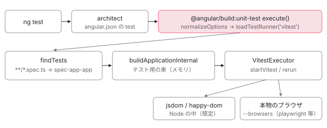

[目次](../README.md) › [CLI とビルド](README.md) › 第 12 回 / 全 16 回

# unit-test builder と Vitest：テストを application builder で束ねる

> v21 から既定になった @angular/build:unit-test が、テストファイルを探し（test-discovery）、application builder の仕組みでテスト用にビルドし、Vitest の runner（executor / plugins / browser-provider）に渡す行。Karma の runner との違い、jsdom とブラウザモード、ng test が何を起動しているか。

angular/angular-cli · 読了 約 13 分 · 中核 · [サイトで読む（デモが動きます）](https://angular-deep-dive-cyan.vercel.app/chapter/cli-unit-test)

---

v21 から、`ng new` で作ったプロジェクトの `ng test` は Vitest で動きます。この章では `@angular/build:unit-test` の `execute` を入口に、テストファイルを探す処理、application builder でテスト用の束をメモリ上に作る処理、その束を Vitest に渡して jsdom かブラウザで実行する処理、保存したときに変わったテストだけを流し直す処理を順に読みます。最後に Karma の runner と比べます。

読む対象は angular-cli の `packages/angular/build/src/builders/unit-test/` の `builder.ts`・`options.ts`・`test-discovery.ts`・`runners/api.ts`・`runners/vitest/`（`index.ts`・`build-options.ts`・`executor.ts`・`plugins.ts`・`browser-provider.ts`）・`runners/karma/` と、`packages/schematics/angular/application/index.ts` です。

1. [1. 概観](01-cli-overview.md)
2. [2. ng build の段取り](02-build.md)
3. [3. AotCompilation](03-cli-angular-compilation.md)
4. [4. コンポーネントのスタイル](04-cli-component-styles.md)
5. [5. oxc の変換](05-cli-javascript-transformer.md)
6. [6. リンカー](06-cli-linker.md)
7. [7. 遅延チャンク](07-cli-code-splitting.md)
8. [8. budgets](08-cli-budgets.md)
9. [9. i18n](09-cli-i18n.md)
10. [10. 再ビルドとキャッシュ](10-cli-cache-watch.md)
11. [11. HMR](11-cli-hmr.md)
12. **12. unit-test と Vitest**（この章）
13. [13. Tree と sink](13-schematics.md)
14. [14. Rule の組み立て](14-schematics-rules.md)
15. [15. ng generate component](15-schematics-component.md)
16. [16. ng add と ng update](16-cli-add-update.md)

## 0. 全体の流れ



*unit-test builder は自分ではビルドしない。テストファイルを入口にした設定で application builder を呼び、出てきたメモリ上のファイルを Vitest に読ませる。*

1. **ng test**

   architect のコマンドとして `angular.json` の `test` ターゲットの builder を起動する（1 節）。
2. **オプションの正規化と runner の選択**

   既定の runner は `vitest`。`runners/vitest/index.ts` を動的に import する（2〜3 節）。
3. **テストを探す**

   `**/*.spec.ts` を glob し、ファイルごとに `spec-app-app` のような出力名を付ける（4 節）。
4. **テスト用の束を作る**

   ビルドターゲットの設定に「入口 = テストファイル + TestBed の初期化」を上書きし、application builder を呼ぶ。出力はメモリ上（5 節）。
5. **Vitest に渡す**

   Vitest を Node の API で起動し、Vite のプラグインで「ファイルを読む」をメモリ上の出力に差し替える（6 節）。
6. **jsdom かブラウザで実行**

   既定は DOM の模造品（happy-dom があればそれ、無ければ jsdom）。`--browsers` なら本物のブラウザ（7 節）。
7. **watch**

   保存すると application builder が差分を出し、変わったテストファイルだけを流し直す（8 節）。

## 1. ng test が起動するもの

📄 `angular-cli/packages/angular/cli/src/commands/test/cli.ts` L14–23 （▶ の行: 15, 19）

```ts
14 │ export default class TestCommandModule
15 ▶   extends ArchitectCommandModule
16 │   implements CommandModuleImplementation
17 │ {
18 │   multiTarget = true;
19 ▶   command = 'test [project]';
20 │   aliases = RootCommands['test'].aliases;
21 │   describe = 'Runs unit tests in a project.';
22 │   longDescriptionPath = join(__dirname, 'long-description.md');
23 │ }
```

15 行目、`ng test` は `ng build` と同じ `ArchitectCommandModule` です。`angular.json` の `test` ターゲットを読んで builder を起動するだけで、テストのことは何も知りません（[ng コマンドの章](../boot/01-boot-ng-command.md)・[architect の章](../boot/02-boot-architect.md)）。では `test` に何が書かれるか。`ng new` が使う application の schematic です。

📄 `angular-cli/packages/schematics/angular/application/index.ts` L338–349 （▶ の行: 342, 344–345, 347）

```ts
338 │       test:
339 │         options.skipTests || options.minimal
340 │           ? undefined
341 │           : {
342 ▶               builder: Builders.BuildUnitTest,
343 │               options:
344 ▶                 options.testRunner === TestRunner.Vitest
345 ▶                   ? {}
346 │                   : {
347 ▶                       runner: 'karma',
348 │                     },
349 │             },
```

📄 `angular-cli/packages/angular/build/src/builders/unit-test/schema.json` L16–21 （▶ の行: 19–20）

```json
16 │     "runner": {
17 │       "type": "string",
18 │       "description": "Specifies the test runner to use for test execution.",
19 ▶       "default": "vitest",
20 ▶       "enum": ["karma", "vitest"]
21 │     },
```

342 行目の `Builders.BuildUnitTest` は `'@angular/build:unit-test'` です（`utility/workspace-models.ts`）。344〜345 行目、`--test-runner` が既定の `vitest` なら options は空。runner は builder の schema の既定（19 行目）で `vitest` になります。`karma` を選んだときだけ 347 行目で `runner: 'karma'` を書きます。angular-cli の CHANGELOG では 21.0.0 の「configure Vitest for new projects and allow runner choice」がこの変更です。

このサイトの `angular.json` も `"test": { "builder": "@angular/build:unit-test" }` だけで、`package.json` の devDependencies には `vitest` と `jsdom` が入っています。ただし `src/` に `*.spec.ts` は 1 つもありません。このサイトで `ng test` を打つと、5 節 205〜211 行目の「No tests found」で止まります。

## 2. execute：オプションを正規化して runner を選ぶ

📄 `angular-cli/packages/angular/build/src/builders/unit-test/builder.ts` L173–205 （▶ の行: 179, 190–192, 195–196）

```ts
173 │ export async function* execute(
174 │   options: UnitTestBuilderOptions,
175 │   context: BuilderContext,
176 │   extensions?: ApplicationBuilderExtensions,
177 │ ): AsyncIterable<BuilderOutput> {
178 │   // Determine project name from builder context target
179 ▶   const projectName = context.target?.project;
180 │   if (!projectName) {
181 │     context.logger.error(`The builder requires a target to be specified.`);
182 │ 
183 │     return;
184 │   }
185 │ 
186 │   // Initialize the test runner and normalize options
187 │   let runner;
188 │   let normalizedOptions;
189 │   try {
190 ▶     normalizedOptions = await normalizeOptions(context, projectName, options);
191 ▶     runner = await loadTestRunner(normalizedOptions.runnerName);
192 ▶     await runner.validateDependencies?.(normalizedOptions);
193 │   } catch (e) {
194 │     assertIsError(e);
195 ▶     if (e instanceof MissingDependenciesError) {
196 ▶       context.logger.error(e.message);
197 │     } else {
198 │       context.logger.error(
199 │         `An exception occurred during initialization of the test runner:\n${e.stack ?? e.message}`,
200 │       );
201 │     }
202 │     yield { success: false };
203 │ 
204 │     return;
205 │   }
```

📄 `angular-cli/packages/angular/build/src/builders/unit-test/options.ts` L45–68 （▶ の行: 46–47, 52, 67–68）

```ts
45 │   // Target specifier defaults to the current project's build target using a development configuration
46 ▶   const buildTargetSpecifier = options.buildTarget ?? `::development`;
47 ▶   const buildTarget = targetFromTargetString(buildTargetSpecifier, projectName, 'build');
48 │ 
49 │   // Load target options to determine preserveSymlinks setting
50 │   let buildTargetOptions: Record<string, unknown> | undefined;
51 │   try {
52 ▶     buildTargetOptions = await context.getTargetOptions(buildTarget);
53 │   } catch {}
54 │ 
55 │   const preserveSymlinks =
56 │     typeof buildTargetOptions?.preserveSymlinks === 'boolean'
57 │       ? buildTargetOptions.preserveSymlinks
58 │       : process.execArgv.includes('--preserve-symlinks');
59 │ 
60 │   // Setup base paths based on workspace root and project information
61 │   const workspaceRoot = canonicalizePath(context.workspaceRoot);
62 │ 
63 │   const projectMetadata = await context.getProjectMetadata(projectName);
64 │   const { projectRoot, projectSourceRoot } = getProjectRootPaths(workspaceRoot, projectMetadata);
65 │ 
66 │   // Gather persistent caching option and provide a project specific cache location
67 ▶   const cacheOptions = normalizeCacheOptions(projectMetadata, workspaceRoot);
68 ▶   cacheOptions.path = path.join(cacheOptions.path, projectName);
```

📄 `angular-cli/packages/angular/build/src/builders/unit-test/options.ts` L98–125 （▶ の行: 99–100, 102, 106, 122, 125）

```ts
 98 │   } else {
 99 ▶     const tsconfigSpecPath = path.join(projectRoot, 'tsconfig.spec.json');
100 ▶     if (await exists(tsconfigSpecPath)) {
101 │       // The application builder expects a path relative to the workspace root.
102 ▶       tsConfig = path.relative(workspaceRoot, tsconfigSpecPath);
103 │     }
104 │   }
105 │ 
106 ▶   let watch = options.watch ?? isTTY();
107 │   if (options.ui && options.watch === false) {
108 │     context.logger.warn(
109 │       `The '--ui' option requires watch mode. The '--no-watch' flag will be ignored.`,
110 │     );
111 │     watch = true;
112 │   }
113 │ 
114 │   return {
115 │     // Project/workspace information
116 │     workspaceRoot,
117 │     projectRoot,
118 │     projectSourceRoot,
119 │     cacheOptions,
120 │     // Target/configuration specified options
121 │     buildTarget,
122 ▶     include: options.include ?? ['**/*.spec.ts'],
123 │     exclude: options.exclude,
124 │     filter,
125 ▶     runnerName: runner ?? Runner.Vitest,
```

1. **ビルドの設定はビルドターゲットから借りる**

   46 行目、`buildTarget` を書かなければ `::development`、つまり同じプロジェクトの `build` ターゲットの `development` 構成です。`styles` や `assets` を `test` 側に書き直さなくてよいのはこのためです。
2. **tsconfig は tsconfig.spec.json**

   99〜103 行目、プロジェクトのルートに `tsconfig.spec.json` があればそれを使います。
3. **watch は端末かどうか**

   106 行目。`--watch` を書かなければ、端末（TTY）から打ったときは watch、CI のように出力をパイプしているときは 1 回で終わります。
4. **探すファイルと runner の既定**

   122 行目で `['**/*.spec.ts']`、125 行目で `vitest`。
5. **runner を読み込み、依存を確かめる**

   191〜192 行目。足りないパッケージがあれば 195〜196 行目でそのメッセージだけを出して終わります（7 節）。

📄 `angular-cli/packages/angular/build/src/builders/unit-test/builder.ts` L34–68 （▶ の行: 36, 44, 56, 59–60）

```ts
34 │ async function loadTestRunner(runnerName: string): Promise<TestRunner> {
35 │   // Harden against directory traversal
36 ▶   if (!/^[a-zA-Z0-9-]+$/.test(runnerName)) {
37 │     throw new Error(
38 │       `Invalid runner name "${runnerName}". Runner names can only contain alphanumeric characters and hyphens.`,
39 │     );
40 │   }
41 │ 
42 │   let runnerModule;
43 │   try {
44 ▶     runnerModule = await import(`./runners/${runnerName}/index`);
45 │   } catch (e) {
46 │     assertIsError(e);
47 │     if (e.code === 'ERR_MODULE_NOT_FOUND') {
48 │       throw new Error(`Unknown test runner "${runnerName}".`, { cause: e });
49 │     }
50 │     throw new Error(
51 │       `Failed to load the '${runnerName}' test runner. The package may be corrupted or improperly installed.`,
52 │       { cause: e },
53 │     );
54 │   }
55 │ 
56 ▶   const runner = runnerModule.default;
57 │   if (
58 │     !runner ||
59 ▶     typeof runner.getBuildOptions !== 'function' ||
60 ▶     typeof runner.createExecutor !== 'function'
61 │   ) {
62 │     throw new Error(
63 │       `The loaded test runner '${runnerName}' does not appear to be a valid TestRunner implementation.`,
64 │     );
65 │   }
66 │ 
67 │   return runner;
68 │ }
```

44 行目、runner は `runners/<名前>/index` を動的に import するだけです。36 行目で名前を英数字とハイフンに限り、`../` で外のファイルを読めないようにしています。59〜60 行目、読めたモジュールが `getBuildOptions` と `createExecutor` を持っていれば runner とみなします。

## 3. runner の約束：TestRunner と TestExecutor

📄 `angular-cli/packages/angular/build/src/builders/unit-test/runners/api.ts` L54–82 （▶ の行: 59, 61, 63, 77）

```ts
54 │ /**
55 │  * Represents the metadata and hooks for a specific test runner.
56 │  */
57 │ export interface TestRunner {
58 │   readonly name: string;
59 ▶   readonly isStandalone?: boolean;
60 │ 
61 ▶   validateDependencies?(options: NormalizedUnitTestBuilderOptions): void | Promise<void>;
62 │ 
63 ▶   getBuildOptions(
64 │     options: NormalizedUnitTestBuilderOptions,
65 │     baseBuildOptions: Partial<ApplicationBuilderInternalOptions>,
66 │   ): RunnerOptions | Promise<RunnerOptions>;
67 │ 
68 │   /**
69 │    * Creates a stateful executor for a test session.
70 │    * This is called once at the start of the `ng test` command.
71 │    *
72 │    * @param context The Architect builder context.
73 │    * @param options The normalized unit test options.
74 │    * @param testEntryPointMappings A map of test entry points to their corresponding test files.
75 │    * @returns A TestExecutor instance that will handle the test runs.
76 │    */
77 ▶   createExecutor(
78 │     context: BuilderContext,
79 │     options: NormalizedUnitTestBuilderOptions,
80 │     testEntryPointMappings: Map<string, string> | undefined,
81 │   ): Promise<TestExecutor>;
82 │ }
```

📄 `angular-cli/packages/angular/build/src/builders/unit-test/runners/api.ts` L37–52 （▶ の行: 41, 49, 51）

```ts
37 │ /**
38 │  * Represents a stateful test execution session.
39 │  * An instance of this is created for each `ng test` command.
40 │  */
41 ▶ export interface TestExecutor {
42 │   /**
43 │    * Executes tests using the artifacts from a specific build.
44 │    * This method can be called multiple times in watch mode.
45 │    *
46 │    * @param buildResult The output from the application builder.
47 │    * @returns An async iterable builder output stream.
48 │    */
49 ▶   execute(buildResult: FullResult | IncrementalResult): AsyncIterable<BuilderOutput>;
50 │ 
51 ▶   [Symbol.asyncDispose](): Promise<void>;
52 │ }
```

runner は 3 つの仕事を持ちます。61 行目で依存を確かめる、63 行目で「application builder に足すオプション」を返す、77 行目で実行役（`TestExecutor`）を作る。実行役は 49 行目の `execute(buildResult)` を、watch ならビルドのたびに呼ばれます。51 行目の `Symbol.asyncDispose` は builder 側の `await using` で、終わるときに必ず呼ばれます。59 行目の `isStandalone` は「application builder を使わず自分でビルドする」runner の印で、Karma がそれです（9 節）。

📄 `angular-cli/packages/angular/build/src/builders/unit-test/builder.ts` L225–241 （▶ の行: 225, 227–230）

```ts
225 ▶   if (runner.isStandalone) {
226 │     try {
227 ▶       await using executor = await runner.createExecutor(context, normalizedOptions, undefined);
228 ▶       yield* executor.execute({
229 ▶         kind: ResultKind.Full,
230 ▶         files: [],
231 │       });
232 │     } catch (e) {
233 │       assertIsError(e);
234 │       context.logger.error(
235 │         `An exception occurred during standalone test execution:\n${e.stack ?? e.message}`,
236 │       );
237 │       yield { success: false };
238 │     }
239 │ 
240 │     return;
241 │   }
```

## 4. テストファイルを探し、出力名を付ける

📄 `angular-cli/packages/angular/build/src/builders/unit-test/test-discovery.ts` L44–78 （▶ の行: 48, 54–55, 57, 65–66, 69）

```ts
44 │   await initializeHash();
45 │   const resolvedTestFiles = new Set<string>();
46 │   const dynamicPatterns: string[] = [];
47 │ 
48 ▶   const projectRootPrefix = toPosixPath(relative(workspaceRoot, projectSourceRoot) + '/');
49 │   const normalizedExcludes = exclude.map((p) => normalizePattern(p, projectRootPrefix));
50 │ 
51 │   // 1. Separate static and dynamic patterns
52 │   for (const pattern of include) {
53 │     const normalized = normalizePattern(pattern, projectRootPrefix);
54 ▶     if (isDynamicPattern(pattern)) {
55 ▶       dynamicPatterns.push(normalized);
56 │     } else {
57 ▶       const { resolved, unresolved } = await resolveStaticPattern(normalized, projectSourceRoot);
58 │       resolved.forEach((file) => resolvedTestFiles.add(file));
59 │       unresolved.forEach((p) => dynamicPatterns.push(p));
60 │     }
61 │   }
62 │ 
63 │   // 2. Execute a single glob for all dynamic patterns
64 │   if (dynamicPatterns.length > 0) {
65 ▶     const globMatches = await glob(dynamicPatterns, {
66 ▶       cwd: projectSourceRoot,
67 │       absolute: true,
68 │       expandDirectories: false,
69 ▶       ignore: ['**/node_modules/**', ...normalizedExcludes],
70 │     });
71 │ 
72 │     for (const match of globMatches) {
73 │       resolvedTestFiles.add(toPosixPath(match));
74 │     }
75 │   }
76 │ 
77 │   // 3. Combine and de-duplicate results
78 │   return [...resolvedTestFiles];
```

📄 `angular-cli/packages/angular/build/src/builders/unit-test/test-discovery.ts` L292–318 （▶ の行: 297, 300, 306–309, 313）

```ts
292 │ async function resolveStaticPattern(
293 │   pattern: string,
294 │   projectSourceRoot: string,
295 │ ): Promise<{ resolved: string[]; unresolved: string[] }> {
296 │   const fullPath = isAbsolute(pattern) ? pattern : join(projectSourceRoot, pattern);
297 ▶   if (await isDirectory(fullPath)) {
298 │     const infixes = TEST_FILE_INFIXES.map((p) => p.substring(1)).join('|');
299 │ 
300 ▶     return { resolved: [], unresolved: [`${pattern}/**/*.@(${infixes}).@(ts|tsx)`] };
301 │   }
302 │ 
303 │   const fileExt = extname(fullPath);
304 │   const baseName = basename(fullPath, fileExt);
305 │ 
306 ▶   for (const infix of TEST_FILE_INFIXES) {
307 ▶     const potentialSpec = join(dirname(fullPath), `${baseName}${infix}${fileExt}`);
308 ▶     if (await exists(potentialSpec)) {
309 ▶       return { resolved: [toPosixPath(potentialSpec)], unresolved: [] };
310 │     }
311 │   }
312 │ 
313 ▶   if (await exists(fullPath)) {
314 │     return { resolved: [toPosixPath(fullPath)], unresolved: [] };
315 │   }
316 │ 
317 │   return { resolved: [], unresolved: [toPosixPath(pattern)] };
318 │ }
```

1. **glob とそれ以外に分ける**

   54 行目。`**/*.spec.ts` のような glob はまとめて 65〜70 行目の 1 回の glob で探します（`node_modules` は 69 行目で除外）。基準はプロジェクトの `src`（66 行目）。
2. **glob でないパスは便利に読む**

   57 行目の `resolveStaticPattern`。フォルダなら 300 行目でその中の `*.spec.ts` / `*.test.ts` に。ファイルなら 306〜309 行目で同じ名前の `.spec` / `.test` を探します。`ng test --include src/app/app.ts` で `app.spec.ts` が流れるのはこのためです。

📄 `angular-cli/packages/angular/build/src/builders/unit-test/test-discovery.ts` L114–134 （▶ の行: 116–117, 122–125）

```ts
114 │   return new Map(
115 │     Array.from(testFiles, (testFile) => {
116 ▶       const fileName = generateNameFromPath(testFile, roots, !!removeTestExtension);
117 ▶       const baseName = fileName === prefix ? prefix : `${prefix}-${fileName}`;
118 │       let uniqueName = baseName;
119 │       // Start at 2 for collisions as the first instance remains suffix-less.
120 │       let suffix = counters.get(baseName) ?? 2;
121 │ 
122 ▶       while (seen.has(uniqueName)) {
123 ▶         uniqueName = `${baseName}-${suffix}`.replace(
124 ▶           new RegExp(`([^\\w](?:${infixesPattern}))-([\\d]+)$`),
125 ▶           '-$2$1',
126 │         );
127 │         ++suffix;
128 │       }
129 │       seen.add(uniqueName);
130 │       counters.set(baseName, suffix);
131 │ 
132 │       return [uniqueName, testFile];
133 │     }),
134 │   );
```

📄 `angular-cli/packages/angular/build/src/builders/unit-test/test-discovery.ts` L146–182 （▶ の行: 151, 155, 162, 165, 178）

```ts
146 │ export function generateNameFromPath(
147 │   testFile: string,
148 │   roots: string[],
149 │   removeTestExtension: boolean,
150 │ ): string {
151 ▶   const relativePath = removeRoots(testFile, roots.map(toPosixPath));
152 │ 
153 │   let startIndex = 0;
154 │   // Skip leading dots and slashes
155 ▶   while (startIndex < relativePath.length && /^[./\\]$/.test(relativePath[startIndex])) {
156 │     startIndex++;
157 │   }
158 │ 
159 │   let endIndex = relativePath.length;
160 │   if (removeTestExtension) {
161 │     const infixes = TEST_FILE_INFIXES.map((p) => p.substring(1)).join('|');
162 ▶     const match = relativePath.match(new RegExp(`\\.(${infixes})\\.[^.]+$`));
163 │ 
164 │     if (match?.index) {
165 ▶       endIndex = match.index;
166 │     }
167 │   } else {
168 │     const extIndex = relativePath.lastIndexOf('.');
169 │     if (extIndex > startIndex) {
170 │       endIndex = extIndex;
171 │     }
172 │   }
173 │ 
174 │   // Build the final string in a single pass
175 │   let result = '';
176 │   for (let i = startIndex; i < endIndex; i++) {
177 │     const char = relativePath[i];
178 ▶     result += char === '/' || char === '\\' ? '-' : char;
179 │   }
180 │ 
181 │   return truncateName(result, relativePath);
182 │ }
```

見つけたファイルには 1 つずつ、application builder の入口（entry point）の名前を付けます。151 行目で `src` かワークスペースのルートを外し、162 行目で `.spec.ts` を落とし、178 行目で `/` を `-` にして、117 行目で `spec-` を付けます。122〜128 行目、名前が重なったら `-2`、`-3` と数字を足します。出力ファイルはこの名前に `.js` を付けたものです。

> **🧪 DEMO — テストファイルの出力名**
>
> 114〜134 行目と 146〜182 行目を写した自作の関数です。ワークスペースを `/ws`、プロジェクトの `src` を `/ws/src` とし、1 行に 1 つワークスペースからのパスを書きます。実物は macOS / Windows で大文字・小文字を無視してルートを外し、128 文字を超える名前はハッシュで縮めますが、このデモはその 2 点を省いています。
>
> ▶ [このデモはサイトで動かせます](https://angular-deep-dive-cyan.vercel.app/chapter/cli-unit-test)

## 5. テスト用の束を application builder で作る

📄 `angular-cli/packages/angular/build/src/builders/unit-test/builder.ts` L243–262 （▶ の行: 246–248, 252）

```ts
243 │   // Get base build options from the buildTarget
244 │   let buildTargetOptions: ApplicationBuilderInternalOptions;
245 │   try {
246 ▶     const builderName = await context.getBuilderNameForTarget(normalizedOptions.buildTarget);
247 ▶     if (builderName === '@angular/build:application') {
248 ▶       buildTargetOptions = (await context.validateOptions(
249 │         await context.getTargetOptions(normalizedOptions.buildTarget),
250 │         builderName,
251 │       )) as unknown as ApplicationBuilderInternalOptions;
252 ▶     } else if (builderName === '@angular/build:ng-packagr') {
253 │       const ngPackagrOptions = await context.validateOptions(
254 │         await context.getTargetOptions(normalizedOptions.buildTarget),
255 │         builderName,
256 │       );
257 │ 
258 │       buildTargetOptions = await transformNgPackagrOptions(
259 │         context,
260 │         ngPackagrOptions,
261 │         normalizedOptions.projectRoot,
262 │       );
```

246〜251 行目、ビルドターゲットが `@angular/build:application` ならそのオプションをそのまま土台にします。ライブラリ（`ng-packagr`）なら 252 行目から、`ng-package.json` のスタイルとアセットの設定だけを拾います。

📄 `angular-cli/packages/angular/build/src/builders/unit-test/runners/vitest/build-options.ts` L197–234 （▶ の行: 204–205, 214, 217, 233–234）

```ts
197 │ export async function getVitestBuildOptions(
198 │   options: NormalizedUnitTestBuilderOptions,
199 │   baseBuildOptions: Partial<ApplicationBuilderInternalOptions>,
200 │ ): Promise<RunnerOptions> {
201 │   const { workspaceRoot, projectSourceRoot, include, exclude = [], watch, providersFile } = options;
202 │ 
203 │   // Find test files
204 ▶   const testFiles = await findTests(include, exclude, workspaceRoot, projectSourceRoot);
205 ▶   if (testFiles.length === 0) {
206 │     throw new Error(
207 │       'No tests found matching the following patterns:\n' +
208 │         `- Included: ${include.join(', ')}\n` +
209 │         (exclude.length ? `- Excluded: ${exclude.join(', ')}\n` : '') +
210 │         `\nPlease check the 'test' target configuration in your project's 'angular.json' file.`,
211 │     );
212 │   }
213 │ 
214 ▶   const entryPoints = getTestEntrypoints(testFiles, {
215 │     projectSourceRoot,
216 │     workspaceRoot,
217 ▶     removeTestExtension: true,
218 │   });
219 │ 
220 │   if (options.setupFiles?.length) {
221 │     const setupEntryPoints = getTestEntrypoints(options.setupFiles, {
222 │       projectSourceRoot,
223 │       workspaceRoot,
224 │       removeTestExtension: false,
225 │       prefix: 'setup',
226 │     });
227 │ 
228 │     for (const [entryPoint, setupFile] of setupEntryPoints) {
229 │       entryPoints.set(entryPoint, setupFile);
230 │     }
231 │   }
232 │ 
233 ▶   entryPoints.set('init-testbed', 'angular:test-bed-init');
234 ▶   entryPoints.set('vitest-mock-patch', 'angular:vitest-mock-patch');
```

📄 `angular-cli/packages/angular/build/src/builders/unit-test/runners/vitest/build-options.ts` L236–269 （▶ の行: 237, 243, 245–248, 251, 256, 258, 260, 264, 267）

```ts
236 │   // The 'vitest' package is always external for testing purposes
237 ▶   const externalDependencies = ['vitest'];
238 │   if (baseBuildOptions.externalDependencies) {
239 │     externalDependencies.push(...baseBuildOptions.externalDependencies);
240 │   }
241 │ 
242 │   const buildOptions: Partial<ApplicationBuilderInternalOptions> = {
243 ▶     ...baseBuildOptions,
244 │     watch,
245 ▶     incrementalResults: watch,
246 ▶     index: false,
247 ▶     browser: undefined,
248 ▶     server: undefined,
249 │     outputMode: undefined,
250 │     localize: false,
251 ▶     budgets: [],
252 │     serviceWorker: false,
253 │     appShell: false,
254 │     ssr: false,
255 │     prerender: false,
256 ▶     sourceMap: { scripts: true, vendor: false, styles: false },
257 │     outputHashing: adjustOutputHashing(baseBuildOptions.outputHashing),
258 ▶     optimization: false,
259 │     namedChunks: false,
260 ▶     entryPoints,
261 │     // Vitest's Node-based module loading emulation (vite-node) is not fully spec compliant and lacks
262 │     // live ESM bindings across chunk boundaries. This can cause uninitialized exports or break mocking.
263 │     // Disabling code splitting avoids shared chunks, but increases build and coverage memory/time.
264 ▶     disableCodeSplitting: !options.splitting,
265 │     // Enable support for vitest browser prebundling. Excludes can be controlled with a runnerConfig
266 │     // and the `optimizeDeps.exclude` option.
267 ▶     externalPackages: true,
268 │     externalDependencies,
269 │   };
```

204 行目で 4 節の `findTests`、214 行目で出力名を付け、233〜234 行目でさらに 2 つの入口を足します。`angular:test-bed-init` と `angular:vitest-mock-patch` は実在しないファイルで、中身はこの関数の中で文字列として作ります（下の 2 つの引用）。242〜269 行目は「アプリのビルド設定を、テスト用に上書きする」部分です。

| 行 | 設定 | 意味 |
| --- | --- | --- |
| 247〜248 | `browser` / `server`: undefined | アプリの `main.ts` は入口にしない。代わりに 260 行目の `entryPoints`（テストファイルと初期化の 2 つ） |
| 246, 249〜255 | `index: false`、SSR・プリレンダー・i18n・Service Worker を切る | テストに要らない段を飛ばす（[第 2 回](02-build.md)の段の多くが通らない） |
| 251 | `budgets: []` | [第 8 回](08-cli-budgets.md)の検査をしない |
| 256, 258 | scripts の source map のみ、最適化なし | 失敗したテストの行番号を元の `.ts` で出すため |
| 245 | `incrementalResults: watch` | watch なら差分の結果を受け取る（8 節） |
| 237, 267 | `vitest` と node\_modules のパッケージを束ねない | Vitest 自身と依存は Vitest（Vite）側が読む |
| 264 | `disableCodeSplitting: !splitting` | `--no-splitting` で共有チャンクを作らない（コメント 261〜263 行目のモックの問題の回避） |

📄 `angular-cli/packages/angular/build/src/builders/unit-test/runners/vitest/build-options.ts` L108–131 （▶ の行: 109–110, 118–119, 125–128）

```ts
108 │     const ANGULAR_TESTBED_SETUP = Symbol.for('@angular/cli/testbed-setup');
109 ▶     if (!globalThis[ANGULAR_TESTBED_SETUP]) {
110 ▶       globalThis[ANGULAR_TESTBED_SETUP] = true;
111 │ 
112 │       // The Angular TestBed needs to be initialized before any tests are run.
113 │       // In a non-isolated environment, this setup file can be executed multiple times.
114 │       // The guard condition above ensures that the setup is only performed once.
115 │ 
116 │       @NgModule({
117 │         providers: [
118 ▶           ...(typeof Zone !== 'undefined' ? [provideZoneChangeDetection()] : []),
119 ▶           ...providers,
120 │           { provide: TestComponentRenderer, useClass: DynamicDOMTestComponentRenderer },
121 │         ],
122 │       })
123 │       class TestModule {}
124 │ 
125 ▶       getTestBed().initTestEnvironment([BrowserTestingModule, TestModule], platformBrowserTesting(), {
126 ▶         errorOnUnknownElements: true,
127 ▶         errorOnUnknownProperties: true,
128 ▶         ${teardown === false ? 'teardown: { destroyAfterEach: false },' : ''}
129 │       });
130 │     }
131 │   `;
```

これが `angular:test-bed-init` の中身の後半です。125 行目、Karma 時代に `test.ts` に書いていた `getTestBed().initTestEnvironment(...)` を CLI が書いてくれます。126〜127 行目、知らない要素やプロパティはエラーにします。118 行目、`provideZoneChangeDetection()` は zone.js が読み込まれているときだけ足します。109〜110 行目は、同じ環境で何度読まれても初期化が 1 回で済むようにする印です。

📄 `angular-cli/packages/angular/build/src/builders/unit-test/runners/vitest/build-options.ts` L159–185 （▶ の行: 163, 167, 173, 177–178, 181, 183）

```ts
159 │ function getZoneTestingStrategy(
160 │   buildOptions: Partial<ApplicationBuilderInternalOptions>,
161 │   projectSourceRoot: string,
162 │ ): 'none' | 'static' | 'dynamic' | 'dynamic-zone' {
163 ▶   if (buildOptions.polyfills?.includes('zone.js/testing')) {
164 │     return 'none';
165 │   }
166 │ 
167 ▶   if (buildOptions.polyfills?.includes('zone.js')) {
168 │     return 'static';
169 │   }
170 │ 
171 │   try {
172 │     const projectResolve = createProjectResolver(projectSourceRoot);
173 ▶     projectResolve('zone.js');
174 │ 
175 │     // If polyfills is undefined (e.g. library build target), load zone.js dynamically.
176 │     // If polyfills is defined but doesn't include zone.js (e.g. zoneless application), do NOT load zone.js.
177 ▶     if (buildOptions.polyfills === undefined) {
178 ▶       return 'dynamic-zone';
179 │     }
180 │ 
181 ▶     return 'dynamic';
182 │   } catch {
183 ▶     return 'none';
184 │   }
185 │ }
```

zone.js をどう読むかは、ビルドターゲットの `polyfills` とインストールの有無で決めます。`polyfills` に `zone.js` があれば 167 行目で `import 'zone.js/testing'` を静的に。zone.js が入っていなければ 183 行目で何もしません。このサイトは zone.js をインストールしていないので `none`、TestBed は zoneless で動きます（[zoneless の章](../zoneless/01-zoneless-default.md)）。

📄 `angular-cli/packages/angular/build/src/builders/unit-test/runners/vitest/build-options.ts` L296–321 （▶ の行: 296–297, 307–308, 316）

```ts
296 ▶       const error = new Error(
297 ▶         'The "vi.mock" and related methods are not supported for relative imports with the Angular unit-test system. ' +
298 │         'Please use Angular TestBed for mocking dependencies.'
299 │       );
300 │ 
301 │       // Store original implementations
302 │       const { mock, doMock, importMock, unmock, doUnmock } = vi;
303 │ 
304 │       function patch(original) {
305 │         return (path, ...args) => {
306 │           // Check if the path is a string and starts with a character that indicates a relative path.
307 ▶           if (typeof path === 'string' && /^[./]/.test(path)) {
308 ▶             throw error;
309 │           }
310 │ 
311 │           // Call the original function for non-relative paths.
312 │           return original(path, ...args);
313 │         };
314 │       }
315 │ 
316 ▶       vi.mock = patch(mock);
317 │       vi.doMock = patch(doMock);
318 │       vi.importMock = patch(importMock);
319 │       vi.unmock = patch(unmock);
320 │       vi.doUnmock = patch(doUnmock);
321 │     }
```

`angular:vitest-mock-patch` は、`vi.mock('./foo')` のような相対パスのモックを 307〜308 行目で例外にします。テストは 1 つの束にビルド済みなので、Vitest が相対パスのモジュールを差し替えようとしても、その import はもう束の中で解決されているからです。依存の差し替えは TestBed の `providers` で行います（296〜299 行目のメッセージ）。

📄 `angular-cli/packages/angular/build/src/builders/unit-test/builder.ts` L70–97 （▶ の行: 81–84, 87）

```ts
70 │ function prepareBuildExtensions(
71 │   virtualFiles: Record<string, string> | undefined,
72 │   projectSourceRoot: string,
73 │   extensions?: ApplicationBuilderExtensions,
74 │ ): ApplicationBuilderExtensions | undefined {
75 │   if (!virtualFiles) {
76 │     return extensions;
77 │   }
78 │ 
79 │   extensions ??= {};
80 │   extensions.codePlugins ??= [];
81 ▶   for (const [namespace, contents] of Object.entries(virtualFiles)) {
82 ▶     extensions.codePlugins.push(
83 ▶       createVirtualModulePlugin({
84 ▶         namespace,
85 │         loadContent: () => {
86 │           return {
87 ▶             contents,
88 │             loader: 'js',
89 │             resolveDir: projectSourceRoot,
90 │           };
91 │         },
92 │       }),
93 │     );
94 │   }
95 │ 
96 │   return extensions;
97 │ }
```

📄 `angular-cli/packages/angular/build/src/builders/unit-test/builder.ts` L309–343 （▶ の行: 310, 316, 323–326, 333–334, 337）

```ts
309 │   try {
310 ▶     await using executor = await runner.createExecutor(
311 │       context,
312 │       normalizedOptions,
313 │       testEntryPointMappings,
314 │     );
315 │ 
316 ▶     const finalExtensions = prepareBuildExtensions(
317 │       virtualFiles,
318 │       normalizedOptions.projectSourceRoot,
319 │       extensions,
320 │     );
321 │ 
322 │     // Prepare and run the application build
323 ▶     const applicationBuildOptions = {
324 ▶       ...buildTargetOptions,
325 ▶       ...runnerBuildOptions,
326 ▶       watch: normalizedOptions.watch,
327 │       progress: normalizedOptions.buildProgress ?? buildTargetOptions.progress,
328 │       quiet: normalizedOptions.quiet,
329 │       ...(normalizedOptions.tsConfig ? { tsConfig: normalizedOptions.tsConfig } : {}),
330 │       preserveSymlinks: normalizedOptions.preserveSymlinks,
331 │     } satisfies ApplicationBuilderInternalOptions;
332 │ 
333 ▶     const dumpDirectory = normalizedOptions.dumpVirtualFiles
334 ▶       ? path.join(normalizedOptions.cacheOptions.path, 'unit-test', 'output-files')
335 │       : undefined;
336 │ 
337 ▶     yield* runBuildAndTest(
338 │       executor,
339 │       applicationBuildOptions,
340 │       context,
341 │       dumpDirectory,
342 │       finalExtensions,
343 │     );
```

文字列で作った 2 つのファイルは、81〜94 行目で esbuild の仮想モジュールのプラグインになります。323〜331 行目で、ビルドターゲットのオプション（324 行目）に runner の上書き（325 行目）を重ね、337 行目で 6 節の `runBuildAndTest` に渡します。`--dump-virtual-files` を付けると、333〜335 行目で `.angular/cache/…/unit-test/output-files` にこの束が書き出されるので、中身を見られます。

## 6. ビルド結果を Vitest に渡す

📄 `angular-cli/packages/angular/build/src/builders/unit-test/builder.ts` L99–124 （▶ の行: 107, 112–113, 116–117）

```ts
 99 │ async function* runBuildAndTest(
100 │   executor: import('./runners/api').TestExecutor,
101 │   applicationBuildOptions: ApplicationBuilderInternalOptions,
102 │   context: BuilderContext,
103 │   dumpDirectory: string | undefined,
104 │   extensions: ApplicationBuilderExtensions | undefined,
105 │ ): AsyncIterable<BuilderOutput> {
106 │   let consecutiveErrorCount = 0;
107 ▶   for await (const buildResult of buildApplicationInternal(
108 │     applicationBuildOptions,
109 │     context,
110 │     extensions,
111 │   )) {
112 ▶     if (buildResult.kind === ResultKind.Failure) {
113 ▶       yield { success: false };
114 │       continue;
115 │     } else if (
116 ▶       buildResult.kind !== ResultKind.Full &&
117 ▶       buildResult.kind !== ResultKind.Incremental
118 │     ) {
119 │       assert.fail(
120 │         'A full and/or incremental build result is required from the application builder.',
121 │       );
122 │     }
123 │ 
124 │     assert(buildResult.files, 'Builder did not provide result files.');
```

📄 `angular-cli/packages/angular/build/src/builders/unit-test/builder.ts` L140–167 （▶ の行: 142, 157, 160）

```ts
140 │     // Pass the build artifacts to the executor
141 │     try {
142 ▶       yield* executor.execute(buildResult);
143 │ 
144 │       // Successful execution resets the failure counter
145 │       consecutiveErrorCount = 0;
146 │     } catch (e) {
147 │       assertIsError(e);
148 │       context.logger.error(`An exception occurred during test execution:\n${e.stack ?? e.message}`);
149 │       if (e instanceof AggregateError) {
150 │         e.errors.forEach((inner) => {
151 │           assertIsError(inner);
152 │           context.logger.error(inner.stack ?? inner.message);
153 │         });
154 │       }
155 │ 
156 │       yield { success: false };
157 ▶       consecutiveErrorCount++;
158 │     }
159 │ 
160 ▶     if (consecutiveErrorCount >= 3) {
161 │       context.logger.error(
162 │         'Test runner process has failed multiple times in a row. Please fix the configuration and restart the process.',
163 │       );
164 │ 
165 │       return;
166 │     }
167 │   }
```

107 行目の `buildApplicationInternal` は `ng build` と同じ関数です（[application builder の章](../boot/04-boot-application-build.md)）。ビルドが終わるたびに結果（`Full` か `Incremental`）が 1 つ出てきて、142 行目でそれを実行役に渡します。ビルドに失敗したら 113 行目でテストを流さずに次の変更を待ちます。160 行目、実行役が 3 回続けて例外を出したら止めます。

📄 `angular-cli/packages/angular/build/src/builders/unit-test/runners/vitest/executor.ts` L101–141 （▶ の行: 105–108, 124, 127–128, 141）

```ts
101 │   async *execute(buildResult: FullResult | IncrementalResult): AsyncIterable<BuilderOutput> {
102 │     this.debugLog(DebugLogLevel.Info, `Executing test run (kind: ${buildResult.kind}).`);
103 │     this.normalizePath ??= ((await import('vite' as string)) as typeof Vite).normalizePath;
104 │ 
105 ▶     if (buildResult.kind === ResultKind.Full) {
106 ▶       this.buildResultFiles.clear();
107 ▶       for (const file of buildResult.files) {
108 ▶         this.buildResultFiles.set(this.normalizePath(file.path), file);
109 │       }
110 │       this.debugLog(
111 │         DebugLogLevel.Info,
112 │         `Full build results received. Total files: ${this.buildResultFiles.size}.`,
113 │       );
114 │     } else {
115 │       this.debugLog(
116 │         DebugLogLevel.Info,
117 │         `Incremental build results received.` +
118 │           `Added: ${buildResult.added.length}, Modified: ${buildResult.modified.length}, Removed: ${buildResult.removed.length}.`,
119 │       );
120 │       this.debugLog(DebugLogLevel.Verbose, 'Added files:', buildResult.added);
121 │       this.debugLog(DebugLogLevel.Verbose, 'Modified files:', buildResult.modified);
122 │       this.debugLog(DebugLogLevel.Verbose, 'Removed files:', buildResult.removed);
123 │ 
124 ▶       for (const file of buildResult.removed) {
125 │         this.buildResultFiles.delete(this.normalizePath(file.path));
126 │       }
127 ▶       for (const file of buildResult.files) {
128 ▶         this.buildResultFiles.set(this.normalizePath(file.path), file);
129 │       }
130 │     }
131 │ 
132 │     updateExternalMetadata(buildResult, this.externalMetadata, undefined, true);
133 │     this.debugLog(DebugLogLevel.Verbose, 'Updated external metadata:', this.externalMetadata);
134 │ 
135 │     // Reset the exit code to allow for a clean state.
136 │     // This is necessary because Vitest may set the exit code on failure, which can
137 │     // affect subsequent runs in watch mode or when running multiple builders.
138 │     process.exitCode = 0;
139 │ 
140 │     // Initialize Vitest if not already present.
141 ▶     this.vitest ??= await this.initializeVitest();
```

実行役は出力ファイルを Map に持ちます。`Full` なら 106〜109 行目で入れ替え、`Incremental` なら 124〜129 行目で差分だけ反映します。141 行目、Vitest の起動は最初の 1 回だけで、2 回目からは同じ Vitest に流し直させます（8 節）。

📄 `angular-cli/packages/angular/build/src/builders/unit-test/runners/vitest/executor.ts` L381–422 （▶ の行: 385, 387–388, 394, 398, 401, 422）

```ts
381 │     const vitestConfig = {
382 │       config: externalConfigPath,
383 │       root: workspaceRoot,
384 │       project,
385 ▶       watch,
386 │       ...(outputFile !== undefined ? { outputFile } : {}),
387 ▶       ...(cacheOptions.enabled ? {} : { cache: false as const }),
388 ▶       ...(this.options.filter !== undefined ? { testNamePattern: this.options.filter } : {}),
389 │       ...(typeof ui === 'boolean' ? { ui } : {}),
390 │       ...debugOptions,
391 │     };
392 │     const vitestServerConfig = {
393 │       // Note `.vitest` is auto appended to the path.
394 ▶       cacheDir: cacheOptions.path,
395 │       server: {
396 │         // Disable the actual file watcher. The boolean watch option above should still
397 │         // be enabled as it controls other internal behavior related to rerunning tests.
398 ▶         watch: null,
399 │       },
400 │       plugins: [
401 ▶         await createVitestConfigPlugin({
402 │           browser: browserOptions.browser,
403 │           coverage,
404 │           projectName,
405 │           projectSourceRoot,
406 │           optimizeDepsInclude: this.externalMetadata.implicitBrowser,
407 │           reporters,
408 │           setupFiles: testSetupFiles,
409 │           projectPlugins,
410 │           include,
411 │           watch,
412 │           isolate: this.options.isolate,
413 │           preserveSymlinks: this.options.preserveSymlinks,
414 │         }),
415 │       ],
416 │     };
417 │ 
418 │     this.debugLog(DebugLogLevel.Info, 'Calling startVitest with final configuration.');
419 │     this.debugLog(DebugLogLevel.Verbose, 'Vitest config:', vitestConfig);
420 │     this.debugLog(DebugLogLevel.Verbose, 'Vitest server config:', vitestServerConfig);
421 │ 
422 ▶     return startVitest('test', undefined, vitestConfig, vitestServerConfig);
```

422 行目、Vitest を CLI としてではなく Node の API（`startVitest`）で起動します。398 行目、**Vitest 自身のファイル監視は切ります**。ファイルの変化を見るのは application builder の watcher（[第 10 回](10-cli-cache-watch.md)）だけで、Vitest は 385 行目の `watch` で「終わらずに待つ」動作だけを使います。394 行目のキャッシュの置き場所は `.angular/cache/<版>/<プロジェクト>` で、Vitest がその下に `vitest/` を作ります。388 行目、`--filter` はテスト名の正規表現になります。

📄 `angular-cli/packages/angular/build/src/builders/unit-test/runners/vitest/plugins.ts` L381–421 （▶ の行: 385, 388, 400–401, 404, 406, 408, 413）

```ts
381 │       async load(id: string) {
382 │         assert(buildResultFiles.size > 0, 'buildResult must be available for in-memory loading.');
383 │ 
384 │         // Attempt to load as a source test file.
385 ▶         const entryPoint = testFileToEntryPoint.get(id);
386 │         let outputPath;
387 │         if (entryPoint) {
388 ▶           outputPath = entryPoint + '.js';
389 │ 
390 │           if (vitestConfig?.coverage?.enabled) {
391 │             // To support coverage exclusion of the actual test file, the virtual
392 │             // test entry point only references the built and bundled intermediate file.
393 │             // If vitest supported an "excludeOnlyAfterRemap" option, this could be removed completely.
394 │             return {
395 │               code: `import "./${outputPath}";`,
396 │             };
397 │           }
398 │         } else {
399 │           // Attempt to load as a built artifact.
400 ▶           const relativePath = path.relative(workspaceRoot, id);
401 ▶           outputPath = toPosixPath(relativePath);
402 │         }
403 │ 
404 ▶         const outputFile = buildResultFiles.get(outputPath);
405 │         if (outputFile) {
406 ▶           const code = await loadResultFile(outputFile);
407 │           const sourceMapPath = outputPath + '.map';
408 ▶           const sourceMapFile = buildResultFiles.get(sourceMapPath);
409 │           const sourceMapText = sourceMapFile ? await loadResultFile(sourceMapFile) : undefined;
410 │ 
411 │           const map = sourceMapText ? JSON.parse(sourceMapText) : undefined;
412 │           if (map) {
413 ▶             adjustSourcemapSources(map, true, workspaceRoot, id);
414 │           }
415 │ 
416 │           return {
417 │             code,
418 │             map,
419 │           };
420 │         }
421 │       },
```

Vite のプラグインの `load` フックで、ファイルの読み込みを差し替えます。Vitest が `src/app/app.spec.ts` を読もうとすると、385 行目で 4 節の対応表から `spec-app-app` を引き、388 行目の `spec-app-app.js` を 404 行目でメモリの Map から返します。束の中の別のチャンク（共有チャンク）も 400〜401 行目で同じ Map から。408〜413 行目で source map を付け、エラーの行番号を元の `.ts` に戻します。**テスト用の束は一度もディスクに書かれません**。

## 7. jsdom（happy-dom）か、本物のブラウザか

📄 `angular-cli/packages/angular/build/src/builders/unit-test/runners/vitest/index.ts` L22–61 （▶ の行: 24, 35, 39–40, 47–48, 53, 55）

```ts
22 │   validateDependencies(options) {
23 │     const checker = new DependencyChecker(options.projectSourceRoot);
24 ▶     checker.check('vitest');
25 │ 
26 │     // If a runnerConfig is present, only check for 'vitest' itself.
27 │     // Custom configuration may include unknown browsers or other setup
28 │     // that doesn't follow the default dependency requirements.
29 │     if (options.runnerConfig) {
30 │       checker.report();
31 │ 
32 │       return;
33 │     }
34 │ 
35 ▶     if (options.browsers?.length) {
36 │       if (process.versions.webcontainer) {
37 │         checker.check('@vitest/browser-preview');
38 │       } else {
39 ▶         checker.checkAny(
40 ▶           ['@vitest/browser-playwright', '@vitest/browser-webdriverio', '@vitest/browser-preview'],
41 │           'The "browsers" option requires either ' +
42 │             '"@vitest/browser-playwright", "@vitest/browser-webdriverio", or "@vitest/browser-preview" to be installed.',
43 │         );
44 │       }
45 │     } else {
46 │       // DOM emulation is used when no browsers are specified
47 ▶       checker.checkAny(
48 ▶         ['jsdom', 'happy-dom'],
49 │         'A DOM environment is required for non-browser tests. Please install either "jsdom" or "happy-dom".',
50 │       );
51 │     }
52 │ 
53 ▶     if (options.coverage.enabled) {
54 │       checker.checkAny(
55 ▶         ['@vitest/coverage-v8', '@vitest/coverage-istanbul'],
56 │         'Code coverage requires either "@vitest/coverage-v8" or "@vitest/coverage-istanbul" to be installed.',
57 │       );
58 │     }
59 │ 
60 │     checker.report();
61 │   },
```

📄 `angular-cli/packages/angular/build/src/builders/unit-test/runners/vitest/plugins.ts` L59–70 （▶ の行: 63, 65, 68）

```ts
59 │ async function findTestEnvironment(
60 │   projectResolver: (packageName: string) => string,
61 │ ): Promise<'jsdom' | 'happy-dom'> {
62 │   try {
63 ▶     projectResolver('happy-dom');
64 │ 
65 ▶     return 'happy-dom';
66 │   } catch {
67 │     // happy-dom is not installed, fallback to jsdom
68 ▶     return 'jsdom';
69 │   }
70 │ }
```

📄 `angular-cli/packages/angular/build/src/builders/unit-test/runners/vitest/plugins.ts` L247–285 （▶ の行: 251, 253, 274, 276, 278–279）

```ts
247 │       const projectDefaults: Vite.UserConfig & UserWorkspaceConfig = {
248 │         extends: false,
249 │         test: {
250 │           setupFiles,
251 ▶           globals: true,
252 │           // Default to `false` to align with the Karma/Jasmine experience.
253 ▶           isolate: false,
254 │           sequence: { setupFiles: 'list' },
255 │         },
256 │         optimizeDeps: {
257 │           noDiscovery: true,
258 │           include: options.optimizeDepsInclude,
259 │         },
260 │         resolve: {
261 │           mainFields: ['es2020', 'module', 'main'],
262 │           conditions: ['es2015', 'es2020', 'module', ...(browser ? ['browser'] : [])],
263 │           preserveSymlinks: options.preserveSymlinks,
264 │         },
265 │       };
266 │ 
267 │       const { optimizeDeps, resolve } = config;
268 │       const projectOverrides: Vite.UserConfig & UserWorkspaceConfig = {
269 │         extends: false,
270 │         test: {
271 │           name: projectName,
272 │           include,
273 │           // CLI provider browser options override, if present
274 ▶           ...(browser ? { browser } : {}),
275 │           // Only override if the user explicitly set it via CLI
276 ▶           ...(options.isolate !== undefined ? { isolate: options.isolate } : {}),
277 │           // If the user has not specified an environment, use a smart default.
278 ▶           ...(!testConfig?.environment
279 ▶             ? { environment: await findTestEnvironment(projectResolver) }
280 │             : {}),
281 │         },
282 │         plugins: projectPlugins,
283 │         optimizeDeps,
284 │         resolve,
285 │       };
```

1. **browsers を書かない（既定）**

   47〜50 行目で jsdom か happy-dom のどちらかを要求し、63〜68 行目で happy-dom が入っていればそれ、無ければ jsdom を使います。Node のプロセスの中に DOM の模造品を作って実行します。このサイトは jsdom です。
2. **browsers を書く**

   35〜44 行目で `@vitest/browser-playwright` などのどれかを要求し、274 行目で Vitest のブラウザモードを有効にします。
3. **Jasmine に寄せた既定**

   251 行目 `globals: true` で `describe` / `it` / `expect` を import せずに使えます。253 行目 `isolate: false`、テストファイルごとに環境を作り直しません（Karma と同じ。`--isolate` で変えられる、276 行目）。

📄 `angular-cli/packages/angular/build/src/builders/unit-test/runners/vitest/browser-provider.ts` L23–61 （▶ の行: 29–31, 35, 54–55, 58）

```ts
23 │ function findBrowserProvider(
24 │   projectResolver: (packageName: string) => string,
25 │ ): BrowserBuiltinProvider | undefined {
26 │   const requiresPreview = !!process.versions.webcontainer;
27 │ 
28 │   // One of these must be installed in the project to use browser testing
29 ▶   const vitestBuiltinProviders = requiresPreview
30 ▶     ? (['preview'] as const)
31 ▶     : (['playwright', 'webdriverio', 'preview'] as const);
32 │ 
33 │   for (const providerName of vitestBuiltinProviders) {
34 │     try {
35 ▶       projectResolver(`@vitest/browser-${providerName}`);
36 │ 
37 │       return providerName;
38 │     } catch {}
39 │   }
40 │ 
41 │   return undefined;
42 │ }
43 │ 
44 │ export interface BrowserInstanceConfiguration {
45 │   browser: string;
46 │   headless: boolean;
47 │   provider?: BrowserProviderOption;
48 │ }
49 │ 
50 │ export function normalizeBrowserName(browserName: string): BrowserInstanceConfiguration {
51 │   // Normalize browser names to match Vitest's expectations for headless but also supports karma's names
52 │   // e.g., 'ChromeHeadless' -> 'chrome', 'FirefoxHeadless' -> 'firefox'
53 │   // and 'Chrome' -> 'chrome', 'Firefox' -> 'firefox'.
54 ▶   const normalized = browserName.toLowerCase();
55 ▶   const headless = normalized.endsWith('headless');
56 │ 
57 │   return {
58 ▶     browser: headless ? normalized.slice(0, -8) : normalized,
59 │     headless: headless,
60 │   };
61 │ }
```

📄 `angular-cli/packages/angular/build/src/builders/unit-test/runners/vitest/browser-provider.ts` L212–227 （▶ の行: 216–217, 220, 222, 224）

```ts
212 │   if (errors) {
213 │     return { errors };
214 │   }
215 │ 
216 ▶   const isCI = !!process.env['CI'];
217 ▶   const messages = applyHeadlessConfiguration(instances, providerName, headless, isCI);
218 │ 
219 │   const browser = {
220 ▶     enabled: true,
221 │     provider,
222 ▶     ui: !isCI && instances.some((instance) => !instance.headless),
223 │     viewport,
224 ▶     instances,
225 │   } satisfies BrowserConfigOptions;
226 │ 
227 │   return { browser, messages };
```

ブラウザを動かす仕組み（provider）は 31 行目の順、playwright → webdriverio → preview で、入っている最初のものを使います。54〜58 行目、`ChromeHeadless` のような Karma の書き方も受け付け、`chrome` + headless に直します。216〜217 行目、環境変数 `CI` があれば headless にします。

## 8. watch：変わったテストだけを流し直す

📄 `angular-cli/packages/angular/build/src/builders/unit-test/runners/vitest/executor.ts` L145–184 （▶ の行: 145, 148, 151, 157, 164, 171–172, 181）

```ts
145 ▶     if (buildResult.kind === ResultKind.Incremental) {
146 │       // To rerun tests, Vitest needs the original test file paths, not the output paths.
147 │       const modifiedSourceFiles = new Set<string>();
148 ▶       for (const modifiedFile of [...buildResult.modified, ...buildResult.added]) {
149 │         // The `modified` files in the build result are the output paths.
150 │         // We need to find the original source file path to pass to Vitest.
151 ▶         const source = this.entryPointToTestFile.get(modifiedFile);
152 │         if (source) {
153 │           this.debugLog(
154 │             DebugLogLevel.Verbose,
155 │             `Mapped output file '${modifiedFile}' to source file '${source}' for re-run.`,
156 │           );
157 ▶           modifiedSourceFiles.add(source);
158 │         } else {
159 │           this.debugLog(
160 │             DebugLogLevel.Verbose,
161 │             `Could not map output file '${modifiedFile}' to a source file. It may not be a test file.`,
162 │           );
163 │         }
164 ▶         vitest.invalidateFile(
165 │           this.normalizePath(path.join(this.options.workspaceRoot, modifiedFile)),
166 │         );
167 │       }
168 │ 
169 │       const specsToRerun = [];
170 │       for (const file of modifiedSourceFiles) {
171 ▶         vitest.invalidateFile(file);
172 ▶         const specs = vitest.getModuleSpecifications(file);
173 │         if (specs) {
174 │           specsToRerun.push(...specs);
175 │         }
176 │       }
177 │ 
178 │       if (specsToRerun.length > 0) {
179 │         this.debugLog(DebugLogLevel.Info, `Re-running ${specsToRerun.length} test specifications.`);
180 │         this.debugLog(DebugLogLevel.Verbose, 'Specs to rerun:', specsToRerun);
181 ▶         testResults = await vitest.rerunTestSpecifications(specsToRerun);
182 │       } else {
183 │         this.debugLog(DebugLogLevel.Info, 'No test specifications to rerun.');
184 │       }
```

1. **保存**

   application builder の watcher が受け、再ビルドして `Incremental` を出します（[第 10 回](10-cli-cache-watch.md)）。
2. **出力名からテストファイルへ戻す**

   148 行目、変わった・増えた出力ファイル（`spec-app-app.js`）を、151 行目で 4 節の対応表から元のテストファイルに戻します。
3. **Vitest のモジュールのキャッシュを消す**

   164 行目と 171 行目の `invalidateFile`。
4. **そのテストだけ流す**

   172 行目でそのファイルのテストを集め、181 行目の `rerunTestSpecifications`。

コンポーネントの `.ts` だけを変えた場合も、そのコンポーネントを import しているテストの出力（`spec-…js`）の中身が変わるので、そのテストが流れます。どのテストからも読まれていない共有チャンクだけが変わった場合は 151 行目で対応が見つからず、流し直すテストはありません。

## 9. Karma の runner との違い

📄 `angular-cli/packages/angular/build/src/builders/unit-test/runners/karma/index.ts` L16–49 （▶ の行: 18, 22–23, 28, 40–42）

```ts
16 │ const KarmaTestRunner: TestRunner = {
17 │   name: 'karma',
18 ▶   isStandalone: true,
19 │ 
20 │   validateDependencies(options) {
21 │     const checker = new DependencyChecker(options.projectSourceRoot);
22 ▶     checker.check('karma');
23 ▶     checker.check('karma-jasmine');
24 │ 
25 │     // Check for browser launchers
26 │     if (options.browsers?.length) {
27 │       for (const browser of options.browsers) {
28 ▶         const launcherName = `karma-${browser.toLowerCase().split('headless')[0]}-launcher`;
29 │         checker.check(launcherName);
30 │       }
31 │     }
32 │ 
33 │     if (options.coverage) {
34 │       checker.check('karma-coverage');
35 │     }
36 │ 
37 │     checker.report();
38 │   },
39 │ 
40 ▶   getBuildOptions() {
41 ▶     return {
42 ▶       buildOptions: {},
43 │     };
44 │   },
45 │ 
46 │   async createExecutor(context, options) {
47 │     return new KarmaExecutor(context, options);
48 │   },
49 │ };
```

📄 `angular-cli/packages/angular/build/src/builders/unit-test/runners/karma/executor.ts` L76–92 （▶ の行: 76–79, 88）

```ts
76 ▶     const karmaOptions: KarmaBuilderOptions = {
77 ▶       karmaConfig,
78 ▶       tsConfig: unitTestOptions.tsConfig ?? buildTargetOptions.tsConfig,
79 ▶       polyfills: injectTestingPolyfills(buildTargetOptions.polyfills),
80 │       assets: buildTargetOptions.assets,
81 │       scripts: buildTargetOptions.scripts,
82 │       styles: buildTargetOptions.styles,
83 │       inlineStyleLanguage: buildTargetOptions.inlineStyleLanguage,
84 │       stylePreprocessorOptions: buildTargetOptions.stylePreprocessorOptions,
85 │       externalDependencies: buildTargetOptions.externalDependencies,
86 │       loader: buildTargetOptions.loader,
87 │       define: buildTargetOptions.define,
88 ▶       include: unitTestOptions.include,
89 │       exclude: unitTestOptions.exclude,
90 │       sourceMap: buildTargetOptions.sourceMap,
91 │       progress: unitTestOptions.buildProgress ?? buildTargetOptions.progress,
92 │       watch: unitTestOptions.watch,
```

18 行目 `isStandalone: true` なので、3 節の 225〜241 行目の枝に入り、unit-test builder の application builder 呼び出しは使いません。40〜44 行目の `getBuildOptions` は空で、76〜92 行目でオプションを詰め直して、以前からある `@angular/build:karma` の builder の実装（`builders/karma`）にそのまま渡します。

|   | Vitest runner | Karma runner |
| --- | --- | --- |
| ビルド | unit-test builder が application builder を呼ぶ（5 節） | karma builder が自分で束ねる（`isStandalone`） |
| 実行する場所 | Node の中の jsdom / happy-dom（既定）か、Vitest のブラウザモード | Karma が起動したブラウザ（`karma-*-launcher`、28 行目） |
| テストの書き方 | Vitest の API（`vi.fn`・`vi.spyOn`）。`describe` / `it` / `expect` は globals | Jasmine（`jasmine.createSpy`・`spyOn`）。23 行目で `karma-jasmine` を要求 |
| TestBed の初期化 | CLI が仮想ファイルで書く（5 節 125 行目） | karma builder 側が用意する |
| watch | application builder の watcher → 変わったテストだけ流し直す（8 節） | karma builder の watch |
| 設定ファイル | 無くてよい。`runnerConfig` で Vitest の設定を足せる | 無くてよい。`runnerConfig` で `karma.conf.js` |
| 使えないオプション | — | `browserViewport`・`debug`・`setupFiles`・`headless` などは警告して無視（`karma/executor.ts` の冒頭） |

## ここまでの呼び出し

- 👤 `ng test` — commands/test/cli.ts — *ArchitectCommandModule*
  - `execute(options, context)` — unit-test/builder.ts L173
    - `normalizeOptions → loadTestRunner('vitest')` — options.ts L40, builder.ts L34
    - `runner.getBuildOptions → getVitestBuildOptions` — vitest/build-options.ts L197
      - `findTests → getTestEntrypoints` — test-discovery.ts L38, L96
    - `runner.createExecutor → new VitestExecutor` — vitest/index.ts L67
    - `runBuildAndTest` — builder.ts L99
      - `buildApplicationInternal` — builders/application — *テスト用の束（メモリ）*
      - `executor.execute(buildResult)` — vitest/executor.ts L101
        - `startVitest('test', …)` — executor.ts L422 — *1 回目だけ*
          - `angular:test-in-memory-provider の load` — vitest/plugins.ts L381 — *メモリから読む*
        - `rerunTestSpecifications` — executor.ts L181 — *watch の 2 回目以降*

## 聞かれそうな質問

**Q. Jasmine で書いた既存のテストはそのまま動きますか？**

`describe` / `it` / `beforeEach` / `expect(...).toBe` のような共通の書き方は、7 節 251 行目の `globals: true` で import 無しのまま動きます。動かないのは Jasmine 固有の API です（`jasmine.createSpy`・`spyOn`・`jasmine.clock()`・`jasmine.any` など）。これらは Vitest の `vi.fn` / `vi.spyOn` / `vi.useFakeTimers` に書き換えます。書き換えには `@schematics/angular` の `refactor-jasmine-vitest`（collection.json で \[EXPERIMENTAL\]）があり、Karma の設定ごと移す `migrate-karma-to-vitest` は v22 の `ng update` の任意の migration です。すぐ書き換えられないなら `runner: 'karma'` で 9 節の Karma runner に戻せます。

**Q. TestBed は Vitest でも同じですか？**

同じ `@angular/core/testing` の `TestBed` です。違うのは初期化を書く場所だけで、5 節 125 行目の `initTestEnvironment` を CLI が仮想ファイルで書き、テストより先に読み込みます。初期化時に `errorOnUnknownElements` / `errorOnUnknownProperties` が `true`（126〜127 行目）なので、`imports` し忘れたコンポーネントはエラーになります。`fakeAsync` は zone.js の機能で、`core/testing/src/fake_async.ts` の doc コメントにも「Zone.js が要り、Vitest の test runner では使えない」とあります（zone.js を入れていないプロジェクトは 5 節 183 行目で `none` にもなります）。Vitest の fake timers（`vi.useFakeTimers`）か、`await fixture.whenStable()` を使います。全テストに足したい providers は `providersFile` オプション（119 行目で TestModule に入る）に書けます。

**Q. jsdom とブラウザモード、どちらを選べばよいですか？**

既定の jsdom / happy-dom（7 節 47〜50 行目、63〜68 行目）は Node の中で動くので、ブラウザを起動しないぶん速く、CI でもブラウザのインストールが要りません。ただし本物の描画はしないので、レイアウト（大きさ・位置）や `IntersectionObserver`、CSS の効き方を確かめるテストには向きません。それが要るときは `ng test --browsers chromium` と `@vitest/browser-playwright`（31 行目の順で探す）でブラウザモードにします。CI では 216〜217 行目で自動的に headless です。

**Q. `vi.mock` でサービスを差し替えられません。**

相対パスの `vi.mock('./data.service')` は 5 節 307〜308 行目で、わざと例外にしています。テストは application builder で 1 つの束にビルド済みで、import はその中で解決されているので、Vitest のモジュール差し替えが効かないからです。TestBed の `providers: [{ provide: DataService, useValue: fake }]` で差し替えます（[DI の章](../di/10-di.md)）。パッケージ名の `vi.mock('some-lib')` は 310〜312 行目で通します。

**Q. CI で `ng test` が終わりません。**

2 節 106 行目、`--watch` を書かないときは TTY かどうかで決まります。CI の環境で TTY 扱いになると watch のまま待ち続けるので、`ng test --no-watch` と明示します。

## 読み終えて

- `ng test` は architect で `@angular/build:unit-test` を起動するだけ。v21 から新しいプロジェクトの既定の runner は Vitest。
- unit-test builder はビルドターゲットの設定を借り、入口をテストファイルと TestBed の初期化に差し替えて、application builder でメモリ上に束ねる。
- Vitest は Node の API で起動し、Vite のプラグインで束をメモリから読ませる。ファイル監視は application builder だけが行う。
- 既定の実行場所は happy-dom か jsdom。`--browsers` で playwright などのブラウザモード。`globals: true`・`isolate: false` は Jasmine / Karma に寄せた既定。
- Karma の runner は `isStandalone` で、昔からの karma builder にそのまま渡す。

---

← 前: [コンポーネントの HMR：画面を保ったままテンプレートとスタイルを差し替える](11-cli-hmr.md)  
次: [Tree と sink：ng generate はなぜ失敗しても壊れないか](13-schematics.md) →
