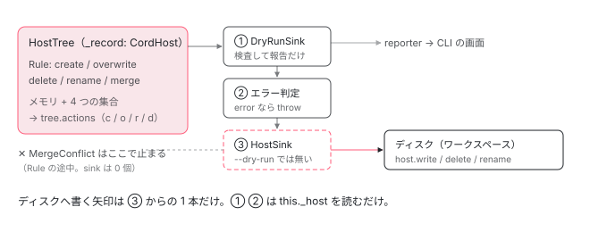

[目次](../README.md) › [CLI とビルド](README.md) › 第 13 回 / 全 16 回

# Tree と sink：ng generate はなぜ失敗しても壊れないか

> schematics の変更は HostTree に積まれ、実行の最後に sink がまとめて書き出す。DryRunSink で検査してから HostSink で書く設計、Action（c / o / r / d）の列、衝突（MergeConflict）で止まったときにディスクが変わらない理由、--dry-run が書き込む sink を足さないだけであること。

angular/angular-cli · 読了 約 12 分 · 中核 · [サイトで読む（デモが動きます）](https://angular-deep-dive-cyan.vercel.app/chapter/schematics)

---

`ng generate` も `ng add` も `ng update` の migration も、中身は schematics です。この章では、schematic（ファイルを作ったり書き換えたりする小さなプログラム）がファイルを変えるとき、その変更が**どこに溜まり、いつ、誰がディスクに書くのか**を追います。結論は「Rule の実行中はメモリの `HostTree` に記録するだけで、最後に sink（変更をまとめて受け取る係）が、検査 → 書き出しの順に流す」です。これが分かると、「途中で失敗したのにファイルが半分だけできた」が起きない理由と、`--dry-run` が何を省いているかを説明できます。

読む対象は angular-cli リポジトリの `packages/angular_devkit/schematics/src/` の `tree/host-tree.ts`・`tree/action.ts`・`tree/recorder.ts`・`workflow/base.ts`・`sink/sink.ts`・`sink/host.ts`・`sink/dryrun.ts`、記録の本体 `packages/angular_devkit/core/src/virtual-fs/host/record.ts`（`CordHost`）、画面に `CREATE` を出す `packages/angular/cli/src/command-builder/utilities/schematic-workflow.ts` です。

1. [1. 概観](01-cli-overview.md)
2. [2. ng build の段取り](02-build.md)
3. [3. AotCompilation](03-cli-angular-compilation.md)
4. [4. コンポーネントのスタイル](04-cli-component-styles.md)
5. [5. oxc の変換](05-cli-javascript-transformer.md)
6. [6. リンカー](06-cli-linker.md)
7. [7. 遅延チャンク](07-cli-code-splitting.md)
8. [8. budgets](08-cli-budgets.md)
9. [9. i18n](09-cli-i18n.md)
10. [10. 再ビルドとキャッシュ](10-cli-cache-watch.md)
11. [11. HMR](11-cli-hmr.md)
12. [12. unit-test と Vitest](12-cli-unit-test.md)
13. **13. Tree と sink**（この章）
14. [14. Rule の組み立て](14-schematics-rules.md)
15. [15. ng generate component](15-schematics-component.md)
16. [16. ng add と ng update](16-cli-add-update.md)

## 0. 全体の流れ

1. **Tree を作る**

   `BaseWorkflow.execute` が、ワークスペースのフォルダを読むだけの `HostTree` を 1 つ作って schematic に渡す（6 節）。
2. **Rule が Tree を変える**

   `tree.create` / `overwrite` / `delete` / `rename` は、`CordHost` のメモリと 4 つの集合に記録されるだけ。ディスクには触れない（1〜3 節）。Rule の組み立て方は[第 14 回](14-schematics-rules.md)。
3. **記録を Action の列にする**

   `tree.actions` が記録を `c`（create）/ `o`（overwrite）/ `r`（rename）/ `d`（delete）の列に変える（4 節）。
4. **途中の衝突は例外**

   2 つの Tree を重ねるとき同じパスに違う中身があれば `MergeConflictException`。ここで止まれば sink は 1 つも動かない（5 節）。
5. **sink に順に流す**

   `DryRunSink`（検査と報告）→ エラー判定 → `HostSink`（書き出し）。`--dry-run` のときは最後の `HostSink` が配列に入らない（6〜8 節）。
6. **画面に出す**

   `DryRunSink` の報告を CLI が受け取り、エラーが無ければ `CREATE` / `UPDATE` の行をまとめて表示する（9 節）。

## 1. HostTree の正体は「記録する仮想ファイルシステム」

📄 `angular-cli/packages/angular_devkit/schematics/src/tree/host-tree.ts` L110–134 （▶ の行: 112–113, 130, 132–133）

```ts
110 │ export class HostTree implements Tree {
111 │   private readonly _id = --_uniqueId;
112 ▶   private _record: virtualFs.CordHost;
113 ▶   private _recordSync: virtualFs.SyncDelegateHost;
114 │   private _ancestry = new Set<number>();
115 │ 
116 │   private _dirCache = new Map<Path, HostDirEntry>();
117 │ 
118 │   static isHostTree(tree: Tree): tree is HostTree {
119 │     if (tree instanceof HostTree) {
120 │       return true;
121 │     }
122 │ 
123 │     if (typeof tree === 'object' && typeof (tree as HostTree)._ancestry === 'object') {
124 │       return true;
125 │     }
126 │ 
127 │     return false;
128 │   }
129 │ 
130 ▶   constructor(protected _backend: virtualFs.ReadonlyHost<{}> = new virtualFs.Empty()) {
131 │     this[TreeSymbol] = () => this;
132 ▶     this._record = new virtualFs.CordHost(new virtualFs.SafeReadonlyHost(_backend));
133 ▶     this._recordSync = new virtualFs.SyncDelegateHost(this._record);
134 │   }
```

112 行目、`HostTree` の中身は `_record: virtualFs.CordHost` です。130 行目で受け取る `_backend` は、実行時にはワークスペースのフォルダ（`NodeJsSyncHost` を root で区切ったもの）です。132 行目でそれを `SafeReadonlyHost`（読むだけの包み）にしてから `CordHost` に渡しています。つまり **Tree からディスクへは「読む」道しか無く、書く道は最初から作られていません**。133 行目の `SyncDelegateHost` は、Observable を返す `CordHost` を同期の呼び出しで使うための包みです。

📄 `angular-cli/packages/angular_devkit/core/src/virtual-fs/host/record.ts` L195–231 （▶ の行: 196–197, 200, 202, 204, 207, 219–221, 224–225, 228）

```ts
195 │   create(path: Path, content: FileBuffer): Observable<void> {
196 ▶     if (super._exists(path)) {
197 ▶       throw new FileAlreadyExistException(path);
198 │     }
199 │ 
200 ▶     if (this._filesToDelete.has(path)) {
201 │       this._filesToDelete.delete(path);
202 ▶       this._filesToOverwrite.add(path);
203 │     } else {
204 ▶       this._filesToCreate.add(path);
205 │     }
206 │ 
207 ▶     return super.write(path, content);
208 │   }
209 │ 
210 │   overwrite(path: Path, content: FileBuffer): Observable<void> {
211 │     return this.isDirectory(path).pipe(
212 │       switchMap((isDir) => {
213 │         if (isDir) {
214 │           return throwError(new PathIsDirectoryException(path));
215 │         }
216 │ 
217 │         return this.exists(path);
218 │       }),
219 ▶       switchMap((exists) => {
220 ▶         if (!exists) {
221 ▶           return throwError(new FileDoesNotExistException(path));
222 │         }
223 │ 
224 ▶         if (!this._filesToCreate.has(path)) {
225 ▶           this._filesToOverwrite.add(path);
226 │         }
227 │ 
228 ▶         return super.write(path, content);
229 │       }),
230 │     );
231 │   }
```

`CordHost` は `SimpleMemoryHost`（メモリ上のファイルシステム）を継承し、「何をしたか」を 4 つの集合に覚えます。

1. **create（195〜208 行目）**

   196 行目の `super._exists(path)` は**メモリにあるかだけ**を見ます。同じ Tree の中で 2 回 create すると 197 行目で例外です。一方、ディスクに既にあるファイルを create しても、ここでは止まりません（このサイトのリポジトリで `HostTree` を作って試すと、例外は出ずに `c` の Action が 1 つ積まれます）。その検査は 8 節の sink の役目です。200〜202 行目、削除予定のファイルを作り直したら「上書き」として覚え直します。それ以外は 204 行目で `_filesToCreate` に入れ、207 行目でメモリに書きます。
2. **overwrite（210〜231 行目）**

   219〜221 行目、無いファイルは上書きできません。224〜225 行目、**作ったばかりのファイルを上書きしても「作る」のまま**です（`_filesToOverwrite` に入らない）。228 行目でメモリに書きます。

## 2. Tree の 4 つの操作は、すべて \_record に流れる

📄 `angular-cli/packages/angular_devkit/schematics/src/tree/host-tree.ts` L413–423 （▶ の行: 416, 419, 422）

```ts
413 │   // Structural methods.
414 │   create(path: string, content: Buffer | string): void {
415 │     const c = typeof content == 'string' ? Buffer.from(content) : content;
416 ▶     this._record.create(this._normalizePath(path), c as {} as virtualFs.FileBuffer).subscribe();
417 │   }
418 │   delete(path: string): void {
419 ▶     this._recordSync.delete(this._normalizePath(path));
420 │   }
421 │   rename(from: string, to: string): void {
422 ▶     this._recordSync.rename(this._normalizePath(from), this._normalizePath(to));
423 │   }
```

416 行目、`tree.create` は `_record.create(...)` を呼んで `.subscribe()` するだけ。419 行目の `delete` と 422 行目の `rename` も `_recordSync`（同じ `CordHost`）に渡すだけです。`fs.writeFile` のような呼び出しはどこにもありません。

> [!TIP]
> **新卒エンジニアへ**
>
> 比喩を 1 つだけ使うと、`HostTree` は「下書き用のトレーシングペーパー」です。下の紙（ディスク）は透けて読めますが、書き込みはすべて上の紙に乗ります。実物では、下の紙が 132 行目の `_backend`、上の紙が `CordHost` のメモリ（`SimpleMemoryHost`）と 4 つの集合です。

## 3. 既存ファイルの一部を書き換える：UpdateRecorder

`app.config.ts` に 1 行足すような変更は、ファイル全体を作り直さずに `beginUpdate` → `insertLeft` → `commitUpdate` で書きます。

📄 `angular-cli/packages/angular_devkit/schematics/src/tree/host-tree.ts` L379–411 （▶ の行: 382–383, 386, 394, 403–405）

```ts
379 │   // Change content of host files.
380 │   overwrite(path: string, content: Buffer | string): void {
381 │     const p = this._normalizePath(path);
382 ▶     if (!this._recordSync.exists(p)) {
383 ▶       throw new FileDoesNotExistException(p);
384 │     }
385 │     const c = typeof content == 'string' ? Buffer.from(content) : content;
386 ▶     this._record.overwrite(p, c as {} as virtualFs.FileBuffer).subscribe();
387 │   }
388 │   beginUpdate(path: string): UpdateRecorder {
389 │     const entry = this.get(path);
390 │     if (!entry) {
391 │       throw new FileDoesNotExistException(path);
392 │     }
393 │ 
394 ▶     return UpdateRecorderBase.createFromFileEntry(entry);
395 │   }
396 │   commitUpdate(record: UpdateRecorder): void {
397 │     if (record instanceof UpdateRecorderBase) {
398 │       const path = record.path;
399 │       const entry = this.get(path);
400 │       if (!entry) {
401 │         throw new ContentHasMutatedException(path);
402 │       } else {
403 ▶         const newContent = record.apply(entry.content);
404 ▶         if (!newContent.equals(entry.content)) {
405 ▶           this.overwrite(path, newContent);
406 │         }
407 │       }
408 │     } else {
409 │       throw new InvalidUpdateRecordException();
410 │     }
411 │   }
```

📄 `angular-cli/packages/angular_devkit/schematics/src/tree/recorder.ts` L72–103 （▶ の行: 75, 82, 89, 95–96, 100）

```ts
 72 │   // These just record changes.
 73 │   insertLeft(index: number, content: Buffer | string): UpdateRecorder {
 74 │     this._assertIndex(index);
 75 ▶     this.content.appendLeft(index, content.toString());
 76 │ 
 77 │     return this;
 78 │   }
 79 │ 
 80 │   insertRight(index: number, content: Buffer | string): UpdateRecorder {
 81 │     this._assertIndex(index);
 82 ▶     this.content.appendRight(index, content.toString());
 83 │ 
 84 │     return this;
 85 │   }
 86 │ 
 87 │   remove(index: number, length: number): UpdateRecorder {
 88 │     this._assertIndex(index);
 89 ▶     this.content.remove(index, index + length);
 90 │ 
 91 │     return this;
 92 │   }
 93 │ 
 94 │   apply(content: Buffer): Buffer {
 95 ▶     if (!content.equals(this.data)) {
 96 ▶       throw new ContentHasMutatedException(this.path);
 97 │     }
 98 │ 
 99 │     // Schematics only support writing UTF-8 text
100 ▶     const result = Buffer.from((this.bom ? '\uFEFF' : '') + this.content.toString(), 'utf-8');
101 │ 
102 │     return result;
103 │   }
```

1. **beginUpdate（394 行目）**

   今の中身から `UpdateRecorderBase` を作ります。中身の文字列は `MagicString`（元の文字列の位置を保ったまま挿入・削除を記録する部品）に入ります。
2. **insertLeft / insertRight / remove（75・82・89 行目）**

   位置は**元の文字列での位置**です。先に挿入しても後ろの位置がずれないので、TypeScript の AST で求めた位置をそのまま何個も使えます（[第 15 回](15-schematics-component.md)の NgModule への追加がこの使い方）。
3. **commitUpdate（403〜405 行目）**

   403 行目の `apply` で新しい中身を作ります。95〜96 行目、beginUpdate のあとに誰かが同じファイルを書き換えていたら `ContentHasMutatedException`。404〜405 行目、中身が変わったときだけ `overwrite` に回ります。386 行目のとおり、それも `_record` への記録です。

## 4. 記録を Action の列にする

📄 `angular-cli/packages/angular_devkit/core/src/virtual-fs/host/record.ts` L152–186 （▶ の行: 154, 161, 169, 174, 177）

```ts
152 │   records(): CordHostRecord[] {
153 │     return [
154 ▶       ...[...this._filesToDelete.values()].map(
155 │         (path) =>
156 │           ({
157 │             kind: 'delete',
158 │             path,
159 │           }) as CordHostRecord,
160 │       ),
161 ▶       ...[...this._filesToRename.entries()].map(
162 │         ([from, to]) =>
163 │           ({
164 │             kind: 'rename',
165 │             from,
166 │             to,
167 │           }) as CordHostRecord,
168 │       ),
169 ▶       ...[...this._filesToCreate.values()].map(
170 │         (path) =>
171 │           ({
172 │             kind: 'create',
173 │             path,
174 ▶             content: this._read(path),
175 │           }) as CordHostRecord,
176 │       ),
177 ▶       ...[...this._filesToOverwrite.values()].map(
178 │         (path) =>
179 │           ({
180 │             kind: 'overwrite',
181 │             path,
182 │             content: this._read(path),
183 │           }) as CordHostRecord,
184 │       ),
185 │     ];
186 │   }
```

📄 `angular-cli/packages/angular_devkit/schematics/src/tree/host-tree.ts` L429–449 （▶ の行: 430, 436, 445）

```ts
429 │   private *generateActions(): Iterable<Action> {
430 ▶     for (const record of this._record.records()) {
431 │       switch (record.kind) {
432 │         case 'create':
433 │           yield {
434 │             id: this._id,
435 │             parent: 0,
436 ▶             kind: 'c',
437 │             path: record.path,
438 │             content: Buffer.from(record.content),
439 │           } as CreateFileAction;
440 │           break;
441 │         case 'overwrite':
442 │           yield {
443 │             id: this._id,
444 │             parent: 0,
445 ▶             kind: 'o',
446 │             path: record.path,
447 │             content: Buffer.from(record.content),
448 │           } as OverwriteFileAction;
449 │           break;
```

📄 `angular-cli/packages/angular_devkit/schematics/src/tree/host-tree.ts` L465–475 （▶ の行: 471, 474）

```ts
465 │           } as DeleteFileAction;
466 │           break;
467 │       }
468 │     }
469 │   }
470 │ 
471 ▶   get actions(): Action[] {
472 │     // Create a list of all records until we hit our original backend. This is to support branches
473 │     // that diverge from each others.
474 ▶     return Array.from(this.generateActions());
475 │   }
```

`records()` は 154 行目の delete、161 行目の rename、169 行目の create、177 行目の overwrite の**順で並べて**返します。操作した順ではありません。174 行目、中身はこの時点のメモリから読むので、同じファイルを何回書き換えても Action は最後の中身 1 つです。430 行目でそれを 1 つずつ取り出し、436 行目の `kind: 'c'`・445 行目の `'o'` のように 1 文字の種類を付けます。471〜475 行目の `actions` ゲッターは呼ばれるたびにこれを作り直します。

📄 `angular-cli/packages/angular_devkit/schematics/src/tree/action.ts` L158–184 （▶ の行: 162, 168, 174–175, 181）

```ts
158 │ export function isContentAction(action: Action): action is CreateFileAction | OverwriteFileAction {
159 │   return action.kind == 'c' || action.kind == 'o';
160 │ }
161 │ 
162 ▶ // Create a file. If the file already exists then this is an error.
163 │ export interface CreateFileAction extends ActionBase {
164 │   readonly kind: 'c';
165 │   readonly content: Buffer;
166 │ }
167 │ 
168 ▶ // Overwrite a file. If the file does not already exist, this is an error.
169 │ export interface OverwriteFileAction extends ActionBase {
170 │   readonly kind: 'o';
171 │   readonly content: Buffer;
172 │ }
173 │ 
174 ▶ // Move a file from one path to another. If the source files does not exist, this is an error.
175 ▶ // If the target path already exists, this is an error.
176 │ export interface RenameFileAction extends ActionBase {
177 │   readonly kind: 'r';
178 │   readonly to: Path;
179 │ }
180 │ 
181 ▶ // Delete a file. If the file does not exist, this is an error.
182 │ export interface DeleteFileAction extends ActionBase {
183 │   readonly kind: 'd';
184 │ }
```

162・168・174〜175・181 行目のコメントが、それぞれの Action の「エラーになる条件」です。create は「既にあったらエラー」、overwrite と delete は「無かったらエラー」、rename は「元が無いか、行き先があったらエラー」。この条件を実際に確かめるのが 8 節の sink です。

## 5. 途中の衝突：MergeConflictException

`url('./files')` から作った別の Tree を今の Tree に重ねる（`mergeWith`。[第 14 回](14-schematics-rules.md)）とき、`HostTree.merge` が相手の Action を 1 つずつ自分に写します。create の場合はこうです。

📄 `angular-cli/packages/angular_devkit/schematics/src/tree/host-tree.ts` L198–220 （▶ の行: 198, 203, 205–206, 210–211, 216）

```ts
198 ▶     other.actions.forEach((action) => {
199 │       switch (action.kind) {
200 │         case 'c': {
201 │           const { path, content } = action;
202 │ 
203 ▶           if (this._willCreate(path) || this._willOverwrite(path) || this.exists(path)) {
204 │             const existingContent = this.read(path);
205 ▶             if (existingContent && content.equals(existingContent)) {
206 ▶               // Identical outcome; no action required
207 │               return;
208 │             }
209 │ 
210 ▶             if (!creationConflictAllowed) {
211 ▶               throw new MergeConflictException(path);
212 │             }
213 │ 
214 │             this._record.overwrite(path, content as {} as virtualFs.FileBuffer).subscribe();
215 │           } else {
216 ▶             this._record.create(path, content as {} as virtualFs.FileBuffer).subscribe();
217 │           }
218 │ 
219 │           return;
220 │         }
```

📄 `angular-cli/packages/angular_devkit/schematics/src/exception/exception.ts` L35–45 （▶ の行: 35, 37, 41, 43）

```ts
35 ▶ export class MergeConflictException extends BaseException {
36 │   constructor(path: string) {
37 ▶     super(`A merge conflicted on path "${path}".`);
38 │   }
39 │ }
40 │ 
41 ▶ export class UnsuccessfulWorkflowExecution extends BaseException {
42 │   constructor() {
43 ▶     super('Workflow did not execute successfully.');
44 │   }
45 │ }
```

203 行目、作ろうとしたパスに自分の側で既にファイルがある（作成予定・上書き予定・ディスクにある、のどれか）とき、205〜206 行目で**中身が同じなら何もしません**。違えば、既定の MergeStrategy では 210〜211 行目で `MergeConflictException` を投げます。この例外は Rule の実行中に投げられるので、6 節の 177 行目の `concatMap`（sink を呼ぶ所）まで届きません。**sink が 1 つも動かないので、ディスクは 1 バイトも変わりません**。

実際に、このサイトのリポジトリで既にある `src/app/pages/chapters/schematics.ts` と同じ名前のコンポーネントを `ng g c pages/chapters/schematics --flat --dry-run` で作ろうとすると、出力は「`A merge conflicted on path "/src/app/pages/chapters/schematics.ts".`」の 1 行だけで、終了コードは 1 でした。`--force` を付けても同じです（`--force` が効くのは 8 節の sink の検査だけだから）。

## 6. sink はいつ動くか：execute の最後

📄 `angular-cli/packages/angular_devkit/schematics/src/workflow/base.ts` L174–201 （▶ の行: 175, 177, 180–181, 184, 188–189, 194–195）

```ts
174 │     return schematic
175 ▶       .call(options.options, of(new HostTree(this._host)), { logger: context.logger })
176 │       .pipe(
177 ▶         concatMap((tree: Tree) => {
178 │           // Process all sinks.
179 │           return concat(
180 ▶             from(sinks).pipe(
181 ▶               concatMap((sink) => sink.commit(tree)),
182 │               ignoreElements(),
183 │             ),
184 ▶             of(tree),
185 │           );
186 │         }),
187 │         concatMap(() => {
188 ▶           if (this._dryRun) {
189 ▶             return EMPTY;
190 │           }
191 │ 
192 │           this._lifeCycle.next({ kind: 'post-tasks-start' });
193 │ 
194 ▶           return this._engine
195 ▶             .executePostTasks()
196 │             .pipe(
197 │               tap({ complete: () => this._lifeCycle.next({ kind: 'post-tasks-end' }) }),
198 │               defaultIfEmpty(undefined),
199 │               last(),
200 │             );
201 │         }),
```

175 行目、`schematic.call` に `new HostTree(this._host)` を 1 つ渡します。`this._host` は `NodeWorkflow` がワークスペースの root で作ったホストです。177 行目、schematic の Rule が全部終わって**最後の Tree が 1 つ出てきてから**、180〜181 行目で sink を 1 つずつ（`concatMap` なので前が終わってから次）`commit(tree)` します。188〜189 行目、`--dry-run` なら後片付けのタスク（`npm install` を走らせる `NodePackageInstallTask` など）も 194 行目の `executePostTasks` ごと飛ばします。

## 7. sink の並べ方：DryRunSink → エラー判定 → HostSink

📄 `angular-cli/packages/angular_devkit/schematics/src/workflow/base.ts` L117–144 （▶ の行: 120–123, 126, 128, 131, 133–134, 142）

```ts
117 │   protected _createSinks(): Sink[] {
118 │     let error = false;
119 │ 
120 ▶     const dryRunSink = new DryRunSink(this._host, this._force);
121 ▶     const dryRunSubscriber = dryRunSink.reporter.subscribe((event) => {
122 ▶       this._reporter.next(event);
123 ▶       error = error || event.kind == 'error';
124 │     });
125 │ 
126 ▶     // We need two sinks if we want to output what will happen, and actually do the work.
127 │     return [
128 ▶       dryRunSink,
129 │       // Add a custom sink that clean ourselves and throws an error if an error happened.
130 │       {
131 ▶         commit() {
132 │           dryRunSubscriber.unsubscribe();
133 ▶           if (error) {
134 ▶             return throwError(new UnsuccessfulWorkflowExecution());
135 │           }
136 │ 
137 │           return of();
138 │         },
139 │       },
140 │ 
141 │       // Only add a HostSink if this is not a dryRun.
142 ▶       ...(!this._dryRun ? [new HostSink(this._host, this._force)] : []),
143 │     ];
144 │   }
```

1. **1 番目：DryRunSink（120・128 行目）**

   同じ `this._host` を相手に検査だけします。121〜124 行目でその報告（reporter）を購読し、`kind == 'error'` が 1 つでも来たら 123 行目で `error = true`。
2. **2 番目：その場で作ったオブジェクト（130〜139 行目）**

   `commit()` しか持たない sink です。133〜134 行目、1 番目でエラーがあったら `UnsuccessfulWorkflowExecution` を投げます。`concatMap` の途中で Observable が error になるので、3 番目は呼ばれません。
3. **3 番目：HostSink（142 行目）**

   `!this._dryRun` のときだけ配列に入ります。**`--dry-run` は、この 1 つを入れないだけ**です。検査は通常の実行でも毎回走っています。



*Rule の実行中はすべて HostTree（CordHost）のメモリに溜まる。最後の Tree が出てから、sink の配列を前から順に commit する。衝突や検査エラーはそれより左で止まるので、ディスクへの矢印に届かない。*

## 8. sink の中身：検査して、溜めて、最後に書く

### commit：Action を 1 つずつ「検査 → 溜める」

📄 `angular-cli/packages/angular_devkit/schematics/src/sink/sink.ts` L149–175 （▶ の行: 150, 166, 172）

```ts
149 │   commit(tree: Tree): Observable<void> {
150 ▶     const actions = observableFrom(tree.actions);
151 │ 
152 │     return concat(
153 │       this.preCommit() || observableOf(null),
154 │       deferObservable(() => actions).pipe(
155 │         concatMap((action) => {
156 │           const maybeAction = this.preCommitAction(action);
157 │ 
158 │           if (isObservable(maybeAction) || isPromiseLike(maybeAction)) {
159 │             return maybeAction;
160 │           }
161 │ 
162 │           return observableOf(maybeAction || action);
163 │         }),
164 │         concatMap((action) => {
165 │           return concat(
166 ▶             this.commitSingleAction(action).pipe(ignoreElements()),
167 │             observableOf(action),
168 │           );
169 │         }),
170 │         concatMap((action) => this.postCommitAction(action) || observableOf(null)),
171 │       ),
172 ▶       deferObservable(() => this._done()),
173 │       deferObservable(() => this.postCommit() || observableOf(null)),
174 │     ).pipe(ignoreElements(), defaultIfEmpty(undefined));
175 │   }
```

📄 `angular-cli/packages/angular_devkit/schematics/src/sink/sink.ts` L120–147 （▶ の行: 122, 127, 130, 136）

```ts
120 │   commitSingleAction(action: Action): Observable<void> {
121 │     return concat(
122 ▶       this.validateSingleAction(action),
123 │       new Observable<void>((observer) => {
124 │         let committed: Observable<void> | null = null;
125 │         switch (action.kind) {
126 │           case 'o':
127 ▶             committed = this._overwriteFile(action.path, action.content);
128 │             break;
129 │           case 'c':
130 ▶             committed = this._createFile(action.path, action.content);
131 │             break;
132 │           case 'r':
133 │             committed = this._renameFile(action.path, action.to);
134 │             break;
135 │           case 'd':
136 ▶             committed = this._deleteFile(action.path);
137 │             break;
138 │         }
139 │ 
140 │         if (committed) {
141 │           committed.subscribe(observer);
142 │         } else {
143 │           observer.complete();
144 │         }
145 │       }),
146 │     ).pipe(ignoreElements());
147 │   }
```

150 行目で 4 節の `tree.actions` を取り、166 行目で 1 つずつ `commitSingleAction`。その中で 122 行目の検査を先に、127〜136 行目の `_createFile` などを後に呼びます。すべての Action が終わってから 172 行目で `_done()` です。

📄 `angular-cli/packages/angular_devkit/schematics/src/sink/sink.ts` L55–79 （▶ の行: 56, 59, 65–66, 74–75）

```ts
55 │   protected _fileAlreadyExistException(path: string): void {
56 ▶     throw new FileAlreadyExistException(path);
57 │   }
58 │   protected _fileDoesNotExistException(path: string): void {
59 ▶     throw new FileDoesNotExistException(path);
60 │   }
61 │ 
62 │   protected _validateOverwriteAction(action: OverwriteFileAction): Observable<void> {
63 │     return this._validateFileExists(action.path).pipe(
64 │       map((b) => {
65 ▶         if (!b) {
66 ▶           this._fileDoesNotExistException(action.path);
67 │         }
68 │       }),
69 │     );
70 │   }
71 │   protected _validateCreateAction(action: CreateFileAction): Observable<void> {
72 │     return this._validateFileExists(action.path).pipe(
73 │       map((b) => {
74 ▶         if (b) {
75 ▶           this._fileAlreadyExistException(action.path);
76 │         }
77 │       }),
78 │     );
79 │   }
```

基底クラスの検査は 4 節のコメントどおりです。74〜75 行目、create したいのにファイルがあれば `_fileAlreadyExistException`。基底では 56 行目で**例外を投げます**。

### HostSink：メモリに溜めてから、\_done でまとめて書く

📄 `angular-cli/packages/angular_devkit/schematics/src/sink/host.ts` L35–72 （▶ の行: 36, 40–41, 44, 57, 62, 69）

```ts
35 │   protected override _validateCreateAction(action: CreateFileAction): Observable<void> {
36 ▶     return this._force ? EMPTY : super._validateCreateAction(action);
37 │   }
38 │ 
39 │   protected _validateFileExists(p: Path): Observable<boolean> {
40 ▶     if (this._filesToCreate.has(p) || this._filesToUpdate.has(p)) {
41 ▶       return observableOf(true);
42 │     }
43 │ 
44 ▶     if (this._filesToDelete.has(p)) {
45 │       return observableOf(false);
46 │     }
47 │ 
48 │     for (const [from, to] of this._filesToRename.values()) {
49 │       switch (p) {
50 │         case from:
51 │           return observableOf(false);
52 │         case to:
53 │           return observableOf(true);
54 │       }
55 │     }
56 │ 
57 ▶     return this._host.exists(p);
58 │   }
59 │ 
60 │   protected _overwriteFile(path: Path, content: Buffer): Observable<void> {
61 │     // TODO: `as unknown` was necessary during TS 5.9 update. Figure out a long-term solution.
62 ▶     this._filesToUpdate.set(path, content as unknown as ArrayBufferLike);
63 │ 
64 │     return EMPTY;
65 │   }
66 │ 
67 │   protected _createFile(path: Path, content: Buffer): Observable<void> {
68 │     // TODO: `as unknown` was necessary during TS 5.9 update. Figure out a long-term solution.
69 ▶     this._filesToCreate.set(path, content as unknown as ArrayBufferLike);
70 │ 
71 │     return EMPTY;
72 │   }
```

📄 `angular-cli/packages/angular_devkit/schematics/src/sink/host.ts` L91–107 （▶ の行: 94–95, 98, 101, 104）

```ts
 91 │   _done(): Observable<void> {
 92 │     // Really commit everything to the actual filesystem.
 93 │     return concatObservables(
 94 ▶       observableFrom([...this._filesToDelete.values()]).pipe(
 95 ▶         concatMap((path) => this._host.delete(path)),
 96 │       ),
 97 │       observableFrom([...this._filesToRename.entries()]).pipe(
 98 ▶         concatMap(([_, [path, to]]) => this._host.rename(path, to)),
 99 │       ),
100 │       observableFrom([...this._filesToCreate.entries()]).pipe(
101 ▶         concatMap(([path, buffer]) => this._host.write(path, buffer)),
102 │       ),
103 │       observableFrom([...this._filesToUpdate.entries()]).pipe(
104 ▶         concatMap(([path, buffer]) => this._host.write(path, buffer)),
105 │       ),
106 │     ).pipe(reduce(() => {}));
107 │   }
```

1. **存在の確認（39〜58 行目）**

   40〜46 行目、**この sink の中で既に作った・消したもの**を先に見て、57 行目で初めて本物のホストに `exists` を聞きます。delete のあとの create のような並びも正しく判定できます。
2. **溜める（62・69 行目）**

   `_overwriteFile` と `_createFile` は `Map` に入れて `EMPTY` を返すだけ。commit の途中では何も書きません。
3. **書く（91〜107 行目）**

   全 Action の検査が終わってから、94〜95 行目の delete、98 行目の rename、101 行目の create、104 行目の update の順に `this._host` へ書きます。
4. **--force（36 行目）**

   create の検査だけを飛ばします。既にあるファイルは 101 行目の `host.write` で上書きされます。5 節の `MergeConflictException` には効きません。

### DryRunSink：例外を投げずに集め、書かずに報告する

📄 `angular-cli/packages/angular_devkit/schematics/src/sink/dryrun.ts` L46–73 （▶ の行: 46, 51, 68–69, 71–72）

```ts
46 ▶ export class DryRunSink extends HostSink {
47 │   protected _subject: Subject<DryRunEvent> = new Subject();
48 │   protected _fileDoesNotExistExceptionSet: Set<string> = new Set();
49 │   protected _fileAlreadyExistExceptionSet: Set<string> = new Set();
50 │ 
51 ▶   readonly reporter: Observable<DryRunEvent> = this._subject.asObservable();
52 │ 
53 │   /**
54 │    * @param {host} dir The host to use to output. This should be scoped.
55 │    * @param {boolean} force Whether to force overwriting files that already exist.
56 │    */
57 │   constructor(host: virtualFs.Host, force?: boolean);
58 │ 
59 │   constructor(host: virtualFs.Host | string, force = false) {
60 │     super(
61 │       typeof host == 'string'
62 │         ? new virtualFs.ScopedHost(new NodeJsSyncHost(), normalize(host))
63 │         : host,
64 │       force,
65 │     );
66 │   }
67 │ 
68 ▶   protected override _fileAlreadyExistException(path: string): void {
69 ▶     this._fileAlreadyExistExceptionSet.add(path);
70 │   }
71 ▶   protected override _fileDoesNotExistException(path: string): void {
72 ▶     this._fileDoesNotExistExceptionSet.add(path);
73 │   }
```

📄 `angular-cli/packages/angular_devkit/schematics/src/sink/dryrun.ts` L75–90 （▶ の行: 75–77, 83）

```ts
75 ▶   override _done(): Observable<void> {
76 ▶     this._fileAlreadyExistExceptionSet.forEach((path) => {
77 ▶       this._subject.next({
78 │         kind: 'error',
79 │         description: 'alreadyExist',
80 │         path,
81 │       });
82 │     });
83 ▶     this._fileDoesNotExistExceptionSet.forEach((path) => {
84 │       this._subject.next({
85 │         kind: 'error',
86 │         description: 'doesNotExist',
87 │         path,
88 │       });
89 │     });
90 │ 
```

46 行目、`DryRunSink extends HostSink`。検査と「溜める」はそのまま受け継ぎます。68〜73 行目で 2 つの例外メソッドを上書きし、投げる代わりに `Set` に入れます。だから 1 つ目のエラーで止まらず、**全部の問題をまとめて**報告できます。75 行目の `_done` も上書きされ、`super._done()` を呼びません。76〜89 行目でエラーを、その先で delete / rename / create / update を 51 行目の `reporter` に流すだけです。**書き込みのコードを通らない**ので、1 番目の sink は何があってもディスクを変えません。

## 9. 画面の CREATE と ERROR!

📄 `angular-cli/packages/angular/cli/src/command-builder/utilities/schematic-workflow.ts` L29–53 （▶ の行: 29, 34–35, 37, 40–41, 47–48, 50）

```ts
29 ▶   const reporterSubscription = workflow.reporter.subscribe((event) => {
30 │     // Strip leading slash to prevent confusion.
31 │     const eventPath = removeLeadingSlash(event.path);
32 │ 
33 │     switch (event.kind) {
34 ▶       case 'error':
35 ▶         error = true;
36 │         logger.error(
37 ▶           `ERROR! ${eventPath} ${event.description == 'alreadyExist' ? 'already exists' : 'does not exist'}.`,
38 │         );
39 │         break;
40 ▶       case 'update':
41 ▶         logs.push(
42 │           // TODO: `as unknown` was necessary during TS 5.9 update. Figure out a long-term solution.
43 │           `${colors.cyan('UPDATE')} ${eventPath} (${(event.content as unknown as Buffer).length} bytes)`,
44 │         );
45 │         files.add(eventPath);
46 │         break;
47 ▶       case 'create':
48 ▶         logs.push(
49 │           // TODO: `as unknown` was necessary during TS 5.9 update. Figure out a long-term solution.
50 ▶           `${colors.green('CREATE')} ${eventPath} (${(event.content as unknown as Buffer).length} bytes)`,
51 │         );
52 │         files.add(eventPath);
53 │         break;
```

📄 `angular-cli/packages/angular/cli/src/command-builder/utilities/schematic-workflow.ts` L69–79 （▶ の行: 70–71, 73）

```ts
69 │   const lifecycleSubscription = workflow.lifeCycle.subscribe((event) => {
70 ▶     if (event.kind == 'end' || event.kind == 'post-tasks-start') {
71 ▶       if (!error) {
72 │         // Output the logging queue, no error happened.
73 ▶         logs.forEach((log) => logger.info(log));
74 │       }
75 │ 
76 │       logs = [];
77 │       error = false;
78 │     }
79 │   });
```

29 行目、CLI は `workflow.reporter`（7 節の 122 行目で `DryRunSink` の報告を流し直したもの）を購読します。35〜37 行目、エラーはすぐ「`ERROR! … already exists.`」と出します。40〜53 行目の `UPDATE` / `CREATE` はすぐには出さず `logs` に溜め、70〜73 行目、実行が終わったときに**エラーが無かった場合だけ**まとめて出します。つまり `CREATE src/app/… (N bytes)` の行は、**HostSink が書いたファイルの一覧ではなく、DryRunSink が「書けるはず」と判定した一覧**です。`--dry-run` でも同じ行が出るのはこのためで、最後に「`NOTE: The "--dry-run" option means no changes were made.`」が足されます（[第 15 回](15-schematics-component.md)の `runSchematic`）。

> **🧪 DEMO — 自作の小さな Tree と sink**
>
> ボタンで Rule の中の操作を積み、「commit」で実行します。実物の規則を写した自作の関数で、本物のファイルには触れません。記録は 1 節の `CordHost`、mergeWith は 5 節の 203〜216 行目、Action の順は 4 節の `records()`、検査は 8 節の `HostSink` と同じです（rename は省きました）。「ディスク」は表示用の `Map` です。
>
> 積んだ操作（Rule の中で呼んだ順）： まだありません
>
> ▶ [このデモはサイトで動かせます](https://angular-deep-dive-cyan.vercel.app/chapter/schematics)

## ここまでの呼び出し

- 👤 `ng generate component user-card` — ターミナル
  - `SchematicsCommandModule.runSchematic` — command-builder/schematics-command-module.ts L332 — *第 15 回*
    - `subscribeToWorkflow(workflow, logger)` — utilities/schematic-workflow.ts L17 — *reporter を購読*
    - `BaseWorkflow.execute(...)` — schematics/src/workflow/base.ts L146
      - `_createSinks()` — base.ts L117 — *\[DryRunSink, エラー判定, HostSink?\]*
      - `schematic.call(options, of(new HostTree(this._host)))` — base.ts L175 — *Rule が CordHost に記録*
        - `HostTree.merge(other)` — tree/host-tree.ts L179 — *衝突なら MergeConflictException*
      - `sink.commit(tree)` × 3 — sink/sink.ts L149
        - `tree.actions → records()` — host-tree.ts L471 / record.ts L152
        - `commitSingleAction → validateSingleAction → _createFile 等` — sink.ts L120
        - `_done()` — DryRunSink: dryrun.ts L75（報告だけ）/ HostSink: host.ts L91（書く）
      - `executePostTasks()` — base.ts L194 — *--dry-run では飛ばす*

## 聞かれそうな質問

**Q. `ng generate` が途中で失敗したら、作りかけのファイルが残りますか？**

残りません。Rule の実行中は 2 節の 416・419・422 行目のとおり `CordHost` のメモリに記録するだけで、ディスクへ書くのは 3 番目の sink の `_done`（host.ts 91〜107 行目）だけです。Rule の途中の例外（5 節の `MergeConflictException` など）なら sink は 1 つも動かず、検査で見つかったエラーなら 2 番目の sink が 133〜134 行目で止めるので、`HostSink` まで届きません。ただし `HostSink._done` の書き込み自体がディスクの都合（権限など）で途中で失敗した場合は、それまでに書いたファイルは残ります。巻き戻す仕組みはありません。

**Q. `--dry-run` は何をしないのですか？**

2 つだけです。7 節の 142 行目で `HostSink` を sink の配列に入れないことと、6 節の 188〜189 行目で `executePostTasks`（パッケージのインストールなど）を飛ばすこと。Rule は全部走り、`DryRunSink` の検査も通常どおり走ります。だから `--dry-run` で出たエラーは、本番でも同じように出ます。

**Q. 既にあるファイルを作ろうとすると、どのエラーになりますか？**

作り方で変わります。Rule が `tree.create` を直接呼んだ場合は、1 節の 196 行目がメモリしか見ないので Rule は通り、`DryRunSink` が「`ERROR! … already exists.`」を報告します（`--force` なら host.ts 36 行目で検査を飛ばして上書き）。`ng g c` のように `mergeWith` でテンプレートの Tree を重ねる場合は、5 節の 210〜211 行目で `MergeConflictException` になり、`--force` を付けても止まります。どちらもディスクは変わりません。

**Q. 同じファイルを 1 つの schematic の中で何回も書き換えると、ディスクには何回書かれますか？**

1 回です。4 節の 174・182 行目で、Action の中身は記録の最後の状態から読み、ファイルごとに 1 つの Action になります。作ったばかりのファイルを上書きしても 1 節の 224 行目で create のままなので、画面にも `CREATE` が 1 行出るだけです。

**Q. `CREATE` の行は、実際に書いたファイルの一覧ですか？**

いいえ。9 節の 29 行目で CLI が購読しているのは `DryRunSink` の報告です。`HostSink` は何も報告しません。ただ、`HostSink` は同じ Action を同じ規則で検査してから書くので、エラーが無ければ同じファイルが書かれます。

## 読み終えて

- `HostTree` の中身は `CordHost`。ディスクは `SafeReadonlyHost` 越しに読むだけで、Rule の操作はメモリと 4 つの集合に記録される。
- `tree.actions` は記録を delete → rename → create → overwrite の順の `c` / `o` / `r` / `d` にしたもの。ファイルごとに 1 つ。
- Rule の途中の `MergeConflictException` は sink の前で止まる。検査のエラーは `DryRunSink` が集めて、2 番目の sink が止める。
- ディスクに書くのは `HostSink._done` だけ。`--dry-run` はその sink を入れず、post task も飛ばすだけ。
- 画面の `CREATE` / `ERROR!` は `DryRunSink` の報告。エラーが 1 つでもあれば `CREATE` の行は出ない。

---

← 前: [unit-test builder と Vitest：テストを application builder で束ねる](12-cli-unit-test.md)  
次: [Rule の組み立て：chain・apply・url・template・mergeWith](14-schematics-rules.md) →
