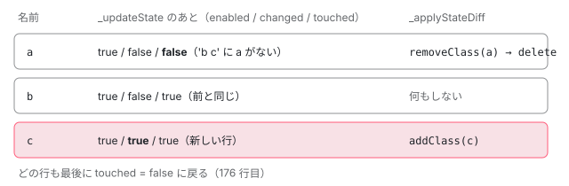

[目次](../README.md) › [common の内側](README.md) › 第 2 回 / 全 20 回

# NgClass と NgStyle：DoCheck で差分を取って書く

> NgClass が ngDoCheck のたびに静的な class（@Input('class')）と文字列・配列・Set・オブジェクトを読み直し、クラスごとの状態の表（enabled・changed・touched）を \_updateState で作って \_applyStateDiff で Renderer2 の addClass・removeClass を呼ぶまで。NgStyle が KeyValueDiffer（DefaultKeyValueDiffer）で差分を取り、消す → 足す → 変えるの順に "width.px" の単位を分けて setStyle する行と、shorthand と longhand を同じオブジェクトに入れたときのずれ。\[class\]・\[style\] のバインディングとの違い。ページの上で、本物の NgClass・NgStyle が renderer に送る呼び出しを記録するデモ。

angular/angular · 読了 約 12 分 · 中核 · [サイトで読む（デモが動きます）](https://angular-deep-dive-cyan.vercel.app/chapter/cmn-ng-class-style)

---

`[ngClass]` と `[ngStyle]` は、`[class]`・`[style]` のバインディングと見た目の結果は似ていますが、中の作りがまったく違います。一言で言うと、**どちらも普通のディレクティブで、変更検知のたびに呼ばれる `ngDoCheck` の中で、自分で前回との差を取って `Renderer2` を呼ぶ**です。この章では、NgClass がクラスごとの状態の表（enabled・changed・touched）で差を取る手順と、NgStyle が core の `KeyValueDiffer` に差を取らせて `"width.px"` の単位を分けて書く手順を、行で追います。最後に、本物の NgClass・NgStyle が renderer に送る呼び出しをページの上で記録します。

読む対象は `packages/common/src/directives/ng_class.ts`・`ng_style.ts` と、core の `packages/core/src/change_detection/differs/keyvalue_differs.ts`・`default_keyvalue_differ.ts` です（../angular、22.2.0-next.7、8576f161ae4）。

1. [1. 全体像](01-cmn-overview.md)
2. **2. NgClass と NgStyle**（この章）
3. [3. NgForOf](03-cmn-ng-for-of.md)
4. [4. NgIf と NgSwitch](04-cmn-ng-if-switch.md)
5. [5. outlet](05-cmn-outlets.md)
6. [6. pipe の仕組み](06-cmn-pipe-mechanism.md)
7. [7. 小さな pipe](07-cmn-simple-pipes.md)
8. [8. KeyValuePipe](08-cmn-keyvalue-pipe.md)
9. [9. DatePipe](09-cmn-date-pipe.md)
10. [10. 日付の書式](10-cmn-format-date.md)
11. [11. 日付の部品](11-cmn-date-getters.md)
12. [12. 数の書式](12-cmn-format-number.md)
13. [13. NgOptimizedImage](13-cmn-image-overview.md)
14. [14. srcset と sizes](14-cmn-image-srcset.md)
15. [15. 画像のローダー](15-cmn-image-loaders.md)
16. [16. LCP と preload](16-cmn-image-lcp-preload.md)
17. [17. Location](17-cmn-location.md)
18. [18. テスト用の Location](18-cmn-location-testing.md)
19. [19. ViewportScroller](19-cmn-viewport-scroller.md)
20. [20. issue と PR を読む](20-cmn-issues.md)

## 1. NgClass が持つもの：状態の表

📄 `angular/packages/common/src/directives/ng_class.ts` L17–37 （▶ の行: 17, 19, 34–36）

```ts
17 ▶ type NgClassSupportedTypes = string[] | Set<string> | {[klass: string]: any} | null | undefined;
18 │ 
19 ▶ const WS_REGEXP = /\s+/;
20 │ 
21 │ const EMPTY_ARRAY: string[] = [];
22 │ 
23 │ /**
24 │  * Represents internal object used to track state of each CSS class. There are 3 different (boolean)
25 │  * flags that, combined together, indicate state of a given CSS class:
26 │  * - enabled: indicates if a class should be present in the DOM (true) or not (false);
27 │  * - changed: tracks if a class was toggled (added or removed) during the custom dirty-checking
28 │  * process; changed classes must be synchronized with the DOM;
29 │  * - touched: tracks if a class is present in the current object bound to the class / ngClass input;
30 │  * classes that are not present any more can be removed from the internal data structures;
31 │  */
32 │ interface CssClassState {
33 │   // PERF: could use a bit mask to represent state as all fields are boolean flags
34 ▶   enabled: boolean;
35 ▶   changed: boolean;
36 ▶   touched: boolean;
37 │ }
```

17 行目が `[ngClass]` に渡せる型です。文字列・配列・`Set`・オブジェクト・`null`・`undefined`。19 行目の `WS_REGEXP` は「1 文字以上の空白」で、文字列を切るときに使います。32〜37 行目の `CssClassState` が、**クラス名 1 つにつき 1 行**の状態です。24〜30 行目のコメントのとおり、

- 34 行目 `enabled`：そのクラスが DOM に付いているべきか。
- 35 行目 `changed`：今回の見直しで付け外しが変わったか（DOM に書く必要があるか）。
- 36 行目 `touched`：今回渡された値の中にその名前があったか（なければ表から消してよい）。

📄 `angular/packages/common/src/directives/ng_class.ts` L76–98 （▶ の行: 80–81, 83, 86–87, 90, 92, 95, 97）

```ts
76 │ @Directive({
77 │   selector: '[ngClass]',
78 │ })
79 │ export class NgClass implements DoCheck {
80 ▶   private initialClasses = EMPTY_ARRAY;
81 ▶   private rawClass: NgClassSupportedTypes;
82 │ 
83 ▶   private stateMap = new Map<string, CssClassState>();
84 │ 
85 │   constructor(
86 ▶     private _ngEl: ElementRef,
87 ▶     private _renderer: Renderer2,
88 │   ) {}
89 │ 
90 ▶   @Input('class')
91 │   set klass(value: string) {
92 ▶     this.initialClasses = value != null ? value.trim().split(WS_REGEXP) : EMPTY_ARRAY;
93 │   }
94 │ 
95 ▶   @Input('ngClass')
96 │   set ngClass(value: string | string[] | Set<string> | {[klass: string]: any} | null | undefined) {
97 ▶     this.rawClass = typeof value === 'string' ? value.trim().split(WS_REGEXP) : value;
98 │   }
```

83 行目の `stateMap` が状態の表で、`Map` なので名前を入れた順に並びます。86〜87 行目、DOM に触るのはコンストラクタでもらう `ElementRef` と `Renderer2` だけです。

入力は 2 つあります。90 行目は **`@Input('class')`**、つまり同じ要素の `class="…"` 属性や `[class]` のバインディングの値を NgClass が受け取ります。92 行目で空白で切って `initialClasses` に入れます。95〜98 行目の `ngClass` は、97 行目で文字列だけを配列に切り、配列・`Set`・オブジェクトは**参照のまま**`rawClass` に入れます。setter は値を覚えるだけで、DOM には何もしません。

> [!NOTE]
> **ポイント**
>
> `@Input('class')` を持つディレクティブが要素にいると、core は `[class]` の値を DOM に書かずにそのディレクティブの入力へ回します（[domr-styling-maps](../domr/12-domr-styling-maps.md) の `hasStylingInputShadow` の分かれ道）。静的な `class="base"` のほうは、要素を作るときに `setAttribute` で DOM にも書かれ、同じ文字列が NgClass の `klass` にも入ります。デモの「描く」で、`setAttribute(…, "class", "base")` のすぐあとに NgClass の `addClass(…, "base")` が来るのはこのためです。

## 2. ngDoCheck：毎回、全部の名前をなめる

📄 `angular/packages/common/src/directives/ng_class.ts` L125–144 （▶ の行: 127–128, 133, 135, 137–139, 143）

```ts
125 │   ngDoCheck(): void {
126 │     // classes from the [class] binding
127 ▶     for (const klass of this.initialClasses) {
128 ▶       this._updateState(klass, true);
129 │     }
130 │ 
131 │     // classes from the [ngClass] binding
132 │     const rawClass = this.rawClass;
133 ▶     if (Array.isArray(rawClass) || rawClass instanceof Set) {
134 │       for (const klass of rawClass) {
135 ▶         this._updateState(klass, true);
136 │       }
137 ▶     } else if (rawClass != null) {
138 ▶       for (const klass of Object.keys(rawClass)) {
139 ▶         this._updateState(klass, Boolean(rawClass[klass]));
140 │       }
141 │     }
142 │ 
143 ▶     this._applyStateDiff();
144 │   }
```

`ngDoCheck` は、そのディレクティブがいるビューが変更検知で見直されるたびに呼ばれるフックです（いつ呼ばれるかは [ivy-hooks](../ivy/13-ivy-hooks.md)）。NgClass は入力が変わったかどうかに関係なく、毎回ここで次の順に名前をなめます。

1. **127〜129 行目：静的なクラス**

   `initialClasses` の名前を全部「付いているべき（true）」として `_updateState` に渡します。
2. **133〜136 行目：配列か Set**

   中の名前を全部 true として渡します。
3. **137〜140 行目：オブジェクト**

   139 行目、鍵を名前、`Boolean(値)` を付ける・付けないとして渡します。
4. **143 行目：表を DOM に流す**

   `_applyStateDiff`（3 節）。

ポイントは、**オブジェクトや配列を毎回読み直す**ことです。参照が同じでも、中身を書き換えればここで拾えます（デモの「今の値の中身だけ書き換える」）。`ngDoCheck` の上の長いコメントは、この作りの狙いを「何も変わらなければ DOM に触らず、メモリも確保しない」と書いています。

## 3. \_updateState と \_applyStateDiff

📄 `angular/packages/common/src/directives/ng_class.ts` L146–178 （▶ の行: 148–151, 153, 155, 164–167, 170–171, 173, 176）

```ts
146 │   private _updateState(klass: string, nextEnabled: boolean) {
147 │     const state = this.stateMap.get(klass);
148 ▶     if (state !== undefined) {
149 ▶       if (state.enabled !== nextEnabled) {
150 ▶         state.changed = true;
151 ▶         state.enabled = nextEnabled;
152 │       }
153 ▶       state.touched = true;
154 │     } else {
155 ▶       this.stateMap.set(klass, {enabled: nextEnabled, changed: true, touched: true});
156 │     }
157 │   }
158 │ 
159 │   private _applyStateDiff() {
160 │     for (const stateEntry of this.stateMap) {
161 │       const klass = stateEntry[0];
162 │       const state = stateEntry[1];
163 │ 
164 ▶       if (state.changed) {
165 ▶         this._toggleClass(klass, state.enabled);
166 ▶         state.changed = false;
167 ▶       } else if (!state.touched) {
168 │         // A class that was previously active got removed from the new collection of classes -
169 │         // remove from the DOM as well.
170 ▶         if (state.enabled) {
171 ▶           this._toggleClass(klass, false);
172 │         }
173 ▶         this.stateMap.delete(klass);
174 │       }
175 │ 
176 ▶       state.touched = false;
177 │     }
178 │   }
```

1. **148〜153 行目：表にある名前**

   149 行目、付ける・付けないが前回と違えば `changed` を立てて `enabled` を書き換えます。どちらにしても 153 行目で `touched` を立てます。
2. **155 行目：表にない名前**

   新しい行を `{enabled, changed: true, touched: true}` で足します。初めて見た名前は、付ける・付けないのどちらでも一度は DOM に書きます。
3. **164〜166 行目：changed の行**

   `_toggleClass` で DOM に書き、`changed` を下ろします。
4. **167〜174 行目：touched でない行**

   今回の値に名前がなかった行です。170〜171 行目、付いていれば外し、173 行目で表から消します。
5. **176 行目：次回のために**

   `touched` を下ろします。次の `ngDoCheck` で、また 1 から「今回あったか」を数えます。



*'a b' のあとに 'b c' を渡したときの状態の表。b は changed にならず DOM に触らない。a は touched にならず外して表から消える。c は新しい行。*

📄 `angular/packages/common/src/directives/ng_class.ts` L180–199 （▶ の行: 181–182, 188–190, 192, 194）

```ts
180 │   private _toggleClass(klass: string, enabled: boolean): void {
181 ▶     if (ngDevMode) {
182 ▶       if (typeof klass !== 'string') {
183 │         throw new Error(
184 │           `NgClass can only toggle CSS classes expressed as strings, got ${stringify(klass)}`,
185 │         );
186 │       }
187 │     }
188 ▶     klass = klass.trim();
189 ▶     if (klass.length > 0) {
190 ▶       klass.split(WS_REGEXP).forEach((klass) => {
191 │         if (enabled) {
192 ▶           this._renderer.addClass(this._ngEl.nativeElement, klass);
193 │         } else {
194 ▶           this._renderer.removeClass(this._ngEl.nativeElement, klass);
195 │         }
196 │       });
197 │     }
198 │   }
199 │ }
```

181〜187 行目、開発モードでは名前が文字列でなければ例外です（配列に数を入れたときなど）。188〜190 行目、表の 1 行の名前をもう一度空白で切ってから 1 つずつ `addClass`・`removeClass` を呼びます。なので `{'a b': true}` や `new Set(['e f'])` のように、1 つの名前に空白を入れると、表では 1 行・DOM では 2 つのクラスになります。`className` を丸ごと書き直すことはしません。

## 4. NgStyle：差は KeyValueDiffer に取らせる

📄 `angular/packages/common/src/directives/ng_style.ts` L61–89 （▶ の行: 66, 70, 76–78, 83–86）

```ts
61 │ @Directive({
62 │   selector: '[ngStyle]',
63 │ })
64 │ export class NgStyle implements DoCheck {
65 │   private _ngStyle: {[key: string]: string} | null | undefined = null;
66 ▶   private _differ: KeyValueDiffer<string, string | number> | null = null;
67 │ 
68 │   constructor(
69 │     private _ngEl: ElementRef,
70 ▶     private _differs: KeyValueDiffers,
71 │     private _renderer: Renderer2,
72 │   ) {}
73 │ 
74 │   @Input('ngStyle')
75 │   set ngStyle(values: {[klass: string]: any} | null | undefined) {
76 ▶     this._ngStyle = values;
77 ▶     if (!this._differ && values) {
78 ▶       this._differ = this._differs.find(values).create();
79 │     }
80 │   }
81 │ 
82 │   ngDoCheck() {
83 ▶     if (this._differ) {
84 ▶       const changes = this._differ.diff(this._ngStyle!);
85 ▶       if (changes) {
86 ▶         this._applyChanges(changes);
87 │       }
88 │     }
89 │   }
```

1. **70 行目：KeyValueDiffers をもらう**

   差の取り方の「工場の一覧」です（5 節）。
2. **76〜79 行目：最初の値で differ を作る**

   setter は値を覚え、まだ differ がなくて値が `null` でなければ、78 行目で `find(values).create()` します。differ は一度作ったら作り直しません。
3. **83〜88 行目：ngDoCheck のたびに diff**

   84 行目、今の `_ngStyle` を渡して差を取らせ、変化があれば `_applyChanges` へ。NgClass と同じく、参照が同じでも中身の変化を拾えます。

📄 `angular/packages/common/src/directives/ng_style.ts` L91–112 （▶ の行: 92–93, 96, 99–100, 103, 108–110）

```ts
 91 │   private _setStyle(nameAndUnit: string, value: string | number | null | undefined): void {
 92 ▶     const [name, unit] = nameAndUnit.split('.');
 93 ▶     const flags = name.indexOf('-') === -1 ? undefined : (RendererStyleFlags2.DashCase as number);
 94 │ 
 95 │     if (value != null) {
 96 ▶       this._renderer.setStyle(
 97 │         this._ngEl.nativeElement,
 98 │         name,
 99 ▶         unit ? `${value}${unit}` : value,
100 ▶         flags,
101 │       );
102 │     } else {
103 ▶       this._renderer.removeStyle(this._ngEl.nativeElement, name, flags);
104 │     }
105 │   }
106 │ 
107 │   private _applyChanges(changes: KeyValueChanges<string, string | number>): void {
108 ▶     changes.forEachRemovedItem((record) => this._setStyle(record.key, null));
109 ▶     changes.forEachAddedItem((record) => this._setStyle(record.key, record.currentValue));
110 ▶     changes.forEachChangedItem((record) => this._setStyle(record.key, record.currentValue));
111 │   }
112 │ }
```

92 行目、鍵を `.` で 2 つに分けます。`"width.px"` なら名前は `width`、単位は `px` で、99 行目で値の後ろに単位を足して `"120px"` にします。93 行目、名前に `-` が入っていれば `RendererStyleFlags2.DashCase`（値は 2）を付けます。DOM の renderer はこの印があると `style.setProperty('padding-left', …)` で、なければ `style.color = …` の形で書きます（[domr-renderer-api](../domr/02-domr-renderer-api.md)）。`--cmn-c` のような CSS 変数は `-` を含むので印が付きます（DOM の renderer 自身も `--` で始まる名前は印に関係なく `setProperty` で書きます）。103 行目、値が `null` か `undefined` なら `removeStyle` です。

108〜110 行目の順番が大事です。**消す → 足す → 変える**の順に呼びます。`{'width.px': 120}` から `{'width.em': 8}` にすると、鍵が違うので「`width.px` を消す」と「`width.em` を足す」になり、108 行目の `removeStyle(width)` が先、109 行目の `setStyle(width, 8em)` があとなので、最後に 8em が残ります（spec の 114 行目の it がこれを確かめています）。

## 5. KeyValueDiffers と DefaultKeyValueDiffer

📄 `angular/packages/core/src/change_detection/differs/keyvalue_differs.ts` L113–134 （▶ の行: 113–114, 124, 126–127）

```ts
113 ▶ export function defaultKeyValueDiffersFactory() {
114 ▶   return new KeyValueDiffers([new DefaultKeyValueDifferFactory()]);
115 │ }
116 │ 
117 │ /**
118 │  * A repository of different Map diffing strategies used by NgClass, NgStyle, and others.
119 │  *
120 │  * @publicApi
121 │  */
122 │ export class KeyValueDiffers {
123 │   /** @nocollapse */
124 ▶   static ɵprov = /** @pureOrBreakMyCode */ /* @__PURE__ */ ɵɵdefineInjectable({
125 │     token: KeyValueDiffers,
126 ▶     providedIn: 'root',
127 ▶     factory: defaultKeyValueDiffersFactory,
128 │   });
129 │ 
130 │   private readonly factories: KeyValueDifferFactory[];
131 │ 
132 │   constructor(factories: KeyValueDifferFactory[]) {
133 │     this.factories = factories;
134 │   }
```

📄 `angular/packages/core/src/change_detection/differs/keyvalue_differs.ts` L177–187 （▶ の行: 178, 182）

```ts
177 │   find(kv: any): KeyValueDifferFactory {
178 ▶     const factory = this.factories.find((f) => f.supports(kv));
179 │     if (factory) {
180 │       return factory;
181 │     }
182 ▶     throw new RuntimeError(
183 │       RuntimeErrorCode.NO_SUPPORTING_DIFFER_FACTORY,
184 │       ngDevMode && `Cannot find a differ supporting object '${kv}'`,
185 │     );
186 │   }
187 │ }
```

126 行目、`KeyValueDiffers` は `providedIn: 'root'` で、何もしなければ 114 行目の `DefaultKeyValueDifferFactory` 1 つだけの一覧です。178 行目の `find` は一覧の前から `supports` が true の工場を返し、なければ 182 行目で例外です。同じクラスの静的メソッド `KeyValueDiffers.extend([...])` で自分の工場を前に足せますが、ふつうは既定の 1 つです。KeyValuePipe も同じ differ を使います（[第 8 回](08-cmn-keyvalue-pipe.md)）。

📄 `angular/packages/core/src/change_detection/differs/default_keyvalue_differ.ts` L20–31 （▶ の行: 21–22, 26, 31）

```ts
20 │ export class DefaultKeyValueDifferFactory implements KeyValueDifferFactory {
21 ▶   supports(obj: any): boolean {
22 ▶     return obj instanceof Map || isJsObject(obj);
23 │   }
24 │ 
25 │   create<K, V>(): KeyValueDiffer<K, V> {
26 ▶     return new DefaultKeyValueDiffer<K, V>();
27 │   }
28 │ }
29 │ 
30 │ export class DefaultKeyValueDiffer<K, V> implements KeyValueDiffer<K, V>, KeyValueChanges<K, V> {
31 ▶   private _records = new Map<K, KeyValueChangeRecord_<K, V>>();
```

22 行目、扱えるのは `Map` と、`isJsObject`（`null` でないオブジェクトか関数）です。31 行目の `_records` が鍵から記録への `Map` で、記録どうしは `_next`・`_prev` の連結リストで「前回の並び」を作ります。

📄 `angular/packages/core/src/change_detection/differs/default_keyvalue_differ.ts` L83–115 （▶ の行: 84–85, 93, 98, 101, 103, 106–108, 110, 112–113）

```ts
 83 │   diff(map?: Map<any, any> | {[k: string]: any} | null): any {
 84 ▶     if (!map) {
 85 ▶       map = new Map();
 86 │     } else if (!(map instanceof Map || isJsObject(map))) {
 87 │       throw new RuntimeError(
 88 │         RuntimeErrorCode.INVALID_DIFFER_INPUT,
 89 │         ngDevMode && `Error trying to diff '${stringify(map)}'. Only maps and objects are allowed`,
 90 │       );
 91 │     }
 92 │ 
 93 ▶     return this.check(map) ? this : null;
 94 │   }
 95 │ 
 96 │   /**
 97 │    * Check the current state of the map vs the previous.
 98 ▶    * The algorithm is optimised for when the keys do no change.
 99 │    */
100 │   check(map: Map<any, any> | {[k: string]: any}): boolean {
101 ▶     this._reset();
102 │ 
103 ▶     let insertBefore = this._mapHead;
104 │     this._appendAfter = null;
105 │ 
106 ▶     this._forEach(map, (value: any, key: any) => {
107 ▶       if (insertBefore && insertBefore.key === key) {
108 ▶         this._maybeAddToChanges(insertBefore, value);
109 │         this._appendAfter = insertBefore;
110 ▶         insertBefore = insertBefore._next;
111 │       } else {
112 ▶         const record = this._getOrCreateRecordForKey(key, value);
113 ▶         insertBefore = this._insertBeforeOrAppend(insertBefore, record);
114 │       }
115 │     });
```

1. **84〜85 行目：null は空の Map**

   `[ngStyle]="null"` にすると「鍵が 1 つもない」と比べることになり、前回の鍵が全部「消えた」になります。デモの `ngStyle null` で全部 `removeStyle` されるのはこのためです。
2. **93 行目：変化がなければ null**

   NgStyle の 85 行目の `if (changes)` は、ここで `null` が返ると何もしません。
3. **101 行目：前回の変化の記録を片付ける**

   `_reset` で、前回の「足した・変えた・消した」のリストを空にします。
4. **106〜110 行目：同じ位置に同じ鍵**

   鍵の並びが前回と同じあいだは、108 行目で値だけ比べ、ポインタを 1 つ進めます。98 行目のコメントのとおり「鍵が変わらない場合」に速い作りです。
5. **111〜113 行目：違う鍵**

   その鍵の記録を探すか作り（下の 188 行目から）、今の位置に差し込みます。

📄 `angular/packages/core/src/change_detection/differs/default_keyvalue_differ.ts` L188–211 （▶ の行: 189, 191, 194, 200, 206, 208–209）

```ts
188 │   private _getOrCreateRecordForKey(key: K, value: V): KeyValueChangeRecord_<K, V> {
189 ▶     if (this._records.has(key)) {
190 │       const record = this._records.get(key)!;
191 ▶       this._maybeAddToChanges(record, value);
192 │       const prev = record._prev;
193 │       const next = record._next;
194 ▶       if (prev) {
195 │         prev._next = next;
196 │       }
197 │       if (next) {
198 │         next._prev = prev;
199 │       }
200 ▶       record._next = null;
201 │       record._prev = null;
202 │ 
203 │       return record;
204 │     }
205 │ 
206 ▶     const record = new KeyValueChangeRecord_<K, V>(key);
207 │     this._records.set(key, record);
208 ▶     record.currentValue = value;
209 ▶     this._addToAdditions(record);
210 │     return record;
211 │   }
```

📄 `angular/packages/core/src/change_detection/differs/default_keyvalue_differ.ts` L238–254 （▶ の行: 240–243, 248, 251）

```ts
238 │   // Add the record or a given key to the list of changes only when the value has actually changed
239 │   private _maybeAddToChanges(record: KeyValueChangeRecord_<K, V>, newValue: any): void {
240 ▶     if (!Object.is(newValue, record.currentValue)) {
241 ▶       record.previousValue = record.currentValue;
242 ▶       record.currentValue = newValue;
243 ▶       this._addToChanges(record);
244 │     }
245 │   }
246 │ 
247 │   private _addToAdditions(record: KeyValueChangeRecord_<K, V>) {
248 ▶     if (this._additionsHead === null) {
249 │       this._additionsHead = this._additionsTail = record;
250 │     } else {
251 ▶       this._additionsTail!._nextAdded = record;
252 │       this._additionsTail = record;
253 │     }
254 │   }
```

189〜203 行目、知っている鍵なら 191 行目で値を比べ、連結リストから一度外して返します（並びが変わっただけなら「変えた」にも「足した」にもなりません）。206〜210 行目、知らない鍵なら新しい記録を作り「足した」リストに入れます。240 行目、値の比べ方は `Object.is` です。`NaN` から `NaN` は変化なし、`0` から `-0` は変化ありになります。

📄 `angular/packages/core/src/change_detection/differs/default_keyvalue_differ.ts` L117–147 （▶ の行: 118, 123, 133, 135–136, 146）

```ts
117 │     // Items remaining at the end of the list have been deleted
118 ▶     if (insertBefore) {
119 │       if (insertBefore._prev) {
120 │         insertBefore._prev._next = null;
121 │       }
122 │ 
123 ▶       this._removalsHead = insertBefore;
124 │ 
125 │       for (
126 │         let record: KeyValueChangeRecord_<K, V> | null = insertBefore;
127 │         record !== null;
128 │         record = record._nextRemoved
129 │       ) {
130 │         if (record === this._mapHead) {
131 │           this._mapHead = null;
132 │         }
133 ▶         this._records.delete(record.key);
134 │         record._nextRemoved = record._next;
135 ▶         record.previousValue = record.currentValue;
136 ▶         record.currentValue = null;
137 │         record._prev = null;
138 │         record._next = null;
139 │       }
140 │     }
141 │ 
142 │     // Make sure tails have no next records from previous runs
143 │     if (this._changesTail) this._changesTail._nextChanged = null;
144 │     if (this._additionsTail) this._additionsTail._nextAdded = null;
145 │ 
146 ▶     return this.isDirty;
147 │   }
```

118 行目、今回の鍵を全部なめ終えても `insertBefore` が残っていれば、そこから後ろは今回の値になかった鍵です。123 行目で「消した」リストの頭にし、133 行目で `_records` からも消し、135〜136 行目で `previousValue` に前の値・`currentValue` に `null` を入れます。146 行目、3 つのリストのどれかに何かあれば「変化あり」です。

## 6. \[class\]・\[style\] のバインディングとの違い

`[class]="…"` と `[style]="…"` はディレクティブではなく、コンパイラが `ɵɵclassMap`・`ɵɵstyleMap` の命令にするテンプレートの機能です（[domr-styling-maps](../domr/12-domr-styling-maps.md)）。違いを並べます。

|   | `[ngClass]`・`[ngStyle]` | `[class]`・`[style]` |
| --- | --- | --- |
| いつ差を取るか | 毎回の `ngDoCheck`（値の参照が同じでも中身を読み直す） | バインディングの値が `Object.is` で変わったときだけ（中身の書き換えは拾わない） |
| 差の取り方 | NgClass は名前ごとの状態の `Map`、NgStyle は `KeyValueDiffer` | 名前の辞書順に並べた KeyValueArray を前回と 1 回なめる |
| 呼ぶ順 | NgClass は表に入った順、NgStyle は消す → 足す → 変える | 名前の辞書順 |
| 単位 | `"width.px"` を `ngStyle` が分ける | `[style.width.px]` はコンパイラが分ける。`[style]` の map の鍵には単位を書けない |
| import | NgClass・NgStyle（または CommonModule）が要る | 要らない |

`[ngClass]` を `[class]` に書き換えるマイグレーション（`ng generate @angular/core:ngclass-to-class`）は [mig-template-rewrites](../mig/14-mig-template-rewrites.md) で読みました。`[ngClass]` が受け付けて `[class]` が無視していた `Set` は、2026-01 の commit 4831a9f676c（fix(core): handle Set in class bindings）で `[class]` の側も受け付けるようになりました。書き換えたあとは「中身だけ書き換えても反映されない」になるので、signal なら毎回新しいオブジェクトを `set` します。

## 7. 動かして確かめる

> **🧪 DEMO — 本物の NgClass・NgStyle が renderer に送る呼び出し**
>
> この章で定義した本物のコンポーネント `CmnNcsTarget` の `<p class="base" cmnNcsCount [ngClass]="cls()" [ngStyle]="sty()">` を描き、`mountWithLog`（`domr-probe.ts`）で、このサイトの本物の `DomRendererFactory2` に届いた呼び出しを記録します。`NgClass` と `NgStyle` はこのサイトの `@angular/common` 22.1.6 の本物です。`cmnNcsCount` は同じ要素の `ngDoCheck` の回数を数えるだけの、この章のディレクティブです。ボタンを押すたびに `detectChanges()` を 1 回走らせます。
>
> ▶ [このデモはサイトで動かせます](https://angular-deep-dive-cyan.vercel.app/chapter/cmn-ng-class-style)

デモで確かめられることです（2026-11-05 に headless Chrome で、開発ビルドで記録）。

1. **描く**

   `setAttribute(…, "class", "base")` のあとに `addClass(…, "base")`。静的な class が NgClass の `klass` にも入り、155 行目の新しい行として一度 DOM に書かれます（同じクラスなので見た目は変わりません）。
2. **`'a b'` → `'b c'`**

   `removeClass(a)`・`addClass(c)` の 2 つだけ（3 節の図）。
3. **何も変えずに detectChanges**

   ngDoCheck の回数は 1 増えますが、renderer の呼び出しは 0 です。全部の行が `changed: false` で `touched: true` だからです。
4. **`{d: true, base: false}`**

   `removeClass(base)` と `removeClass(c)`。静的な base も消せます（`initialClasses` の true のあとに、オブジェクトの false で上書きされるため）。
5. **中身だけ `{d: false, x: true}` に書き換える**

   参照は同じなのに、`addClass(base)`・`removeClass(d)`・`addClass(x)` が来ます。2 節のとおり毎回読み直すからです。base が戻るのは、オブジェクトから base が消え、127 行目の true だけが残ったからです。
6. **`new Set(['e f'])`**

   表では 1 行の `'e f'` が、190 行目で切られて `addClass(e)`・`addClass(f)` になります。
7. **`{'width.px': 120}` → `{'width.em': 8}`**

   `setStyle(width, "120px", undefined)`、次に `removeStyle(width)` → `setStyle(width, "8em")`。消すのが先なので 8em が残ります。
8. **CSS 変数**

   `setStyle(--cmn-c, red, 2)` の 2 が `DashCase` です。`color` は `-` がないので `undefined`。
9. **`{padding: 1em, padding-left: 3em}` → `{padding: 2em, padding-left: 3em}`**

   2 回目は `setStyle(padding, 2em)` の 1 つだけで、style 属性は `padding: 2em;` になり、**左の 3em が消えます**。下の注意を見てください。

> [!WARNING]
> **ハマりどころ**
>
> 同じ `ngStyle` のオブジェクトに shorthand（`padding`）と longhand（`padding-left`）を一緒に入れ、shorthand の値だけを変えると、`KeyValueDiffer` は `padding` だけを「変えた」と報告し（240 行目で `padding-left` は同じ値）、110 行目の `setStyle(padding, 2em)` が DOM の上で左の 3em まで上書きします。`ngStyle` の値の上では `padding-left: 3em` のままなのに、画面は 2em です。`[style]` のバインディングで起きる開いた issue #37224（[domr-styling-maps](../domr/12-domr-styling-maps.md)）と同じ仲間で、「差だけを書く」作りと「1 つのプロパティを 2 つの名前で書ける CSS」の組み合わせで起きます。NgStyle についての issue は、`gh search issues --repo angular/angular "ngStyle shorthand"` などで探した範囲では見つかりませんでした。一方 `padding-left` から `padding` への付け替え（#37224 の形）は、NgStyle では 108 行目の「消す」が先に来るので起きません。

## ここまでの呼び出し

- 👤 `[ngClass]="cls()"` と `class="base"`
  - `NgClass.klass = 'base'` / `NgClass.ngClass = value` — ng\_class.ts L91 / L96 — *値を覚えるだけ*
  - `NgClass.ngDoCheck()` — ng\_class.ts L125 — *変更検知でビューを見直すたび*
    - `_updateState(name, enabled)` — ng\_class.ts L146 — *静的 → 配列・Set → オブジェクトの順*
    - `_applyStateDiff()` — ng\_class.ts L159 — *changed なら書く、touched でなければ外して消す*
      - `_toggleClass → renderer.addClass / removeClass` — ng\_class.ts L180
- 👤 `[ngStyle]="sty()"`
  - `NgStyle.ngStyle = value → differs.find(value).create()` — ng\_style.ts L75 / L78 — *最初の 1 回だけ作る*
  - `NgStyle.ngDoCheck() → differ.diff(value)` — ng\_style.ts L82 / L84
    - `DefaultKeyValueDiffer.check(map)` — default\_keyvalue\_differ.ts L100 — *足した・変えた・消したのリスト*
    - `_applyChanges → _setStyle → renderer.setStyle / removeStyle` — ng\_style.ts L107 / L91 — *消す → 足す → 変える*

## テストと直し方

### spec と describe

| spec | describe / it | bazel のターゲット |
| --- | --- | --- |
| common/test/directives/ng\_class\_spec.ts | describe `binding to CSS class list`（14 行目、it 40）。中に `expressions evaluating to objects`（45）・`to lists`（137）・`to sets`（206）・`to string`（221）・`cooperation with other class-changing constructs`（277）・`prevent regressions`（381） | `//packages/common/test:test`（Node） |
| common/test/directives/ng\_style\_spec.ts | describe `NgStyle`（14 行目、it 15）。`should update styles using style.unit notation when unit changes`（114）・`should handle CSS variables`（232）など |   |
| core/test/change\_detection/differs/default\_keyvalue\_differ\_spec.ts・keyvalue\_differs\_spec.ts | describe `keyvalue differ` の `DefaultKeyValueDiffer`（18 行目、it 15）。`should work regardless key order`（134）・`should not see a NaN value as a change`（124）など。`KeyValueDiffers`（keyvalue\_differs\_spec.ts 12 行目、it 1） | `//packages/core/test:test`（Node、4 つの shard） |

📄 `angular/packages/common/test/directives/ng_class_spec.ts` L277–293 （▶ の行: 279, 282, 285–286, 288–289）

```ts
277 │   describe('cooperation with other class-changing constructs', () => {
278 │     it('should co-operate with the class attribute', async () => {
279 ▶       fixture = createTestComponent('<div [ngClass]="objExpr" class="init foo"></div>');
280 │       const objExpr = getComponent().objExpr;
281 │ 
282 ▶       objExpr!['bar'] = true;
283 │       await waitForStableAndExpectClassName('init foo bar');
284 │ 
285 ▶       objExpr!['foo'] = false;
286 ▶       await waitForStableAndExpectClassName('init bar');
287 │ 
288 ▶       getComponent().objExpr = null;
289 ▶       await waitForStableAndExpectClassName('init foo');
290 │ 
291 │       getComponent().objExpr = undefined;
292 │       await waitForStableAndExpectClassName('init foo');
293 │     });
```

279 行目、静的な `class="init foo"` と `[ngClass]` を一緒に書き、282 行目で**オブジェクトの中身を書き換えて**（参照はそのまま）`bar` を足しています。2 節の「毎回読み直す」をそのまま確かめる it です。285〜286 行目、`foo: false` で静的な foo も消え、288〜289 行目、値を `null` にすると静的な foo が戻ります（`initialClasses` の true だけが残るため）。

📄 `angular/packages/common/test/directives/ng_class_spec.ts` L401–439 （▶ の行: 407, 409, 412–413, 431–433, 436–438）

```ts
401 │     it('should not write to the native node when values are the same (obj reference change)', async () => {
402 │       fixture = createTestComponent(`<div [ngClass]="objExpr"></div>`);
403 │       await waitForStableAndExpectClassName('foo');
404 │ 
405 │       // Overwrite CSS classes so that we can check if ngClass performed DOM manipulation to
406 │       // update it
407 ▶       fixture.debugElement.children[0].nativeElement.className = '';
408 │       // Assert that the DOM node still has the same value after change detection
409 ▶       await waitForStableAndExpectClassName('');
410 │ 
411 │       // change the object reference (without changing values)
412 ▶       fixture.componentInstance.objExp = {...fixture.componentInstance.objExp};
413 ▶       await waitForStableAndExpectClassName('');
414 │     });
415 │ 
416 │     it('should not write to the native node when values are the same (array reference change)', async () => {
417 │       fixture = createTestComponent(`<div [ngClass]="arrExpr"></div>`);
418 │       await waitForStableAndExpectClassName('foo');
419 │ 
420 │       // Overwrite CSS classes so that we can check if ngClass performed DOM manipulation to
421 │       // update it
422 │       fixture.debugElement.children[0].nativeElement.className = '';
423 │       // Assert that the DOM node still has the same value after change detection
424 │       await waitForStableAndExpectClassName('');
425 │ 
426 │       // change the object reference (without changing values)
427 │       fixture.componentInstance.arrExpr = [...fixture.componentInstance.arrExpr];
428 │       await waitForStableAndExpectClassName('');
429 │     });
430 │ 
431 ▶     it('should not add css class when bound initial class is removed by ngClass binding', async () => {
432 ▶       fixture = createTestComponent(`<div [class]="'bar'" [ngClass]="objExpr"></div>`);
433 ▶       await waitForStableAndExpectClassName('foo');
434 │     });
435 │ 
436 ▶     it('should not add css class when static initial class is removed by ngClass binding', async () => {
437 ▶       fixture = createTestComponent(`<div class="bar" [ngClass]="objExpr"></div>`);
438 ▶       await waitForStableAndExpectClassName('foo');
439 │     });
```

407 行目で DOM の `className` をわざと空にし、412 行目で同じ中身の新しいオブジェクトを渡しても、413 行目で空のまま、つまり NgClass が DOM に書かなかったことを確かめています（149 行目で値が同じなら `changed` が立たない）。431〜439 行目は、`[class]="'bar'"` と静的な `class="bar"` の両方で、`objExpr` の `bar: false`（テスト用コンポーネントの初期値は `{foo: true, bar: false}`）が勝つことを見ています。

📄 `angular/packages/common/test/directives/ng_style_spec.ts` L114–127 （▶ の行: 119, 121, 123, 126）

```ts
114 │   it('should update styles using style.unit notation when unit changes', async () => {
115 │     const template = `<div [ngStyle]="expr"></div>`;
116 │ 
117 │     fixture = createTestComponent(template);
118 │ 
119 ▶     getComponent().expr = {'max-width.px': '40'};
120 │     await fixture.whenStable();
121 ▶     expectNativeEl(fixture).toHaveCssStyle({'max-width': '40px'});
122 │ 
123 ▶     getComponent().expr = {'max-width.em': '40'};
124 │     fixture.changeDetectorRef.markForCheck();
125 │     await fixture.whenStable();
126 ▶     expectNativeEl(fixture).toHaveCssStyle({'max-width': '40em'});
127 │   });
```

119〜126 行目、単位だけを px から em に変えて、最後に `40em` が残ることを見ています。4 節の「消す → 足す」の順番の確認です。

### 手元で走らせた結果

📄 `ターミナル（../angular で）`

```
cd ~/angular-research/angular
pnpm bazel test //packages/common/test:test \
  --nocache_test_results --test_output=all \
  '--test_arg=--filter=^(binding to CSS class list|NgStyle) '
pnpm bazel test //packages/core/test:test \
  --nocache_test_results --test_output=all \
  '--test_arg=--filter=^keyvalue differ '
```

📄 `出力（2026-11-05 に実行。抜粋。ログは scratchpad/cmn-logs/a-class-style.log・a-kv-differ.log）`

```
# common（NgClass 40 件 + NgStyle 15 件）
Ran 55 of 667 specs
55 specs, 0 failures
//packages/common/test:test                                              PASSED in 1.0s
# core（4 つの shard に分かれて走る。4 + 4 + 3 + 4 = 15 件）
Ran 4 of 1390 specs
Ran 4 of 1390 specs
Ran 3 of 1389 specs
Ran 4 of 1390 specs
//packages/core/test:test                                                PASSED in 1.4s
  Stats over 4 runs: max = 1.4s, min = 1.4s, avg = 1.4s, dev = 0.0s
```

- common の 55 件 = `binding to CSS class list` 40・`NgStyle` 15。どちらも Node で走り、1.0 秒です。
- core の `//packages/core/test:test` は 4 つの shard に分かれて走るので、「Ran N of M」が 4 回出ます。足すと 15 件で、`default_keyvalue_differ_spec.ts` の it の数と同じです（`KeyValueDiffers` の 1 件は大文字で始まるので `^keyvalue differ ` には入りません）。
- フィルタの最後の空白は、describe の名前のあとに it の名前が続くことを使って、似た名前の describe を拾わないためです。

### 直すとしたら

- NgClass の付け外しは `_updateState`（146〜157 行目）と `_applyStateDiff`（159〜178 行目）です。直したら `ng_class_spec.ts` の `prevent regressions` に it を足すのが今までの形です（`prevent regressions` の最初の it に付いたコメントの #34336 が例）。
- NgStyle の書き方は `_setStyle`（91〜105 行目）と `_applyChanges`（107〜111 行目）です。7 節の shorthand の件を直すなら呼ぶ順番の話になりますが、`[style]` の #37224 と同じく、どの順番でも直せない組み合わせ（同じオブジェクトに両方を入れて片方だけ変える）があります。
- 差の取り方そのものは core の `default_keyvalue_differ.ts` です。2026 年に入ったのは 0c2efc0d46b（2026-01、使っていない `_removalsTail` と `onDestroy` を消す refactor）と 0837d25a70f（2026-03、`KeyValueDiffers` の使っていない型引数を消す）で、どちらも動きは変わりません。
- NgClass・NgStyle の近ごろの修正は見当たりません（`git log -- packages/common/src/directives/ng_class.ts` は 2025 年以降 docs と refactor だけ）。本家に PR を出すことは勧めません。手元でデモと spec を動かし、issue を読むときの手がかりにします（[第 20 回](20-cmn-issues.md)）。

## 聞かれそうな質問

**Q. `[ngClass]` に渡したオブジェクトの中身を書き換えると反映されますか？`[class]` では？**

`[ngClass]` は反映されます。`ngDoCheck` の 137〜140 行目で毎回オブジェクトの鍵を読み直すからです（spec の 282 行目）。`[class]` は値が `Object.is` で変わったときしか差を取らないので反映されません。ただし `[ngClass]` でも、コンポーネントが OnPush で見直されなければ `ngDoCheck` 自体が呼ばれません。

**Q. 値が変わっていないのに NgClass は何か仕事をしていますか？**

名前をなめて表を見る仕事はします（ngDoCheck は毎回呼ばれます）。DOM には触りません。149 行目で前と同じなら `changed` が立たず、164 行目の書き込みに行かないからです。デモの「何も変えずに」で renderer の呼び出しが 0 になります。

**Q. `[ngClass]="{base: false}"` で静的な `class="base"` を消せますか？値から base を外すと？**

消せます。静的な class は 90〜93 行目の `@Input('class')` で NgClass に入り、127 行目で true、そのあとオブジェクトの false で上書きされるからです。値から base を外すと、127 行目の true だけが残るので、149 行目で変化になり `addClass(base)` で戻ります。

**Q. `{'width.px': 120}` の `.px` は誰が分けますか？**

NgStyle の `_setStyle` の 92 行目が `.` で名前と単位に分け、99 行目で値の後ろに単位を付けます。`-` を含む名前には 93 行目で `DashCase` を付け、renderer に `setProperty` で書かせます。

**Q. NgStyle はキーの順番が変わっただけでも書き直しますか？**

書き直しません。`_getOrCreateRecordForKey` の 189〜203 行目は知っている鍵の記録を並べ替えるだけで、値が同じなら「変えた」にも「足した」にも入れません。spec の `should work regardless key order` がこれを確かめています。

## 読み終えて

- NgClass・NgStyle は普通のディレクティブ。仕事は全部 `ngDoCheck` の中で、自分で差を取って `Renderer2` を呼ぶ。
- NgClass はクラス名ごとの enabled・changed・touched の表で差を取る。静的な class も `@Input('class')` で表に入る。
- NgStyle は core の `KeyValueDiffer` に差を取らせ、消す → 足す → 変えるの順に書く。`.px` の単位と `-` の印は `_setStyle` が付ける。
- 毎回読み直すので中身の書き換えも拾える。その代わり、ビューが見直されなければ何も起きない。
- 差だけを書く作りなので、shorthand と longhand を同じ値に入れると DOM と値がずれることがある。

---

← 前: [common の全体像：ディレクティブ・pipe・i18n・画像・Location](01-cmn-overview.md)  
次: [NgForOf と IterableDiffer：一覧の差分をビューに当てる](03-cmn-ng-for-of.md) →
