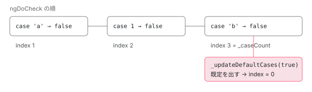

[目次](../README.md) › [common の内側](README.md) › 第 4 回 / 全 20 回

# NgIf・NgSwitch・NgPlural：テンプレートを出し入れする

> NgIf の \_updateView が then と else の 2 つのテンプレートを ViewContainerRef で出し入れする行、NgSwitch が NgSwitchCase の数を数えて既定のケースを決める仕組み（SwitchView・\_matchCase・\_updateDefaultCases）と === に変わった経緯、NgPlural が NgLocalization でカテゴリを選ぶ行。@if・@switch の組み込みの制御フローとの違い。ページの上で、本物の NgSwitch・NgIf・NgPlural のビューの出し入れを記録し、ケースを \*ngIf で包むと既定のケースがずれる issue #47578 を再現するデモ。

angular/angular · 読了 約 12 分 · 中核 · [サイトで読む（デモが動きます）](https://angular-deep-dive-cyan.vercel.app/chapter/cmn-ng-if-switch)

---

`*ngIf`・`[ngSwitch]`・`[ngPlural]` は、どれも「条件に合うテンプレートだけをビューにして出す」ディレクティブです。共通の道具は `ViewContainerRef` の `createEmbeddedView` と `clear` で、違いは**どれを出すかをいつ・どう決めるか**です。この章では、NgIf が then と else の 2 つのテンプレートを出し入れする `_updateView`、NgSwitch がケースの数を数えて既定のケースを決める仕組み（`SwitchView`・`_matchCase`・`_updateDefaultCases`）、NgPlural が `NgLocalization` でカテゴリを選ぶ行を読みます。数え方が「ngDoCheck の順番」に頼っているせいで起きる、閉じられた issue #47578 もページの上で再現します。

読む対象は `packages/common/src/directives/ng_if.ts`・`ng_switch.ts`・`ng_plural.ts` です（../angular、22.2.0-next.7、8576f161ae4）。

1. [1. 全体像](01-cmn-overview.md)
2. [2. NgClass と NgStyle](02-cmn-ng-class-style.md)
3. [3. NgForOf](03-cmn-ng-for-of.md)
4. **4. NgIf と NgSwitch**（この章）
5. [5. outlet](05-cmn-outlets.md)
6. [6. pipe の仕組み](06-cmn-pipe-mechanism.md)
7. [7. 小さな pipe](07-cmn-simple-pipes.md)
8. [8. KeyValuePipe](08-cmn-keyvalue-pipe.md)
9. [9. DatePipe](09-cmn-date-pipe.md)
10. [10. 日付の書式](10-cmn-format-date.md)
11. [11. 日付の部品](11-cmn-date-getters.md)
12. [12. 数の書式](12-cmn-format-number.md)
13. [13. NgOptimizedImage](13-cmn-image-overview.md)
14. [14. srcset と sizes](14-cmn-image-srcset.md)
15. [15. 画像のローダー](15-cmn-image-loaders.md)
16. [16. LCP と preload](16-cmn-image-lcp-preload.md)
17. [17. Location](17-cmn-location.md)
18. [18. テスト用の Location](18-cmn-location-testing.md)
19. [19. ViewportScroller](19-cmn-viewport-scroller.md)
20. [20. issue と PR を読む](20-cmn-issues.md)

## 1. NgIf：文脈は 1 つ、ビューの参照は 2 つ

📄 `angular/packages/common/src/directives/ng_if.ts` L163–188 （▶ の行: 167–171, 175, 177, 185–187）

```ts
163 │ @Directive({
164 │   selector: '[ngIf]',
165 │ })
166 │ export class NgIf<T = unknown> {
167 ▶   private _context: NgIfContext<T> = new NgIfContext<T>();
168 ▶   private _thenTemplateRef: TemplateRef<NgIfContext<T>> | null = null;
169 ▶   private _elseTemplateRef: TemplateRef<NgIfContext<T>> | null = null;
170 ▶   private _thenViewRef: EmbeddedViewRef<NgIfContext<T>> | null = null;
171 ▶   private _elseViewRef: EmbeddedViewRef<NgIfContext<T>> | null = null;
172 │ 
173 │   constructor(
174 │     private _viewContainer: ViewContainerRef,
175 ▶     templateRef: TemplateRef<NgIfContext<T>>,
176 │   ) {
177 ▶     this._thenTemplateRef = templateRef;
178 │   }
179 │ 
180 │   /**
181 │    * The Boolean expression to evaluate as the condition for showing a template.
182 │    * @deprecated Use the `@if` block instead. Intent to remove in a future major release
183 │    */
184 │   @Input()
185 ▶   set ngIf(condition: T) {
186 ▶     this._context.$implicit = this._context.ngIf = condition;
187 ▶     this._updateView();
188 │   }
```

167 行目、文脈（テンプレートに渡す変数の入れ物）の `NgIfContext` は 1 つだけ作り、then のビューにも else のビューにも同じものを渡します。168〜171 行目、テンプレートとビューの参照を then・else で 2 つずつ持ちます。175〜177 行目、`*ngIf` を付けた `<ng-template>` 自身の `TemplateRef` が、最初の then のテンプレートです。186 行目、`ngIf` の setter は条件の値を文脈の `$implicit` と `ngIf` の両方に入れ、187 行目ですぐに `_updateView` を呼びます。NgIf は `ngDoCheck` を持たず、**入力が変わったときだけ**動きます。

📄 `angular/packages/common/src/directives/ng_if.ts` L194–212 （▶ の行: 196–199, 208, 210）

```ts
194 │   @Input()
195 │   set ngIfThen(templateRef: TemplateRef<NgIfContext<T>> | null) {
196 ▶     assertTemplate(templateRef, (typeof ngDevMode === 'undefined' || ngDevMode) && 'ngIfThen');
197 ▶     this._thenTemplateRef = templateRef;
198 ▶     this._thenViewRef = null; // clear previous view if any.
199 ▶     this._updateView();
200 │   }
201 │ 
202 │   /**
203 │    * A template to show if the condition expression evaluates to false.
204 │    * @deprecated Use the `@if` block instead. Intent to remove in a future major release
205 │    */
206 │   @Input()
207 │   set ngIfElse(templateRef: TemplateRef<NgIfContext<T>> | null) {
208 ▶     assertTemplate(templateRef, (typeof ngDevMode === 'undefined' || ngDevMode) && 'ngIfElse');
209 │     this._elseTemplateRef = templateRef;
210 ▶     this._elseViewRef = null; // clear previous view if any.
211 │     this._updateView();
212 │   }
```

196 行目、渡されたものが `TemplateRef` かを確かめます（下の 278 行目からの `assertTemplate`）。198 行目と 210 行目、テンプレートを替えたら、そちらのビューの参照を `null` にしてから `_updateView` を呼びます。参照が `null` なら次の 2 節で作り直しになるので、`else` のテンプレートを途中で差し替えても新しいほうが出ます。

## 2. \_updateView：出ているほうの参照があれば何もしない

📄 `angular/packages/common/src/directives/ng_if.ts` L214–238 （▶ の行: 215–220, 227–229, 231）

```ts
214 │   private _updateView() {
215 ▶     if (this._context.$implicit) {
216 ▶       if (!this._thenViewRef) {
217 ▶         this._viewContainer.clear();
218 ▶         this._elseViewRef = null;
219 ▶         if (this._thenTemplateRef) {
220 ▶           this._thenViewRef = this._viewContainer.createEmbeddedView(
221 │             this._thenTemplateRef,
222 │             this._context,
223 │           );
224 │         }
225 │       }
226 │     } else {
227 ▶       if (!this._elseViewRef) {
228 ▶         this._viewContainer.clear();
229 ▶         this._thenViewRef = null;
230 │         if (this._elseTemplateRef) {
231 ▶           this._elseViewRef = this._viewContainer.createEmbeddedView(
232 │             this._elseTemplateRef,
233 │             this._context,
234 │           );
235 │         }
236 │       }
237 │     }
238 │   }
```

1. **215 行目：真偽は JavaScript の truthy**

   `$implicit` が truthy なら then、そうでなければ else です。`0`・`''`・`null` は else に行きます。
2. **216 行目：then のビューがもう出ているなら何もしない**

   条件が `1` から `2` になっても、ビューは作り直しません（spec の 134 行目の it）。文脈は同じオブジェクトなので、ビューの中の `{{ … }}` は次の変更検知で新しい値を読みます。
3. **217〜218 行目：まず全部片付ける**

   `clear()` で入れ物の中のビュー（else が出ていればそれ）を破棄し、else の参照を `null` にします。
4. **219〜224 行目：then を作る**

   then のテンプレートがあれば、共有の文脈で `createEmbeddedView` します。`ngIfThen` に `null` を渡していれば何も作りません。
5. **226〜237 行目：else 側も同じ形**

   else のテンプレートが無ければ、`clear()` だけで何も出しません（ふつうの `*ngIf="false"`）。

📄 `angular/packages/common/src/directives/ng_if.ts` L273–289 （▶ の行: 274–275, 278, 282, 284–285）

```ts
273 │ export class NgIfContext<T = unknown> {
274 ▶   public $implicit: T = null!;
275 ▶   public ngIf: T = null!;
276 │ }
277 │ 
278 ▶ function assertTemplate(
279 │   templateRef: TemplateRef<any> | null,
280 │   property: string | false | null,
281 │ ): void {
282 ▶   if (templateRef && !templateRef.createEmbeddedView) {
283 │     throw new RuntimeError(
284 ▶       RuntimeErrorCode.NG_IF_NOT_A_TEMPLATE_REF,
285 ▶       (typeof ngDevMode === 'undefined' || ngDevMode) &&
286 │         `${property} must be a TemplateRef, but received '${stringify(templateRef)}'.`,
287 │     );
288 │   }
289 │ }
```

274〜275 行目、文脈には同じ値が 2 つの名前で入ります。`*ngIf="user$ | async as user"` の `as user` は `let-user="ngIf"` になり、275 行目の `ngIf` を読みます。`let-x` とだけ書けば 274 行目の `$implicit` です。型の検査で `user` が `null` を外した型になる仕組みは、NgIf クラスの静的メンバ `ngTemplateGuard_ngIf`・`ngTemplateContextGuard` にあり、[typecheck-template-guards](../typecheck/14-typecheck-template-guards.md) で引用して読みました。282 行目、`createEmbeddedView` を持たないものを then や else に渡すと 284 行目の `NG_IF_NOT_A_TEMPLATE_REF`（2020）の例外です。285〜286 行目、文言は開発モードだけで、本番では番号だけになります（2025-01 の 0f3fa5a2af5）。

## 3. SwitchView：1 つのケースの入れ物

📄 `angular/packages/common/src/directives/ng_switch.ts` L22–47 （▶ の行: 23, 31–32, 36–37, 40–44）

```ts
22 │ export class SwitchView {
23 ▶   private _created = false;
24 │ 
25 │   constructor(
26 │     private _viewContainerRef: ViewContainerRef,
27 │     private _templateRef: TemplateRef<Object>,
28 │   ) {}
29 │ 
30 │   create(): void {
31 ▶     this._created = true;
32 ▶     this._viewContainerRef.createEmbeddedView(this._templateRef);
33 │   }
34 │ 
35 │   destroy(): void {
36 ▶     this._created = false;
37 ▶     this._viewContainerRef.clear();
38 │   }
39 │ 
40 ▶   enforceState(created: boolean) {
41 ▶     if (created && !this._created) {
42 ▶       this.create();
43 ▶     } else if (!created && this._created) {
44 ▶       this.destroy();
45 │     }
46 │   }
47 │ }
```

`SwitchView` は NgSwitchCase・NgSwitchDefault・NgPluralCase が共通で使う小さなクラスです。1 つのケースの `ViewContainerRef` と `TemplateRef` を持ち、23 行目の `_created` で「今出ているか」を覚えます。40〜46 行目の `enforceState` は「出ているべきか」を受け取り、今の状態と違うときだけ 32 行目の `createEmbeddedView` か 37 行目の `clear` を呼びます。同じ値を何度渡しても DOM には触りません。

## 4. NgSwitch：ケースを数え、最後のケースで既定を決める

📄 `angular/packages/common/src/directives/ng_switch.ts` L117–145 （▶ の行: 121–125, 131–133, 139, 144）

```ts
117 │ @Directive({
118 │   selector: '[ngSwitch]',
119 │ })
120 │ export class NgSwitch {
121 ▶   private _defaultViews: SwitchView[] = [];
122 ▶   private _defaultUsed = false;
123 ▶   private _caseCount = 0;
124 ▶   private _lastCaseCheckIndex = 0;
125 ▶   private _lastCasesMatched = false;
126 │   private _ngSwitch: any;
127 │ 
128 │   /** @deprecated Use the `@switch` block instead. Intent to remove in a future major release */
129 │   @Input()
130 │   set ngSwitch(newValue: any) {
131 ▶     this._ngSwitch = newValue;
132 ▶     if (this._caseCount === 0) {
133 ▶       this._updateDefaultCases(true);
134 │     }
135 │   }
136 │ 
137 │   /** @internal */
138 │   _addCase(): number {
139 ▶     return this._caseCount++;
140 │   }
141 │ 
142 │   /** @internal */
143 │   _addDefault(view: SwitchView) {
144 ▶     this._defaultViews.push(view);
145 │   }
```

📄 `angular/packages/common/src/directives/ng_switch.ts` L205–236 （▶ の行: 214, 219, 221–222, 225–226, 233–234）

```ts
205 │ @Directive({
206 │   selector: '[ngSwitchCase]',
207 │ })
208 │ export class NgSwitchCase implements DoCheck {
209 │   private _view: SwitchView;
210 │   /**
211 │    * Stores the HTML template to be selected on match.
212 │    * @deprecated Use the `@case` block within a `@switch` block instead. Intent to remove in a future major release
213 │    */
214 ▶   @Input() ngSwitchCase: any;
215 │ 
216 │   constructor(
217 │     viewContainer: ViewContainerRef,
218 │     templateRef: TemplateRef<Object>,
219 ▶     @Optional() @Host() private ngSwitch: NgSwitch,
220 │   ) {
221 ▶     if ((typeof ngDevMode === 'undefined' || ngDevMode) && !ngSwitch) {
222 ▶       throwNgSwitchProviderNotFoundError('ngSwitchCase', 'NgSwitchCase');
223 │     }
224 │ 
225 ▶     ngSwitch._addCase();
226 ▶     this._view = new SwitchView(viewContainer, templateRef);
227 │   }
228 │ 
229 │   /**
230 │    * Performs case matching. For internal use only.
231 │    * @docs-private
232 │    */
233 ▶   ngDoCheck() {
234 ▶     this._view.enforceState(this.ngSwitch._matchCase(this.ngSwitchCase));
235 │   }
236 │ }
```

📄 `angular/packages/common/src/directives/ng_switch.ts` L147–168 （▶ の行: 149–155, 157, 161–162, 164）

```ts
147 │   /** @internal */
148 │   _matchCase(value: any): boolean {
149 ▶     const matched = value === this._ngSwitch;
150 ▶     this._lastCasesMatched ||= matched;
151 ▶     this._lastCaseCheckIndex++;
152 ▶     if (this._lastCaseCheckIndex === this._caseCount) {
153 ▶       this._updateDefaultCases(!this._lastCasesMatched);
154 ▶       this._lastCaseCheckIndex = 0;
155 ▶       this._lastCasesMatched = false;
156 │     }
157 ▶     return matched;
158 │   }
159 │ 
160 │   private _updateDefaultCases(useDefault: boolean) {
161 ▶     if (this._defaultViews.length > 0 && useDefault !== this._defaultUsed) {
162 ▶       this._defaultUsed = useDefault;
163 │       for (const defaultView of this._defaultViews) {
164 ▶         defaultView.enforceState(useDefault);
165 │       }
166 │     }
167 │   }
168 │ }
```

NgSwitch 自身はケースのビューを持ちません。それぞれのケースが自分で出し入れし、NgSwitch は数を数える役です。

1. **225 行目：ケースは作られるときに名乗る**

   NgSwitchCase のコンストラクタが `ngSwitch._addCase()` を呼び、139 行目で `_caseCount` が 1 増えます。219 行目の `@Optional() @Host()` は「同じコンポーネントのテンプレートの中で、上の要素の NgSwitch を探す」という意味です。
2. **NgSwitchDefault は既定の一覧に入る**

   下の 267 行目で `_addDefault`。144 行目で `_defaultViews` に足します。既定は何個あってもかまいません。
3. **233〜235 行目：ケースは毎回の ngDoCheck で聞く**

   「自分の値は一致したか」を `_matchCase` に聞き、その答えをそのまま自分の `SwitchView.enforceState` に渡します。
4. **149 行目：比べ方は `===`**

   v17 から厳密な等しさです（5 節）。
5. **150〜151 行目：一致を貯め、数を進める**

   今回の見直しで 1 つでも一致したら `_lastCasesMatched` が true のまま残ります。`_lastCaseCheckIndex` は聞かれた回数です。
6. **152〜156 行目：最後のケースに聞かれたら既定を決める**

   聞かれた回数がケースの数に届いたら、「どれも一致しなかった」ときだけ既定を出すよう 153 行目で `_updateDefaultCases` を呼び、154〜155 行目で数と印を 0 に戻します。
7. **161〜165 行目：既定の出し入れ**

   前回と違うときだけ、全部の既定の `enforceState` を呼びます。
8. **131〜134 行目：ケースが 1 つもないとき**

   `_matchCase` が一度も呼ばれないので、setter が直接「既定を出す」を決めます。



*1 回の変更検知の中の NgSwitch の数え方（ケースが 3 つ、値が 'z'）。3 回目の \_matchCase で数がケースの数に届き、どれも一致していないので既定を出す。*

📄 `angular/packages/common/src/directives/ng_switch.ts` L254–278 （▶ の行: 261, 263–264, 267, 273–275）

```ts
254 │ @Directive({
255 │   selector: '[ngSwitchDefault]',
256 │ })
257 │ export class NgSwitchDefault {
258 │   constructor(
259 │     viewContainer: ViewContainerRef,
260 │     templateRef: TemplateRef<Object>,
261 ▶     @Optional() @Host() ngSwitch: NgSwitch,
262 │   ) {
263 ▶     if ((typeof ngDevMode === 'undefined' || ngDevMode) && !ngSwitch) {
264 ▶       throwNgSwitchProviderNotFoundError('ngSwitchDefault', 'NgSwitchDefault');
265 │     }
266 │ 
267 ▶     ngSwitch._addDefault(new SwitchView(viewContainer, templateRef));
268 │   }
269 │ }
270 │ 
271 │ function throwNgSwitchProviderNotFoundError(attrName: string, directiveName: string): never {
272 │   throw new RuntimeError(
273 ▶     RuntimeErrorCode.PARENT_NG_SWITCH_NOT_FOUND,
274 ▶     `An element with the "${attrName}" attribute ` +
275 ▶       `(matching the "${directiveName}" directive) must be located inside an element with the "ngSwitch" attribute ` +
276 │       `(matching "NgSwitch" directive)`,
277 │   );
278 │ }
```

263〜265 行目と 221〜223 行目、NgSwitch の外で `*ngSwitchCase` や `*ngSwitchDefault` を使うと、開発モードでは 271 行目からの `throwNgSwitchProviderNotFoundError` が `PARENT_NG_SWITCH_NOT_FOUND`（2000）を投げます。この確かめは `ngDevMode` の中だけなので、本番では 267 行目（ケースなら 225 行目）で `null` のメソッドを呼んで、ふつうの `TypeError` になります。

## 5. === と、消えた警告

149 行目の `===` は、2023-08 の commit 28a5925f537（fix(common): use === operator to match NgSwitch cases、v17）で `==` から変わりました。組み込みの `@switch` と揃えるためです。そのときは移行のために、「`==` なら一致したのに `===` では一致しない」ときに開発モードで警告を出していました。`git -C ../angular show 08f56d980bf`（2024-06、refactor(common): remove ng\_switch ability to use == equality check）を読むと、この commit が `_matchCase` から `NG_SWITCH_USE_STRICT_EQUALS` で `==` と `===` を切り替える式と、`EQUALITY_NG_SWITCH_DIFFERENCE` の `console.warn` を消し、今の 1 行 `const matched = value === this._ngSwitch;` にしています。spec からも、`'1'` と `1` で警告が 1 回だけ出る（NG02001）ことを確かめていた it `should warn if === and == give different results` が消えました。続く b5c2e91f8f9（2024-07）で切り替え用のファイル `ng_switch_equality.ts` も消えています。いまの v22 では、`'1'` と `1` が一致しなくても何も言われません。エラーの番号 2001 だけが `errors.ts` に残っています（[第 1 回](01-cmn-overview.md)）。

## 6. NgPlural：=値、カテゴリ、other の順

📄 `angular/packages/common/src/directives/ng_plural.ts` L104–117 （▶ の行: 109, 112, 114–115）

```ts
104 │ @Directive({
105 │   selector: '[ngPluralCase]',
106 │ })
107 │ export class NgPluralCase {
108 │   constructor(
109 ▶     @Attribute('ngPluralCase') public value: string,
110 │     template: TemplateRef<Object>,
111 │     viewContainer: ViewContainerRef,
112 ▶     @Host() ngPlural: NgPlural,
113 │   ) {
114 ▶     const isANumber: boolean = !isNaN(Number(value));
115 ▶     ngPlural.addCase(isANumber ? `=${value}` : value, new SwitchView(viewContainer, template));
116 │   }
117 │ }
```

109 行目、`ngPluralCase` の値は `@Attribute` で読む静的な文字列です。114〜115 行目、数として読める `"0"` は `"=0"` に直して登録し、`"=0"` や `"one"` はそのまま登録します。

📄 `angular/packages/common/src/directives/ng_plural.ts` L46–82 （▶ の行: 51, 53, 56–57, 61, 65, 67–69, 73, 77–79）

```ts
46 │ @Directive({
47 │   selector: '[ngPlural]',
48 │ })
49 │ export class NgPlural {
50 │   private _activeView?: SwitchView;
51 ▶   private _caseViews: {[k: string]: SwitchView} = {};
52 │ 
53 ▶   constructor(private _localization: NgLocalization) {}
54 │ 
55 │   @Input()
56 ▶   set ngPlural(value: number) {
57 ▶     this._updateView(value);
58 │   }
59 │ 
60 │   addCase(value: string, switchView: SwitchView): void {
61 ▶     this._caseViews[value] = switchView;
62 │   }
63 │ 
64 │   private _updateView(switchValue: number): void {
65 ▶     this._clearViews();
66 │ 
67 ▶     const cases = Object.keys(this._caseViews);
68 ▶     const key = getPluralCategory(switchValue, cases, this._localization);
69 ▶     this._activateView(this._caseViews[key]);
70 │   }
71 │ 
72 │   private _clearViews() {
73 ▶     if (this._activeView) this._activeView.destroy();
74 │   }
75 │ 
76 │   private _activateView(view: SwitchView) {
77 ▶     if (view) {
78 ▶       this._activeView = view;
79 ▶       this._activeView.create();
80 │     }
81 │   }
82 │ }
```

1. **53 行目：NgLocalization をもらう**

   既定は `LOCALE_ID` のロケールの複数形の規則を引く `NgLocaleLocalization` です（[loc-locale-data](../loc/12-loc-locale-data.md)）。
2. **56〜58 行目：値が変わるたびに**

   NgIf と同じく setter で動き、`ngDoCheck` は持ちません。
3. **65 行目：今のビューを消す**

   前のカテゴリと同じでも、まず消します。
4. **67〜68 行目：鍵を選ぶ**

   登録された鍵の一覧を `getPluralCategory`（`i18n/localization.ts`。loc-locale-data で引用済み）に渡します。中では「`=値` があればそれ」「なければ `NgLocalization` のカテゴリ（`one`・`few`・`many`・`other` など）があればそれ」「なければ `other`」「それもなければ `NO_PLURAL_MESSAGE_FOUND` の例外」の順に探します。
5. **69・76〜81 行目：選んだビューを作る**

   新しいほうを `create` します。

65 行目で毎回消してから作るので、値が 2 から 3 に変わってどちらも `other` でも、ビューは作り直されます（デモの「ngPlural に 3」）。NgSwitch の `enforceState` のように「同じなら触らない」形ではありません。

## 7. @if・@switch との違い

`@if` と `@switch` はディレクティブではなく、コンパイラが `ɵɵconditional` の命令にするテンプレートの構文です。どの分岐を出すかはテンプレートの関数の中で 1 つの index として決まり、ランタイムは「前と違う分岐ならビューを入れ替える」だけです（[compiler-control-flow-blocks](../compiler/08-compiler-control-flow-blocks.md)）。NgSwitch のように、ケースが自分の `ngDoCheck` で聞きに来る順番と数に頼る仕組みはありません。なので 8 節の #47578 のような「ケースを `*ngIf` で包むと壊れる」は `@switch` では起きません。`@switch` は 2025-12 の commit 640693da8e6（feat(compiler): Add support for multiple swich cases matching）で `@case (0) @case (1) { … }` のように続けて書いたケースをまとめられるようになり、長く開いていた issue #14659（ngSwitch・@switch で複数の値に一致させたい）がこれで閉じました。この commit が直したのはコンパイラだけで、`NgSwitchCase` は今も値を 1 つしか取りません。NgIf・NgSwitch は v20 から deprecated で、2026-04 の 28d38b582cc で文言が「将来のメジャーで消す予定」に変わりました。書き換えのマイグレーションは [mig-control-flow](../mig/12-mig-control-flow.md) です。

## 8. 動かして確かめる

> **🧪 DEMO — 本物の NgSwitch・NgIf・NgPlural とビューの出し入れ**
>
> この章で定義した本物のコンポーネント `CmnNisTarget` を描き、`mountWithLog`（`domr-probe.ts`）で、このサイトの本物の `DomRendererFactory2` に届いたノードの作成・挿入・取り外しを記録します。使っているディレクティブはこのサイトの `@angular/common` 22.1.6 の本物です。的は 2 つあり、違いは `'b'` のケースの置き方だけです。
>
> ▶ [このデモはサイトで動かせます](https://angular-deep-dive-cyan.vercel.app/chapter/cmn-ng-if-switch)

デモで確かめられることです（2026-11-05 に headless Chrome で、開発ビルドで記録）。まず `CmnNisFlat` です。

1. **描く**

   テンプレートの `<ng-template>` ごとに `createComment("container")` の印ができ、`'a'` のケース・then・`=0` だけがビューになって `insertBefore` されます。`_caseCount = 3`、`_lastCaseCheckIndex = 0`。
2. **`'a'` → `'b'` → `'c'`**

   `'b'` では a のビューの `removeChild` と b のビューの作成だけ。`'c'` ではどれも一致しないので、3 つ目の `_matchCase` で既定の `[default]` が作られます（図のとおり）。
3. **`1`（数）と `'1'`（文字列）**

   数の 1 では `[case 1]`、文字列の `'1'` では `===` で一致しないので `[default]` です。警告は出ません（5 節）。
4. **何も変えずに detectChanges**

   ケースの `ngDoCheck` は走りますが、`enforceState` が今の状態と同じなので、ノードの作成も取り外しも 0 です。
5. **ngIf を false → true**

   then の `span` を `removeChild`、else の `em` を作って入れ、戻すと逆です。2 節の `clear()` と `createEmbeddedView` です。
6. **ngPlural を 0 → 1 → 2 → 3**

   `[=0]` → `[one]`（en-US の 1 は one）→ `[other]` → `[other]`。3 のときもカテゴリは同じ other なのに、`removeChild` と `createText` が来て作り直されます（6 節の 65 行目）。

次に `CmnNisNested`（`'b'` のケースだけ `*ngIf` の中）です。

1. **描く**

   `_caseCount = 3` なのに、`_lastCaseCheckIndex = 1` で終わります。最初の変更検知では、`'a'` と `1` の 2 回の `_matchCase` の時点では `'b'` のケースがまだ作られておらず、`_caseCount` が 2 だったので 152 行目で数え終わってしまい、そのあと `*ngIf` がビューを作って `'b'` が 225 行目で名乗り（3 になる）、その `ngDoCheck` の分だけ 1 つ進んだ状態が残ります。外側のビューのフックが先、`*ngIf` の中のビューはあとで見直される順番は [cd-refresh-view](../cd/03-cd-refresh-view.md) のとおりです。
2. **`'b'` を渡す**

   `[case 'b']` と `[default]` が**両方**出ます。数が 1 つずれているので、既定を決める「3 回」が「前回の `'b'`・今回の `'a'`・今回の `1`」になり、どれも一致していないと判断されたあとで、今回の `'b'` が一致するからです。
3. **B を包む \*ngIf を false にして `'c'`**

   ケースのビューが破棄されても `_caseCount` は減りません（減らす行がない）。1 回の変更検知で聞かれるのは 2 回なので、`'c'` を渡した回には既定が出ず、**もう 1 回「何も変えずに」**で初めて `[default]` が出ます。
4. **\*ngIf を true に戻す**

   新しい `'b'` のケースがもう一度 `_addCase` し、`_caseCount = 4` になります。ケースは 3 つしかないのに 4 回を待つので、ずれは直りません。

> [!WARNING]
> **ハマりどころ**
>
> これは 2022-09 に開かれた issue #47578（Add an error message when ngSwitchDefault is surrounded by ngIf）と同じ形です。メンテナーのコメントは「NgSwitch は case や default のテンプレートが動的に増えたり減ったりすることを考えて作られていない」で、一度は「実行時にこの形を見つけてエラーを出す」方針になりましたが、2025-08-29 に「v20 で ngSwitch を deprecated にし、@switch を使ってほしい」として not planned で閉じられました。同じ症状の #48444 も重複として閉じられています。デモの作りのせいではないことは、`CmnNisFlat` では同じ操作で数が毎回 0 に戻ること、ずれ方が 138〜139 行目（増やすだけ）と 152〜156 行目（数が届いたら決める）でそのまま説明できることで確かめました。

## ここまでの呼び出し

- 👤 `*ngIf="cond; else other"`
  - `NgIf.ngIf = cond` / `NgIf.ngIfElse = other` — ng\_if.ts L185 / L207
    - `_updateView()` — ng\_if.ts L214 — *出ているほうの参照があれば何もしない*
      - `viewContainer.clear() → createEmbeddedView(template, context)` — ng\_if.ts L217 / L220
- 👤 `[ngSwitch]="v"` と `*ngSwitchCase`・`*ngSwitchDefault`
  - `new NgSwitchCase(...) → ngSwitch._addCase()` — ng\_switch.ts L225 / L138 — *作られるときに数える*
  - `NgSwitchCase.ngDoCheck()` — ng\_switch.ts L233
    - `ngSwitch._matchCase(value)` — ng\_switch.ts L148 — *=== と数え上げ*
      - `_updateDefaultCases(!matched) → SwitchView.enforceState` — ng\_switch.ts L160 / L40 — *最後のケースのときだけ*
    - `SwitchView.enforceState(matched)` — ng\_switch.ts L40
- 👤 `[ngPlural]="n"`
  - `NgPlural._updateView(n)` — ng\_plural.ts L64
    - `getPluralCategory(n, cases, NgLocalization)` — i18n/localization.ts — *=値 → カテゴリ → other*
    - `SwitchView.destroy() → create()` — ng\_plural.ts L73 / L79

## テストと直し方

### spec と describe

| spec | describe / it | bazel のターゲット |
| --- | --- | --- |
| common/test/directives/ng\_if\_spec.ts | describe `ngIf directive`（16 行目、it 15）。中に `then/else templates`（155）・`Type guarding`（297） | `//packages/common/test:test`（Node） |
| common/test/directives/ng\_switch\_spec.ts | describe `NgSwitch`（15 行目、it 12）。中に `switch value changes`（39）・`when values changes`（117）・`corner cases`（176） |   |
| common/test/directives/ng\_plural\_spec.ts | describe `ngPlural`（15 行目、it 8）。テスト用の `TestLocalization`（2〜3 は few、4〜9 は many、ほかは other）を `NgLocalization` として入れている |   |

📄 `angular/packages/common/test/directives/ng_if_spec.ts` L134–153 （▶ の行: 135, 142, 145, 150）

```ts
134 │   it('should not add the element twice if the condition goes from truthy to truthy', () => {
135 ▶     const template = '<span *ngIf="numberCondition">hello</span>';
136 │ 
137 │     fixture = createTestComponent(template);
138 │ 
139 │     fixture.detectChanges();
140 │     let els = fixture.debugElement.queryAll(By.css('span'));
141 │     expect(els.length).toEqual(1);
142 ▶     els[0].nativeElement.classList.add('marker');
143 │     expect(fixture.nativeElement).toHaveText('hello');
144 │ 
145 ▶     getComponent().numberCondition = 2;
146 │     fixture.changeDetectorRef.markForCheck();
147 │     fixture.detectChanges();
148 │     els = fixture.debugElement.queryAll(By.css('span'));
149 │     expect(els.length).toEqual(1);
150 ▶     expect(els[0].nativeElement.classList.contains('marker')).toBe(true);
151 │ 
152 │     expect(fixture.nativeElement).toHaveText('hello');
153 │   });
```

142 行目で出ている `span` に印のクラスを付け、145 行目で条件を truthy のまま別の値にして、150 行目で印が残っている（作り直されていない）ことを見ています。2 節の 216 行目の確認です。

📄 `angular/packages/common/test/directives/ng_switch_spec.ts` L99–114 （▶ の行: 102, 109–110, 112–113）

```ts
 99 │     it('should use === to match cases', () => {
100 │       const template =
101 │         '<ul [ngSwitch]="switchValue">' +
102 ▶         '<li *ngSwitchCase="1">when one</li>' +
103 │         '<li *ngSwitchDefault>when default</li>' +
104 │         '</ul>';
105 │ 
106 │       fixture = createTestComponent(template);
107 │       detectChangesAndExpectText('when default');
108 │ 
109 ▶       getComponent().switchValue = 1;
110 ▶       detectChangesAndExpectText('when one');
111 │ 
112 ▶       getComponent().switchValue = '1';
113 ▶       detectChangesAndExpectText('when default');
114 │     });
```

109〜113 行目、数の `1` では一致し、文字列の `'1'` では既定に行きます。5 節の 149 行目です。

📄 `angular/packages/common/test/directives/ng_switch_spec.ts` L216–235 （▶ の行: 219–221, 223, 228, 231）

```ts
216 │     it('should allow defaults before cases', () => {
217 │       const template =
218 │         '<ul [ngSwitch]="switchValue">' +
219 ▶         '<li *ngSwitchDefault>when default1;</li>' +
220 ▶         '<li *ngSwitchDefault>when default2;</li>' +
221 ▶         '<li *ngSwitchCase="\'a\'">when a1;</li>' +
222 │         '<li *ngSwitchCase="\'b\'">when b1;</li>' +
223 ▶         '<li *ngSwitchCase="\'a\'">when a2;</li>' +
224 │         '<li *ngSwitchCase="\'b\'">when b2;</li>' +
225 │         '</ul>';
226 │ 
227 │       fixture = createTestComponent(template);
228 ▶       detectChangesAndExpectText('when default1;when default2;');
229 │ 
230 │       getComponent().switchValue = 'a';
231 ▶       detectChangesAndExpectText('when a1;when a2;');
232 │ 
233 │       getComponent().switchValue = 'b';
234 │       detectChangesAndExpectText('when b1;when b2;');
235 │     });
```

既定がケースより前にあっても、既定が 2 つあっても、同じ値のケースが 2 つあっても（221・223 行目）よいことを見ています。既定を決めるのは位置ではなく「聞かれた回数」だからです。ケースを `*ngIf` で包む形の it はありません（#47578 は not planned で閉じたため）。

📄 `angular/packages/common/test/directives/ng_plural_spec.ts` L127–142 （▶ の行: 130–131, 136–137, 139, 141）

```ts
127 │   it('should prioritize value matches over category matches', async () => {
128 │     const template =
129 │       '<ul [ngPlural]="switchValue">' +
130 ▶       '<ng-template ngPluralCase="few"><li>you have a few messages.</li></ng-template>' +
131 ▶       '<ng-template ngPluralCase="=2">you have two messages.</ng-template>' +
132 │       '</ul>';
133 │ 
134 │     fixture = createTestComponent(template);
135 │ 
136 ▶     getComponent().switchValue = 2;
137 ▶     await waitForStableAndExpectText('you have two messages.');
138 │ 
139 ▶     getComponent().switchValue = 3;
140 │     fixture.changeDetectorRef.markForCheck();
141 ▶     await waitForStableAndExpectText('you have a few messages.');
142 │   });
```

136〜137 行目、2 はカテゴリでは few ですが、`=2` があるのでそちらが勝ちます。139〜141 行目、3 は `=3` がないので few です。`getPluralCategory` の「=値が先」の確認です。

### 手元で走らせた結果

📄 `ターミナル（../angular で）`

```
cd ~/angular-research/angular
pnpm bazel test //packages/common/test:test \
  --nocache_test_results --test_output=all \
  '--test_arg=--filter=^(ngIf directive|NgSwitch|ngPlural) '
```

📄 `出力（2026-11-05 に実行。抜粋。ログは scratchpad/cmn-logs/a-if-switch.log）`

```
Ran 35 of 667 specs
35 specs, 0 failures
INFO: Elapsed time: 8.132s, Critical Path: 1.04s
//packages/common/test:test                                              PASSED in 0.9s
```

- 35 件 = `ngIf directive` 15・`NgSwitch` 12・`ngPlural` 8。Node で 0.9 秒です。

### 直すとしたら

- NgIf の出し入れは `_updateView`（214〜238 行目）、NgSwitch の数え方は `_matchCase`・`_updateDefaultCases`（147〜167 行目）、NgPlural は `_updateView`（64〜70 行目）です。直したら同じ名前の spec に it を足します。
- #47578 を直すなら、ケースが破棄されたときに `_caseCount` を減らす（NgSwitchCase に `ngOnDestroy` を足す）だけでは足りません。デモの「描く」のとおり、ケースが途中で作られる回にも数がずれるからです。issue のとおり、本家は「deprecated のディレクティブは直さず `@switch` に移ってもらう」方針です。
- 3 つとも v20 から deprecated で、2025 年以降の commit は deprecated の文言・docs・本番のエラー文言を落とす refactor だけです。本家に PR を出すことは勧めません。手元でデモと spec を動かし、issue を読むときの手がかりにします（[第 20 回](20-cmn-issues.md)）。

## 聞かれそうな質問

**Q. `*ngIf` の条件が `1` から `2` に変わると、中のビューは作り直されますか？**

作り直されません。`_updateView` の 216 行目で then のビューの参照がすでにあれば何もしないからです。文脈 `NgIfContext` は 167 行目の 1 つのオブジェクトを共有しているので、中の式は次の変更検知で新しい値を読みます（spec の 134 行目の it）。

**Q. `*ngIf="x as y"` の `y` と `let-y` の `y` は同じ値ですか？**

同じです。setter の 186 行目が同じ値を `$implicit` と `ngIf` の両方に入れます。`as y` は文脈の `ngIf`（275 行目）、`let-y` は `$implicit`（274 行目）を読みます。

**Q. NgSwitch はどうやって「どのケースも一致しなかった」と知るのですか？**

ケースの数を数えています。各 NgSwitchCase がコンストラクタで `_addCase`（139 行目）を呼び、毎回の `ngDoCheck` で `_matchCase` に聞きに来ます。聞かれた回数がケースの数に届いたとき（152 行目）、それまでに 1 つも一致がなければ既定を出します（153 行目）。

**Q. `*ngSwitchCase` を `*ngIf` の中に入れるとどうなりますか？**

数え方がずれて、既定のケースが一緒に出たり、1 回遅れて出たりします（デモの `CmnNisNested`）。ケースが作られる回の順番と、破棄されても `_caseCount` が減らないことが原因で、issue #47578 として報告され、deprecated を理由に not planned で閉じられています。`@switch` に移ると起きません。

**Q. `ngSwitch` の値が `'1'`、ケースが `1` だと一致しますか？**

しません。149 行目が `===` だからです。v17 までは `==` で、移行のための警告がありましたが、2024-06 の 08f56d980bf で警告ごと消えました。

**Q. NgPlural は `=0` と `zero` のどちらを先に見ますか？**

`=0` です。`getPluralCategory` はまず `=値` の鍵を探し、なければ `NgLocalization` のカテゴリ、それもなければ `other` を探します。`NgPluralCase` は 114〜115 行目で数の `"0"` も `"=0"` に直して登録します。

## 読み終えて

- 3 つとも、ビューの出し入れは `ViewContainerRef` の `createEmbeddedView` と `clear`。違いは「いつ」「どれを」決めるか。
- NgIf と NgPlural は入力の setter で動き、NgSwitchCase は毎回の `ngDoCheck` で動く。
- NgIf は文脈を 1 つ共有し、出ているほうの参照があればビューを作り直さない。
- NgSwitch は「ケースの数」と「聞かれた回数」で既定を決める。ケースが増減する形（`*ngIf` の中のケース）ではずれる。
- NgPlural は =値 → カテゴリ → other の順に探し、値が変わるたびに作り直す。

---

← 前: [NgForOf と IterableDiffer：一覧の差分をビューに当てる](03-cmn-ng-for-of.md)  
次: [NgTemplateOutlet と NgComponentOutlet：外から渡したものを描く](05-cmn-outlets.md) →
