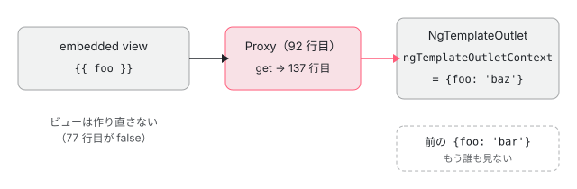

[目次](../README.md) › [common の内側](README.md) › 第 5 回 / 全 20 回

# NgTemplateOutlet と NgComponentOutlet：外から渡したものを描く

> NgTemplateOutlet がテンプレートか injector が変わったときだけビューを作り直し（\_shouldRecreateView）、context は作り直さずに Proxy が毎回読み直す仕組み（\_createContextForwardProxy）、2026 年 2 月に入った injector の 'outlet' の選択肢（18003a33bb0）。NgComponentOutlet が createComponent に渡すもの（injector・ngModuleRef・content・environmentInjector）と、ngDoCheck の \_applyInputStateDiff が毎回すべての入力を setInput し、消えた入力に undefined を書く行（同じ値をはじくのは ComponentRef.setInput の側）。

angular/angular · 読了 約 12 分 · 中核 · [サイトで読む（デモが動きます）](https://angular-deep-dive-cyan.vercel.app/chapter/cmn-outlets)

---

`*ngTemplateOutlet` は「外から渡された `TemplateRef` を、ここに描く」、`*ngComponentOutlet` は「外から渡されたコンポーネントのクラスを、ここに描く」ディレクティブです。どちらも中身は `ViewContainerRef` を 1 つ持って `createEmbeddedView` か `createComponent` を呼ぶだけですが、**いつビューを作り直し、いつ作り直さずに値だけを流し込むか**の判定がそれぞれ違います。この章ではその判定の行を 1 つずつ読み、同僚に「context を変えたらビューは作り直されるの？」と聞かれて行で答えられるようにします。

読む対象は `packages/common/src/directives/ng_template_outlet.ts`（142 行）と `ng_component_outlet.ts`（221 行）、spec の `packages/common/test/directives/ng_template_outlet_spec.ts`・`ng_component_outlet_spec.ts` です。

1. [1. 全体像](01-cmn-overview.md)
2. [2. NgClass と NgStyle](02-cmn-ng-class-style.md)
3. [3. NgForOf](03-cmn-ng-for-of.md)
4. [4. NgIf と NgSwitch](04-cmn-ng-if-switch.md)
5. **5. outlet**（この章）
6. [6. pipe の仕組み](06-cmn-pipe-mechanism.md)
7. [7. 小さな pipe](07-cmn-simple-pipes.md)
8. [8. KeyValuePipe](08-cmn-keyvalue-pipe.md)
9. [9. DatePipe](09-cmn-date-pipe.md)
10. [10. 日付の書式](10-cmn-format-date.md)
11. [11. 日付の部品](11-cmn-date-getters.md)
12. [12. 数の書式](12-cmn-format-number.md)
13. [13. NgOptimizedImage](13-cmn-image-overview.md)
14. [14. srcset と sizes](14-cmn-image-srcset.md)
15. [15. 画像のローダー](15-cmn-image-loaders.md)
16. [16. LCP と preload](16-cmn-image-lcp-preload.md)
17. [17. Location](17-cmn-location.md)
18. [18. テスト用の Location](18-cmn-location-testing.md)
19. [19. ViewportScroller](19-cmn-viewport-scroller.md)
20. [20. issue と PR を読む](20-cmn-issues.md)

> [!TIP]
> **新卒エンジニアへ**
>
> `ViewContainerRef` は「この場所にビューを差し込める口」、`TemplateRef` は「`<ng-template>` の中身の設計図」、embedded view（埋め込みビュー）は設計図から作った 1 つのビューです。ViewContainerRef の中身（`LContainer` とビューの差し込み方）は [view-container の章](../template/04-view-container.md)で読みました。この章はその口を**使う側**です。

## 1. NgTemplateOutlet の入力は 3 つ

📄 `angular/packages/common/src/directives/ng_template_outlet.ts` L47–74 （▶ の行: 48, 51, 59, 64, 70, 72, 74）

```ts
47 │ @Directive({
48 ▶   selector: '[ngTemplateOutlet]',
49 │ })
50 │ export class NgTemplateOutlet<C = unknown> implements OnChanges {
51 ▶   private _viewRef: EmbeddedViewRef<C> | null = null;
52 │ 
53 │   /**
54 │    * A context object to attach to the {@link EmbeddedViewRef}. This should be an
55 │    * object, the object's keys will be available for binding by the local template `let`
56 │    * declarations.
57 │    * Using the key `$implicit` in the context object will set its value as default.
58 │    */
59 ▶   @Input() public ngTemplateOutletContext: C | null | undefined = null;
60 │ 
61 │   /**
62 │    * A string defining the template reference and optionally the context object for the template.
63 │    */
64 ▶   @Input() public ngTemplateOutlet: TemplateRef<C> | null | undefined = null;
65 │ 
66 │   /**
67 │    * Injector to be used within the embedded view. A value of "outlet" can be used to indicate
68 │    * that the injector should be inherited from the template outlet's location in the instantiated DOM.
69 │    */
70 ▶   @Input() public ngTemplateOutletInjector: Injector | 'outlet' | null | undefined = null;
71 │ 
72 ▶   protected injector = inject(Injector);
73 │ 
74 ▶   constructor(private _viewContainerRef: ViewContainerRef) {}
```

- 48 行目：セレクタは `[ngTemplateOutlet]`。`*ngTemplateOutlet="tpl; context: c; injector: i"` と書くと、マイクロ構文（`*` の後ろの短い書き方）が `ngTemplateOutlet`・`ngTemplateOutletContext`・`ngTemplateOutletInjector` の 3 つの入力に分けます。
- 51 行目：作ったビューを 1 つだけ覚える `_viewRef`。outlet が持つビューは常に 0 個か 1 個です。
- 59・64・70 行目：3 つの入力。どれも `@Input()` のふつうのプロパティで、signal の入力ではありません。だから変化は `ngOnChanges` で受け取ります。
- 70 行目：injector には `Injector` のほかに文字列 `'outlet'` も渡せます（2 節）。
- 72 行目：`inject(Injector)` で**このディレクティブが置かれた場所**の注入器（NodeInjector）を持っておきます。74 行目は描く口の `ViewContainerRef`。

## 2. ngOnChanges：作り直すときだけ createEmbeddedView

📄 `angular/packages/common/src/directives/ng_template_outlet.ts` L76–96 （▶ の行: 77, 80–81, 85–87, 92–94）

```ts
76 │   ngOnChanges(changes: SimpleChanges) {
77 ▶     if (this._shouldRecreateView(changes)) {
78 │       const viewContainerRef = this._viewContainerRef;
79 │ 
80 ▶       if (this._viewRef) {
81 ▶         viewContainerRef.remove(viewContainerRef.indexOf(this._viewRef));
82 │       }
83 │ 
84 │       // If there is no outlet, clear the destroyed view ref.
85 ▶       if (!this.ngTemplateOutlet) {
86 ▶         this._viewRef = null;
87 ▶         return;
88 │       }
89 │ 
90 │       // Create a context forward `Proxy` that will always bind to the user-specified context,
91 │       // without having to destroy and re-create views whenever the context changes.
92 ▶       const viewContext = this._createContextForwardProxy();
93 ▶       this._viewRef = viewContainerRef.createEmbeddedView(this.ngTemplateOutlet, viewContext, {
94 ▶         injector: this._getInjector(),
95 │       });
96 │     }
```

1. **77 行目：作り直すかを聞く**

   答えは 3 節の `_shouldRecreateView`。`false` なら、この関数は**何もしません**。context だけが変わったときがこれです。
2. **80〜82 行目：前のビューを外して壊す**

   `remove(indexOf(_viewRef))` は、コンテナから外してビューを破棄します（[ivy-destroy の章](../ivy/17-ivy-destroy.md)の破棄が走り、中のコンポーネントの `ngOnDestroy` が呼ばれる）。
3. **85〜88 行目：テンプレートが無ければ空のまま**

   `null` か `undefined`（82327f2092a で `undefined` も受け付けるようになった）なら、`_viewRef` を消して終わり。
4. **92〜95 行目：Proxy を context にして作る**

   92 行目の `_createContextForwardProxy()`（3 節）が context の代わりの `Proxy` を作り、93 行目の `createEmbeddedView` に渡します。**ビューの context は、渡したオブジェクトそのものではありません**。94 行目の injector は 2 節の終わりで読みます。

### injector と 'outlet'

📄 `angular/packages/common/src/directives/ng_template_outlet.ts` L100–106 （▶ の行: 103–104, 106）

```ts
100 │    * Gets the injector to use for the template outlet based on ngTemplateOutletInjector.
101 │    */
102 │   private _getInjector(): Injector | undefined {
103 ▶     if (this.ngTemplateOutletInjector === 'outlet') {
104 ▶       return this.injector;
105 │     }
106 ▶     return this.ngTemplateOutletInjector ?? undefined;
```

103〜104 行目：`'outlet'` なら 1 節 72 行目の「outlet を置いた場所の注入器」を返します。106 行目：それ以外は渡された `Injector`、無ければ `undefined`（ビューの外の注入器は足さない）です。embedded view の中で `inject()` がどの順に注入器をたどるか（渡した注入器 → テンプレートを**宣言した**場所）と、`'outlet'` で「置いた場所」に変わる理由は [di-node-injector-lookup の章](../di/11-di-node-injector-lookup.md)で、この行を使ったデモと一緒に読みました。

この選択肢は 2026 年 2 月の 18003a33bb0（feat(common): add an 'outlet' injector option for ngTemplateOutlet）で入りました。`git show` で読んだ差分の本体です。

📄 `git -C ../angular show 18003a33bb0 -- packages/common/src/directives/ng_template_outlet.ts（抜粋）`

```
-  /** Injector to be used within the embedded view. */
-  @Input() public ngTemplateOutletInjector: Injector | null | undefined = null;
+  @Input() public ngTemplateOutletInjector: Injector | 'outlet' | null | undefined = null;
+
+  protected injector = inject(Injector);
 …
       this._viewRef = viewContainerRef.createEmbeddedView(this.ngTemplateOutlet, viewContext, {
-        injector: this.ngTemplateOutletInjector ?? undefined,
+        injector: this._getInjector(),
       });
```

修正の前は `ngTemplateOutletInjector ?? undefined` を直接渡していて、「置いた場所の注入器」を渡す方法がありませんでした。後は `inject(Injector)` を 1 行足し、`_getInjector()` を通すだけです。同じコミットで spec に it `should be able to inherit outlet injector`（今の 364 行目）と、再帰するテンプレートで深さを数える it（375 行目）が足されています。v21.2.0 から入っていて、このサイトの 22.1.6 にもあります。

## 3. 作り直す条件と、作り直さない仕組み

📄 `angular/packages/common/src/directives/ng_template_outlet.ts` L109–142 （▶ の行: 114–115, 123–125, 127–129, 131, 133–135, 137）

```ts
109 │   /**
110 │    * We need to re-create existing embedded view if either is true:
111 │    * - the outlet changed.
112 │    * - the injector changed.
113 │    */
114 ▶   private _shouldRecreateView(changes: SimpleChanges): boolean {
115 ▶     return !!changes['ngTemplateOutlet'] || !!changes['ngTemplateOutletInjector'];
116 │   }
117 │ 
118 │   /**
119 │    * For a given outlet instance, we create a proxy object that delegates
120 │    * to the user-specified context. This allows changing, or swapping out
121 │    * the context object completely without having to destroy/re-create the view.
122 │    */
123 ▶   private _createContextForwardProxy(): C {
124 ▶     return <C>new Proxy(
125 ▶       {},
126 │       {
127 ▶         set: (_target, prop, newValue) => {
128 ▶           if (!this.ngTemplateOutletContext) {
129 ▶             return false;
130 │           }
131 ▶           return Reflect.set(this.ngTemplateOutletContext, prop, newValue);
132 │         },
133 ▶         get: (_target, prop, receiver) => {
134 ▶           if (!this.ngTemplateOutletContext) {
135 ▶             return undefined;
136 │           }
137 ▶           return Reflect.get(this.ngTemplateOutletContext, prop, receiver);
138 │         },
139 │       },
140 │     );
141 │   }
142 │ }
```

1. **115 行目：テンプレートか injector が変わったときだけ**

   `changes` は `ngOnChanges` の引数（変わった入力の名前が鍵の `SimpleChanges`）です。`ngTemplateOutlet` か `ngTemplateOutletInjector` が入っていれば作り直します。`ngTemplateOutletContext` は**条件に入っていません**。
2. **124〜125 行目：中身が空の Proxy**

   `Proxy` は、プロパティの読み書きを関数で横取りできる JavaScript の仕組みです。的（target）は空のオブジェクト `{}` で、値は何も持ちません。
3. **133〜138 行目：読むたびに「今の」context を見る**

   ビューのテンプレートが `let-foo="foo"` の `foo` を読むと、ここが呼ばれます。134 行目で今の `this.ngTemplateOutletContext` を見て、無ければ `undefined`、あれば 137 行目でそこから読みます。`this` はアロー関数なので outlet のディレクティブです。**context の入力が新しいオブジェクトに変わっても、ビューの持つ Proxy は同じで、次に読むときに新しいオブジェクトを見る**、というのがこの仕組みです。
4. **127〜132 行目：書き込みも今の context へ**

   テンプレートの中から context に書く（`let-` の変数への代入）と、131 行目で今の context に書きます。context が無ければ 129 行目で `false`（書けなかった）。

つまり context の変化を「ビューに伝える」処理はどこにもありません。context が変わった変更検知の回で、outlet の `ngOnChanges` は 77 行目で何もせずに戻り、そのあと embedded view が変更検知されるときに、テンプレートの式が Proxy 越しに新しい値を読みます。



*context を差し替えても、embedded view の context（Proxy）は同じ。読むたびに outlet の今の入力を見る*

> [!WARNING]
> **ハマりどころ**
>
> 「context の**形**（鍵の組み合わせ）を変えたら作り直す」という判定はありません。`{foo}` から `{foo, other}` に変えても 115 行目は `false` です（spec の it `should update but not destroy embedded view when context shape changes`）。逆に、同じテンプレートでも `injector` に毎回 `Injector.create(…)` の新しい値を渡すと、変更検知のたびにビューが壊されて作り直されます。

## 4. DEMO：作り直されたかを番号で見る

> **🧪 DEMO — 本物の NgTemplateOutlet に、テンプレート・context・injector を渡す**
>
> このサイトの本物の `NgTemplateOutlet`（@angular/common 22.1.6）で、この章で定義した 2 つの `<ng-template>`（A と B）のどちらかを描きます。テンプレートの中には小さなコンポーネント `cmn-outlets-probe` があり、作られるたびに番号（#1、#2…）が進み、壊されると記録します。ボタンを押すと値を変え、デモの部品の `detectChanges()` を 1 回だけ走らせて、番号が変わったか（＝ビューが作り直されたか）を表示します。token は probe が `inject()` で読んだ値で、どの注入器から来たかが分かります。
>
> ▶ [このデモはサイトで動かせます](https://angular-deep-dive-cyan.vercel.app/chapter/cmn-outlets)

確かめられることです（2026-11-05 にこのサイトの開発ビルドで確かめました）。

1. **context を新しいオブジェクトに**

   番号はそのまま、name だけ変わります。115 行目に `ngTemplateOutletContext` が無いので作り直さず、137 行目の Proxy が新しいオブジェクトを読みます。
2. **同じ context の中身だけ書き換える**

   入力の参照が変わらないので `ngOnChanges` 自体が呼ばれません。それでも name は変わります。embedded view の変更検知でテンプレートが Proxy を読み、Proxy が同じオブジェクトの新しい `name` を返すからです。
3. **形の違う context に**

   番号はそのまま。extra が出てきます。形が変わっても作り直しません（3 節の注意）。
4. **テンプレートを A ↔ B**

   前の番号が「壊した」、新しい番号が「作った」になります。80〜81 行目で外し、93 行目で作り直しています。
5. **Injector.create で新しく作って渡す**

   押すたびに作り直され、token が `Injector.create #n` になります。`'outlet'` を押すと「アウトレットの場所」、injector なしに戻すと「テンプレートを宣言した場所」です。`'outlet'` をもう一度押しても、同じ文字列なので入力が変わらず、作り直されません。

## 5. NgComponentOutlet の入力は 6 つ

📄 `angular/packages/common/src/directives/ng_component_outlet.ts` L96–129 （▶ の行: 98, 102, 104–107, 109, 111–112, 119, 125–126）

```ts
 96 │ @Directive({
 97 │   selector: '[ngComponentOutlet]',
 98 ▶   exportAs: 'ngComponentOutlet',
 99 │ })
100 │ export class NgComponentOutlet<T = any> implements OnChanges, DoCheck, OnDestroy {
101 │   /** Component that should be rendered in the outlet. */
102 ▶   @Input() ngComponentOutlet: Type<T> | null = null;
103 │ 
104 ▶   @Input() ngComponentOutletInputs?: Record<string, unknown>;
105 ▶   @Input() ngComponentOutletInjector?: Injector;
106 ▶   @Input() ngComponentOutletEnvironmentInjector?: EnvironmentInjector;
107 ▶   @Input() ngComponentOutletContent?: Node[][];
108 │ 
109 ▶   @Input() ngComponentOutletNgModule?: Type<any>;
110 │ 
111 ▶   private _componentRef: ComponentRef<T> | undefined;
112 ▶   private _moduleRef: NgModuleRef<any> | undefined;
113 │ 
114 │   /**
115 │    * A helper data structure that allows us to track inputs that were part of the
116 │    * ngComponentOutletInputs expression. Tracking inputs is necessary for proper removal of ones
117 │    * that are no longer referenced.
118 │    */
119 ▶   private _inputsUsed = new Map<string, boolean>();
120 │ 
121 │   /**
122 │    * Gets the instance of the currently-rendered component.
123 │    * Will be null if no component has been rendered.
124 │    */
125 ▶   get componentInstance(): T | null {
126 ▶     return this._componentRef?.instance ?? null;
127 │   }
128 │ 
129 │   constructor(private _viewContainerRef: ViewContainerRef) {}
```

- 102 行目：描くコンポーネントのクラス。`null` なら何も描きません。
- 104 行目 `Inputs`：コンポーネントの入力に書く値のオブジェクト（6 節）。
- 105 行目 `Injector`：コンポーネントの親にする注入器。106 行目 `EnvironmentInjector`：環境注入器（アプリ全体の providers の木）を差し替えるもの（58aedc37d10、2024 年）。
- 107 行目 `Content`：`<ng-content>` に差し込む DOM ノード。スロットごとの配列の配列です。109 行目 `NgModule`：コンポーネントを NgModule ごと読み込むためのクラス。
- 111〜112 行目：作った `ComponentRef` と `NgModuleRef`。119 行目 `_inputsUsed` は「前の回に書いた入力の名前」を覚える Map（6 節）。
- 98 行目 `exportAs` と 125〜127 行目の `componentInstance`：`#o="ngComponentOutlet"` で今のインスタンスを取れます。

### 作り直す条件

📄 `angular/packages/common/src/directives/ng_component_outlet.ts` L131–149 （▶ の行: 135, 143–147）

```ts
131 │   private _needToReCreateNgModuleInstance(changes: SimpleChanges): boolean {
132 │     // Note: square brackets property accessor is safe for Closure compiler optimizations (the
133 │     // `changes` argument of the `ngOnChanges` lifecycle hook retains the names of the fields that
134 │     // were changed).
135 ▶     return changes['ngComponentOutletNgModule'] !== undefined;
136 │   }
137 │ 
138 │   private _needToReCreateComponentInstance(changes: SimpleChanges): boolean {
139 │     // Note: square brackets property accessor is safe for Closure compiler optimizations (the
140 │     // `changes` argument of the `ngOnChanges` lifecycle hook retains the names of the fields that
141 │     // were changed).
142 │     return (
143 ▶       changes['ngComponentOutlet'] !== undefined ||
144 ▶       changes['ngComponentOutletContent'] !== undefined ||
145 ▶       changes['ngComponentOutletInjector'] !== undefined ||
146 ▶       changes['ngComponentOutletEnvironmentInjector'] !== undefined ||
147 ▶       this._needToReCreateNgModuleInstance(changes)
148 │     );
149 │   }
```

143〜147 行目：コンポーネント・content・injector・environmentInjector・ngModule の**どれか**が変われば作り直します。**`ngComponentOutletInputs` は入っていません**。入力の値は作り直しではなく、6 節の `ngDoCheck` で流し込みます。135 行目の ngModule だけは別の関数になっていて、NgModuleRef も作り直すかの判定に使います。

### ngOnChanges：createComponent に渡すもの

📄 `angular/packages/common/src/directives/ng_component_outlet.ts` L151–182 （▶ の行: 154–156, 159, 161–162, 165–167, 174–178）

```ts
151 │   /** @docs-private */
152 │   ngOnChanges(changes: SimpleChanges) {
153 │     if (this._needToReCreateComponentInstance(changes)) {
154 ▶       this._viewContainerRef.clear();
155 ▶       this._inputsUsed.clear();
156 ▶       this._componentRef = undefined;
157 │ 
158 │       if (this.ngComponentOutlet) {
159 ▶         const injector = this.ngComponentOutletInjector || this._viewContainerRef.parentInjector;
160 │ 
161 ▶         if (this._needToReCreateNgModuleInstance(changes)) {
162 ▶           this._moduleRef?.destroy();
163 │ 
164 │           if (this.ngComponentOutletNgModule) {
165 ▶             this._moduleRef = createNgModule(
166 ▶               this.ngComponentOutletNgModule,
167 ▶               getParentInjector(injector),
168 │             );
169 │           } else {
170 │             this._moduleRef = undefined;
171 │           }
172 │         }
173 │ 
174 ▶         this._componentRef = this._viewContainerRef.createComponent(this.ngComponentOutlet, {
175 ▶           injector,
176 ▶           ngModuleRef: this._moduleRef,
177 ▶           projectableNodes: this.ngComponentOutletContent,
178 ▶           environmentInjector: this.ngComponentOutletEnvironmentInjector,
179 │         });
180 │       }
181 │     }
182 │   }
```

1. **154〜156 行目：全部捨てる**

   コンテナを `clear()`（前のコンポーネントを破棄）し、`_inputsUsed` も空にします。新しいコンポーネントには、まだ何も書いていない、という状態に戻すためです。
2. **159 行目：親の注入器**

   渡された injector か、無ければ `this._viewContainerRef.parentInjector`（outlet を置いた場所の注入器）。NgTemplateOutlet の既定（宣言の場所）とは違い、こちらは最初から「置いた場所」です。
3. **161〜171 行目：NgModule が変わったときだけ NgModuleRef を作り直す**

   162 行目で前のものを壊し、165〜168 行目の `createNgModule` に、218〜221 行目の `getParentInjector` で取った「親の NgModule の注入器」を親として渡します。
4. **174〜179 行目：createComponent**

   渡すのは `injector`・`ngModuleRef`・`projectableNodes`（content）・`environmentInjector` の 4 つ。**入力の値はここでは渡しません**。ViewContainerRef の `createComponent` の中は [view-container の章](../template/04-view-container.md)です。

## 6. ngDoCheck：入力を毎回書く、消えた入力は undefined に

📄 `angular/packages/common/src/directives/ng_component_outlet.ts` L184–221 （▶ の行: 185, 187–189, 193, 199, 203–204, 206–207, 210–211, 218–220）

```ts
184 │   /** @docs-private */
185 ▶   ngDoCheck() {
186 │     if (this._componentRef) {
187 ▶       if (this.ngComponentOutletInputs) {
188 ▶         for (const inputName of Object.keys(this.ngComponentOutletInputs)) {
189 ▶           this._inputsUsed.set(inputName, true);
190 │         }
191 │       }
192 │ 
193 ▶       this._applyInputStateDiff(this._componentRef);
194 │     }
195 │   }
196 │ 
197 │   /** @docs-private */
198 │   ngOnDestroy() {
199 ▶     this._moduleRef?.destroy();
200 │   }
201 │ 
202 │   private _applyInputStateDiff(componentRef: ComponentRef<unknown>) {
203 ▶     for (const [inputName, touched] of this._inputsUsed) {
204 ▶       if (!touched) {
205 │         // The input that was previously active no longer exists and needs to be set to undefined.
206 ▶         componentRef.setInput(inputName, undefined);
207 ▶         this._inputsUsed.delete(inputName);
208 │       } else {
209 │         // Since touched is true, it can be asserted that the inputs object is not empty.
210 ▶         componentRef.setInput(inputName, this.ngComponentOutletInputs![inputName]);
211 ▶         this._inputsUsed.set(inputName, false);
212 │       }
213 │     }
214 │   }
215 │ }
216 │ 
217 │ // Helper function that returns an Injector instance of a parent NgModule.
218 ▶ function getParentInjector(injector: Injector): Injector {
219 ▶   const parentNgModule = injector.get(NgModuleRef);
220 ▶   return parentNgModule.injector;
221 │ }
```

1. **185 行目：ngDoCheck は変更検知のたびに呼ばれる**

   `ngDoCheck` は、入力が変わったかどうかに関係なく、outlet を置いたビューが変更検知されるたびに呼ばれるフックです。ここで入力を流し込みます。
2. **187〜191 行目：今の inputs の鍵に印 true**

   今回の `ngComponentOutletInputs` にある名前を全部 `_inputsUsed` に `true` で入れます。前の回からある名前で、今回も無いものは `false` のまま残ります。
3. **203〜213 行目：印で分ける**

   `false`（前はあった、今は無い）なら 206 行目で `setInput(name, undefined)` を書いてから 207 行目で Map から消します。`true` なら 210 行目で今の値を `setInput` し、211 行目で印を `false` に戻して次の回に備えます。

要約の「差分だけ書く」は、正確にはこうです：**outlet は毎回、全部の入力について `setInput` を呼びます**。前と同じ値なら何もしないのは `ComponentRef.setInput` の側で、前に書いた値と `Object.is` で比べ、同じなら setter（入力のプロパティ）に触らずに戻ります（[testing-component-bindings の章](../testing/06-testing-component-bindings.md)で `setInput` の本体を読みました）。だから `inputs` に毎回新しいオブジェクトを渡しても、中の値が同じなら子は何も変わりません。値を書き換えた（同じオブジェクトの `inputs['bar'] = …`）ときも、210 行目が毎回読み直すので届きます（spec の it `should be binding the component input (with mutable inputs)`）。

198〜200 行目の `ngOnDestroy` が壊すのは NgModuleRef だけです。コンポーネントは outlet の ViewContainerRef の中にあるので、outlet を置いたビューと一緒に壊れます。

> **🧪 DEMO — 本物の NgComponentOutlet の inputs と、呼ばれた setter**
>
> このサイトの本物の `NgComponentOutlet` で、この章で定義したコンポーネント `CmnOutletsTarget`（入力 `title` と `count`。setter が呼ばれるたびに記録する）を描きます。ボタンを押すと textarea の JSON から**新しいオブジェクト**を作って `inputs` に渡し、`detectChanges()` を 1 回走らせて、その回に呼ばれた setter を並べます。
>
> ▶ [このデモはサイトで動かせます](https://angular-deep-dive-cyan.vercel.app/chapter/cmn-outlets)

- 最初の「渡す」で title・count の 2 回。同じ JSON のままもう一度「渡す」と 0 回です（新しいオブジェクトでも、中の値が `Object.is` で同じ）。
- JSON から `"count"` を消して渡すと、`count ← undefined` の 1 回（206 行目）。次の回からは count はもう Map に無いので書きません。
- `{"title": {"a": 1}}` のようにオブジェクトを値にすると、同じ JSON でも JSON.parse が毎回新しいオブジェクトを作るので、渡すたびに setter が呼ばれます。
- 宣言していない名前（`"nope": 1`）は、デモでは渡さずに断ります。渡すと開発モードの `setInput` が「入力として宣言していない」とコンソールにエラーを出すからです。

> [!NOTE]
> **ポイント**
>
> outlet で作ったコンポーネントの**出力（output）**を購読したり、双方向バインディングをしたりする方法はありません。入力も、ここで読んだ `setInput` の流し込みだけです。2017 年の issue #15360（There is no way to access inputs or outputs of Components created by NgComponentOutlet）は 2026-11-05 時点で open。その後の要望 #63099 は #15360 の重複として 2026 年 1 月に閉じられ、`createComponent` の `bindings`・`directives` をそのまま渡す入力を足す PR #63101 は open（review 待ち）です。

## 7. ここまでを 1 本に

- 👤 `<ng-container *ngTemplateOutlet="tpl; context: {foo: value}" />` — あなたのテンプレート
- `NgTemplateOutlet.ngOnChanges(changes)` — ng\_template\_outlet.ts L76
  - `_shouldRecreateView(changes)` — L114-116 — *テンプレートか injector が変わったか*
  - `viewContainerRef.remove(…)` — L80-82 — *前のビューを壊す*
  - `_createContextForwardProxy()` — L123-141
  - `viewContainerRef.createEmbeddedView(tpl, proxy, {injector: _getInjector()})` — L93-95
- 👤 `value を変える` — あなたのコンポーネント
- `ngOnChanges({ngTemplateOutletContext})` — L77 — *false で何もしない*
  - `embedded view の変更検知 → proxy.foo → Reflect.get(今の context, 'foo')` — L133-138
- 👤 `<ng-container *ngComponentOutlet="cmp; inputs: i" />` — あなたのテンプレート
- `NgComponentOutlet.ngOnChanges` → `createComponent(cmp, {injector, ngModuleRef, projectableNodes, environmentInjector})` — ng\_component\_outlet.ts L152-182
- `NgComponentOutlet.ngDoCheck` → `_applyInputStateDiff` — L185-214
  - `componentRef.setInput(name, value | undefined)` — L206 / L210 — *同じ値なら setInput の側で何もしない*

## テストと直し方

### spec と describe

| spec | describe / it | bazel のターゲット |
| --- | --- | --- |
| common/test/directives/ng\_template\_outlet\_spec.ts | describe `NgTemplateOutlet`（30 行目）の it 28 個。この章に関係するのは `should update but not destroy embedded view when context values change`（180）・`… when context shape changes`（197）・ `should not mutate context object if two contexts with an identical shape are swapped`（303）・`should re-render if the injector changes`（336）・ `should be able to inherit outlet injector`（364）・`… in a deeply nested structure`（375） | `//packages/common/test:test`（Node。どちらの spec にも `isBrowser` で止める行は無い） |
| common/test/directives/ng\_component\_outlet\_spec.ts | describe `insert/remove`（32 行目、it 15 個）と describe `inputs`（284 行目、it 3 個）。`should swap content if component changes`（92）・`should re-create moduleRef when changed (NgModule class reference)`（216）・ `should be binding the component input`（285）・`… (with mutable inputs)`（323）・`… (with component type change)`（349） |   |

📄 `angular/packages/common/test/directives/ng_template_outlet_spec.ts` L180–195 （▶ の行: 183, 189, 191, 193–194）

```ts
180 │   it('should update but not destroy embedded view when context values change', async () => {
181 │     const template =
182 │       `<ng-template let-foo="foo" #tpl><destroyable-cmpt></destroyable-cmpt>:{{foo}}</ng-template>` +
183 ▶       `<ng-template [ngTemplateOutlet]="tpl" [ngTemplateOutletContext]="{foo: value}"></ng-template>`;
184 │ 
185 │     fixture = createTestComponent(template);
186 │     const spyService = fixture.debugElement.injector.get(DestroyedSpyService);
187 │ 
188 │     await waitForStableAndExpectText('Content to destroy:bar');
189 ▶     expect(spyService.destroyed).toBeFalsy();
190 │ 
191 ▶     fixture.componentInstance.value = 'baz';
192 │     fixture.changeDetectorRef.markForCheck();
193 ▶     await waitForStableAndExpectText('Content to destroy:baz');
194 ▶     expect(spyService.destroyed).toBeFalsy();
195 │   });
```

183 行目の `{foo: value}` はテンプレートのオブジェクトリテラルなので、`value` が変わると新しいオブジェクトになります（[compiler-consts-pure の章](../compiler/14-compiler-consts-pure.md)の pure function）。194 行目の `destroyed` が `false` のままなのが「作り直していない」ことの確かめで、3 節 115 行目と 137 行目の結果です。

📄 `angular/packages/common/test/directives/ng_template_outlet_spec.ts` L336–351 （▶ の行: 341, 346, 350）

```ts
336 │   it('should re-render if the injector changes', async () => {
337 │     const template =
338 │       `<ng-template #tpl><inject-value></inject-value></ng-template>` +
339 │       `<ng-container *ngTemplateOutlet="tpl; injector: injector"></ng-container>`;
340 │     fixture = createTestComponent(template);
341 ▶     fixture.componentInstance.injector = Injector.create({
342 │       providers: [{provide: templateToken, useValue: 'world'}],
343 │     });
344 │     await waitForStableAndExpectText('Hello world');
345 │ 
346 ▶     fixture.componentInstance.injector = Injector.create({
347 │       providers: [{provide: templateToken, useValue: 'there'}],
348 │     });
349 │     fixture.changeDetectorRef.markForCheck();
350 ▶     await waitForStableAndExpectText('Hello there');
351 │   });
```

346 行目で injector を新しくすると、350 行目で中のコンポーネントが新しい injector の値を読み直しています。115 行目の `ngTemplateOutletInjector` で作り直した結果です。

📄 `angular/packages/common/test/directives/ng_component_outlet_spec.ts` L284–321 （▶ の行: 290, 298, 304, 308, 310, 314, 316, 320）

```ts
284 │ describe('inputs', () => {
285 │   it('should be binding the component input', async () => {
286 │     const fixture = TestBed.createComponent(TestInputsComponent);
287 │     fixture.componentInstance.currentComponent = ComponentWithInputs;
288 │     await fixture.whenStable();
289 │ 
290 ▶     expect(fixture.nativeElement.textContent).toBe('foo: , bar: , baz: Baz');
291 │ 
292 │     fixture.componentInstance.inputs = {};
293 │     fixture.changeDetectorRef.markForCheck();
294 │     await fixture.whenStable();
295 │ 
296 │     expect(fixture.nativeElement.textContent).toBe('foo: , bar: , baz: Baz');
297 │ 
298 ▶     fixture.componentInstance.inputs = {foo: 'Foo', bar: 'Bar'};
299 │     fixture.changeDetectorRef.markForCheck();
300 │     await fixture.whenStable();
301 │ 
302 │     expect(fixture.nativeElement.textContent).toBe('foo: Foo, bar: Bar, baz: Baz');
303 │ 
304 ▶     fixture.componentInstance.inputs = {foo: 'Foo'};
305 │     fixture.changeDetectorRef.markForCheck();
306 │     await fixture.whenStable();
307 │ 
308 ▶     expect(fixture.nativeElement.textContent).toBe('foo: Foo, bar: , baz: Baz');
309 │ 
310 ▶     fixture.componentInstance.inputs = {foo: 'Foo', baz: null};
311 │     fixture.changeDetectorRef.markForCheck();
312 │     await fixture.whenStable();
313 │ 
314 ▶     expect(fixture.nativeElement.textContent).toBe('foo: Foo, bar: , baz: ');
315 │ 
316 ▶     fixture.componentInstance.inputs = undefined;
317 │     fixture.changeDetectorRef.markForCheck();
318 │     await fixture.whenStable();
319 │ 
320 ▶     expect(fixture.nativeElement.textContent).toBe('foo: , bar: , baz: ');
321 │   });
```

290 行目の `baz: Baz` は、まだ一度も書いていない入力が既定値のままであること。304〜308 行目は bar を消すと 206 行目で `undefined` になること。316〜320 行目は inputs 自体を `undefined` にすると、前に書いた foo と baz が両方 `undefined` になること（187 行目の if を通らないので全部が `false` のまま 203 行目に来る）です。

### 手元で走らせた結果

📄 `ターミナル（../angular で）`

```
cd ~/angular-research/angular
pnpm bazel test //packages/common/test:test \
  --nocache_test_results --test_output=all \
  '--test_arg=--filter=NgTemplateOutlet|^insert/remove|^inputs '
```

📄 `出力（2026-11-05 に実行。抜粋。ログは scratchpad/cmn-logs/b-outlets.log）`

```
Ran 46 of 667 specs
46 specs, 0 failures
Finished in 0.216 seconds
//packages/common/test:test                                              PASSED in 0.9s
INFO: Elapsed time: 5.295s
```

- 46 件 = NgTemplateOutlet の 28 + insert/remove の 15 + inputs の 3。フィルタは正規表現なので、`^inputs ` のように頭と後ろの空白で、ほかの describe の it に当たらないようにしています。

### 直すとしたら

- 作り直す条件は `NgTemplateOutlet._shouldRecreateView`（114〜116 行目）と `NgComponentOutlet._needToReCreateComponentInstance`（138〜149 行目）、入力の流し込みは `_applyInputStateDiff`（202〜214 行目）です。
- it を足すなら、作り直しは ng\_template\_outlet\_spec.ts の 180 行目の形（`DestroyedSpyService` で壊れたかを見る）、入力は ng\_component\_outlet\_spec.ts の describe `inputs` の形（`textContent` を見る）です。
- 最近の修正：18003a33bb0（2026-02、'outlet'）、24243e34d9f（2025-11、使っていない NgModuleFactory の設定を外す）、196fa500a3c（2025-10、ngComponentOutlet の型）、82327f2092a（2025-05、ngTemplateOutlet が `undefined` を受け付ける）。
- 本家に PR を出すことは勧めません。outlet の issue を読むときに「作り直しの判定（115・143〜147 行目）の話か、値の流し込み（Proxy・setInput）の話か」を最初に分ける手がかりにします（[第 20 回](20-cmn-issues.md)）。

## 聞かれそうな質問

**Q. ngTemplateOutletContext を毎回新しいオブジェクトにしたら、ビューは作り直されますか？**

作り直されません。115 行目の条件は `ngTemplateOutlet` と `ngTemplateOutletInjector` だけで、context はビューに渡した Proxy（92 行目）が 137 行目で毎回読み直します。中の子コンポーネントは壊れず、状態も残ります。

**Q. テンプレートの中のコンポーネントの状態が消えてしまいます。なぜ？**

outlet の側でビューが壊れるのは、115 行目でテンプレート（`TemplateRef`）か injector の入力が変わったときだけです。どちらが変わっているかを確かめます。とくに `injector: makeInjector()` のように毎回新しい `Injector` を作ると、変更検知のたびに 115 行目が `true` になり、80〜81 行目で壊して 93 行目で作り直します。injector はフィールドに 1 度だけ作って渡します。

**Q. 'outlet' と、何も渡さないときの違いは？**

何も渡さないと、テンプレートの中の `inject()` はテンプレートを**宣言した**場所から上をたどります。`'outlet'` だと 103〜104 行目で outlet を**置いた**場所の注入器（72 行目）を渡すので、置いた場所の祖先の providers が見えます。DEMO の token の表示で違いが見えます。

**Q. NgComponentOutlet の inputs を変えると、コンポーネントは作り直されますか？**

作り直されません。143〜147 行目に inputs は無く、185〜214 行目の `ngDoCheck` が毎回 `setInput` を呼びます。コンポーネントのクラス・injector・environmentInjector・content・ngModule のどれかを変えたときだけ 154 行目で `clear()` して作り直します。

**Q. inputs から消した入力はどうなりますか？**

次の変更検知で 206 行目が `setInput(name, undefined)` を 1 回書き、207 行目で記録から消します。既定値に戻るのではなく `undefined` になる点に注意します（spec 304〜308 行目）。

**Q. NgComponentOutlet で output を受け取れますか？**

この版にはその入力がありません（5 節の 102〜109 行目の 6 つだけ）。issue #15360 は open、`bindings` と `directives` を渡せるようにする PR #63101 も open です。今は `componentInstance`（125〜127 行目）から自分で購読するか、`ViewContainerRef.createComponent` を直接使います。

## 読み終えて

- NgTemplateOutlet が作り直すのは、テンプレートか injector が変わったときだけ（115 行目）。context は Proxy が毎回読み直す（133〜138 行目）。
- `'outlet'` は「置いた場所の注入器」を渡す選択肢（103〜104 行目、18003a33bb0）。
- NgComponentOutlet は ngOnChanges で作り直しを判定して `createComponent` に 4 つを渡し、入力は ngDoCheck で毎回 `setInput` する。同じ値をはじくのは `setInput` の側。
- inputs から消した名前は `undefined` を 1 回書いて忘れる（206〜207 行目）。

---

← 前: [NgIf・NgSwitch・NgPlural：テンプレートを出し入れする](04-cmn-ng-if-switch.md)  
次: [pipe の仕組み：ɵɵpipeBind と pure pipe のキャッシュ](06-cmn-pipe-mechanism.md) →
