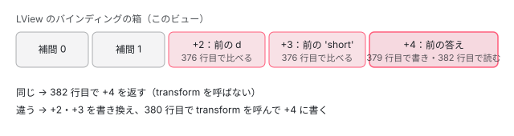

[目次](../README.md) › [common の内側](README.md) › 第 6 回 / 全 20 回

# pipe の仕組み：ɵɵpipeBind と pure pipe のキャッシュ

> テンプレートの {{ d | date:'short' }} がコンパイルで ɵɵpipe と ɵɵpipeBind2 になり、pure な pipe は pureFunction の仕組みで引数が同じなら transform を呼ばない行（core の pipe.ts と pure\_function.ts）、pure: false の pipe が毎回呼ばれる理由、pipe のインスタンスがいつ作られ ngOnDestroy がいつ呼ばれるか。common の invalidPipeArgumentError と、signal を渡したときの警告。

angular/angular · 読了 約 13 分 · 中核 · [サイトで読む（デモが動きます）](https://angular-deep-dive-cyan.vercel.app/chapter/cmn-pipe-mechanism)

---

テンプレートの `{{ d | date:'short' }}` は、実行時に「pipe という仕組み」が解釈するのではありません。コンパイラが `ɵɵpipe`（インスタンスを作る命令）と `ɵɵpipeBind2`（呼ぶ命令）の 2 つに分け、`ɵɵpipeBind2` は pure な pipe なら「引数が前と同じなら transform を呼ばずに前の答えを返す」関数を通します。この章では、その 2 つの命令がどこで作られ、実行時にどの行で「呼ぶ・呼ばない」が決まるかを読み、`pure: false` が毎回呼ばれる理由と、ngOnDestroy がいつ呼ばれるかまで説明できるようにします。

読む対象は core の `packages/core/src/render3/pipe.ts`（320 行）と `render3/pure_function.ts`、コンパイラの `packages/compiler/src/template/pipeline/src/phases/pipe_creation.ts`・`src/instruction.ts`、common の `packages/common/src/pipes/utils.ts`、spec の `packages/core/test/acceptance/pipe_spec.ts` です。

1. [1. 全体像](01-cmn-overview.md)
2. [2. NgClass と NgStyle](02-cmn-ng-class-style.md)
3. [3. NgForOf](03-cmn-ng-for-of.md)
4. [4. NgIf と NgSwitch](04-cmn-ng-if-switch.md)
5. [5. outlet](05-cmn-outlets.md)
6. **6. pipe の仕組み**（この章）
7. [7. 小さな pipe](07-cmn-simple-pipes.md)
8. [8. KeyValuePipe](08-cmn-keyvalue-pipe.md)
9. [9. DatePipe](09-cmn-date-pipe.md)
10. [10. 日付の書式](10-cmn-format-date.md)
11. [11. 日付の部品](11-cmn-date-getters.md)
12. [12. 数の書式](12-cmn-format-number.md)
13. [13. NgOptimizedImage](13-cmn-image-overview.md)
14. [14. srcset と sizes](14-cmn-image-srcset.md)
15. [15. 画像のローダー](15-cmn-image-loaders.md)
16. [16. LCP と preload](16-cmn-image-lcp-preload.md)
17. [17. Location](17-cmn-location.md)
18. [18. テスト用の Location](18-cmn-location-testing.md)
19. [19. ViewportScroller](19-cmn-viewport-scroller.md)
20. [20. issue と PR を読む](20-cmn-issues.md)

## 1. 先にゴールを見る：本物のコンパイル結果

小さなコンポーネントを 1 つ書き、このサイトの node\_modules にある `@angular/compiler-cli` 22.1.6 の `ngc` でコンパイルしました。

📄 `scratchpad/b-ngc/src/demo.ts（コンパイルしたもの）`

```
@Pipe({name: 'twice', pure: false})
export class TwicePipe implements PipeTransform {
  transform(v: string): string { return v + v; }
}

@Component({
  selector: 'app-demo',
  imports: [DatePipe, TwicePipe],
  template: `<p>{{ d | date:'short' }}</p><p>{{ name | twice }}</p>`,
})
export class Demo {
  d = new Date();
  name = 'a';
}
```

📄 `ターミナル`

```
# scratchpad/b-ngc に src/demo.ts（上のコンポーネント）と tsconfig.json を置き、
# このサイトの node_modules の @angular/compiler-cli 22.1.6 でコンパイルした
node node_modules/@angular/compiler-cli/bundles/src/bin/ngc.js -p tsconfig.json
cat out/demo.js
```

📄 `out/demo.js（出力の抜粋。2026-11-05）`

```
static ɵpipe = i0.ɵɵdefinePipe({ name: "twice", type: TwicePipe, pure: false });
…
static ɵcmp = i0.ɵɵdefineComponent({ type: Demo, selectors: [["app-demo"]], decls: 6, vars: 7,
  template: function Demo_Template(rf, ctx) { if (rf & 1) {
    i0.ɵɵdomElementStart(0, "p");
    i0.ɵɵtext(1);
    i0.ɵɵpipe(2, "date");
    i0.ɵɵdomElementEnd();
    i0.ɵɵdomElementStart(3, "p");
    i0.ɵɵtext(4);
    i0.ɵɵpipe(5, "twice");
    i0.ɵɵdomElementEnd();
  } if (rf & 2) {
    i0.ɵɵadvance();
    i0.ɵɵtextInterpolate(i0.ɵɵpipeBind2(2, 2, ctx.d, "short"));
    i0.ɵɵadvance(3);
    i0.ɵɵtextInterpolate(i0.ɵɵpipeBind1(5, 5, ctx.name));
  } }, dependencies: [DatePipe, TwicePipe], encapsulation: 2 });
```

- `rf & 1`（作成の回）の `ɵɵpipe(2, "date")` と `ɵɵpipe(5, "twice")`：pipe ごとに**スロット**（LView の箱）を 1 つ取り、そこにインスタンスを置きます。2 は `<p>`（0）とテキスト（1）の次です。
- `rf & 2`（更新の回）の `ɵɵpipeBind2(2, 2, ctx.d, "short")`：1 つ目の 2 がインスタンスのスロット、2 つ目の 2 が「バインディングの箱のどこから使うか」（slotOffset）、残りが transform の引数です。引数が 2 つなので `pipeBind2`。`twice` は引数 1 つなので `pipeBind1` です。
- `vars: 7`：テキストの補間 2 つで 2、`pipeBind2` が引数 2 つ + 答え 1 つで 3、`pipeBind1` が 1 + 1 で 2。補間（0・1）を先に、式の中の pipe（2〜4・5〜6）を後に数えます（数え方は [compiler-slots-vars の章](../compiler/12-compiler-slots-vars.md)）。
- `ɵɵdefinePipe({ …, pure: false })`：`pure` はクラスの静的な定義 `ɵpipe` に入り、実行時に 3 節の `isPure` が読みます。

## 2. コンパイラ：式を PipeBinding にし、作成の命令を足す

### ingest：`x | name:arg` を 1 つの式にする

📄 `angular/packages/compiler/src/template/pipeline/src/ingest.ts` L1377–1386 （▶ の行: 1380, 1382–1384）

```ts
1377 │   } else if (ast instanceof e.NonNullAssert) {
1378 │     // A non-null assertion shouldn't impact generated instructions, so we can just drop it.
1379 │     return convertAst(ast.expression, job, baseSourceSpan);
1380 ▶   } else if (ast instanceof e.BindingPipe) {
1381 │     // TODO: pipes should probably have source maps; figure out details.
1382 ▶     return new ir.PipeBindingExpr(job.allocateXrefId(), new ir.SlotHandle(), ast.name, [
1383 ▶       convertAst(ast.exp, job, baseSourceSpan),
1384 ▶       ...ast.args.map((arg) => convertAst(arg, job, baseSourceSpan)),
1385 │     ]);
1386 │   } else if (ast instanceof e.SafeKeyedRead) {
```

1380 行目：パーサが作った `BindingPipe`（`|` の式）を見つけると、1382 行目で `ir.PipeBindingExpr`（中間表現の式）にします。引数の配列は 1383 行目の左辺（`d`）が先頭で、1384 行目の `:` の後ろ（`'short'`）が続きます。**transform の第 1 引数が左辺**になるのはここで並べるからです。1382 行目の `new ir.SlotHandle()` は、まだ番号の決まっていないスロットの札です。

### pipe\_creation：作成の命令を「どこに」置くか

📄 `angular/packages/compiler/src/template/pipeline/src/phases/pipe_creation.ts` L19–48 （▶ の行: 26–27, 32, 41, 45）

```ts
19 │ export function createPipes(job: CompilationJob): void {
20 │   for (const unit of job.units) {
21 │     processPipeBindingsInView(unit);
22 │   }
23 │ }
24 │ 
25 │ function processPipeBindingsInView(unit: CompilationUnit): void {
26 ▶   for (const updateOp of unit.update) {
27 ▶     ir.visitExpressionsInOp(updateOp, (expr, flags) => {
28 │       if (!ir.isIrExpression(expr)) {
29 │         return;
30 │       }
31 │ 
32 ▶       if (expr.kind !== ir.ExpressionKind.PipeBinding) {
33 │         return;
34 │       }
35 │ 
36 │       if (flags & ir.VisitorContextFlag.InChildOperation) {
37 │         throw new Error(`AssertionError: pipe bindings should not appear in child expressions`);
38 │       }
39 │ 
40 │       // TODO: We can delete this cast and check once compatibility mode is removed.
41 ▶       const slotHandle = (updateOp as {target?: ir.XrefId}).target;
42 │       if (slotHandle == undefined) {
43 │         throw new Error(`AssertionError: expected slot handle to be assigned for pipe creation`);
44 │       }
45 ▶       addPipeToCreationBlock(unit, slotHandle, expr);
46 │     });
47 │   }
48 │ }
```

1. **26〜27 行目：更新の命令の中の式を全部見る**

   pipe は更新の回の式の中にしか出てきません。`visitExpressionsInOp` で 1 つずつ見ます。
2. **32 行目：PipeBinding だけ拾う**

   1 節の `ɵɵtextInterpolate(…)` の中の `pipeBind` になる式です。
3. **41・45 行目：その命令の「対象」の後ろに作成の命令を足す**

   41 行目の `target` はテキストや要素の札。`addPipeToCreationBlock`（50〜78 行目。[compiler-slots-vars の章](../compiler/12-compiler-slots-vars.md)で引用）が作成の回の命令の並びからその札を探し、すぐ後ろに `Pipe` の命令を差し込みます。だから 1 節で `ɵɵtext(1)` の直後に `ɵɵpipe(2, "date")` が来ます。

### instruction：引数の数で命令を選ぶ

📄 `angular/packages/compiler/src/template/pipeline/src/instruction.ts` L846–864 （▶ の行: 846–847, 850, 854, 858–859, 863）

```ts
846 ▶ const PIPE_BINDINGS: o.ExternalReference[] = [
847 ▶   Identifiers.pipeBind1,
848 │   Identifiers.pipeBind2,
849 │   Identifiers.pipeBind3,
850 ▶   Identifiers.pipeBind4,
851 │ ];
852 │ 
853 │ export function pipeBind(slot: number, varOffset: number, args: o.Expression[]): o.Expression {
854 ▶   if (args.length < 1 || args.length > PIPE_BINDINGS.length) {
855 │     throw new Error(`pipeBind() argument count out of bounds`);
856 │   }
857 │ 
858 ▶   const instruction = PIPE_BINDINGS[args.length - 1];
859 ▶   return o.importExpr(instruction).callFn([o.literal(slot), o.literal(varOffset), ...args]);
860 │ }
861 │ 
862 │ export function pipeBindV(slot: number, varOffset: number, args: o.Expression): o.Expression {
863 ▶   return o.importExpr(Identifiers.pipeBindV).callFn([o.literal(slot), o.literal(varOffset), args]);
864 │ }
```

reify（中間表現を出力の式にする phase）は PipeBinding をここに渡します。858 行目：引数の数 − 1 で 846〜851 行目の表を引き、1〜4 個なら `ɵɵpipeBind1`〜`ɵɵpipeBind4`。859 行目で `(スロット, varOffset, ...引数)` の呼び出しにします。5 個以上は前の phase（`pipe_variadic.ts`、[compiler-ir の章](../compiler/11-compiler-ir.md)）が配列にまとめ、863 行目の `ɵɵpipeBindV(スロット, varOffset, [引数…])` になります。

## 3. 実行時：ɵɵpipe でインスタンスを作る

`ɵɵpipe` の本体は 2 つの章で読みました。名前から `PipeDef`（pipe の定義）を後ろから探す `getPipeDef` は [standalone-directive-registry の章](../standalone/07-standalone-directive-registry.md)、factory を呼ぶ前後で `inject()` の行き先を切り替える行は [di-inject-function の章](../di/02-di-inject-function.md)です。ここでは「何をどこに置くか」の行だけを見ます。

📄 `angular/packages/core/src/render3/pipe.ts` L46–52 （▶ の行: 46, 49–52）

```ts
46 ▶   if (tView.firstCreatePass) {
47 │     // The `getPipeDef` throws if a pipe with a given name is not found
48 │     // (so we use non-null assertion below).
49 ▶     pipeDef = getPipeDef(pipeName, tView.pipeRegistry)!;
50 ▶     tView.data[adjustedIndex] = pipeDef;
51 ▶     if (pipeDef.onDestroy) {
52 ▶       (tView.destroyHooks ??= []).push(adjustedIndex, pipeDef.onDestroy);
```

46 行目：テンプレートを初めて実行するとき（`firstCreatePass`）だけ、49 行目で定義を探し、50 行目で **`TView.data` の同じ番号に PipeDef を置きます**。`TView` はコンポーネントの型ごとに 1 つの共有の設計図です。51〜52 行目：定義に `onDestroy` があれば、`TView.destroyHooks` に「番号, 関数」の組を足します。`onDestroy` は `ɵɵdefinePipe` がクラスの `prototype.ngOnDestroy` から入れたものです。

📄 `angular/packages/core/src/render3/pipe.ts` L72–75 （▶ の行: 72, 74–75）

```ts
72 ▶     const pipeInstance = pipeFactory();
73 │     setIncludeViewProviders(previousIncludeViewProviders);
74 ▶     store(tView, getLView(), adjustedIndex, pipeInstance);
75 ▶     return pipeInstance;
```

72 行目で factory（`new CmnPmPurePipe()` に当たる関数）を呼び、74 行目でインスタンスを**この LView の同じ番号**に置きます。`LView` はビューの実体（インスタンスごとの配列）です。つまり pipe のインスタンスは**テンプレートに `|` を書いた場所ごと・ビューごとに 1 つ**で、作られるのはビューの作成の回の 1 度だけです。同じ pipe を 2 か所に書けばインスタンスは 2 つです（spec の it `should not cache impure pipes` は 4 か所で 4 つを確かめています）。

## 4. 実行時：ɵɵpipeBind2 が「呼ぶか」を決める

📄 `angular/packages/core/src/render3/pipe.ts` L187–215 （▶ の行: 200–201, 203–205, 208–209, 212, 214）

```ts
187 │ /**
188 │  * Invokes a pipe with 2 arguments.
189 │  *
190 │  * This instruction acts as a guard to {@link PipeTransform#transform} invoking
191 │  * the pipe only when an input to the pipe changes.
192 │  *
193 │  * @param index Pipe index where the pipe was stored on creation.
194 │  * @param slotOffset the offset in the reserved slot space
195 │  * @param v1 1st argument to {@link PipeTransform#transform}.
196 │  * @param v2 2nd argument to {@link PipeTransform#transform}.
197 │  *
198 │  * @codeGenApi
199 │  */
200 ▶ export function ɵɵpipeBind2(index: number, slotOffset: number, v1: any, v2: any): any {
201 ▶   const adjustedIndex = index + HEADER_OFFSET;
202 │   const lView = getLView();
203 ▶   const pipeInstance = load<PipeTransform>(lView, adjustedIndex);
204 ▶   return isPure(lView, adjustedIndex)
205 ▶     ? pureFunction2Internal(
206 │         lView,
207 │         getBindingRoot(),
208 ▶         slotOffset,
209 ▶         pipeInstance.transform,
210 │         v1,
211 │         v2,
212 ▶         pipeInstance,
213 │       )
214 ▶     : pipeInstance.transform(v1, v2);
215 │ }
```

1. **201・203 行目：インスタンスを取り出す**

   `HEADER_OFFSET`（LView の先頭にある管理用の箱の数）を足した番号で、3 節 74 行目に置いたインスタンスを `load` します。
2. **204 行目：pure か**

   下の `isPure` が 3 節 50 行目の PipeDef の `pure` を読みます。
3. **205〜213 行目：pure なら pureFunction2Internal に任せる**

   209 行目で `pipeInstance.transform` を「pure な関数」として渡し、212 行目でそれを呼ぶときの `this` にインスタンスを渡します。
4. **214 行目：pure でなければ、そのまま呼ぶ**

   比べる行も覚える行もありません。**この命令が実行されるたびに transform が呼ばれます**。これが `pure: false` の正体です。

📄 `angular/packages/core/src/render3/pipe.ts` L302–320 （▶ の行: 306–307, 315, 318–319）

```ts
302 │ export function ɵɵpipeBindV(index: number, slotOffset: number, values: [any, ...any[]]): any {
303 │   const adjustedIndex = index + HEADER_OFFSET;
304 │   const lView = getLView();
305 │   const pipeInstance = load<PipeTransform>(lView, adjustedIndex);
306 ▶   return isPure(lView, adjustedIndex)
307 ▶     ? pureFunctionVInternal(
308 │         lView,
309 │         getBindingRoot(),
310 │         slotOffset,
311 │         pipeInstance.transform,
312 │         values,
313 │         pipeInstance,
314 │       )
315 ▶     : pipeInstance.transform.apply(pipeInstance, values);
316 │ }
317 │ 
318 ▶ function isPure(lView: LView, index: number): boolean {
319 ▶   return (<PipeDef<any>>lView[TVIEW].data[index]).pure;
320 │ }
```

5 個以上の `ɵɵpipeBindV` も同じ形で、315 行目は `apply` で配列を広げて呼ぶだけです。318〜320 行目の `isPure` は 1 行：`lView[TVIEW].data[index]`、つまり 3 節 50 行目の PipeDef の `pure` です。PipeDef の `pure` は `ɵɵdefinePipe` が `pure !== false` で入れるので、書かなければ pure です。

## 5. pureFunction2Internal：引数が同じなら前の答え

📄 `angular/packages/core/src/render3/pure_function.ts` L366–383 （▶ の行: 375–380, 382）

```ts
366 │ export function pureFunction2Internal(
367 │   lView: LView,
368 │   bindingRoot: number,
369 │   slotOffset: number,
370 │   pureFn: (v1: any, v2: any) => any,
371 │   exp1: any,
372 │   exp2: any,
373 │   thisArg?: any,
374 │ ): any {
375 ▶   const bindingIndex = bindingRoot + slotOffset;
376 ▶   return bindingUpdated2(lView, bindingIndex, exp1, exp2)
377 ▶     ? updateBinding(
378 ▶         lView,
379 ▶         bindingIndex + 2,
380 ▶         thisArg ? pureFn.call(thisArg, exp1, exp2) : pureFn(exp1, exp2),
381 │       )
382 ▶     : getPureFunctionReturnValue(lView, bindingIndex + 2);
383 │ }
```

1. **375 行目：箱の場所**

   `bindingRoot`（このビューのバインディングの箱が始まる番号）＋ slotOffset（1 節の 2 つ目の数）。`{{ d | date:'short' }}` なら、この位置から 3 つの箱を使います。
2. **376 行目：引数 2 つを前の値と比べる**

   `bindingUpdated2` は 1 つ目の箱と `d`、2 つ目の箱と `'short'` を比べ、どちらかが違えば新しい値を箱に書いて `true` を返します。比べ方は `Object.is`（[ivy-update-instructions の章](../ivy/10-ivy-update-instructions.md)の `bindingUpdated`）。**同じ配列を push で書き換えても、参照が同じなので「同じ」**です。
3. **377〜381 行目：違えば呼んで、答えを 3 つ目の箱へ**

   380 行目：`thisArg`（pipe のインスタンス）があれば `pureFn.call(thisArg, exp1, exp2)`。これが `transform(d, 'short')` です。答えは `updateBinding` で 3 つ目の箱（`bindingIndex + 2`）に書きます。
4. **382 行目：同じなら、3 つ目の箱を返す**

   transform は呼びません。これが pure な pipe の「キャッシュ」の全部で、**覚えているのは直前の 1 組だけ**です。引数を A → B → A と変えると、3 回とも呼ばれます。

同じ仕組みは、テンプレートの配列・オブジェクトのリテラル（`[x]="[a, b]"`）にも使われています。`pureFunction1Internal` と `ɵɵpureFunctionN` の読み方は [compiler-consts-pure の章](../compiler/14-compiler-consts-pure.md)です。pipe の場合だけ違うのは、関数が transform で、`this` がインスタンスになる点です。



*d | date:'short' の ɵɵpipeBind2 が使う 3 つの箱（bindingRoot + 2 から）*

### 最初の 1 回で throw したら

📄 `angular/packages/core/src/render3/pure_function.ts` L314–325 （▶ の行: 316–319, 323–324）

```ts
314 │ /**
315 │  * Results of a pure function invocation are stored in LView in a dedicated slot that is initialized
316 ▶  * to NO_CHANGE. In rare situations a pure pipe might throw an exception on the very first
317 ▶  * invocation and not produce any valid results. In this case LView would keep holding the NO_CHANGE
318 ▶  * value. The NO_CHANGE is not something that we can use in expressions / bindings thus we convert
319 ▶  * it to `undefined`.
320 │  */
321 │ function getPureFunctionReturnValue(lView: LView, returnValueIndex: number) {
322 │   ngDevMode && assertIndexInRange(lView, returnValueIndex);
323 ▶   const lastReturnValue = lView[returnValueIndex];
324 ▶   return lastReturnValue === NO_CHANGE ? undefined : lastReturnValue;
325 │ }
```

答えの箱は最初 `NO_CHANGE`（「まだ値が無い」を表す印）です。376 行目の比べは、比べた時点で新しい引数を箱に書くので、transform が throw しても引数は「書いた」ことになります。次の回は引数が同じなので 382 行目に行き、箱は `NO_CHANGE` のまま。324 行目はそれを `undefined` にして返します（316〜319 行目のコメント）。結果として、**pure な pipe は throw した引数で二度呼ばれず、画面は前の答え（最初なら空）のまま**になります。

## 6. DEMO：pure と impure を数える

> **🧪 DEMO — 変更検知 1 回ごとの transform の回数**
>
> この章で定義した 2 つの pipe（`cmnPmPure` と `pure: false` の `cmnPmImpure`。どちらも `list.join(sep)` を返し、呼ばれた回数を数える）を、本物のテンプレート `{{ list | cmnPmPure: sep }}`・`{{ list | cmnPmImpure: sep }}`（AOT でコンパイル済み）で使う OnPush の部品 `cmn-pm-host` を描きます。ボタンを押すと値を変え、その部品の `ChangeDetectorRef.detectChanges()` を**ちょうど 1 回**走らせて、その回に transform が何回呼ばれたかと、画面の文字を表にします。
>
> ▶ [このデモはサイトで動かせます](https://angular-deep-dive-cyan.vercel.app/chapter/cmn-pipe-mechanism)

確かめられることです（このサイトの開発ビルドで確かめました）。

1. **描く**

   pure 1 回・impure 2 回。作る回の最初の描画で両方 1 回、続く `detectChanges` で impure だけもう 1 回（pure は引数が同じなので 382 行目）。インスタンスは 1 個ずつ。
2. **何も変えずに detectChanges**

   pure 0 回・impure 1 回。214 行目の impure は毎回呼ばれます。
3. **同じ配列に push する**

   pure 0 回で表示は**古いまま**、impure 1 回で新しい文字。376 行目の `Object.is` は同じ参照を「同じ」とみなすからです。`JsonPipe`・`SlicePipe`・`KeyValuePipe` が `pure: false` なのは、この書き換えに追いつくためです（[第 7 回](07-cmn-simple-pipes.md)・[第 8 回](08-cmn-keyvalue-pipe.md)）。
4. **中身が同じ新しい配列にする**

   pure も 1 回。中身が同じでも参照が違えば呼びます。
5. **引数を変える**

   pure 1 回。2 つ目の箱が変わったからです。
6. **壊す**

   ngOnDestroy が pure・impure とも 1 回。3 節 51〜52 行目で `destroyHooks` に入れた関数を、ビューの破棄の `executeOnDestroys`（[ivy-destroy の章](../ivy/17-ivy-destroy.md)）が呼びます。

## 7. common の側：invalidPipeArgumentError と signal の警告

📄 `angular/packages/common/src/pipes/utils.ts` L18–29 （▶ の行: 18–21, 25–27）

```ts
18 ▶ export function invalidPipeArgumentError(type: Type<any>, value: Object) {
19 ▶   return new RuntimeError(
20 ▶     RuntimeErrorCode.INVALID_PIPE_ARGUMENT,
21 ▶     ngDevMode && `InvalidPipeArgument: '${value}' for pipe '${stringify(type)}'`,
22 │   );
23 │ }
24 │ 
25 ▶ export function warnIfSignal(pipeName: string, value: unknown): void {
26 ▶   if (isSignal(value)) {
27 ▶     console.warn(`The ${pipeName} does not unwrap signals. Received a signal with value:`, value());
28 │   }
29 │ }
```

- 18〜23 行目 `invalidPipeArgumentError`：common の pipe が「受け取れない値」を見つけたときに投げるエラーです。20 行目のコード `INVALID_PIPE_ARGUMENT` は `common/src/errors.ts` で 2100（画面には `NG02100`）。21 行目のとおり、文の部分 `InvalidPipeArgument: '…' for pipe '…'` は `ngDevMode` のときだけで、本番ビルドではコードだけになります。使っているのは SlicePipe・大文字小文字の 3 つ・I18nSelectPipe（[第 7 回](07-cmn-simple-pipes.md)）、AsyncPipe、I18nPluralPipe、数と日付の pipe です。
- 25〜29 行目 `warnIfSignal`：値が signal なら `console.warn` を出します（27 行目は警告の中で `value()` を呼んで中身も見せる）。呼ぶのは `JsonPipe` と `KeyValuePipe` の 2 つだけで、どちらも `ngDevMode && warnIfSignal(…)` の形です。

この 2 つは 2026 年 2 月の 2 つのコミットでできました。`git show` で読んだ中身です。0d652ba4da6（refactor(common): log a warning when a JsonPipe receives a signal）は JsonPipe の transform に直接この 4 行を足しました。

📄 `git -C ../angular show 0d652ba4da6 -- packages/common/src/pipes/json_pipe.ts（抜粋）`

```
   transform(value: any): string {
+    if (ngDevMode && isSignal(value)) {
+      console.warn(`The JsonPipe does not unwrap signals. Received a signal with value:`, value());
+    }
+
     return JSON.stringify(value, null, 2);
   }
```

コミットの本文は「JsonPipe は signal を開かず、`JSON.stringify` は signal に `undefined` を返す」。signal は関数なので、`JSON.stringify(signal)` は `undefined` になり、画面には何も出ません。10 日後の 97ed3d9e859（refactor(common): log a warning when a KeyValuePipe receives a signal）は、この 4 行を `warnIfSignal` に切り出して KeyValuePipe にも足し、同時に `invalid_pipe_argument_error.ts` を `utils.ts` に名前を変えて、`invalidPipeArgumentError` を使う 7 つのファイル（async・case\_conversion・date・i18n\_plural・i18n\_select・number・slice）の import を直しました。pipe に signal を渡すときは `value()` と呼んでから渡す、というのが警告の言いたいことです。

> [!NOTE]
> **さらに深く**
>
> 「pipe をテンプレートの中の computed のようにしたい」という要望 #61501（Pipes in a signal worlds - Template defined computed）は open です（ラベル core: pipes）。2026 年 7 月のコメントでメンテナーは「pipe は凝った memoize された関数呼び出し」と書いています。5 節の 376・382 行目が、まさにその memoize（直前の 1 組だけ覚える）です。

## 8. ここまでを 1 本に

- 👤 `{{ d | date:'short' }}` — あなたのテンプレート
- `convertAst` → `new ir.PipeBindingExpr(xref, slot, 'date', [d, 'short'])` — ingest.ts L1380-1385
- `createPipes` → `addPipeToCreationBlock` — pipe\_creation.ts L19-48 — *作成の回に Pipe の命令*
- `pipeBind(slot, varOffset, args)` → `ɵɵpipeBind2` — instruction.ts L853-860
- 👤 `作成の回` — 実行時
  - `ɵɵpipe(2, 'date')` — pipe.ts L46-52・L72-75 — *TView.data に PipeDef（L50）、destroyHooks（L51-52）、LView にインスタンス（L74）*
- 👤 `更新の回（変更検知のたび）` — 実行時
  - `ɵɵpipeBind2(2, 2, ctx.d, 'short')` — pipe.ts L200
    - `isPure` → `pureFunction2Internal(…, transform, d, 'short', pipe)` — L204-213 / L318-320
      - `bindingUpdated2` → 同じなら箱 +4 を返す・違えば `transform.call(pipe, d, 'short')` — pure\_function.ts L376-382
    - `pure: false なら pipe.transform(d, 'short')` — pipe.ts L214 — *毎回*
- 👤 `ビューの破棄` — 実行時
  - `executeOnDestroys` → `pipe.ngOnDestroy()` — ivy-destroy の章

## テストと直し方

### spec と describe

| spec | describe / it | bazel のターゲット |
| --- | --- | --- |
| core/test/acceptance/pipe\_spec.ts | describe `pipe`（35 行目）の中の describe `pure`（407）・`impure`（454）・`lifecycles`（529）・`injection mechanism`（563）・`pure pipe error handling`（784）。it `should call pure pipes only if the arguments change`（408）・`should call impure pipes on each change detection run`（475）・`should not cache impure pipes`（503）・ `should call ngOnDestroy on pipes`（530）・`should not re-invoke pure pipes if it fails initially`（790）・`should display the last known result from a pure pipe when it throws`（822） | `//packages/core/test/acceptance:acceptance`（Node） |
| core/test/acceptance/pure\_function\_spec.ts | describe `components using pure function instructions internally`（22 行目）。配列・オブジェクトのリテラルの側（5 節の同じ仕組み） |   |

📄 `angular/packages/core/test/acceptance/pipe_spec.ts` L419–451 （▶ の行: 424, 427, 429, 431, 434, 437, 447, 449–450）

```ts
419 │       TestBed.configureTestingModule({declarations: [App, CountingPipe]});
420 │       const fixture = TestBed.createComponent(App);
421 │       fixture.detectChanges();
422 │ 
423 │       // change from undefined -> null
424 ▶       fixture.componentInstance.person.name = null;
425 │       fixture.changeDetectorRef.markForCheck();
426 │       fixture.detectChanges();
427 ▶       expect(fixture.nativeElement.textContent).toEqual('null state:0');
428 │ 
429 ▶       fixture.changeDetectorRef.markForCheck();
430 │       fixture.detectChanges();
431 ▶       expect(fixture.nativeElement.textContent).toEqual('null state:0');
432 │ 
433 │       // change from null -> some value
434 ▶       fixture.componentInstance.person.name = 'bob';
435 │       fixture.changeDetectorRef.markForCheck();
436 │       fixture.detectChanges();
437 ▶       expect(fixture.nativeElement.textContent).toEqual('bob state:1');
438 │ 
439 │       fixture.changeDetectorRef.markForCheck();
440 │       fixture.detectChanges();
441 │       expect(fixture.nativeElement.textContent).toEqual('bob state:1');
442 │ 
443 │       // change from some value -> some other value
444 │       fixture.componentInstance.person.name = 'bart';
445 │       fixture.changeDetectorRef.markForCheck();
446 │       fixture.detectChanges();
447 ▶       expect(fixture.nativeElement.textContent).toEqual('bart state:2');
448 │ 
449 ▶       fixture.detectChanges();
450 ▶       expect(fixture.nativeElement.textContent).toEqual('bart state:2');
451 │     });
```

`CountingPipe`（呼ばれるたびに `state` を 1 進める）で、5 節を確かめています。427 行目：最初の回は箱が `NO_CHANGE` なので `null` でも呼ばれて `state:0`。429〜431 行目：同じ `null` のままなら呼ばれず `state:0` のまま（382 行目）。434〜437 行目：`'bob'` に変えると呼ばれて `state:1`。

📄 `angular/packages/core/test/acceptance/pipe_spec.ts` L475–501 （▶ の行: 488, 493, 496–497, 499–500）

```ts
475 │     it('should call impure pipes on each change detection run', () => {
476 │       @Component({
477 │         template: '{{person.name | countingImpurePipe}}',
478 │         standalone: false,
479 │ 
480 │         changeDetection: ChangeDetectionStrategy.Eager,
481 │       })
482 │       class App {
483 │         person = {name: 'bob'};
484 │       }
485 │ 
486 │       TestBed.configureTestingModule({
487 │         declarations: [App, CountingImpurePipe],
488 ▶         providers: [provideZoneChangeDetection()],
489 │       });
490 │       const fixture = TestBed.createComponent(App);
491 │       const pipe = impurePipeInstances[0];
492 │ 
493 ▶       spyOn(pipe, 'transform').and.returnValue('');
494 │       expect(pipe.transform).not.toHaveBeenCalled();
495 │ 
496 ▶       fixture.detectChanges();
497 ▶       expect(pipe.transform).toHaveBeenCalledTimes(2);
498 │ 
499 ▶       fixture.detectChanges();
500 ▶       expect(pipe.transform).toHaveBeenCalledTimes(4);
501 │     });
```

impure は `fixture.detectChanges()` 1 回で 2 回呼ばれます（497 行目）。488 行目で zone の変更検知にしているので、`ComponentFixture.detectChanges` は `changeDetectorRef.detectChanges()` のあとに `checkNoChanges()`（値が変わっていないかを確かめる 2 周目）も走らせ、214 行目がその両方で実行されるからです。DEMO は部品の `ChangeDetectorRef.detectChanges()` を直接呼ぶので、2 周目は無く 1 回です。

📄 `angular/packages/core/test/acceptance/pipe_spec.ts` L530–560 （▶ の行: 538–539, 547, 557, 559）

```ts
530 │     it('should call ngOnDestroy on pipes', () => {
531 │       let destroyCalls = 0;
532 │ 
533 │       @Pipe({
534 │         name: 'pipeWithOnDestroy',
535 │         standalone: false,
536 │       })
537 │       class PipeWithOnDestroy implements PipeTransform, OnDestroy {
538 ▶         ngOnDestroy() {
539 ▶           destroyCalls++;
540 │         }
541 │         transform(value: any): any {
542 │           return null;
543 │         }
544 │       }
545 │ 
546 │       @Component({
547 ▶         template: '{{1 | pipeWithOnDestroy}}',
548 │         standalone: false,
549 │ 
550 │         changeDetection: ChangeDetectionStrategy.Eager,
551 │       })
552 │       class App {}
553 │ 
554 │       TestBed.configureTestingModule({declarations: [App, PipeWithOnDestroy]});
555 │       const fixture = TestBed.createComponent(App);
556 │       fixture.detectChanges();
557 ▶       fixture.destroy();
558 │ 
559 ▶       expect(destroyCalls).toBe(1);
560 │     });
```

557 行目でビューを壊すと、3 節 51〜52 行目で登録した ngOnDestroy が 1 回呼ばれます。

📄 `angular/packages/core/test/acceptance/pipe_spec.ts` L790–820 （▶ の行: 798, 816, 819）

```ts
790 │     it('should not re-invoke pure pipes if it fails initially', () => {
791 │       @Pipe({
792 │         name: 'throwPipe',
793 │         pure: true,
794 │         standalone: false,
795 │       })
796 │       class ThrowPipe implements PipeTransform {
797 │         transform(): never {
798 ▶           throw new Error('ThrowPipeError');
799 │         }
800 │       }
801 │       @Component({
802 │         template: `{{ val | throwPipe }}`,
803 │         standalone: false,
804 │ 
805 │         changeDetection: ChangeDetectionStrategy.Eager,
806 │       })
807 │       class App {
808 │         val = 'anything';
809 │       }
810 │ 
811 │       const fixture = TestBed.configureTestingModule({
812 │         declarations: [App, ThrowPipe],
813 │       }).createComponent(App);
814 │ 
815 │       // first invocation
816 ▶       expect(() => fixture.detectChanges()).toThrowError(/ThrowPipeError/);
817 │ 
818 │       // second invocation - should not throw
819 ▶       fixture.detectChanges();
820 │     });
```

816 行目の 1 回目は throw、819 行目の 2 回目は throw しません。5 節の「throw したら」の、引数を先に書く 376 行目と、`NO_CHANGE` を `undefined` にする 324 行目の結果です。

### 手元で走らせた結果

📄 `ターミナル（../angular で）`

```
cd ~/angular-research/angular
pnpm bazel test //packages/core/test/acceptance:acceptance \
  --nocache_test_results --test_output=all '--test_arg=--filter=^pipe '
pnpm bazel test //packages/core/test/acceptance:acceptance \
  --nocache_test_results --test_output=all \
  '--test_arg=--filter=^components using pure function instructions internally'
```

📄 `出力（2026-11-05 に実行。抜粋。ログは scratchpad/cmn-logs/b-pipe-acc.log・b-pure-acc.log）`

```
Ran 43 of 2693 specs
43 specs, 0 failures
Finished in 0.144 seconds
//packages/core/test/acceptance:acceptance                               PASSED in 1.4s
INFO: Elapsed time: 8.824s

Ran 17 of 2693 specs
17 specs, 0 failures
Finished in 0.12 seconds
//packages/core/test/acceptance:acceptance                               PASSED in 1.4s
INFO: Elapsed time: 8.041s
```

- `^pipe ` で 43 件（describe `pipe` の中の全部）。`^` を付けないと、名前に pipe を含むほかの describe（`async pipe` など）にも当たります。

### 直すとしたら

- 呼ぶか呼ばないかは pipe.ts の `ɵɵpipeBind1`〜`ɵɵpipeBindV` と pure\_function.ts の `pureFunctionNInternal`、作成と破棄の登録は `ɵɵpipe` です。it は pipe\_spec.ts の describe `pure`・`impure` の形（数える pipe を作って `textContent` を見る）で足します。
- コンパイラの側（どの命令になるか）は `pipe_creation.ts`・`instruction.ts` の `pipeBind`。出力の形は compliance テスト（`packages/compiler-cli/test/compliance/test_cases/` の pipes）で決まっていて、[compiler-slots-vars の章](../compiler/12-compiler-slots-vars.md)がその 1 つを読んでいます。
- common の側の最近の変更は 0d652ba4da6・97ed3d9e859（2026-02、signal の警告と utils.ts）。閉じた issue では #39276（2020 年、投影した中身の pipe が host の viewProviders を見る、という Ivy と View Engine の違いの報告）が 2026-09-29 に「今の振る舞いが正しい」として NOT\_PLANNED で閉じられました。3 節で触れた、factory を呼ぶ前に viewProviders を見えなくする行（[di-inject-function の章](../di/02-di-inject-function.md)で引用）の話です。
- 本家に PR を出すことは勧めません。pipe の issue を読むときに、「pure の比べ（参照が同じ）で呼ばれていないのか」「impure で呼ばれすぎているのか」を、この章の 376・214 行目のどちらの話かで分けます（[第 20 回](20-cmn-issues.md)）。

## 聞かれそうな質問

**Q. pure な pipe はどこに答えを覚えていますか？全部の引数の組を覚えますか？**

そのビューの LView の、`|` を書いた場所ごとの箱に、直前の引数と答えの 1 組だけを覚えます（375〜382 行目）。辞書のようなキャッシュではないので、引数を A → B → A と変えると 3 回とも transform が呼ばれます。

**Q. 配列に push したのに pure な pipe の表示が変わりません。**

376 行目の比べは `Object.is` で、同じ配列は同じとみなされ、382 行目で前の答えを返すからです。新しい配列を渡す（`[...list, x]`）か、`pure: false` にします。common の `JsonPipe`・`SlicePipe`・`KeyValuePipe` は後者です。

**Q. pure: false の pipe は 1 回の変更検知で何回呼ばれますか？**

そのビューが 1 回変更検知されるたびに 1 回（214 行目）です。開発モードで `checkNoChanges` が走るとそこでも呼ばれます（spec 497 行目で 2 回）。OnPush のビューで、ビューが変更検知されない回は呼ばれません。

**Q. 同じ pipe を 2 か所で使うと、インスタンスは共有されますか？**

されません。`ɵɵpipe` は書いた場所ごとにスロットを取り、74 行目でそのビューの LView に置きます。`@for` の中で使えば、繰り返しのビューごとに 1 つです。

**Q. pipe の ngOnDestroy はいつ呼ばれますか？**

pipe を置いたビューが壊されるときです。51〜52 行目で TView.destroyHooks に登録され、ビューの破棄の `executeOnDestroys` が呼びます（spec 530〜560 行目、DEMO の「壊す」）。

**Q. transform で例外が出たら、次の変更検知でまた呼ばれますか？**

pure なら、引数が変わるまで呼ばれません。376 行目が比べた時点で新しい引数を書くので、次の回は「同じ」になり、382 行目で前の答え（最初なら 324 行目で `undefined`）を返します（spec 790〜820 行目）。

## 読み終えて

- `x | p:a` はコンパイラで `ɵɵpipe(slot, 'p')`（作成の回）と `ɵɵpipeBindN(slot, offset, x, a)`（更新の回）になる。左辺が第 1 引数。
- インスタンスは書いた場所ごと・ビューごとに 1 つ。PipeDef は TView.data、インスタンスは LView の同じ番号。
- pure は `pureFunctionNInternal` で引数を `Object.is` で比べ、同じなら直前の答え。impure は 214 行目でそのまま呼ぶ。
- ngOnDestroy は `ɵɵpipe` が destroyHooks に登録し、ビューの破棄で呼ばれる。
- common の `invalidPipeArgumentError` は NG02100、`warnIfSignal` は JsonPipe と KeyValuePipe の開発モードだけ。

---

← 前: [NgTemplateOutlet と NgComponentOutlet：外から渡したものを描く](05-cmn-outlets.md)  
次: [小さな pipe たち：JsonPipe・SlicePipe・大文字小文字・I18nSelectPipe](07-cmn-simple-pipes.md) →
