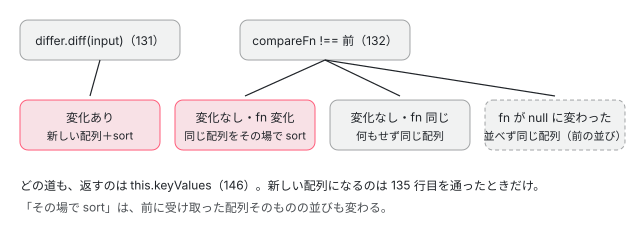

[目次](../README.md) › [common の内側](README.md) › 第 8 回 / 全 20 回

# KeyValuePipe：オブジェクトと Map を並べる

> KeyValuePipe が KeyValueDiffers で入力の変化を確かめ、変わったときだけ配列を作り直して compareFn で並べる行、defaultComparator が数・文字列・それ以外をどう比べるか、compareFn に null を渡したときの並び（途中で null に変えると並びが戻らない点も）、2026 年 8 月の型の修正（46d2cb7ff04）と signal を渡したときの警告（97ed3d9e859）。ページの上で本物の KeyValuePipe に値を渡すデモ。

angular/angular · 読了 約 12 分 · 中核 · [サイトで読む（デモが動きます）](https://angular-deep-dive-cyan.vercel.app/chapter/cmn-keyvalue-pipe)

---

`@for (kv of obj | keyvalue; track kv.key)` は、オブジェクトや `Map` を `{key, value}` の配列にして並べる pipe です。`pure: false` なので変更検知のたびに呼ばれますが、毎回配列を作り直すわけではありません。`KeyValueDiffer` に「前と比べて変わったか」を聞き、変わったときだけ作り直して並べます。この章では transform の 30 行と `defaultComparator` の 29 行を 1 行ずつ読み、「`"10"` が `"2"` より前に来るのはなぜ」「同じ配列が返るのはいつ」に行で答えられるようにします。

読む対象は `packages/common/src/pipes/keyvalue_pipe.ts`（178 行）と spec の `packages/common/test/pipes/keyvalue_pipe_spec.ts` です。

1. [1. 全体像](01-cmn-overview.md)
2. [2. NgClass と NgStyle](02-cmn-ng-class-style.md)
3. [3. NgForOf](03-cmn-ng-for-of.md)
4. [4. NgIf と NgSwitch](04-cmn-ng-if-switch.md)
5. [5. outlet](05-cmn-outlets.md)
6. [6. pipe の仕組み](06-cmn-pipe-mechanism.md)
7. [7. 小さな pipe](07-cmn-simple-pipes.md)
8. **8. KeyValuePipe**（この章）
9. [9. DatePipe](09-cmn-date-pipe.md)
10. [10. 日付の書式](10-cmn-format-date.md)
11. [11. 日付の部品](11-cmn-date-getters.md)
12. [12. 数の書式](12-cmn-format-number.md)
13. [13. NgOptimizedImage](13-cmn-image-overview.md)
14. [14. srcset と sizes](14-cmn-image-srcset.md)
15. [15. 画像のローダー](15-cmn-image-loaders.md)
16. [16. LCP と preload](16-cmn-image-lcp-preload.md)
17. [17. Location](17-cmn-location.md)
18. [18. テスト用の Location](18-cmn-location-testing.md)
19. [19. ViewportScroller](19-cmn-viewport-scroller.md)
20. [20. issue と PR を読む](20-cmn-issues.md)

## 1. 持っている状態は 3 つ

📄 `angular/packages/common/src/pipes/keyvalue_pipe.ts` L19–32 （▶ の行: 19–20, 29–31）

```ts
19 ▶ function makeKeyValuePair<K, V>(key: K, value: V): KeyValue<K, V> {
20 ▶   return {key: key, value: value};
21 │ }
22 │ 
23 │ /**
24 │  * A key value pair.
25 │  * Usually used to represent the key value pairs from a Map or Object.
26 │  *
27 │  * @publicApi
28 │  */
29 ▶ export interface KeyValue<K, V> {
30 ▶   key: K;
31 ▶   value: V;
32 │ }
```

19〜21 行目：返す配列の 1 つ 1 つは、ただの `{key, value}` のオブジェクトです。型 `KeyValue<K, V>`（29〜32 行目）は公開 API で、compareFn の引数の型にも使います。

📄 `angular/packages/common/src/pipes/keyvalue_pipe.ts` L57–73 （▶ の行: 59, 62, 64–67, 70–72）

```ts
57 │ @Pipe({
58 │   name: 'keyvalue',
59 ▶   pure: false,
60 │ })
61 │ export class KeyValuePipe implements PipeTransform {
62 ▶   constructor(private readonly differs: KeyValueDiffers) {}
63 │ 
64 ▶   private differ!: KeyValueDiffer<any, any>;
65 ▶   private keyValues: Array<KeyValue<any, any>> = [];
66 ▶   private compareFn: ((a: KeyValue<any, any>, b: KeyValue<any, any>) => number) | null =
67 ▶     defaultComparator;
68 │ 
69 │   /*
70 ▶    * NOTE: when the `input` value is a simple Record<K, V> object, the keys are extracted with
71 ▶    * Object.keys(). This means that even if the `input` type is Record<number, V> the keys are
72 ▶    * compared/returned as `string`s.
73 │    */
```

- 59 行目：`pure: false`。同じオブジェクトに鍵を足しても追いつくためです。pure なら参照が同じ限り呼ばれません（[第 6 回](06-cmn-pipe-mechanism.md)の 376 行目）。
- 62 行目：コンストラクタで `KeyValueDiffers`（「この値の変化を見張る道具」を選ぶ表）を受け取ります。pipe の DI なので、[第 6 回](06-cmn-pipe-mechanism.md)の `ɵɵpipe` がこの引数を注入します。
- 64〜67 行目：pipe のインスタンスが覚えている 3 つ。見張り役の `differ`、前に返した配列 `keyValues`、前に使った `compareFn`（最初は `defaultComparator`）。
- 70〜72 行目のコメント：普通のオブジェクトの鍵は `Object.keys()` で取るので、`Record<number, V>` でも鍵は**文字列**です。

## 2. transform：変わったときだけ作り直す

📄 `angular/packages/common/src/pipes/keyvalue_pipe.ts` L118–147 （▶ の行: 120, 122, 124–125, 129, 131–132, 134–137, 140–142, 144, 146）

```ts
118 │   transform<K, V>(
119 │     input: undefined | null | {[key: string]: V; [key: number]: V} | ReadonlyMap<K, V>,
120 ▶     compareFn: ((a: KeyValue<K, V>, b: KeyValue<K, V>) => number) | null = defaultComparator,
121 │   ): Array<KeyValue<K, V>> | null {
122 ▶     ngDevMode && warnIfSignal('KeyValuePipe', input);
123 │ 
124 ▶     if (!input || (!(input instanceof Map) && typeof input !== 'object')) {
125 ▶       return null;
126 │     }
127 │ 
128 │     // make a differ for whatever type we've been passed in
129 ▶     this.differ ??= this.differs.find(input).create();
130 │ 
131 ▶     const differChanges: KeyValueChanges<K, V> | null = this.differ.diff(input as any);
132 ▶     const compareFnChanged = compareFn !== this.compareFn;
133 │ 
134 ▶     if (differChanges) {
135 ▶       this.keyValues = [];
136 ▶       differChanges.forEachItem((r: KeyValueChangeRecord<K, V>) => {
137 ▶         this.keyValues.push(makeKeyValuePair(r.key, r.currentValue!));
138 │       });
139 │     }
140 ▶     if (differChanges || compareFnChanged) {
141 ▶       if (compareFn) {
142 ▶         this.keyValues.sort(compareFn);
143 │       }
144 ▶       this.compareFn = compareFn;
145 │     }
146 ▶     return this.keyValues;
147 │   }
```

1. **122 行目：signal なら警告（開発モード）**

   97ed3d9e859（2026-02）で足された `warnIfSignal`（[第 6 回](06-cmn-pipe-mechanism.md)の 7 節）。signal は関数なので、そのままだと次の行で `null` になります。
2. **124〜126 行目：オブジェクトでも Map でもなければ null**

   `!input` で `null`・`undefined`・`0`・`''` を、`typeof input !== 'object'` で数・文字列・関数を、どれも throw せずに `null` にします（ほかの pipe の `invalidPipeArgumentError` とは違う扱い）。配列はオブジェクトなので通ります。
3. **129 行目：最初の 1 回だけ differ を作る**

   `??=`（左が null か undefined のときだけ代入）なので、**最初に渡した値の種類で differ を選び、あとは使い回します**。`differs.find(input)` は、この値を扱える factory を探します。既定の表には `Map` と普通のオブジェクトの両方を扱う `DefaultKeyValueDifferFactory` が 1 つあるだけです。
4. **131 行目：diff で前と比べる**

   変化が無ければ `null`、あれば変化の記録（`KeyValueChanges`）が返ります。`KeyValueDiffer` が入力の鍵を順にたどって、足された・消えた・値が変わった鍵を見つける中身は [第 2 回](02-cmn-ng-class-style.md)（NgClass と NgStyle も同じ differ を使う）で読みます。この章で要るのは「値を `Object.is` で比べ、足す・消す・値が変わる、のどれかがあれば変化」ということと、記録の並びが入力の並び（Map なら入れた順、普通のオブジェクトなら `Object.keys` の順）だということです。
5. **132 行目：compareFn が前と違うか**

   `!==` で関数の参照を比べます。テンプレートに `keyvalue: byValue` と書くと、`byValue` がクラスのフィールドなら毎回同じ参照です。
6. **134〜139 行目：変化があれば、新しい配列を作る**

   135 行目で**新しい配列**を用意し、136〜138 行目で記録の全部（変わっていない鍵も含む）を `forEachItem` の順に詰めます。
7. **140〜145 行目：変化があるか、compareFn が変わったら並べる**

   141 行目：compareFn が `null` でなければ 142 行目で `sort`。`Array.prototype.sort` はその配列を**その場で**並べ替えます。144 行目で今の compareFn を覚えます。compareFn が `null` なら並べず、配列は記録の順（入力の順）のままです。
8. **146 行目：返すのはいつも `this.keyValues`**

   入力に変化が無ければ 135 行目を通らないので、**前の回と同じ配列（`===`）**が返ります。`@for` や、その先の pure な pipe・OnPush の子の入力にとっては「何も変わっていない」です。



*transform の 4 つの道。作り直すのは入力が変わったときだけ、並べ直すのは入力か compareFn が変わったとき*

## 3. defaultComparator：数・文字列・それ以外

📄 `angular/packages/common/src/pipes/keyvalue_pipe.ts` L150–178 （▶ の行: 154–155, 157, 159–160, 162–163, 166–167, 170–171, 174–175, 177）

```ts
150 │ export function defaultComparator<K, V>(
151 │   keyValueA: KeyValue<K, V>,
152 │   keyValueB: KeyValue<K, V>,
153 │ ): number {
154 ▶   const a = keyValueA.key;
155 ▶   const b = keyValueB.key;
156 │   // If both keys are the same, return 0 (no sorting needed).
157 ▶   if (a === b) return 0;
158 │   // If one of the keys is `null` or `undefined`, place it at the end of the sort.
159 ▶   if (a == null) return 1; // `a` comes after `b`.
160 ▶   if (b == null) return -1; // `b` comes after `a`.
161 │   // If both keys are strings, compare them lexicographically.
162 ▶   if (typeof a == 'string' && typeof b == 'string') {
163 ▶     return a < b ? -1 : 1;
164 │   }
165 │   // If both keys are numbers, sort them numerically.
166 ▶   if (typeof a == 'number' && typeof b == 'number') {
167 ▶     return a - b;
168 │   }
169 │   // If both keys are booleans, sort `false` before `true`.
170 ▶   if (typeof a == 'boolean' && typeof b == 'boolean') {
171 ▶     return a < b ? -1 : 1;
172 │   }
173 │   // Fallback case: if keys are of different types, compare their string representations.
174 ▶   const aString = String(a);
175 ▶   const bString = String(b);
176 │   // Compare the string representations lexicographically.
177 ▶   return aString == bString ? 0 : aString < bString ? -1 : 1;
178 │ }
```

1. **154〜155 行目：比べるのは鍵だけ**

   値（value）は見ません。値で並べたいときは自分の compareFn を渡します。
2. **157 行目：`===` で同じなら 0**

   同じ鍵は普通は 1 つしか無いので、ここに来るのは主に spec のような手作りの配列です。
3. **159〜160 行目：`null` と `undefined` は後ろ**

   `== null` なので両方。`Map` の鍵にしか現れません（普通のオブジェクトの鍵は文字列）。
4. **162〜164 行目：両方文字列なら `<` で比べる**

   文字列の `<` は UTF-16 の単位の値の順（辞書順に近いが、ロケールは見ない）。**`"10" < "2"` は true**（1 文字目の `'1'` が `'2'` より小さい）。普通のオブジェクトの鍵は全部文字列なので、`{2: …, 10: …}` は `["10", "2"]` の順になります。
5. **166〜168 行目：両方数なら引き算**

   数の順。`Map` の鍵が数なら `2` が `10` より前です。
6. **170〜172 行目：両方 boolean なら false が先**

   `false < true` は true なので、false が前です。
7. **174〜177 行目：型が違えば `String()` にして比べる**

   数の `1` と文字列の `'2'` は `'1'` と `'2'` の比べ。文字列にして同じなら 0（`2` と `'2'`）。

> [!WARNING]
> **ハマりどころ**
>
> 型の違う鍵が混ざった `Map` では、この比べは「推移的」（a &lt; b かつ b &lt; c なら a &lt; c）になりません。`2 < 10`（数）、`10 < "2"`（文字列で `"10" < "2"`）、`"2"` と `2` は 0。こうした比べ方での `sort` の結果は、要素の並べ方の手順に左右されます。DEMO の Map の例で、自分のブラウザでの並びを見られます。鍵の型は揃えるのが安全です。

## 4. compareFn を渡す・null を渡す

- **省略**：120 行目の既定の引数で `defaultComparator`。
- **自分の関数**：`(a: KeyValue<K, V>, b: KeyValue<K, V>) => number`。142 行目の `sort` にそのまま渡ります。
- **`null`**：141 行目で並べないので、入力の順です。Map なら入れた順、普通のオブジェクトなら `Object.keys` の順（JavaScript の決まりで、整数に見える鍵が小さい順に先、残りは足した順）。2024 年の 13c13067bc3（feat(common): disable keyvalue sorting using null compareFn、PR #57487）で入りました。「既定で並べないでほしい」という issue #42490 への答えで、既定を `null` にする要望 #66132 は 2025-12-17 に NOT\_PLANNED で閉じています。
- **compareFn だけを変える**：132 行目が `true` になり、入力に変化が無くても 142 行目で並べ直します。これは 2021 年の e42aa6c13b9（fix(common): re-sort output of KeyValuePipe when compareFn changes）で、issue #42819（compareFn を変えても並びが変わらない）を直したものです。並べ直すのは 135 行目を通らない**同じ配列**なので、返る配列は前の回と `===` です。

> [!NOTE]
> **さらに深く**
>
> **compareFn を関数から `null` に変えたときは、並びが戻りません。**入力に変化が無ければ 135〜138 行目を通らず、141 行目の `if (compareFn)` も通らないので、`this.keyValues` は前の compareFn で並べたままです（144 行目で `null` を覚えるだけ）。最初から `null` を渡した pipe は入力の順を返すので、同じ入力・同じ compareFn でも、それまでの経緯で答えが変わります。クラスの説明のコメント（「Passing `null` as the compareFn will use natural ordering of the input」）と合わない振る舞いです。main（2026-11-05 に gh で読んだ版）でも同じ行で、spec にはこの切り替えの it がありません。同じく、**鍵の並びだけが変わった**入力も、differ が「変化なし」と答えるので（足す・消す・値が変わる、のどれでもない）、`null` でも前の並びのままです。DEMO の下の表の最後の 2 行で見られます。

## 5. 型の修正 46d2cb7ff04：overload の順番

📄 `angular/packages/common/src/pipes/keyvalue_pipe.ts` L74–94 （▶ の行: 74–75, 78–81, 84, 87–88, 91–93）

```ts
74 ▶   transform<K, V>(
75 ▶     input: ReadonlyMap<K, V>,
76 │     compareFn?: ((a: KeyValue<K, V>, b: KeyValue<K, V>) => number) | null,
77 │   ): Array<KeyValue<K, V>>;
78 ▶   // TypeScript tries overloads top-to-bottom and stops at the first match. A
79 ▶   // plain object with string-literal keys (e.g. `Record<'a' | 'b', V>`) also
80 ▶   // happens to satisfy the more general `K extends number` overload below once
81 ▶   // inference falls back to its constraint — so if that overload is checked
82 │   // first, it wins by accident and silently widens `key` from `'a' | 'b'` to
83 │   // plain `string`. Putting the string overload first means it claims
84 ▶   // string-keyed input before the number overload ever gets a chance, while
85 │   // genuinely numeric-keyed input (which fails `K extends string`) still falls
86 │   // through to the number overload exactly as before.
87 ▶   transform<K extends string, V>(
88 ▶     input: Record<K, V> | ReadonlyMap<K, V>,
89 │     compareFn?: ((a: KeyValue<K, V>, b: KeyValue<K, V>) => number) | null,
90 │   ): Array<KeyValue<K, V>>;
91 ▶   transform<K extends number, V>(
92 ▶     input: Record<K, V>,
93 ▶     compareFn?: ((a: KeyValue<string, V>, b: KeyValue<string, V>) => number) | null,
94 │   ): Array<KeyValue<string, V>>;
```

transform には、実行時の 1 本（2 節）の上に、型だけの overload（同じ名前の関数の型の書き分け）が 8 つ並んでいます。TypeScript は overload を上から試し、最初に当たったものを使います（78 行目のコメント）。2026 年 8 月の 46d2cb7ff04（fix(common): preserve literal key union in KeyValuePipe.transform()、PR #70200）は、**実行時のコードを 1 行も変えず**、`K extends string` の overload（87〜90 行目）を `K extends number`（91〜94 行目）より上に動かしました。

📄 `コミットの本文の例（抜粋）`

```
const input: Record<'a' | 'b', number> = {a: 1, b: 2};
const result = pipe.transform(input);
const key: 'a' | 'b' = result[0].key;
// 修正の前：K extends number の overload が先に当たり、key は string（代入でエラー）
// 修正の後：K extends string の overload が先に当たり、key は 'a' | 'b'
```

修正の前は、`Record<'a' | 'b', number>` が先にある `K extends number` の overload に「推論が制約に落ちて」当たり、鍵が `string` に広がっていました（79〜82 行目のコメント）。同じコミットで spec に it が 2 つ（`should preserve a literal key union instead of widening it to string`・`should still collapse a numerically-keyed object to string keys`）足され、その it のコメントが issue #43883（Incorrect return type on `KeyValuePipe`）を挙げています。このコミットは v22.2.0-next.3 からで、このサイトの 22.1.6 には入っていません（型だけなので、DEMO の動きには関係ありません）。

## 6. DEMO：本物の KeyValuePipe に渡す

> **🧪 DEMO — 既定・null・逆順、と、同じ配列が返るか**
>
> このサイトの本物の `KeyValuePipe`（@angular/common 22.1.6）を、このサイトの本物の `KeyValueDiffers` で `new KeyValuePipe(differs)` して、ボタンを押したときに transform を直接呼びます。上の表は compareFn ごとに新しい pipe で 1 回ずつ、下の表は**1 つの pipe**に順に渡して、返った配列が前の回と同じオブジェクト（`===`）かを見ます。逆順の compareFn だけはこの章で書いたもの（鍵を文字列にして逆に比べる）です。
>
> ▶ [このデモはサイトで動かせます](https://angular-deep-dive-cyan.vercel.app/chapter/cmn-keyvalue-pipe)

- 既定のオブジェクトの例：既定は `["10", "2", "_z", "a", "b"]`（文字列の比べ。`_` は `a` より前）、`null` は `["2", "10", "b", "a", "_z"]`（`Object.keys` の順）。
- Map の例：数の `2` と `10` は数の順、`false` は `true` より前、`null` は最後。`null` の compareFn なら入れた順のまま。
- 下の表：「同じオブジェクトをもう一度」も「中身が同じ新しいオブジェクト」も `true`（131 行目が `null`）。鍵を足すと `false`（135 行目）。compareFn を逆順に変えると並びは変わるが `true`（同じ配列をその場で sort）。`null` に変えると `true` で、並びは逆順のまま（4 節の注意）。

## 7. ここまでを 1 本に

- 👤 `@for (kv of obj | keyvalue; track kv.key)` — あなたのテンプレート
- `ɵɵpipeBind1(…, obj)` — 第 6 回 — *pure: false なので毎回 transform*
  - `KeyValuePipe.transform(obj, defaultComparator)` — keyvalue\_pipe.ts L118-121
    - `!input || typeof input !== 'object'` → `null` — L124-126
    - `this.differ ??= differs.find(obj).create()` — L129 — *最初の 1 回だけ*
    - `this.differ.diff(obj)` — L131 — *中身は第 2 回*
    - `changes.forEachItem(r => keyValues.push({key: r.key, value: r.currentValue}))` — L134-139 — *変化があったときだけ、新しい配列*
    - `keyValues.sort(defaultComparator)` — L140-145 — *変化か compareFn の変化があったとき*
      - `defaultComparator(a, b)` — L150-178 — *null は後ろ・文字列は &lt;・数は引き算・boolean は false が先・ほかは String()*
    - `return this.keyValues` — L146

## テストと直し方

### spec と describe

| spec | describe / it | bazel のターゲット |
| --- | --- | --- |
| common/test/pipes/keyvalue\_pipe\_spec.ts | describe `KeyValuePipe`（15 行目）の中の describe `object dictionary`（29）・`Map`（189）、そして describe `defaultComparator`（322）。`should not order by alpha when compareFn is null`（64・258）・`should reorder when compareFn changes`（71・273）・`should return the same ref if nothing changes`（80・285）・ `should preserve a literal key union instead of widening it to string`（103）・`should sort numbers as strings in numerical ascending`（385） | `//packages/common/test:test`（Node。`isBrowser` で止める行は無い） |

📄 `angular/packages/common/test/pipes/keyvalue_pipe_spec.ts` L45–79 （▶ の行: 47–49, 54, 56, 60, 66–68, 74–77）

```ts
45 │     it('should order by numerical', () => {
46 │       const pipe = new KeyValuePipe(defaultKeyValueDiffers);
47 ▶       expect(pipe.transform({2: 1, 1: 1})).toEqual([
48 ▶         {key: '1', value: 1},
49 ▶         {key: '2', value: 1},
50 │       ]);
51 │     });
52 │     it('should order by numerical and alpha', () => {
53 │       const pipe = new KeyValuePipe(defaultKeyValueDiffers);
54 ▶       const input = {2: 1, 1: 1, 'b': 1, 0: 1, 3: 1, 'a': 1};
55 │       expect(pipe.transform(input)).toEqual([
56 ▶         {key: '0', value: 1},
57 │         {key: '1', value: 1},
58 │         {key: '2', value: 1},
59 │         {key: '3', value: 1},
60 ▶         {key: 'a', value: 1},
61 │         {key: 'b', value: 1},
62 │       ]);
63 │     });
64 │     it('should not order by alpha when compareFn is null', () => {
65 │       const pipe = new KeyValuePipe(defaultKeyValueDiffers);
66 ▶       expect(pipe.transform({'b': 1, 'a': 1}, null)).toEqual([
67 ▶         {key: 'b', value: 1},
68 ▶         {key: 'a', value: 1},
69 │       ]);
70 │     });
71 │     it('should reorder when compareFn changes', () => {
72 │       const pipe = new KeyValuePipe(defaultKeyValueDiffers);
73 │       const input = {'b': 1, 'a': 2};
74 ▶       pipe.transform<string, number>(input);
75 ▶       expect(pipe.transform<string, number>(input, (a, b) => a.value - b.value)).toEqual([
76 ▶         {key: 'b', value: 1},
77 ▶         {key: 'a', value: 2},
78 │       ]);
79 │     });
```

- 47〜50 行目：`{2: 1, 1: 1}` の鍵は文字列の `'1'`・`'2'`。1 桁なので文字列の比べでも数の順と同じになります（it の名前は numerical ですが、通っているのは 162〜163 行目）。
- 54〜62 行目：数に見える鍵が文字の鍵より前。`'0'`〜`'3'` は `'a'` より小さい文字だからです。
- 66〜69 行目：`null` なら入力の順（`b`、`a`）。**最初から**`null` を渡した場合だけを確かめています。
- 74〜78 行目：1 回目は既定、2 回目に同じ input で compareFn を値の順に変えると並び直す（132・142 行目、e42aa6c13b9 の it）。

📄 `angular/packages/common/test/pipes/keyvalue_pipe_spec.ts` L80–91 （▶ の行: 82–84, 88–90）

```ts
80 │     it('should return the same ref if nothing changes', () => {
81 │       const pipe = new KeyValuePipe(defaultKeyValueDiffers);
82 ▶       const transform1 = pipe.transform({1: 2});
83 ▶       const transform2 = pipe.transform({1: 2});
84 ▶       expect(transform1 === transform2).toEqual(true);
85 │     });
86 │     it('should return a new ref if something changes', () => {
87 │       const pipe = new KeyValuePipe(defaultKeyValueDiffers);
88 ▶       const transform1 = pipe.transform({1: 2});
89 ▶       const transform2 = pipe.transform({1: 3});
90 ▶       expect(transform1 !== transform2).toEqual(true);
91 │     });
```

82〜83 行目は**別々のオブジェクト**ですが中身が同じなので、131 行目が `null` を返し、84 行目で同じ配列です。89 行目は値が変わったので 135 行目で新しい配列になります。

📄 `angular/packages/common/test/pipes/keyvalue_pipe_spec.ts` L385–397 （▶ の行: 390–391, 394–395）

```ts
385 │   it('should sort numbers as strings in numerical ascending', () => {
386 │     // We need to cast the values array to "any[]" because the object keys
387 │     // have no type overlap and the "Array.sort" expects all keys to have the
388 │     // same type when passed to the sort comparator.
389 │     const values = [
390 ▶       {key: '2', value: 1},
391 ▶       {key: 1, value: 3},
392 │     ] as any[];
393 │     expect(values.sort(defaultComparator)).toEqual([
394 ▶       {key: 1, value: 3},
395 ▶       {key: '2', value: 1},
396 │     ]);
397 │   });
```

文字列の `'2'` と数の `1`：型が違うので 174〜177 行目で `'1'` と `'2'` を比べ、数の 1 が先です。

### 手元で走らせた結果

📄 `ターミナル（../angular で）`

```
cd ~/angular-research/angular
pnpm bazel test //packages/common/test:test \
  --nocache_test_results --test_output=all \
  '--test_arg=--filter=KeyValuePipe|defaultComparator'
```

📄 `出力（2026-11-05 に実行。抜粋。ログは scratchpad/cmn-logs/b-keyvalue.log）`

```
Ran 38 of 667 specs
38 specs, 0 failures
Finished in 0.039 seconds
//packages/common/test:test                                              PASSED in 0.8s
INFO: Elapsed time: 7.466s
```

- 38 件 = describe `KeyValuePipe` の 31 件 + describe `defaultComparator` の 7 件。

### 直すとしたら

- 作り直しと並べ替えは `transform` の 131〜146 行目、並べ方は `defaultComparator`（150〜178 行目）です。it は spec の 64〜79 行目の形（`new KeyValuePipe(defaultKeyValueDiffers)` に 2 回渡して `toEqual`）で足せます。
- 4 節の「関数 → `null` で並びが戻らない」を spec の形で書くと、次のようになります。2026-11-05 に、このサイトの node\_modules の 22.1.6 の本物の `KeyValuePipe` と `ɵdefaultKeyValueDiffers` を node で動かし、2 回目が `[a, b]` のまま（つまりこの it は今は落ちる）ことを確かめました。gh で `keyvalue` を含む issue と PR を検索した範囲（2026-11-05）では、同じ報告は見つかりませんでした。

📄 `keyvalue_pipe_spec.ts の形で書いた確かめ（手元で書いたもの。本家には無い）`

```
it('should use natural ordering after compareFn changes to null', () => {
  const pipe = new KeyValuePipe(defaultKeyValueDiffers);
  const input = {'b': 1, 'a': 1};
  pipe.transform(input);                       // [a, b]（既定で並べる）
  expect(pipe.transform(input, null)).toEqual([ // 今は [a, b] のまま
    {key: 'b', value: 1},
    {key: 'a', value: 1},
  ]);
});
```

- 最近の修正：46d2cb7ff04（2026-08、型の overload の順）、97ed3d9e859（2026-02、signal の警告）、9eac43cf469（2025-10、省略できる鍵を持つオブジェクトを受け付ける型）、edb8407d4f1（2025-01、null と undefined の判定を短く）。
- 本家に PR を出すことは勧めません。上の振る舞いも、issue を読むときの手がかりにとどめます。KeyValuePipe の issue は「differ の判定（131 行目）」「compareFn の判定（132・141 行目）」「型（overload）」のどれかに分けると、読む行が決まります（[第 20 回](20-cmn-issues.md)）。

## 聞かれそうな質問

**Q. keyvalue に {2: 'b', 10: 'a'} を渡すと "10" が先に来ます。なぜ？**

普通のオブジェクトの鍵は `Object.keys` で取るので文字列で（70〜72 行目のコメント）、162〜163 行目は文字列を `<` で比べるからです。`"10" < "2"` は true です。数の順にしたいなら、数の鍵の `Map` にするか、`(a, b) => +a.key - +b.key` のような compareFn を渡します。

**Q. keyvalue は pure: false なのに、毎回新しい配列を作りませんか？**

作りません。131 行目の differ が「変化なし」と答えれば 135 行目を通らず、146 行目で前と同じ配列を返します。新しい配列になるのは、鍵が足された・消えた・値が変わったときだけです（spec 80〜91 行目）。

**Q. 入力の順のまま並べたいときは？**

`keyvalue: null` と書きます。141 行目で並べ替えを飛ばします。ただし、別の compareFn から途中で `null` に切り替えると、入力に変化が無い限り前の並びのままです（4 節の注意）。

**Q. 値（value）で並べられますか？**

defaultComparator は鍵しか見ません（154〜155 行目）。`(a, b) => a.value - b.value` のような compareFn を、クラスのフィールドとして 1 度作って渡します。テンプレートの中で毎回新しい関数を作ると、132 行目が毎回 `true` になり、変更検知のたびに並べ直します。

**Q. Map とオブジェクトで何が違いますか？**

鍵の型です。Map の鍵は数・boolean・`null` などそのままの型で、166〜172 行目の数・boolean の比べや、159〜160 行目の「null は後ろ」が効きます。オブジェクトの鍵は全部文字列なので、162〜163 行目だけです。`null` の compareFn の順も、Map は入れた順、オブジェクトは `Object.keys` の順です。

**Q. signal を渡すとどうなりますか？**

開発モードでは 122 行目が `console.warn` を出します。signal は関数なので 124 行目の `typeof input !== 'object'` に当たり、`null` が返って何も描かれません。`obj() | keyvalue` と呼んでから渡します。

## 読み終えて

- KeyValuePipe は differ・前の配列・前の compareFn の 3 つを覚え、入力が変わったときだけ新しい配列を作る（131〜139 行目）。
- 並べるのは入力か compareFn が変わったとき（140〜145 行目）。`sort` はその場で並べ替える。
- defaultComparator は鍵だけを、null は後ろ・文字列は `<`・数は引き算・boolean は false が先・ほかは `String()` で比べる。オブジェクトの鍵は文字列なので `"10"` が `"2"` より先。
- `null` の compareFn は入力の順。ただし途中で `null` に変えても並びは戻らない。
- 46d2cb7ff04 は overload の順を入れ替えただけの型の修正で、実行時の振る舞いは変わらない。

---

← 前: [小さな pipe たち：JsonPipe・SlicePipe・大文字小文字・I18nSelectPipe](07-cmn-simple-pipes.md)  
次: [DatePipe：transform から formatDate まで](09-cmn-date-pipe.md) →
